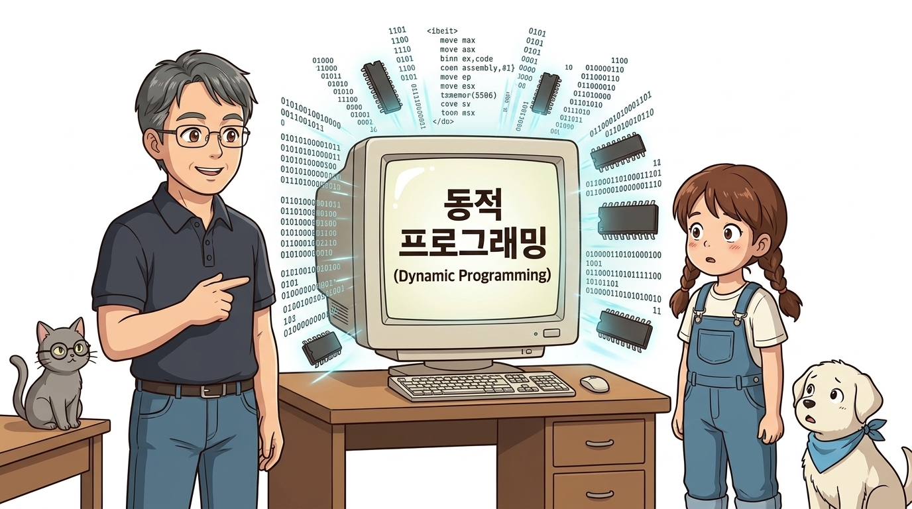
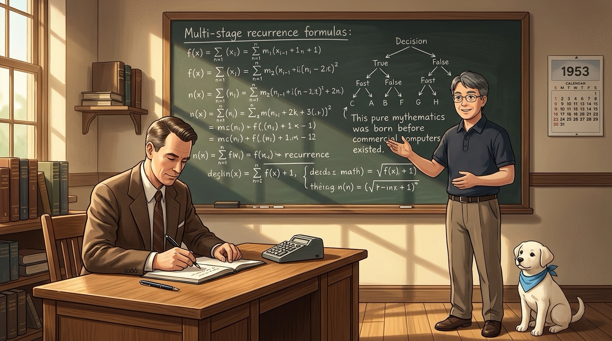
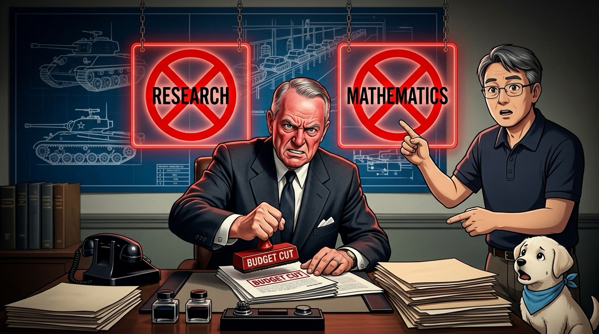
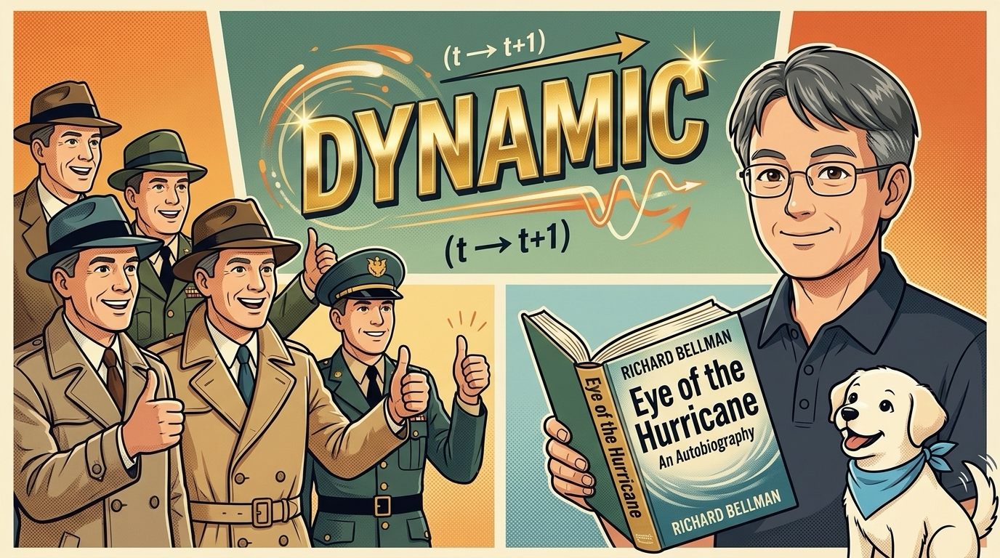
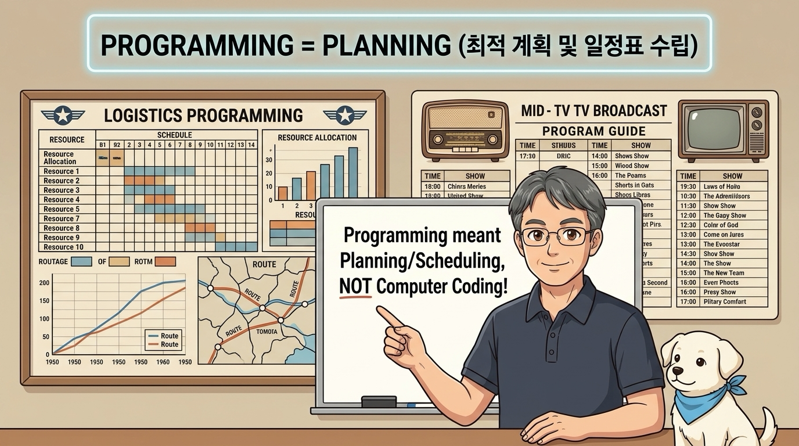

# 07.1 동적 프로그래밍의 유래
## 07.1.0.0 동적 프로그래밍, 이름이 주는 위압감

*동적 프로그래밍(Dynamic Programming)이라는 거창한 이름이 주는 첫인상과 기술적 위압감*

### 📌 핵심 개념
- **컴퓨터 과학과 강화학습의 주춧돌**: 최적화와 가치 함수 계산을 지탱하는 핵심 알고리즘
- **기술적 위압감**: '동적(Dynamic)'과 '프로그래밍(Programming)'의 조합이 풍기는 난해한 인상
- **초심자의 선입견**: 저수준 시스템 코딩이나 메모리 극한 최적화 기법이라는 막연한 두려움

### 🎙️ 강의 내레이션 (30초)
> "강화학습과 컴퓨터 과학의 거대한 주춧돌인 동적 프로그래밍이라는 이름을 처음 들으면 대다수는 기술적 위압감을 느낍니다. 컴퓨터 메모리를 쪼개고 코드를 한 줄씩 극한으로 최적화하는 저수준 시스템 코딩 기술을 먼저 연상하기 때문입니다. 과연 이 거창한 이름의 정체는 무엇일까요?"

---

# Slide 02: 딱딱한 이론 뒤에 숨은 유쾌한 생존 비화

*1950년대 수학자 리처드 벨만(Richard Bellman)과 연구비를 지키기 위한 기상천외한 마케팅 비화*

### 📌 핵심 개념
- **1950년대 미국 랜드 연구소(RAND)**: 국방부 지원을 받던 군사 전략 및 수학 싱크탱크
- **수학자 리처드 벨만**: 다단계 최적화 연구비를 지켜내기 위한 절체절명의 과제 직면
- **이론 뒤의 생생한 역사**: 딱딱한 수학 이론 이면에 펼쳐진 유쾌하고 기발한 생존 스토리

### 🎙️ 강의 내레이션 (30초)
> "놀랍게도 거창한 이름 뒤에는 1950년대 수학자 리처드 벨만이 국방부 장관의 예산 삭감 칼바람에서 자신의 수학 연구비를 지키기 위해 펼친 기상천외한 생존 비화가 숨어 있습니다. 이번 시간에는 딱딱한 이론 뒤에 숨은 유쾌한 역사적 유래를 흥미진진하게 파헤쳐 봅니다."

---

# Slide 03: 흔한 오해 1: 하드웨어 분해와 기계 수리?

*동적 프로그래밍은 컴퓨터 하드웨어를 분해하고 회로를 납땜하는 공학 실습이 아닙니다.*

### 📌 핵심 개념
- **물리적 엔지니어링 오해**: 컴퓨터 본체를 뜯고 기판을 납땜하는 실습과의 혼동
- **기계 장치 조작 아님**: 기계 부품 연결이나 전자기기 수리와는 완전히 무관
- **수학적 최적화**: 복잡한 문제를 작은 부분 문제로 나누어 해결하는 순수 추상 알고리즘

### 🎙️ 강의 내레이션 (30초)
> "사람들이 동적 프로그래밍을 들었을 때 가장 흔히 빠지는 함정은 컴퓨터 본체를 뜯어 하드웨어 회로를 납땜하고 수리하는 복잡한 엔지니어링 기술로 오해하는 것입니다. 기계 부품을 직접 조립하고 전선을 연결하는 공학 실습의 이미지를 먼저 떠올리기 쉽기 때문입니다."

---

# Slide 04: 흔한 오해 2: C언어 동적 메모리 할당(malloc)?

*C/C++의 malloc, 포인터 연산 등 저수준 시스템 프로그래밍 기법과의 차이점*

### 📌 핵심 개념
- **C/C++ 힙 메모리 관리 아님**: malloc, free, 포인터 연산 등과 무관
- **용어의 다의성**: 프로그래밍 언어의 '동적 할당(Dynamic Allocation)'과 의미가 다름
- **알고리즘적 접근**: 메모리 주소를 조작하는 코딩 기술이 아니라 최적화 수학 모델

### 🎙️ 강의 내레이션 (30초)
> "또한 많은 개발자들은 C언어나 C++에서 포인터로 RAM 메모리를 동적으로 할당하고 힙 영역을 극한으로 최적화하는 저수준 시스템 프로그래밍 기법으로 착각하곤 합니다. 하지만 동적 프로그래밍은 이러한 컴퓨터 메모리 관리나 소스 코드 튜닝과는 완전히 거리가 먼 수학 이론입니다."

---

# Slide 05: 시대적 모순: 컴퓨터 보급 전 탄생한 수학

*1950년대 초 상용 컴퓨터가 널리 보급되기도 전에 탄생한 순수 수학적 최적화 이론*

### 📌 핵심 개념
- **1950년대 초의 시대상**: 상용 전자식 컴퓨터가 대중화되기 이전 시대
- **순수 수학 이론**: 펜과 종이로 다단계 의사결정 프로세스의 점화식을 유도
- **핵심 의문**: 컴퓨터 코딩도 없던 시대에 벨만은 왜 '프로그래밍'이란 단어를 썼을까?

### 🎙️ 강의 내레이션 (30초)
> "역사적 사실을 들여다보면 벨만이 이 이론을 완성한 1950년대 초는 현대적 전자식 컴퓨터가 보급되기도 전이었습니다. 벨만이 창안한 동적 프로그래밍은 컴퓨터 코딩이 아니라 순수 수학적 다단계 의사결정 최적화 이론이었습니다. 그렇다면 벨만은 왜 프로그래밍이란 단어를 썼을까요?"

---

# Slide 06: 1950년대 랜드 연구소와 찰스 윌슨 장관

*미국 군사 싱크탱크 랜드 연구소(RAND)와 제너럴 모터스 CEO 출신 찰스 윌슨 국방부 장관*

### 📌 핵심 개념
- **랜드 연구소(RAND Corporation)**: 국방부 프로젝트를 수행하던 정상급 연구기관
- **신임 국방부 장관 부임**: 제너럴 모터스(GM) 최고경영자 출신 찰스 어윈 윌슨
- **기업가형 관료**: 실용적이고 즉각적인 상업/군사적 성과를 최우선으로 요구

### 🎙️ 강의 내레이션 (30초)
> "1950년대 초 리처드 벨만은 미국의 군사 싱크탱크인 랜드 연구소에서 국방부의 지원을 받아 다양한 군사 전략과 기초 과학을 연구하고 있었습니다. 그런데 당시 국방부 장관으로 부임한 인물이 바로 제너럴 모터스의 최고경영자 출신인 찰스 어윈 윌슨이었습니다."

---

# Slide 07: 윌슨 장관의 2대 금기어: '연구'와 '수학'

*장관의 서슬 퍼런 예산 가위: 즉각적 제품이 나오지 않는 '연구'와 '수학' 단어 전액 삭감*

### 📌 핵심 개념
- **극단적 실용주의**: 당장 전선에 투입될 군용 탱크나 무기로 생산되지 않는 연구 증오
- **금기 단어 1: 연구(Research)**: "세금으로 한가하게 풀밭 연구나 한다"며 배척
- **금기 단어 2: 수학(Mathematics)**: 탁상공론의 비현실적 학문이라 단정하여 전액 삭감

### 🎙️ 강의 내레이션 (30초)
> "비즈니스 실용주의자였던 윌슨 장관은 당장 눈앞에서 군용 탱크로 생산되지 않는 기초 학문 연구에 세금이 쓰이는 것을 극도로 혐오했습니다. 특히 연구 계획서에 당장 쓸모없는 연구나 비현실적 수학이라는 단어가 보이면 히스테리에 가까운 반응을 보이며 예산을 전액 삭감했습니다."

---

# Slide 08: 벨만의 절체절명 생존 딜레마

*수학 연구비를 보존하면서도 장관의 파쇄기를 피할 기상천외한 작명이 필요했던 벨만*

### 📌 핵심 개념
- **연구 책임자의 위기**: 자신이 창안한 다단계 결정 이론을 국방부에 보고해야 함
- **파쇄기 직행 위기**: 제목에 '수학적 연구'라는 단어를 쓰는 순간 연구비 삭감 확정
- **정치적 위장 전략**: 학문의 본질은 지키되 관료들이 반대할 수 없는 매력적 제목 필요

### 🎙️ 강의 내레이션 (30초)
> "벨만은 자신이 개발한 다단계 최적화 수학 이론을 국방부에 보고해야 하는 연구 책임자였습니다. 하지만 제목에 수학 연구라는 솔직한 단어를 적는 순간 제안서는 파쇄기로 직행할 운명이었습니다. 학문의 깊이는 지키되 관료들이 반대할 수 없는 환상적인 단어로 위장해야 했습니다."

---

# Slide 09: 첫 번째 단어 'Dynamic'의 정치학

*시간에 따른 변화를 뜻하며 관료와 정치가들이 결코 반대할 수 없었던 단어 'Dynamic'*

### 📌 핵심 개념
- **물리적/수학적 의미**: 시간에 따라 상태가 변화하는 시스템을 다루므로 적합
- **정치적 뉘앙스**: 역동적이고 진취적인 느낌을 주어 누구도 거부할 수 없는 단어
- **벨만의 회고**: "그 어떤 정치가나 관료도 활기찬 동적이란 수식어에 시비를 걸 수 없었다"

### 🎙️ 강의 내레이션 (30초)
> "첫 번째 단어는 동적, 즉 Dynamic이었습니다. 시간에 따라 변화하는 시스템을 다루었기에 물리적으로도 어울렸지만 진짜 이유는 정치적 뉘앙스였습니다. 벨만은 자서전에서 그 어떤 정치가나 관료도 활기찬 동적이란 말에 결코 반대할 수 없었기 때문이라고 유쾌하게 밝혔습니다."

---

# Slide 10: 두 번째 단어 'Programming'의 본래 의미

*1950년대 프로그래밍은 코딩이 아니라 군사 작전이나 물류의 '최적 일정표 작성(Planning)'을 의미*

### 📌 핵심 개념
- **1950년대 용어의 본뜻**: 컴퓨터 코드가 아닌 최적의 작전 계획 및 일정 수립(Planning)
- **군사 및 물류 응용**: 한정된 자원을 배분하고 최선의 스케줄을 짜는 행위
- **어원적 맥락**: 방송 편성표를 '프로그램'이라 부르듯, 계획표를 작성한다는 의미

### 🎙️ 강의 내레이션 (30초)
> "두 번째 단어 프로그래밍은 당시 컴퓨터 코딩을 뜻하는 말이 아니었습니다. 군사 작전이나 물류 보급에서 자원을 효율적으로 분배하고 최적의 작전 일정표나 계획을 수립하는 행위를 프로그래밍이라 불렀습니다. 방송 편성표를 프로그램이라 부르는 것과 똑같은 어원입니다."

---

# Slide 11: 두 단어의 마법 같은 융합 방패

*물리적 변화(Dynamic)와 실용적 계획 수립(Programming)의 완벽한 언어적 방패막이*

### 📌 핵심 개념
- **기막힌 합성어 탄생**: Dynamic(시간에 따른 변화) + Programming(최적 계획 수립)
- **관료들의 착각 유도**: 국방 활동 일정을 낭비 없이 수립하는 최첨단 실무 기획 시스템
- **순수 수학의 보호**: 복잡한 점화식과 최적화 이론을 관료들의 의심 없이 통과시킴

### 🎙️ 강의 내레이션 (30초)
> "벨만은 시간에 따라 변화한다는 물리적 현실의 Dynamic과 최적의 작전 계획표를 수립한다는 실용적 Programming을 절묘하게 결합했습니다. 복잡한 수학 공식이 관료들의 눈에는 국방 활동의 일정을 낭비 없이 완벽하게 짜주는 최첨단 기획 도구로 완벽하게 둔갑한 것입니다."

---

# Slide 12: 장관의 예산 가위를 막아낸 방패와 전액 승인

*서슬 퍼런 국방부 장관의 가위를 튕겨내고 100% 연구비 전액 승인을 쟁취한 벨만*

### 📌 핵심 개념
- **완벽한 방어 성공**: 윌슨 장관의 날카로운 예산 삭감 가위를 통쾌하게 방어
- **100% 전액 승인**: 실무적 가치가 높은 국방 계획 도구로 인정받아 연구비 확보
- **마케팅의 승리**: 학자의 지적 유희가 아닌 실무 기획으로 포장하여 연구를 지속

### 🎙️ 강의 내레이션 (30초)
> "벨만이 고안한 동적 프로그래밍이란 마법 같은 합성어는 장관의 서슬 퍼런 예산 삭감 가위를 완벽하게 튕겨냈습니다. 관료들은 이것이 국방 예산을 아끼는 실무 기획 시스템이라 믿고 예산 전액을 승인했습니다. 기발한 언어적 방패막이 덕분에 소중한 수학 연구가 마침내 꽃피게 되었습니다."

---

# Slide 13: 위기 극복의 결실: 최적성 원리와 현대 AI

*예산 방패 덕분에 완성된 벨만의 최적성 원리와 벨만 방정식, 현대 AI의 핵심 기반이 되다*

### 📌 핵심 개념
- **벨만의 최적성 원리**: 전체 최적 경로는 임의의 중간 지점부터 끝까지도 최적 경로여야 함
- **벨만 방정식의 탄생**: 현재 상태의 가치를 다음 상태들의 가치로 재귀적 분해
- **현대 인공지능의 뼈대**: 강화학습, 로봇 제어, 알파고, 자율주행의 핵심 수학적 기반

### 🎙️ 강의 내레이션 (30초)
> "예산 삭감의 칼바람을 피해 연구를 지속한 벨만은 다단계 의사결정의 핵심인 벨만의 최적성 원리와 벨만 방정식을 성공적으로 완성했습니다. 관료들의 가위질을 피하기 위해 만든 기발한 방패막이 표어가 훗날 현대 인공지능과 강화학습을 지탱하는 가장 거대한 주춧돌이 된 것입니다."

---

# Slide 14: 핵심 정리: 동적 프로그래밍 유래의 3대 교훈

*프로그래밍은 계획 수립, 연구비 생존 마케팅, 벨만 방정식의 수치 계산 알고리즘*

### 📌 핵심 개념
- **1. 프로그래밍 != 코딩**: 다단계 의사결정의 최적 계획(Planning) 수립
- **2. 연구비 생존 마케팅**: 관료들의 예산 삭감을 피하기 위한 벨만의 뛰어난 언어적 방패
- **3. 가치 반복 알고리즘**: 벨만 방정식을 컴퓨터 코드로 반복 갱신하여 가치를 계산

### 🎙️ 강의 내레이션 (30초)
> "오늘 학습한 핵심 교훈을 정리합니다. 첫째, 프로그래밍은 코딩이 아닌 최적 계획 수립을 뜻합니다. 둘째, 연구비를 지키기 위해 벨만이 펼친 최고의 마케팅 전략이었습니다. 셋째, 동적 프로그래밍은 벨만 방정식을 반복 갱신하여 최적 가치를 계산하는 핵심 알고리즘입니다."

---

# Slide 15: 랩노트 피날레: 다음 실습으로의 힘찬 출발

*역사적 비밀을 넘어 다음 시간 2칸 격자 세계와 부트스트랩 첫 실습으로 나아갑니다.*

### 📌 핵심 개념
- **유래의 이해 완료**: 기술적 위압감 극복 및 수학적 본질 정립
- **07.2절 실습 예고**: 2칸짜리 초소형 방에서 손계산과 파이썬 코드로 정책 평가 수행
- **부트스트랩(Bootstrap) 원리**: 추정치로 다음 추정치를 스스로 다듬어가는 강력한 여정 시작

### 🎙️ 강의 내레이션 (30초)
> "이름에 얽힌 흥미진진한 비밀을 풀었으니 이제 본격적인 강화학습 알고리즘 모험을 떠날 준비가 끝났습니다. 다음 시간에는 2칸짜리 초소형 방에서 손계산과 파이썬 코드를 통해 가치 함수를 스스로 다듬어가는 부트스트랩의 놀라운 첫 실습으로 힘차게 나아갑니다."
