# 07.3 더 큰 문제를 향해
## 07.3.0 도입: 2칸 방을 떠나 3x4 격자 숲속으로!

- **모험의 확장**: 기존의 좁디좁은 2칸짜리 방을 벗어나 3x4 격자의 더 넓은 그리드 월드 숲속으로 영역을 확장합니다.
- **반복적 정책 평가 알고리즘**: 상태와 행동 패턴의 수가 많아져도 수학적 가치 함수를 안정적으로 풀어내는 강력한 무기를 장착합니다.
- 💡 **핵심 목표**: 더 복잡하고 현실적인 문제 환경을 파이썬 객체로 모델링하고, 동적 프로그래밍을 통해 각 위치의 진정한 가치를 평가합니다.


> 도로시와 토토가 조교 지니가 건네준 큰 지도와 함께, 드디어 좁은 2칸짜리 방을 떠나 더 넓은 3x4 격자 세상으로 첫 발을 내딛습니다. 우리가 앞 단원에서 배운 '반복적 정책 평가 알고리즘'은 상태와 행동의 경우의 수가 많아지더라도 컴퓨터를 통해 매우 빠르고 정확하게 풀어낼 수 있는 강력한 도구입니다. 이제 가벼운 발걸음으로 더 복잡하고 흥미진진한 강화학습 가상 세계를 향해 출발해 보겠습니다.

---

# 07.3 더 큰 문제를 향해
## 07.3.1 좀더 큰 과제: 왜 더 큰 문제인가?

- **학습 스케일업**: 이전에는 2칸짜리 초소형 그리드 월드로 가치 갱신 원리를 직관적으로 이해했습니다.
- **다차원 상태와 행동**: 칸 수가 늘어나고 장애물과 다양한 보상이 공존할 때 알고리즘이 어떻게 작동하는지 실전 검증합니다.
- 💡 **핵심 인사이트**: 복잡한 환경에서도 기본 원리는 동일하며, 프로그래밍적 체계화가 왜 필요한지 체감하게 됩니다.


> 이전에는 원리를 직관적으로 파악하기 위해 아주 단순한 2칸짜리 그리드 월드를 다뤘습니다. 하지만 실제 인공지능이 풀어야 할 현실 세계는 이보다 훨씬 넓고 복잡합니다. 이번 절에서는 상태의 수가 12개로 늘어나고, 상하좌우 4가지 행동과 장애물, 보상과 페널티가 복합적으로 얽힌 3x4 그리드 월드를 통해 반복적 정책 평가 알고리즘의 진정한 위력을 확인해 보겠습니다.

---

# 07.3 더 큰 문제를 향해
## 07.3.1.1 3 × 4 그리드 월드: 지도와 지형 구조

- **격자 규격**: 가로 4칸 × 세로 3칸 = 총 12칸의 2차원 공간.
- **지형 요소**:
  - **시작 지점**: 왼쪽 맨 아래 칸
  - **벽(장애물)**: 가운데 위치한 회색 칸 (진입 불가)
  - **사과(목표)**: 오른쪽 맨 위 칸 (+1.0 보상)
  - **폭탄(함정)**: 사과 바로 아래 칸 (-1.0 페널티)
- 💡 **특징**: 2칸 그리드보다 경로가 다양해졌지만, 여전히 사람의 눈으로 직관적 검증이 가능한 최적의 표준 벤치마크 환경입니다.

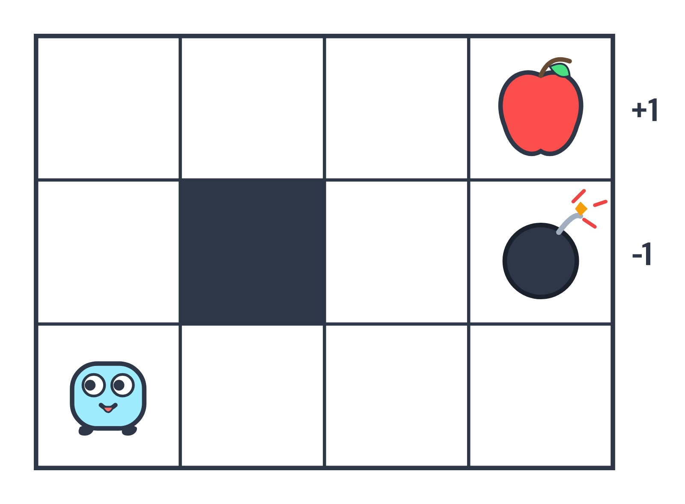

> 화면에 보이는 지도가 바로 이번에 우리가 탐험할 3x4 그리드 월드입니다. 가로 4칸, 세로 3칸으로 이루어져 있으며, 왼쪽 맨 아래 칸에서 출발합니다. 가운데에는 회색으로 표시된 벽이 있어 통과할 수 없고, 오른쪽 맨 위에는 달콤한 사과가, 그 바로 아래에는 위험한 폭탄이 놓여 있습니다. 이 구조는 강화학습 교과서에서 가장 널리 쓰이는 표준 문제 중 하나입니다.

---

# 07.3 더 큰 문제를 향해
## 07.3.1.2 3 × 4 그리드 월드의 문제 설정과 규칙

- **행동 공간**: 에이전트는 **상(UP) / 하(DOWN) / 좌(LEFT) / 우(RIGHT)** 네 방향으로 이동할 수 있습니다.
- **벽과 외곽 경계**: 회색 벽 안으로는 들어갈 수 없으며, 그리드 바깥 테두리도 벽으로 막혀 있습니다.
- **충돌 패널티**: 벽이나 테두리에 부딪히면 제자리에 머물며 **보상은 0**입니다.
- **보상 구조**: **사과는 보상 +1**, **폭탄은 보상 -1**, 그 외 일반 이동의 보상은 0입니다.
- **결정적 전이**: 환경의 상태 전이는 고유합니다(Deterministic). 오른쪽 행동을 취하면 (벽이 없다면) 100% 확실하게 오른쪽으로 이동합니다.
- **일회성 과제 (Episodic Task)**: 사과나 폭탄을 만나면 그 즉시 모험이 **종료**됩니다.

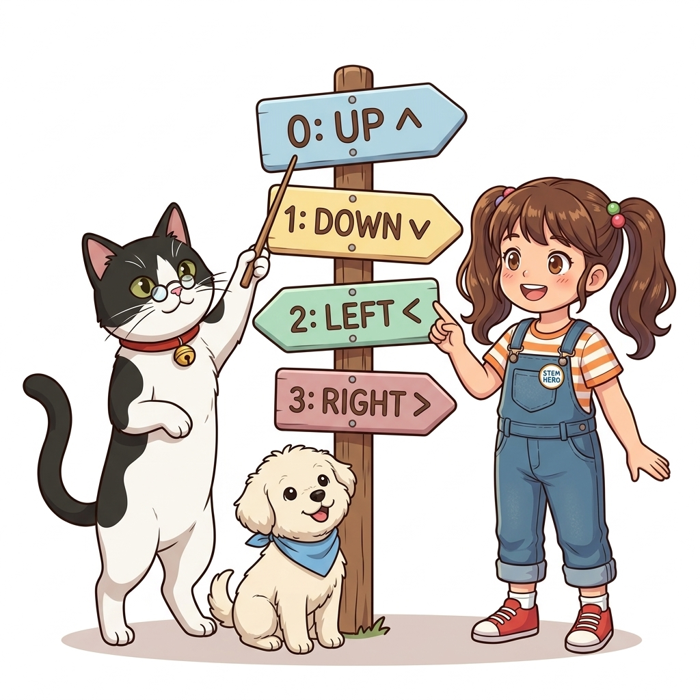

> 3x4 그리드 월드의 룰은 매우 명확합니다. 에이전트는 상하좌우 네 방향으로 움직일 수 있고, 벽이나 외곽 낭떠러지에 부딪히면 이동하지 못하고 제자리에 머뭅니다. 중요한 점은 상태 전이가 '결정적'이라는 사실입니다. 미끄러짐 없이 선택한 방향으로 정직하게 이동합니다. 또한 목표 지점인 사과나 폭탄 칸에 도달하면 모든 모험이 끝나는 '일회성 과제'로 설정되어 있습니다.

---

# 07.3 더 큰 문제를 향해
## 07.3.2 GridWorld 클래스 구현: 초기화 코드 (step1)

- **공용 모듈 설계**: 그리드 월드는 앞으로도 반복해서 사용할 핵심 환경이므로 `common/gridworld.py` 파일에 구현합니다.
- **단계별 접근**: 복잡한 환경 클래스를 한 번에 작성하지 않고, `__init__` 초기화 단계부터 차근차근 조립합니다.

```python
import numpy as np

class GridWorld:
    def __init__(self):
        self.action_space = [0, 1, 2, 3] # 행동 공간(가능한 행동들)
        self.action_meaning = { # 행동의 의미
            0: 'UP',
            1: 'DOWN',
            2: 'LEFT',
            3: 'RIGHT',
        }

        self.reward_map = np.array(  # 보상 맵(각 좌표의 보상값)
            [[0, 0, 0, 1.0],
             [0, None, 0, -1.0],
             [0, 0, 0, 0]]
        )
        self.goal_state = (0, 3)     # 목표 상태(좌표)
        self.wall_state = (1, 1)     # 벽 상태(좌표)
        self.start_state = (2, 0)    # 시작 상태(좌표)
        self.agent_state = self.start_state  # 에이전트 초기 상태(좌표)
```


> 이제 우리가 정의한 규칙을 파이썬 객체지향 코드로 옮겨보겠습니다. 첫 번째 단계는 `__init__` 초기화 메서드입니다. 여기서는 가능한 네 가지 행동 번호와 그 의미, 그리고 격자의 보상을 담은 2차원 넘파이 배열 `reward_map`을 선언합니다. 아울러 목표 지점, 벽의 좌표, 시작 지점을 튜플 형태로 깔끔하게 정의하여 에이전트가 살아갈 가상 세계의 뼈대를 완성합니다.

---

# 07.3 더 큰 문제를 향해
## 07.3.2.0 step2 행동 공간과 정수 인덱싱의 필요성

- **행동 공간 표현**: `self.action_space = [0, 1, 2, 3]`
- **의미 사전 매핑**: `self.action_meaning = {0: 'UP', 1: 'DOWN', 2: 'LEFT', 3: 'RIGHT'}`
- 💡 **왜 숫자로 정의하고 다시 의미를 부여할까요?**
  - **컴퓨터와 AI의 계산 효율성**: 신경망 연산이나 행렬 인덱싱을 수행할 때는 문자열('UP')보다 정수 인덱스(0, 1, 2, 3)를 사용하는 것이 메모리와 속도 면에서 압도적으로 유리합니다.
  - **개발자의 가독성과 디버깅**: 반면 사람이 코드를 읽고 시각화할 때는 텍스트 이름이 직관적입니다.
  - **이중 구조**: 컴퓨터의 고속 연산과 사람의 가독성을 동시에 만족시키기 위한 최적의 엔지니어링 패턴입니다.


> 코드 첫머리를 보시면 행동을 'UP', 'DOWN' 같은 문자열 대신 `0, 1, 2, 3`이라는 숫자로 정의했습니다. 왜 굳이 숫자로 정의하고 딕셔너리로 이름을 붙였을까요? 컴퓨터와 인공지능 알고리즘은 행렬 연산과 메모리 인덱싱을 수행할 때 정수를 다루는 것이 훨씬 빠르기 때문입니다. 반면 사람은 이름을 보아야 직관적으로 이해할 수 있으므로, 연산 효율과 가독성을 모두 잡기 위해 정수 인덱스와 의미 매핑 테이블을 분리하여 설계했습니다.

---

# 07.3 더 큰 문제를 향해
## 07.3.2.0 step3 보상 맵(reward_map)과 2차원 배열

- **보상 지도 선언**: `self.reward_map`은 각 격자 칸으로 이동했을 때 얻는 보상값을 담고 있는 2차원 배열입니다.
- **값의 배치**:
  - `(0, 3)`: `1.0` (사과가 있는 목표 지점)
  - `(1, 3)`: `-1.0` (폭탄이 있는 위험 지점)
  - `(1, 1)`: `None` (벽 칸으로, 에이전트가 진입할 수 없음)
  - 나머지 모든 칸: `0` (일반 이동)
- 💡 **역할**: 에이전트가 어떤 상태로 진입했을 때 환경이 즉각 보상을 되돌려줄 수 있는 물리적 기준표가 됩니다.


> 화면의 그림은 보상 지도인 `reward_map`의 물리적 배치입니다. 오른쪽 맨 위에 위치한 사과는 플러스 1.0점의 보상을 주고, 그 바로 아래 칸의 폭탄은 마이너스 1.0점의 페널티를 부여합니다. 가운데 (1, 1) 칸은 벽이므로 아예 값이 없다는 뜻으로 파이썬의 `None`을 채워 넣었습니다. 에이전트는 이 보상 지도를 나침반 삼아 어느 방향으로 걸어가는 것이 현명한지 가치를 학습하게 됩니다.

---

# 07.3 더 큰 문제를 향해
## 07.3.2.0 step3 보상 맵의 좌표계 (행렬 인덱스 체계)

- **배열 차원**: 넘파이 2차원 배열 `np.ndarray`의 구조를 따릅니다.
- **좌표 표기법**: `(행, 열)` 즉 `(row, col)` 또는 `(y, x)` 형태의 튜플로 상태를 나타냅니다.
  - **세로 축 (y / row)**: 위에서 아래로 갈수록 인덱스가 증가 (`0` $\rightarrow$ `1` $\rightarrow$ `2`)
  - **가로 축 (x / col)**: 왼쪽에서 오른쪽으로 갈수록 인덱스가 증가 (`0` $\rightarrow$ `1` $\rightarrow$ `2` $\rightarrow$ `3`)
- ⚠️ **주의**: 일반 데카르트 좌표계(수학의 x축, y축)와 달리 **세로 축이 첫 번째 인수**이며, 아래로 갈수록 양수가 된다는 점에 각별히 유의해야 합니다.

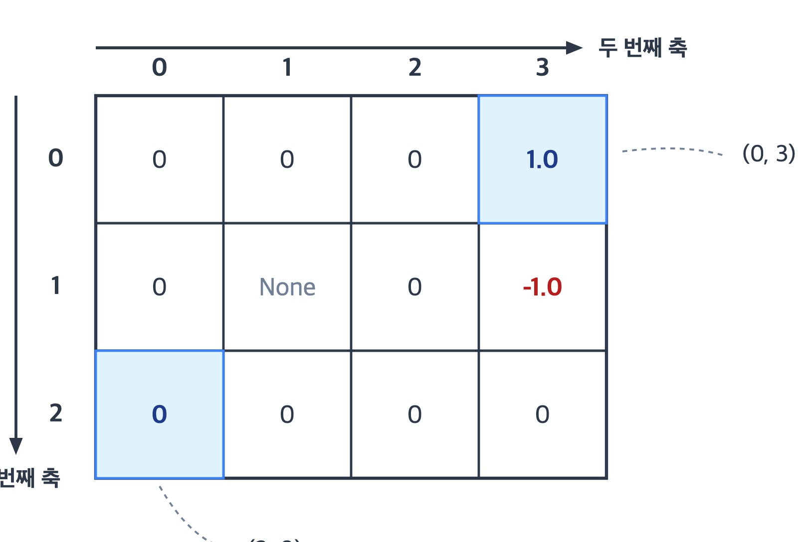

> 보상 맵의 좌표계를 볼 때 프로그래머들이 가장 자주 실수하는 부분이 바로 행렬 인덱스 체계입니다. 수학의 직교 좌표계는 가로가 먼저 오고 위로 갈수록 y가 커지지만, 컴퓨터의 행렬이나 넘파이 배열은 '세로 행'이 먼저 오고 아래로 내려갈수록 인덱스가 증가합니다. 즉, (0, 0)은 맨 왼쪽 위 칸이고, 시작점인 왼쪽 맨 아래 칸은 (2, 0)이 됩니다. 이 좌표 체계를 머릿속에 꼭 새겨두시기 바랍니다.

---

# 07.3 더 큰 문제를 향해
## 07.3.2.0 step4 일회성 과제(Episodic Task)의 3대 이점

- **정의**: 에이전트가 목표 상태에 도달하면 해당 에피소드가 즉시 종료되는 과제입니다.
- 💡 **왜 문제를 '일회성 과제'로 제한하여 설계할까요?**
  1. **수학적 가치 수렴의 보장**: 사과나 폭탄에 도착하면 모험이 끝나 더 이상의 미래 보상이 발생하지 않으므로, 할인 누적 보상 합계가 무한대로 발산하지 않고 명확한 유한값으로 수렴합니다.
  2. **경계 조건의 단순화**: 목표 지점에 도달한 순간의 상태 가치 함수는 무조건 0으로 고정(`V[goal_state] = 0`)되므로, 벨만 방정식 갱신의 든든한 기준점 역할을 합니다.
  3. **학습 루프의 종결성**: 에피소드가 유한한 스텝 내에서 끝나므로 컴퓨터 시뮬레이션의 안정성이 보장됩니다.


> 우리가 다루는 문제는 목표에 도달하면 게임이 끝나는 '일회성 과제'입니다. 왜 이렇게 설계했을까요? 첫째, 목표에 도착하면 더 이상 추가 보상이 나오지 않으므로 미래 보상의 총합이 무한대로 발산하지 않고 안정적으로 수렴합니다. 둘째, 목표 지점의 가치를 0으로 확실하게 고정할 수 있어 알고리즘 구현 시 경계 조건이 단순해집니다. 마지막으로 시뮬레이션이 무한 루프에 빠지지 않고 안정적으로 끝납니다.

---

# 07.3 더 큰 문제를 향해
## 07.3.2.0 step5 격자 위 주요 상태들 (시작, 벽, 목표)

- **목표 상태 (`self.goal_state`)**: `(0, 3)` $\rightarrow$ 달콤한 사과가 놓여 있는 최종 목적지.
- **벽 상태 (`self.wall_state`)**: `(1, 1)` $\rightarrow$ 회색 돌벽으로 에이전트가 진입할 수 없는 장애물.
- **시작 상태 (`self.start_state`)**: `(2, 0)` $\rightarrow$ 에이전트가 모험을 시작하는 왼쪽 맨 아래 칸.
- **현재 위치 추적**: `self.agent_state = self.start_state`를 통해 에이전트의 실시간 위치를 기억합니다.


> 격자 세상의 핵심 좌표들을 한눈에 정리해 보겠습니다. 에이전트 도로시가 처음 발을 딛는 시작 상태는 (2, 0)입니다. 중앙의 (1, 1) 칸에는 단단한 벽이 버티고 서 있어 우회해야 하며, 우리가 도달해야 할 사과가 놓인 목표 상태는 (0, 3)입니다. 이 세 가지 핵심 좌표가 `GridWorld` 클래스 내부에서 인스턴스 변수로 관리되며 모험의 내비게이션 역할을 하게 됩니다.

---

# 07.3 더 큰 문제를 향해
## 07.3.2.1 step6 메소드 추가: @property 데코레이터

- **메서드를 변수처럼**: 메서드 이름 윗줄에 `@property` 데코레이터를 배치하면 소괄호 `()` 호출 없이 인스턴스 변수처럼 속성 조회를 할 수 있습니다.

```python
class GridWorld:
    ...

    @property
    def height(self):
        return len(self.reward_map)

    @property
    def width(self):
        return len(self.reward_map[0])

    @property
    def shape(self):
        return self.reward_map.shape
```

- 💡 **장점**: 내부적으로는 보상 맵의 길이를 동적으로 계산하지만, 외부에서는 `env.height`처럼 단순 변수를 읽는 감각으로 깔끔하게 코딩할 수 있습니다.


> 파이썬의 아주 매력적인 문법인 `@property` 데코레이터를 살펴보겠습니다. 메서드 위에 골뱅이 프로퍼티를 붙여주면, 함수를 호출할 때 뒤에 소괄호를 붙이지 않고 마치 일반 변수처럼 값을 꺼내 쓸 수 있습니다. 내부적으로는 2차원 배열의 행과 열 크기를 안전하게 계산하면서도, 외부 코드는 훨씬 간결하고 우아해지는 객체지향 캡슐화 기법입니다.

---

# 07.3 더 큰 문제를 향해
## 07.3.2.1 step6 그리드 월드 크기 및 형상 측정

- **프로퍼티 호출 예시**:
```python
env = GridWorld()

# env.height() 대신 env.height로 직관적 사용 가능
print(env.height) # [출력 결과] 3
print(env.width)  # [출력 결과] 4
print(env.shape)  # [출력 결과] (3, 4)
```

- **동작 원리**:
  - `env.height`: 세로 높이(행의 개수 = 3) 반환
  - `env.width`: 가로 너비(열의 개수 = 4) 반환
  - `env.shape`: 두 축의 크기를 튜플 `(3, 4)`로 한 번에 제공


> 방금 구현한 프로퍼티들을 실제로 호출해 보면 화면과 같습니다. `env.height`는 세로 높이인 3을 반환하고, `env.width`는 가로 너비인 4를 반환합니다. 그리고 `env.shape`는 넘파이 배열처럼 (3, 4)라는 튜플을 한 번에 돌려줍니다. 소괄호 없이 변수처럼 조회되니 코드가 읽기 편하고 오타를 줄일 수 있습니다.

---

# 07.3 더 큰 문제를 향해
## 07.3.2.1 step7 actions(), states()와 yield 제너레이터

- **전체 탐색 지원**: 모든 행동과 모든 상태에 순차적으로 접근할 수 있는 메서드를 제공합니다.

```python
class GridWorld:
    ...
    def actions(self):
        return self.action_space # [0, 1, 2, 3]

    def states(self):
        for h in range(self.height):
            for w in range(self.width):
                yield (h, w)
```

- **`yield` 제너레이터의 원리**:
  - `return`처럼 값을 반환하지만, 함수를 종료하지 않고 실행 위치를 잠시 멈춥니다(Pause).
  - 다음 호출 시 멈췄던 지점부터 다시 실행하므로 메모리를 절약하며 `for state in env.states():` 형태로 완벽하게 순회할 수 있습니다.


> 강화학습 알고리즘은 모든 칸과 모든 행동을 빠짐없이 훑어야 합니다. 이를 위해 `actions()`와 `states()` 메서드를 작성했습니다. 특히 `states()` 메서드에 쓰인 `yield` 키워드에 주목해 주십시오. `yield`는 12개 좌표를 한꺼번에 메모리에 다 올려두는 대신, 루프가 돌 때마다 좌표를 하나씩 톡톡 꺼내어 건네주는 파이썬 제너레이터 문법입니다. 대규모 상태 공간에서도 매우 효율적입니다.

---

# 07.3 더 큰 문제를 향해
## 07.3.2.1 step8 next_state() 구현: 좌표 이동 연산

- **방향별 오프셋 매핑**: `action_move_map`을 통해 행동 번호를 좌표 변화량 `(dy, dx)`로 변환합니다.

```python
class GridWorld:
    ...
    def next_state(self, state, action):
        # ❶ 이동 위치 계산
        action_move_map = [(-1, 0), (1, 0), (0, -1), (0, 1)]
        move = action_move_map[action]
        next_state = (state[0] + move[0], state[1] + move[1])
        ny, nx = next_state
        ...
```

- 💡 **인덱스 매핑과 행렬 좌표계의 특성**:
  - `0: (-1, 0)` $\rightarrow$ **UP**: 위로 1칸 (행 번호 y가 1 감소!)
  - `1: (1, 0)` $\rightarrow$ **DOWN**: 아래로 1칸 (행 번호 y가 1 증가!)
  - `2: (0, -1)` $\rightarrow$ **LEFT**: 왼쪽으로 1칸 (열 번호 x가 1 감소)
  - `3: (0, 1)` $\rightarrow$ **RIGHT**: 오른쪽으로 1칸 (열 번호 x가 1 증가)

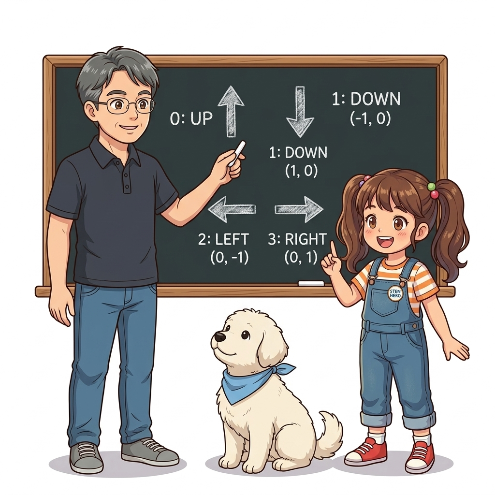

> 다음 상태를 계산하는 `next_state` 함수의 첫 번째 단계입니다. `action_move_map` 리스트에는 행동 0, 1, 2, 3번에 대응하는 좌표 이동량 `(dy, dx)`가 들어있습니다. 여기서 꼭 기억하실 점은 행렬 인덱스 체계이므로 위로 이동할 때 y좌표를 '빼주어야' 하고, 아래로 이동할 때 y좌표를 '더해주어야' 한다는 점입니다. 현재 좌표에 이 변화량을 더하면 가상의 다음 위치가 계산됩니다.

---

# 07.3 더 큰 문제를 향해
## 07.3.2.1 step8 next_state() 구현: 벽 충돌 및 테두리 이탈 방지

- **예외 상황 안전망 로직**:

```python
        # ❷ 이동한 위치가 그리드 월드의 테두리 밖이나 벽인가?
        if nx < 0 or nx >= self.width or ny < 0 or ny >= self.height:
            next_state = state
        elif next_state == self.wall_state:
            next_state = state

        return next_state # ❸ 다음 상태 반환
```

- 💡 **동작 원리**:
  - **테두리 이탈 검사**: `nx`나 `ny`가 가로(0~3) 또는 세로(0~2) 범위를 벗어나면 외곽 벽에 부딪힌 것이므로 `next_state = state`로 원복시킵니다.
  - **장애물 충돌 감지**: 다음 위치가 회색 벽(`(1, 1)`)이면 진입을 막고 현재 위치를 유지합니다.
  - **결정적 단일 반환**: 미끄러짐이 없는 결정적 환경이므로 확정된 단 하나의 좌표 `next_state`만을 깔끔하게 리턴합니다.


> 다음 위치를 계산했다고 끝이 아닙니다. 에이전트가 맵 밖으로 튕겨 나가거나 벽 속으로 파고들면 안 되기 때문입니다. 코드의 2번 블록에서는 계산된 새 좌표가 맵 테두리를 벗어났는지, 혹은 (1, 1) 벽 칸인지를 검사합니다. 만약 그렇다면 벽에 쿵 부딪힌 것이므로 원래 자리에 그대로 서 있도록 `next_state = state`로 되돌립니다. 물리적 충돌 처리를 아주 간결하게 해결했습니다.

---

# 07.3 더 큰 문제를 향해
## 07.3.2.1 step9 reward() 구현: 상태 기반 보상 조회

- **보상 함수 선언**: 수학적 정의인 $r(s, a, s')$에 맞추어 매개변수를 선언합니다.

```python
class GridWorld:
    ...
    def reward(self, state, action, next_state):
        return self.reward_map[next_state]
```

- 💡 **설계 원리와 인덱싱**:
  - **수식과의 일치**: 현재 상태 $s$, 행동 $a$, 다음 상태 $s'$를 모두 받도록 하여 강화학습 이론과의 일관성을 유지합니다.
  - **상태 기반 보상**: 하지만 현재 3x4 격자에서는 어떤 행동을 했는지와 상관없이 에이전트가 최종 도착한 **다음 상태($s'$)**에 사과나 폭탄이 있는지에 의해서만 보상이 결정됩니다.
  - **초고속 배열 색인**: 복잡한 `if`문 대신, 2차원 넘파이 배열 `self.reward_map`에 `next_state` 튜플을 인덱스로 넣어 즉시 반환합니다.


> 환경이 에이전트에게 보상을 건네주는 `reward` 메서드입니다. 함수의 인수로는 현재 상태, 행동, 다음 상태를 모두 받지만, 내부 구현은 아주 간단합니다. 우리 3x4 격자 월드에서는 도착한 '다음 상태'가 사과 칸인지 폭탄 칸인지만 보면 되기 때문에, 미리 만들어 둔 보상 지도 배열에 `next_state`를 집어넣어 해당 칸의 보상값을 즉시 돌려줍니다.

---

# 07.3 더 큰 문제를 향해
## 07.3.2.1 step10 GridWorld 기본 렌더링: render_v()

- **시각화 메서드**: 환경의 현재 상태와 격자 지형을 그래픽으로 출력합니다.
```python
env = GridWorld()
env.render_v()
```

- **화면 구성 요소**:
  - 회색 칸: 벽 장애물 표시
  - 각 칸의 왼쪽 아래: 보상값 표시 (`+1.0`, `-1.0` 등, 0이면 생략)
  - 에이전트 위치 및 전반적인 지형 구조 확인 가능

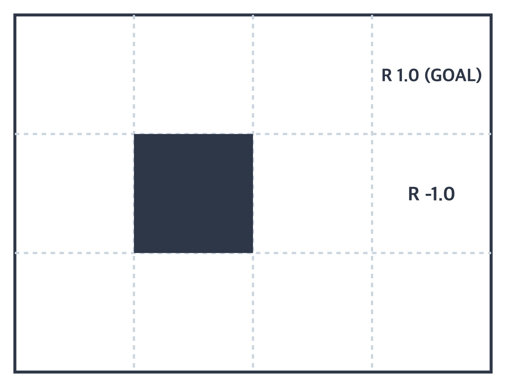

> 우리가 만든 `GridWorld` 클래스에는 내부 지형을 한눈에 확인할 수 있는 `render_v()` 시각화 메서드가 포함되어 있습니다. 코드를 실행하면 화면처럼 예쁜 격자 판이 그려집니다. 회색으로 칠해진 곳은 벽이고, 각 칸의 왼쪽 아래에는 해당 칸의 보상값이 적혀 있습니다. 보상이 0인 칸은 숫자를 생략하여 깔끔하게 보여줍니다.

---

# 07.3 더 큰 문제를 향해
## 07.3.2.1 step11 상태 가치 함수 시각화 (히트맵 렌더링)

- **가치 함수 매개변수 전달**: `render_v()`에 상태 가치 함수 `V`를 전달하면 각 칸의 가치 크기를 히트맵으로 시각화합니다.

```python
env = GridWorld()
V = {}
for state in env.states():
    V[state] = np.random.randn() # 더미 상태 가치 함수
env.render_v(V)
```

- **표시 규칙**:
  - 각 칸의 오른쪽 위: 해당 상태의 가치 함수 값 숫자 표기
  - 색상 그라데이션: 가치 값이 작을수록 붉은색, 클수록 녹색으로 진해짐
  - 정책 전달 시: 각 위치에서 취할 최선의 행동을 화살표로 렌더링 가능

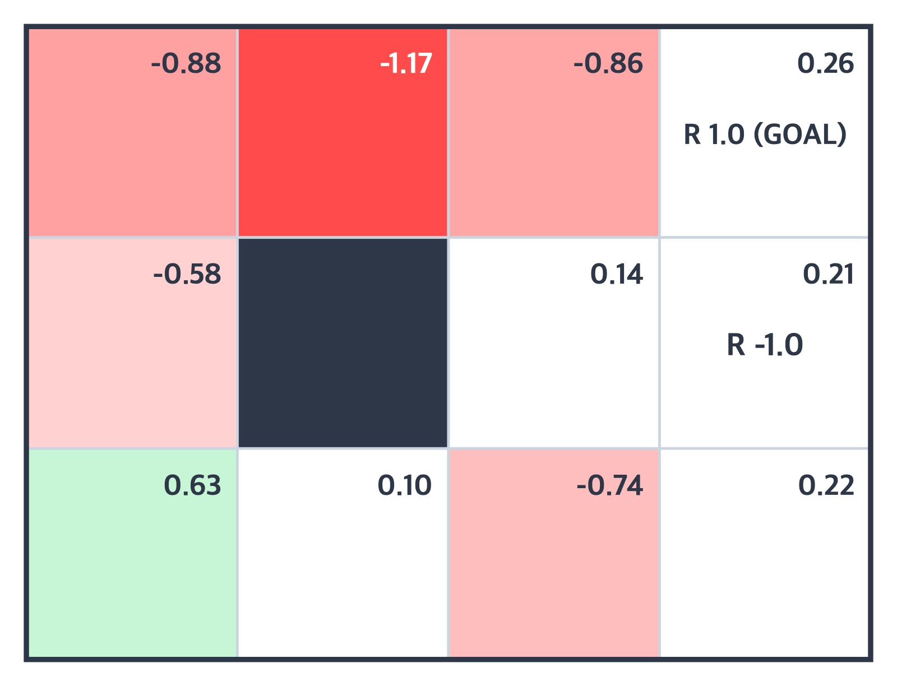

> `render_v()` 메서드는 상태 가치 함수 `V`를 인수로 받아 멋진 히트맵을 그려줄 수도 있습니다. 화면처럼 임의의 랜덤 숫자를 넣어서 호출해 보면, 각 칸의 오른쪽 위에 가치 값이 찍히고 값의 크기에 따라 색상이 달라집니다. 가치가 낮으면 붉은색, 가치가 높으면 초록색으로 칠해져 알고리즘이 찾아낸 가치 분포를 직관적으로 파악할 수 있습니다.

---

# 07.3 더 큰 문제를 향해
## 07.3.2.1 step13 일반 딕셔너리의 한계와 KeyError

- **일반 딕셔너리(`dict`)의 문제점**:
  - 파이썬 딕셔너리는 존재하지 않는 키를 조회하면 즉시 `KeyError` 예외를 일으키며 프로그램이 중단됩니다.
- **번거로운 사전 초기화**:
  - 에러를 피하려면 알고리즘을 돌리기 전에 모든 상태 좌표를 일일이 순회하며 기본값 0을 집어넣는 장황한 준비 코드가 필요합니다.
```python
V = {}
for state in env.states(): # 12개 상태를 일일이 돌며 초기화해야 하는 번거로움!
    V[state] = 0
```
- 💡 **해결책**: 등록되지 않은 키를 요청받아도 알아서 기본값을 채워주는 똑똑한 자료구조가 필요합니다.

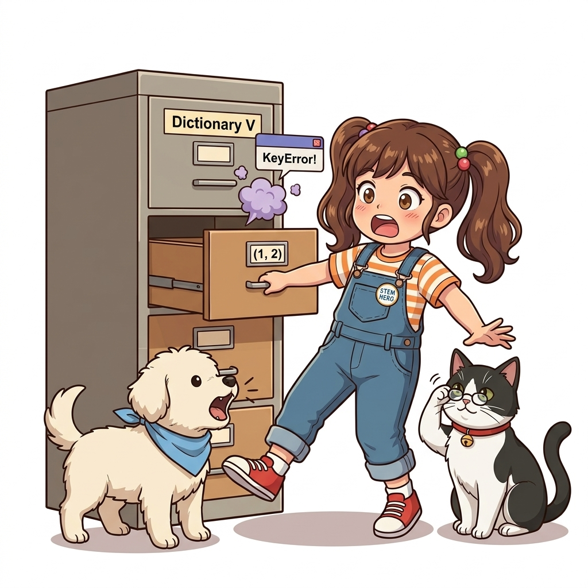

> 가치 함수를 파이썬의 일반 딕셔너리로 다룰 때 한 가지 치명적인 불편함이 있습니다. 딕셔너리에 아직 등록되지 않은 새로운 좌표 키를 조회하면, 파이썬은 화면처럼 `KeyError`를 발생시키며 즉시 멈춰버립니다. 이를 막으려면 모든 상태 좌표를 미리 루프를 돌며 0으로 일일이 채워넣어야 합니다. 이 번거로움을 단번에 해결해 주는 마법의 도구가 바로 다음에 배울 `defaultdict`입니다.

---

# 07.3 더 큰 문제를 향해
## 07.3.2.1 step14 defaultdict의 마법과 기본값 자동 생성

- **파이썬 표준 라이브러리 `collections.defaultdict`**:
```python
from collections import defaultdict
from common.gridworld import GridWorld

env = GridWorld()
V = defaultdict(lambda: 0) # 기본값을 0으로 생성하는 defaultdict

state = (1, 2)
print(V[state]) # [출력 결과] 0  <-- 사전에 없던 키여도 에러 없이 0 자동 생성!
```

- 💡 **동작 메커니즘**:
  - 없는 키로 가치를 조회하는 순간, 사전에 지정된 람다 함수(`lambda: 0`)를 구동하여 즉시 기본값 `0`을 생성하고 원소로 자동 등록합니다.
  - 사전 초기화 루프 코드를 단 한 줄도 쓰지 않아도 되는 강력한 코드 단축 효과를 제공합니다.


> 파이썬 표준 라이브러리의 `defaultdict`는 정말 마법 같은 도구입니다. `defaultdict(lambda: 0)`으로 가치 함수를 선언해 두면, 이전에 등록한 적 없는 낯선 좌표를 조회하더라도 에러를 내지 않습니다. 대신 지정해 둔 람다 함수가 즉시 실행되어 기본값 0을 채워 넣고 돌려줍니다. 이 덕분에 번거로운 초기화 코드 없이 곧바로 알고리즘 핵심 로직에 집중할 수 있습니다.

---

# 07.3 더 큰 문제를 향해
## 07.3.2.1 step15 무작위 정책의 개념과 4방향 0.25 확률

- **무작위 탐색 (Random Exploration)**:
  - 에이전트가 격자 판 위의 어떤 상태에 있든 특정 방향을 편애하지 않고 공평하게 움직이는 기본 정책입니다.
  - 상/하/좌/우 4가지 행동을 균일하게 선택하므로 각 행동의 확률은 정확히 $\frac{1}{4} = 0.25$입니다.
- **행동 확률 분포**:
  - `{0: 0.25, 1: 0.25, 2: 0.25, 3: 0.25}`
- 💡 **의의**: 아직 환경에 대한 정보(사과나 폭탄의 위치)가 전혀 없는 상태에서 가치를 측정하기 위한 출발선 역할을 합니다.

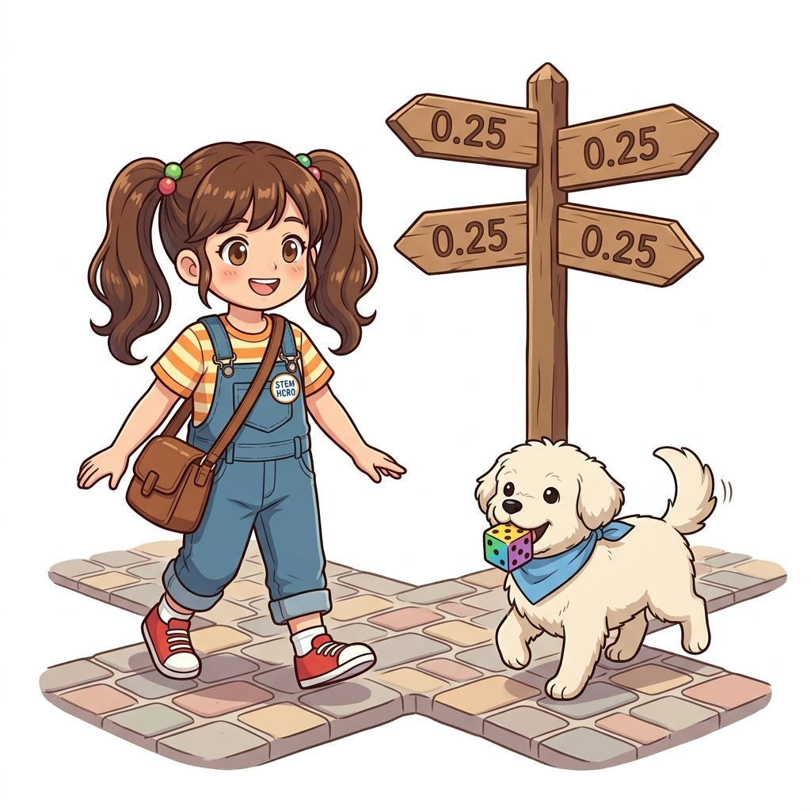

> 정책을 구현하기에 앞서 가장 기본이 되는 '무작위 정책'을 살펴보겠습니다. 무작위 정책이란 어떤 칸에 있든 상하좌우 네 방향으로 움직일 확률이 25%, 즉 0.25로 똑같은 정책을 말합니다. 그림처럼 사거리에 서 있는 도로시와 토토가 어느 한쪽으로 치우치지 않고 공평하게 발걸음을 내딛는 물리적 상황과 같습니다. 학습의 기초 체력을 다지는 출발선입니다.

---

# 07.3 더 큰 문제를 향해
## 07.3.2.1 step15 defaultdict를 이용한 정책 pi 구현

- **중첩 `defaultdict` 선언**:
```python
pi = defaultdict(lambda: {0: 0.25, 1: 0.25, 2: 0.25, 3: 0.25})

state = (0, 1)
print(pi[state]) # [출력 결과] {0: 0.25, 1: 0.25, 2: 0.25, 3: 0.25}
```

- 💡 **데이터 구조의 2단계 매핑**:
  - **외부 키 (Key)**: 상태 좌표 튜플 `(y, x)` (예: `(0, 1)`)
  - **내부 값 (Value)**: 행동별 확률 사전 `{행동: 확률}` (예: `{0: 0.25, 1: 0.25, 2: 0.25, 3: 0.25}`)
  - 미지의 상태 좌표를 조회하더라도 사방 0.25의 확률 분포 사전을 자동으로 즉시 생성해 줍니다.


> 이번에는 `defaultdict`를 이용해 무작위 정책 객체 `pi`를 만들어보겠습니다. 화면의 코드처럼 람다의 반환값으로 네 방향의 0.25 딕셔너리를 지정해 줍니다. 이렇게 하면 어떤 상태 좌표를 키로 넣더라도, 상하좌우 4마리의 나비가 0.25 확률표를 달고 튀어나오듯 완벽한 확률 분포 딕셔너리를 돌려줍니다. 2단계 중첩 사전 구조를 단 한 줄로 깔끔하게 구축한 것입니다.

---

# 07.3 더 큰 문제를 향해
## 07.3.4 step16 eval_onestep()과 상태 순차 접근

- **함수 시그니처**: `eval_onestep(pi, V, env, gamma=0.9)`
  - `pi`: 현재 평가할 정책 딕셔너리
  - `V`: 현재 가치 함수 딕셔너리
  - `env`: GridWorld 환경 인스턴스
  - `gamma`: 미래 보상 할인율 (기본값 0.9)

```python
def eval_onestep(pi, V, env, gamma=0.9):
    for state in env.states(): # ❶ 모든 상태에 순차 접근
        if state == env.goal_state: # ❷ 목표 상태의 가치는 항상 0
            V[state] = 0
            continue
        ...
```

- 💡 **순차 접근 원리**: 12개 칸을 좌측 상단 `(0, 0)`부터 우측 하단 `(2, 3)`까지 빈틈없이 방문합니다.

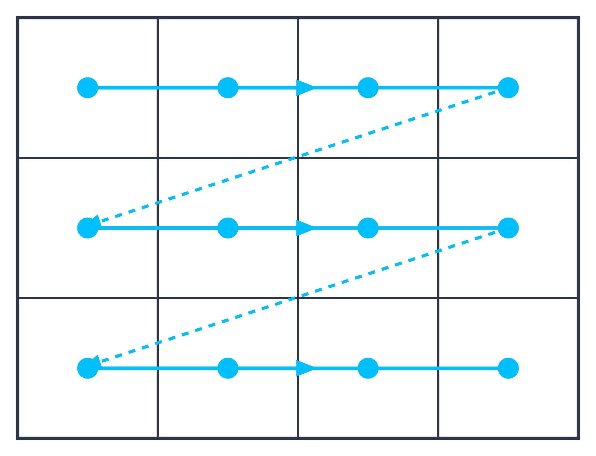

> 이제 정책 평가의 핵심 심장인 `eval_onestep()` 함수를 구현해 보겠습니다. 이 함수는 정책, 가치 함수, 환경, 할인율 4개의 인수를 받아 모든 칸의 가치를 딱 한 번 갱신합니다. 바깥쪽 `for`문에서는 화면의 화살표처럼 (0, 0)번 칸부터 (2, 3)번 칸까지 12개 상태를 하나씩 순서대로 방문하며, 목표 상태인 사과 칸은 가치를 0으로 고정하고 다음 칸으로 넘어갑니다.

---

# 07.3 더 큰 문제를 향해
## 07.3.4 step16 eval_onestep() 이중 루프 구조와 48회 갱신

- **완전 전수 갱신 (Full Backup)**:
```python
        action_probs = pi[state] # 현재 상태에서의 행동 확률 분포
        new_V = 0

        # ❸ 각 행동에 접근
        for action, action_prob in action_probs.items():
            next_state = env.next_state(state, action)
            r = env.reward(state, action, next_state)
            # ❹ 새로운 가치 함수
            new_V += action_prob * (r + gamma * V[next_state])

        V[state] = new_V
    return V
```

- 💡 **연산 스케일**:
  - 바깥쪽 루프: 12개 상태 순회 $\times$ 안쪽 루프: 4가지 행동 순회
  - 총 **$12 \times 4 = 48$번의 조합 경로**를 전수 스캔하여 가치 $V(s)$를 완벽하게 갱신합니다.

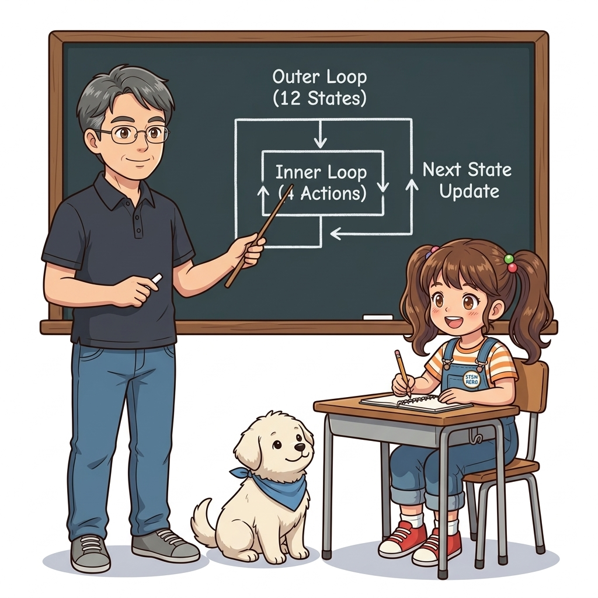

> `eval_onestep` 함수의 내부 루프를 자세히 보시겠습니다. 하나의 칸에 도착하면 안쪽 `for`문이 돌며 상하좌우 4가지 행동을 모두 따져봅니다. 즉, 바깥쪽 12개 상태 곱하기 안쪽 4개 행동, 총 48번의 경로를 빈틈없이 전수 조사하는 이중 루프 구조입니다. 가능한 모든 다음 상태의 보상과 할인된 미래 가치를 확률적으로 가중합산하여 새로운 가치 `new_V`를 도출합니다.

---

# 07.3 더 큰 문제를 향해
## 07.3.4 step17 벨만 갱신식과 파이썬 코드의 1:1 완벽한 대응

- **벨만 기대 방정식 [식 07-3]**:
$$
V_{k+1}(s) = \sum_{a} \pi(a \mid s) \{ r(s, a, s') + \gamma V_k(s') \}
\tag{식 07-3}
$$

- **파이썬 구현 코드와의 1:1 대조**:
| 수학 수식 기호 | 파이썬 코드 요소 | 의미 |
| :---: | :---: | :--- |
| $\sum_{a}$ | `for action, action_prob in ...` | 모든 가능한 행동에 대한 누적 합산 |
| $\pi(a \mid s)$ | `action_prob` | 현재 상태 $s$에서 행동 $a$를 취할 확률 (0.25) |
| $r(s, a, s')$ | `r = env.reward(...)` | 상태 전이 시 즉시 주어지는 보상 |
| $\gamma$ | `gamma` | 미래 가치 할인율 (0.9) |
| $V_k(s')$ | `V[next_state]` | 다음 도달 상태의 기존 가치 |
| $\{ \dots \}$ 합산 | `new_V += action_prob * (...)` | 가중 기대 수익 계산 및 $V(s)$ 갱신 |

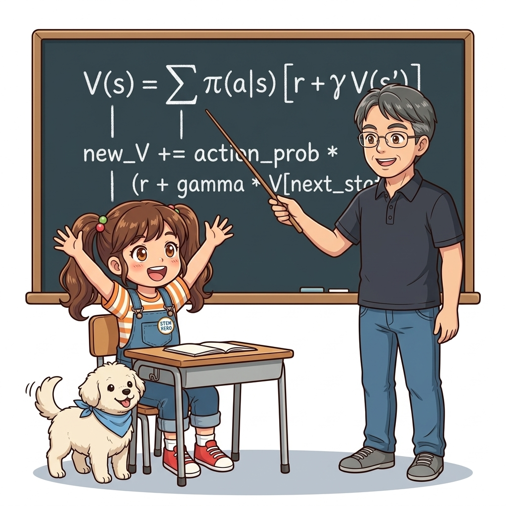

> 수학 수식과 파이썬 코드가 어떻게 완벽하게 짝을 이루는지 확인해 보십시오. 벨만 기대 방정식의 시그마 기호는 파이썬의 `for`문과 `+=` 연산자로 바뀌었고, 파이 확률은 `action_prob`, 즉각 보상은 `r`, 감마는 `gamma`, 다음 상태 가치는 `V[next_state]`로 완벽히 번역되었습니다. 복잡한 수식이 실제로는 단 한 줄의 파이썬 코드로 아름답게 구현되는 순간입니다.

---

# 07.3 더 큰 문제를 향해
## 07.3.4 step18 policy_eval() 구현과 수렴 메커니즘

- **수렴할 때까지 무한 반복 (`while True`)**:
```python
def policy_eval(pi, V, env, gamma, threshold=0.001):
    while True:
        old_V = V.copy() # 갱신 전 가치 함수 복사
        V = eval_onestep(pi, V, env, gamma)

        # 갱신된 양의 최댓값(delta) 계산
        delta = 0
        for state in V.keys():
            t = abs(V[state] - old_V[state])
            if delta < t:
                delta = t

        # 임계값과 비교하여 수렴 판정
        if delta < threshold:
            break
    return V
```

- 💡 **수렴 3요소**:
  1. `old_V`: 이전 스텝 가치 보존
  2. `delta`: 상태별 최대 오차 추적 (`abs(V - old_V)`)
  3. `threshold = 0.001`: 오차가 기준선 아래로 떨어지면 루프 탈출 (`break`)


> 한 단계 갱신을 배웠으니, 이제 값이 완전히 굳어질 때까지 반복하는 `policy_eval` 함수를 만듭니다. `while True` 무한 루프 안에서 `eval_onestep`을 계속 돌리며, 직전 가치와의 최대 차이인 `delta`를 측정합니다. 계측기 바늘처럼 `delta`가 점점 줄어들다가, 우리가 설정한 미세 오차 기준인 0.001 아래로 떨어지는 순간 루프를 멈추고 최종 수렴된 가치 함수를 반환합니다.

---

# 07.3 더 큰 문제를 향해
## 07.3.5 무작위 정책 평가 결과와 상태 가치 분석

- **전체 실행 코드**:
```python
env = GridWorld()
gamma = 0.9 # 할인율

pi = defaultdict(lambda: {0: 0.25, 1: 0.25, 2: 0.25, 3: 0.25}) # 무작위 정책
V = defaultdict(lambda: 0) # 가치 함수 초기화

V = policy_eval(pi, V, env, gamma) # 정책 평가 실행
env.render_v(V, pi) # 시각화 렌더링
```

- **결과 히트맵 분석**:
  - **시작점 `(2, 0)`**: 가치 함수 값이 **`-0.10`**으로 마이너스 기록!
  - **원인 분석**: 에이전트가 아무 생각 없이 무작위로 움직이다 보면, 사과(+1.0)를 찾기보다 바로 위쪽에 위치한 폭탄(-1.0)에 빠질 확률이 더 높기 때문입니다.
  - **음수 영역**: 폭탄 주변의 맨 아래 줄과 가운데 줄은 폭탄의 강력한 음의 영향력이 지배하고 있습니다.

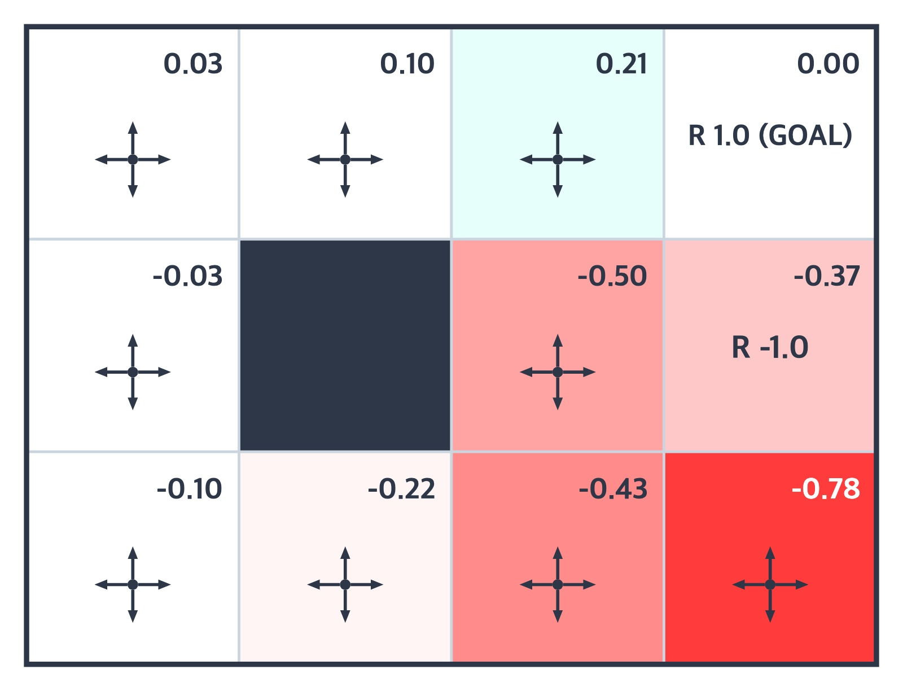

> 드디어 무작위 정책의 평가 결과가 나왔습니다. 결과를 보시면 아주 흥미로운 사실을 발견할 수 있습니다. 시작점인 왼쪽 아래 칸의 기대 가치가 `-0.10`으로 마이너스입니다. 아무 전략 없이 사방으로 무작위로 걷다 보면 사과(+1)를 만나기보다 바로 위에 있는 폭탄(-1)을 밟을 확률이 더 크기 때문입니다. 가치 함수가 환경의 위험과 기회를 수학적으로 정확히 꿰뚫어 본 것입니다.

---

# 07.3 더 큰 문제를 향해
## 07.3.5 무작위 정책의 한계와 최적 정책을 향한 모험

- **동적 프로그래밍의 연산 효율성**:
  - DP를 적용한 덕분에 12개 상태의 반복 계산이 컴퓨터에서 0.1초도 안 되는 순식간에 끝났습니다. 그리드 월드가 더 커져도 거뜬히 풀어낼 수 있습니다.
- 💡 **다음 단계로의 도약: 정책 개선 (Policy Improvement)**:
  - 현재는 '무작위 정책'의 참담한 가치를 평가했을 뿐입니다.
  - 다음 장에서는 이 가치 함수를 바탕으로 폭탄을 요리조리 피하고 사과만을 쏙쏙 골라 찾아가는 **최적 정책(Optimal Policy)**을 찾아내는 정책 반복(Policy Iteration) 마법을 배우러 떠납니다!


> 우리는 오늘 더 넓어진 3x4 그리드 월드에서 반복적 정책 평가 알고리즘을 성공적으로 가동했습니다. 무작위 정책으로는 폭탄을 밟아 마이너스 점수를 얻기 십상이라는 한계도 직접 눈으로 확인했습니다. 하지만 실망할 필요는 없습니다. 가치 지도를 손에 쥐었으니, 이제 다음 단원에서는 폭탄을 영리하게 피해 사과로 직행하는 '최적 정책'을 스스로 학습하는 법을 배우게 될 테니까요!
