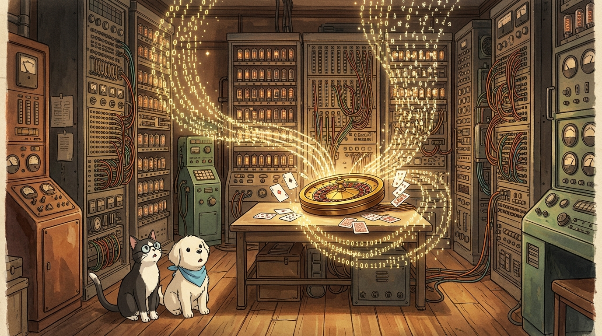
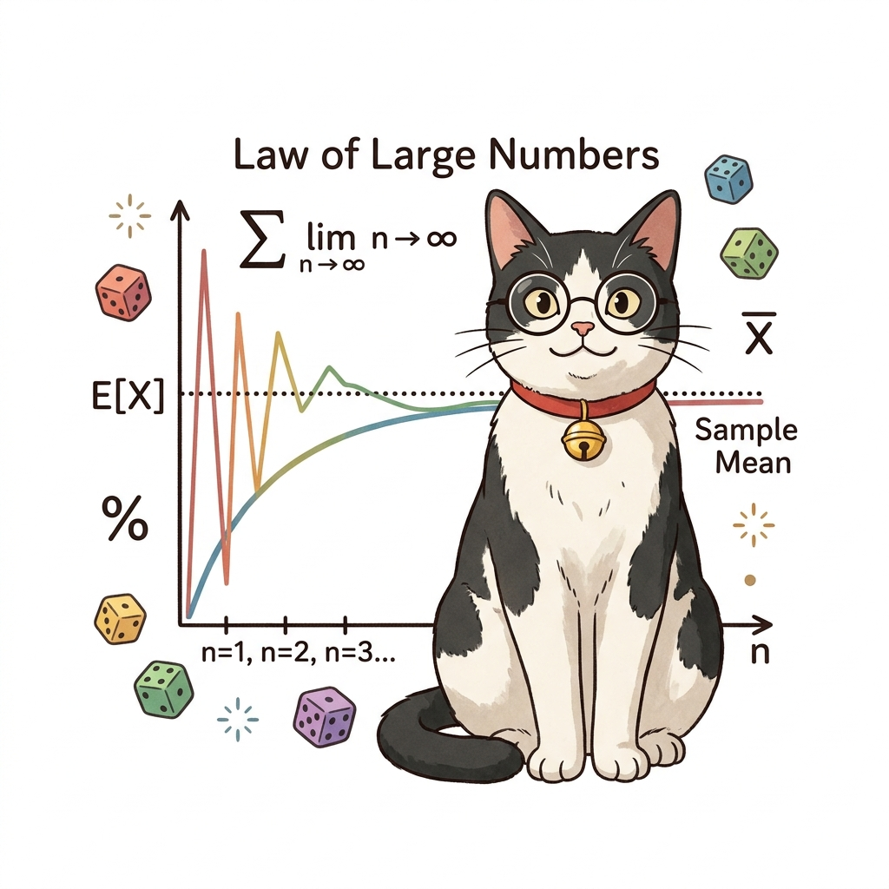
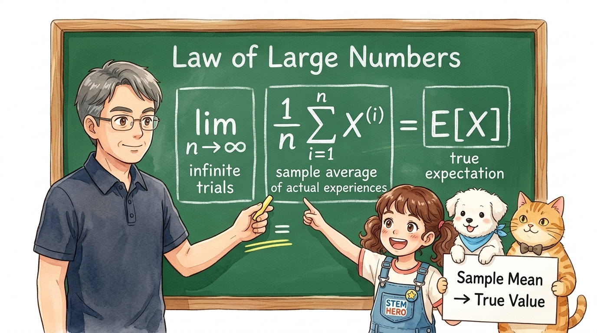
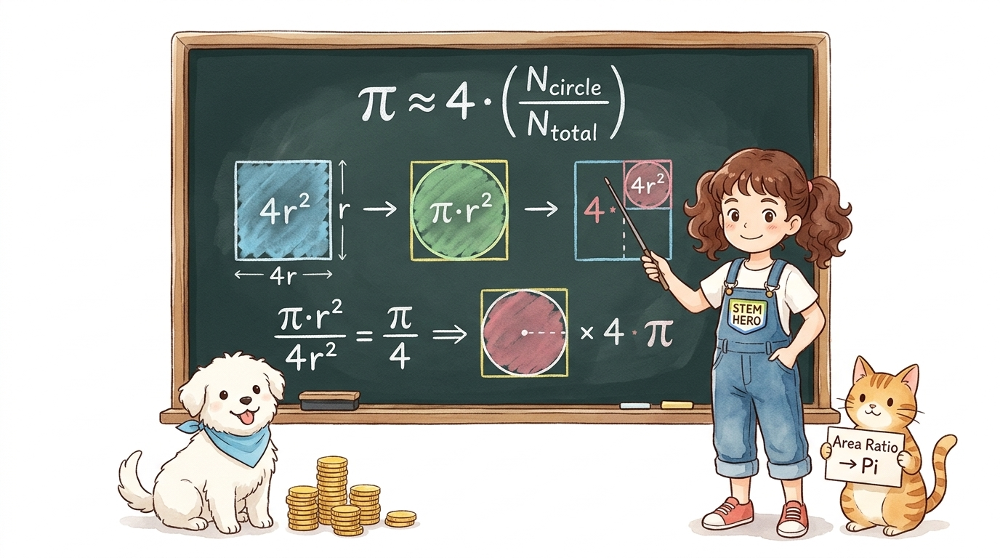

# 09.0 몬테카를로법의 수학적 기초와 역사적 유래
## 09.0.0 몬테카를로법의 시작: 모델 없는 세상의 모험

강화학습에서 환경의 수학적 모델(상태 전이 확률과 보상 함수)을 전혀 알지 못해도, 에이전트가 세상에 직접 발을 내딛고 겪은 수많은 실제 모험(에피소드) 샘플들을 모아 평균을 내어 최적 가치와 정책을 찾아내는 기법을 **몬테카를로법(Monte Carlo Method)**이라고 부릅니다.

**그림 09-0-1** 이호진 교수님의 몬테카를로법 역사와 원리 특강 — 조교 지니와 함께 룰렛과 컴퓨터의 만남을 강의하고 경청하는 도로시와 토토 (16:9 와이드)

- **몬테카를로법(MC)**: 환경의 전이 확률을 몰라도 실제 경험 샘플을 모아 평균 내는 학습법
- **핵심 질문**: 완벽한 지도가 없는 세상에서 에이전트는 어떻게 최적의 길을 찾을까?
- 💡 **해법**: 직접 걸어보고 겪은 수많은 모험(에피소드)의 평균으로 가치를 추정!

> "여러분 안녕하세요! 오늘부터 강화학습의 거대한 기둥인 '몬테카를로법'을 함께 탐험해 보겠습니다. 환경의 확률 규칙을 전혀 몰라도, 에이전트가 직접 세상에 발을 내딛고 겪은 경험들의 평균을 내면 놀랍게도 최적의 가치를 찾을 수 있습니다. 룰렛과 컴퓨터가 만난 놀라운 역사로 출발해 봅시다!"

---

# 09.0 몬테카를로법의 수학적 기초와 역사적 유래
## 09.0.0 직관적 비유: 연못에 던진 조약돌

복잡한 미적분이나 수학 공식 없이도, 무작위로 표본을 던지고 비율을 세는 단순한 행위만으로 우주의 참된 기하학적 면적과 원주율 *π*를 정확히 계산해낼 수 있습니다.

**그림 09-0-1-2** 사각형 연못 안의 원형 분수대에 조약돌을 던져 무작위 표본 비율로 면적과 원주율을 직관적으로 유도해보는 도로시와 토토, 지니 (1:1 순백색)

- **도로시의 실험**: 사각형 연못 안쪽의 둥근 분수대에 조약돌 무작위 던지기
- **단순한 셈(Counting)**: 분수대에 빠진 돌과 전체 돌의 개수 비율 측정
- 💡 **놀라운 결과**: 복잡한 적분 공식 없이 오직 돌을 던지고 센 것만으로 원주율 *π* 근사!

> "도로시가 정원의 사각형 연못에 조약돌을 신나게 던져보았습니다. 복잡한 수학 공식 없이, 원형 분수대에 빠진 돌과 전체 돌의 개수 비율만 셌는데도 원주율 파이를 정확히 유도해냈죠. 토토가 옆에서 돌을 물어다 주며 함께 센 것처럼, 무작위 시행의 힘은 실로 놀랍습니다."

---

# 09.0 몬테카를로법의 수학적 기초와 역사적 유래
## 09.0.1.1 병상에서 시작된 솔리테어 카드 놀이

1946년, 맨해튼 프로젝트에 핵심 연구원으로 참여했던 폴란드계 미국인 천재 수학자 **스타니스와프 울람(Stanisław Ulam)**은 뇌염 수술을 받고 병상에 누워 무료하게 요양을 하고 있었습니다.

**그림 09-0-2** 병상에서 솔리테어 카드 놀이를 하던 중 표본 무작위 추출(Random Sampling)의 위대한 힘을 직관적으로 깨달은 스타니스와프 울람과 조교 지니 (1:1 순백색)

- **1946년의 울람**: 맨해튼 프로젝트 참여 중 뇌염 수술 후 병상 요양
- **무료함 달래기**: 혼자서 트레이 위에 카드를 배열하는 '솔리테어' 게임 반복
- 💡 **수학자의 호기심**: "이 카드가 처음에 무작위로 섞였을 때, 성공적으로 풀릴 확률은 얼마일까?"

> "1946년, 맨해튼 프로젝트의 천재 수학자 스타니스와프 울람은 뇌염 수술 후 병상에 누워 있었습니다. 무료함을 달래려 솔리테어 카드 게임을 하던 그는 문득 '52장의 카드를 무작위로 섞었을 때, 게임이 성공적으로 풀릴 수학적 확률은 얼마일까?'라는 의문을 품게 됩니다."

---

# 09.0 몬테카를로법의 수학적 기초와 역사적 유래
## 09.0.1.1 조합론의 한계와 실전 발상의 전환

52장의 트럼프 카드가 뒤섞여 나오는 경우의 수는 상상을 초월하는 우주적 규모였으며, 해석적 수식으로는 도저히 성공 확률을 계산할 수 없었습니다.

**그림 09-0-2** 복잡한 조합 수식 대신 실제 100번의 플레이 표본 평균으로 확률을 추정하는 발상의 전환 (1:1 순백색)

- **순수 수학의 벽**: 카드 52장의 순열 조합 52! ≈ 8.065 × 1067 (우주 원자 수급)
- **해석적 계산 불가**: 종이와 연필로는 도저히 풀 수 없는 초거대 경우의 수
- 💡 **발상의 전환**: "공식 대신 실제로 100번 해보고, 성공한 횟수를 세면 대략적인 확률이 나오잖아!"

> "수학자였던 울람은 순열 조합 공식으로 풀려 했지만, 카드의 경우의 수는 무려 52 팩토리얼로 우주의 원자 수에 달했습니다. 연필로는 불가능했죠. 이때 울람은 '어려운 공식 대신 실제로 100번 게임을 해보고 성공 횟수를 세면 되잖아!'라는 기발한 발상의 전환을 떠올렸습니다."

---

# 09.0 몬테카를로법의 수학적 기초와 역사적 유래
## 09.0.1.2 맨해튼 프로젝트와 존 폰 노이만의 만남

울람의 무작위 표본 추출 아이디어는 핵무기 개발의 핵심 과제였던 중성자 확산과 핵분열 연쇄 반응 연산의 돌파구로 이어졌습니다.

**그림 09-0-2-2** 울람의 무작위 표본 추출 아이디어를 맨해튼 프로젝트(중성자 확산) 컴퓨터 수치 해석에 적용할 수 있음을 깨닫고 열띤 토론을 벌이는 존 폰 노이만과 스타니스와프 울람 (16:9 와이드)

- **존 폰 노이만과의 공유**: 병상에서 얻은 무작위 샘플링 영감을 동료에게 설명
- **핵물리학의 난제**: 중성자가 물질 속에서 무수히 충돌하는 궤적의 연산 곤란
- 💡 **컴퓨터 시뮬레이션 간파**: "중성자 하나하나의 충돌을 난수로 시뮬레이션해 평균을 내자!"

> "울람은 이 영감을 20세기 최고의 천재 존 폰 노이만에게 전했습니다. 당시 맨해튼 프로젝트는 핵분열 시 중성자가 충돌하는 복잡한 궤적을 풀지 못해 애를 먹고 있었는데요. 폰 노이만은 이 무작위 시뮬레이션을 컴퓨터로 수천 번 돌리면 전체 확산율을 풀 수 있음을 즉시 간파했습니다."

---

# 09.0 몬테카를로법의 수학적 기초와 역사적 유래
## 09.0.1.2 도박 도시 몬테카를로와 암호명의 탄생

국가 1급 기밀 연구였기에 무작위 시뮬레이션 연산 기법을 감출 수 있는 흥미진진한 프로젝트 암호명이 채택되었습니다.

**그림 09-0-2-3** 조교 지니가 돋보기로 지중해 연안 모나코의 세계적인 카지노 도시 '몬테카를로' 지도를 비추며 암호명의 유래를 재미있게 설명해주는 씬 (1:1 순백색)

- **국가 1급 비밀**: 핵 연구 계산 기법을 은폐할 프로젝트 암호명 필요
- **울람 삼촌의 단골 도시**: 카지노를 좋아해 친척 돈을 빌리던 삼촌의 출몰지
- 💡 **몬테카를로(Monte Carlo)**: 모나코의 룰렛·주사위 도박 성지 이름에서 명명

> "당시 핵 연구는 극비였기에 비밀 암호명이 필요했습니다. 조교 지니의 돋보기처럼, 울람에게는 카지노를 좋아하던 삼촌이 있었는데 그 삼촌의 단골 도시가 바로 모나코의 '몬테카를로'였습니다. 룰렛의 무작위성이 연산의 본질과 딱 맞아 '몬테카를로 프로젝트'로 명명되었죠."

---

# 09.0 몬테카를로법의 수학적 기초와 역사적 유래
## 09.0.1.2 전자식 컴퓨터(ENIAC)와의 결합

인간의 손으로는 불가능했던 수만 번의 무작위 난수 연산이 최초의 전자식 진공관 컴퓨터와 결합하며 현대 컴퓨터 과학의 일대 혁명을 일으켰습니다.

**그림 09-0-2-4** 1940년대 거대한 진공관 컴퓨터 회로와 카지노 룰렛의 무작위 난수가 만나 현대 과학 시뮬레이션으로 피어난 역사적인 만남 (16:9 와이드)

- **에니악(ENIAC)의 활약**: 손으로 불가능한 수만 번의 무작위 연산을 컴퓨터가 대행
- **난수 발생(Random Number)**: 확률적 물리학 및 수치해석의 표준 도구 정립
- 💡 **강화학습으로의 진화**: 환경 모델을 몰라도 에이전트의 경험을 평균 내는 핵심 엔진!

> "이렇게 몬테카를로법은 1940년대 최초의 전자식 컴퓨터 에니악과 만나 만개했습니다. 룰렛 바퀴의 무작위 난수가 진공관 회로를 타고 흘러, 수만 번의 계산을 순식간에 해치웠죠. 오늘날 물리학과 금융, 그리고 우리가 배우는 인공지능 강화학습의 핵심 엔진이 되었습니다."

---

# 09.0 몬테카를로법의 수학적 기초와 역사적 유래
## 09.0.2.0 수학적 의미: 기댓값의 정의와 표본 평균

무작위로 뽑아낸 표본들의 평균(Sample Mean)은 표본 수가 늘어날수록 원래 모집단의 참 기댓값 E[*X*]로 확실하게 수렴합니다.

**그림 09-0-3-0** 이호진 교수님이 대형 칠판 앞에서 몬테카를로법의 핵심 수학 이론(기댓값과 표본 평균의 수렴)을 명쾌하게 강의하고, 도로시가 손을 들며 깨달음을 얻는 씬 (16:9 와이드)

- **수학적 의문**: 무작위로 뽑아 평균 낸 값이 왜 진짜 참값이 될까?
- **기댓값 공식**: E[*X*] = ∑ *x* · *P*(*X* = *x*)
- 💡 **교수님의 직강**: 확률 분포 *P*를 몰라도, 실제 경험 샘플 *X*의 평균이 참 기댓값으로 수렴!

> "무작위로 뽑아 평균 낸 값이 왜 진짜 참값이 될까요? 이호진 교수님의 칠판 강의를 보세요. 확률 변수의 참 기댓값 수식은 복잡하지만, 실제로 경험한 수많은 샘플들의 산술 평균을 구하면 놀랍게도 원래 모집단의 참 기댓값에 정확히 도달하게 됩니다."

---

# 09.0 몬테카를로법의 수학적 기초와 역사적 유래
## 09.0.2.0 수식 돋보기: 기댓값 E[*X*]와 표본 평균 기호 해부

확률 변수의 기댓값 공식과 몬테카를로법의 표본 평균 수식에 담긴 기호들을 하나씩 뜯어보며 직관적인 의미를 파악해 봅시다.

**그림 09-0-3-0b** 이호진 교수님과 조교 지니가 기댓값 공식 E[*X*] = ∑ *x* · *P*(*X* = *x*)과 표본 평균 (1/*n*) ∑ *X*(*i*)의 기호별 의미를 알기 쉽게 해설하는 칠판 강의 (16:9 와이드)

- **E[*X*]**: 확률 변수 *X*가 가질 것으로 기대되는 이론적 '참 평균(기댓값)'
- **∑ *x* · *P*(*X* = *x*)**: 나올 수 있는 모든 사건 값(*x*)에 그 사건 확률(*P*)을 곱해 합산
- **(1/*n*) ∑*i*=1*n* *X*(*i*)**: 실제로 경험한 *n*개의 표본(*X*(*i*))을 더해 개수(*n*)로 나눈 '산술 평균'
- 💡 **핵심 통찰**: 확률 분포 *P*를 몰라도, 실제 경험 샘플의 표본 평균으로 참 기댓값 E[*X*]를 완벽히 근사!

> "칠판의 수식을 하나씩 분해해 볼까요? E[X]는 확률 변수가 취할 이론적 참 기댓값이고, 시그마는 가능한 모든 값에 확률을 곱해 더한 값입니다. 우리가 확률 분포를 몰라도, 실제로 겪은 n개의 경험 표본을 더해 n으로 나눈 표본 평균을 구하면 참 기댓값을 완벽히 추정할 수 있습니다."

---

# 09.0 몬테카를로법의 수학적 기초와 역사적 유래
## 09.0.2.1 대수의 법칙: 표본이 쌓이면 참값이 된다

몬테카를로법의 정확성과 수렴성을 수학적으로 뒷받침하는 가장 거대한 수학적 기둥은 바로 **대수의 법칙(Law of Large Numbers)**입니다.

**그림 09-0-3-1** 표본 수(n)가 적을 때는 극심하게 요동치다 표본이 누적될수록 참 기댓값으로 정밀하게 수렴하는 대수의 법칙 다이어그램 (1:1 순백색)

- **대수의 법칙(큰 수의 법칙)**: lim*n* → ∞ (1/*n*) ∑*i*=1*n* *X*(*i*) = E[*X*]
- **주사위 실험**: 눈금 기댓값은 3.5. 초기 3회 던짐(평균 3.0) → 10,000회(평균 3.500)
- 💡 **강화학습 시사점**: 수많은 에피소드의 보상 합을 평균 내면 상태 가치 *V*(*s*) 완벽 추정!

> "이를 수학적으로 보장하는 정리가 바로 '대수의 법칙'입니다. 주사위를 서너 번 던질 때는 평균이 크게 요동치지만, 100번, 10,000번 던지면 정확히 참값인 3.5로 수렴합니다. 이 덕분에 우리는 복잡한 수식 없이도 수많은 모험의 보상을 평균 내어 가치 함수를 구할 수 있습니다."

---

# 09.0 몬테카를로법의 수학적 기초와 역사적 유래
## 09.0.2.1 수식 돋보기: 대수의 법칙 극한 수식 3대 블록 분석

표본 평균이 어떻게 참 기댓값으로 정확하게 수렴하는지, 대수의 법칙 극한 수식을 3개의 핵심 블록으로 나누어 살펴봅시다.

**그림 09-0-3-1b** 대수의 법칙 극한 수식 lim*n* → ∞ (1/*n*) ∑*i*=1*n* *X*(*i*) = E[*X*]을 3대 블록으로 분해하여 설명하는 이호진 교수님과 도로시, 토토 (16:9 와이드)

- **블록 1: lim*n* → ∞ (무한 시행)**: 에이전트의 경험 횟수(시행 횟수 *n*)를 무한히 증가시키는 극한
- **블록 2: (1/*n*) ∑*i*=1*n* *X*(*i*) (표본 평균)**: 실제로 부딪히며 수집한 실제 경험 데이터들의 누적 평균
- **블록 3: = E[*X*] (완전 일치)**: 표본이 충분히 쌓이면 오차가 0으로 사라지고 참값에 도달
- 💡 **강화학습 응용**: 에피소드를 무수히 반복하면 보상의 표본 평균이 환경의 참 가치 함수로 정밀 수렴!

> "대수의 법칙 수식을 세 블록으로 나누어 봅시다. 첫 번째는 시행 횟수를 무한히 늘린다는 극한 기호이고, 두 번째는 에이전트가 실제로 겪은 경험들의 누적 표본 평균입니다. 표본이 충분히 쌓이면 등호 기호처럼 오차가 완벽히 사라지며 이론적 참 기댓값에 도달하게 됩니다."

---

# 09.0 몬테카를로법의 수학적 기초와 역사적 유래
## 09.0.2.2 실습: 정사각형 내접원 동전 던지기

정사각형 안에 내접하는 원을 그리고 무작위로 동전을 던져 떨어뜨리는 기하학적 확률 실험을 통해 몬테카를로법의 마법 같은 원리를 체감할 수 있습니다.

**그림 09-0-3** 사각형 안에 내접하는 원을 그리고 무작위로 동전을 던져 원주율 *π*를 기하학적으로 추정하는 도로시와 보조견 토토 (1:1 순백색)

- **기하학적 면적**: 정사각형 *S*square = 4*r*2, 내접원 *S*circle = *πr*2
- **면적 비율**: *N*circle / *N*total ≈ *πr*2 / 4*r*2 = *π* / 4
- 💡 **원주율 공식 유도**: *π* ≈ 4 × (*N*circle / *N*total)

> "도로시와 토토의 원주율 동전 던지기 실습을 살펴봅시다. 한 변이 2r인 정사각형 안에 반지름 r인 원을 그리고 동전을 무작위로 던집니다. 원 안의 동전 비율은 면적 비율인 4분의 파이와 같으므로, 단순히 개수를 세는 것만으로 원주율 파이를 완벽히 유도할 수 있습니다."

---

# 09.0 몬테카를로법의 수학적 기초와 역사적 유래
## 09.0.2.2 수식 돋보기: 원주율 유도 공식 *π* ≈ 4 × (*N*circle / *N*total) 기호 해부

단순히 동전을 던져서 센 비율에 왜 숫자 '4'를 곱하면 신기하게도 원주율 *π*가 되는지, 수식 기호 하나하나를 뜯어봅시다.

**그림 09-0-3b** 정사각형 면적 4*r*2과 내접원 면적 *πr*2의 기하학적 비례 관계에서 원주율 *π*를 단독으로 유도해내는 과정을 설명하는 도로시와 토토, 지니 (16:9 와이드)

- ***N*circle / *N*total**: 전체 동전 개수 중 원 안쪽에 들어간 동전 개수의 표본 비율
- **기하학적 면적 비율**: 원 넓이(*πr*2) / 정사각형 넓이(4*r*2) = *π* / 4
- **'4 ×'의 유래**: 비율 *π* / 4에서 분모인 '4'를 양변에 곱해 *π*만 남기기 위한 배수
- **'≈' (근사 기호)**: 무한대가 아닌 현실의 유한한 표본 개수로 추정한 근사값임을 명시
- 💡 **최종 유도**: *π* ≈ 4 × (*N*circle / *N*total) ➔ 단순한 카운팅만으로 원주율 완벽 계산!

> "원주율 공식에 왜 숫자 4를 곱하는지 궁금하셨죠? 반지름 r인 원의 넓이는 파이 r제곱이고, 한 변이 2r인 정사각형의 넓이는 4r제곱입니다. 면적 비율이 4분의 파이가 되므로, 양변에 4를 곱해주면 오직 동전 개수를 센 비율만으로 원주율 파이를 완벽히 구할 수 있습니다."

---

# 09.0 몬테카를로법의 수학적 기초와 역사적 유래
## 09.0.2.2 시행 횟수와 정확도: 4단계 정밀 수렴

시행 횟수(샘플 데이터 개수) *N*이 증가함에 따라 원주율 추정치가 오차를 좁혀가며 참값 3.14159...로 정밀하게 수렴해 나갑니다.

**그림 09-0-4** 동전 던지기 횟수 *N*이 증가할수록 오차가 줄어들며 참값 3.14159...로 수렴해 가는 4단계 시각화 다이어그램 (1:1 순백색)

- **STEP 1 (*N* = 10)**: *π* ≈ 4.0000 (오차 +0.8584, 초기 불안정)
- **STEP 2 (*N* = 100)**: *π* ≈ 3.2000 (오차 +0.0584)
- **STEP 3 (*N* = 1,000)**: *π* ≈ 3.1600 (오차 +0.0184)
- **STEP 4 (*N* = 10,000)**: *π* ≈ 3.1416 (오차 +0.00001, 초정밀 수렴!)

> "시행 횟수 N이 증가함에 따른 수렴 과정을 표와 다이어그램으로 확인해 보세요. 10번 던졌을 땐 4.00으로 오차가 크지만, 100번, 1,000번, 10,000번으로 갈수록 놀랍게도 3.1416으로 정밀하게 수렴합니다. 표본이 많아질수록 오차가 마법처럼 사라지는 원리입니다."

---

# 09.0 몬테카를로법의 수학적 기초와 역사적 유래
## 09.0.3 핵심 정리: 몬테카를로법의 3대 수학적 기둥

몬테카를로 기법은 복잡한 환경 모델과 수식을 몰라도, 에이전트가 직접 부딪히며 축적한 경험의 평균으로 참된 가치와 최적 정책을 찾아내는 강력한 방법론입니다.

**그림 09-0-5** 몬테카를로법의 3대 핵심 기둥(무작위 표본 추출, 대수의 법칙 수렴, 모델 프리 학습)을 총정리하는 이호진 교수님과 연구실 4인방 (16:9 와이드)

- 1️⃣ **무작위 표본 추출 (Sampling)**: 복잡한 확률 분포를 계산하는 대신 직접 무작위 샘플을 채집하여 문제를 단순화
- 2️⃣ **대수의 법칙 수렴 (Convergence)**: 표본 개수 *n*이 커질수록 표본 평균 (1/*n*) ∑ *X*(*i*)은 참 기댓값 E[*X*]로 정밀 수렴
- 3️⃣ **모델 프리 강화학습 (Model-free RL)**: 환경의 전이 확률 *P*(*s'*|*s*,*a*)를 몰라도 실제 경험 에피소드만으로 가치 함수를 완벽히 학습
- 🚀 **다음 시간**: 도로시가 강화학습 미로 에피소드를 완주하고 보상을 역방향으로 정산하는 본격 몬테카를로 예측(Prediction) 실전!

> "오늘 배운 몬테카를로법의 3대 기둥을 정리해 봅시다. 무작위 표본 추출로 계산을 단순화하고, 대수의 법칙으로 참 기댓값에 수렴하며, 환경 모델 없이도 순수 경험만으로 가치를 학습합니다. 다음 시간부터는 도로시와 함께 미로 에피소드를 직접 완주하며 가치를 추정해 보겠습니다!"

