# 09.1 몬테카를로법 기초
## 09.1.0 몬테카를로법의 대수적 기초와 환경 모델의 비교

몬테카를로법(Monte Carlo Method)의 대수적 기초를 공부합니다. 


무작위 샘플링을 반복하여 원하는 참값을 추정해내는 원리를 이해하기 위해, 주사위 던지기 실험 및 알려지지 않은 환경 모델의 비유를 통해 샘플 모델의 핵심을 파악해 봅시다!


**그림 09-1-1** 투명한 규칙으로 시뮬레이션 가능한 알려진 환경 모델과 수식을 알 수 없어 직접 부딪혀야 하는 블랙박스 미지 모델의 비교

> "환경 모델을 사전에 완벽히 알고 있는 온실 속 세계와, 수식을 전혀 모르는 미지의 현실 세계의 차이를 보여줍니다. 과거에 다룬 동적 프로그래밍은 모든 전이 확률이 주어진 세계였지만, 현실은 공식을 알 수 없는 블랙박스입니다. 몬테카를로법은 바로 이러한 미지의 세상에서 직접 부딪히며 경험을 통해 최적의 길을 찾아내는 강력한 출발점입니다."

---

# 09.1 몬테카를로법 기초
## 09.1.0.1 알려진 환경 모델과 정밀한 바둑판

### 지금까지는 환경 모델이 알려진 문제를 다뤘습니다

우리가 지난 단원들에서 다루었던 강화학습 문제들은 모두 컴퓨터 화면 속의 정밀한 바둑판과 같았습니다. 

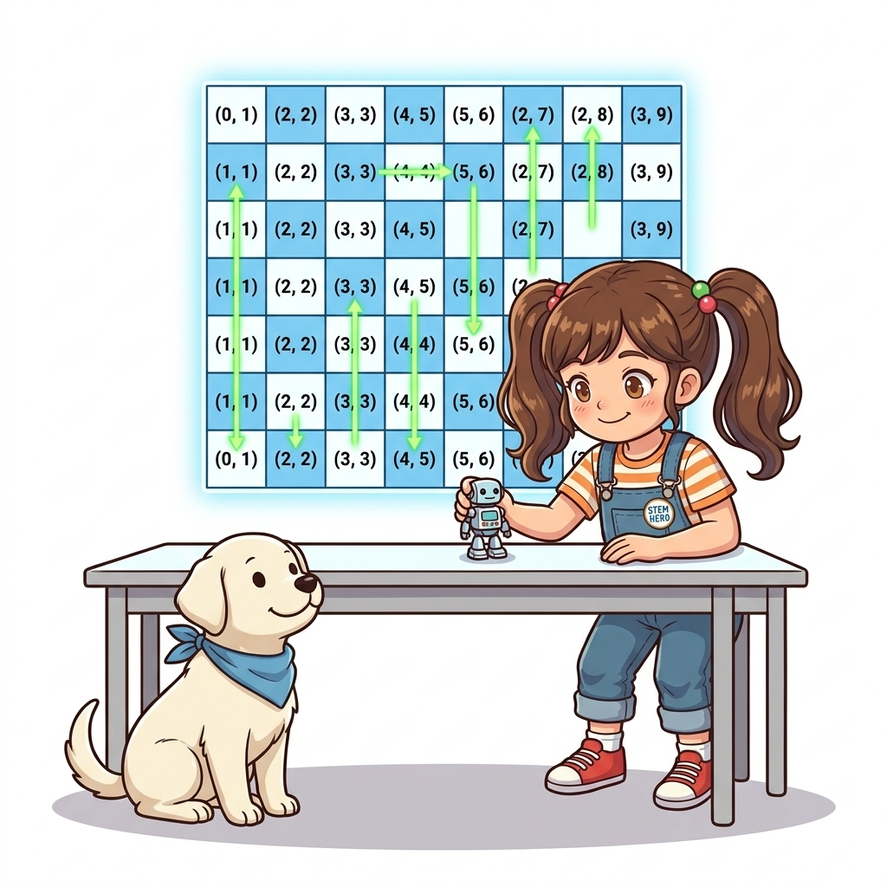
**그림 09-1-1a** 컴퓨터 화면 속 정밀한 바둑판처럼 상태와 규칙이 100% 투명하게 정해져 있는 알려진 환경 모델

> "알려진 환경 모델은 마치 정밀한 바둑판이나 체스판과 같습니다. 에이전트가 어떤 위치에서 어떤 행동을 취했을 때, 다음에 도달할 위치와 주어질 보상이 컴퓨터 메모리 안에 규칙으로 100% 투명하게 정의되어 있습니다. 이처럼 명확한 모델이 주어지면 에이전트는 실제로 환경을 밟아보지 않고도 머릿속 계산만으로 최적 경로를 계획할 수 있습니다."

---

# 09.1 몬테카를로법 기초
## 09.1.0.2 그리드월드의 상태 전이와 보상 규칙

예를 들어 앞서 다룬 '그리드 월드(Grid World)' 문제에서는 에이전트의 행동에 따른 다음 상태(위치)와 보상이 명확했습니다. 

에이전트가 어떤 칸에서 '오른쪽' 버튼을 눌렀을 때, 벽에 부딪힐지 아니면 다음 칸으로 이동할지, 그리고 그 칸에 도달했을 때 사과 보상을 받을지 독버섯 감점을 받을지가 한 치의 오차도 없이 미리 정해져 있었습니다.

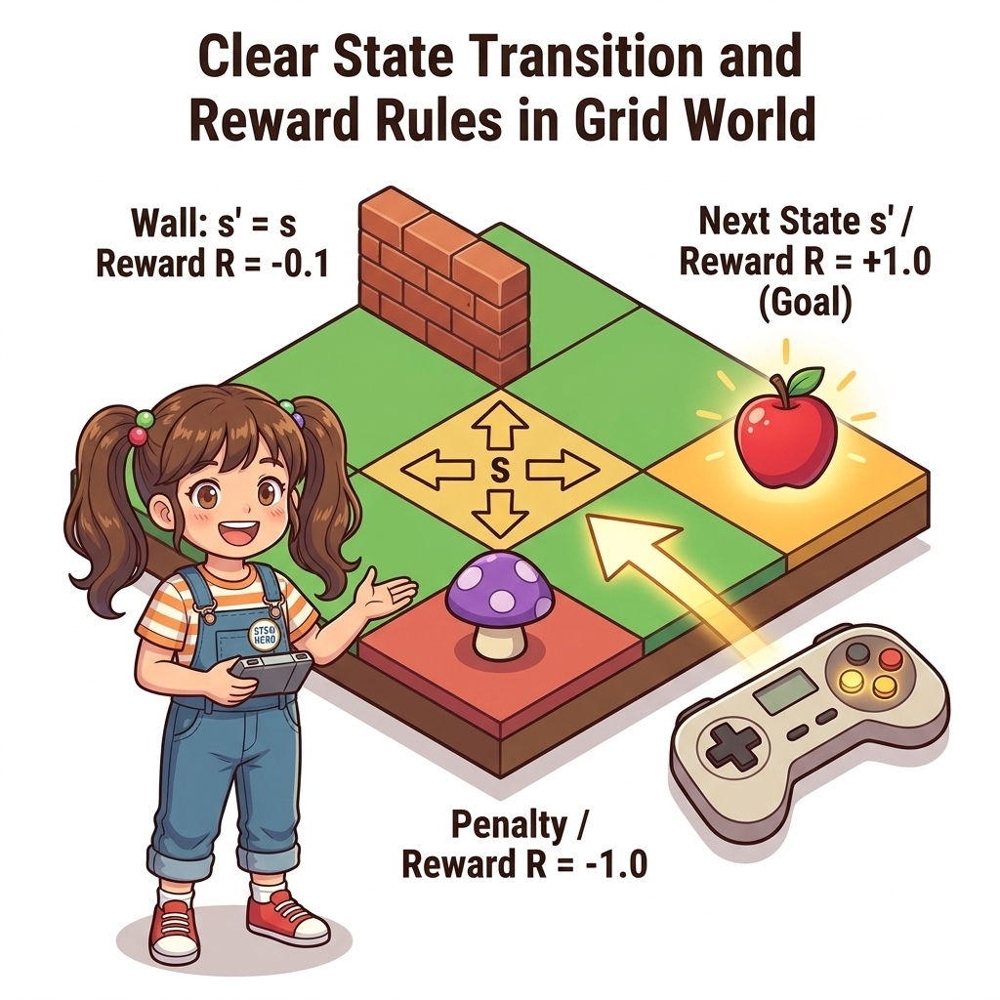
**그림 09-1-1b** 그리드월드에서 에이전트의 행동에 따른 다음 상태 전이와 즉각 보상 규칙이 사전에 명확하게 정해져 있는 구조

> "그리드월드의 구체적인 전이와 보상 규칙을 살펴보겠습니다. 예를 들어 (1, 1) 상태에서 '오른쪽'으로 이동하면 100% 확률로 (1, 2)에 도달하고, 이때 즉각 보상은 -1.0이 주어집니다. 이처럼 다음 상태 s'와 보상 r이 어떤 확률로 주어지는지 명확한 표나 규칙으로 이미 알고 있는 상태를 환경 모델이 알려져 있다고 표현합니다."

---

# 09.1 몬테카를로법 기초
## 09.1.0.3 상태 전이 확률과 보상 함수 수식 기호 해부

수식으로 표현하면 **상태 전이 확률 *p*(*s*' | *s*, *a*)**와 **보상 함수 *r*(*s*, *a*, *s'*)**를 완벽하게 이용할 수 있었습니다. 

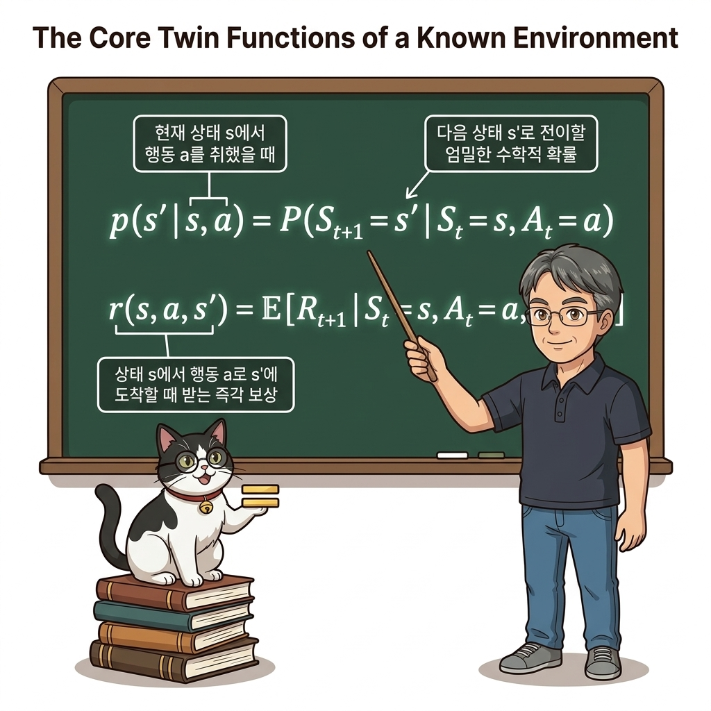
**그림 09-1-1c** 알려진 환경 모델의 2대 수학 기둥: 상태 전이 확률 p(s'|s,a)와 보상 함수 r(s,a,s')의 수식 기호 해부

> "알려진 환경 모델을 수학적으로 표현한 핵심 기호입니다. p(s'|s,a)는 현재 상태 s에서 행동 a를 했을 때 다음 상태 s'로 전이될 조건부 확률이며, r(s,a,s')는 그 전이 과정에서 즉각 주어지는 보상 함수입니다. 동적 프로그래밍은 바로 이 두 가지 수학 공식을 완벽히 알고 있다는 전제하에 벨만 방정식을 풀어 최적 가치를 계산했습니다."

---

# 09.1 몬테카를로법 기초
## 09.1.0.4 결정적 상태 전이 함수

만약 미끄러짐이 없는 완벽한 환경이라면 상태 전이가 결정적(Deterministic)이므로, 다음 상태를 나타내는 수학 함수 *s'* = *f*(*s*, *a*)로 딱 떨어지게 나타낼 수도 있었습니다.

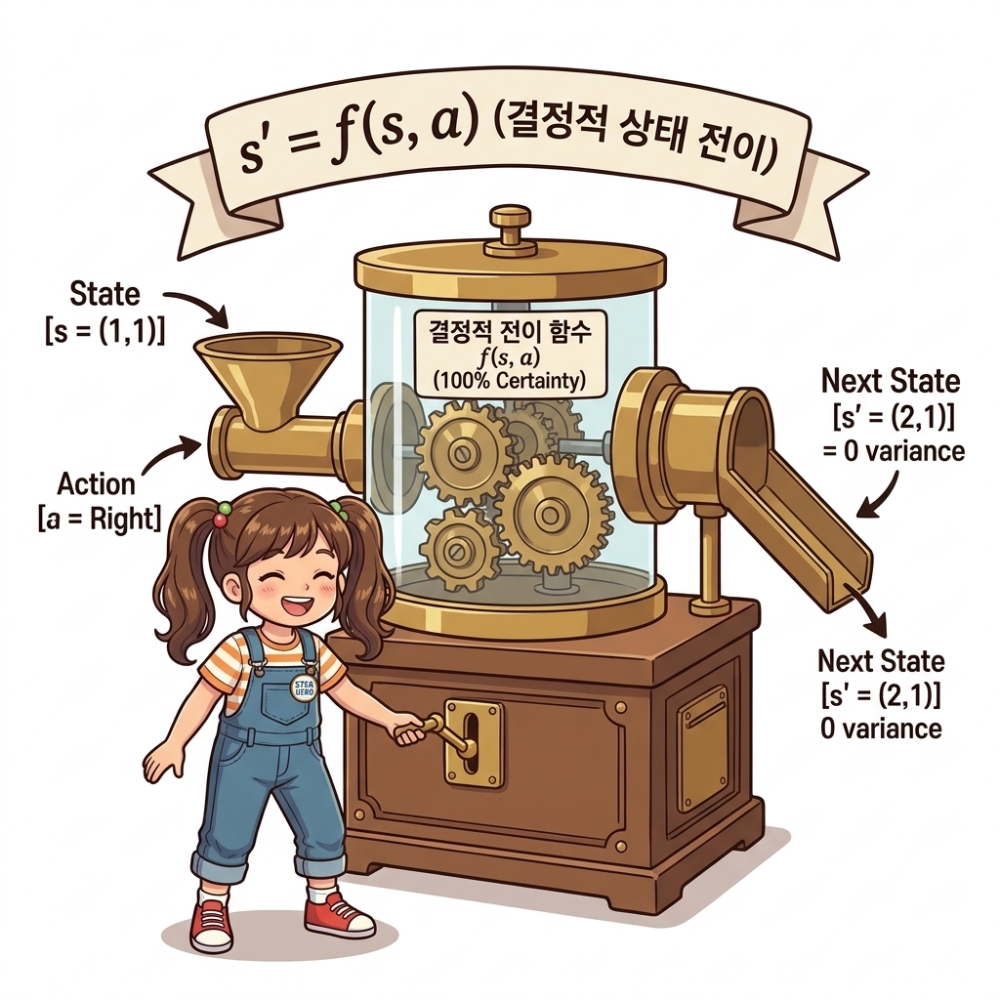
**그림 09-1-1d** 미끄러짐이 없는 완벽한 환경에서의 결정적 상태 전이 함수 s' = f(s, a)

> "바람이 불거나 미끄러짐이 전혀 없는 완벽한 환경이라면 확률이 아닌 결정적 함수 s' = f(s, a)로 나타낼 수 있습니다. 현재 상태와 행동을 함수에 넣으면 다음 상태가 단 하나로 확정되어 나옵니다. 에이전트는 수학 함수 f를 가지고 모든 미래를 한 치의 오차도 없이 미리 예측할 수 있습니다."

---

# 09.1 몬테카를로법 기초
## 09.1.0.5 게임기 소스 코드를 쥔 에이전트의 사전 시뮬레이션

이처럼 환경 모델이 알려진 문제에서는 에이전트 측에서 '상태, 행동, 보상'의 전이를 컴퓨터 시뮬레이션으로 완전히 계산할 수 있었습니다. 

마치 게임기 내부의 소스 코드를 에이전트가 손에 쥐고 있는 것과 같아서, 굳이 직접 캐릭터를 움직여보지 않고도 머릿속(메모리 연산)으로만 미래의 모든 가능성을 시뮬레이션하고 최적의 길을 찾아낼 수 있었습니다.

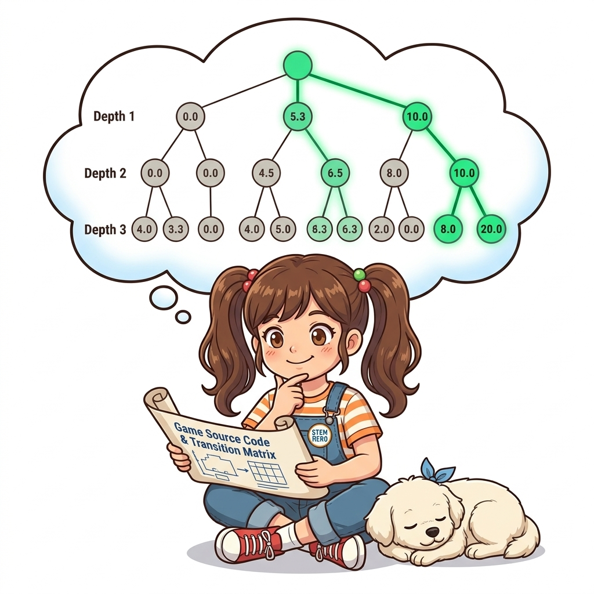
**그림 09-1-1e** 게임기 소스 코드를 쥔 에이전트가 메모리 연산만으로 미래의 모든 가능성을 사전 시뮬레이션하는 계획(Planning)

> "환경 모델을 안다는 것은 마치 게임기 본체의 내부 소스 코드를 에이전트가 통째로 쥐고 있는 것과 같습니다. 적이 언제 어디서 나타날지, 점수가 어떻게 계산될지 코드를 뜯어보면 다 알 수 있으므로, 에이전트는 실제로 게임을 플레이하지 않고도 메모리 속에서 모든 수를 미리 시뮬레이션하여 최적의 전략을 세울 수 있습니다."

---

# 09.1 몬테카를로법 기초
## 09.1.0.6 온실 밖 미지의 현실 세계로의 출발

### 하지만, 현실에는 환경 모델을 알 수 없는 문제가 많습니다

온실 밖의 현실 세계로 한 걸음만 나가보면 상황은 180도 달라집니다. 

현실에는 환경 모델을 사전에 알 수 없는 문제가 셀 수 없이 많습니다.


**그림 09-1-1f** 온실 밖으로 나와 예측 불가능한 변수들이 소용돌이치는 미지의 현실 세계로 첫발을 내딛는 도로시

> "이제 온실 밖 진짜 현실 세계로 눈을 돌려보겠습니다. 우리가 살고 있는 현실은 그리드월드처럼 깔끔하지 않습니다. 날씨가 급변하고, 주식 시장이 요동치며, 도로 위에는 수많은 돌발 변수가 존재합니다. 자연계의 복잡한 물리 법칙이나 인간의 심리는 단 몇 줄의 수학 공식으로 가둘 수 없는 미지의 세계입니다."

---

# 09.1 몬테카를로법 기초
## 09.1.0.7 편의점 삼각김밥 재고 관리의 현실적 불확실성

예를 들어 편의점의 '상품 재고 관리'나 도로 위를 달리는 '자율주행차의 주행 제어'를 생각해 봅시다. 

재고 관리 문제에서는 '내일 삼각김밥이 몇 개나 팔릴 것인가'가 환경의 상태 전이 확률에 해당합니다. 그런데 내일 삼각김밥의 판매량은 계절의 변화, 당일의 날씨(비나 눈), 주변 학교의 시험 기간, SNS에서 유행하는 최신 먹방 트렌드, 경기 변동, 심지어 손님 한 사람 한 사람의 기분까지 수많은 요인이 복잡하게 얽혀 결정되기 때문에 **사전에 수식으로 완벽하게 알아내기가 현실적으로 불가능**합니다. 

그 어떤 천재 수학자도 '내일 삼각김밥이 17개 팔릴 확률은 0.0842...'와 같은 엄밀한 확률 공식을 작성해 건네줄 수 없습니다.

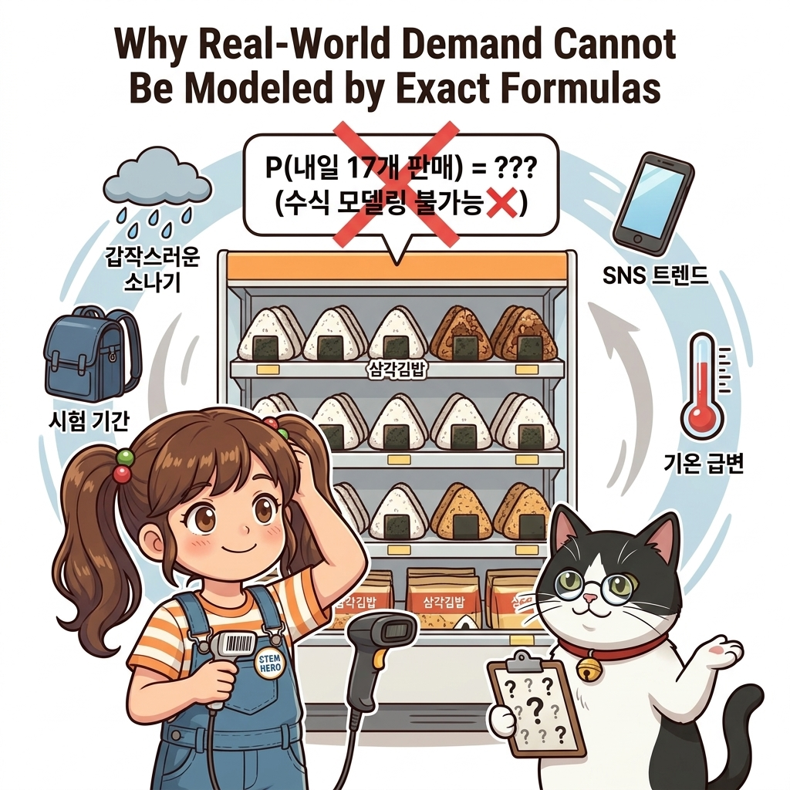
**그림 09-1-1g** 날씨, 시험기간, 트렌드 등 수많은 요인으로 인해 사전에 엄밀한 수식을 세울 수 없는 편의점 삼각김밥 재고 관리의 현실적 불확실성

> "편의점의 삼각김밥 재고 관리 예시를 생각해 보겠습니다. 내일 비가 올지, 근처 학교가 시험기간인지, 갑자기 어떤 유행이 번질지에 따라 고객의 수요는 끊임없이 변합니다. 내일 삼각김밥이 몇 개 팔릴지를 나타내는 엄밀한 전이 확률 수식 p(s'|s,a)를 수학적으로 완벽히 정의하는 것은 불가능에 가깝습니다."

---

# 09.1 몬테카를로법 기초
## 09.1.0.8 계산 복잡도의 폭발과 슈퍼컴퓨터의 한계

또한, 물리학 법칙을 동원하여 상태 전이 확률을 이론적으로 세울 수 있더라도 **계산량이 너무 방대하여 계산 불능(Tractable)에 빠지는 경우**가 허다합니다. 

바둑이나 체스, 스타크래프트 같은 게임만 해도 가능한 상태와 행동의 조합이 우주의 원자 수(약 10<sup>80</sup>개)보다 훨씬 많습니다. 이 모든 경우의 수를 연립방정식으로 풀려고 들면 최신 슈퍼컴퓨터를 1억 년 동안 돌려도 답을 내지 못하고 멈춰버립니다.


**그림 09-1-1h** 바둑이나 게임에서 우주 전체 원자 수(10^80)를 초과하는 경우의 수로 인한 슈퍼컴퓨터의 계산 불능 한계

> "설령 물리 법칙을 완벽히 동원해 수식을 세울 수 있다 해도 또 다른 장벽이 있습니다. 바로 계산 복잡도의 폭발입니다. 바둑만 하더라도 가능한 경우의 수가 우주 전체의 모든 원자 수인 10의 80제곱을 아득히 뛰어넘습니다. 슈퍼컴퓨터를 수억 년 동안 돌려도 모든 확률 분포를 전개하는 것은 물리적으로 불가능합니다."

---

# 09.1 몬테카를로법 기초
## 09.1.0.9 복잡한 계산 상상과 친근한 주사위

얼마나 계산이 복잡해지는지 피부로 실감할 수 있도록, 이번 절에서는 우선 우리가 친숙하게 접할 수 있는 '주사위'를 예로 들어 간단한 비교 작업을 해보겠습니다.

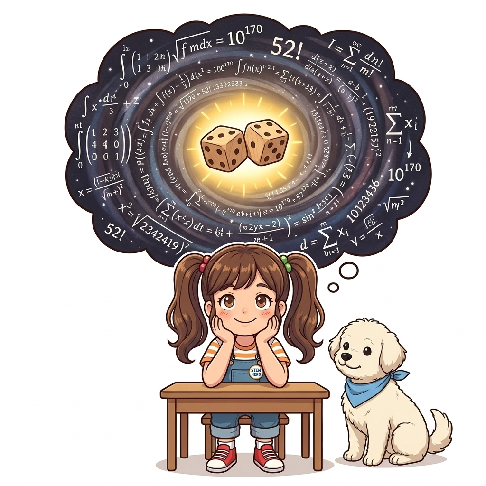
**그림 09-1-1i** 천문학적인 복잡한 계산의 소용돌이를 상상하며 아찔해하다가, 친근한 주사위 예시를 떠올리며 호기심을 반짝이는 도로시와 토토

> "우주적 규모의 계산 복잡도를 상상하면 눈앞이 아찔해집니다. 하지만 지레 겁먹을 필요는 없습니다. 몬테카를로법은 이렇게 복잡한 공식을 풀지 않고도, 친근한 주사위 놀이처럼 무작위 시행을 반복하여 문제를 아주 단순하고 명쾌하게 해결하는 놀라운 발상의 전환을 제시하기 때문입니다."

---

# 09.1 몬테카를로법 기초
## 09.1.1 주사위 눈의 합과 확률 전개도

## 09.1.1 주사위 눈의 합

주사위 두 개를 책상 위에 올려놓고 굴리는 문제를 상상해 봅시다. 

주사위는 정육면체이고 모서리가 균일하게 깎여 있어서, 각 눈(1부터 6까지)이 나올 확률은 정확하게 공평한 **1/6**이라고 가정합니다.


**그림 09-1-2** 주사위 2개를 던졌을 때 나타나는 36가지 눈금 조합 매트릭스와 확률 분포를 분석하는 도로시, 토토, 지니

> "주사위 두 개를 동시에 굴려 나오는 눈의 합을 관찰해 보겠습니다. 1부터 6까지 적힌 두 개의 주사위를 던졌을 때, 눈의 합은 최소 2부터 최대 12까지 나타납니다. 모든 경우를 나열하여 각 합이 나타날 확률을 표로 정리한 것이 바로 확률 분포이며, 이를 통해 기댓값의 개념을 직관적으로 이해할 수 있습니다."

---

# 09.1 몬테카를로법 기초
## 09.1.1.1 두 주사위 36가지 경우의 수 전개 격자도

### 2개 주사위의 확률 전개도와 분포

두 주사위를 던졌을 때 나올 수 있는 모든 경우의 수는 첫 번째 주사위의 눈(6가지)과 두 번째 주사위의 눈(6가지)을 곱한 6 × 6 = **36가지**입니다. 


**그림 09-1-2a** 두 주사위를 굴렸을 때 나타나는 6×6 = 36가지 가능한 모든 눈금 쌍의 전개 격자 매트릭스

> "두 주사위를 던져 나올 수 있는 모든 경우를 6 곱하기 6의 격자 매트릭스로 펼쳐보았습니다. 첫 번째 주사위 6가지, 두 번째 주사위 6가지가 만나 총 36가지의 독립적인 순서쌍이 형성됩니다. 모든 칸의 발생 확률은 36분의 1로 완전히 동일합니다."

---

# 09.1 몬테카를로법 기초
## 09.1.1.2 주사위 눈의 합 조합 피라미드

두 주사위 눈의 합을 집계해 보면, 가장 작은 합은 1 + 1 = 2이고 가장 큰 합은 6 + 6 = 12입니다. 

이때 각 합이 나오는 경우의 수를 세어보면 다음과 같습니다:

- 합이 2가 되는 경우: (1, 1) → 1가지
- 합이 3이 되는 경우: (1, 2), (2, 1) → 2가지
- 합이 4가 되는 경우: (1, 3), (2, 2), (3, 1) → 3가지
- 합이 5가 되는 경우: (1, 4), (2, 3), (3, 2), (4, 1) → 4가지
- 합이 6이 되는 경우: (1, 5), (2, 4), (3, 3), (4, 2), (5, 1) → 5가지
- **합이 7이 되는 경우**: (1, 6), (2, 5), (3, 4), (4, 3), (5, 2), (6, 1) → **6가지 (가장 많음!)**
- 합이 8이 되는 경우: (2, 6), (3, 5), (4, 4), (5, 3), (6, 2) → 5가지
- 합이 9가 되는 경우: (3, 6), (4, 5), (5, 4), (6, 3) → 4가지
- 합이 10이 되는 경우: (4, 6), (5, 5), (6, 4) → 3가지
- 합이 11이 되는 경우: (5, 6), (6, 5) → 2가지
- 합이 12가 되는 경우: (6, 6) → 1가지

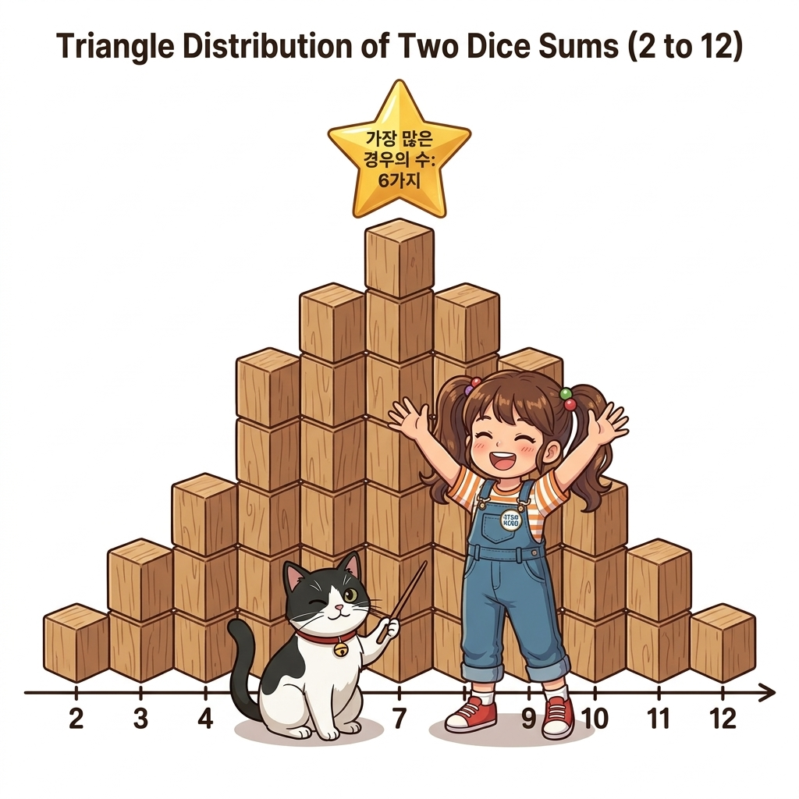
**그림 09-1-2a2** 두 주사위 눈의 합(2~12) 가짓수 집계와 합 7이 6가지로 최정점을 이루는 대칭 삼각형 피라미드 다이어그램

> "두 주사위 눈의 합을 집계하여 가짓수를 피라미드 형태로 쌓아 올렸습니다. 가장 작은 합 2는 (1,1) 한 가지뿐이고, 가장 큰 합 12도 (6,6) 한 가지입니다. 하지만 가운데에 위치한 합 7은 무려 6가지 조합이 존재하여 가장 높은 정점을 이룹니다. 양쪽이 완벽하게 대칭을 이루는 아름다운 구조입니다."

---

# 09.1 몬테카를로법 기초
## 09.1.1.3 주사위 눈의 합 종 모양 확률 분포

두 주사위 눈의 합을 집계하면 다음과 같은 대칭적인 확률 분포를 얻을 수 있습니다:

| 합 (*x*) | 2 | 3 | 4 | 5 | 6 | **7** | 8 | 9 | 10 | 11 | 12 |
| :---: | :---: | :---: | :---: | :---: | :---: | :---: | :---: | :---: | :---: | :---: | :---: | :---: | :---: |
| **나오는 가짓수** | 1 | 2 | 3 | 4 | 5 | **6** | 5 | 4 | 3 | 2 | 1 |
| **확률 *P*(*x*)** | 1/36 | 2/36 | 3/36 | 4/36 | 5/36 | **6/36** | 5/36 | 4/36 | 3/36 | 2/36 | 1/36 |

> [!NOTE]
> **💡 확률분포(Probability Distribution)란?**  
> 어떤 확률 변수(여기서는 '두 주사위 눈의 합 *X*')가 취할 수 있는 모든 개별 값과, 그 값들이 각각 나타날 확률 *P*(*X* = *x*)를 대응시켜 놓은 표나 그래프를 말합니다. 주사위 눈의 합은 최소 2부터 최대 12까지 가능하며, 7이 나올 확률이 6/36(약 16.7%)로 가장 높고 양쪽으로 갈수록 종 모양으로 확률이 낮아집니다.

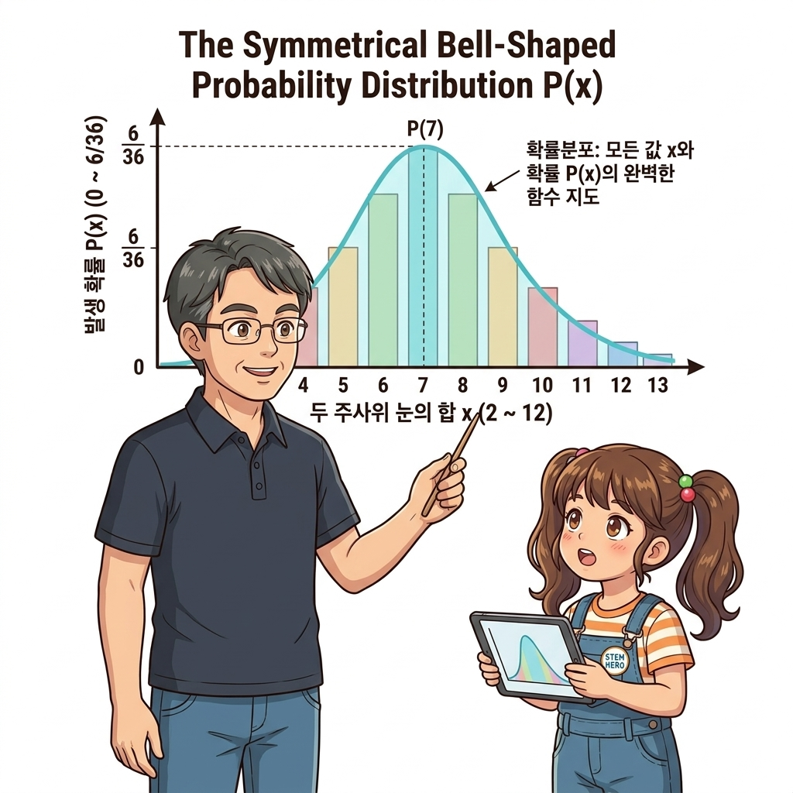
**그림 09-1-2a3** 두 주사위 눈의 합에 대한 대칭 종 모양(Bell-shaped) 확률 분포(Probability Distribution) 그래프

> "앞서 구한 가짓수를 바탕으로 확률 분포 그래프를 그려보았습니다. 가운데인 합 7이 36분의 6, 즉 약 16.7%로 가장 높고, 양 끝으로 갈수록 확률이 점진적으로 낮아지는 전형적인 종 모양 곡선이 완성됩니다. 이것이 바로 주사위 눈의 합이 가지는 이론적 확률 분포입니다."

---

# 09.1 몬테카를로법 기초
## 09.1.1.4 확률 분포를 통한 기댓값 계산 공식

### 확률 분포를 통한 기댓값 계산

이 확률 분포를 알면 이론적 기댓값(Expected Value)을 다음과 같이 계산할 수 있습니다:

> ### (식 9.1-1) 이산 확률 변수의 이론적 기댓값
> E[*X*] = ∑<sub>*x*</sub> *x* · *P*(*X* = *x*)

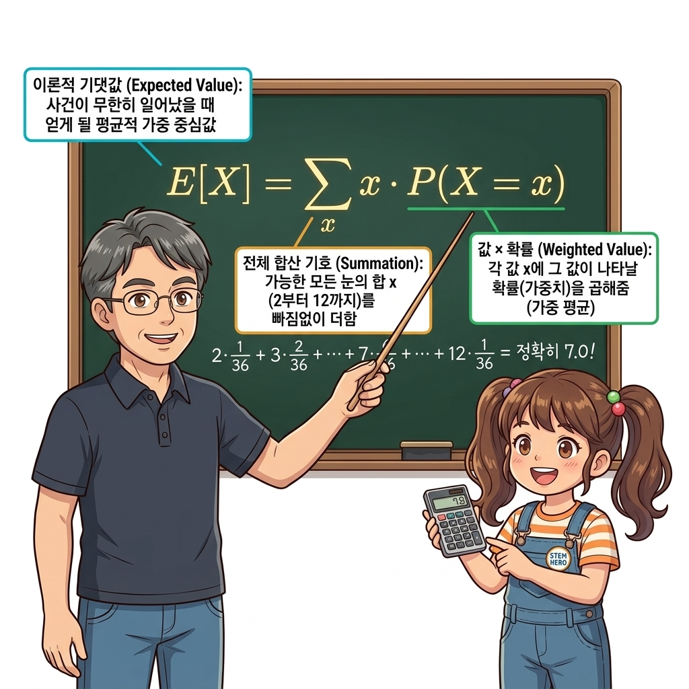
**그림 09-1-2a4** 이산 확률 변수의 이론적 기댓값 공식 E[X] = ∑ x · P(X = x) 기호 해부 및 가중합 원리 인포그래픽

> "확률 분포가 주어졌을 때 이론적 참 기댓값을 구하는 공식입니다. 기댓값 E[X]는 나올 수 있는 모든 사건 값 x에 그 사건이 발생할 엄밀한 수학적 확률 P를 곱한 뒤 전부 더해주는 가중합입니다. 주사위 눈의 합 2부터 12까지 각 값에 해당 확률을 곱해 합산하면 이론적 중심값을 얻게 됩니다."

---

# 09.1 몬테카를로법 기초
## 09.1.1.5 이호진 교수님의 기댓값 시소 강의

수학적으로는 각 합에 해당 확률을 곱해 모두 더하면 정확히 **7.0**이 나옵니다. 


**그림 09-1-2b** 이호진 교수님이 나무 시소(저울) 교구를 활용해 기댓값 7.0의 물리적 무게중심 원리를 도로시와 토토에게 친절하게 설명하는 장면

> 👨‍🏫 **이호진 교수님의 눈높이 특강: 기댓값은 '시소의 무게중심'이란다!**  
> "도로시야, 기댓값이라는 말이 어렵게 느껴질 수 있지만, 사실은 **놀이터에 있는 시소(Seesaw)의 균형점**과 똑같단다.  
> 2부터 12까지 번호가 적힌 긴 나무 널빤지 위에, 각 숫자가 나올 확률만큼의 무게추를 올려놓았다고 상상해 보렴.  
> 7 위에는 가장 무거운 6개의 추(6/36)가 올라가고, 6과 8 위에는 각각 5개, 2와 12 위에는 가장 가벼운 1개씩의 추가 올라가게 되지.  
> 이때 시소 받침대를 정확히 **'7.0'** 위치에 놓아야 시소가 양쪽으로 기울어지지 않고 완벽하게 수평을 유지한단다!  
> 즉, **기댓값 E[*X*]란 모든 확률적 사건들이 평형을 이루는 수학적 무게중심**이란다."

> 👧 **도로시의 깨달음**:  
> "아하! 그래서 2부터 12까지 더해서 단순히 2와 12의 가운데인 7이 나온 게 아니라, 7을 중심으로 양쪽의 확률이 완전히 거울처럼 대칭을 이루기 때문에 시소 받침대가 정확히 7.0에 놓이는 것이군요!"

> "이호진 교수님의 칠판 시소 강의를 살펴보겠습니다. 시소의 받침점이 바로 기댓값의 물리적 위치입니다. 종 모양으로 대칭을 이루는 확률 무게추들이 양쪽에 고르게 얹혀 있을 때, 시소가 완벽하게 수평을 이루는 정중앙의 무게중심 위치가 바로 7.0입니다. 기댓값은 확률 분포의 물리적 무게중심과 완벽히 일치합니다."

---

# 09.1 몬테카를로법 기초
## 09.1.1.6 파이썬 기댓값 누적 계산 알고리즘

#### 파이썬 코드로 작성해 봅시다:

```python
ps = {2: 1/36, 3: 2/36, 4: 3/36, 5: 4/36, 6: 5/36, 7: 6/36,
      8: 5/36, 9: 4/36, 10: 3/36, 11: 2/36, 12: 1/36}

V = 0
for x, p in ps.items():
    V += x * p
print("계산된 기댓값 V:", V) # [출력 결과] 6.999999999999999
```

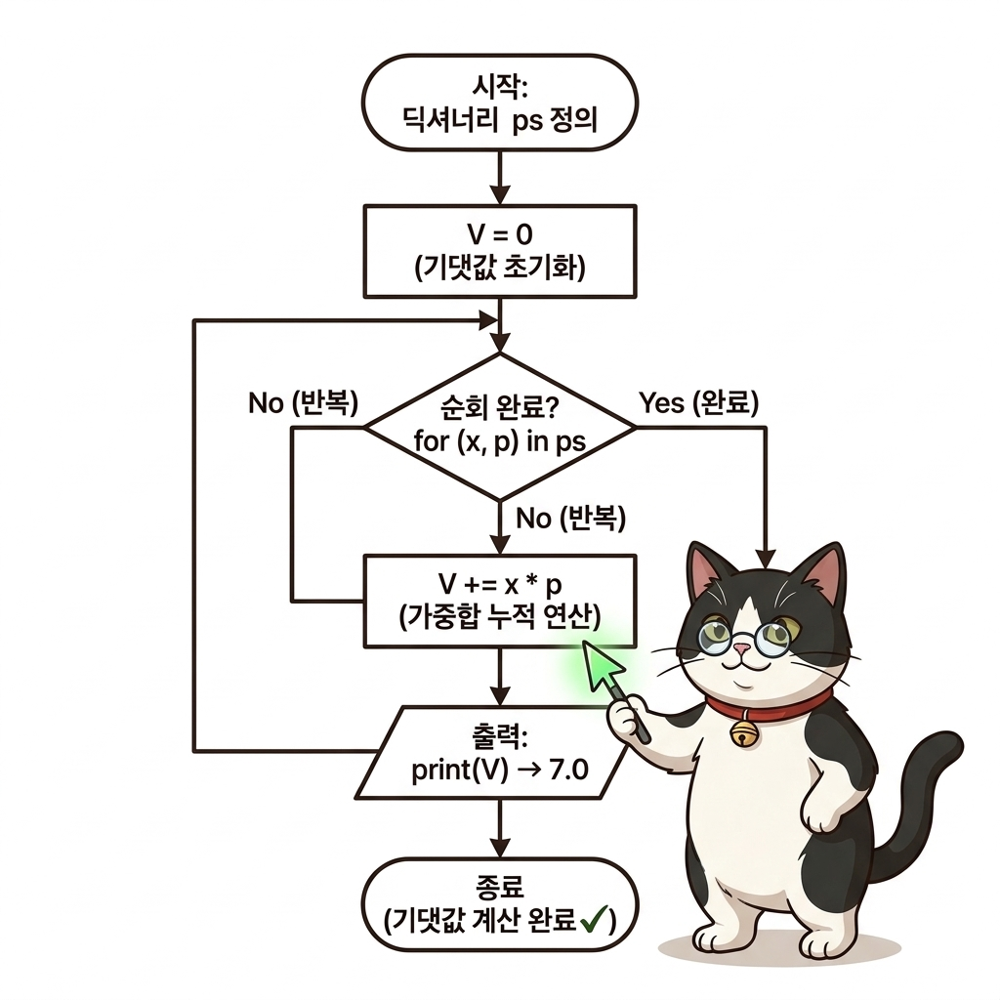
**그림 09-1-2c** 파이썬 기댓값 가중합 누적 계산 알고리즘 실행 순서도

> "파이썬 코드로 기댓값을 누적 계산하는 알고리즘 순서도입니다. 합 2부터 12까지 딕셔너리를 순회하면서, 각 합 x와 확률 p를 곱한 값을 변수 V에 계속해서 더해 나갑니다. 루프가 모두 끝나면 이론적 기댓값의 최종 누적 결과가 출력됩니다."

---

# 09.1 몬테카를로법 기초
## 09.1.1.7 부동소수점 2진수 계산 오차의 원리

#### 💡 왜 7.0이 아니라 6.9999...가 나올까요? (부동소수점 계산 오차)
컴퓨터는 내부적으로 모든 숫자를 0과 1로 이루어진 2진수로 처리합니다. 십진수 분수인 `1/36 = 0.027777...`은 2진수로 바꾸면 무한히 반복되는 무한소수가 됩니다. 컴퓨터는 메모리 한계로 인해 일정 자리에서 숫자를 잘라내므로, 미세한 반올림 오차가 누적되어 수학 이론값인 `7.0` 대신 `6.999999999999999`가 출력됩니다. 컴퓨터의 이러한 계산 오차를 감안하면 출력값은 수학 이론값인 7.0과 완전히 동일합니다.

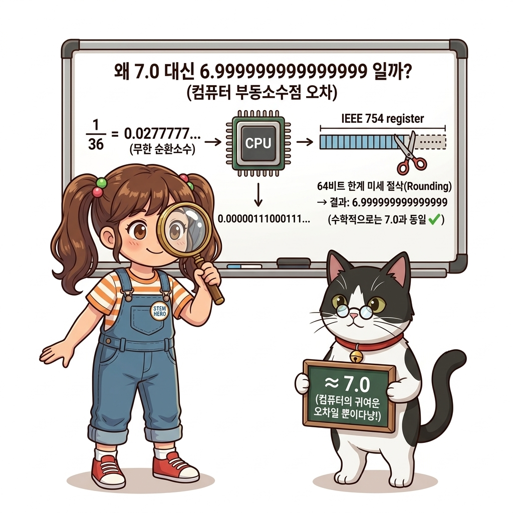
**그림 09-1-2d** 1/36의 2진수 변환 시 발생하는 무한 순환소수와 64비트 메모리 절삭으로 인한 6.9999... 부동소수점 오차 원리

> "파이썬 연산 결과 7.0 대신 6.9999가 출력되는 원리입니다. 컴퓨터는 10진수 숫자를 2진수 비트로 변환하여 메모리에 저장합니다. 3분의 1을 10진수로 정확히 쓸 수 없듯이, 36분의 1과 같은 분수는 2진수에서 무한 소수가 되어 미세한 반올림 오차가 누적됩니다. 부동소수점의 하드웨어적 한계이지만 이론적 참값은 7.0이 맞습니다."

---

# 09.1 몬테카를로법 기초
## 09.1.1.8 강화학습의 궁극적 목표 기대 수익 극대화

이처럼 **확률 분포를 완벽하게 알고 있다면 공식에 대입하여 참 기댓값을 단번에 계산**할 수 있습니다. 

강화학습의 궁극적 목표는 '에이전트가 앞으로 얻을 보상의 총합에 대한 기댓값(기대 수익)'을 극대화하는 것이므로, 기댓값의 계산 원리를 이해하는 것은 매우 중요합니다.


**그림 09-1-2e** 강화학습의 궁극적 목표: 미래에 얻을 모든 보상의 총합에 대한 기댓값(기대 수익 E[G_t])을 극대화하기 위해 나아가는 에이전트와 기댓값 계산의 중요성

> "이처럼 확률 분포를 완벽히 알면 단 한 번의 공식 계산으로 참 기댓값을 얻을 수 있습니다. 강화학습의 궁극적인 목표 역시 매 상태에서 얻게 될 미래 보상들의 참 기댓값을 극대화하는 것입니다. 그렇다면 현실처럼 확률 분포를 모를 때는 어떻게 기댓값을 구할 수 있을까요?"

---

# 09.1 몬테카를로법 기초
## 09.1.2 분포 모델과 샘플 모델의 비교

## 09.1.2 분포 모델과 샘플 모델

환경을 표현하는 수학적 방식에는 크게 **분포 모델**과 **샘플 모델**의 두 가지가 있습니다.

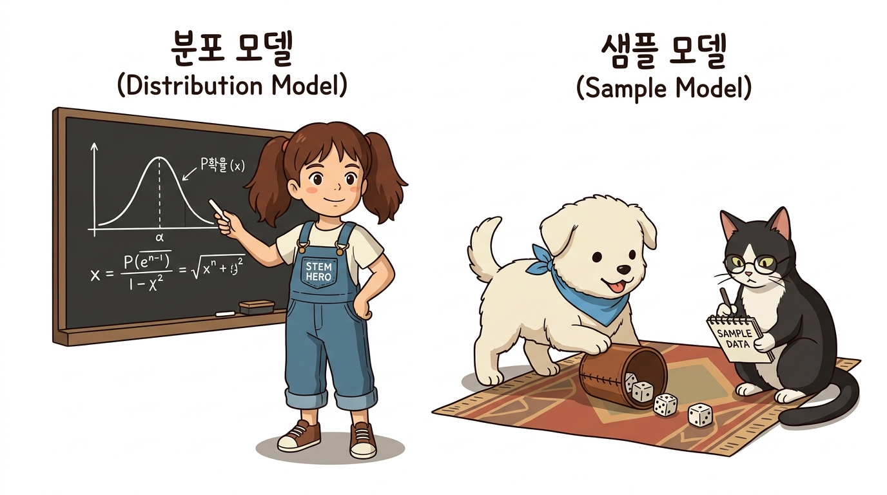
**그림 09-1-3** 완벽한 확률 곡선 지도를 연구하는 분포 모델과, 주사위를 직접 굴려 관측 데이터를 모으는 샘플 모델의 비교


> 👧 **도로시와 토토의 비유로 이해하기**:
>
> * **분포 모델**은 도로시가 36가지 주사위 눈 조합과 각 확률이 완벽하게 적힌 지도를 들고 칠판에서 공부하는 것과 같습니다. 모든 확률적 가능성을 머릿속으로 사전에 계산해 볼 수 있습니다.
> * **샘플 모델**은 토토가 직접 주사위를 컵에 넣고 수없이 굴려가며 실제로 나온 표본 눈들을 눈으로 확인하며 배우는 것과 같습니다. 전체 지도는 모르지만, 실제 경험(시행)을 통해 표본을 모아 기댓값을 알아냅니다.
>
>

> "여기서 강화학습의 가장 중요한 두 가지 모델, 분포 모델과 샘플 모델이 등장합니다. 분포 모델은 가능한 모든 경우의 수와 확률을 통째로 펼쳐놓은 설명서이고, 샘플 모델은 주사위를 직접 흔들어 던지듯 단 하나의 구체적인 결과만을 툭 던져주는 시뮬레이터입니다."

---

# 09.1 몬테카를로법 기초
## 09.1.2.1 분포 모델과 동적 프로그래밍(DP) 메커니즘

* **분포 모델 (Distribution Model)**:
  * 확률 분포 *P*(*x*)를 완벽하게 알고 있는 모델입니다.
  * 전체 지도를 펼쳐놓고 모든 가능성을 수식으로 정밀하게 계산합니다.
  * 동적 프로그래밍(DP)이 바로 이 분포 모델을 사용했습니다.

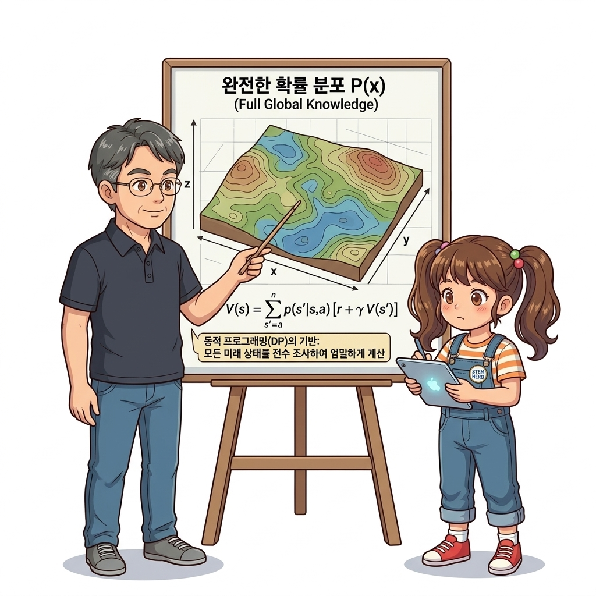
**그림 09-1-3a** 완전한 확률 지도를 펼쳐놓고 모든 미래를 수식으로 전수 조사하는 분포 모델과 동적 프로그래밍(DP)

> "분포 모델은 동적 프로그래밍의 핵심 엔진입니다. 모든 상태 전이의 확률 지도를 통째로 알고 있으므로, 에이전트는 한 번의 수학적 가중합 연산으로 미래의 기댓값을 엄밀하게 계산해냅니다. 하지만 모든 경우의 수를 알고 있어야 한다는 치명적인 전제 조건이 따릅니다."

---

# 09.1 몬테카를로법 기초
## 09.1.2.2 샘플 모델과 몬테카를로(MC) 메커니즘

* **샘플 모델 (Sample Model)**:
  * 전체 확률 분포는 전혀 몰라도, **'표본을 추출(샘플링)할 수만 있으면 충분하다'**는 모델입니다.
  * 주사위를 실제로 컵에 넣고 굴려서 나온 눈의 합을 직접 관찰하는 방식입니다.
  * 몬테카를로법(MC)이 바로 이 샘플 모델을 기반으로 동작합니다.

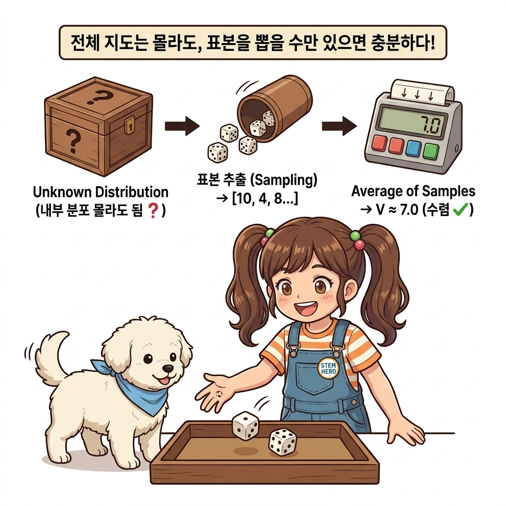
**그림 09-1-3b** 확률 분포를 몰라도 직접 주사위를 굴려 관측한 표본들의 평균으로 가치를 학습하는 샘플 모델과 몬테카를로법(MC)

> "반면 샘플 모델은 몬테카를로법의 심장입니다. 확률 분포 수식을 몰라도 상관없습니다. 동전이나 주사위를 실제로 던져보듯, 환경에 행동을 취해보고 실제로 일어난 단 하나의 다음 상태와 보상 표본만을 수집합니다. 이를 수없이 반복하여 평균을 내는 것이 몬테카를로의 원리입니다."

---

# 09.1 몬테카를로법 기초
## 09.1.2.3 파이썬 코드로 샘플 모델 구현하기

### 파이썬 코드로 샘플 모델 구현하기

주사위 두 개를 굴리는 샘플 모델은 파이썬의 `np.random.choice()`를 이용해 믿을 수 없을 만큼 간단하게 구현할 수 있습니다:

```python
import numpy as np

def sample(dices=2):
    x = 0
    for _ in range(dices):
        x += np.random.choice([1, 2, 3, 4, 5, 6])
    return x

print(sample()) # 실행할 때마다 10, 4, 8 등 무작위 표본 반환
```

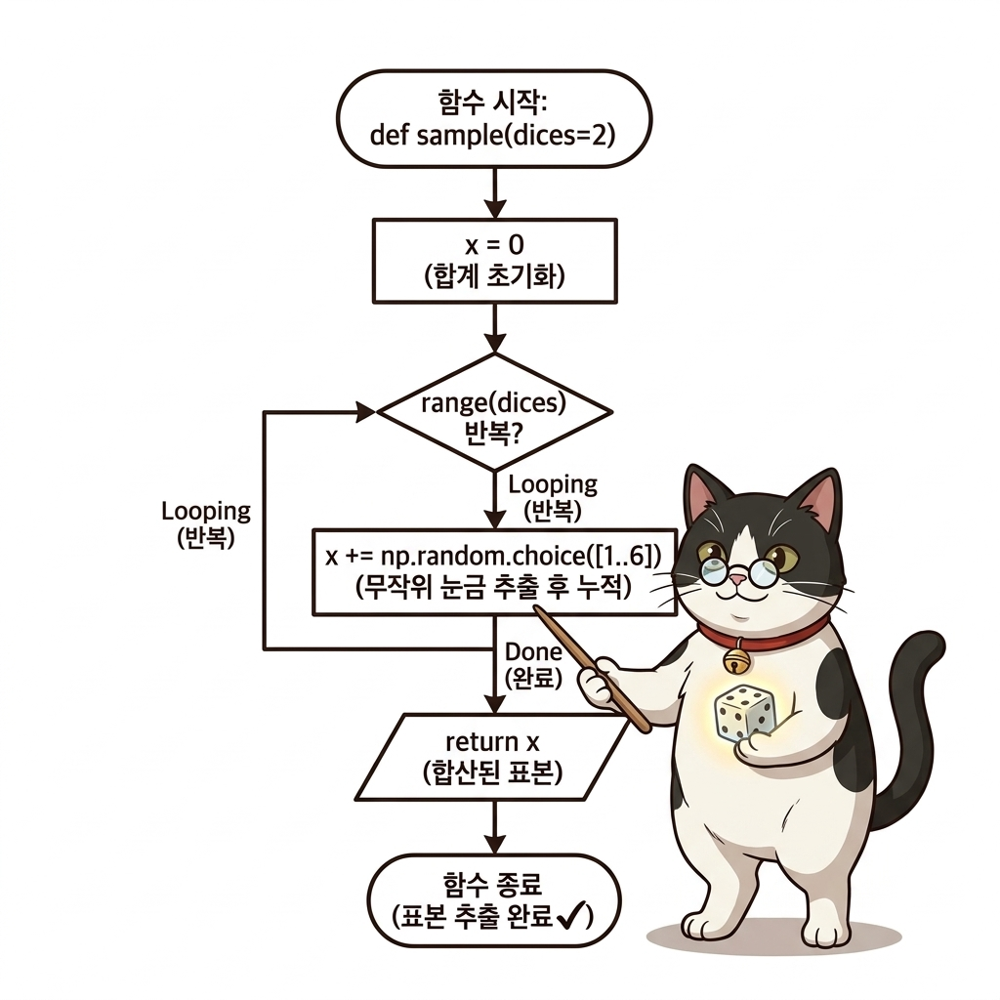
**그림 09-1-3c** 파이썬 `sample(dices=2)` 함수 실행 알고리즘 순서도

전체 확률 분포를 준비할 필요가 전혀 없기 때문에, 환경의 내부 법칙을 모르는 상태에서도 즉시 구현할 수 있습니다.

> "파이썬으로 구현한 간단한 주사위 샘플 모델 함수입니다. random.choice를 사용하여 1부터 6까지의 눈금 중 하나를 무작위로 뽑아 두 주사위의 합을 반환합니다. 복잡한 36가지 확률 분포를 정의하지 않고도, 단 한 줄의 함수 호출로 실제 경험 데이터를 무한히 생성해낼 수 있습니다."

---

# 09.1 몬테카를로법 기초
## 09.1.2.4 10개 주사위의 계산 폭발과 조합론의 한계

### 여러 개의 주사위: 샘플 모델이 빛을 발하는 순간!

만약 주사위를 2개가 아니라 **10개** 굴려서 합계를 구해야 한다면 두 모델의 차이는 어떻게 될까요?

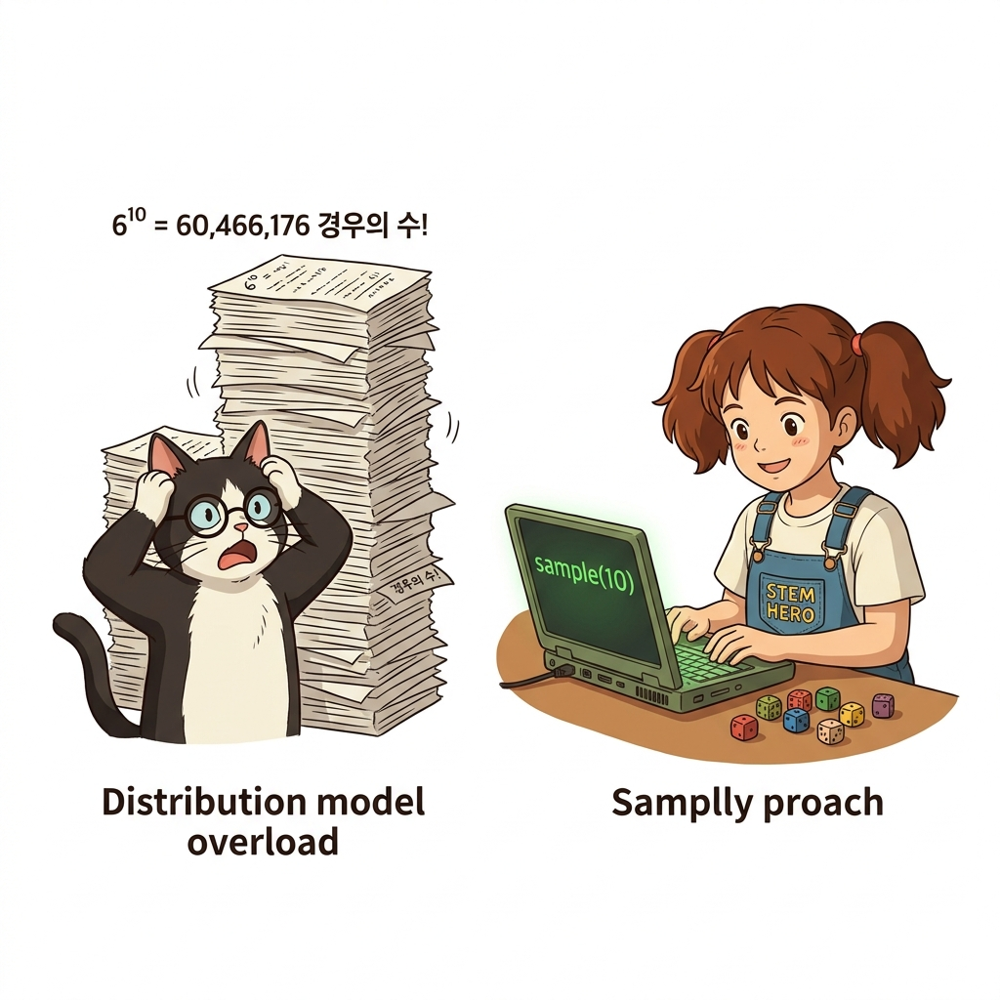
**그림 09-1-4** 6천만 가지 경우의 수에 머리를 쥐어뜯는 지니와, 단 한 줄의 `sample(10)` 코드로 즉시 표본을 뽑아내는 도로시

> "주사위를 10개로 늘렸을 때 두 모델의 운명이 어떻게 갈리는지 살펴보겠습니다. 10개의 주사위를 굴렸을 때 나올 수 있는 모든 경우의 수는 6의 10제곱, 즉 6천만 개가 넘습니다. 분포 모델은 이 6천만 개의 확률을 전부 계산해서 더해야 하므로 심각한 계산 폭발에 직면합니다."

---

# 09.1 몬테카를로법 기초
## 09.1.2.5 주사위 N개의 기하급수적 계산 폭발 그래프

* **분포 모델의 계산 폭발**:
  * 주사위 10개의 합에 대한 이론적인 확률 분포 표를 미리 구하려면 무려 6<sup>10</sup> = **60,466,176가지(약 6천만 가지!)**나 되는 모든 조합을 일일이 전수 조사해야 합니다. 
  * 주사위가 20개, 50개, 100개로 늘어나면 경우의 수가 기하급수적으로 폭발하여 전 세계 슈퍼컴퓨터를 총동원해도 계산이 불가능해집니다.

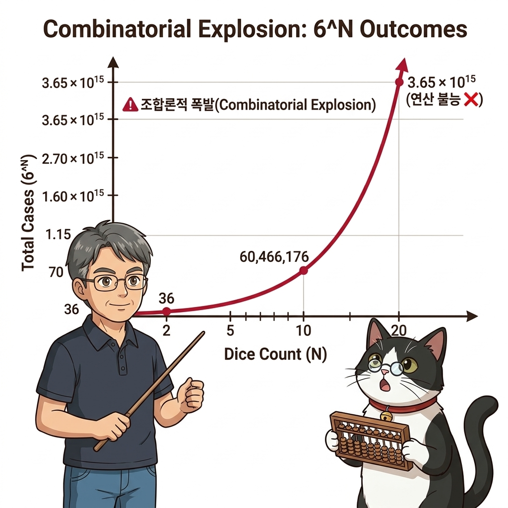
**그림 09-1-4a** 주사위 개수 N에 따른 경우의 수 6^N의 기하급수적 조합론적 폭발 그래프

> "주사위 개수 N이 늘어남에 따라 분포 모델의 계산량이 기하급수적으로 폭발하는 그래프입니다. 주사위가 100개가 되면 경우의 수는 6의 100제곱으로 우주 전체의 원자 수보다 많아집니다. 어떤 최첨단 슈퍼컴퓨터도 분포 모델 방식으로는 답을 계산할 수 없습니다."

---

# 09.1 몬테카를로법 기초
## 09.1.2.6 샘플 모델의 선형적 확장성과 단순성

* **샘플 모델의 초간단 해결**:
  * 반면 샘플 모델은 단순히 `sample(10)`이라고 함수 매개변수 숫자만 바꾸어 호출하면 끝입니다. 컴퓨터가 알아서 눈 깜짝할 사이에 10번 던져 합을 구해줍니다. 10개든 1,000개든 컴퓨터에게는 그저 루프를 몇 번 더 도는 사소한 일에 불과합니다.

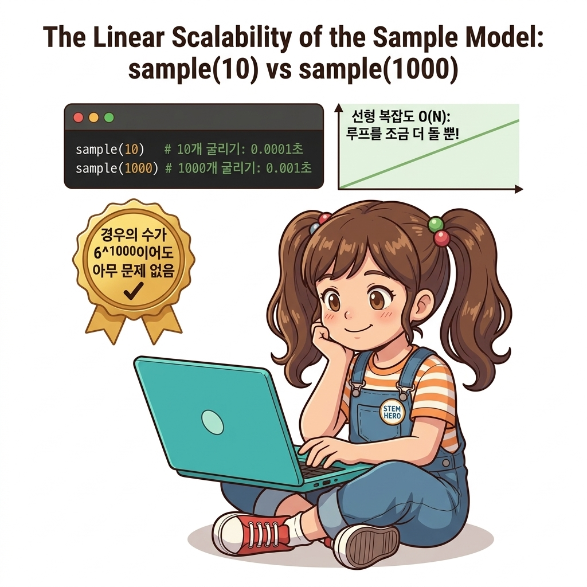
**그림 09-1-4b** 주사위가 10개든 1,000개든 가볍게 O(N) 단일 루프로 표본을 뽑아내는 샘플 모델의 선형적 확장성

> "하지만 샘플 모델은 놀랍도록 단순합니다. 주사위가 10개든 1,000개든 상관없이, 그냥 주사위들을 바닥에 굴려서 나온 눈금들을 쓱 더하면 단 1회의 연산으로 표본 하나가 즉시 얻어집니다. 계산량이 주사위 개수에 비례하여 선형적으로만 증가하므로 거대한 문제도 가볍게 다룰 수 있습니다."

---

# 09.1 몬테카를로법 기초
## 09.1.2.7 몬테카를로법의 철학적 도약과 실용주의

이처럼 **"모든 경우의 수를 일일이 계산하기가 현실적으로 불가능하거나 환경 모델을 모를 때, 실제로 굴려보면서(샘플링) 그 평균값으로 진짜 값을 찾아가는 과정"**이 바로 몬테카를로법의 위대한 존재 이유입니다.


**그림 09-1-4c** 전수 조사가 불가능할 때 직접 경험하고 평균을 내어 참된 가치를 찾아가는 몬테카를로법의 위대한 철학적 도약

> "이것이 바로 몬테카를로법이 이뤄낸 위대한 철학적 도약입니다. 모든 경우의 수를 일일이 계산하는 것이 불가능할 때, 실제로 몇 번 시뮬레이션을 돌려보고 그 표본들의 평균을 내는 것만으로 우주의 참 진리에 도달할 수 있다는 실용주의적 혁명입니다."

---

# 09.1 몬테카를로법 기초
## 09.1.3 몬테카를로법 구현: 도로시의 호기심

## 09.1.3 몬테카를로법 구현

그렇다면 샘플 모델로 어떻게 참 기댓값 7.0을 계산할 수 있을까요? **샘플링을 많이 하고 그 표본들의 산술 평균을 구하면 됩니다.** 표본 수가 커질수록 평균이 참값으로 수렴한다는 통계학의 **대수의 법칙(Law of Large Numbers)**이 이를 완벽하게 보장합니다.

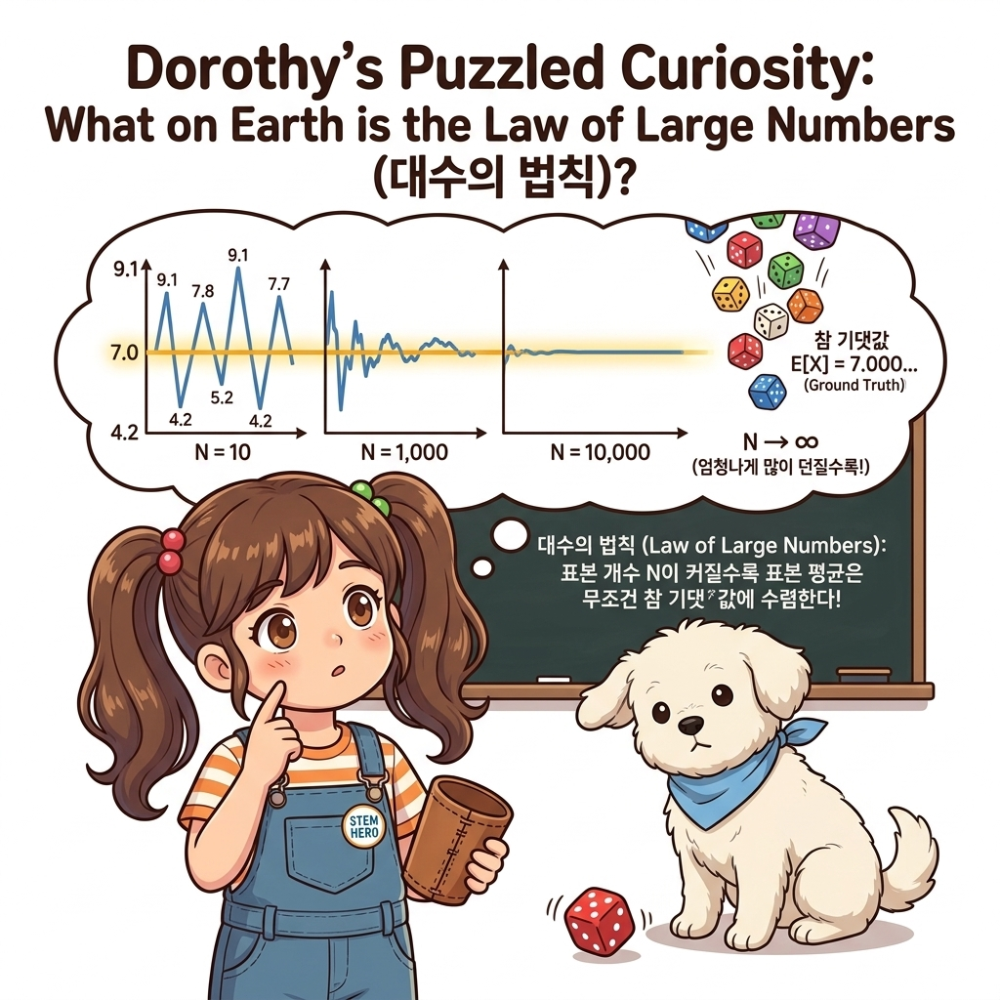
**그림 09-1-4d** "대수의 법칙이 도대체 뭐예요?" 표본 수가 늘어날수록 표본 평균이 참 기댓값 7.0으로 수렴한다는 통계학의 기적에 호기심 어린 의문을 품는 도로시와 토토

> "도로시가 품은 질문처럼, 도대체 무작위로 뽑은 표본 몇 개의 평균이 어떻게 이론적 참값과 같아질 수 있을까요? 그 비밀의 열쇠가 바로 통계학에서 가장 위대한 정리 중 하나인 대수의 법칙에 있습니다."

---

# 09.1 몬테카를로법 기초
## 09.1.3.1 수학적 표현: 표본 평균 공식

### 수학적 표현: 표본 평균 공식

수학적으로 몬테카를로법은 수집한 무작위 표본(*s*<sub>*i*</sub>)들의 **표본 평균(Sample Mean)**으로 참 기댓값 *V*를 추정합니다:

> ### (식 9.1-2) 표본 평균을 이용한 가치 추정
> *V* ≈ 1 / *N* ∑<sub>*i*=1</sub><sup>*N*</sup> *s*<sub>*i*</sub>


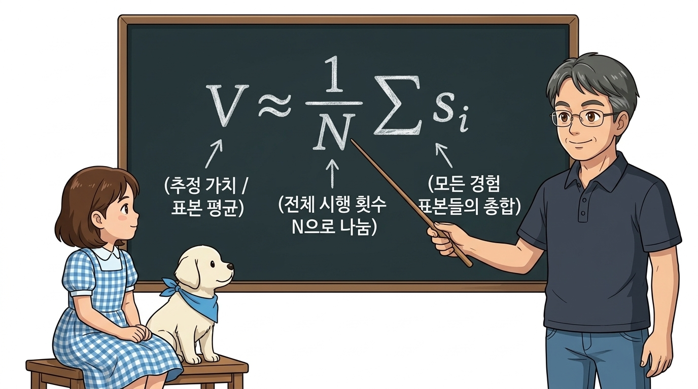
**그림 09-1-5** 이호진 교수님이 칠판에서 표본 평균 기댓값 공식의 3대 블록 기호와 물리적 의미를 알기 쉽게 해설하는 직강 강의

> "표본 평균의 수학적 정의식입니다. 에이전트가 현실 세계에서 직접 부딪히며 측정한 N개의 실제 경험 데이터 s_i를 전부 더한 뒤, 시행 횟수 N으로 나누어 산술 평균 V를 구합니다. 이것이 몬테카를로법에서 가치 함수를 추정하는 가장 기초적인 수식입니다."

---

# 09.1 몬테카를로법 기초
## 09.1.3.2 수식 돋보기: 표본 평균 공식 3대 블록 해부

#### 💡 수식 돋보기: 표본 평균 공식 *V* ≈ 1 / *N* ∑ *s*<sub>*i*</sub> 기호 해부

이 간단한 수식은 몬테카를로 기법 전체를 관통하는 핵심 기둥입니다. 기호 하나하나를 뜯어보면 다음과 같습니다:

1. ***V* ≈ (가치 추정치)**:
   * 환경의 완전한 확률 분포를 알 때 구하는 이론적 참값 E[*X*] 대신, 실제 표본들로 추정한 값임을 물결 기호(`≈`)로 나타냅니다.
2. **1 / *N* (시행 횟수 정규화)**:
   * 지금까지 수집한 전체 표본의 개수 *N*으로 나누어 산술 평균을 만드는 정규화 연산자입니다.
3. **∑<sub>*i*=1</sub><sup>*N*</sup> *s*<sub>*i*</sub> (경험 표본의 누적 총합)**:
   * 에이전트가 1번째부터 *N*번째까지 실제로 환경과 부딪히며 관측한 모든 표본 데이터의 합산입니다.

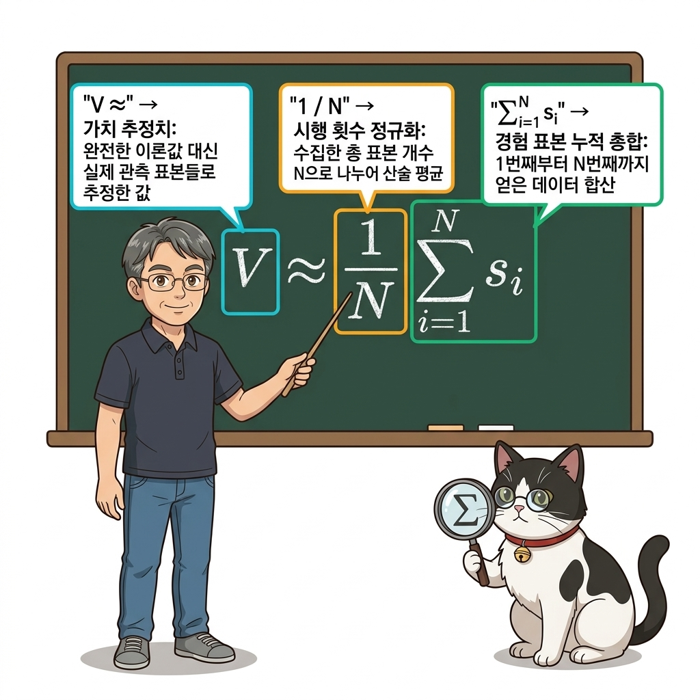
**그림 09-1-5a** 표본 평균 공식 V ≈ (1/N) ∑ s_i의 3대 핵심 블록 기호 해부 인포그래픽

> "표본 평균 공식을 3대 블록으로 분해해 보겠습니다. N분의 1은 데이터 개수로 나누어 주는 정규화 배수이고, 시그마 s_i는 에이전트가 수집한 모든 경험값들의 총합입니다. 대수의 법칙에 의해 시행 횟수 N이 커질수록 이 표본 평균은 이론적 참 기댓값 E[S]로 오차 없이 수렴합니다."

---

# 09.1 몬테카를로법 기초
## 09.1.3.3 파이썬 일반 평균 코드 구현과 알고리즘

### 파이썬 일반 평균 코드 구현

```python
trial = 1000 # 샘플링 횟수

samples = []
for _ in range(trial):
    s = sample()
    samples.append(s)

V = sum(samples) / len(samples) # 표본 평균 계산
print("추정 기댓값 V:", V) # 출력 결과: 6.98 (참값 7.0에 근접!)
```

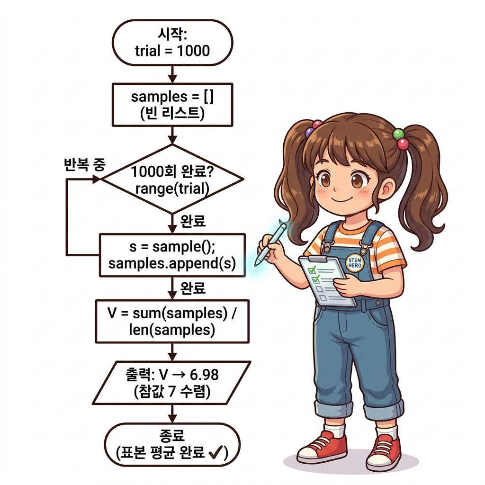
**그림 09-1-5a2** 파이썬 몬테카를로 일반 표본 평균 알고리즘 실행 순서도

1,000번 주사위를 던져 평균을 낸 결과 `6.98`이 나왔으며, 이론적 정답인 7에 매우 근접함을 확인할 수 있습니다. 1만 번, 10만 번으로 횟수를 늘리면 오차는 더욱 줄어듭니다.

> "파이썬으로 구현한 몬테카를로 일반 표본 평균 알고리즘입니다. samples라는 빈 리스트를 만들어두고, 루프를 돌며 수집된 주사위 합 데이터를 계속 append합니다. 루프가 끝나면 sum(samples)를 len(samples)로 나누어 최종 평균을 구합니다."

---

# 09.1 몬테카를로법 기초
## 09.1.3.4 대량 데이터 누적 시 메모리 한계와 비효율

### 메모리 절약의 혁명: 증분 갱신(Incremental Update)

하지만 샘플 데이터가 100만 개, 1억 개로 늘어난다면 어떨까요? 모든 샘플을 `samples` 리스트에 담아두고 매번 `sum()`을 계산하면 컴퓨터 메모리가 부족해지고 연산 속도가 심각하게 느려집니다. 1억 개의 주사위 눈을 메모리에 보관하려면 수백 메가바이트의 RAM이 소모되고, 새로운 주사위를 던질 때마다 과거 1억 개의 데이터를 처음부터 다시 더해야 하는 끔찍한 비효율이 발생합니다.

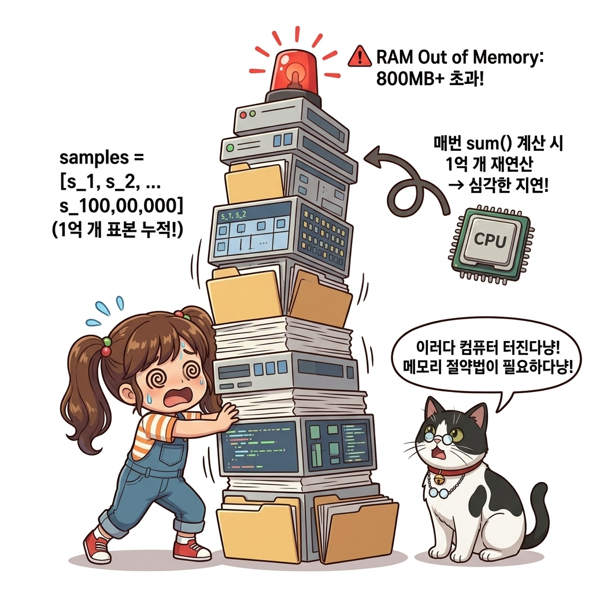
**그림 09-1-5a3** 1억 개의 표본을 리스트에 누적할 때 발생하는 메모리 폭발과 O(N^2) 비효율의 하드웨어적 한계

> "하지만 이 기초적인 방식에는 심각한 하드웨어적 한계가 존재합니다. 만약 정밀한 가치를 추정하기 위해 1억 번, 10억 번의 에피소드를 수행한다면 리스트의 크기가 기하급수적으로 커져 컴퓨터 메모리가 고갈됩니다. 또한 매번 수억 개의 데이터를 다시 합산하는 것은 엄청난 낭비입니다."

---

# 09.1 몬테카를로법 기초
## 09.1.3.5 메모리 절약의 혁명: 증분 갱신 칠판 직강

이를 해결하기 위해, 과거 데이터를 일일이 보관하지 않고 오직 **직전 가치 *V*와 시행 횟수 *n* 딱 2개만 기억**하여 실시간으로 평균을 업데이트하는 **증분 갱신(Incremental Update)**을 사용합니다:

> ### (식 9.1-3) 평균의 증분 갱신 점화식
> *V*<sub>new</sub> = *V*<sub>old</sub> + 1 / *n* (*s* − *V*<sub>old</sub>)

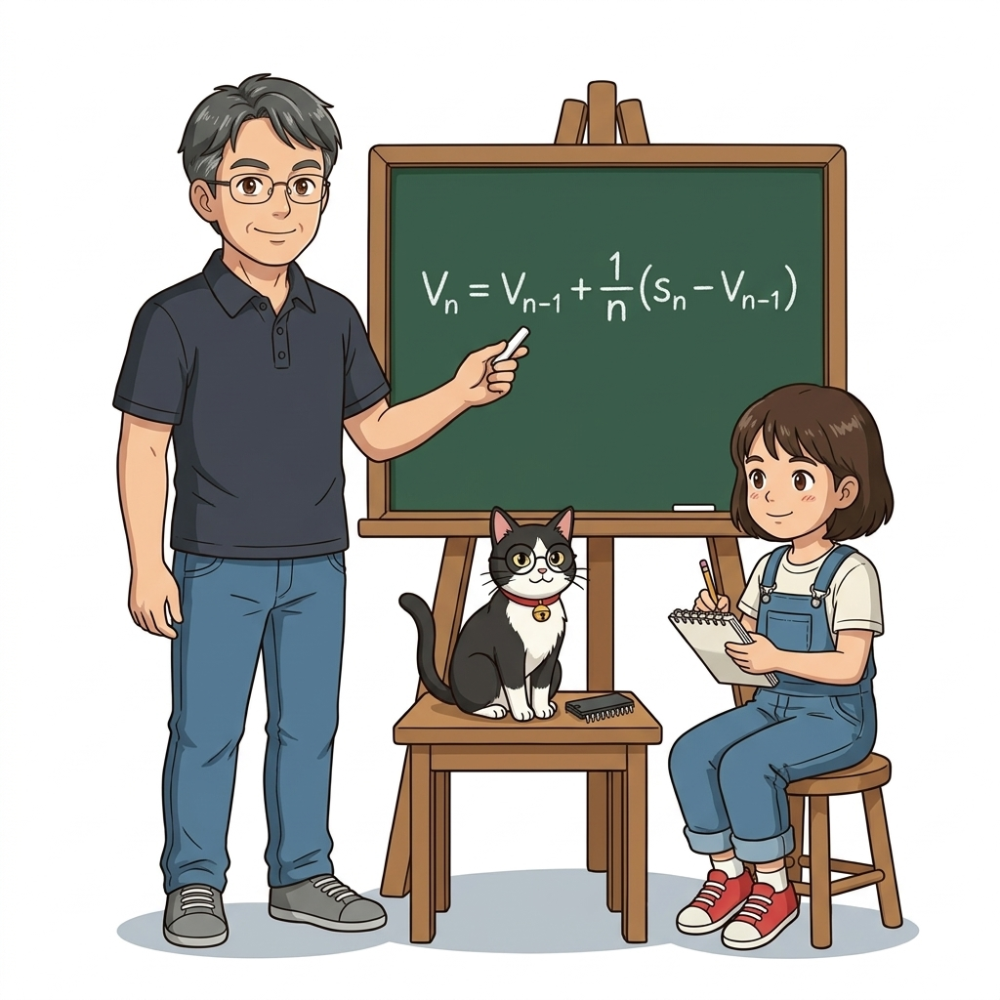
**그림 09-1-5b** 이호진 교수님이 칠판에서 증분 갱신 점화식 *V*<sub>*n*</sub> = *V*<sub>*n*−1</sub> + 1 / *n* (*s*<sub>*n*</sub> − *V*<sub>*n*−1</sub>)의 단계별 수학 유도 과정을 도로시와 지니에게 설명하는 장면

> "이 거대한 메모리 낭비를 해결하기 위해 이호진 교수님이 제시하는 해법이 바로 증분 갱신입니다. 과거의 수억 개 데이터를 일일이 보관하지 않고, 오직 직전 평균값 V 하나와 현재 시행 횟수 n만 기억하면서 최신 데이터를 즉시 반영하는 놀라운 점화식입니다."

---

# 09.1 몬테카를로법 기초
## 09.1.3.6 증분 갱신 수식 기호와 오차 신호 해부

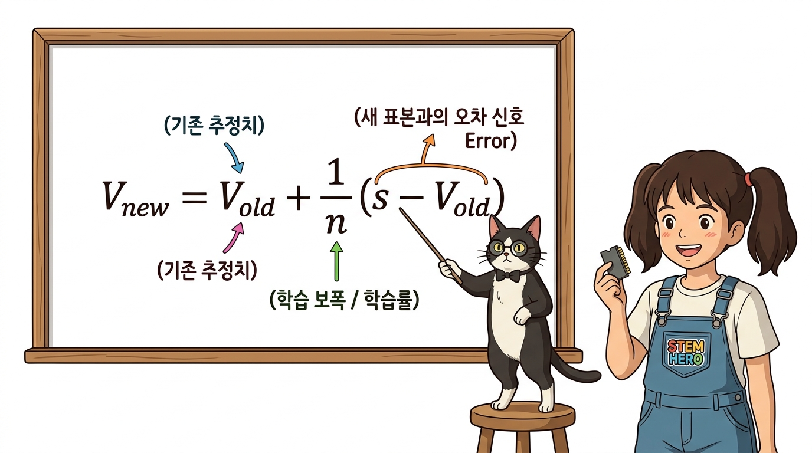
**그림 09-1-6** 조교 지니와 도로시가 가벼운 메모리 칩을 들고 오차 신호 (*s* − *V*<sub>old</sub>)와 학습률 (1 / *n*)의 상호작용을 해설하는 칠판 강의

> "증분 갱신 점화식의 전체적인 형태입니다. 새로운 평균 V_n은 직전 평균 V_{n-1}에 오차 신호 (s_n - V_{n-1})를 학습률 n분의 1만큼 곱해서 더해주는 형태입니다. 이 간단한 식 하나로 과거 데이터를 모두 버려도 완벽한 평균을 유지할 수 있습니다."

---

# 09.1 몬테카를로법 기초
## 09.1.3.7 이호진 교수님의 증분 갱신 유도 교실

#### 👨‍🏫 이호진 교수님의 칠판 유도: 증분 갱신 공식은 어떻게 탄생했을까?

중학생도 쉽게 이해할 수 있도록, 칠판에 적힌 유도 과정을 단계별로 풀어보겠습니다:


**그림 09-1-6a** 이호진 교수님의 칠판 수학 교실: 증분 갱신 점화식 탄생의 4단계 비밀 유도 오리엔테이션

> "이 기적 같은 공식이 어떻게 유도되었는지 이호진 교수님의 칠판 유도 과정을 함께 따라가 보겠습니다. 복잡한 고등 수학이 아니라, 중학교 수준의 단순한 분수 식 변형 4단계만으로 완벽하게 증명할 수 있습니다."

---

# 09.1 몬테카를로법 기초
## 09.1.3.8 증분 갱신 유도 1단계: 일반 평균 정의식

1. **시작점: *n*개의 데이터에 대한 일반 평균 정의식**:
   *V*<sub>*n*</sub> = 1 / *n* ∑<sub>*i*=1</sub><sup>*n*</sup> *s*<sub>*i*</sub> = (*s*<sub>1</sub> + *s*<sub>2</sub> + ... + *s*<sub>*n*−1</sub> + *s*<sub>*n*</sub>) / *n*

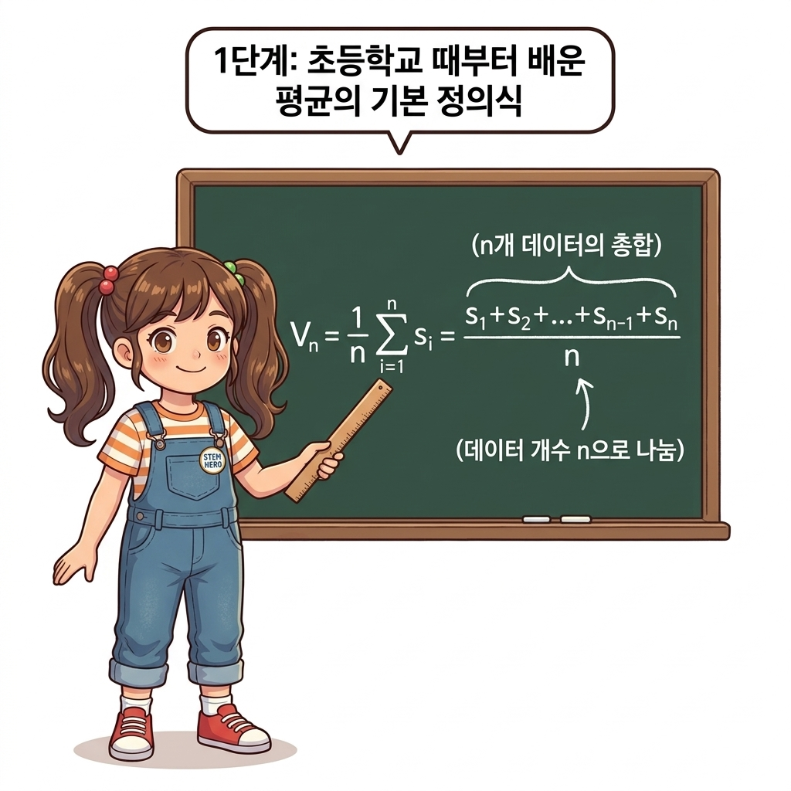
**그림 09-1-6b1** 증분 갱신 유도 1단계: n개 전체 데이터에 대한 일반 산술 평균의 원초적 정의식

> "유도의 1단계, n개의 데이터에 대한 원초적인 평균 정의식에서 출발합니다. V_n은 s_1부터 s_n까지의 모든 데이터를 더한 뒤 n으로 나눈 값입니다. 여기서 분모 n을 좌변으로 넘기면 n 곱하기 V_n은 데이터들의 총합이 됩니다."

---

# 09.1 몬테카를로법 기초
## 09.1.3.9 증분 갱신 유도 2단계: 마지막 데이터 분리

2. **마지막 데이터 *s*<sub>*n*</sub>만 밖으로 떼어내기**:
   *V*<sub>*n*</sub> = 1 / *n* ( ∑<sub>*i*=1</sub><sup>*n*−1</sup> *s*<sub>*i*</sub> + *s*<sub>*n*</sub> )

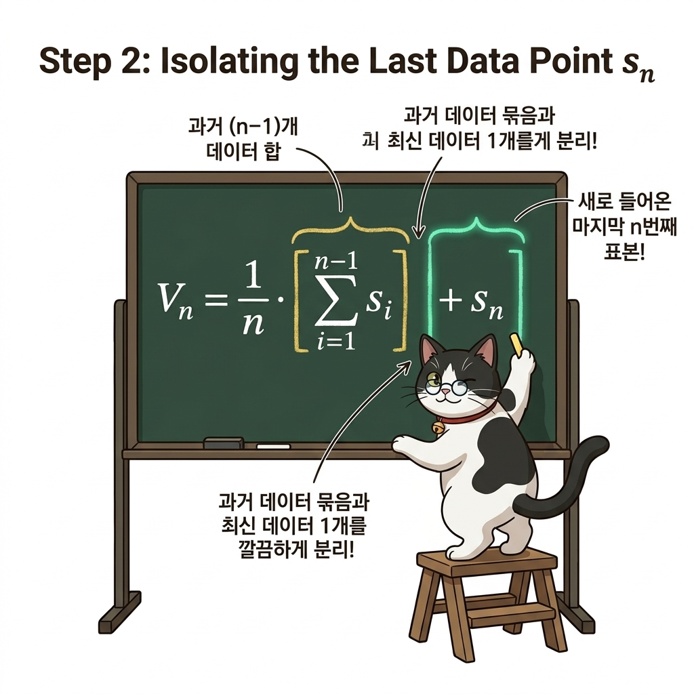
**그림 09-1-6b2** 증분 갱신 유도 2단계: 과거 (n-1)개의 합과 마지막 최신 데이터 s_n의 분리

> "유도의 2단계, 거대한 합에서 가장 최근에 들어온 마지막 데이터 s_n 하나만을 밖으로 분리해 냅니다. 그러면 분자는 과거 (n-1)개 데이터들의 합과 최신 데이터 s_n의 덧셈 형태로 깔끔하게 쪼개집니다."

---

# 09.1 몬테카를로법 기초
## 09.1.3.10 증분 갱신 유도 3단계: 직전 평균 치환

3. **직전 평균 *V*<sub>*n*−1</sub>과의 관계 찾기**:
   직전 *n*−1개까지의 평균은 *V*<sub>*n*−1</sub> = 1 / (*n*−1) ∑<sub>*i*=1</sub><sup>*n*−1</sup> *s*<sub>*i*</sub> 이므로, 양변에 *n*−1을 곱하면:
   ∑<sub>*i*=1</sub><sup>*n*−1</sup> *s*<sub>*i*</sub> = (*n*−1) *V*<sub>*n*−1</sub>  
   이것을 2번 식에 쏙 대입합니다!

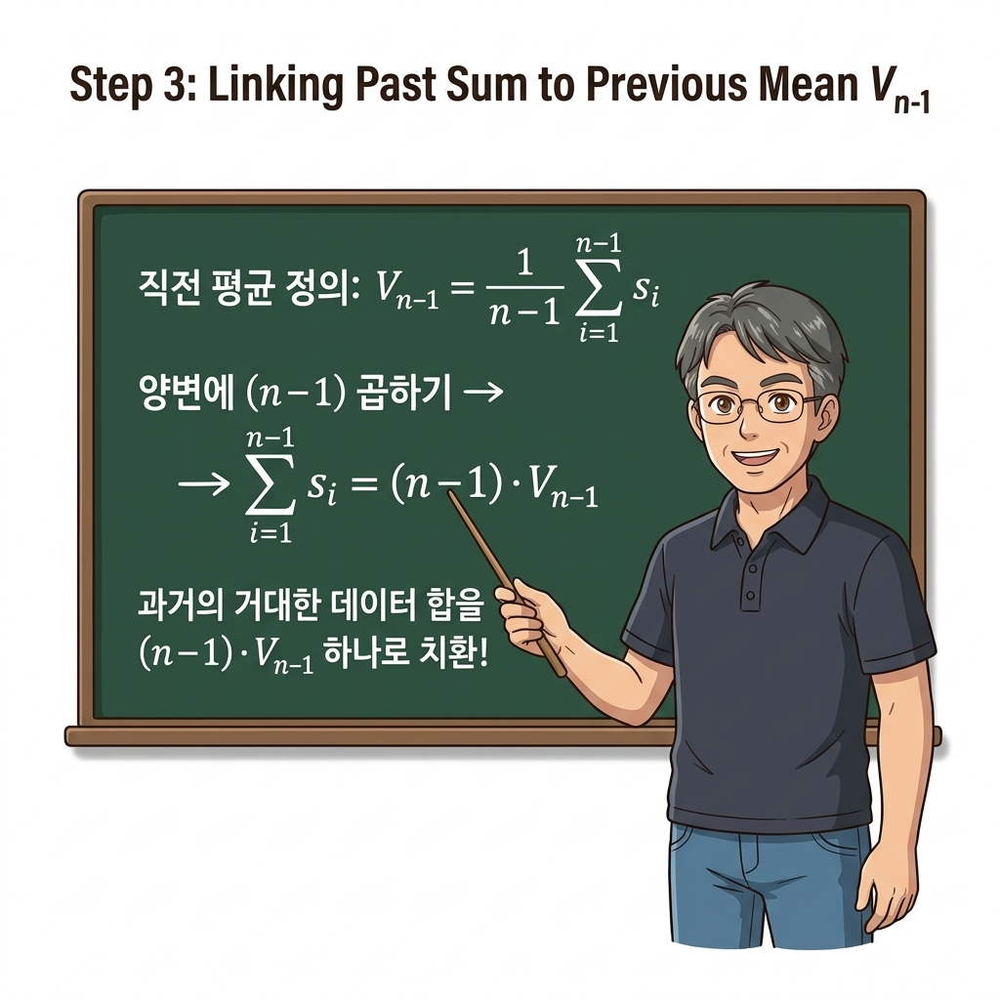
**그림 09-1-6b3** 증분 갱신 유도 3단계: 과거 데이터들의 거대한 합을 직전 평균 (n-1)V_{n-1}로 치환하는 핵심 연결 고리

> "유도의 3단계, 과거 (n-1)개 데이터들의 합을 직전 평균 V_{n-1}과의 관계로 치환합니다. 직전 평균 V_{n-1}의 정의에 따라 과거 데이터들의 합은 정확히 (n-1) 곱하기 V_{n-1}과 같습니다. 과거의 방대한 데이터 덩어리가 직전 평균이라는 단 하나의 숫자로 압축되는 순간입니다."

---

# 09.1 몬테카를로법 기초
## 09.1.3.11 증분 갱신 유도 4단계: 최종 점화식 완성

4. **대입하여 정리하기**:
   *V*<sub>*n*</sub> = 1 / *n* ( (*n*−1) *V*<sub>*n*−1</sub> + *s*<sub>*n*</sub> )  
   = 1 / *n* ( *n* *V*<sub>*n*−1</sub> − *V*<sub>*n*−1</sub> + *s*<sub>*n*</sub> )  
   = (*n* *V*<sub>*n*−1</sub>) / *n* + (*s*<sub>*n*</sub> − *V*<sub>*n*−1</sub>) / *n*  
   =  *V*<sub>*n*−1</sub> + 1 / *n* (*s*<sub>*n*</sub> − *V*<sub>*n*−1</sub>) 


**그림 09-1-6b4** 증분 갱신 유도 4단계: 괄호 전개와 분수 분리를 통한 최종 점화식 V_n = V_{n-1} + (1/n)(s_n - V_{n-1})의 대수적 완성

> "유도의 4단계, 치환된 식을 괄호 전개하고 분수를 분리하여 정리합니다. (n-1)을 n으로 나누어 1 빼기 n분의 1로 바꾸고 전개한 뒤 V_{n-1}로 묶어주면, 마침내 V_n = V_{n-1} + (1/n)(s_n - V_{n-1})이라는 기적의 증분 점화식이 유도됩니다."

---

# 09.1 몬테카를로법 기초
## 09.1.3.12 단 하나의 숫자로 압축되는 메모리의 기적

마침내 우리가 찾던 기적의 점화식이 완성되었습니다!

과거 *s*<sub>1</sub>부터 *s*<sub>*n*−1</sub>까지의 모든 데이터가 단 하나의 숫자 *V*<sub>*n*−1</sub> 속에 압축되어 녹아들어간 것입니다!

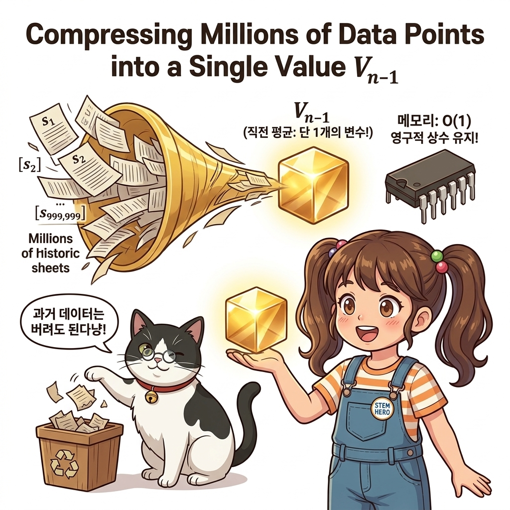
**그림 09-1-6c** 수백만 개의 과거 데이터가 단 1개의 숫자 V_{n-1} 속에 완벽히 압축 보존되는 메모리 절약의 기적

> "이 점화식이 가져온 메모리 압축의 기적을 확인해 보세요. 수백만 개의 과거 데이터를 리스트에 보관할 필요가 완전히 사라졌습니다. 오직 직전 평균 숫자 하나만 손에 쥐고 있으면, 새로운 데이터가 들어올 때마다 오차를 계산해 즉시 최신 평균으로 업데이트할 수 있습니다."

---

# 09.1 몬테카를로법 기초
## 09.1.3.13 증분 갱신 3대 구성요소 상호작용 메커니즘

#### 수식 돋보기: 증분 갱신 공식 기호 해부

과거 데이터를 모두 버려도 수학적으로 완벽한 평균이 유지되는 비밀은 바로 이 점화식 구조에 있습니다:

1. ***V*<sub>old</sub> (*V*<sub>*n*−1</sub>, 기존 추정치)**:
   * 지금까지 누적된 경험으로 알고 있는 현재의 가치 추정치입니다.
2. ***s* − *V*<sub>old</sub> (*s*<sub>*n*</sub> − *V*<sub>*n*−1</sub>, 오차 신호, Error)**:
   * 이번에 새로 관측한 표본 *s*가 기존 지식 *V*<sub>old</sub>와 얼마나 차이가 나는지를 나타내는 예측 오차입니다.
   * 새 표본이 내 생각보다 컸다면 양수(+), 작았다면 음수(-)가 나와 가치를 밀거나 당겨줍니다.
3. **1 / *n* (학습 보폭 / 학습률)**:
   * 새로운 오차를 기존 지식에 얼마나 반영할 것인가를 조절하는 계수입니다.
   * 시행 횟수 *n*이 커질수록 계수가 1/2 → 1/10 → 1/1000로 줄어듭니다. 즉, 초기에는 새로운 데이터에 민감하게 반응하여 빠르게 학습하다가, 경험이 많이 쌓이면 가치가 단단하게 고정되어 안정화됩니다.

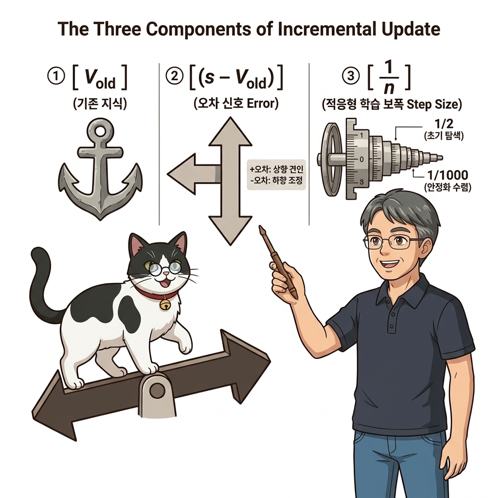
**그림 09-1-6d** 증분 갱신 공식의 3대 요소(기존 가치, 오차 신호, 적응형 학습 보폭 1/n)의 역동적 상호작용 메커니즘

> "증분 갱신 공식을 이루는 3대 구성요소의 역동적 상호작용입니다. V_{old}는 지금까지의 경험치이고, (s - V_{old})는 이번 경험이 기존 예측과 얼마나 달랐는지를 알려주는 오차 신호입니다. 그리고 n분의 1은 그 오차를 얼마나 반영할지 결정하는 적응형 보폭입니다."

---

# 09.1 몬테카를로법 기초
## 09.1.3.14 강화학습 모든 가치 갱신식의 위대한 원형 트리

> [!NOTE]
> **💡 강화학습의 모든 학습식의 뿌리!**  
> 이 공식은 훗날 강화학습에 등장하는 모든 가치 갱신식:  
> **`새 가치 ← 기존 가치 + 학습률 × (새로운 목표치 - 기존 가치)`**  
> 의 위대한 모태가 됩니다! TD 학습, SARSA, Q-러닝, DQN에 이르기까지 모든 최신 인공지능 알고리즘이 바로 이 형태를 그대로 사용합니다.


**그림 09-1-6e** 강화학습 모든 가치 갱신식의 위대한 원형(Mother Formula)과 TD·SARSA·Q-러닝·DQN으로 이어지는 계통수 가계도

> "이 증분 갱신 공식은 강화학습 역사상 가장 위대한 어머니 공식입니다. 새로운 가치는 이전 가치 더하기 학습률 곱하기 오차라는 이 황금 구조는, 훗날 우리가 배울 시간차 학습, SARSA, Q-러닝, 그리고 딥마인드의 DQN에 이르기까지 모든 강화학습 알고리즘의 원형이 됩니다."

---

# 09.1 몬테카를로법 기초
## 09.1.3.15 파이썬 초경량 증분 평균 알고리즘 구현

### 증분 평균 파이썬 구현

```python
trial = 1000
V, n = 0, 0

for _ in range(trial):
    s = sample()
    n += 1
    V += (s - V) / n # 증분 갱신 공식!
    
print("최종 증분 평균 V:", V) # 출력 결과: 7.0019... (참값 7 수렴)
```

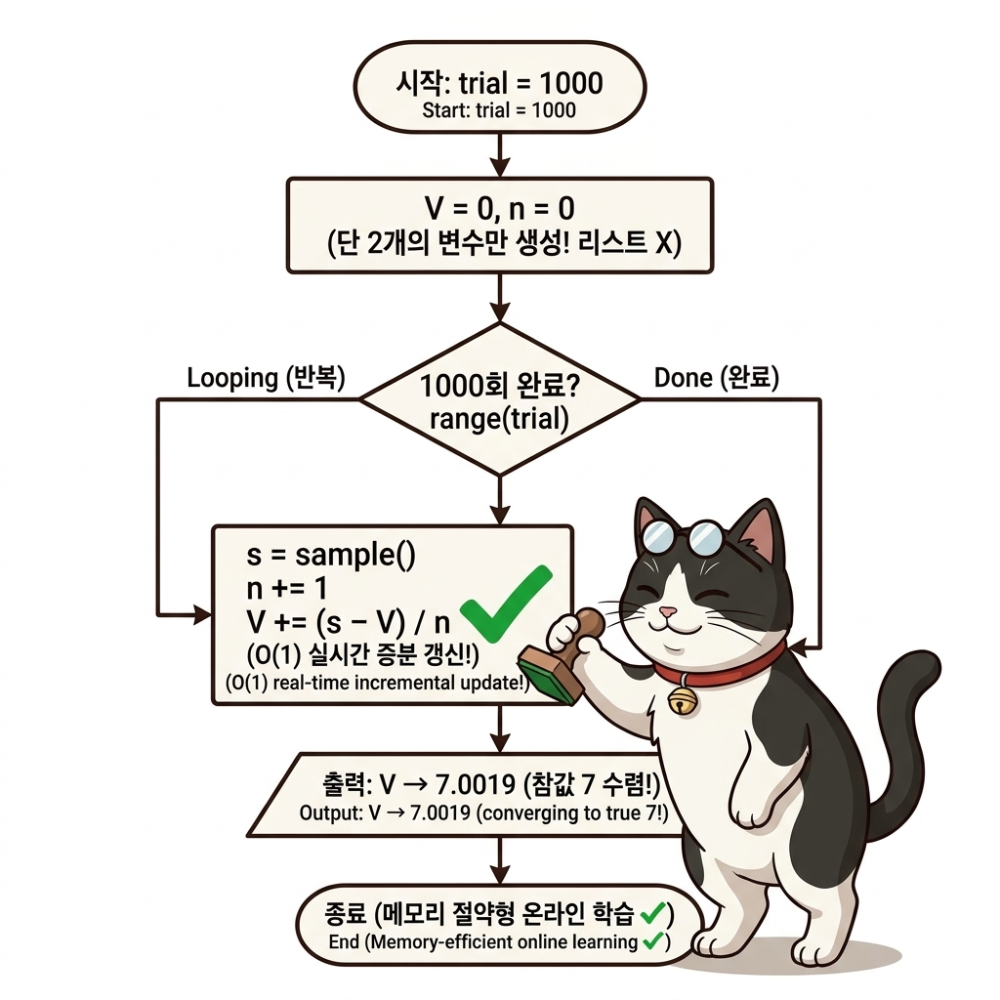
**그림 09-1-6f** 파이썬 초경량 증분 평균 알고리즘 실행 순서도

이 코드는 과거의 수많은 표본을 단 하나도 메모리에 보관하지 않으면서도, 매 루프마다 수학적으로 완전무결한 평균값을 실시간으로 유지합니다. 

메모리 사용량은 표본이 100만 개든 100억 개든 영원히 *O*(1)(상수 크기)입니다!

> "파이썬으로 구현한 초경량 증분 평균 알고리즘입니다. 리스트를 전혀 쓰지 않고 오직 단 하나의 실수 변수 V만 유지합니다. 루프를 돌며 새로운 데이터 s가 들어올 때마다 V += (s - V) / n 한 줄로 값을 갱신하므로 메모리 사용량이 O(1), 즉 완벽한 상수로 유지됩니다."

---

# 09.1 몬테카를로법 기초
## 09.1.4 핵심 정리: 몬테카를로법 기초의 3대 핵심 기둥

### 09.1.4 핵심 정리: 몬테카를로법 기초의 3대 핵심 기둥

몬테카를로 기법은 복잡한 환경 모델과 방대한 확률 분포 수식을 알지 못하더라도, 에이전트가 직접 부딪히며 축적한 **무작위 경험 표본들의 평균만으로 참된 가치에 도달하는 강력한 방법론**입니다.


**그림 09-1-7** 몬테카를로법 기초의 3대 핵심 기둥(샘플 모델, 표본 평균, 증분 갱신)을 총정리하며 응원하는 이호진 교수님과 연구실 4인방

> "오늘 학습한 09.1 단원의 핵심 내용을 정리해 보겠습니다. 환경의 전이 확률 지도를 몰라도 실제 경험을 추출하는 샘플 모델, 대수의 법칙에 기반해 참 기댓값으로 수렴하는 표본 평균, 그리고 메모리를 극적으로 절약하는 증분 갱신의 3대 기둥이 완성되었습니다."

---

# 09.1 몬테카를로법 기초
## 09.1.4.1 몬테카를로 기초 3대 기둥 유기적 파이프라인

오늘 학습한 몬테카를로법 기초의 핵심은 다음 3가지 기둥으로 요약됩니다:

1. **샘플 모델 (Sample Model)**:
   * 확률 분포를 전수 조사하지 않고, '시행하여 표본을 관측할 수만 있으면 충분하다'는 발상의 전환입니다. 조합 폭발이 발생하는 복잡한 환경을 극적으로 단순화합니다.
2. **표본 평균과 대수의 법칙 (Sample Mean & LLN)**:
   * 표본 평균 *V* ≈ 1 / *N* ∑ *s*<sub>*i*</sub> 공식을 통해, 표본 수 *N*이 증가할수록 추정치가 오차를 좁혀가며 참 기댓값으로 정밀 수렴합니다.
3. **초경량 증분 갱신 (Incremental Update)**:
   * *V* ← *V* + 1 / *n* (*s* − *V*) 점화식을 사용하여, 과거의 모든 데이터를 버리고도 단 2개의 변수만으로 실시간 온라인 학습을 완성합니다.


**그림 09-1-7a** 몬테카를로법 기초 3대 핵심 기둥(샘플 모델, 표본 평균, 증분 갱신)의 유기적 알고리즘 파이프라인

> "세 기둥이 하나의 유기적 파이프라인으로 맞물려 돌아가는 메커니즘을 확인해 보세요. 샘플 모델이 현실과 상호작용하여 경험 데이터를 뽑아내면, 증분 갱신 엔진이 메모리 낭비 없이 실시간으로 표본 평균을 누적하여 마침내 환경의 참된 가치 함수로 수렴해 갑니다."

---

# 09.1 몬테카를로법 기초
## 09.1.4.2 이호진 교수님의 직강 멘토링 노트

> 👨‍🏫 **이호진 교수님의 직강 노트**:  
> "몬테카를로법의 본질은 무작위성(Randomness)을 지혜롭게 활용하는 것입니다. 모든 규칙을 다 알아야만 똑똑한 결정을 내릴 수 있는 것은 아닙니다. 직접 부딪혀 보고, 오차를 조금씩 줄여나가는 이 단순한 원리가 바로 현대 강화학습을 움직이는 가장 거대한 엔진입니다."


**그림 09-1-7b** 이호진 교수님의 직강 멘토링 노트: 무작위성을 지혜로 바꾸는 강화학습의 위대한 발상

> "이호진 교수님의 멘토링 노트처럼, 몬테카를로법의 본질은 무작위성이라는 혼돈을 통계적 지혜로 바꾸어 낸 데 있습니다. 완벽한 지도가 없다고 좌절할 필요가 없습니다. 직접 발을 내딛고 겪은 모험의 기록들을 증분 갱신으로 차곡차곡 모아나가면 누구나 최적의 길을 찾아낼 수 있습니다."

---

# 09.1 몬테카를로법 기초
## 09.1.4.3 다음 절 예고: 몬테카를로 정책 평가 실전

> 🐱 **조교 지니의 핵심 요약 노트**:  
> "샘플 모델과 증분 갱신이라는 든든한 무기를 장착했으니, 다음 절에서는 도로시와 함께 강화학습 에피소드를 끝까지 완주하고 가치 함수를 직접 업데이트하는 **몬테카를로 정책 평가(Policy Evaluation)**의 실전으로 뛰어들어 보자냥!"


**그림 09-1-7c** 다음 절 예고: 09.2 몬테카를로 정책 평가 실전으로 씩씩하게 출발하는 도로시와 지니

> "조교 지니의 응원과 함께 다음 9.2절로 나아가겠습니다. 주사위 실험을 통해 수학적 기초를 완벽히 다졌으니, 이제 본격적으로 2차원 그리드월드 미로 환경 속에서 에이전트의 정책을 몬테카를로법으로 평가하는 실전 에피소드 모험을 힘차게 시작해 보겠습니다."
