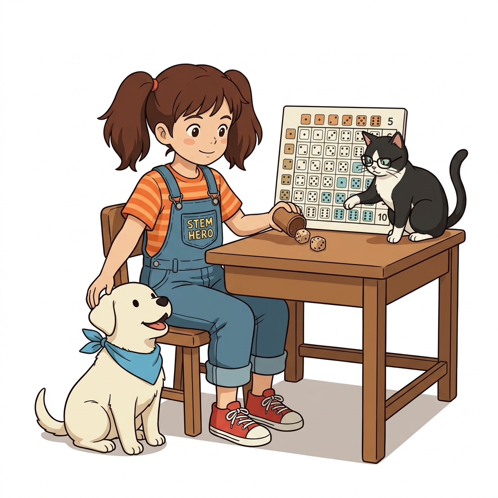
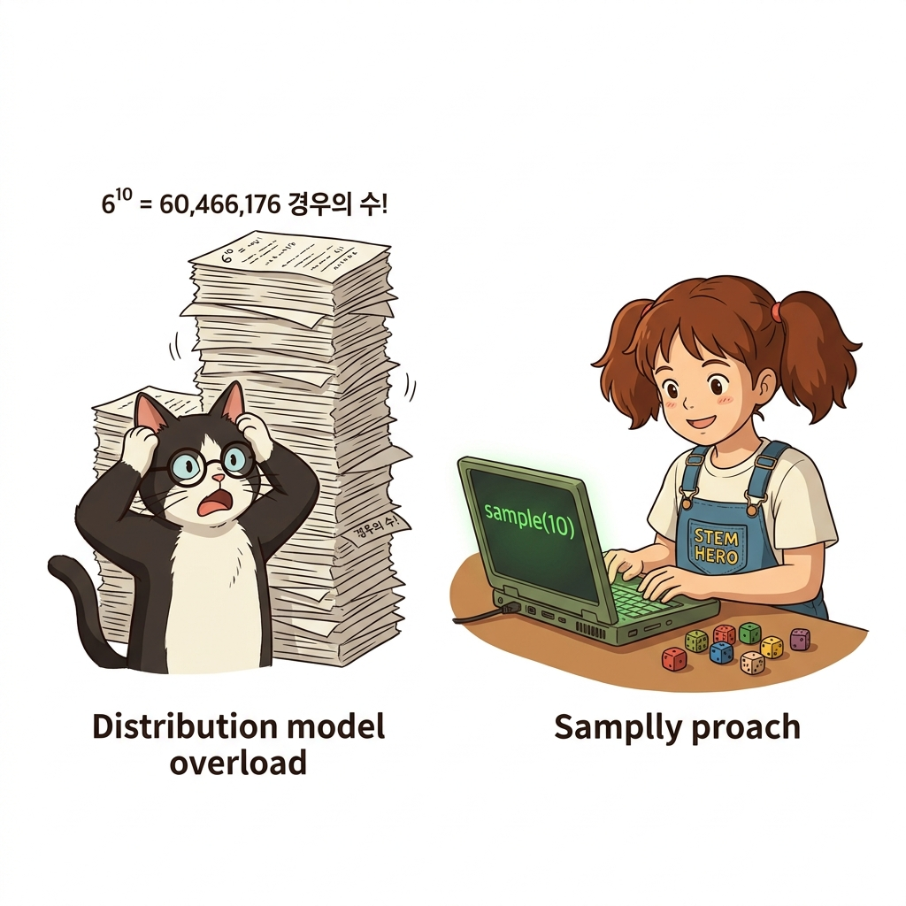
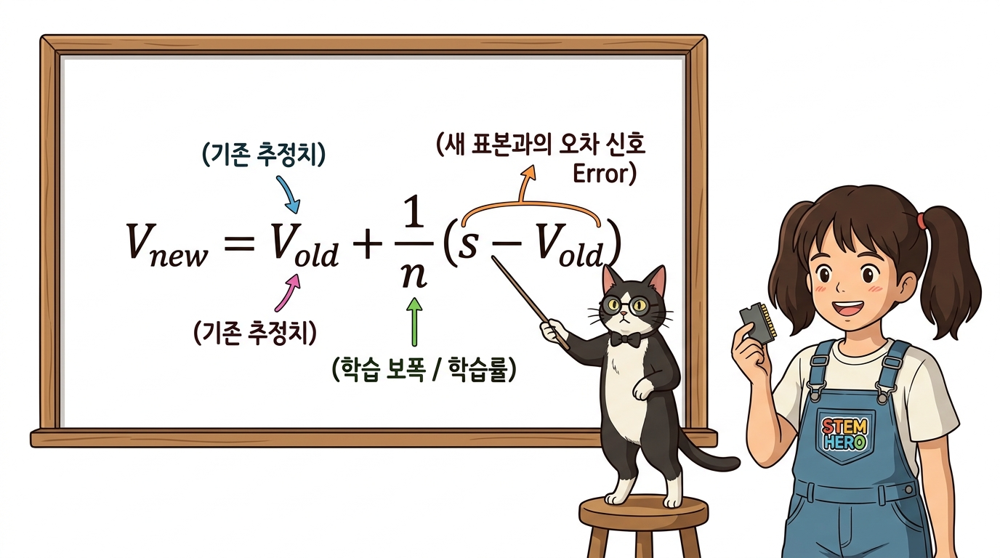

# 09.1 몬테카를로법 기초
## 09.1.0 도입: 알려진 모델에서 경험의 세계로

지금까지는 모든 상태 전이 확률과 보상을 완벽히 아는 환경 모델을 다루었지만, 현실 세계는 공식을 알 수 없거나 계산이 불가능한 블랙박스 환경이 대부분입니다.


**그림 09-1-1** 투명한 규칙으로 시뮬레이션 가능한 알려진 환경 모델과 수식을 알 수 없어 직접 부딪혀야 하는 블랙박스 미지 모델의 비교 (16:9 와이드)

- 📌 **알려진 환경 모델 (DP)**: 상태 전이 확률 *p*(*s'*|*s*,*a*)와 보상 함수 *r*(*s*,*a*,*s'*)를 완벽히 활용
- 📌 **알려지지 않은 현실 환경 (RL)**: 고객 수요, 주식 시장, 로봇 제어 등은 사전 확률 모델링이 불가능
- 💡 **몬테카를로법의 돌파구**: 환경의 물리 법칙을 몰라도, 에이전트의 실제 상호작용 표본만으로 학습 가능!

> "지금까지 다룬 다이내믹 프로그래밍은 환경의 확률 지도를 모두 알고 있는 온실 속 문제였습니다. 하지만 현실 세계는 공식을 알 수 없는 거대한 블랙박스입니다. 몬테카를로 기법은 복잡한 공식을 몰라도, 실제 경험을 직접 수집하여 문제를 해결하는 강력한 무기입니다."

---

# 09.1 몬테카를로법 기초
## 09.1.1 주사위 눈의 합과 확률 전개도

주사위 2개를 굴려 나오는 눈의 합을 관찰하는 간단한 실험을 통해 확률 분포와 기댓값의 개념을 직관적으로 확인해 봅시다.


**그림 09-1-2** 주사위 2개를 던졌을 때 나타나는 36가지 눈금 조합 매트릭스와 확률 분포를 분석하는 도로시, 토토, 지니 (1:1 순백색)

- **독립 시행 확률**: 각 주사위 눈이 나올 확률은 각각 1/6
- **총 경우의 수**: 6 × 6 = 36가지의 독립된 조합 발생
- **합의 분포 범위**: 최소 2(1+1)부터 최대 12(6+6)까지 형성
- 🎲 **최빈값 7**: 합이 7이 되는 조합이 총 6가지로 가장 높은 확률(6/36 = 1/6)을 기록

> "주사위 두 개를 굴려 나오는 눈의 합을 조사해 봅시다. 총 서른여섯 가지 조합이 나오며, 합은 2부터 12까지 분포합니다. 이 중 합이 7이 되는 경우가 여섯 가지로 가장 높습니다. 모든 경우를 표로 정리한 것이 바로 확률 분포입니다."

---

# 09.1 몬테카를로법 기초
## 09.1.1 기댓값의 이론적 참값과 부동소수점 오차

확률 분포 표를 기반으로 주사위 눈의 합에 대한 이론적 기댓값을 수식과 파이썬 코드로 직접 계산해 봅니다.

| 눈의 합 (*x*) | 2 | 3 | 4 | 5 | 6 | **7** | 8 | 9 | 10 | 11 | 12 |
| :---: | :---: | :---: | :---: | :---: | :---: | :---: | :---: | :---: | :---: | :---: | :---: |
| **확률 *P*(*x*)** | 1/36 | 2/36 | 3/36 | 4/36 | 5/36 | **6/36** | 5/36 | 4/36 | 3/36 | 2/36 | 1/36 |

- **기댓값 정의식**: E[*X*] = ∑ *x* · *P*(*X* = *x*) = 2·(1/36) + ... + 12·(1/36) = **7.0**
- 💻 **파이썬 계산 결과**: `V += x * p` 연산 시 `6.999999999999999` 출력
- ⚠️ **부동소수점 오차의 원인**: 컴퓨터 2진수 메모리 표현 한계로 인한 미세한 반올림 오차
- 💡 **핵심 시사점**: 강화학습의 목표인 '기대 수익 극대화'는 바로 이 기댓값을 찾아가는 과정!

> "확률 분포의 각 값에 확률을 곱해 모두 더하면 기댓값이 계산됩니다. 이론적인 참값은 정확히 7.0이지만, 컴퓨터로 계산하면 이진수 부동소수점 오차로 인해 6.999가 나옵니다. 강화학습은 바로 이러한 미래 보상의 참 기댓값을 찾아내는 여정입니다."

---

# 09.1 몬테카를로법 기초
## 09.1.2 모델의 두 얼굴: 분포 모델 vs 샘플 모델

환경을 수학적으로 모델링하는 방식에는 모든 확률을 미리 아는 '분포 모델'과, 실제 경험을 뽑아내는 '샘플 모델'이 있습니다.


**그림 09-1-3** 완벽한 확률 곡선 지도를 연구하는 분포 모델과, 주사위를 직접 굴려 관측 데이터를 모으는 샘플 모델의 비교 (16:9 와이드)

- 🗺️ **분포 모델 (Distribution Model)**:
  * 확률 분포 *P*(*x*)를 완벽하게 사전에 알고 있는 상태
  * 전체 지도를 펼쳐놓고 모든 가능성을 수식으로 정밀 계산
- 🎲 **샘플 모델 (Sample Model)**:
  * 전체 확률 분포는 몰라도, '실제로 굴려서 표본(샘플)을 얻을 수만 있으면 충분'
  * 블랙박스 환경에서 시행착오 경험을 수집하여 학습

> "환경을 다루는 방식에는 두 가지가 있습니다. 분포 모델은 도로시처럼 칠판에 적힌 완전한 확률 지도를 보고 계산하는 방식이고, 샘플 모델은 토토처럼 주사위를 직접 굴려 나온 결과를 관측하는 방식입니다. 강화학습의 핵심은 바로 이 샘플 모델입니다."

---

# 09.1 몬테카를로법 기초
## 09.1.2 10개의 주사위: 샘플 모델이 빛을 발하는 순간

주사위가 2개에서 10개로 늘어나는 순간, 분포 모델은 계산 불능에 빠지지만 샘플 모델은 가볍게 문제를 해결합니다.


**그림 09-1-4** 6천만 가지 경우의 수에 머리를 쥐어뜯는 지니와, 단 한 줄의 `sample(10)` 코드로 즉시 표본을 뽑아내는 도로시 (1:1 순백색)

- 💥 **분포 모델의 한계 (조합 폭발)**:
  * 주사위 10개 합의 확률 표를 구하려면 6<sup>10</sup> = **60,466,176가지(약 6천만 개)**를 전수 계산해야 함
  * 차원이 커지면 슈퍼컴퓨터로도 계산 불가능
- 🚀 **샘플 모델의 위력**:
  * 단지 `sample(10)` 함수를 호출하여 주사위를 10번 무작위로 던지면 즉시 결과 획득!
  * 💡 **결론**: 환경 모델이 너무 복잡할 때 표본 추출로 진리를 찾는 것이 몬테카를로법의 본질

> "주사위가 열 개로 늘어나면 어떻게 될까요? 분포 모델은 6천만 가지의 경우의 수를 모두 계산해야 하므로 연산 폭발이 일어납니다. 반면 샘플 모델은 단순히 함수를 실행하여 열 번 던져보면 끝납니다. 복잡한 문제를 단순하게 푸는 샘플링의 놀라운 위력입니다."

---

# 09.1 몬테카를로법 기초
## 09.1.2 대수의 법칙: 표본 평균이 참값으로 수렴하는 마법

전체 확률 분포를 몰라도, 샘플링 횟수를 무수히 늘려 표본 평균을 구하면 참 기댓값 7.0에 오차 없이 도달합니다.

```python
import numpy as np

def sample(dices=2):
    return sum(np.random.choice([1, 2, 3, 4, 5, 6]) for _ in range(dices))
```

- 📉 **초기 소규모 표본 (*N* = 10)**: 표본 평균의 요동이 심하고 오차 발생
- 📈 **표본 누적 증가 (*N* = 1,000 ~ 10,000)**: 진동 폭이 급격히 줄어들며 참값으로 밀착
- ⚖️ **대수의 법칙 (Law of Large Numbers)**: 표본 수 *N*이 무한대로 가면 표본 평균은 반드시 참 기댓값으로 완벽 수렴
- 🎯 **강화학습 통찰**: 에이전트의 에피소드 경험이 누적되면 참 가치 함수 *V*(*s*)를 찾아낼 수 있음

> "샘플 모델로 어떻게 참값을 알아낼까요? 대수의 법칙 덕분입니다. 표본이 적을 때는 평균이 요동치지만, 던지는 횟수를 천 번, 만 번 늘려갈수록 놀랍게도 이론값인 7.0으로 정밀 수렴합니다. 경험을 많이 쌓으면 진리에 도달한다는 통계학의 황금률입니다."

---

# 09.1 몬테카를로법 기초
## 09.1.3 몬테카를로법 구현: 표본 평균으로 기댓값 추정

수집된 모든 샘플 데이터를 리스트에 저장하고 산술 평균을 구하는 가장 직관적인 몬테카를로 코드를 작성해 봅시다.

```python
trial = 1000
samples = []
for _ in range(trial):
    s = sample()
    samples.append(s)

V = sum(samples) / len(samples)
print("추정 기댓값 V:", V) # 출력 결과: 6.98 (참값 7.0에 근접!)
```

- 📝 **1단계 샘플링**: `for` 루프를 돌며 주사위 2개 합 표본 `s`를 1,000번 수집
- 📦 **2단계 데이터 보관**: `samples.append(s)`로 모든 표본을 메모리 리스트에 차곡차곡 누적
- ➗ **3단계 평균 산출**: 전체 합 `sum(samples)`을 개수 `len(samples)`로 나누어 최종 기댓값 *V* 계산

> "가장 직관적인 몬테카를로 구현 방식입니다. 천 번 동안 주사위를 던져 나온 결과를 리스트에 모두 저장한 뒤, 전체 합을 개수로 나누어 평균을 계산합니다. 실행 결과 6.98이 나오며 이론적 참값인 7.0에 아주 가깝게 도달함을 확인할 수 있습니다."

---

# 09.1 몬테카를로법 기초
## 09.1.3 수식 돋보기: 표본 평균 공식 *V* ≈ (1/*N*) ∑ *s*<sub>*i*</sub> 기호 해부

몬테카를로 기댓값 추정 공식의 세 가지 핵심 기호 블록을 하나씩 분해하여 물리적 의미를 확인해 봅시다.


**그림 09-1-5** 이호진 교수님이 칠판에서 표본 평균 기댓값 공식의 3대 블록 기호와 물리적 의미를 알기 쉽게 해설하는 직강 강의 (16:9 와이드)

- **블록 1: *V* ≈ (추정 가치)**: 무한 표본이 아닌 유한한 시행으로 계산한 가치 추정치임을 표시
- **블록 2: 1 / *N* (시행 횟수 정규화)**: 수집된 전체 샘플 개수 *N*으로 나누어 크기를 1 단위로 산술 정규화
- **블록 3: ∑<sub>*i*=1</sub><sup>*N*</sup> *s*<sub>*i*</sub> (경험 표본의 누적 총합)**: 1번째부터 *N*번째까지 에이전트가 직접 관측한 모든 표본 데이터의 합산
- 💡 **코드 매핑**: `V` ➔ `sum(samples) / len(samples)`와 완벽히 1:1 대응

> "수식을 세 블록으로 나누어 뜯어봅시다. 좌변의 V와 물결 표시는 유한한 표본으로 구한 추정치임을 나타냅니다. 우변의 시그마는 에이전트가 겪은 모든 표본값의 총합이며, 앞의 N분의 1은 전체 개수로 나누는 정규화입니다. 단순한 평균 공식이 몬테카를로의 심장입니다."

---

# 09.1 몬테카를로법 기초
## 09.1.3 메모리 절약의 혁명: 증분 갱신(Incremental Update)

새로운 샘플이 들어올 때마다 매번 과거 데이터를 모두 저장하고 다시 평균을 내면 메모리가 폭발하므로, 점화식 형태의 증분 갱신을 사용합니다.

```python
trial = 1000
V, n = 0, 0
for _ in range(trial):
    s = sample()
    n += 1
    V += (s - V) / n # 증분 갱신 점화식!
```

- 💾 **과거 방식의 메모리 낭비**: 100만 번 시행 시 100만 개의 배열 메모리 상주 필요
- ⚡ **증분 방식의 초경량성**: 과거의 모든 표본을 버리고 오직 직전 가치 `V`와 횟수 `n` 딱 2개 변수만 기억
- 🎯 **동일한 수학적 결과**: 전체 평균을 매번 새로 구하는 것과 수학적으로 100% 동일한 결과 보장
- 🚀 **강화학습 필수 패턴**: 끝없이 이어지는 온라인 상호작용에서 즉각적인 실시간 학습 가능!

> "샘플이 들어올 때마다 매번 리스트에 담아 평균을 구하면 백만 번 시행 시 메모리가 감당되지 않습니다. 하지만 이전 장에서 배운 증분 갱신 공식을 사용하면 과거 데이터를 모두 버리고 단 두 개의 변수만으로 실시간 평균을 완벽하게 업데이트할 수 있습니다."

---

# 09.1 몬테카를로법 기초
## 09.1.3 수식 돋보기: 증분 갱신 공식 *V*<sub>new</sub> = *V*<sub>old</sub> + (1/*n*)(*s* - *V*<sub>old</sub>) 기호 해부

과거 데이터를 일일이 보관하지 않고도 완벽한 평균을 유지할 수 있는 마법 같은 증분 점화식을 해부합니다.


**그림 09-1-6** 조교 지니와 도로시가 가벼운 메모리 칩을 들고 오차 신호 (*s* - *V*<sub>old</sub>)와 학습률 (1/*n*)의 상호작용을 해설하는 칠판 강의 (16:9 와이드)

- ***V*<sub>old</sub> (기존 추정치)**: 지금까지 수많은 경험을 통해 누적해 온 나의 기존 가치 지식
- *(s* - *V*<sub>old</sub>) (오차 신호, Error)**: 새로 관측한 표본 *s*와 기존 추정치 *V*<sub>old</sub> 사이의 차이(예측 오차)
- **1 / *n* (학습률, Step Size)**: 새 표본을 얼마나 반영할 것인가를 조절하는 보폭 (시행 횟수 *n*이 커질수록 0에 수렴하여 가치가 단단하게 고정됨)
- 💡 **강화학습의 근간**: `새 가치 = 이전 가치 + 학습률 × (목표치 - 이전 가치)`의 표준 학습 공식으로 직결!

> "증분 갱신 공식을 해부해 봅시다. 괄호 안의 s 빼기 V는 새로 겪은 경험과 기존 지식 사이의 오차 신호입니다. 앞의 n분의 1은 이 오차를 얼마나 반영할지 결정하는 학습 보폭입니다. 이 구조가 바로 강화학습 모든 밸류 업데이트 식의 원형이 됩니다."

---

# 09.1 몬테카를로법 기초
## 09.1.4 핵심 정리: 몬테카를로법 기초의 3대 핵심 기둥

몬테카를로 기법은 복잡한 환경 모델 없이도 표본 추출과 대수의 법칙, 그리고 증분 갱신을 통해 우아하게 참값을 학습합니다.


**그림 09-1-7** 몬테카를로법 기초의 3대 핵심 기둥(샘플 모델, 표본 평균, 증분 갱신)을 총정리하며 응원하는 이호진 교수님과 연구실 4인방 (16:9 와이드)

- 1️⃣ **샘플 모델 (Sample Model)**: 환경의 전이 확률 지도를 몰라도 표본 추출만으로 충분
- 2️⃣ **표본 평균 (Sample Mean)**: 대수의 법칙에 의해 표본이 많아질수록 참 기댓값으로 완벽 수렴
- 3️⃣ **증분 갱신 (Incremental Update)**: 과거 데이터를 모두 버리고 가볍게 실시간으로 가치 업데이트
- 🚀 **다음 시간 (09.2)**: 이 원리를 강화학습에 본격 적용하여, 에피소드를 거꾸로 정산하는 **몬테카를로 정책 평가**를 배웁니다!

> "오늘 배운 몬테카를로법 기초의 3대 기둥을 정리합시다. 첫째, 확률 분포 대신 표본을 뽑는 샘플 모델. 둘째, 표본 평균을 참값으로 이끄는 대수의 법칙. 셋째, 메모리를 아끼는 증분 갱신입니다. 다음 시간에는 이 원리로 에이전트의 정책을 직접 평가해 보겠습니다!"
