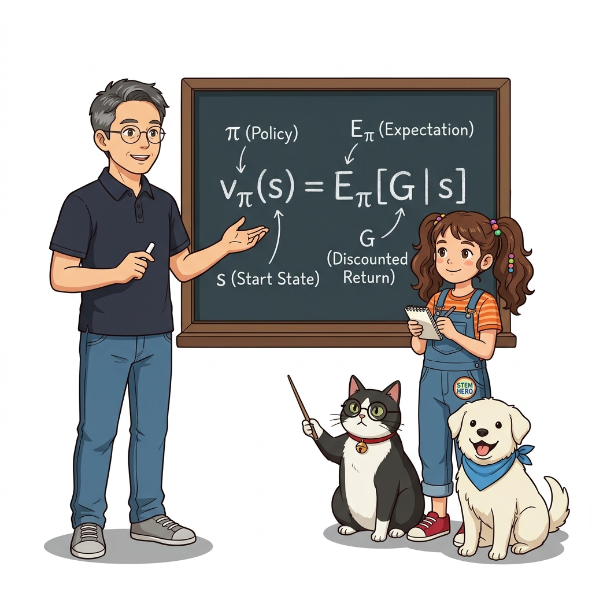
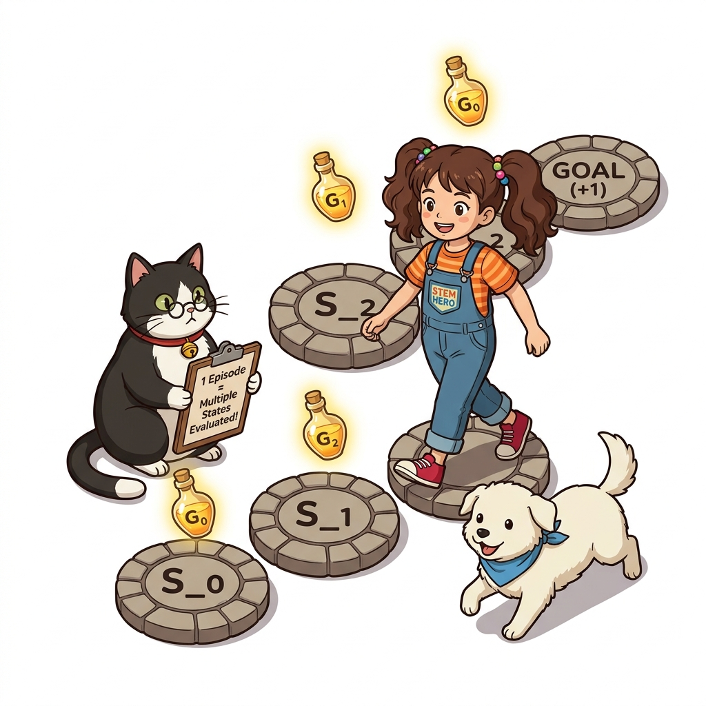

# 09.2 몬테카를로법으로 정책 평가하기
## 09.2.0 도입: 경험으로 가치 함수를 평가하다

주어진 정책 *π*를 따를 때 각 상태의 가치가 얼마나 되는지, 환경의 전이 확률을 몰라도 실제 에피소드를 반복 완주하며 평가할 수 있습니다.


**그림 09-2-1** 징검다리를 건너가며 에피소드를 완주하고 각 칸의 상태 가치 카드 V(s)를 갱신해나가는 도로시와 연구실 친구들 (16:9 와이드)

- 📌 **정책 평가 (Policy Evaluation)**: 고정된 정책 *π*에 따라 행동했을 때 얻는 참 가치 함수 *v*<sub>*π*</sub>(*s*)를 계산
- 📌 **경험 기반 평가**: 복잡한 벨만 연립방정식 대신, 실제 에피소드에서 획득한 보상들의 누적 수익 샘플을 수집
- 💡 **일회성 과제 (Episodic Task)**: 목표 지점(Goal)에 도달하여 끝이 나는 환경에서 확정된 수익으로 가치를 추정

> "동적 계획법에서는 벨만 연립방정식을 풀었지만, 몬테카를로법은 직접 걸어보는 경험으로 가치를 평가합니다. 정책에 따라 에피소드를 완주하고 얻은 실제 수익들을 모아 평균을 내면, 놀랍게도 각 상태의 참된 가치를 완벽히 알아낼 수 있습니다."

---

# 09.2 몬테카를로법으로 정책 평가하기
## 09.2.1 가치 함수의 수학적 정의와 몬테카를로 표본 평균

상태 *s*의 가치는 그 상태에서 시작하여 정책 *π*를 따랐을 때 얻게 되는 기대 수익의 평균값으로 정의됩니다.

> ### ***v*<sub>*π*</sub>(*s*) = E<sub>*π*</sub>[*G* | *s*]**

- **기대 수익 *G***: 현재 상태부터 에피소드 종료까지 받게 될 할인 보상들의 총합 (*G* = *R*<sub>0</sub> + *γR*<sub>1</sub> + *γ*<sup>2</sup>*R*<sub>2</sub> + ...)
- 🎲 **몬테카를로 근사식**: *n*번의 에피소드에서 얻은 실제 수익 표본들의 산술 평균
  > ***V*<sub>*π*</sub>(*s*) = (*G*<sup>(1)</sup> + *G*<sup>(2)</sup> + ... + *G*<sup>(*n*)</sup>) / *n***
- ⚖️ **대수의 법칙 약속**: 시행 횟수 *n*이 커질수록 표본 평균 *V*<sub>*π*</sub>(*s*)는 참 가치 *v*<sub>*π*</sub>(*s*)에 완벽히 수렴!

> "가치 함수의 정의를 기억해 봅시다. 어떤 상태의 가치는 그곳에서 출발해 끝까지 모험했을 때 받을 수 있는 수익들의 기댓값입니다. 몬테카를로법은 이 기댓값을 구하기 위해 수많은 에피소드의 실제 수익을 모아 단순 산술 평균을 냅니다."

---

# 09.2 몬테카를로법으로 정책 평가하기
## 09.2.1 수식 돋보기: 가치 함수 정의식 *v*<sub>*π*</sub>(*s*) = E<sub>*π*</sub>[*G* | *s*] 기호 해부

가치 함수의 수학적 정의식을 이루는 기호 하나하나를 칠판에서 분해하여 그 물리적 의미를 확인해 봅시다.


**그림 09-2-2** 가치 함수 정의식 v_π(s) = E_π[G | s]의 기호별 의미(정책, 출발 상태, 조건부 기댓값)를 칠판에서 해설하는 장면 (1:1 순백색)

- ***v*<sub>*π*</sub>(*s*) (상태 가치)**: 정책 *π*를 고정했을 때 상태 *s*가 지닌 본질적인 장기적 잠재 가치
- **E<sub>*π*</sub> (정책 조건부 기댓값)**: 환경의 무작위성과 에이전트 행동 선택 확률을 고려한 가중 평균
- ***G* (누적 미래 수익)**: 지금 당장의 즉각 보상뿐만 아니라 미래에 받게 될 모든 할인 보상들의 총합
- **| *s* (조건부 출발점)**: "내가 지금 출발하는 위치가 정확히 상태 *s*일 때"라는 단서 조건

> "수식 기호를 하나씩 뜯어봅시다. 좌변은 상태 s의 가치이고, 우변의 E는 기댓값 기호입니다. 괄호 안의 G는 미래에 받을 보상들의 총합이며, 세로 막대 뒤의 s는 출발 위치를 의미합니다. 즉, 상태 s에서 출발했을 때 기대되는 미래 보상의 평균입니다."

---

# 09.2 몬테카를로법으로 정책 평가하기
## 09.2.1 구체적 실습: 2회 시도로 가치 함수 근사하기

상태 *s*에서 출발하는 두 번의 에피소드를 직접 실행하여 표본 평균으로 가치 함수를 계산해 봅니다.


**그림 09-2-3** 1차 시도 수익 G^(1)=3과 2차 시도 수익 G^(2)=2를 모아 산술 평균 2.5로 가치 함수를 갱신하는 도로시와 지니 (1:1 순백색)

- 🎯 **1차 에피소드**: 보상 1, 0, 2 획득 (*γ* = 1 가정)
  * 수익 샘플: *G*<sup>(1)</sup> = 1 + 0 + 2 = **3** ➔ 1차 추정 가치: *V*<sub>*π*</sub>(*s*) = **3.0**
- 🎯 **2차 에피소드**: 보상 0, 0, 1, 1 획득 (확률적 전이 발생)
  * 수익 샘플: *G*<sup>(2)</sup> = 0 + 0 + 1 + 1 = **2**
- ⚖️ **표본 평균 계산**: *V*<sub>*π*</sub>(*s*) = (*G*<sup>(1)</sup> + *G*<sup>(2)</sup>) / 2 = (3 + 2) / 2 = **2.5**
- 💡 **점진적 수렴**: 에피소드가 100회, 1,000회 거듭될수록 참값으로 정확하게 수렴!

> "실제 숫자로 계산해 봅시다. 첫 번째 모험에서 얻은 수익이 3점이고, 두 번째 모험에서 얻은 수익이 2점이라면, 이 시점의 가치는 둘의 평균인 2.5점이 됩니다. 매 시도마다 보상이 달라지더라도, 평균을 내면 오차가 줄어들며 참 가치에 도달합니다."

---

# 09.2 몬테카를로법으로 정책 평가하기
## 09.2.2 모든 상태의 가치 평가: 1타 3피의 혁신

모든 상태의 가치를 구하기 위해 상태마다 따로따로 출발할 필요 없이, 단 한 번의 에피소드에서 거쳐 간 모든 상태의 수익을 동시에 얻어냅니다.


**그림 09-2-4** 하나의 모험 경로(A ➔ B ➔ C)를 완주하면서 상태 A, B, C의 수익 데이터를 동시에 수확하는 스마트한 경로 학습 (1:1 순백색)

- ❌ **비효율적인 독립 출발 방식**:
  * 상태 *A*, *B*, *C*마다 로봇의 시작 위치를 리셋하여 따로따로 실험 (현실 환경에서 불가능)
- ✅ **1타 다피의 단일 경로 방식**:
  * 상태 *A*에서 출발하여 *B*와 *C*를 거쳐 골에 도달하면,
  * *A*에서 시작한 수익: *G*<sub>*A*</sub> = *R*<sub>0</sub> + *γR*<sub>1</sub> + *γ*<sup>2</sup>*R*<sub>2</sub>
  * *B*에서 시작한 수익: *G*<sub>*B*</sub> = *R*<sub>1</sub> + *γR*<sub>2</sub>
  * *C*에서 시작한 수익: *G*<sub>*C*</sub> = *R*<sub>2</sub>
  * 💡 **단 한 번의 에피소드로 3개 상태의 수익 샘플을 동시에 획득!**

> "상태마다 매번 로봇을 되돌려 따로 출발시키는 것은 시간 낭비입니다. A에서 출발해 B와 C를 거쳐 완주했다면, A의 수익뿐 아니라 B와 C에서 시작한 수익 데이터까지 한꺼번에 얻을 수 있습니다. 단 한 번의 모험으로 경로 위의 모든 상태를 동시에 배우는 지혜입니다."

---

# 09.2 몬테카를로법으로 정책 평가하기
## 09.2.3 몬테카를로 계산 효율 개선: 골에서부터 거꾸로 계산하기

앞에서부터 계산하면 할인율 거듭제곱의 중복 계산이 발생하므로, 골(Goal)에서부터 출발지를 향해 거꾸로 계산하는 역방향 정산 점화식을 사용합니다.

```
순방향 계산 (중복 발생):
G_A = R_0 + γ * R_1 + γ^2 * R_2
G_B = R_1 + γ * R_2
G_C = R_2

역방향 점화식 계산 (중복 0%):
G_C = R_2
G_B = R_1 + γ * G_C
G_A = R_0 + γ * G_B
```

- 💡 **핵심 아이디어**: *G*<sub>*A*</sub>를 구할 때 이미 구해둔 *G*<sub>*B*</sub>를 그대로 재사용!
- ⚡ **연산 효율**: 시간 복잡도가 *O*(*T*<sup>2</sup>)에서 **선형 시간 *O*(*T*)**로 획기적 단축
- 🎯 **강화학습 구현의 정석**: 에피소드 버퍼를 `reversed()`로 뒤에서부터 읽으며 즉시 정산

> "수익을 앞에서부터 계산하면 중복 덧셈이 계속 발생합니다. 하지만 골에서부터 거꾸로 내려오며 계산하면, 직전에 계산한 미래 수익을 그대로 재사용할 수 있습니다. 계산량이 획기적으로 줄어들어 긴 에피소드도 눈 깜짝할 사이에 정산할 수 있습니다."

---

# 09.2 몬테카를로법으로 정책 평가하기
## 09.2.3 수식 돋보기: 역방향 수익 점화식 *G*<sub>*t*</sub> = *R*<sub>*t*</sub> + *γG*<sub>*t*+1</sub> 기호 해부

몬테카를로 알고리즘 구현의 핵심 심장인 역방향 수익 계산 점화식을 해부합니다.


**그림 09-2-5** 골 지점에서부터 뒤로 걸어오며 할인율 γ를 곱해 미래 수익을 재사용하는 역방향 수익 정산 점화식 시각화 (1:1 순백색)

- ***G*<sub>*t*</sub> (현재 시점 *t*의 총수익)**: 상태 *S*<sub>*t*</sub>에서 끝까지 플레이했을 때 얻게 될 누적 수익
- ***R*<sub>*t*</sub> (즉각 보상)**: 현재 행동을 통해 바로 획득한 1보 앞의 즉각적인 보상
- **+ (단순 합산)**: 즉각 보상과 미래 가치를 하나로 합치는 징검다리 덧셈
- ***γ* (할인율, Discount Factor)**: 미래의 가치를 현재 시점으로 환산하기 위한 할인 계수 (0 ≤ *γ* ≤ 1)
- ***G*<sub>*t*+1</sub> (다음 시점의 수익)**: 이미 골 쪽에서 계산 완료되어 재사용 가능한 바로 다음 스텝의 미래 수익

> "역방향 점화식을 해부해 봅시다. 현재 시점 t의 수익은 바로 받는 즉각 보상 R_t에, 다음 시점의 수익 G_t+1을 할인율 감마로 깎아서 더한 것입니다. 뒤에서부터 거꾸로 올라오면 이 한 줄의 점화식만으로 모든 상태의 가치를 완벽히 조립할 수 있습니다."

---

# 09.2 몬테카를로법으로 정책 평가하기
## 09.2.4 핵심 정리: 몬테카를로 정책 평가의 3대 핵심 기둥

몬테카를로 정책 평가는 모델 없이도 실제 완주 경험의 수익을 모아 가치를 정확히 평가하며, 역방향 점화식으로 초고속 정산을 완수합니다.


**그림 09-2-6** 몬테카를로 정책 평가의 3대 핵심 기둥(수익 표본 평균, 단일 경로 다중 수확, 역방향 재귀 정산)을 총정리하는 연구실 4인방 (16:9 와이드)

- 1️⃣ **경험 수익의 표본 평균 (Return Averaging)**:
  * 환경의 복잡한 수식을 몰라도, 실제 에피소드 완주 수익 표본들의 평균으로 가치 함수 *v*<sub>*π*</sub>(*s*)를 완벽 근사
- 2️⃣ **단일 경로 다중 상태 수확 (Multi-state Harvesting)**:
  * 에피소드 경로 상에 방문한 모든 상태(*A, B, C*)의 수익 데이터를 단 한 번의 주행으로 동시 수집
- 3️⃣ **역방향 재귀 정산 (Backward Recursion)**:
  * *G*<sub>*t*</sub> = *R*<sub>*t*</sub> + *γG*<sub>*t*+1</sub> 점화식을 통해 골에서부터 역순으로 계산하여 연산 효율 극대화
- 🚀 **다음 시간 (09.3)**: 이 아름다운 수학 원리를 순수 파이썬과 딕셔너리로 직접 구현하는 **몬테카를로 정책 평가 코드 실전**에 돌입합니다!

> "오늘 배운 몬테카를로 정책 평가의 핵심을 정리합시다. 실제 에피소드의 수익을 평균 내어 가치 함수를 평가하고, 한 번의 주행으로 경로 위의 모든 상태를 동시에 수확하며, 골에서부터 거꾸로 정산하여 효율을 극대화합니다. 다음 시간에는 이를 파이썬 코드로 직접 구현해 보겠습니다!"
