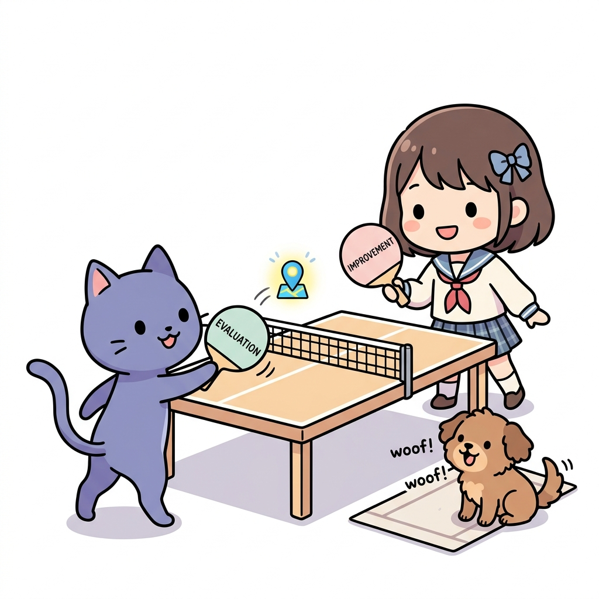

# 09.4 몬테카를로법으로 정책 제어하기
## 09.4.0 도입: 평가를 넘어 제어로

가치 함수를 측정하는 '평가' 단계를 정복한 에이전트는 이제 스스로 최적의 길을 개척하는 '정책 제어(Control)'의 세계로 진입합니다.


**그림 09-4-1** 탐색과 활용의 갈림길에서 지니의 입실론 주사위 안내를 받으며 나아갈 최적 경로를 고민하는 도로시 (16:9 와이드)

- 🎯 **강의 목표**: 환경 모델 없이 경험만으로 최적 정책 *π*\*를 찾아내는 몬테카를로 제어 루프 완성
- 🔄 **핵심 메커니즘**: 정책 평가(Evaluation)와 정책 개선(Improvement)의 핑퐁 순환
- ⚖️ **극복할 과제**: 탐색(Exploration)과 활용(Exploitation)의 균형, 그리고 비정상성(Non-stationarity)

> "가치 함수 평가를 완료한 우리는 이제 최적의 행동 방침을 찾아내는 정책 제어 단계로 나아갑니다. 환경 모델을 전혀 모르는 상태에서 에이전트가 스스로 모험하며 최선의 정책을 찾아가는 몬테카를로 제어 알고리즘의 원리를 지니와 함께 차근차근 확인해 봅시다."

---

# 09.4 몬테카를로법으로 정책 제어하기
## 09.4.1 정책 반복: 평가와 개선의 핑퐁

동적 프로그래밍에서 배운 정책 반복의 황금률은 '평가'와 '개선'을 번갈아 가며 끊임없이 반복하는 것입니다.


**그림 09-4-2** 정책 평가와 정책 개선 과정을 탁구 라켓으로 핑퐁 랠리하듯 주고받으며 최적 정책에 수렴해가는 도로시와 지니 (1:1 순백색)

- 🏓 **1단계: 정책 평가 (Evaluation)**
  * 현재 정책 *π*를 따라 에피소드를 진행하고 경험 데이터로 가치 함수를 측정
- 🏓 **2단계: 정책 개선 (Improvement)**
  * 추정된 가치 함수가 가장 높은 행동을 골라 정책을 탐욕적으로 개선 (*π* &rarr; *π*')
- 🏆 **최적 수렴**: 두 과정의 랠리를 거듭하면 궁극의 최적 정책 *π*\*와 최적 가치 *Q*\*에 도달!

> "최적 정책을 찾는 여정은 가치를 평가하는 과정과 더 나은 쪽으로 개선하는 과정의 연속적인 랠리입니다. 정책 평가로 가치 함수를 정확히 측정하고, 이 가치를 토대로 더 큰 보상을 주는 행동을 선택해 정책을 개선하는 과정을 수렴할 때까지 무한히 반복합니다."

---

# 09.4 몬테카를로법으로 정책 제어하기
## 09.4.1 모델 프리의 핵심: 왜 V(s)가 아닌 Q(s, a)인가?

상태 가치 함수 *V*(*s*)로 최선의 행동을 선택하려면 다음 상태의 전이 확률 *p*(*s'*|*s*, *a*)가 필요하지만, 모델 프리 환경에서는 이를 알 수 없습니다.


**그림 09-4-3** 환경 모델 전이 확률이 없어 막히는 V(s) 대신, 행동 가치 Q(s, a)로 즉시 최적 행동을 선택하는 도로시와 지니 (16:9 와이드)

- ❌ ***V*(*s*) 개선의 한계**:
  * *argmax*<sub>*a*</sub> &sum;<sub>*s'*</sub> *p*(*s'*|*s*, *a*)[*r* + *γV*(*s'*)] &rarr; 전이 확률 행렬 *p*를 모르면 계산 불가!
- ✅ ***Q*(*s*, *a*) 개선의 마법**:
  * *μ*(*s*) = *argmax*<sub>*a*</sub> *Q*(*s*, *a*) &rarr; 환경 모델 없이 오직 *Q* 값의 크기 비교만으로 즉각 결정!
- 💡 **핵심 결론**: 모델 프리 강화학습의 제어에서는 반드시 행동 가치 함수 *Q*(*s*, *a*)를 평가해야 함

> "상태 가치 함수 V만으로는 다음 상태의 전이 확률을 모를 때 최선의 행동을 고를 수 없습니다. 하지만 행동 가치 함수 Q를 사용하면 복잡한 환경 공식 없이도 가장 큰 Q 값을 가진 행동을 즉시 골라낼 수 있어 모델 프리 학습의 핵심 무기가 됩니다."

---

# 09.4 몬테카를로법으로 정책 제어하기
## 09.4.1 수식 돋보기: Q 함수 평가와 탐욕화

행동 가치 함수 *Q*(*s*, *a*)의 증분 평가 공식과 정책 탐욕화 수식의 기호들을 돋보기로 해부합니다.

```
[식 1: 탐욕 정책 결정]    μ(s) = argmax_a Q(s, a)
[식 2: Q 함수 증분 갱신]  Q_n(s, a) = Q_{n-1}(s, a) + (1 / n) · (G^(n) - Q_{n-1}(s, a))
```

- 🔍 **`argmax_a Q(s, a)` 기호 해부**:
  * 상태 *s*에서 취할 수 있는 모든 행동 *a* &isin; &Alpha; 중 *Q*(*s*, *a*)를 최대로 만드는 단 하나의 행동
- 🔍 **`Q_n(s, a)` 증분 갱신 기호 해부**:
  * *G*<sup>(*n*)</sup> : (*s*, *a*) 방문 이후 에피소드 완주까지 얻은 실제 누적 할인 수익 샘플
  * *Q*<sub>*n*&minus;1</sub>(*s*, *a*) : 직전 에피소드까지 누적 추정된 과거 행동 가치 평균
  * 1/*n* : 표본 평균을 유지하기 위한 균등 스텝 크기 (*n* = 방문 횟수)

> "수식을 돋보기로 들여다보면 탐욕화는 각 상태에서 가장 큰 Q 값을 주는 행동을 선택하는 단순한 최대화 연산입니다. 그리고 Q 함수의 갱신은 실제 얻은 수익 G와 이전 추정치 사이의 오차를 방문 횟수 n분의 1만큼 반영해 점진적으로 좁혀나갑니다."

---

# 09.4 몬테카를로법으로 정책 제어하기
## 09.4.2 탐욕 정책의 치명적 함정: 탐색의 실종

단 1회의 에피소드 경험으로 바로 100% 탐욕화를 단행하면, 에이전트는 좁은 시야에 갇혀 영원히 편향된 경로만 걷게 됩니다.


**그림 09-4-4** 초기의 작은 보상 경로에만 갇혀 더 큰 보상이 숨겨진 황금 미로를 발견하지 못하는 탐욕 경로의 함정 (1:1 순백색)

- 🔒 **결정적 경로의 덫**:
  * 한 번이라도 성공을 맛본 행동의 *Q* 값이 커지면, 다음 에피소드에서도 오직 그 행동만 반복 선택
- 🚫 **미방문 상태의 비극**:
  * 다른 칸에 훨씬 더 큰 황금 보상이 숨겨져 있어도, 탐색해보지 않아 그 존재를 영원히 모름
- ⚖️ **탐색과 활용의 딜레마**:
  * **활용(Exploitation)**: 현재 알고 있는 최선의 행동으로 높은 보상 확보
  * **탐색(Exploration)**: 새로운 행동을 시도하여 더 나은 대박 기회 발견

> "처음 얻은 경험만 믿고 곧바로 탐욕화해 버리면 에이전트는 늘 가던 안전한 길만 반복해서 걷게 됩니다. 저 너머에 훨씬 큰 황금 보상이 숨겨져 있어도 새로운 길을 탐색하지 않기 때문에 더 우수한 최적 경로를 영영 찾아내지 못하는 덫에 빠집니다."

---

# 09.4 몬테카를로법으로 정책 제어하기
## 09.4.3 해결책 1: ε-탐욕 정책 (ε-Greedy)

대부분은 가장 똑똑한 행동을 선택하되, 작은 확률 &epsilon;만큼은 호기심을 발휘하여 무작위로 모험하도록 균형을 맞춥니다.


**그림 09-4-5** 최선 행동에 압도적인 확률(1-ε)을 부여하고 나머지 행동들에 고른 탐색 확률(ε/4)을 나누어주는 입실론 탐욕 마법 (16:9 와이드)

- 🎲 **입실론(&epsilon;)의 역할**:
  * 1 &minus; &epsilon; (예: 90%): *Q* 값이 가장 높은 탐욕 행동을 확고하게 선택
  * &epsilon; (예: 10%): 전체 4가지 행동 중 하나를 무작위로 골라 균등 탐색
- 🍰 **방향별 확률 배분 (행동 수 |&Alpha;| = 4)**:
  * 최선 행동 *a*\*의 최종 확률: (1 &minus; &epsilon;) + &epsilon;/4 = **0.925**
  * 나머지 3개 행동의 확률: 각 &epsilon;/4 = **0.025**
- 🌟 **효과**: 모든 상태-행동 쌍 (*s*, *a*)이 지속적으로 방문되어 참 가치에 도달!

> "입실론 탐욕 정책은 영리한 타협안입니다. 90퍼센트의 높은 확률로는 현재 가장 우수한 탐욕 행동을 수행하여 보상을 챙기고, 10퍼센트의 작은 입실론 확률로는 무작위 행동을 시도함으로써 미지의 새로운 최적 경로를 꾸준히 탐색해냅니다."

---

# 09.4 몬테카를로법으로 정책 제어하기
## 09.4.3 수식 돋보기: ε-탐욕 확률 공식 해부

파이썬 `greedy_probs()` 함수로 구현되는 &epsilon;-탐욕 확률 분포 공식을 돋보기로 정밀 분해합니다.

```
[최선 행동 확률]   π(a* | s) = 1 - ε + (ε / |A|)
[비최선 행동 확률] π(a  | s) = ε / |A|   (단, a ≠ a*)
```

- 🔍 **`|A|` 기호 해부**:
  * 에이전트가 상태 *s*에서 선택할 수 있는 총 행동의 가짓수 (그리드월드는 상·하·좌·우 4가지)
- 🔍 **`ε / |A|` 균등 베이스 확률**:
  * 모든 행동에 공평하게 깔아두는 기본 모험 확률 (&epsilon;=0.1일 때 0.1 / 4 = 0.025)
- 🔍 **`1 - ε` 최선 행동 보너스**:
  * *argmax*<sub>*a*</sub> *Q*(*s*, *a*)를 달성한 최우수 행동에게만 단독으로 얹어주는 0.9의 압도적 확률 프리미엄
- 💯 **확률 합 보존**: (1 &minus; &epsilon; + &epsilon;/4) + 3 &times; (&epsilon;/4) = 1 &minus; &epsilon; + &epsilon; = **1.0**

> "수식을 해부해 보면 모든 행동에 기본 탐색 확률인 4분의 입실론을 골고루 깔아준 뒤, 오직 최고 Q 값을 기록한 챔피언 행동에게만 1 빼기 입실론이라는 큰 보너스를 얹어줍니다. 이렇게 하면 확률의 총합이 정확히 1이 유지되면서 탐색이 보장됩니다."

---

# 09.4 몬테카를로법으로 정책 제어하기
## 09.4.4 해결책 2: 비정상 환경과 고정값 α (지수 이동 평균)

정책이 끊임없이 진화하면 과거의 경험 데이터는 현재 정책과 맞지 않는 낡은 정보가 되므로, 고정값 &alpha;로 최신 데이터에 힘을 실어야 합니다.


**그림 09-4-6** 과거 데이터에 균일한 1/n을 주는 표본 평균 대신, 최신 경험에 높은 기하급수 가중치를 부여하는 지수 이동 평균 저울 (1:1 순백색)

- 📉 **문제점: 비정상성 (Non-stationary)**
  * 정책이 개선될 때마다 수익 *G*가 생성되는 확률 분포 자체가 계속 변화함
- ⚖️ **표본 평균 (1/*n*)의 한계**:
  * 멍청했던 초창기 에피소드의 낡은 경험과 현재 똑똑해진 경험을 똑같이 1/*n* 가중치로 평가
- 🚀 **고정 학습률 &alpha;의 승리 (지수 이동 평균)**:
  * 최신 에피소드일수록 높은 가중치를 부여하고, 오래된 데이터는 기하급수적으로 잊어버림!

> "정책이 학습을 거치며 계속 발전하기 때문에 과거 초보 시절에 얻은 수익 데이터는 낡은 정보가 됩니다. 모든 데이터를 똑같이 1/n로 대하는 대신, 고정값 알파를 사용해 최신 데이터에 더 큰 가중치를 부여하는 지수 이동 평균 방식이 필수적입니다."

---

# 09.4 몬테카를로법으로 정책 제어하기
## 09.4.4 수식 돋보기: 지수 이동 평균 점화식

고정 스텝 크기 &alpha;를 적용한 행동 가치 갱신식과 그 기하급수적 가중치 전개 수식을 해부합니다.

```
[갱신 점화식]    Q(s, a) ← Q(s, a) + α · (G - Q(s, a))
[가중치 전개]    Q_{n+1} = (1 - α)^n · Q_1 + ∑_{i=1}^n α · (1 - α)^{n-i} · G^{(i)}
```

- 🔍 **`α · (G - Q(s, a))` 기호 해부**:
  * 관측된 새 수익 *G*와 기존 예측 *Q* 사이의 오차에 고정 비율 &alpha; (예: 0.1)를 곱해 10%만큼 보정
- 🔍 **`(1 - α)^n` 과거 망각 인자**:
  * 에피소드가 1회 지날 때마다 과거 데이터의 영향력이 (1 &minus; &alpha;)배씩 기하급수적으로 감소
- 🔍 **`α(1 - α)^{n-i}` 최신성 프리미엄**:
  * 가장 최근에 수집된 수익 *G*<sup>(*n*)</sup>은 온전한 가중치 &alpha;를 받고, 오래된 과거 샘플일수록 가중치가 0에 수렴

> "점화식을 수학적으로 풀어서 전개해 보면, 오래된 과거 수익의 가중치는 에피소드가 거듭될수록 1 빼기 알파씩 계속 곱해져 0으로 소멸합니다. 반면 방금 얻은 최신 경험은 알파라는 높은 비중을 유지하므로, 변화하는 정책에 민첩하게 적응합니다."

---

# 09.4 몬테카를로법으로 정책 제어하기
## 09.4.5 McAgent 완성: 10,000 에피소드 제어 결과

&epsilon;-탐욕 정책과 고정값 &alpha;를 탑재한 `McAgent`가 10,000번의 모험을 마친 후 그리드월드의 최적 행동 화살표를 완벽히 찾아냅니다.


**그림 09-4-7** 10,000번 에피소드 후 수렴된 4방향 Q 함수와, 이를 바탕으로 도출된 최적 탈출 경로 화살표 맵 (공학 벡터)

```python
agent = McAgent() # epsilon=0.1, alpha=0.1
for episode in range(10000):
    state = env.reset()
    while True:
        action = agent.get_action(state) # ε-탐욕 행동
        next_state, reward, done = env.step(action)
        agent.add(state, action, reward)
        if done:
            agent.update() # 역방향 Q 갱신 + greedy_probs 정책 갱신
            break
```

- 🚩 **학습 결과**: 함정(-1)을 멀리 우회하고 골(+1) 지점으로 최단거리 진입하는 완벽한 제어 정책 획득!

> "입실론 탐욕과 고정 학습률 알파로 무장한 McAgent를 만 번 훈련시키자, 마이너스 함정을 영리하게 피해 플러스 골 지점으로 직행하는 최적의 화살표 지도가 완성되었습니다. 환경의 수학적 모델 없이도 스스로 최적 정책을 제어해낸 것입니다."

---

# 09.4 몬테카를로법으로 정책 제어하기
## 09.4.6 핵심 정리: 몬테카를로 정책 제어 3대 기둥

환경 모델을 전혀 모르는 무지의 상태에서도 스스로 모험하며 최적의 정책을 찾아내는 몬테카를로 제어의 3대 초석을 총정리합니다.


**그림 09-4-8** Q 함수, 입실론 탐욕, 고정 알파의 3대 기둥을 세우고 오프-정책의 새로운 장으로 나아가는 도로시와 지니 (16:9 와이드)

1. **행동 가치 함수 *Q*(*s*, *a*)의 채택**:
   - 상태 전이 확률 *p*를 모르는 모델 프리 환경에서는 *argmax*<sub>*a*</sub> *Q*(*s*, *a*)가 유일한 해법
2. **&epsilon;-탐욕 정책을 통한 탐색 보장**:
   - 1 &minus; &epsilon;의 활용과 &epsilon;의 무작위 탐색을 조화시켜 국소 최적해에 갇히는 편향을 원천 차단
3. **고정 학습률 &alpha; 기반 지수 이동 평균**:
   - 정책 개선으로 끊임없이 바뀌는 비정상 환경에서 최신 경험 데이터에 적응적 가중치 부여

> "우리는 오늘 모델 없이 최적 행동을 결정하는 Q 함수, 국소 덫을 탈출하는 입실론 탐욕, 그리고 변화하는 환경에 민첩하게 적응하는 고정 알파의 삼총사를 완성했습니다. 다음 9.5절에서는 행동과 학습을 분리하는 오프-정책과 중요도 샘플링을 만나봅시다."
