# 09.4 몬테카를로법으로 정책 제어하기
## 09.4 몬테카를로법으로 정책 제어하기 개요

가치 함수 평가를 넘어 최적 정책을 스스로 찾아 나가는 **정책 제어(Policy Control)**와 탐색-이용의 균형을 다룹니다.


**그림 09-4-1** 탐색-이용(Exploration-Exploitation) 갈림길에서 지니의 입실론 주사위 마법을 보며 나아갈 길을 결정하는 도로시

> 09.4 몬테카를로법으로 정책 제어하기 개요에 대한 핵심 메커니즘을 살펴보겠습니다. 가치 함수 평가를 넘어 최적 정책을 스스로 찾아 나가는 정책 제어(Policy Control)와 탐색-이용의 균형을 다룹니다. 그림 09-4-1 탐색-이용(Exploration-Exploitation) 갈림길에서 지니의 입실론 주사위 마법을 보며 나아갈 길을 결정하는 도로시 이 원리를 통해 몬테카를로법이 어떻게 스스로 최적 정책을 찾아가고 오차와 분산을 제어하는지 직관적으로 파악할 수 있습니다.

---

# 09.4 몬테카를로법으로 정책 제어하기
## 09.4 몬테카를로법으로 정책 제어하기 개요

무작위 행동 탐색의 비율을 제어하는 ***ε*-탐욕 정책(*ε*-greedy policy)**과 시시각각 발전하는 최신 데이터에 적응하는 **고정 학습률 *α* 기반 지수 이동 평균**을 활용하여 몬테카를로법으로 최적 솔루션에 수렴해 나가는 전체 라이프사이클을 요정 지니의 딜레마 주사위 놀이와 이호진 교수님의 4개의 문 비유로 완벽히 정복해 봅시다!

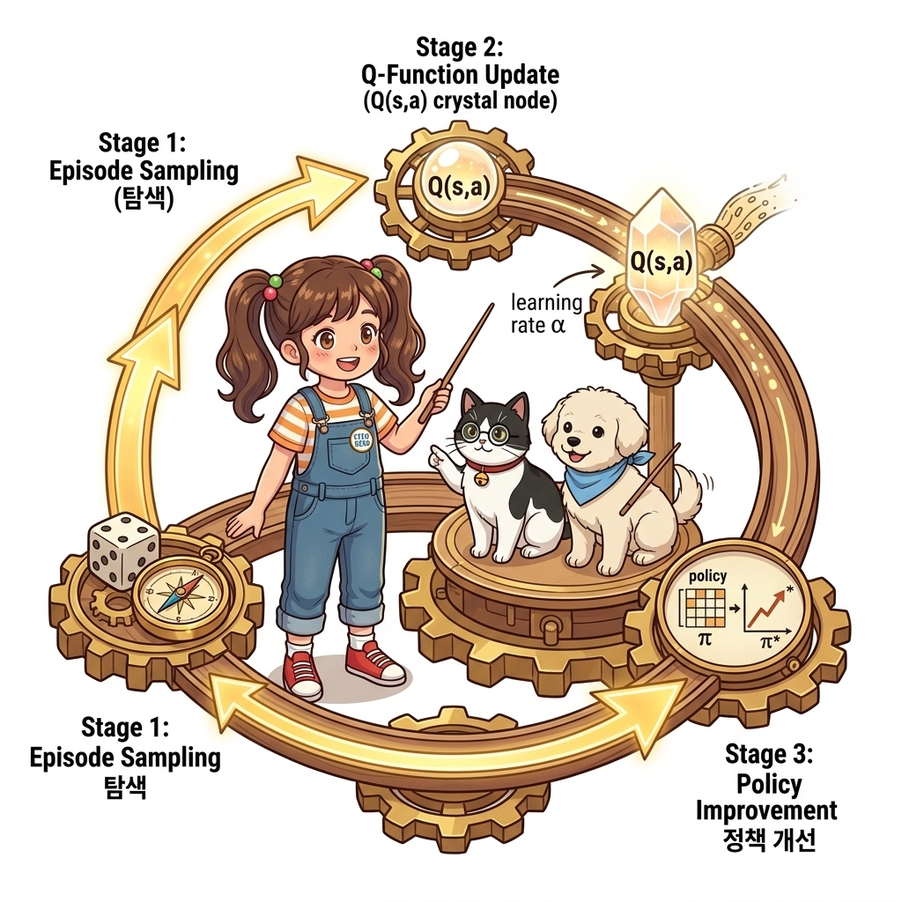
**그림 09-4-1b** 몬테카를로 정책 제어 3단계 라이프사이클 (에피소드 샘플링 → Q 함수 지수이동평균 갱신 → ε-탐욕 정책 개선) 로드맵 인포그래픽

> 09.4 몬테카를로법으로 정책 제어하기 개요에 대한 핵심 메커니즘을 살펴보겠습니다. 무작위 행동 탐색의 비율을 제어하는 ε-탐욕 정책(ε-greedy policy)과 시시각각 발전하는 최신 데이터에 적응하는 고정 학습률 α 기반 지수 이동 평균을 활용하여 몬테카를로법으로 최적 솔루션에 수렴해 나가는 전체 라이프사이클을 요정 지니의 딜레마 주사위 놀이와 이호진 교수님의  이 원리를 통해 몬테카를로법이 어떻게 스스로 최적 정책을 찾아가고 오차와 분산을 제어하는지 직관적으로 파악할 수 있습니다.

---

# 09.4 몬테카를로법으로 정책 제어하기
## 09.4.1 정책 제어의 기초: 평가와 개선의 탁구 핑퐁

앞서 9.2절과 9.3절에서는 몬테카를로법으로 '정책 평가(Policy Evaluation)'를 수행했습니다.

어떤 고정된 정책(예: 4방향 25% 균등 무작위 정책)이 주어졌을 때 각 칸의 가치가 얼마인지를 채점하는 작업이었습니다.


**그림 09-4-1c** 4방향 25% 무작위 정책이 주어졌을 때 각 칸의 성적표(V 가치)를 매기던 9.2~9.3 정책 평가 리캡 인포그래픽

> 09.4.1 정책 제어의 기초: 평가와 개선의 탁구 핑퐁에 대한 핵심 메커니즘을 살펴보겠습니다. 앞서 9.2절과 9.3절에서는 몬테카를로법으로 '정책 평가(Policy Evaluation)'를 수행했습니다. 어떤 고정된 정책(예: 4방향 25% 균등 무작위 정책)이 주어졌을 때 각 칸의 가치가 얼마인지를 채점하는 작업이었습니다. 그림 09-4-1c 4방향 25% 무작위 정책이 주어 이 원리를 통해 몬테카를로법이 어떻게 스스로 최적 정책을 찾아가고 오차와 분산을 제어하는지 직관적으로 파악할 수 있습니다.

---

# 09.4 몬테카를로법으로 정책 제어하기
## 09.4.1 정책 제어의 기초: 평가와 개선의 탁구 핑퐁

하지만 강화학습의 궁극적인 목표는 단순히 남이 준 정책을 채점하는 것에 머무르지 않고, **"어떻게 하면 가장 많은 보상을 획득할 수 있는 최고의 행동 지침(최적 정책 *π*<sup>\*</sup>)을 스스로 찾아낼 수 있을까?"**입니다. 이처럼 최적 정책을 찾아 나가는 전 과정을 **'정책 제어(Policy Control)'**라고 부릅니다.

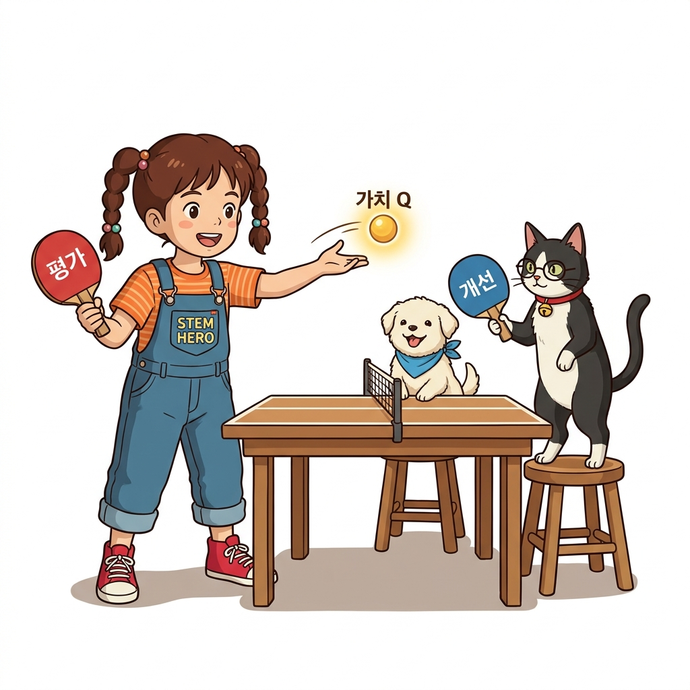
**그림 09-4-2** 정책 평가(Evaluation)와 정책 개선(Improvement)의 과정을 탁구 핑퐁 패들로 주고받는 지니와 도로시

> 09.4.1 정책 제어의 기초: 평가와 개선의 탁구 핑퐁에 대한 핵심 메커니즘을 살펴보겠습니다. 하지만 강화학습의 궁극적인 목표는 단순히 남이 준 정책을 채점하는 것에 머무르지 않고, "어떻게 하면 가장 많은 보상을 획득할 수 있는 최고의 행동 지침(최적 정책 π\)을 스스로 찾아낼 수 있을까?"입니다. 이처럼 최적 정책을 찾아 나가는 전 과정을 '정책 제어(Policy Contr 이 원리를 통해 몬테카를로법이 어떻게 스스로 최적 정책을 찾아가고 오차와 분산을 제어하는지 직관적으로 파악할 수 있습니다.

---

# 09.4 몬테카를로법으로 정책 제어하기
## 09.4.1 정책 제어의 기초: 평가와 개선의 탁구 핑퐁

최적 정책은 4장에서 배운 **'정책 반복(Policy Iteration)'**의 큰 틀과 마찬가지로, '평가'와 '개선'을 탁구공 치듯 번갈아 반복하여 완성됩니다:

1. **'평가(Evaluation)' 단계**: 현재 정책을 바탕으로 환경 속을 직접 걸어 다니며 경험을 쌓고, 각 상태나 행동의 가치 함수를 측정합니다.
2. **'개선(Improvement)' 단계**: 가치 함수가 가장 높은 쪽으로 행동 확률을 수정(탐욕화)하여 정책을 한 단계 업그레이드합니다.

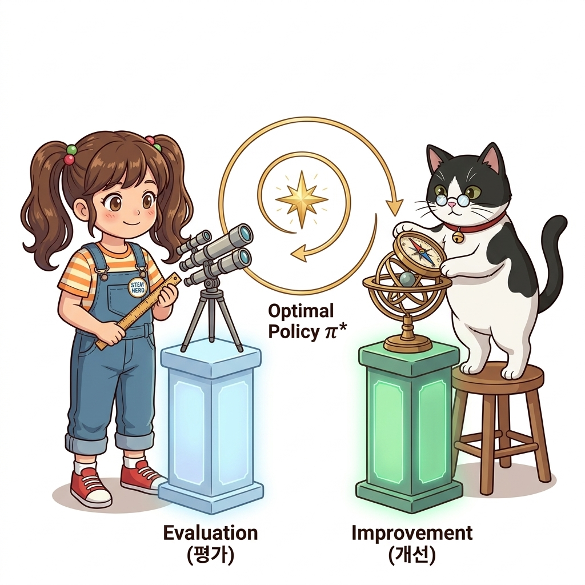
**그림 09-4-2c** 정책 반복의 2단계: 1단계 평가(경험 축적 및 가치 측정)와 2단계 개선(최고 가치 행동 탐욕화) 구조도

> 09.4.1 정책 제어의 기초: 평가와 개선의 탁구 핑퐁에 대한 핵심 메커니즘을 살펴보겠습니다. 최적 정책은 4장에서 배운 '정책 반복(Policy Iteration)'의 큰 틀과 마찬가지로, '평가'와 '개선'을 탁구공 치듯 번갈아 반복하여 완성됩니다: 1. '평가(Evaluation)' 단계: 현재 정책을 바탕으로 환경 속을 직접 걸어 다니며 경험을 쌓고, 각 상태나 행동의 가 이 원리를 통해 몬테카를로법이 어떻게 스스로 최적 정책을 찾아가고 오차와 분산을 제어하는지 직관적으로 파악할 수 있습니다.

---

# 09.4 몬테카를로법으로 정책 제어하기
## 09.4.1 정책 제어의 기초: 평가와 개선의 탁구 핑퐁

이 두 단계를 끊임없이 주고받으면, 처음에는 서툴렀던 무작위 정책이 점차 다듬어져 결국 최적 정책에 도달하게 됩니다.


**그림 09-4-2b** 정책 평가(Q ≈ q_π)와 정책 개선(π ← greedy(Q))이 맞물려 최적 정책 π*로 상승 수렴하는 나선형 수식 다이어그램

> 09.4.1 정책 제어의 기초: 평가와 개선의 탁구 핑퐁에 대한 핵심 메커니즘을 살펴보겠습니다. 이 두 단계를 끊임없이 주고받으면, 처음에는 서툴렀던 무작위 정책이 점차 다듬어져 결국 최적 정책에 도달하게 됩니다. 그림 09-4-2b 정책 평가(Q ≈ qπ)와 정책 개선(π ← greedy(Q))이 맞물려 최적 정책 π로 상승 수렴하는 나선형 수식 다이어그램 이 원리를 통해 몬테카를로법이 어떻게 스스로 최적 정책을 찾아가고 오차와 분산을 제어하는지 직관적으로 파악할 수 있습니다.

---

# 09.4 몬테카를로법으로 정책 제어하기
## 1) 왜 모델 프리 강화학습에서는 V(s) 대신 Q(s, a)를 써야만 할까요?

가치 함수를 개선 단계에서 활용할 때, 우리는 4장에서 배운 탐욕화(Greedy Selection) 공식을 떠올릴 수 있습니다.

수식으로는 다음과 같이 두 가지 방식으로 표현할 수 있습니다:

> ### ***μ*(*s*) = argmax<sub>*a*</sub> *Q*(*s*, *a*)** &nbsp;&nbsp;&nbsp;&nbsp; *(식 9.3: 행동 가치 함수 기반)*
>
> ### ***μ*(*s*) = argmax<sub>*a*</sub> ∑<sub>*s*&#39;</sub> *p*(*s*&#39; | *s*, *a*) [*r*(*s*, *a*, *s*&#39;) + *γV*(*s*&#39;)]** &nbsp;&nbsp;&nbsp;&nbsp; *(식 9.4: 상태 가치 함수 기반)*

두 식 모두 '가장 큰 가치를 주는 행동'을 선택하여 새로운 결정적 정책 *μ*(*s*)를 만드는 탐욕화 식입니다.


**그림 09-4-2d** 탐욕화의 두 가지 표현 방식: Q 기반 직접 탐욕화(식 9.3)와 V 기반 전이확률 합산 탐욕화(식 9.4) 나열 인포그래픽

---

# 09.4 몬테카를로법으로 정책 제어하기
## 1) 왜 모델 프리 강화학습에서는 V(s) 대신 Q(s, a)를 써야만 할까요?

그런데 왜 우리는 몬테카를로 정책 제어에서 [식 9.4]의 상태 가치 함수 *V*(*s*)를 버리고 [식 9.3]의 **행동 가치 함수 *Q*(*s*, *a*)**를 필사적으로 선택해야 할까요?

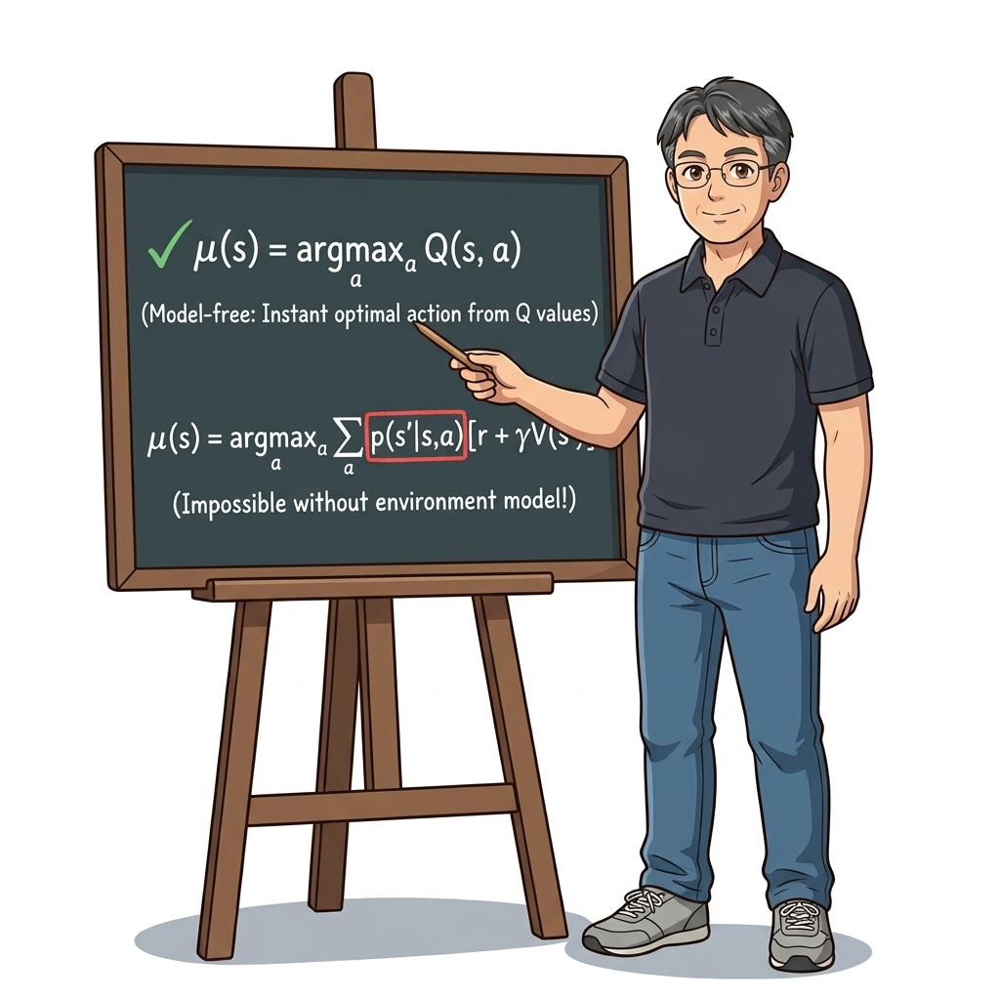
**그림 09-4-2c** 식 9.3(Q 기반 직접 argmax)과 식 9.4(V 기반 전이확률 가중합 argmax)의 수식 기호 분해 및 모델 프리에서 식 9.4 계산 불가능 이유 비교 인포그래픽

> 1) 왜 모델 프리 강화학습에서는 V(s) 대신 Q(s, a)를 써야만 할까요?에 대한 핵심 메커니즘을 살펴보겠습니다. 그런데 왜 우리는 몬테카를로 정책 제어에서 [식 9.4]의 상태 가치 함수 V(s)를 버리고 [식 9.3]의 행동 가치 함수 Q(s, a)를 필사적으로 선택해야 할까요? 그림 09-4-2c 식 9.3(Q 기반 직접 argmax)과 식 9.4(V 기반 전이확률 가중합 argmax)의 수식 이 원리를 통해 몬테카를로법이 어떻게 스스로 최적 정책을 찾아가고 오차와 분산을 제어하는지 직관적으로 파악할 수 있습니다.

---

# 09.4 몬테카를로법으로 정책 제어하기
## 1) 왜 모델 프리 강화학습에서는 V(s) 대신 Q(s, a)를 써야만 할까요?

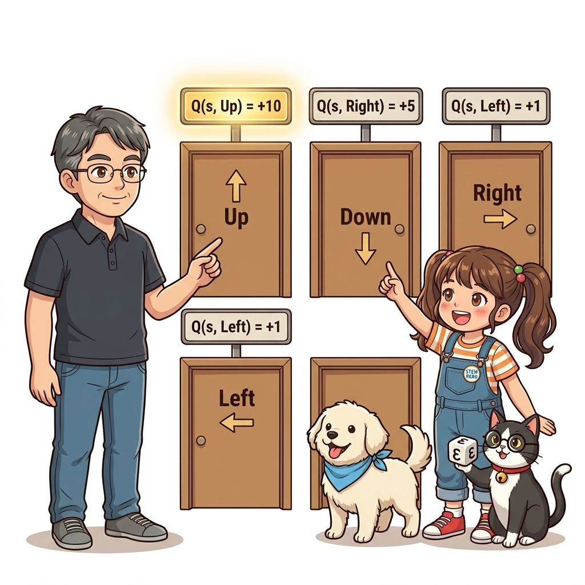
**그림 09-4-3** 이호진 교수님이 상·하·좌·우 4개의 문 위에 붙은 행동 가치 표지판(*Q*(*s*, Up) = +10 등)을 보여주며, 미지의 미로에서 환경 모델 없이 즉시 최선의 문을 고를 수 있는 *Q* 함수의 결정적 위력을 도로시와 토토, 지니에게 설명하는 직강 장면

> 1) 왜 모델 프리 강화학습에서는 V(s) 대신 Q(s, a)를 써야만 할까요?에 대한 핵심 메커니즘을 살펴보겠습니다. 그림 09-4-3 이호진 교수님이 상·하·좌·우 4개의 문 위에 붙은 행동 가치 표지판(Q(s, Up) = +10 등)을 보여주며, 미지의 미로에서 환경 모델 없이 즉시 최선의 문을 고를 수 있는 Q 함수의 결정적 위력을 도로시와 토토, 지니에게 설명하는 직강 장면 이 원리를 통해 몬테카를로법이 어떻게 스스로 최적 정책을 찾아가고 오차와 분산을 제어하는지 직관적으로 파악할 수 있습니다.

---

# 09.4 몬테카를로법으로 정책 제어하기
## 1) 왜 모델 프리 강화학습에서는 V(s) 대신 Q(s, a)를 써야만 할까요?

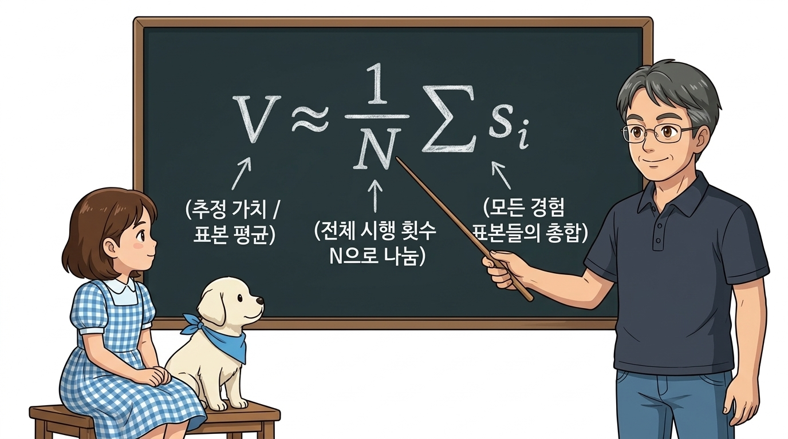
**그림 09-4-4** 환경 모델 전이 확률이 없어 막히는 *V*(*s*) 대신, 행동 가치 *Q*(*s*, *a*)로 즉시 최적 행동을 선택하는 도로시와 지니

> 👨‍🏫 **이호진 교수님의 '방과 4개의 문' 비유**:
> "도로시야, 상태 가치 함수 *V*(*s*)는 **'지금 내가 서 있는 방이 얼마나 좋은 방인가'**를 나타내는 점수란다.
> 만약 방에 상, 하, 좌, 우 4개의 문이 있을 때, 어느 문으로 나가야 할지 결정하려면 '각 문을 열었을 때 어떤 방으로 이어지는지' 미로 전체의 설계도(*p*(*s*&#39; | *s*, *a*))를 에이전트가 미리 완벽하게 알고 있어야만 다음 방의 점수 *V*(*s*&#39;)를 가중 평균하여 비교할 수 있지.
> 하지만 환경 모델을 전혀 모르는 강화학습에서는 그 설계도가 아예 없단다!
> 반면에 행동 가치 함수 *Q*(*s*, *a*)는 **'각 문고리 위에 직접 적혀 있는 점수 표지판'**이란다!
> 위쪽 문 표지판에는 '+10점', 오른쪽 문 표지판에는 '+5점'이라고 적혀 있다면, 문 뒤에 어떤 미로가 펼쳐져 있는지 설계를 전혀 몰라도 **단순히 가장 큰 숫자가 적힌 위쪽 문(argmax<sub>*a*</sub> *Q*)을 열고 나가면 끝**이란다!"

이것이 바로 모델 프리(Model-Free) 강화학습의 핵심입니다. 환경 모델의 확률 수식 *p*(*s*&#39; | *s*, *a*)를 모를 때는 [식 9.4]를 계산할 방법이 전혀 없으므로, 표지판 역할을 해주는 **행동 가치 함수 *Q*(*s*, *a*)**를 평가 대상으로 삼아야 합니다.

---

# 09.4 몬테카를로법으로 정책 제어하기
## 2) Q 함수의 평가: 상태에서 상태-행동 쌍으로의 확장

*Q* 함수를 바탕으로 정책을 개선하려면, 먼저 *Q* 함수를 정확히 '평가'할 수 있어야 합니다.

9.2절과 9.3절에서 배운 상태 가치 함수 *V*(*s*) 평가 공식과 *Q*(*s*, *a*) 평가 공식을 나란히 비교해 보면, 대상이 단일 상태 *s*에서 상태-행동 쌍 *(s, a)*로 확장되었을 뿐 수학적 뼈대는 완전히 동일합니다:

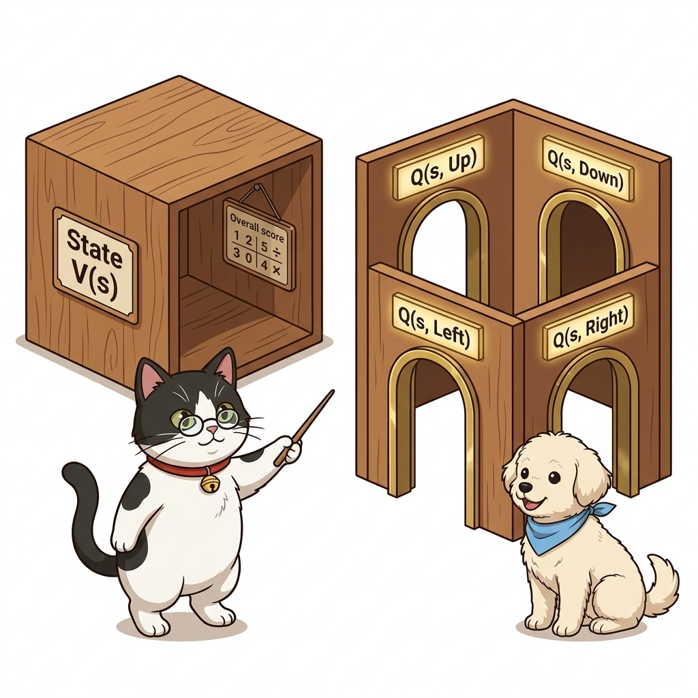
**그림 09-4-4a** 대상의 확장: 단일 상태 s 방에서 상태-행동 쌍 (s, a) 문고리 표지판으로의 2차원 확장 개념도

> 2) Q 함수의 평가: 상태에서 상태-행동 쌍으로의 확장에 대한 핵심 메커니즘을 살펴보겠습니다. Q 함수를 바탕으로 정책을 개선하려면, 먼저 Q 함수를 정확히 '평가'할 수 있어야 합니다. 9.2절과 9.3절에서 배운 상태 가치 함수 V(s) 평가 공식과 Q(s, a) 평가 공식을 나란히 비교해 보면, 대상이 단일 상태 s에서 상태-행동 쌍 (s, a)로 확장되었을 뿐 수학적 뼈대 이 원리를 통해 몬테카를로법이 어떻게 스스로 최적 정책을 찾아가고 오차와 분산을 제어하는지 직관적으로 파악할 수 있습니다.

---

# 09.4 몬테카를로법으로 정책 제어하기
## 2) Q 함수의 평가: 상태에서 상태-행동 쌍으로의 확장

**[상태 가치 함수 V(s) 평가]**
- 표본 평균 정의:
> ***V*<sub>*n*</sub>(*s*) = (*G*<sup>(1)</sup> + *G*<sup>(2)</sup> + &hellip; + *G*<sup>(*n*)</sup>) / *n***
- 증분 갱신 점화식:
> ***V*<sub>*n*</sub>(*s*) = *V*<sub>*n*-1</sub>(*s*) + (1 / *n*) · [*G*<sup>(*n*)</sup> - *V*<sub>*n*-1</sub>(*s*)]** &nbsp;&nbsp;&nbsp;&nbsp; *(식 9.5)*

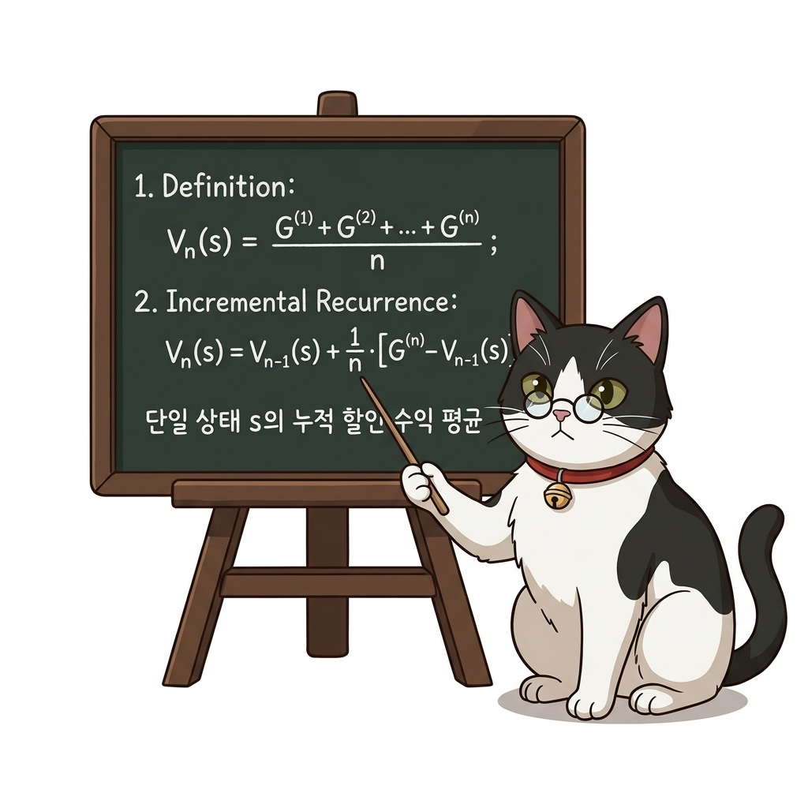
**그림 09-4-4a2** 상태 가치 함수 V(s) 표본 평균 정의식과 증분 갱신 점화식 칠판 수식 인포그래픽

---

# 09.4 몬테카를로법으로 정책 제어하기
## 2) Q 함수의 평가: 상태에서 상태-행동 쌍으로의 확장

**[행동 가치 함수 Q(s, a) 평가]**
- 표본 평균 정의:
> ***Q*<sub>*n*</sub>(*s*, *a*) = (*G*<sup>(1)</sup> + *G*<sup>(2)</sup> + &hellip; + *G*<sup>(*n*)</sup>) / *n***
- 증분 갱신 점화식:
> ***Q*<sub>*n*</sub>(*s*, *a*) = *Q*<sub>*n*-1</sub>(*s*, *a*) + (1 / *n*) · [*G*<sup>(*n*)</sup> - *Q*<sub>*n*-1</sub>(*s*, *a*)]** &nbsp;&nbsp;&nbsp;&nbsp; *(식 9.6)*

여기서 *G*<sup>(*n*)</sup>은 상태 *s*에서 행동 *a*를 취한 *n*번째 에피소드에서 실제로 얻은 누적 할인 수익입니다.

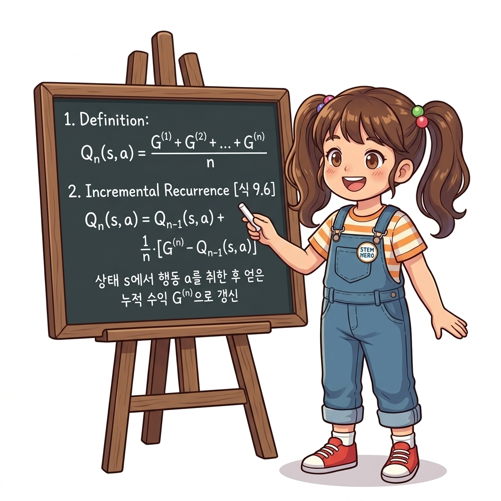
**그림 09-4-4a3** 행동 가치 함수 Q(s, a) 표본 평균 정의 및 누적 할인 수익 G^(n) 매핑 수식 인포그래픽

---

# 09.4 몬테카를로법으로 정책 제어하기
## 2) Q 함수의 평가: 상태에서 상태-행동 쌍으로의 확장

[식 9.6]에 따라 에이전트는 경험이 쌓일 때마다 *Q*(*s*, *a*) 테이블을 실시간으로 갱신해 나갈 수 있습니다.

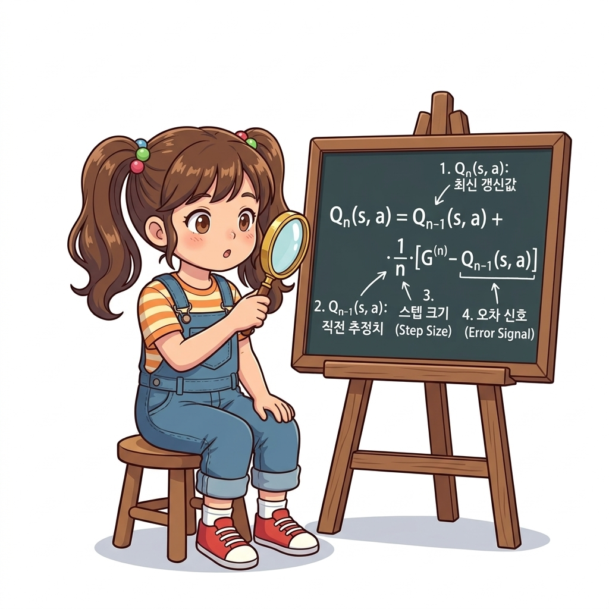
**그림 09-4-4b** Q_n(s,a) = Q_{n-1}(s,a) + (1/n)[G^(n) - Q_{n-1}(s,a)] 행동 가치 증분 갱신 공식의 4대 기호 분해 인포그래픽

> 2) Q 함수의 평가: 상태에서 상태-행동 쌍으로의 확장에 대한 핵심 메커니즘을 살펴보겠습니다. [식 9.6]에 따라 에이전트는 경험이 쌓일 때마다 Q(s, a) 테이블을 실시간으로 갱신해 나갈 수 있습니다. 그림 09-4-4b Qn(s,a) = Q{n-1}(s,a) + (1/n)[G^(n) - Q{n-1}(s,a)] 행동 가치 증분 갱신 공식의 4대 기호 분해 인포그래픽 이 원리를 통해 몬테카를로법이 어떻게 스스로 최적 정책을 찾아가고 오차와 분산을 제어하는지 직관적으로 파악할 수 있습니다.

---

# 09.4 몬테카를로법으로 정책 제어하기
## 09.4.2 몬테카를로 정책 제어의 초기 순진한 버전과 2대 함정

이제 몬테카를로법으로 정책을 제어하는 기본 클래스 `McAgent`의 초기 버전을 작성해 보겠습니다.

```python
from collections import defaultdict
import numpy as np

class McAgent:
def __init__(self):
self.gamma = 0.9
self.action_size = 4

random_actions = {0: 0.25, 1: 0.25, 2: 0.25, 3: 0.25}
self.pi = defaultdict(lambda: random_actions)
self.Q = defaultdict(lambda: 0)  # V 대신 Q를 테이블로 채택! 키는 (state, action)
self.cnts = defaultdict(lambda: 0)
self.memory = []

def get_action(self, state):
action_probs = self.pi[state]
actions = list(action_probs.keys())
probs = list(action_probs.values())
return np.random.choice(actions, p=probs)

def add(self, state, action, reward):
data = (state, action, reward)
self.memory.append(data)

def reset(self):
self.memory.clear()
```

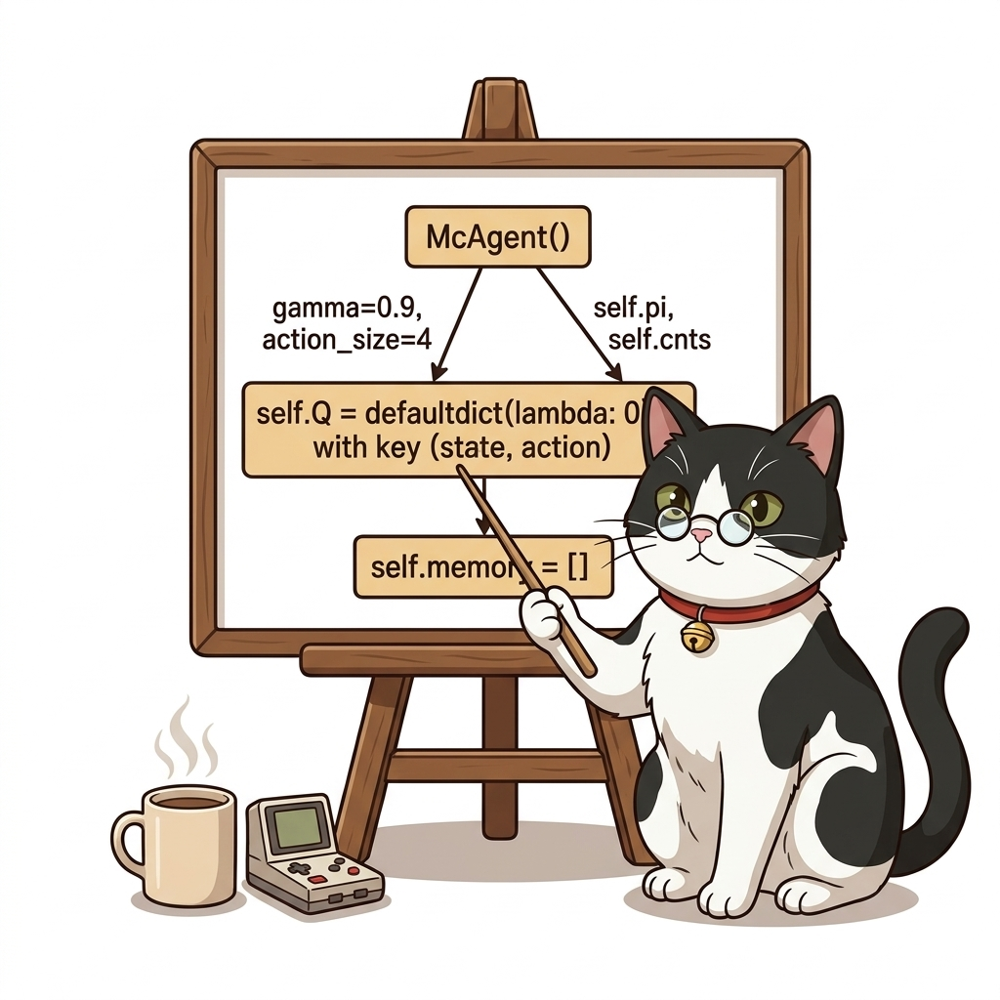
**그림 09-4-4b2** McAgent 초기화 및 memory 배낭, Q 테이블 생성 파이썬 코드 순서도

> 09.4.2 몬테카를로 정책 제어의 초기 순진한 버전과 2대 함정에 대한 핵심 메커니즘을 살펴보겠습니다. 이제 몬테카를로법으로 정책을 제어하는 기본 클래스 McAgent의 초기 버전을 작성해 보겠습니다. python from collections import defaultdict 이 원리를 통해 몬테카를로법이 어떻게 스스로 최적 정책을 찾아가고 오차와 분산을 제어하는지 직관적으로 파악할 수 있습니다.

---

# 09.4 몬테카를로법으로 정책 제어하기
## 09.4.2 몬테카를로 정책 제어의 초기 순진한 버전과 2대 함정

9.3절의 `RandomAgent`와 비교했을 때, 가치 테이블이 `self.V`에서 `self.Q`로 바뀐 점이 가장 큰 차이점입니다. 이제 키(Key)는 단일 좌표 `state`가 아니라 `(state, action)` 튜플이 됩니다.

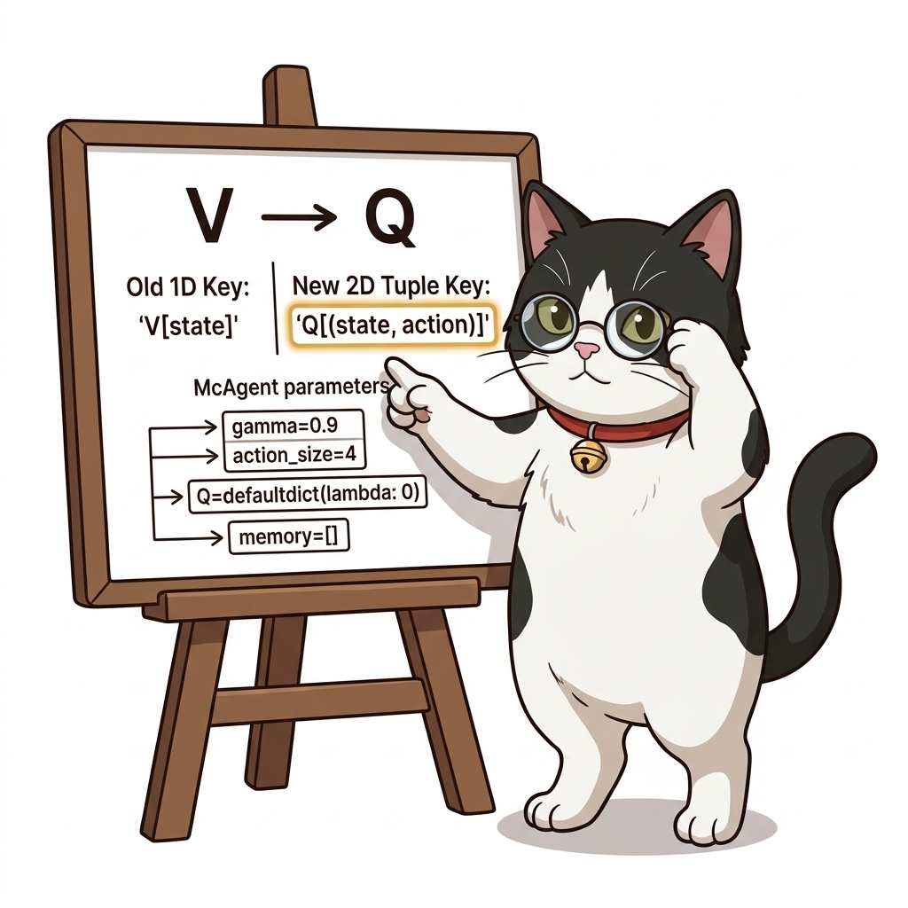
**그림 09-4-4c** 초기 `McAgent` 클래스 구조 및 (state, action) 키 기반 Q 테이블 초기화 순서도

> 09.4.2 몬테카를로 정책 제어의 초기 순진한 버전과 2대 함정에 대한 핵심 메커니즘을 살펴보겠습니다. 9.3절의 RandomAgent와 비교했을 때, 가치 테이블이 self.V에서 self.Q로 바뀐 점이 가장 큰 차이점입니다. 이제 키(Key)는 단일 좌표 state가 아니라 (state, action) 튜플이 됩니다. 그림 09-4-4c 초기 McAgent 클래스 구조 및 (stat 이 원리를 통해 몬테카를로법이 어떻게 스스로 최적 정책을 찾아가고 오차와 분산을 제어하는지 직관적으로 파악할 수 있습니다.

---

# 09.4 몬테카를로법으로 정책 제어하기
## 09.4.2 몬테카를로 정책 제어의 초기 순진한 버전과 2대 함정

이어서 정책을 완전 탐욕적으로 개선하는 `greedy_probs()` 함수와 에이전트의 `update()` 메서드를 추가해 봅시다:

```python
def greedy_probs(Q, state, action_size=4):
qs = [Q[(state, action)] for action in range(action_size)]
max_action = np.argmax(qs)

action_probs = {action: 0.0 for action in range(action_size)}
action_probs[max_action] = 1.0  # ❶ 완전 탐욕 (최고 가치 행동에만 100% 확률 부여)
return action_probs

class McAgent:
# ... (앞부분 동일) ...

def update(self):
G = 0
for data in reversed(self.memory):
state, action, reward = data
G = self.gamma * G + reward
key = (state, action)
self.cnts[key] += 1
# ❷ 표본 평균 증분 갱신 (1/n 방식)
self.Q[key] += (G - self.Q[key]) / self.cnts[key]

# 현재 상태의 정책을 탐욕적으로 즉시 개선
self.pi[state] = greedy_probs(self.Q, state)
```

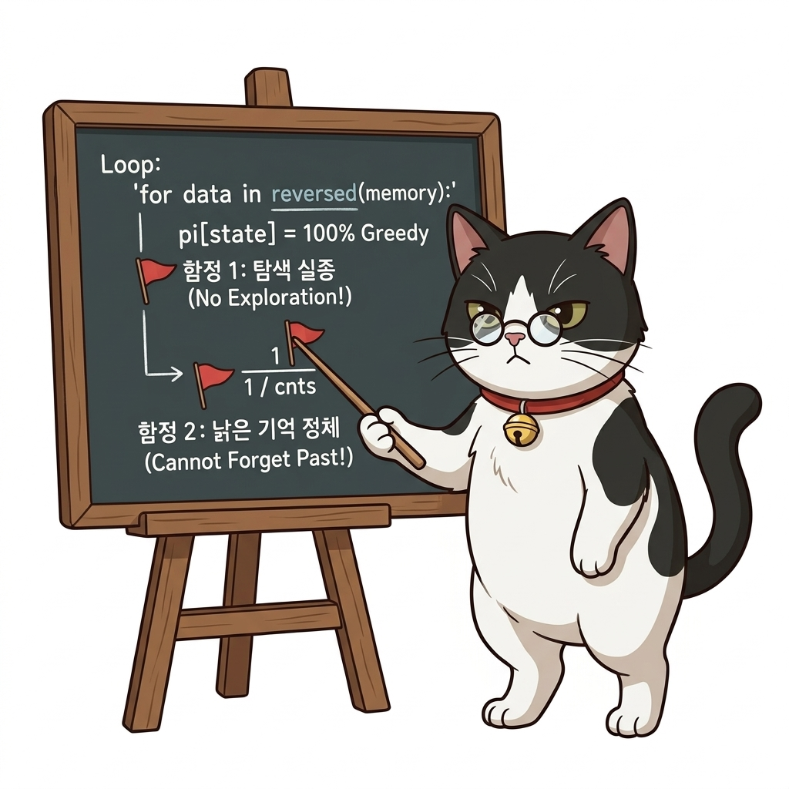
**그림 09-4-4d** 순진한 버전의 탐욕 정책 업데이트 순서도: argmax 완전 탐욕의 경직성과 1/n 평균 갱신의 한계

> 09.4.2 몬테카를로 정책 제어의 초기 순진한 버전과 2대 함정에 대한 핵심 메커니즘을 살펴보겠습니다. 이어서 정책을 완전 탐욕적으로 개선하는 greedyprobs() 함수와 에이전트의 update() 메서드를 추가해 봅시다: python def greedyprobs(Q, state, actionsize=4): 이 원리를 통해 몬테카를로법이 어떻게 스스로 최적 정책을 찾아가고 오차와 분산을 제어하는지 직관적으로 파악할 수 있습니다.

---

# 09.4 몬테카를로법으로 정책 제어하기
## 09.4.2 몬테카를로 정책 제어의 초기 순진한 버전과 2대 함정

겉보기에는 완벽해 보이지만, **이 순진한 코드를 실행하면 에이전트는 미로를 제대로 탈출하지 못하고 심각한 오류에 빠집니다.**


**그림 09-4-4d2** 미로 속에서 완전 탐욕의 오류에 빠져 멈춰버린 초보 McAgent 로봇과 당황하는 도로시

> 09.4.2 몬테카를로 정책 제어의 초기 순진한 버전과 2대 함정에 대한 핵심 메커니즘을 살펴보겠습니다. 겉보기에는 완벽해 보이지만, 이 순진한 코드를 실행하면 에이전트는 미로를 제대로 탈출하지 못하고 심각한 오류에 빠집니다. 그림 09-4-4d2 미로 속에서 완전 탐욕의 오류에 빠져 멈춰버린 초보 McAgent 로봇과 당황하는 도로시 이 원리를 통해 몬테카를로법이 어떻게 스스로 최적 정책을 찾아가고 오차와 분산을 제어하는지 직관적으로 파악할 수 있습니다.

---

# 09.4 몬테카를로법으로 정책 제어하기
## 09.4.2 몬테카를로 정책 제어의 초기 순진한 버전과 2대 함정

여기에는 인공지능 역사상 가장 유명한 2가지 치명적인 함정이 숨어 있습니다:

1. **코드 ❶의 함정 (탐색 실종)**: 100% 완전 탐욕만을 고집하면 한 번 발견한 길에만 갇혀 다른 미지의 황금 경로를 영원히 탐색하지 못합니다.
→ **해결책: *ε*-탐욕 정책(Epsilon-Greedy Policy)**


**그림 09-4-4d3** 함정 ❶ 탐색 실종: 눈앞의 작은 사탕(0.1)에 갇혀 뒤쪽 거대한 황금 보물을 보지 못하는 100% 완전 탐욕의 함정 인포그래픽

> 09.4.2 몬테카를로 정책 제어의 초기 순진한 버전과 2대 함정에 대한 핵심 메커니즘을 살펴보겠습니다. 여기에는 인공지능 역사상 가장 유명한 2가지 치명적인 함정이 숨어 있습니다: 1. 코드 ❶의 함정 (탐색 실종): 100% 완전 탐욕만을 고집하면 한 번 발견한 길에만 갇혀 다른 미지의 황금 경로를 영원히 탐색하지 못합니다. → 해결책: ε-탐욕 정책(Epsilon-Greedy Poli 이 원리를 통해 몬테카를로법이 어떻게 스스로 최적 정책을 찾아가고 오차와 분산을 제어하는지 직관적으로 파악할 수 있습니다.

---

# 09.4 몬테카를로법으로 정책 제어하기
## 09.4.2 몬테카를로 정책 제어의 초기 순진한 버전과 2대 함정

2. **코드 ❷의 함정 (비정상 문제 무시)**: 정책이 매 에피소드 발전하는데, 옛날 초보 시절의 바보 같은 경험과 오늘의 고수 경험을 똑같이 1/*n* 가중치로 균일하게 평균 내고 있습니다.
→ **해결책: 고정 학습률 *α* 기반 지수 이동 평균**


**그림 09-4-4d4** 함정 ❷ 비정상 문제: 발전하는 고수 경험에 초보 시절의 어리숙한 경험이 1/n로 발목을 잡는 현상 인포그래픽

> 09.4.2 몬테카를로 정책 제어의 초기 순진한 버전과 2대 함정에 대한 핵심 메커니즘을 살펴보겠습니다. 2. 코드 ❷의 함정 (비정상 문제 무시): 정책이 매 에피소드 발전하는데, 옛날 초보 시절의 바보 같은 경험과 오늘의 고수 경험을 똑같이 1/n 가중치로 균일하게 평균 내고 있습니다. → 해결책: 고정 학습률 α 기반 지수 이동 평균 그림 09-4-4d4 함정 ❷ 비정상 문제: 발전하 이 원리를 통해 몬테카를로법이 어떻게 스스로 최적 정책을 찾아가고 오차와 분산을 제어하는지 직관적으로 파악할 수 있습니다.

---

# 09.4 몬테카를로법으로 정책 제어하기
## 09.4.2 몬테카를로 정책 제어의 초기 순진한 버전과 2대 함정


**그림 09-4-4e** 인공지능 역사상 가장 유명한 2대 치명적 함정 (탐색 실종의 조기 수렴 vs 비정상 문제의 낡은 데이터 발목잡기) 경고 인포그래픽

이 2대 함정을 어떻게 극복하는지 차례대로 살펴봅시다.

> 09.4.2 몬테카를로 정책 제어의 초기 순진한 버전과 2대 함정에 대한 핵심 메커니즘을 살펴보겠습니다. 그림 09-4-4e 인공지능 역사상 가장 유명한 2대 치명적 함정 (탐색 실종의 조기 수렴 vs 비정상 문제의 낡은 데이터 발목잡기) 경고 인포그래픽 이 2대 함정을 어떻게 극복하는지 차례대로 살펴봅시다. 이 원리를 통해 몬테카를로법이 어떻게 스스로 최적 정책을 찾아가고 오차와 분산을 제어하는지 직관적으로 파악할 수 있습니다.

---

# 09.4 몬테카를로법으로 정책 제어하기
## 09.4.3 첫 번째 개선: *ε*-탐욕 정책으로 탐색 확보

완전 탐욕(100% Greedy) 정책은 왜 미로 탈출에 실패할까요?


**그림 09-4-5** 초기의 작은 보상 경로에 갇혀 더 큰 보상이 숨겨진 황금 미로를 발견하지 못하는 탐욕 경로의 함정

> 09.4.3 첫 번째 개선: *ε*-탐욕 정책으로 탐색 확보에 대한 핵심 메커니즘을 살펴보겠습니다. 완전 탐욕(100% Greedy) 정책은 왜 미로 탈출에 실패할까요? 그림 09-4-5 초기의 작은 보상 경로에 갇혀 더 큰 보상이 숨겨진 황금 미로를 발견하지 못하는 탐욕 경로의 함정 이 원리를 통해 몬테카를로법이 어떻게 스스로 최적 정책을 찾아가고 오차와 분산을 제어하는지 직관적으로 파악할 수 있습니다.

---

# 09.4 몬테카를로법으로 정책 제어하기
## 09.4.3 첫 번째 개선: *ε*-탐욕 정책으로 탐색 확보

초기 에이전트는 아무것도 모른 채 우연히 바로 앞의 작은 사탕(+0.1점)을 발견합니다.

그러면 탐욕화 알고리즘에 의해 이 사탕을 향해 가는 행동의 확률이 즉시 100%로 굳어집니다.

그 뒤로는 평생 그 사탕 길만 반복해서 걷게 되며, 저 건너편 골짜기에 엄청나게 거대한 황금 보물 상자(+1.0 골인 지점)가 숨겨져 있다는 사실을 영원히 탐색하지 못합니다!


**그림 09-4-5a** 0.1점 사탕 길만 영원히 맴도는 탐욕 경로의 고착화와 숨겨진 1.0점 골짜기 대비 일러스트

> 09.4.3 첫 번째 개선: *ε*-탐욕 정책으로 탐색 확보에 대한 핵심 메커니즘을 살펴보겠습니다. 초기 에이전트는 아무것도 모른 채 우연히 바로 앞의 작은 사탕(+0.1점)을 발견합니다. 그러면 탐욕화 알고리즘에 의해 이 사탕을 향해 가는 행동의 확률이 즉시 100%로 굳어집니다. 그 뒤로는 평생 그 사탕 길만 반복해서 걷게 되며, 저 건너편 골짜기에 엄청나게 거대한 황금 보물 상자 이 원리를 통해 몬테카를로법이 어떻게 스스로 최적 정책을 찾아가고 오차와 분산을 제어하는지 직관적으로 파악할 수 있습니다.

---

# 09.4 몬테카를로법으로 정책 제어하기
## 09.4.3 첫 번째 개선: *ε*-탐욕 정책으로 탐색 확보

> [!NOTE]
> **💡 탐색(Exploration)과 활용(Exploitation)의 딜레마**
> - **활용(Exploitation)**: 지금까지 쌓은 내 경험 중에서 현재 가장 좋다고 알려진 최선의 행동을 선택하는 것입니다 (늘 가던 단골 맛집 가기).
> - **탐색(Exploration)**: 현재 최고는 아닐지 몰라도, 혹시 더 훌륭한 대박이 숨겨져 있을지 모르니 새로운 시도를 해보는 것입니다 (새로 문을 연 낯선 식당 가보기).
> 인공지능이 진정한 최적해에 도달하려면 항상 이 둘 사이의 절묘한 균형(Trade-off)을 유지해야 합니다.


**그림 09-4-5b** 도로시와 지니의 맛집 선택 비유: 보장된 맛의 단골집(활용) vs 숨겨진 미슐랭을 찾기 위한 신장개업 식당 도전(탐색) 설명 일러스트

---

# 09.4 몬테카를로법으로 정책 제어하기
## 09.4.3 첫 번째 개선: *ε*-탐욕 정책으로 탐색 확보

이 딜레마를 해결하는 가장 대표적인 해법이 바로 ***ε*-탐욕 정책(*ε*-greedy policy)**입니다.

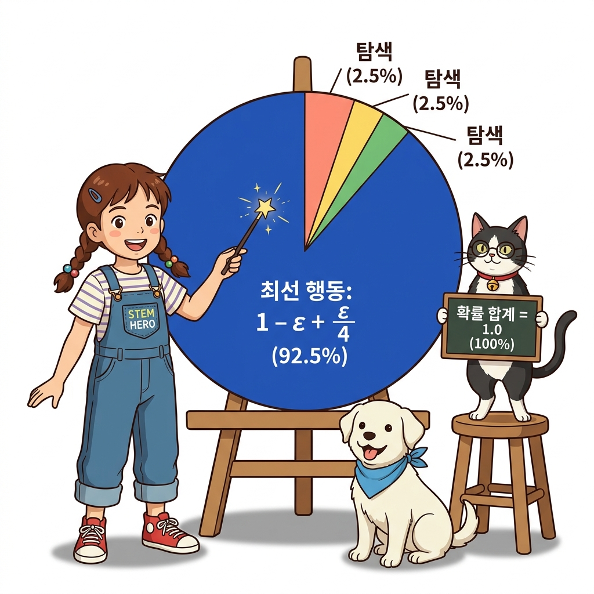
**그림 09-4-6** 최선 행동에 압도적인 확률(1 - ε + ε/4)을 부여하고 나머지 행동들에도 고른 탐색 확률(ε/4)을 나누어주는 입실론 탐욕 마법

> 09.4.3 첫 번째 개선: *ε*-탐욕 정책으로 탐색 확보에 대한 핵심 메커니즘을 살펴보겠습니다. 이 딜레마를 해결하는 가장 대표적인 해법이 바로 ε-탐욕 정책(ε-greedy policy)입니다. 그림 09-4-6 최선 행동에 압도적인 확률(1 - ε + ε/4)을 부여하고 나머지 행동들에도 고른 탐색 확률(ε/4)을 나누어주는 입실론 탐욕 마법 이 원리를 통해 몬테카를로법이 어떻게 스스로 최적 정책을 찾아가고 오차와 분산을 제어하는지 직관적으로 파악할 수 있습니다.

---

# 09.4 몬테카를로법으로 정책 제어하기
## 09.4.3 첫 번째 개선: *ε*-탐욕 정책으로 탐색 확보

*Q* 함수가 가장 큰 최선 행동을 1 - *ε*의 높은 확률(예: 90%)로 선택하되, 그리스 문자 ***ε*(입실론, 보통 0.1 즉 10%)**만큼의 작은 확률을 남겨두어, 주사위를 굴리듯 아무 행동이나 무작위로 시도해 보게 하는 것입니다.


**그림 09-4-6a** 90%는 똑똑하게 최적 행동을 선택하고 10%는 신비로운 주사위를 굴려 엉뚱한 길을 모험하는 입실론 마법 주사위 일러스트

> 09.4.3 첫 번째 개선: *ε*-탐욕 정책으로 탐색 확보에 대한 핵심 메커니즘을 살펴보겠습니다. Q 함수가 가장 큰 최선 행동을 1 - ε의 높은 확률(예: 90%)로 선택하되, 그리스 문자 ε(입실론, 보통 0.1 즉 10%)만큼의 작은 확률을 남겨두어, 주사위를 굴리듯 아무 행동이나 무작위로 시도해 보게 하는 것입니다. 그림 09-4-6a 90%는 똑똑하게 최적 행동을 선택하고 이 원리를 통해 몬테카를로법이 어떻게 스스로 최적 정책을 찾아가고 오차와 분산을 제어하는지 직관적으로 파악할 수 있습니다.

---

# 09.4 몬테카를로법으로 정책 제어하기
## 09.4.3 첫 번째 개선: *ε*-탐욕 정책으로 탐색 확보

수학적으로 가능한 행동의 가짓수가 |*A*|개(지금 예제에서는 4개)일 때, 각 행동이 선택될 확률은 다음과 같이 계산됩니다:

> ### **최선 행동 *a*<sup>\*</sup>의 확률 = (1 - *ε*) + (*ε* / |*A*|)**
> ### **나머지 일반 행동의 확률 = *ε* / |*A*|**

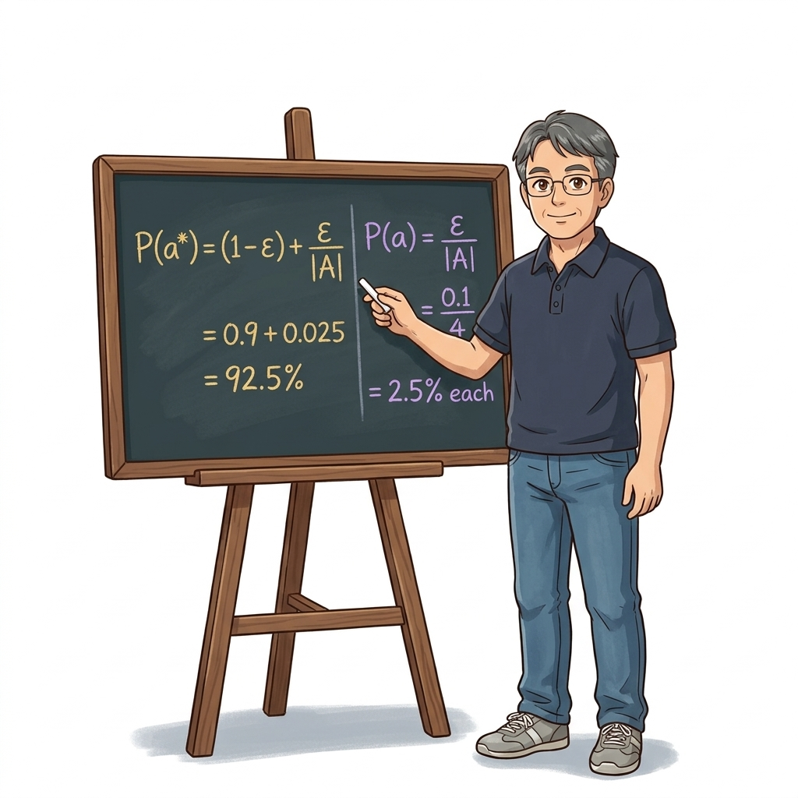
**그림 09-4-6a2** 최선 행동 확률 (1-ε) + (ε/|A|) 및 일반 행동 확률 ε/|A| 수식 카드 인포그래픽

---

# 09.4 몬테카를로법으로 정책 제어하기
## 09.4.3 첫 번째 개선: *ε*-탐욕 정책으로 탐색 확보

*ε* = 0.1이고 행동의 가짓수가 4개일 때 실제 수치를 대입해 봅시다:

- **최선 행동의 선택 확률**: (1 - 0.1) + (0.1 / 4) = 0.9 + 0.025 = **0.925 (92.5%)**
- **나머지 3개 행동의 선택 확률**: 각각 0.1 / 4 = **0.025 (2.5%)**
- **확률의 총합**: 0.925 + 0.025 × 3 = **1.0 (100%)**

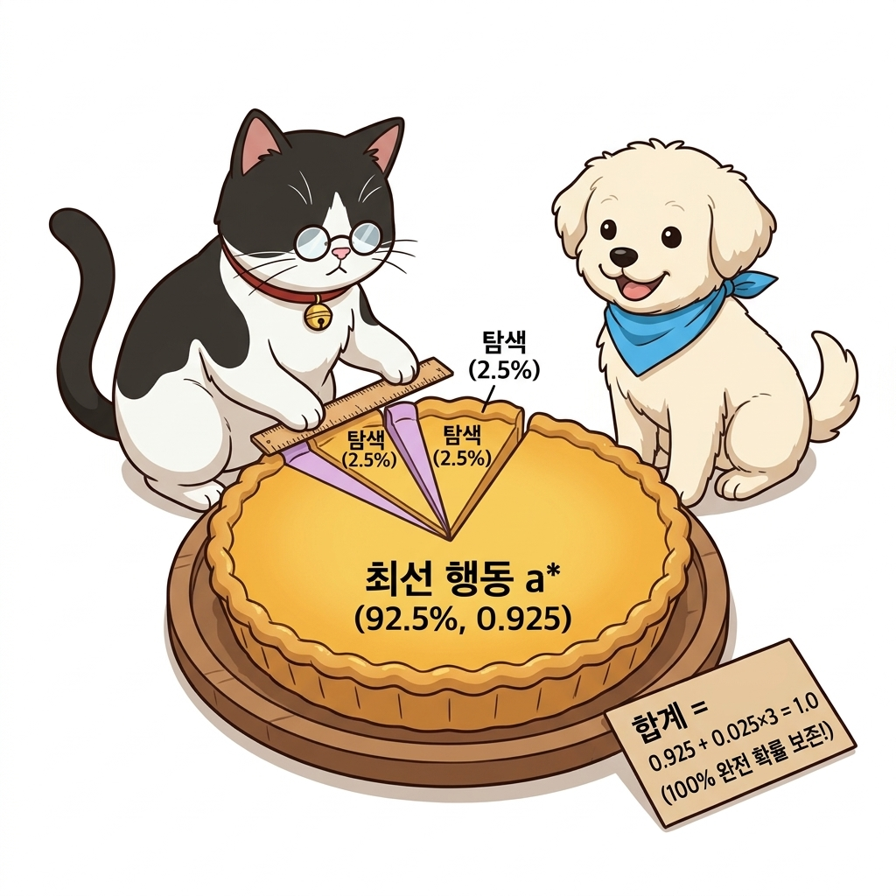
**그림 09-4-6b** ε-탐욕 확률 공식 기호 분해 및 92.5% 최적 부채꼴 vs 3개의 2.5% 균등 탐색 조각 분할 파이차트 인포그래픽

> 09.4.3 첫 번째 개선: *ε*-탐욕 정책으로 탐색 확보에 대한 핵심 메커니즘을 살펴보겠습니다. ε = 0.1이고 행동의 가짓수가 4개일 때 실제 수치를 대입해 봅시다: - 최선 행동의 선택 확률: (1 - 0.1) + (0.1 / 4) = 0.9 + 0.025 = 0.925 (92.5%) - 나머지 3개 행동의 선택 확률: 각각 0.1 / 4 = 0.025 (2.5%) 이 원리를 통해 몬테카를로법이 어떻게 스스로 최적 정책을 찾아가고 오차와 분산을 제어하는지 직관적으로 파악할 수 있습니다.

---

# 09.4 몬테카를로법으로 정책 제어하기
## 09.4.3 첫 번째 개선: *ε*-탐욕 정책으로 탐색 확보

이제 *ε*-탐욕 버전의 `greedy_probs()` 함수를 파이썬으로 구현해 보겠습니다:

<div align="right"><b>ch05/mc_control.py</b></div>

```python
def greedy_probs(Q, state, epsilon=0, action_size=4):
qs = [Q[(state, action)] for action in range(action_size)]
max_action = np.argmax(qs)

base_prob = epsilon / action_size  # 기초 탐색 확률 (예: 0.1 / 4 = 0.025)
action_probs = {action: base_prob for action in range(action_size)}
action_probs[max_action] += (1 - epsilon)  # 최선 행동에 0.9 보너스 추가!
return action_probs
```

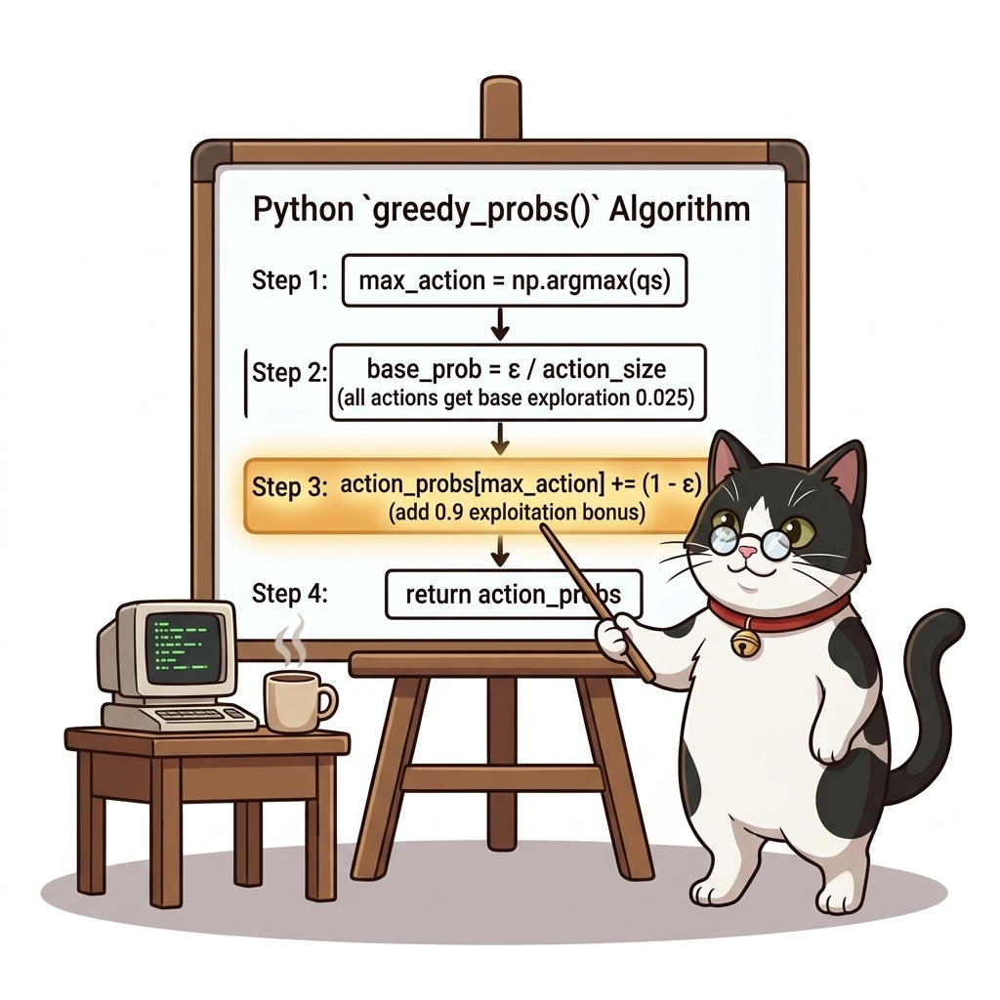
**그림 09-4-6c** `greedy_probs()` 파이썬 함수 동작 표준 순서도: 기초 탐색 확률 분배부터 max_action 보너스 가산 및 확률 반환까지

> 09.4.3 첫 번째 개선: *ε*-탐욕 정책으로 탐색 확보에 대한 핵심 메커니즘을 살펴보겠습니다. 이제 ε-탐욕 버전의 greedyprobs() 함수를 파이썬으로 구현해 보겠습니다: ch05/mccontrol.py python 이 원리를 통해 몬테카를로법이 어떻게 스스로 최적 정책을 찾아가고 오차와 분산을 제어하는지 직관적으로 파악할 수 있습니다.

---

# 09.4 몬테카를로법으로 정책 제어하기
## 09.4.3 첫 번째 개선: *ε*-탐욕 정책으로 탐색 확보

이렇게 수정하면 평소에는 92.5%의 높은 확률로 똑똑하게 최적 행동을 실천하면서도, 10번에 1번꼴로는 새로운 엉뚱한 길을 용감하게 탐색하여 숨겨진 최적 경로를 빠짐없이 찾아낼 수 있게 됩니다!

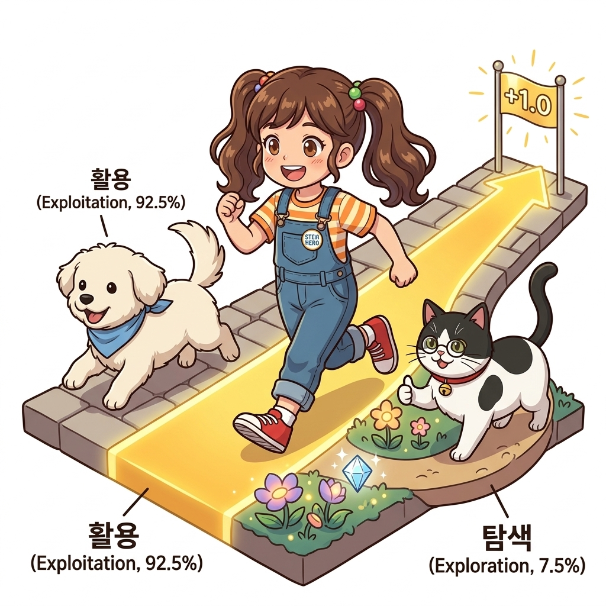
**그림 09-4-6d** 92.5%의 똑똑한 최적 질주와 7.5%의 과감한 탐색이 조화를 이루어 숨겨진 보물 경로를 찾아내는 도로시와 토토

> 09.4.3 첫 번째 개선: *ε*-탐욕 정책으로 탐색 확보에 대한 핵심 메커니즘을 살펴보겠습니다. 이렇게 수정하면 평소에는 92.5%의 높은 확률로 똑똑하게 최적 행동을 실천하면서도, 10번에 1번꼴로는 새로운 엉뚱한 길을 용감하게 탐색하여 숨겨진 최적 경로를 빠짐없이 찾아낼 수 있게 됩니다! 그림 09-4-6d 92.5%의 똑똑한 최적 질주와 7.5%의 과감한 탐색이 조화를 이루어 이 원리를 통해 몬테카를로법이 어떻게 스스로 최적 정책을 찾아가고 오차와 분산을 제어하는지 직관적으로 파악할 수 있습니다.

---

# 수정 후 (고정 학습률 α 방식: 지수 이동 평균)
## 09.4.4 두 번째 개선: 고정 학습률 *α* 방식으로 비정상 문제 극복

다음은 두 번째 치명적 결함인 표본 평균(1/*n*) 공식을 수정할 차례입니다.

```python

alpha = 0.1
self.Q[key] += (G - self.Q[key]) * alpha  # [식 9.7]
```


**그림 09-4-6d** 1/n 표본 평균 코드 vs 고정 학습률 α=0.1 지수 이동 평균 코드의 핵심 변경점 비교 인포그래픽

> 09.4.4 두 번째 개선: 고정 학습률 *α* 방식으로 비정상 문제 극복에 대한 핵심 메커니즘을 살펴보겠습니다. 다음은 두 번째 치명적 결함인 표본 평균(1/n) 공식을 수정할 차례입니다. python alpha = 0.1 이 원리를 통해 몬테카를로법이 어떻게 스스로 최적 정책을 찾아가고 오차와 분산을 제어하는지 직관적으로 파악할 수 있습니다.

---

# 수정 후 (고정 학습률 α 방식: 지수 이동 평균)
## 09.4.4 두 번째 개선: 고정 학습률 *α* 방식으로 비정상 문제 극복

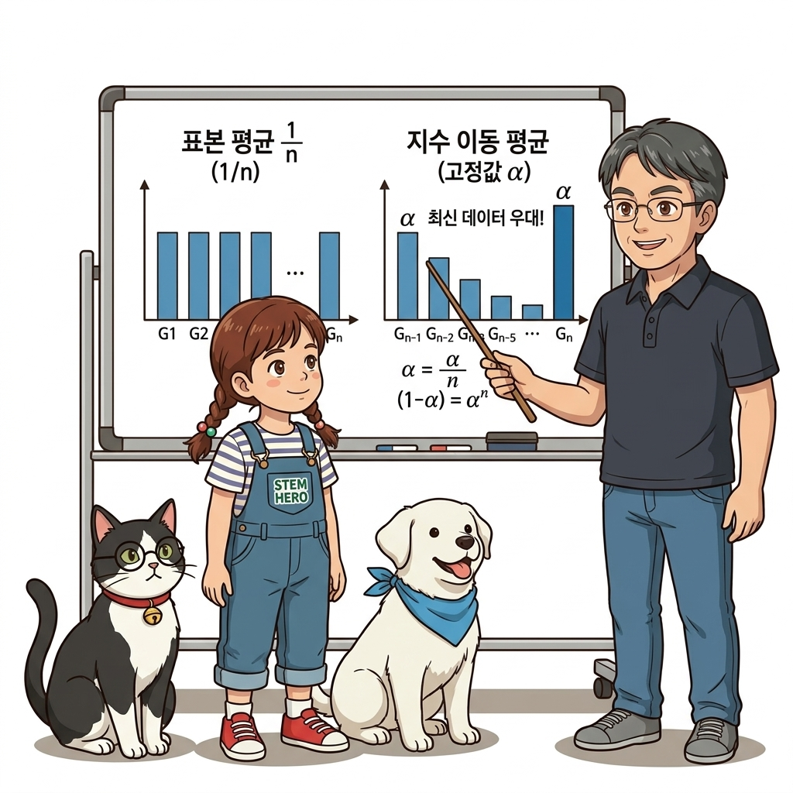
**그림 09-4-7** 모든 과거 데이터를 똑같이 대우하는 표본 평균(왼쪽)과, 어제의 낡은 기억은 잊고 오늘의 고수 경험을 우대하는 지수 이동 평균(오른쪽)의 가중치 비교

> 09.4.4 두 번째 개선: 고정 학습률 *α* 방식으로 비정상 문제 극복에 대한 핵심 메커니즘을 살펴보겠습니다. 그림 09-4-7 모든 과거 데이터를 똑같이 대우하는 표본 평균(왼쪽)과, 어제의 낡은 기억은 잊고 오늘의 고수 경험을 우대하는 지수 이동 평균(오른쪽)의 가중치 비교 이 원리를 통해 몬테카를로법이 어떻게 스스로 최적 정책을 찾아가고 오차와 분산을 제어하는지 직관적으로 파악할 수 있습니다.

---

# 수정 후 (고정 학습률 α 방식: 지수 이동 평균)
## 09.4.4 두 번째 개선: 고정 학습률 *α* 방식으로 비정상 문제 극복

왜 1/*n* 대신 고정된 학습률 계수 ***α*(알파, 보통 0.1)**를 곱해야 할까요?

* **수정 전 (표본 평균 1/*n*)의 치명적 결함**:
- 표본 평균은 1번째 에피소드부터 *n*번째 에피소드까지 모든 데이터에 똑같이 1/*n*의 동일한 가중치를 부여합니다.
- 하지만 1번째 에피소드의 에이전트는 미로 벽에 쿵쿵 부딪히며 방황하던 **'완전 초보 시절'**의 경험입니다. 반면 10,000번째 에피소드의 에이전트는 정책이 성숙해진 **'베테랑 고수 시절'**의 경험입니다.
- 초보 시절의 바보 같은 경험과 고수 시절의 현명한 경험을 똑같이 1/*n*로 동등하게 평균 내는 것은 논리적으로 맞지 않습니다!


**그림 09-4-7a** 벽에 부딪히던 초보 시절 1회차 에피소드와 능숙해진 10,000회차 베테랑 고수 에피소드의 극적 대비 인포그래픽

> 09.4.4 두 번째 개선: 고정 학습률 *α* 방식으로 비정상 문제 극복에 대한 핵심 메커니즘을 살펴보겠습니다. 왜 1/n 대신 고정된 학습률 계수 α(알파, 보통 0.1)를 곱해야 할까요? 수정 전 (표본 평균 1/n)의 치명적 결함: - 표본 평균은 1번째 에피소드부터 n번째 에피소드까지 모든 데이터에 똑같이 1/n의 동일한 가중치를 부여합니다. 이 원리를 통해 몬테카를로법이 어떻게 스스로 최적 정책을 찾아가고 오차와 분산을 제어하는지 직관적으로 파악할 수 있습니다.

---

# 수정 후 (고정 학습률 α 방식: 지수 이동 평균)
## 09.4.4 두 번째 개선: 고정 학습률 *α* 방식으로 비정상 문제 극복

* **수정 후 (고정 학습률 *α* 지수 이동 평균의 마법)**:
- 점화식을 과거로 거슬러 올라가며 전개해 보면 놀라운 수학적 사실이 드러납니다:
> ### ***Q*<sub>*n*</sub> = *αG*<sup>(*n*)</sup> + *α*(1 - *α*)*G*<sup>(*n*-1)</sup> + *α*(1 - *α*)<sup>2</sup>*G*<sup>(*n*-2)</sup> + &hellip; + (1 - *α*)<sup>*n*</sup>*Q*<sub>0</sub>**
- 가장 최근에 얻은 경험 *G*<sup>(*n*)</sup>에는 온전한 가중치 *α*가 곱해지지만, 과거 *k*스텝 전의 낡은 데이터에는 (1 - *α*)<sup>*k*</sup> 배율로 가중치가 기하급수적으로 줄어듭니다!
- 즉, **초보 시절의 낡은 기억은 자연스럽게 잊어버리고(망각), 가장 최근의 똑똑해진 경험을 압도적으로 우대**하게 됩니다.

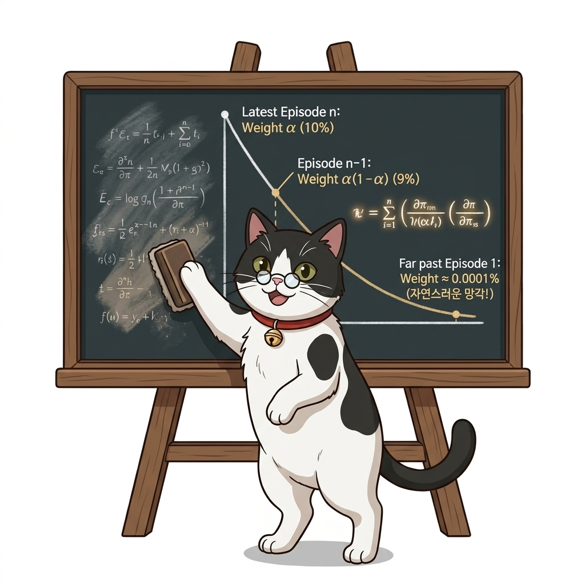
**그림 09-4-7b** 지수 감쇠 전개식 Q_n = ∑ α(1-α)^k G^(n-k) 기호 분해 및 과거 초보 기억의 기하급수적 망각 곡선 인포그래픽

---

# 수정 후 (고정 학습률 α 방식: 지수 이동 평균)
## 09.4.4 두 번째 개선: 고정 학습률 *α* 방식으로 비정상 문제 극복

이처럼 학습이 진행됨에 따라 정책이 진화하고, 그 결과 수익 데이터가 생성되는 확률 분포 자체가 시시각각 변화하는 문제를 통계학에서는 **'비정상 문제(Non-Stationary Problem)'**라고 부릅니다. 정책 제어처럼 데이터 분포가 변하는 비정상 환경에서는 고정 학습률 *α*를 사용한 지수 이동 평균이 절대적인 필수 공식입니다.


**그림 09-4-7c** 비정상 문제(Non-Stationary Problem)의 본질: 정책 발전에 따라 참 가치 목표물(과녁) 자체가 시시각각 이동하는 현상과 고정 알파의 신속한 추적

> 09.4.4 두 번째 개선: 고정 학습률 *α* 방식으로 비정상 문제 극복에 대한 핵심 메커니즘을 살펴보겠습니다. 이처럼 학습이 진행됨에 따라 정책이 진화하고, 그 결과 수익 데이터가 생성되는 확률 분포 자체가 시시각각 변화하는 문제를 통계학에서는 '비정상 문제(Non-Stationary Problem)'라고 부릅니다. 정책 제어처럼 데이터 분포가 변하는 비정상 환경에서는 고정 학습률 α를 사용한  이 원리를 통해 몬테카를로법이 어떻게 스스로 최적 정책을 찾아가고 오차와 분산을 제어하는지 직관적으로 파악할 수 있습니다.

---

# 수정 후 (고정 학습률 α 방식: 지수 이동 평균)
## 09.4.5 완성된 몬테카를로 정책 제어 클래스와 전체 실행

앞서 배운 2대 개선 사항(*ε*-탐욕 탐색 + *α* 지수 이동 평균)을 완벽하게 반영한 몬테카를로 정책 제어의 전체 순환 아키텍처를 확인해 봅시다.

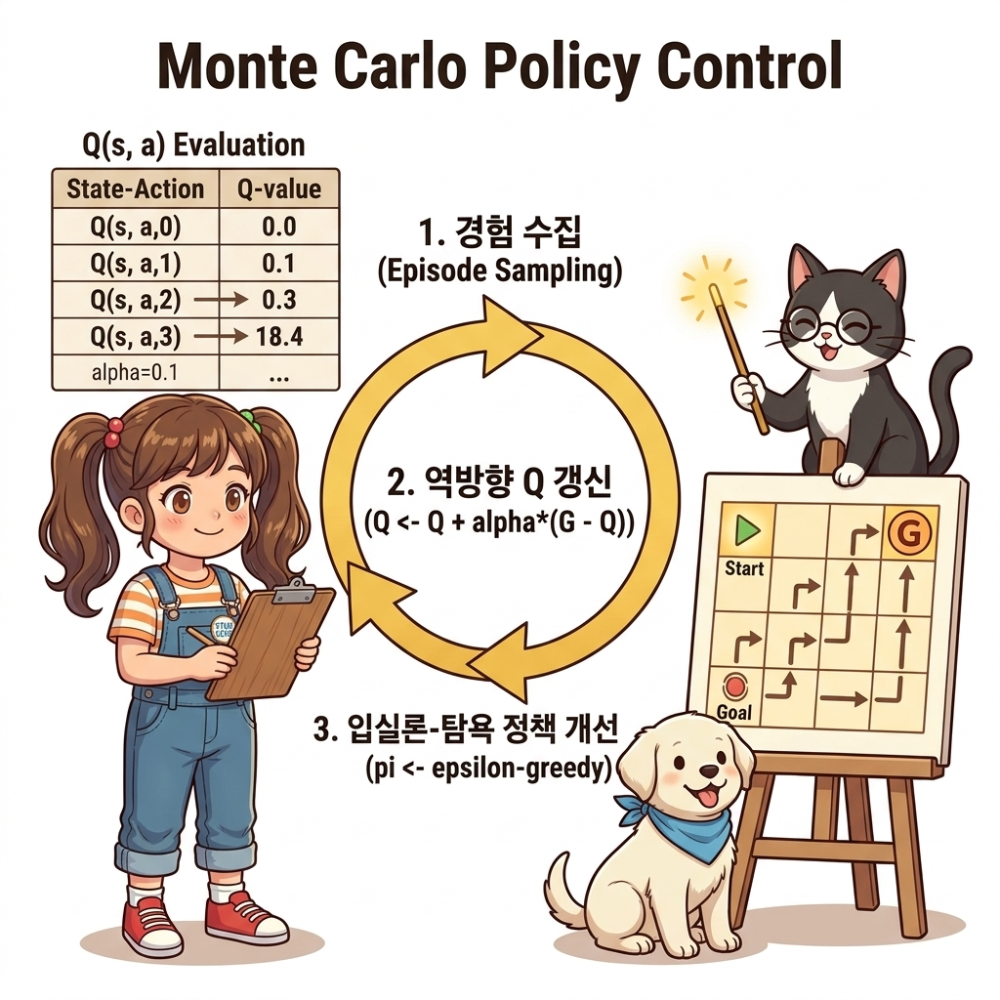
**그림 09-4-8** 몬테카를로 정책 제어의 3단계 순환 아키텍처: 경험 수집(Episode Sampling) → 역방향 Q 갱신(*Q* ← *Q* + *α*(*G* - *Q*)) → 입실론-탐욕 정책 개선(*π* ← *ε*-greedy)

> 09.4.5 완성된 몬테카를로 정책 제어 클래스와 전체 실행에 대한 핵심 메커니즘을 살펴보겠습니다. 앞서 배운 2대 개선 사항(ε-탐욕 탐색 + α 지수 이동 평균)을 완벽하게 반영한 몬테카를로 정책 제어의 전체 순환 아키텍처를 확인해 봅시다. 그림 09-4-8 몬테카를로 정책 제어의 3단계 순환 아키텍처: 경험 수집(Episode Sampling) → 역방향 Q 갱신(Q ← Q +  이 원리를 통해 몬테카를로법이 어떻게 스스로 최적 정책을 찾아가고 오차와 분산을 제어하는지 직관적으로 파악할 수 있습니다.

---

# 수정 후 (고정 학습률 α 방식: 지수 이동 평균)
## 1) 완성된 McAgent 클래스 코드

<div align="right"><b>ch05/mc_control.py</b></div>

```python
from collections import defaultdict
import numpy as np

def greedy_probs(Q, state, epsilon=0, action_size=4):
qs = [Q[(state, action)] for action in range(action_size)]
max_action = np.argmax(qs)

base_prob = epsilon / action_size
action_probs = {action: base_prob for action in range(action_size)}
action_probs[max_action] += (1 - epsilon)
return action_probs

class McAgent:
def __init__(self):
self.gamma = 0.9
self.epsilon = 0.1   # [개선 1] ε-탐욕 정책의 탐색 비율 (10%)
self.alpha = 0.1     # [개선 2] Q 함수 갱신 시의 고정 학습률 α
self.action_size = 4

random_actions = {0: 0.25, 1: 0.25, 2: 0.25, 3: 0.25}
self.pi = defaultdict(lambda: random_actions)
self.Q = defaultdict(lambda: 0)
self.memory = []

def get_action(self, state):
action_probs = self.pi[state]
actions = list(action_probs.keys())
probs = list(action_probs.values())
return np.random.choice(actions, p=probs)

def add(self, state, action, reward):
data = (state, action, reward)
self.memory.append(data)

def reset(self):
self.memory.clear()

def update(self):
G = 0
for data in reversed(self.memory):
state, action, reward = data
G = self.gamma * G + reward
key = (state, action)
# ❶ 고정값 α 기반 지수 이동 평균 갱신!
self.Q[key] += (G - self.Q[key]) * self.alpha
# ❷ ε-탐욕 탐색을 적용하여 정책 즉시 개선!
self.pi[state] = greedy_probs(self.Q, state, self.epsilon)
```

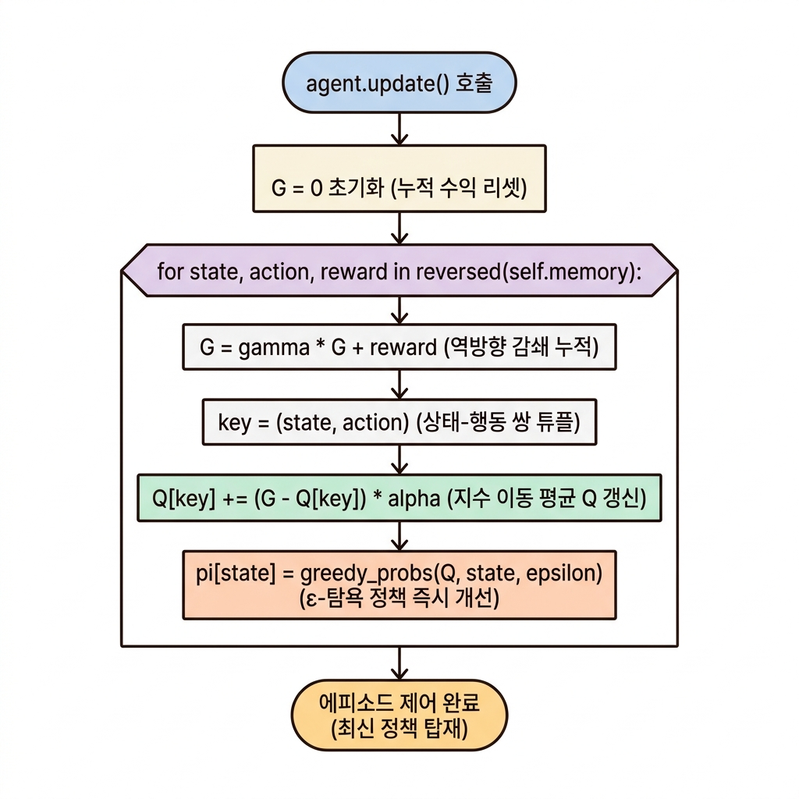
**그림 09-4-8b** 완성된 `McAgent.update()` 메서드 알고리즘 표준 순서도: reversed(memory) 역순회 루프부터 Q 함수 α 갱신 및 정책 π ε-탐욕 개선까지

> 1) 완성된 McAgent 클래스 코드에 대한 핵심 메커니즘을 살펴보겠습니다. ch05/mccontrol.py python from collections import defaultdict 이 원리를 통해 몬테카를로법이 어떻게 스스로 최적 정책을 찾아가고 오차와 분산을 제어하는지 직관적으로 파악할 수 있습니다.

---

# 학습 완료 후 최종 수렴된 Q 함수와 최적 정책 화살표 렌더링
## 2) 10,000회 에피소드 학습 실행 스크립트

이제 완성된 `McAgent`를 3 × 4 그리드 월드 환경에 투입하여 총 10,000번의 에피소드로 학습시켜 보겠습니다:

<div align="right"><b>ch05/mc_control.py</b></div>

```python
from common.gridworld import GridWorld

env = GridWorld()
agent = McAgent()

episodes = 10000
for episode in range(episodes):
state = env.reset()
agent.reset()

while True:
action = agent.get_action(state)
next_state, reward, done = env.step(action)

agent.add(state, action, reward)
if done:
agent.update()  # 에피소드 완주 시 Q 함수 및 정책 일괄 갱신!
break

state = next_state

env.render_q(agent.Q)
```

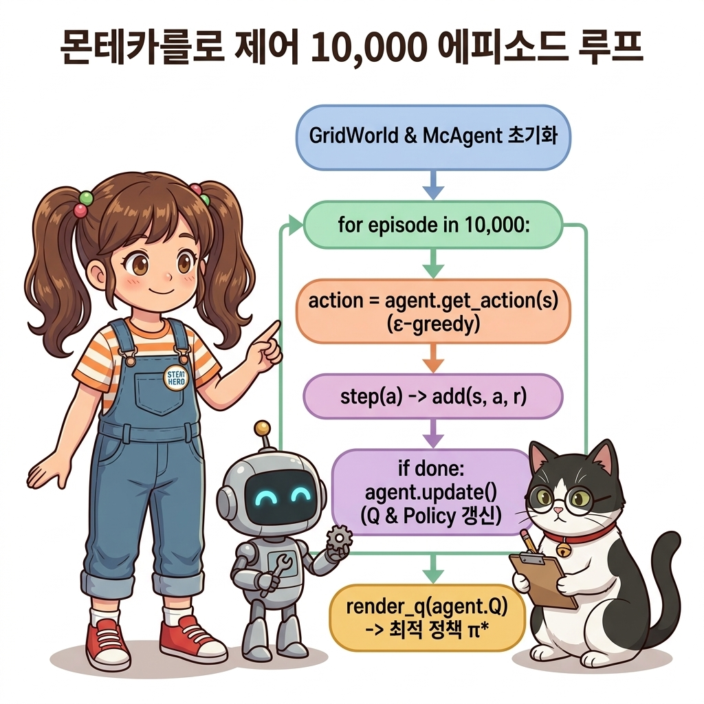
**그림 09-4-8c** 몬테카를로 정책 제어 메인 10,000 에피소드 루프 전체 실행 표준 순서도

> 2) 10,000회 에피소드 학습 실행 스크립트에 대한 핵심 메커니즘을 살펴보겠습니다. 이제 완성된 McAgent를 3 × 4 그리드 월드 환경에 투입하여 총 10,000번의 에피소드로 학습시켜 보겠습니다: ch05/mccontrol.py python 이 원리를 통해 몬테카를로법이 어떻게 스스로 최적 정책을 찾아가고 오차와 분산을 제어하는지 직관적으로 파악할 수 있습니다.

---

# 학습 완료 후 최종 수렴된 Q 함수와 최적 정책 화살표 렌더링
## 3) 학습 결과 해석: 최적 정책 화살표 맵

학습 완료 후 `env.render_q(agent.Q)`가 화면에 출력한 시각화 결과는 다음과 같습니다:

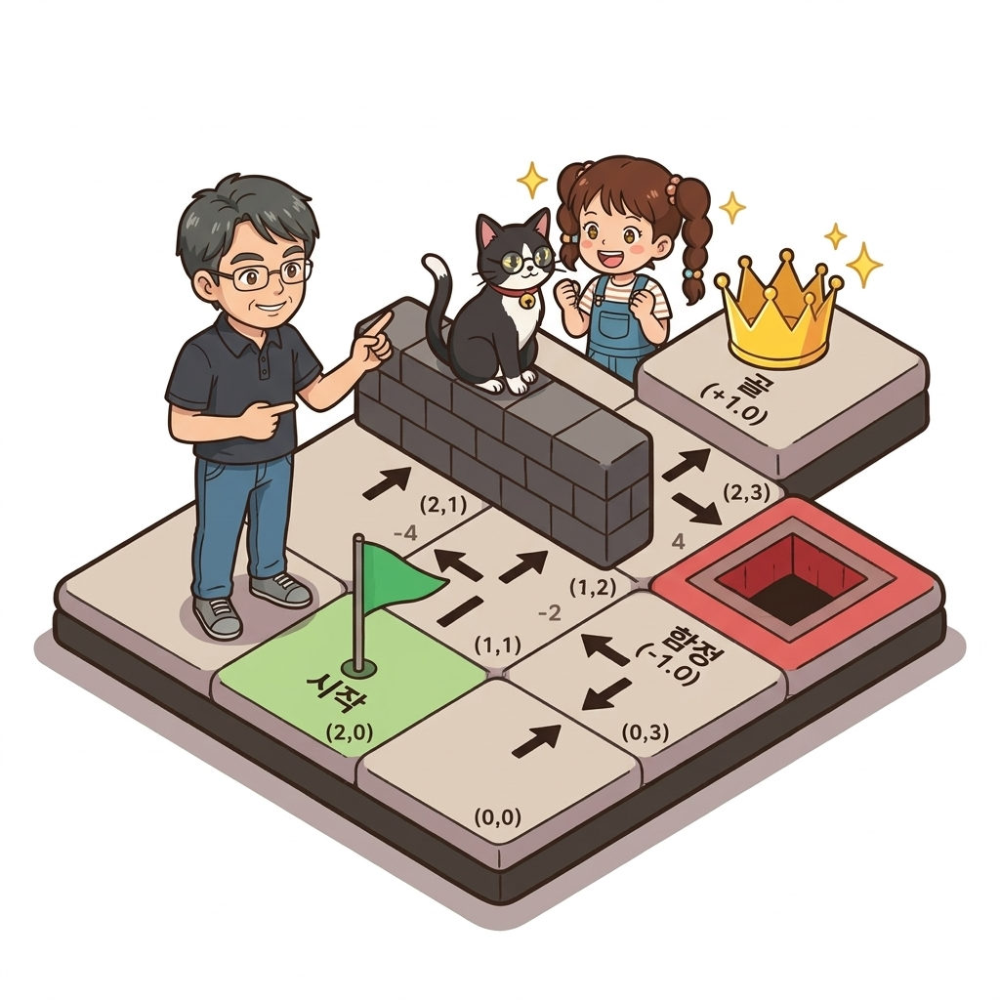
**그림 09-4-9** 10,000번 에피소드 후 수렴된 4방향 Q 함수와 최적 탈출 경로 화살표 맵

> 3) 학습 결과 해석: 최적 정책 화살표 맵에 대한 핵심 메커니즘을 살펴보겠습니다. 학습 완료 후 env.renderq(agent.Q)가 화면에 출력한 시각화 결과는 다음과 같습니다: 그림 09-4-9 10,000번 에피소드 후 수렴된 4방향 Q 함수와 최적 탈출 경로 화살표 맵 이 원리를 통해 몬테카를로법이 어떻게 스스로 최적 정책을 찾아가고 오차와 분산을 제어하는지 직관적으로 파악할 수 있습니다.

---

# 학습 완료 후 최종 수렴된 Q 함수와 최적 정책 화살표 렌더링
## 3) 학습 결과 해석: 최적 정책 화살표 맵

결과 지도를 자세히 분석해 봅시다:

1. **사방 삼각형의 의미**: 격자의 각 칸은 상, 하, 좌, 우 4개의 삼각형으로 분할되어 있으며, 각 삼각형의 색상과 숫자가 바로 해당 방향의 행동 가치 *Q*(*s*, *a*)를 나타냅니다.
2. **최적 경로 화살표**:
- 출발 지점 `(2, 0)`에서 시작한 에이전트는 위험천만한 마이너스 함정(`(1, 3)`, 보상 -1.0) 칸을 멀리 피해 위쪽 안전 경로(`(0, 0) → (0, 1) → (0, 2) → (0, 3)`)로 완벽하게 우회합니다.
- 플러스 골(`(0, 3)`, 보상 +1.0) 지점으로 가장 빠르고 안전하게 도달하는 완벽한 최적 정책 화살표가 뚜렷하게 형성되었습니다!

환경의 상태 전이 확률이나 보상 행렬 공식을 전혀 모르는 완전한 백지상태였지만, **몬테카를로 경험 수집 + *Q* 함수 채택 + *ε*-탐욕 탐색 + *α* 지수 이동 평균**이라는 강력한 도구들이 맞물려 스스로 완벽한 최적 정책 지도를 찾아낸 것입니다.


**그림 09-4-9b** 3x4 그리드 격자 내 상·하·좌·우 4분할 삼각형 Q값 분석 및 함정(-1.0)을 피해 상단 안전 경로로 우회하는 최적 탈출 경로 상세 해석도

> 3) 학습 결과 해석: 최적 정책 화살표 맵에 대한 핵심 메커니즘을 살펴보겠습니다. 결과 지도를 자세히 분석해 봅시다: 1. 사방 삼각형의 의미: 격자의 각 칸은 상, 하, 좌, 우 4개의 삼각형으로 분할되어 있으며, 각 삼각형의 색상과 숫자가 바로 해당 방향의 행동 가치 Q(s, a)를 나타냅니다. 2. 최적 경로 화살표: 이 원리를 통해 몬테카를로법이 어떻게 스스로 최적 정책을 찾아가고 오차와 분산을 제어하는지 직관적으로 파악할 수 있습니다.

---

# 학습 완료 후 최종 수렴된 Q 함수와 최적 정책 화살표 렌더링
## 09.4.6 핵심 정리: 몬테카를로 정책 제어 3대 기둥


**그림 09-4-10** Q 함수, 입실론 탐욕, 고정 알파의 3대 기둥을 세우고 오프-정책의 새로운 장으로 나아가는 도로시와 지니

> 09.4.6 핵심 정리: 몬테카를로 정책 제어 3대 기둥에 대한 핵심 메커니즘을 살펴보겠습니다. 그림 09-4-10 Q 함수, 입실론 탐욕, 고정 알파의 3대 기둥을 세우고 오프-정책의 새로운 장으로 나아가는 도로시와 지니 이 원리를 통해 몬테카를로법이 어떻게 스스로 최적 정책을 찾아가고 오차와 분산을 제어하는지 직관적으로 파악할 수 있습니다.

---

# 학습 완료 후 최종 수렴된 Q 함수와 최적 정책 화살표 렌더링
## 09.4.6 핵심 정리: 몬테카를로 정책 제어 3대 기둥

| 3대 핵심 기둥 | 핵심 원리 및 수학적 이유 | 미적용 시 발생하는 문제점 |
| :--- | :--- | :--- |
| **① 행동 가치 함수 *Q*(*s*, *a*)** | 전이 확률 *p*(*s*&#39; \| *s*, *a*) 없이도 argmax<sub>*a*</sub> *Q*(*s*, *a*)로 즉시 최적 행동 결정 가능 | *V*(*s*)를 쓰면 환경 모델의 확률 수식이 필요해 모델 프리 환경에서 계산 불가 |
| **② *ε*-탐욕 정책 (*ε*-Greedy)** | 1 - *ε* 확률로 최선 행동을 취하고, *ε* 확률로 4방향을 골고루 탐색 | 100% 완전 탐욕 시 조기 수렴으로 인해 더 큰 보상이 있는 경로를 영원히 미탐색 |
| **③ 고정 학습률 *α* (지수 이동 평균)** | (1 - *α*)<sup>*k*</sup> 지수 감쇠로 과거 초보 데이터는 잊고 최신 고수 경험을 우대 | 1/*n* 표본 평균 시 낡은 초보 시절의 데이터가 발목을 잡아 비정상 문제에서 수렴 실패 |


**그림 09-4-10b** 몬테카를로 정책 제어 3대 핵심 기둥 (Q 함수 즉시 결정, ε-탐욕 탐색 보장, 고정 α 비정상 극복) 입체 인포그래픽

> 09.4.6 핵심 정리: 몬테카를로 정책 제어 3대 기둥에 대한 핵심 메커니즘을 살펴보겠습니다. | 3대 핵심 기둥 | 핵심 원리 및 수학적 이유 | 미적용 시 발생하는 문제점 | | :--- | :--- | :--- | | ① 행동 가치 함수 Q(s, a) | 전이 확률 p(s&39; \| s, a) 없이도 argmaxa Q(s, a)로 즉시 최적 행동 결정 가능 | V(s)를  이 원리를 통해 몬테카를로법이 어떻게 스스로 최적 정책을 찾아가고 오차와 분산을 제어하는지 직관적으로 파악할 수 있습니다.

---

# 학습 완료 후 최종 수렴된 Q 함수와 최적 정책 화살표 렌더링
## 09.4.6 핵심 정리: 몬테카를로 정책 제어 3대 기둥

> 👨‍🏫 **이호진 교수님의 직강 노트**:
> "몬테카를로 정책 제어의 완성은 강화학습이 단순한 통계 계산기를 넘어, 미지의 환경을 스스로 탐험하고 최선의 길을 개척해 나가는 '진정한 지능(AI)'으로 도약하는 감동적인 순간입니다.
> 하지만 *ε*-탐욕 정책은 학습이 완전히 끝난 후에도 10%의 확률로 무작위 실수를 저지른다는 아쉬운 타협점이 있습니다.
> 이를 완벽하게 극복하기 위해, 다음 9.5절에서는 '마음껏 탐색하는 행동 정책'과 '오직 최선만을 달리는 대상 정책'을 분리하는 강화학습의 최고봉, **오프-정책(Off-Policy)과 중요도 샘플링**의 세계로 떠나보겠습니다!"


**그림 09-4-10c** 이호진 교수님의 직강 멘토링 노트: 단순 통계 계산기를 넘어 스스로 탐험하고 최선의 길을 여는 진정한 지능으로의 도약과 9.5 오프-정책 예고 칠판 강의 장면

---

# 학습 완료 후 최종 수렴된 Q 함수와 최적 정책 화살표 렌더링
## 09.4.6 핵심 정리: 몬테카를로 정책 제어 3대 기둥

> 🐱 **조교 지니의 응원 노트**:
> "축하합니다냥, 도로시와 여러분! 이제 우리 에이전트는 미로에서 길을 헤매지 않고 스스로 최적의 탈출 지도를 그려냈어요! *Q* 함수, 입실론(*ε*) 탐욕, 그리고 알파(*α*) 지수 이동 평균의 삼위일체를 가슴에 품고, 다음 절에서 더욱 마법 같은 오프-정책을 만나보아요!"


**그림 09-4-10d** 조교 지니의 응원: 행동 정책과 대상 정책을 완벽히 분리하는 강화학습의 최고봉 9.5 오프-정책과 중요도 샘플링으로 전진하는 활기찬 일러스트
