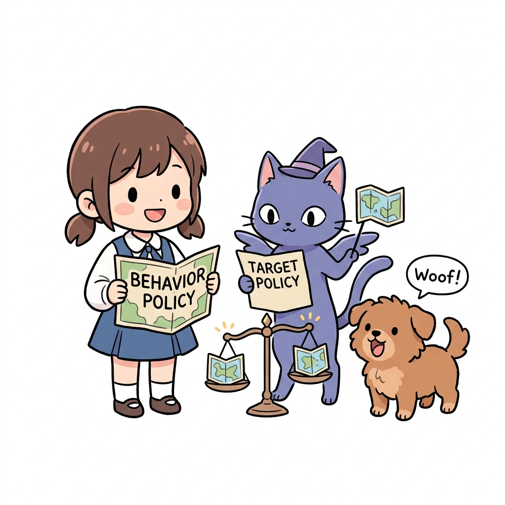
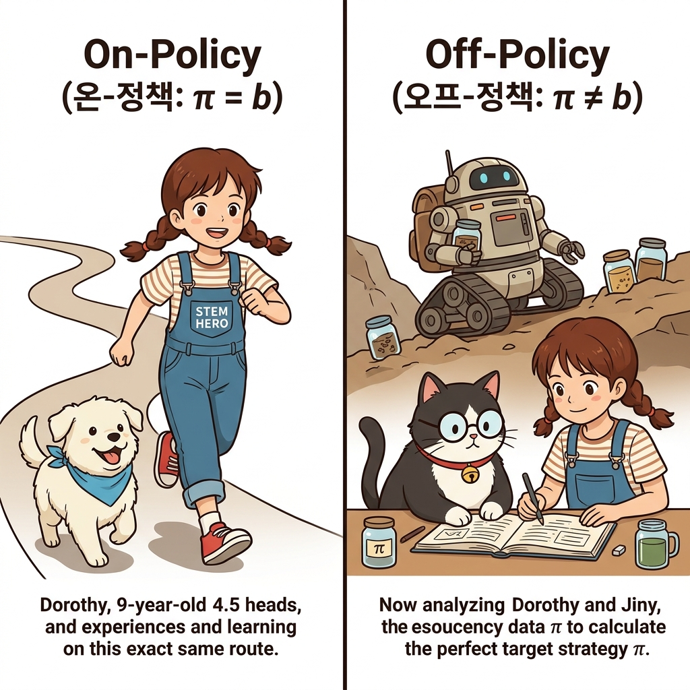
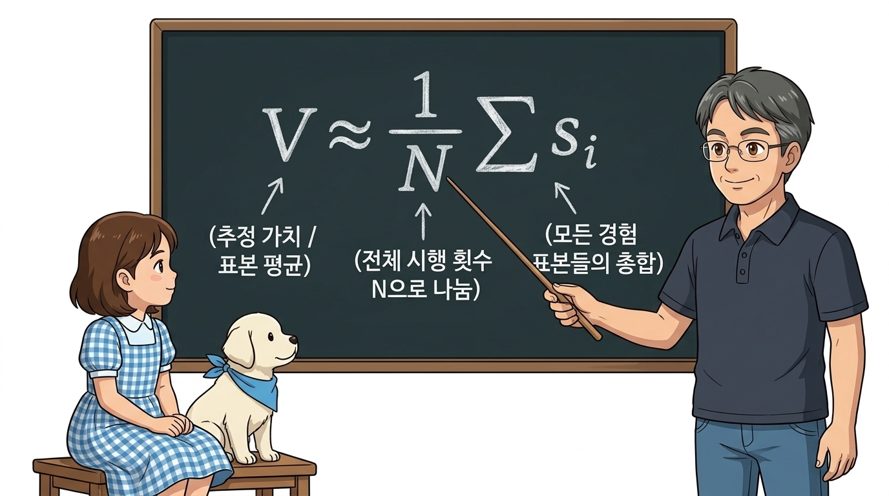
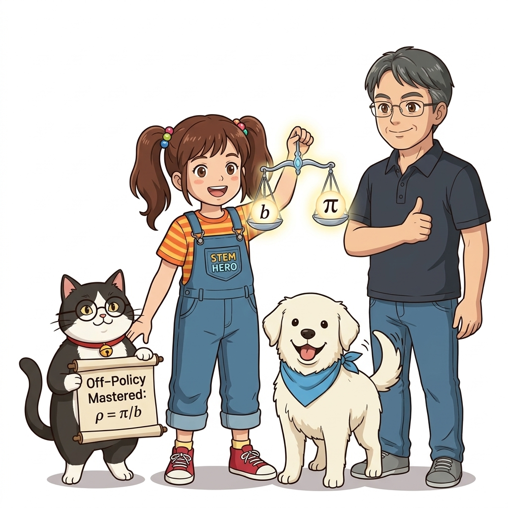

# 09.5 오프-정책과 중요도 샘플링
## 09.5.0 도입: 행동과 학습의 분리

실제 환경에서 자유롭게 탐험하는 '행동 정책'과 우리가 궁극적으로 달성하려는 무결점 최적의 '대상 정책'을 분리하여 학습하는 오프-정책을 배웁니다.


**그림 09-5-1** 탐험 지도와 최적 지도의 확률 비율을 마법 저울에 올리고 오프-정책을 계산하는 도로시와 지니 (16:9 와이드)

- 🧭 **&epsilon;-탐욕의 한계**: 최적 정책에 도달한 후에도 여전히 &epsilon;만큼 무작위 실수를 저지름
- 🎯 **오프-정책의 꿈**: 탐험은 과감한 모험가에게 맡기고, 제어자는 100% 탐욕적 최적 정책만을 깔끔하게 학습!
- ⚖️ **핵심 열쇠**: 서로 다른 두 확률 분포의 차이를 보정해주는 **중요도 샘플링(Importance Sampling)**

> "입실론 탐욕 정책은 최적화된 후에도 무작위 행동을 멈추지 않는 아쉬움이 있습니다. 이를 극복하기 위해 행동하는 정책과 학습할 대상 정책을 둘로 쪼개어, 탐험은 모험가가 하고 최적화는 제어자가 전담하는 혁신적인 오프-정책의 세계로 들어가 봅시다."

---

# 09.5 오프-정책과 중요도 샘플링
## 09.5.1 온-정책 vs 오프-정책

자신의 현재 실력으로 직접 부딪치며 배우는 온-정책과, 다른 선수의 플레이나 모험가의 탐험을 관찰하며 배우는 오프-정책의 차이를 짚어봅니다.


**그림 09-5-2** 자신이 달리는 트랙에서 바로 배우는 온-정책과, 탐험 로봇의 데이터를 관제실에서 분석해 챔피언 전략을 세우는 오프-정책 (1:1 순백색)

- 🏃 **온-정책 (On-policy)**
  * 대상 정책 *π* = 행동 정책 *b*
  * 자신이 내린 행동의 결과만을 가지고 자신의 현재 정책을 직접 평가하고 개선
- 🛰️ **오프-정책 (Off-policy)**
  * 대상 정책 *π* &ne; 행동 정책 *b*
  * 탐험가 *b*가 수집해온 경험 데이터를 바탕으로 목표 정책 *π*의 가치를 정밀하게 추정

> "온-정책은 자신이 직접 뛴 발걸음으로만 배우는 방식이고, 오프-정책은 다른 모험가가 수집해온 탐험 일지를 관제실에서 분석해 최적의 전략을 세우는 방식입니다. 두 정책을 분리하면 마음껏 탐험하면서도 완벽한 최적 정책을 계산해낼 수 있습니다."

---

# 09.5 오프-정책과 중요도 샘플링
## 09.5.2 중요도 샘플링: 다른 분포로 구하는 기댓값

데이터가 확률 분포 *b*에서 수집되었더라도, 수학적 가중치 *ρ* = *π* / *b*를 곱해주면 놀랍게도 목표 분포 *π*의 참 기댓값을 완벽히 도출할 수 있습니다.


**그림 09-5-3** 칠판에 분모·분자 트릭을 전개하며 중요도 가중치 로우를 도출해내는 도로시와 지니 (16:9 와이드)

```
E_π[X] = ∑ x · π(x)
       = ∑ x · (b(x) / b(x)) · π(x)   # b(x)/b(x) = 1 삽입
       = ∑ x · (π(x) / b(x)) · b(x)
       = E_b[ X · (π(X) / b(X)) ]     # b에 대한 기댓값으로 대변환!
```

- 🔑 **중요도 가중치 (Importance Weight)**:
  * *ρ*(*x*) = *π*(*x*) / *b*(*x*) : 샘플 *x*가 목표 정책 *π*에서 얼마나 더 중요한지 알려주는 비율

> "우리는 분포 b에서 모은 데이터로 전혀 다른 분포 파이의 평균을 구하고 싶습니다. 이때 수식에 1에 해당하는 비 분의 비를 끼워넣어 재배열하면, 비 분포의 샘플에 파이 나누기 비라는 중요도 가중치 로우를 곱하는 것만으로 참 기댓값을 얻을 수 있습니다."

---

# 09.5 오프-정책과 중요도 샘플링
## 09.5.2 수식 돋보기: 중요도 샘플링 추정량

확률 분포 *b*에서 추출한 *n*개의 표본으로 목표 분포 *π*의 기댓값을 몬테카를로법으로 근사하는 수식을 해부합니다.

```
[샘플링]  x^{(i)} ~ b                     (i = 1, 2, ..., n)
[근사식]  E_π[X] ≈ (1 / n) · ∑_{i=1}^n ρ(x^{(i)}) · x^{(i)}
```

- 🔍 **`x^{(i)} ~ b` 기호 해부**:
  * 실제 환경 속에서 행동 정책 *b*의 안내를 받아 관측해온 *i*번째 샘플 값
- 🔍 **`ρ(x^{(i)}) = π(x^{(i)}) / b(x^{(i)})` 가중치 해부**:
  * *b*가 드물게 뽑았지만 *π*에게 중요한 값 &rarr; *ρ* > 1 (보상 뻥튀기)
  * *b*가 자주 뽑았지만 *π*에게 사소한 값 &rarr; *ρ* < 1 (보상 삭감)
- ⚖️ **표본 평균 (1/*n*)**: 보정된 샘플들의 산술 평균을 내어 편향 없는 일치 추정량 달성

> "수식을 살펴보면 에이전트는 행동 정책 비에서 데이터를 추출한 뒤, 각 샘플마다 목표 정책과 행동 정책의 확률 비율인 가중치 로우를 곱해줍니다. 이 보정된 값들을 모두 더해 엔으로 나누면 놀랍게도 목표 정책 파이의 기댓값에 편향 없이 수렴합니다."

---

# 09.5 오프-정책과 중요도 샘플링
## 09.5.2 파이썬으로 검증하는 중요도 샘플링

분포 `pi = [0.1, 0.1, 0.8]`의 기댓값(참값 2.7)을 균등 분포 `b = [1/3, 1/3, 1/3]`에서 샘플링하여 중요도 가중치로 정확히 복원해 봅니다.

```python
import numpy as np

x = np.array([1, 2, 3])
pi = np.array([0.1, 0.1, 0.8]) # 목표 분포
b = np.array([1/3, 1/3, 1/3])  # 행동 분포 (균등 탐험)

samples = []
for _ in range(100):
    i = np.random.choice([0, 1, 2], p=b) # b로 샘플링
    rho = pi[i] / b[i]                   # 중요도 가중치
    samples.append(rho * x[i])           # 가중치 곱셈

print('추정 평균:', np.mean(samples)) # 약 2.95 (참값 2.7 근사)
print('추정 분산:', np.var(samples))  # 10.63 (분산 급증!)
```

- 🎯 **평균 추정 성공**: 전혀 다른 균등 분포 *b*에서 뽑았음에도 참값 2.7에 근접
- ⚠️ **숨겨진 복병**: 온-정책 분산(0.27)에 비해 무려 40배나 큰 분산(10.63) 발생!

> "파이썬 코드로 검증해 보면 균등 분포 비에서 데이터를 뽑았음에도 가중치 로우를 곱해 평균을 내자 참값 2.7에 근사하게 도달합니다. 하지만 한 가지 충격적인 사실은 분산이 영점 이칠에서 십 점 육삼으로 무려 마흔 배나 폭증한다는 점입니다."

---

# 09.5 오프-정책과 중요도 샘플링
## 09.5.3 분산의 폭발과 위험성

샘플 3을 뽑았을 때 가중치 *ρ* = 2.4가 곱해져 단번에 7.2로 뻥튀기되면서 데이터가 걷잡을 수 없이 흩어집니다.


**그림 09-5-4** 데이터가 평균 주변에 오밀조밀 모인 온-정책 저분산(0.27)과, 가중치 왜곡으로 넓게 흩어진 고분산(10.63) 비교 (1:1 순백색)

- 💥 **왜 7.2가 되는가?**:
  * *π*에서는 3이 80%로 자주 나와야 하는데, *b*에서는 33%만 나오므로 *ρ* = 0.8 / (1/3) = **2.4**
  * 따라서 한 번 뽑힌 3에게 3 &times; 2.4 = **7.2**의 막대한 책임을 지움!
- 💣 **고분산의 비극**:
  * 첫 번째 샘플이 7.2가 되는 순간 참값(2.7)에서 너무 멀리 빗나가 수렴 속도가 극도로 지연됨
  * *Var*[*X*] = *E*[(*X* &minus; *E*[*X*])<sup>2</sup>]가 커질수록 수만 개의 추가 샘플이 필요

> "가중치 로우는 행동 정책이 덜 뽑아준 값의 책임을 메우기 위해 샘플을 뻥튀기합니다. 예를 들어 삼을 뽑았을 때 이점 사를 곱해 칠 점 이로 취급하게 되는데, 이로 인해 데이터가 평균에서 멀리 흩어지며 분산이 폭발하고 학습이 불안정해집니다."

---

# 09.5 오프-정책과 중요도 샘플링
## 09.5.3 해결책: 분포 정렬을 통한 분산 안정화

행동 분포 *b*가 목표 분포 *π*와 너무 동떨어지지 않도록 조율하면 가중치 *ρ*가 1 근처로 안정되며 분산이 극적으로 축소됩니다.


**그림 09-5-5** 행동 분포 b를 목표 분포 파이에 가깝게 조율하여 분산을 10.63에서 2.48로 대폭 안정화시키는 지니와 도로시 (1:1 순백색)

```python
# 행동 분포 b를 pi([0.1, 0.1, 0.8])에 더 가깝게 변경
b = np.array([0.2, 0.2, 0.6]) # 균등 분포 대신 pi와 유사한 분포 사용

# 중요도 샘플링 재실행 결과:
# 추정 평균: 2.72 (참값 2.7에 훨씬 정확히 일치!)
# 추정 분산: 2.48 (기존 10.63에서 77% 이상 격감!)
```

- 🎛️ **분산 감소의 원리**:
  * *b*가 *π*와 가까워질수록 *ρ*(*x*) = *π*(*x*) / *b*(*x*) &rarr; **1.0**에 수렴
  * 가중치의 극단적 왜곡이 사라져 안정적이고 빠른 학습 보장!

> "분산을 잠재우는 비결은 행동 분포 비를 목표 분포 파이와 너무 멀지 않게 정렬하는 것입니다. 비를 파이와 가깝게 맞춰주면 중요도 가중치 로우가 일에 수렴하면서 왜곡이 사라지고, 분산이 십 점대에서 이 점대로 급격히 안정화됩니다."

---

# 09.5 오프-정책과 중요도 샘플링
## 09.5.4 핵심 정리: 오프-정책과 중요도 샘플링 3대 기둥

행동 정책과 대상 정책을 완벽히 분리하여 탐색과 최적화를 동시에 달성하는 오프-정책의 3대 핵심 원리를 총정리합니다.


**그림 09-5-6** 역할 분담, 중요도 가중치, 분산 안정화의 3대 기둥을 세우고 시간차 학습(TD)의 관문으로 향하는 도로시와 지니 (16:9 와이드)

1. **역할의 분리 (Target vs Behavior)**:
   - 행동 정책 *b*는 거침없이 환경을 탐색하고, 대상 정책 *π*는 오직 100% 최적의 가치만을 학습
2. **중요도 가중치 *ρ* = *π* / *b*의 마법**:
   - 두 정책 사이의 표본 확률 비율을 곱하여, 다른 분포에서 얻은 경험 데이터를 수학적으로 정확히 정산
3. **분산 제어와 차세대 제어(Q-러닝)로의 가교**:
   - 중요도 샘플링의 분산 이슈는 10장 TD법과 Q-러닝에서 중요도 샘플링 없이도 완벽한 오프-정책을 구현하는 열쇠가 됨

> "우리는 오늘 탐험과 최적화의 역할을 분리하는 오프-정책, 수학적 환산 환율인 중요도 가중치 로우, 그리고 분산을 통제하는 지혜를 배웠습니다. 이 원리는 다음 장에서 중요도 가중치 없이도 오프-정책을 실현하는 큐러닝의 든든한 디딤돌이 됩니다."
