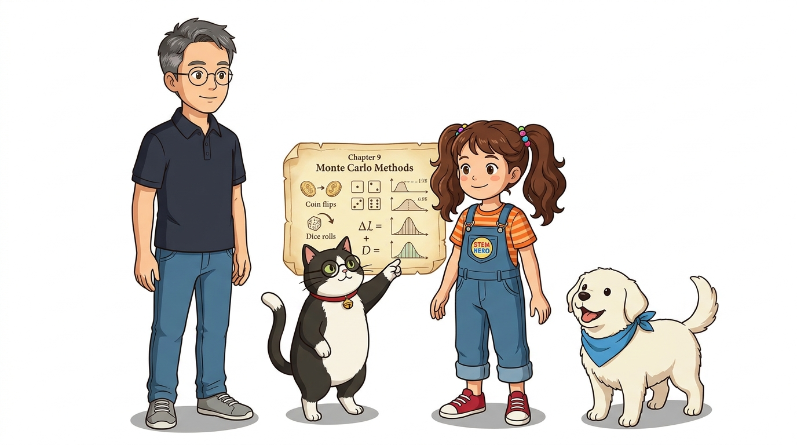
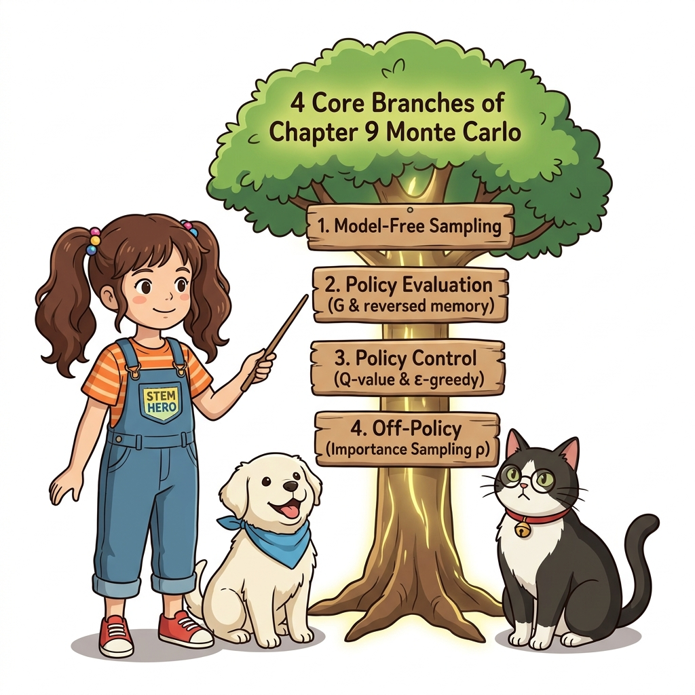
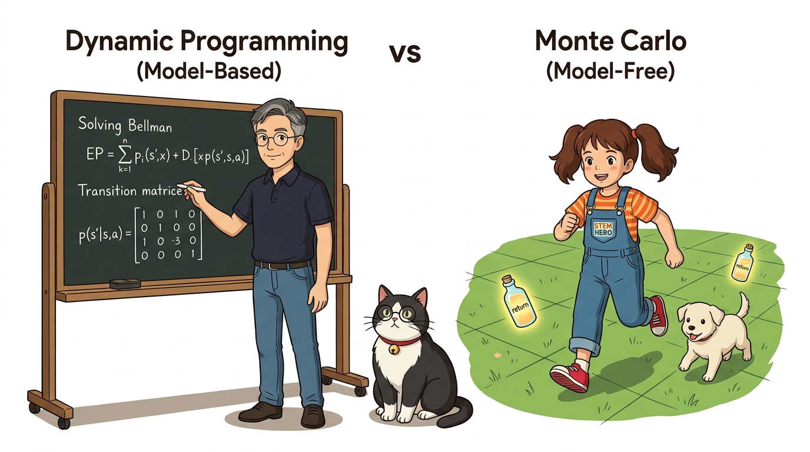

# 09.6 정리
## 09.6.0 도입: 9장 몬테카를로법 총결산

환경 모델을 전혀 모르는 백지 상태에서도 오직 실제 부딪히며 얻은 경험만으로 가치 함수를 평가하고 최적 정책을 제어해낸 9장의 대장정을 총결산합니다.


**그림 09-6-1** 몬테카를로 정상에 올라 경험 학습의 전체 지도를 벅찬 감동으로 내려다보는 도로시, 지니, 토토 (16:9 와이드)

- 🎲 **9.0 ~ 9.1 수학적 기초 & 몬테카를로 기초**: 큰 수의 법칙과 표본 평균을 이용한 모델 프리 가치 추정
- 🚶 **9.2 ~ 9.3 정책 평가와 구현**: 징검다리 에피소드 완주와 `reversed(memory)` 역방향 점화식
- 🧭 **9.4 정책 제어**: *Q*(*s*, *a*) 함수, &epsilon;-탐욕 정책 탐색, 그리고 고정 &alpha; 지수 이동 평균
- ⚖️ **9.5 오프-정책 & 중요도 샘플링**: 행동 정책 *b*와 목표 정책 *π*의 분리와 가중치 *ρ*

> "우리는 오늘 환경의 전이 확률을 전혀 모르는 막막한 상태에서 출발하여, 오직 에이전트의 실제 상호작용 경험만으로 최적의 정책을 찾아내는 몬테카를로법을 완벽히 정복했습니다. 9장의 핵심 통찰들을 하나로 엮어 총정리해 봅시다."

---

# 09.6 정리
## 09.6.1 경험 기반 학습의 핵심 맥락

강화 학습의 진정한 매력은 환경과 에이전트가 끊임없이 상호작용하며 주고받는 경험 데이터로부터 스스로 배운다는 점입니다.


**그림 09-6-2** 샘플링에서 시작해 역방향 평가, Q 함수 제어, 중요도 샘플링으로 뻗어나가는 몬테카를로 지식 나무 (1:1 순백색)

- 🧪 **샘플링 (Sampling)**: 상태 전이 확률 행렬 *P* 대신 실제 환경을 한 걸음씩 밟으며 표본을 획득
- 🎯 **무편향 추정 (Unbiased)**: 에피소드 끝까지 모은 실제 누적 할인 수익 *G*를 사용하여 참 기댓값으로 수렴
- 🔄 **부트스트랩의 부재**: 다른 상태의 추정 가치에 기대지 않고, 실제 관측된 참 보상들의 합만으로 가치 평가

> "몬테카를로법의 본질은 경험에 의한 직접 학습입니다. 환경의 복잡한 물리 법칙이나 확률 분포를 계산하는 대신, 실제로 에피소드를 끝까지 경험하고 얻은 참 수익들의 평균을 냄으로써 어떠한 편향도 없이 정직하게 가치에 도달합니다."

---

# 09.6 정리
## 09.6.2 동적 프로그래밍(DP) vs 몬테카를로(MC)

수학적 모델을 필요로 하는 고전적 동적 프로그래밍과, 모델 없이 경험만으로 돌파하는 몬테카를로법의 패러다임 차이를 비교합니다.


**그림 09-6-3** 환경 지도를 펼쳐놓고 연립방정식을 푸는 DP 거울과, 발걸음으로 미로를 직접 개척하는 MC 거울의 대비 (16:9 와이드)

| 비교 항목 | 동적 프로그래밍 (DP) | 몬테카를로법 (MC) |
| :--- | :--- | :--- |
| **환경 모델** | 상태 전이 확률 *p*, 보상 함수 *r* 필수 | **모델 불필요 (Model-Free)** |
| **학습 원천** | 벨만 기대/최적 방정식 연립 풀이 | **실제 에피소드 상호작용 경험** |
| **부트스트랩** | 사용 (다음 상태의 추정 가치 *V*(*s*') 이용) | **미사용 (에피소드 참 수익 *G* 사용)** |
| **적용 범위** | 바둑판처럼 환경을 완벽히 아는 경우 | **실제 로봇이나 현실 세계처럼 미지의 환경** |

> "동적 프로그래밍은 환경의 완벽한 지도가 주어졌을 때 방정식을 풀어내는 방식인 반면, 몬테카를로법은 지도 한 장 없이도 직접 발을 내딛으며 지도를 완성해가는 방식입니다. 바로 이 점 때문에 몬테카를로가 진정한 강화학습의 출발점이 됩니다."

---

# 09.6 정리
## 09.6.3 정책 제어: Q 함수와 ε-탐욕의 조화

단순한 정책 평가를 넘어 스스로 최적의 정책을 찾아내는 정책 제어(Control)의 3대 성공 방정식을 확인합니다.

```
[방정식 1] 행동 가치 채택 : μ(s) = argmax_a Q(s, a)           # 모델 없이 즉각 탐욕화
[방정식 2] 탐색-활용 균형  : π(a*|s) = 1 - ε + ε/4, π(a|s) = ε/4  # 닫힌 경로 탈출
[방정식 3] 비정상성 적응  : Q ← Q + α · (G - Q)               # 지수 이동 평균
```

- 🔑 **왜 *Q* 함수인가?**: 전이 확률을 모를 때는 *V*(*s*)로 다음 상태를 내다볼 수 없으므로, 행동 가치가 필수
- ⚖️ **탐색의 보장**: 100% 탐욕은 조기 편향에 갇히므로, &epsilon;의 작은 확률로 미지의 경로를 꾸준히 모험
- 📈 **지수 이동 평균**: 정책이 발전함에 따라 데이터 분포가 바뀌므로, 최신 경험에 가중치를 부여하는 &alpha; 적용

> "정책 제어를 성공시키기 위해서는 세 가지 지혜가 결합되어야 합니다. 모델 없이 최적 행동을 고르는 Q 함수, 안전한 길과 새로운 길의 균형을 맞추는 입실론 탐욕, 그리고 나날이 똑똑해지는 정책에 발맞추는 지수 이동 평균입니다."

---

# 09.6 정리
## 09.6.4 오프-정책과 중요도 샘플링의 도약

모험과 최적화의 역할을 분리하여, 과감한 탐색을 수행하면서도 순수한 최적 정책을 완벽하게 학습하는 오프-정책의 원리를 되새깁니다.

```
[행동 정책 b]  미지의 영역을 넓고 과감하게 탐험하여 다양한 경험 수집
[대상 정책 π]  불필요한 무작위 실수 없이 100% 최선의 결정만을 정제 학습
[수학적 가교]  E_π[X] = E_b[ X · (π(X) / b(X)) ] = E_b[ X · ρ(X) ]
```

- 🛰️ **역할 분담의 미학**: 탐험가(Behavior)와 사령관(Target)의 전문화
- ⚖️ **중요도 가중치 *ρ***: 두 정책의 확률 비율을 곱하여 표본의 기댓값을 완벽하게 일치 보정
- 💡 **분산 극복**: 두 분포의 간극을 좁혀 분산 폭발을 통제하는 노하우 확보

> "오프-정책은 탐험하는 역할과 최적화하는 역할을 둘로 나누어 양쪽의 장점을 모두 취하는 고도의 기술입니다. 행동 정책이 자유롭게 모아온 데이터에 중요도 가중치 로우를 곱해줌으로써 목표 정책의 참된 가치를 오차 없이 복원해냅니다."

---

# 09.6 정리
## 09.6.5 몬테카를로의 한계와 10장 TD법으로의 가교

몬테카를로법의 위대한 성취 뒤에 숨은 치명적인 한계는 에피소드가 완전히 끝날 때까지 기다려야만 가치를 갱신할 수 있다는 점입니다.


**그림 09-6-4** 에피소드 완주를 기다리는 몬테카를로의 문을 지나, 매 스텝 실시간으로 학습하는 시간차 학습(TD)의 다리로 나아가는 도로시와 토토 (1:1 순백색)

- ⏳ **몬테카를로의 한계**:
  * 에피소드가 끝나야만 수익 *G*를 알 수 있으므로, 종료 지점이 없는 무한 루프 환경에서는 학습 불가
  * 긴 에피소드 동안 축적되는 보상의 무작위성 때문에 분산(Variance)이 커서 학습 속도가 느림
- 🚀 **10장 시간차 학습(TD)의 혁신 예고**:
  * 단 한 걸음(1-Step)만 걸어도 즉시 가치를 갱신하는 기적!
  * 몬테카를로의 모델 프리 특성과 동적 프로그래밍의 부트스트랩을 완벽히 융합!

> "몬테카를로법의 유일한 약점은 모험이 끝날 때까지 기다려야 한다는 점입니다. 만약 모험이 끝나지 않는 환경이라면 어떻게 해야 할까요? 바로 다음 10장에서는 단 한 걸음만 걷고도 즉시 가치를 갱신하는 시간차 학습, 즉 TD법을 만나게 됩니다."

---

# 09.6 정리
## 09.6.6 핵심 정리: 9장 몬테카를로 완주 3대 금자탑

환경 모델의 장벽을 부수고 자율적인 경험 학습의 문을 활짝 열어젖힌 9장 몬테카를로법의 3대 금자탑을 최종 정리합니다.


**그림 09-6-5** 몬테카를로 3대 금자탑을 세우고, 찬란하게 열린 10장 시간차 학습의 황금 문을 향해 당당하게 걸어가는 도로시와 지니 (16:9 와이드)

1. **모델 프리 가치 평가의 실현 (Model-Free Evaluation)**:
   - 환경의 전이 확률 행렬 *P* 없이, 오직 실제 에피소드 수익 *G*의 표본 평균만으로 참 가치에 도달
2. **행동 가치 기반 정책 제어 (Q-Control & &epsilon;-Greedy)**:
   - *Q*(*s*, *a*) 함수와 &epsilon;-탐욕 정책, 그리고 지수 이동 평균의 삼위일체로 최적 제어 정책 수립
3. **오프-정책과 중요도 샘플링 (Off-Policy & Importance Sampling)**:
   - 행동과 학습을 분리하고 가중치 *ρ*로 보정하여 현대 강화학습의 분기점을 개척

> "도로시와 지니는 환경의 지도 없이도 스스로 경험하고 부딪히며 최적의 길을 찾아내는 몬테카를로 마법을 완벽히 증명했습니다. 이제 우리는 한 걸음마다 실시간으로 깨달음을 얻는 10장 시간차 학습의 거대한 신세계로 당당히 나아갑니다!"
