# 09. 몬테카를로법 (Monte Carlo Methods)
## 경험으로 미지의 세계를 개척하는 무모델 강화학습

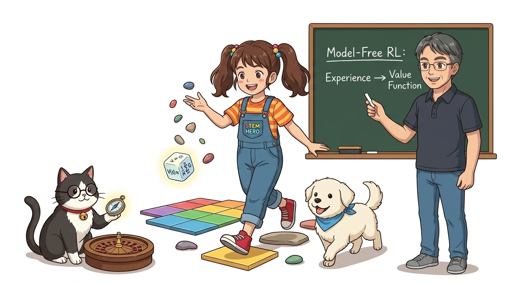

- **핵심 목표**: 환경 모델이 없는 현실 세계에서 에이전트의 실제 경험만으로 가치를 평가하고 최적 정책을 제어하는 원리 정복
- **주요 내용**:
  - 모델 기반(DP)에서 모델 프리(MC)로의 패러다임 전환
  - 무작위 표본 추출과 대수의 법칙을 통한 기댓값 추정
  - 역방향 누적 수익 계산과 파이썬 구현 아키텍처
  - 행동 가치 $Q(s, a)$와 $\varepsilon$-탐욕 정책 개선

>[스크립트] 이번 9장에서는 환경의 상태 전이 확률이나 보상 함수를 전혀 모르는 상태에서, 에이전트가 직접 부딪히며 쌓은 경험 데이터만으로 참된 가치를 추정하고 최적 정책을 도출하는 몬테카를로법을 체계적으로 학습합니다.

---

# 09. 몬테카를로법 (Monte Carlo Methods)
## 09.0.1 경험으로 미지의 세계를 탐험하는 진정한 강화학습

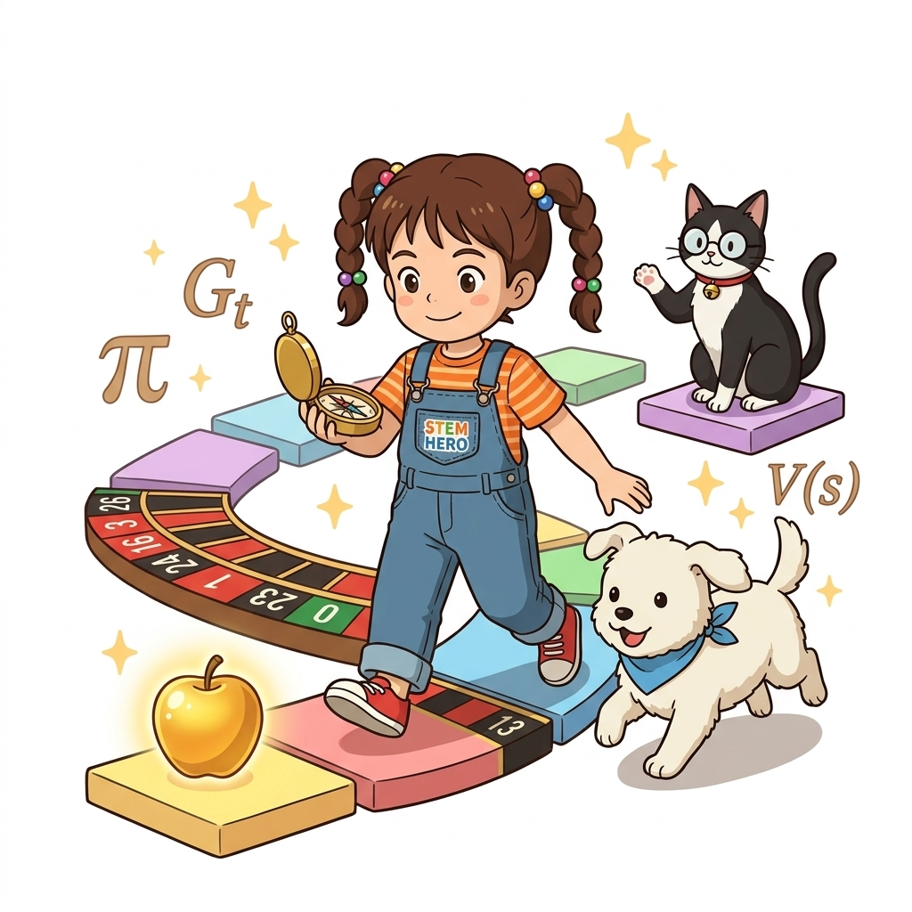
**그림 09-Intro-1** 카지노 룰렛과 그리드 타일을 나침반으로 탐험하는 몬테카를로 모험

- **온실 속 계산(DP)에서 미지의 광야(MC)로**:
  - 7장 동적 프로그래밍은 환경의 확률 지도가 완벽히 주어진 상태에서의 계획(Planning)
  - 현실의 문제는 사전 지도가 주어지지 않는 미지의 영역
- **진정한 강화학습의 출발**:
  - 에이전트가 환경과 직접 상호작용하며 수집한 '경험(Experience)'이 유일한 나침반
  - 교사나 정답 라벨 없이 스스로 시행착오를 겪으며 지능을 발전시킴
- 💡 **핵심 통찰**: 지도가 없어도 발걸음을 내딛고 경험을 기록하면, 그 경험의 통계적 평균이 가장 정확한 나침반이 됩니다.

>[스크립트] 동적 프로그래밍이 완벽한 확률 지도를 펼쳐놓고 책상 위에서 계산하는 온실 속 계획이었다면, 몬테카를로법은 안개 낀 미지의 세상에서 에이전트가 직접 발을 내딛고 넘어지며 스스로 길을 개척하는 진정한 강화학습의 시작점입니다.

---

# 09. 몬테카를로법 (Monte Carlo Methods)
## 09.0.1b DP에서 MC로의 거대한 패러다임 전환


**그림 09-Intro-1b** 모델 기반 온실 속 계획(DP)에서 경험 기반 광야 개척(MC)으로의 패러다임 전환

- **계획(Planning) vs 학습(Learning)**:
  - **DP (Planning)**: 환경 모델을 바탕으로 연립방정식을 연산하여 가치를 유도
  - **MC (Learning)**: 환경과 직접 부딪혀 생성된 표본(Sample)을 통계적으로 집계
- **현대 강화학습의 사상적 뿌리**:
  - 몬테카를로법은 TD 학습, Q-러닝, DQN으로 이어지는 모든 무모델 강화학습의 기틀
  - '환경을 직접 겪어보고 배우는' 강화학습 본연의 정체성을 완성

>[스크립트] 환경의 모델을 미리 알고 푸는 동적 프로그래밍에서, 환경을 블랙박스로 두고 오직 경험 데이터의 표본 평균으로 가치를 복원하는 몬테카를로로의 도약은 강화학습 역사상 가장 중대한 패러다임의 전환입니다.

---

# 09. 몬테카를로법 (Monte Carlo Methods)
## 09.0.2 동적 프로그래밍(DP)의 복습과 완벽한 환경 모델의 전제

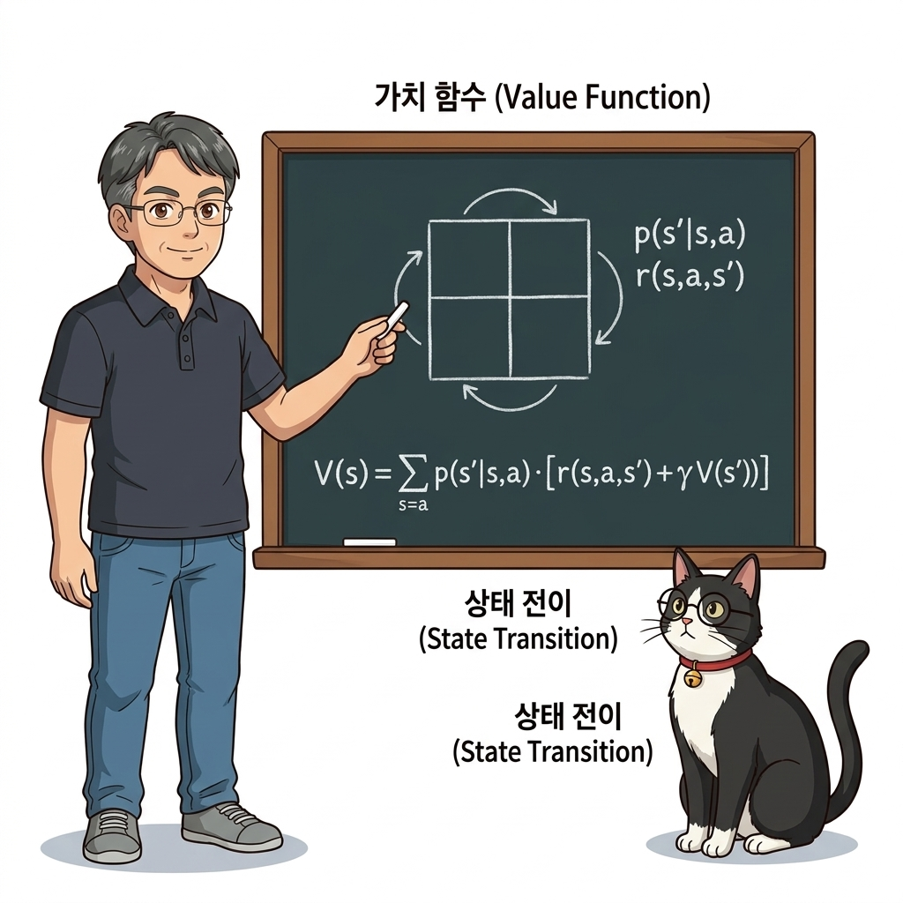
**그림 09-Intro-2** 상태 전이 확률과 보상 함수의 환경 모델 강의

- **환경 모델(Environment Model)의 정의**:
  - 상태 전이 확률: $p(s' \mid s, a)$
  - 즉각 보상 함수: $r(s, a, s')$
- **DP의 벨만 방정식 해법**:
  - 모든 전이 확률과 보상이 주어져야 기댓값을 가중합으로 풀 수 있음
  - 한 치의 오차도 없는 이상적인 이론해를 도출
- 💡 **핵심 한계**: 환경의 물리 법칙을 100% 알고 있다는 비현실적인 전제하에서만 동작합니다.

>[스크립트] 7장에서 벨만 기대 방정식을 우아하게 풀 수 있었던 이유는 에이전트의 모든 행동 결과와 보상이 수식으로 정확히 정의되어 있었기 때문입니다. 하지만 이러한 환경 모델은 현실의 복잡한 시스템에서는 결코 주어지지 않습니다.

---

# 09. 몬테카를로법 (Monte Carlo Methods)
## 09.0.2b 환경 모델의 두 기둥: p(s'|s, a)와 r(s, a, s')

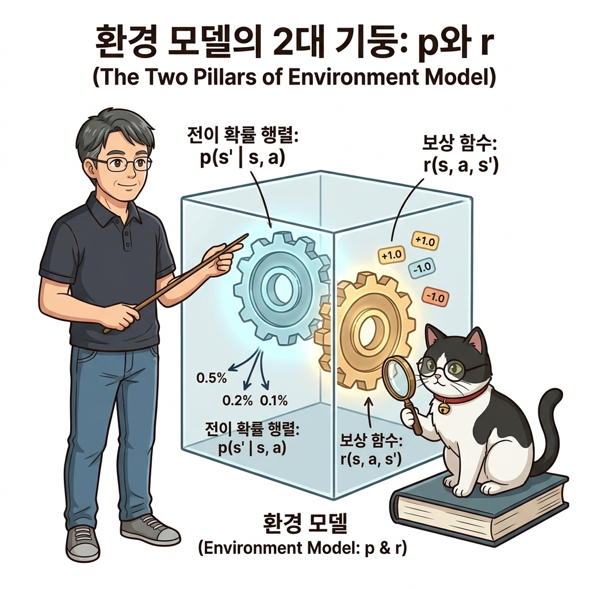
**그림 09-Intro-2b** 상태 전이 확률과 보상 함수의 내부 메커니즘

- **상태 전이 확률 $p(s' \mid s, a)$**:
  - 현재 상태 $s$에서 행동 $a$를 취했을 때 다음 상태 $s'$에 도달할 조건부 확률
  - 확률 보존 법칙: $\sum_{s'} p(s' \mid s, a) = 1$
- **보상 함수 $r(s, a, s')$**:
  - 상태가 전이될 때 환경이 에이전트에게 지급하는 스칼라 피드백
- **벨만 전개식의 종속성**:
  - $v_\pi(s) = \sum_a \pi(a \mid s) \sum_{s', r} p(s', r \mid s, a) [r + \gamma v_\pi(s')]$
  - $p$를 모르면 위 합 기호($\sum$)를 연산할 수 없음

>[스크립트] 벨만 방정식의 핵심 전개식은 상태 전이 확률 $p$와 보상 함수 $r$에 대한 가중합으로 구성됩니다. 만약 이 두 기둥 중 하나라도 모른다면, 동적 프로그래밍의 수식 전개는 그 자리에서 멈추고 맙니다.

---

# 09. 몬테카를로법 (Monte Carlo Methods)
## 09.0.3 현실 세계의 벽과 모델 프리(Model-Free)의 필연성


**그림 09-Intro-3** 안개 낀 미지의 그리드 월드와 불확실성

- **현실 문제의 장벽**:
  - 바둑의 상태 수는 $10^{170}$개로 우주 원자 수($10^{80}$)를 초과
  - 자율주행 도로의 노면, 날씨, 보행자 돌발 행동은 수학적 모델링 불가
- **차원의 저주와 계산 불능**:
  - 설령 모델을 세운다 해도 상태 전이 행렬의 크기가 폭발하여 메모리 적재 불가
- **모델 프리(Model-Free)의 혁신**:
  - 환경의 내부 수식을 몰라도 실제 상호작용 피드백만으로 학습 가능

>[스크립트] 현실 세계의 자율주행이나 로봇 제어에서는 비가 오고 바람이 부는 복잡한 물리 법칙을 수학 공식으로 세울 수 없습니다. 따라서 환경의 내부 수식 없이도 문제를 해결하는 모델 프리 기법이 필연적으로 등장하게 되었습니다.

---

# 09. 몬테카를로법 (Monte Carlo Methods)
## 09.0.3b 블랙박스 환경과 상호작용하는 모델 프리 아키텍처

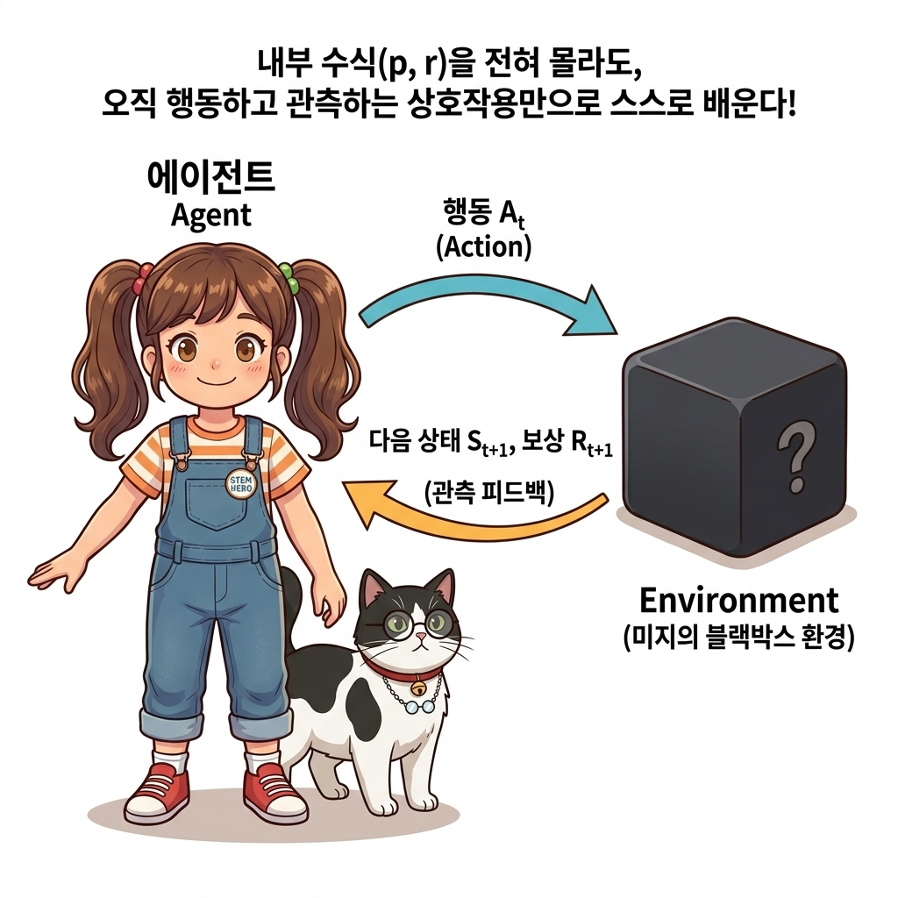
**그림 09-Intro-3b** 모델 프리 시스템 구조도

- **블랙박스로서의 환경**:
  - 에이전트는 환경 내부의 수학적 메커니즘을 알 필요가 없음
  - 오직 행동(Action)을 입력하고 반환되는 상태($S$)와 보상($R$)만 관찰
- **입출력 데이터 기반 최적화**:
  - 내부 미분 방정식 없이 관찰된 결과 데이터의 통계적 속성 활용
- 💡 **핵심 원리**: 원리를 몰라도 결과를 많이 관찰하면, 어떤 선택이 유리한지 통계적으로 확신할 수 있습니다.

>[스크립트] 모델 프리 아키텍처에서 환경은 철저히 블랙박스로 취급됩니다. 에이전트는 행동을 전달하고 그 결과 반환되는 상태와 보상 신호만을 수집하여 최적의 의사결정을 귀납적으로 찾아냅니다.

---

# 09. 몬테카를로법 (Monte Carlo Methods)
## 09.0.4 강화학습의 돌파구: '경험' 데이터의 수집과 가치


**그림 09-Intro-4** 궤적과 데이터를 관찰하며 수첩에 기록하는 에이전트

- **경험(Experience)이란 무엇인가**:
  - 에이전트가 환경 속에서 직접 행동하고 겪은 시계열 상호작용의 기록
  - 1스텝 전이 단위: $(S_t, A_t, R_{t+1}, S_{t+1})$
- **에피소드 궤적 (Trajectory)**:
  - 시작부터 종료까지 에이전트가 지나온 전체 여정
  - $\tau = (S_0, A_0, R_1, S_1, \dots, S_T)$
- 💡 **핵심 가치**: 경험 궤적은 환경의 숨겨진 확률 분포를 통계적으로 복원해내는 가장 값진 원석입니다.

>[스크립트] 환경 모델이 없는 상태에서 에이전트가 기댈 수 있는 유일한 자산은 경험 데이터입니다. 어떤 상태에서 어떤 행동을 취해 어떤 보상을 받았는지에 대한 구체적인 시계열 궤적이 학습의 탄탄한 밑거름이 됩니다.

---

# 09. 몬테카를로법 (Monte Carlo Methods)
## 09.0.4b 에피소드 경험 궤적(Trajectory)의 시계열 사슬

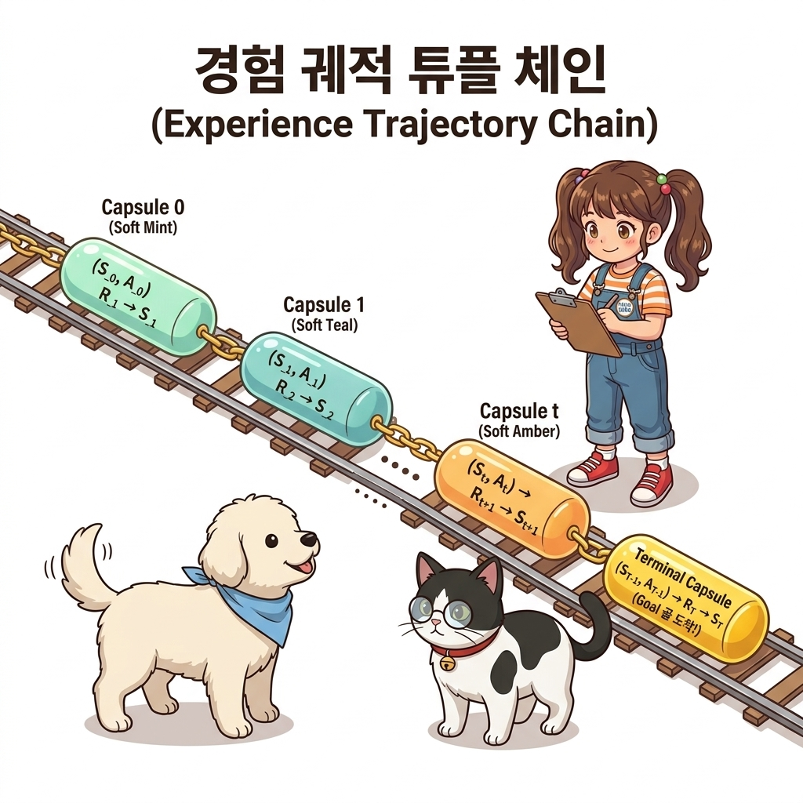
**그림 09-Intro-4b** 전이 튜플들의 연속적인 시계열 사슬 구조

- **시간의 흐름에 따른 튜플 연결**:
  - $(S_0, A_0) \xrightarrow{R_1} S_1 \xrightarrow{A_1} S_2 \dots \xrightarrow{R_T} S_T$
  - 에이전트의 결정($A_t$)과 환경의 응답($R_{t+1}, S_{t+1}$)이 교대로 사슬 형성
- **에피소드형 태스크(Episodic Task) 전제**:
  - 유한한 타임스텝 $T$에서 반드시 종료 상태에 도달
  - 종료 시점 이후 전체 궤적을 대상으로 가치 평가 수행

>[스크립트] 하나의 에피소드는 상태, 행동, 보상이 톱니바퀴처럼 맞물려 종료 상태까지 이어지는 긴 사슬 구조입니다. 몬테카를로법은 이 시계열 궤적 전체를 손에 쥐었을 때 비로소 진정한 위력을 발휘합니다.

---

# 09. 몬테카를로법 (Monte Carlo Methods)
## 09.0.5 몬테카를로법의 본질: 무작위 샘플링과 대수의 법칙

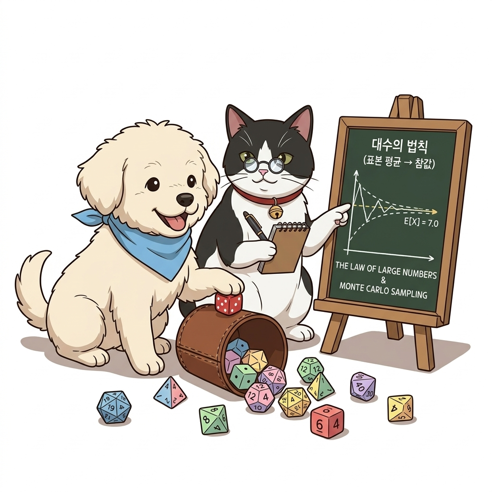
**그림 09-Intro-5** 주사위 굴리기와 통계적 관찰

- **몬테카를로(Monte Carlo)의 어원**:
  - 모나코의 유명 카지노 도시 이름에서 유래
  - 확률과 무작위 표본을 이용해 복잡한 기댓값을 추정하는 수학 기법
- **표본 평균(Sample Mean)의 원리**:
  - 주사위 2개의 합의 이론적 기댓값은 7
  - 실제로 주사위를 수천 번 굴려 평균을 내도 정확히 7에 도달
- 💡 **핵심 통찰**: 난해한 적분식을 직접 풀지 않아도, 주사위를 충분히 많이 던지면 참값을 오차 없이 구해낼 수 있습니다.

>[스크립트] 몬테카를로법의 본질은 무작위 표본 추출과 산술 평균입니다. 복잡한 수학 공식으로 기댓값을 유도하지 않더라도, 주사위를 수천 번 굴려 그 결과를 평균 내면 누구나 정확한 참 기댓값에 도달할 수 있습니다.

---

# 09. 몬테카를로법 (Monte Carlo Methods)
## 09.0.5b 대수의 법칙(Law of Large Numbers)과 표본 수렴

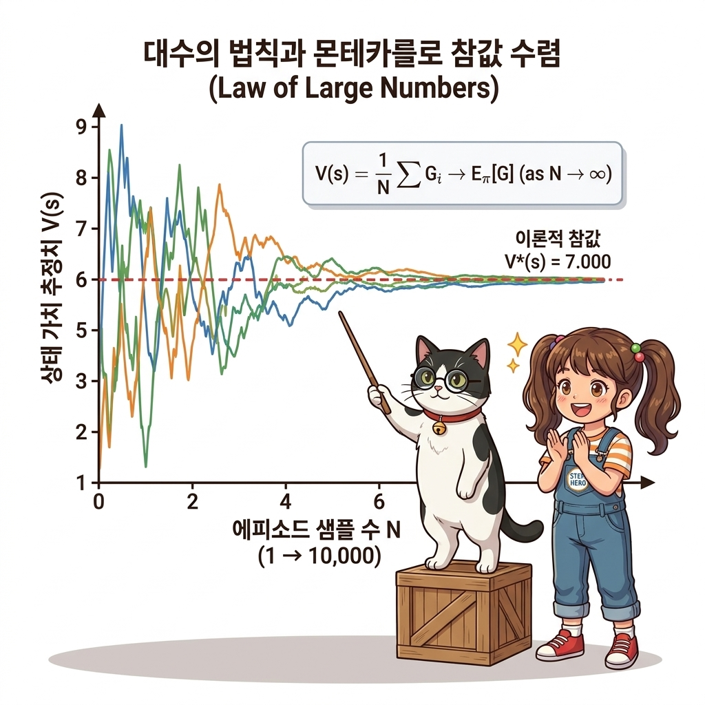
**그림 09-Intro-5b** 표본 수 $N$ 증가에 따른 참 기댓값 수렴 곡선

- **대수의 법칙 수식**:
  - $V(s) = \frac{1}{N} \sum_{i=1}^N G_i(s) \xrightarrow{N \to \infty} v_\pi(s) = \mathbb{E}_\pi[G_t \mid S_t = s]$
- **수렴 특성**:
  - 표본 수 $N$이 작을 때는 평균값이 위아래로 크게 요동침
  - $N$이 커질수록 참 기댓값(빨간 수평선)에 오차 없이 안착
  - 추정의 분산은 표본 수에 반비례하여 감소 ($\propto \frac{1}{\sqrt{N}}$)

>[스크립트] 대수의 법칙에 따라 표본의 개수가 늘어날수록 표본 평균은 모집단의 참 기댓값에 수학적으로 수렴합니다. 초반에는 결과가 요동치더라도, 충분한 경험이 누적되면 오차는 완전히 사라지게 됩니다.

---

# 09. 몬테카를로법 (Monte Carlo Methods)
## 09.0.6 에피소드 완주와 역방향 수익(Return) 계산 메커니즘

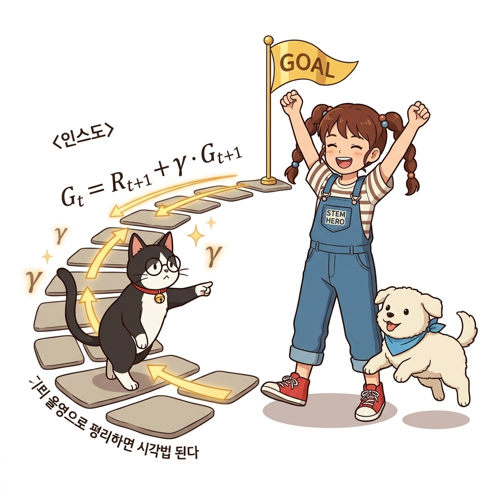
**그림 09-Intro-6** 골인 지점 완주 후 역방향으로 시간을 거슬러 정산하는 구조

- **완주 후 정산(No Bootstrapping)**:
  - 에피소드가 끝날 때까지 중간 상태의 불완전한 추정치를 일절 빌려 쓰지 않음
  - 실제 완주하여 얻은 확정된 총수익(Return $G_t$)만을 사용
- **역방향 시간 순회의 이유**:
  - 목표 지점(골)의 보상부터 시작점으로 거슬러 올라가며 계산
  - 중복 연산 없이 단 한 번의 순회로 모든 타임스텝의 수익 정산 완료

>[스크립트] 몬테카를로법은 중간에 어설프게 다른 상태의 추정 가치를 빌려 쓰지 않습니다. 반드시 에피소드가 끝날 때까지 기다린 후, 골인 지점에서부터 시간을 거꾸로 거슬러 올라가며 실제 누적 수익을 정산합니다.

---

# 09. 몬테카를로법 (Monte Carlo Methods)
## 09.0.6b 역방향 누적 할인 수익 점화식의 분해

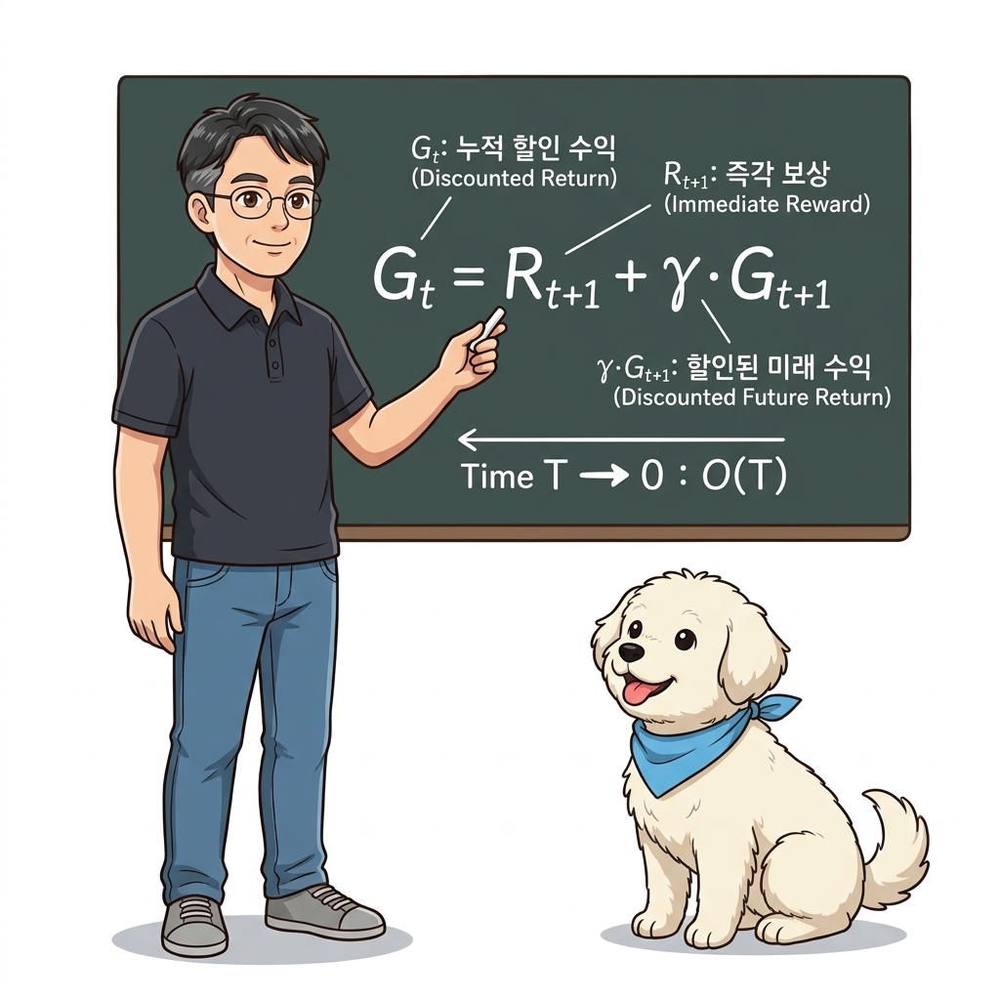
**그림 09-Intro-6b** 점화식 $G_t = R_{t+1} + \gamma G_{t+1}$ 분해 및 $\mathcal{O}(T)$ 시간 복잡도

- **누적 할인 수익 점화식**:
  - $G_t = R_{t+1} + \gamma R_{t+2} + \gamma^2 R_{t+3} + \dots = R_{t+1} + \gamma G_{t+1}$
- **계산 효율성의 극대화**:
  - 순방향 정방향 계산 시: 각 상태마다 끝까지 합산하므로 $\mathcal{O}(T^2)$ 소요
  - 역방향 점화식 순회 시: $G \leftarrow R + \gamma G$ 단 1회 갱신으로 $\mathcal{O}(T)$ 선형 시간에 해결

>[스크립트] 누적 수익 점화식 $G_t = R_{t+1} + \gamma G_{t+1}$을 역순으로 적용하면, 이전에 계산한 미래 수익에 할인율만 곱해 즉시 현재 수익을 구할 수 있으므로 연산량이 $\mathcal{O}(T)$로 대폭 단축됩니다.

---

# 09. 몬테카를로법 (Monte Carlo Methods)
## 09.0.7 모델 패러다임의 전환: 분포 모델 vs 샘플 모델

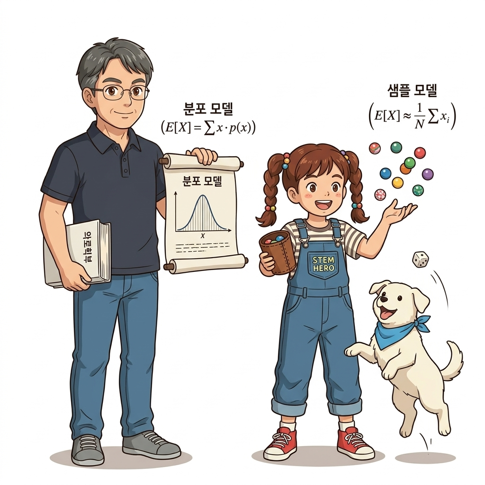
**그림 09-Intro-7** 이론적 분포 모델과 실제 시행 샘플 모델의 대비

- **분포 모델 (Distribution Model)**:
  - 모든 상태 전이의 수학적 확률 분포 $p(s' \mid s, a)$를 사전에 보유
  - 완벽하지만 현실의 복잡한 시스템에서는 모델 구축 자체가 불가능
- **샘플 모델 (Sample Model)**:
  - 환경의 내부 확률식은 몰라도 에이전트의 행동에 대한 다음 상태를 출력하는 시뮬레이터만 있으면 충분
  - 실제 비디오 게임, 물리 엔진, 실세계 로봇에 폭넓게 적용 가능

>[스크립트] 환경을 바라보는 관점은 모든 확률식을 들여다보는 분포 모델과, 직접 행동을 취해 결과를 관찰하는 샘플 모델로 나뉩니다. 몬테카를로법은 샘플 모델을 기반으로 동작하여 현실의 모든 복잡한 환경에 적용될 수 있습니다.

---

# 09. 몬테카를로법 (Monte Carlo Methods)
## 09.0.7b 분포 모델 vs 샘플 모델 4대 핵심 축 비교

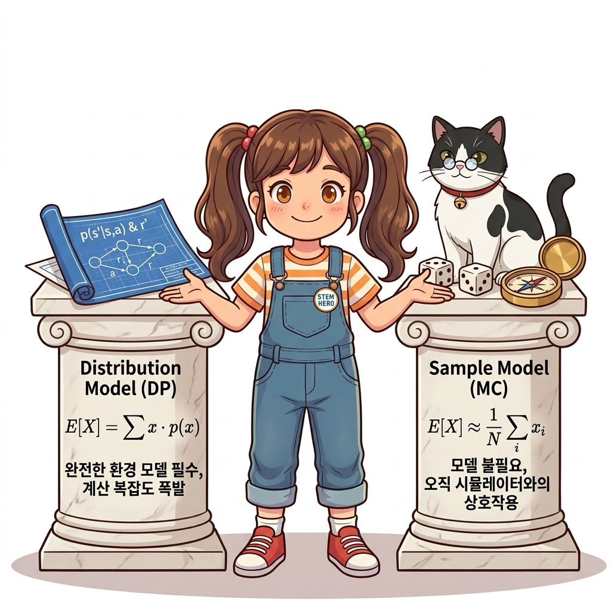
**그림 09-Intro-7b** 두 패러다임의 4대 핵심 축 비교표

- **필수 요건**:
  - 분포 모델: 전이 확률 $p$와 보상 $r$ 완벽 파악
  - 샘플 모델: 시뮬레이터(시행) 실행 가능 여부만 필요
- **기댓값 연산**:
  - 분포 모델: $\mathbb{E}[X] = \sum x \cdot p(x)$ (가중합 연립방정식)
  - 샘플 모델: $\mathbb{E}[X] \approx \frac{1}{N} \sum x_i$ (표본 산술 평균)
- **적용성**: 샘플 모델은 상태가 수억 개에 달하는 복잡한 현실 세계에서도 유효

>[스크립트] 두 패러다임의 가장 큰 차이는 기댓값을 구하는 방식입니다. 분포 모델은 전이 확률을 이용한 가중합을 계산하지만, 샘플 모델은 실제로 얻은 표본들의 산술 평균을 취하므로 확률 공식을 몰라도 동일한 결론에 도달합니다.

---

# 09. 몬테카를로법 (Monte Carlo Methods)
## 09.0.8 에이전트의 step 메서드와 메모리 버퍼 궤적 저장


**그림 09-Intro-8** 파이썬 상호작용 루프와 메모리 버퍼 적재

- **간결한 4단계 상호작용 루프**:
  ```python
  action = agent.get_action(state)           # 1. 행동 선택
  next_state, reward, done = env.step(action) # 2. 환경 1스텝 실행
  agent.add(state, action, reward)            # 3. 메모리에 저장
  state = next_state                          # 4. 상태 전이
  ```
- **메모리 버퍼의 역할**:
  - 한 에피소드가 끝날 때까지 튜플 형태로 경험을 차곡차곡 보관
  - 에피소드 종료(`done == True`) 시 일괄적으로 역방향 가치 갱신 수행

>[스크립트] 몬테카를로 에이전트의 구현 코드는 놀라울 정도로 직관적입니다. 환경에서 한 걸음 내딛을 때마다 경험 튜플을 메모리 리스트에 쌓아두고, 완주 신호를 받으면 저장된 궤적을 역순으로 정산합니다.

---

# 09. 몬테카를로법 (Monte Carlo Methods)
## 09.0.8b 1스텝 상호작용 및 메모리 저장 알고리즘 순서도

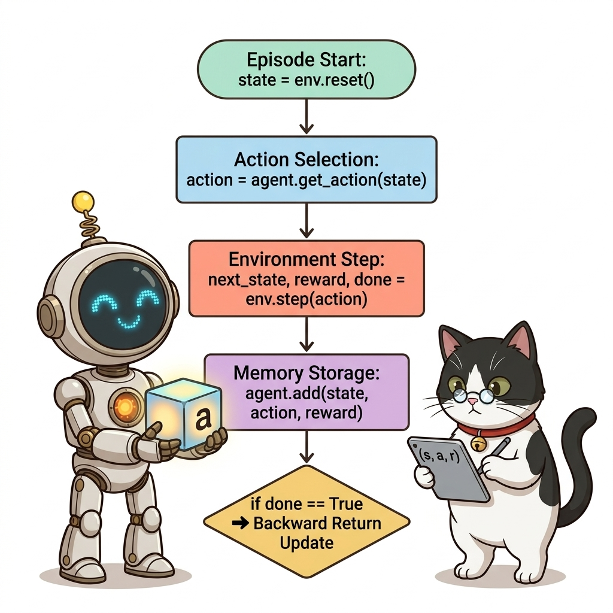
**그림 09-Intro-8b** 에이전트 1스텝 실행 및 메모리 저장 표준 순서도

- **에이전트의 3대 핵심 메서드**:
  1. `get_action(state)`: 탐색과 이용을 고려한 행동 결정
  2. `add(state, action, reward)`: 경험 튜플을 내부 메모리 리스트에 적재
  3. `eval()`: 에피소드 종료 후 역방향 루프를 돌며 가치 함수 테이블 갱신
- **메모리 초기화(`reset`)**:
  - 가치 갱신이 완료되면 다음 에피소드를 위해 메모리 리스트를 비움

>[스크립트] 알고리즘 순서도를 살펴보면 행동 선택, 환경 스텝, 메모리 적재의 세 단계가 순환하며 에피소드를 완주합니다. 완주 후에는 `eval()` 메서드를 통해 가치를 갱신하고 메모리를 비우는 단정한 구조를 갖습니다.

---

# 09. 몬테카를로법 (Monte Carlo Methods)
## 09.0.9 가치 평가에서 최적 정책 제어로의 여정

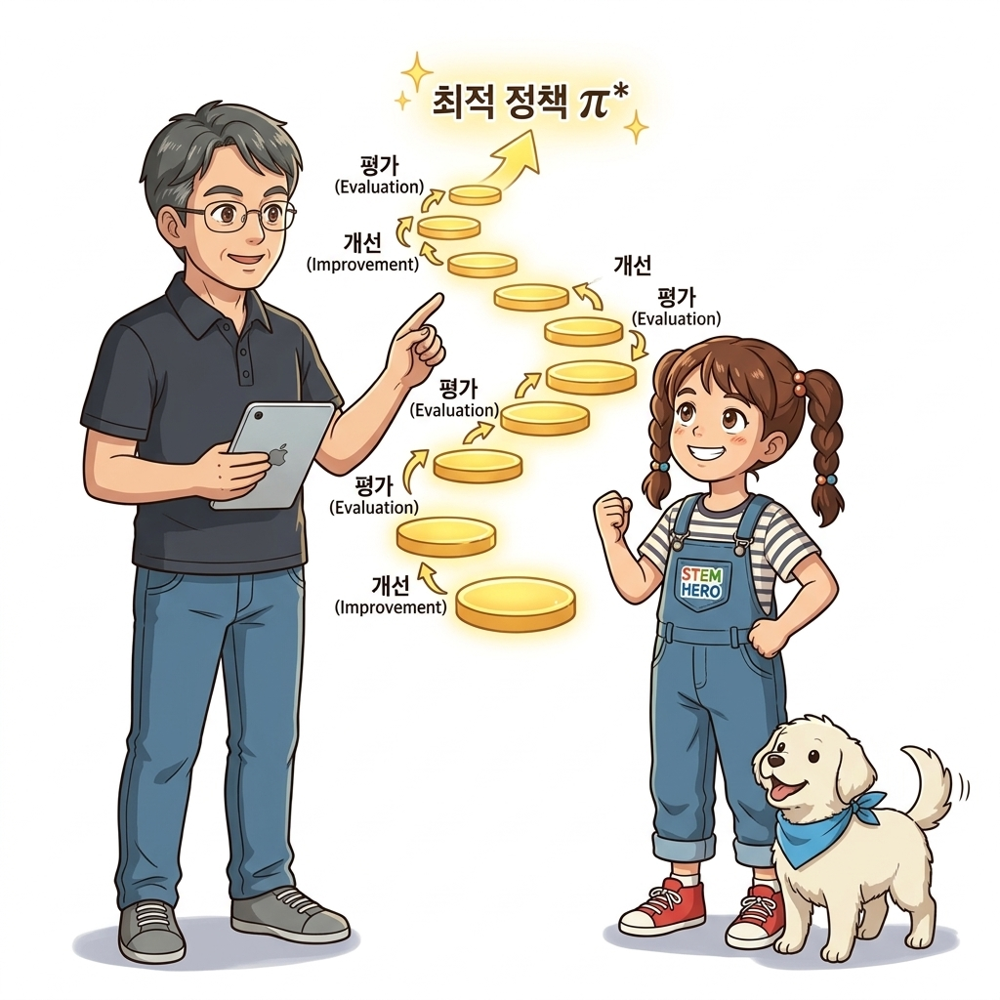
**그림 09-Intro-9** 최적 정책 나선 계단을 안내하는 정책 제어

- **가치 평가의 궁극적 목적**:
  - 단순히 현재 상태의 점수를 매기는 것을 넘어 최적 정책 $\pi^*$을 도출하는 것
- **상태 가치 $V(s)$의 한계와 $Q(s, a)$의 필연성**:
  - 모델 프리에서는 다음 상태 전이 확률을 모르므로 $V(s)$만으로 최적 행동 선택 불가
  - 상태와 행동의 결합 가치인 **행동 가치 함수 $Q(s, a)$**를 직접 평가해야 함
- 💡 **핵심 원리**: $Q(s, a)$를 알면 확률 모델 없이도 단순히 가장 큰 $Q$값을 주는 행동을 고르면 됩니다.

>[스크립트] 환경 모델이 없는 상태에서는 상태 가치 $V(s)$만 알아서는 다음 상태로 갈 수 있는 확률을 모르기 때문에 행동을 결정할 수 없습니다. 따라서 상태에서 특정 행동을 취했을 때의 가치인 행동 가치 함수 $Q(s, a)$를 직접 학습해야 합니다.

---

# 09. 몬테카를로법 (Monte Carlo Methods)
## 09.0.9b 일반화된 정책 반복(GPI)과 Q 제어 루프

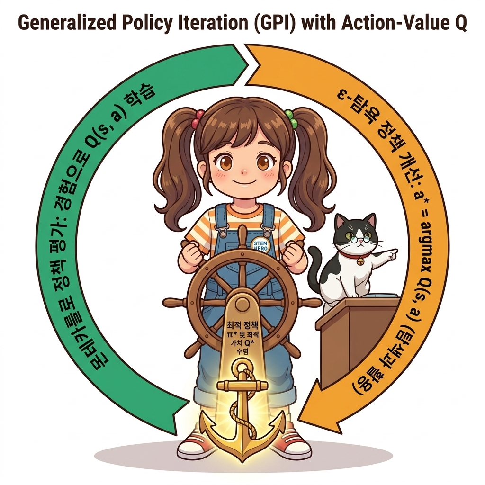
**그림 09-Intro-9b** 행동 가치 $Q(s, a)$ 기반 GPI 및 $\varepsilon$-탐욕 제어 순환도

- **일반화된 정책 반복 (GPI)**:
  - **평가 (Evaluation)**: 현재 정책으로 경험을 수집하여 $Q(s, a)$ 추정
  - **개선 (Improvement)**: 추정된 $Q$값에 따라 더 좋은 행동 쪽으로 정책을 개선
- **탐험과 이용의 딜레마 해결**:
  - 항상 최고 가치만 고르면 새로운 최적 경로를 영원히 발견하지 못함
  - $\varepsilon$의 작은 확률로 무작위 탐험을 시도하는 **$\varepsilon$-탐욕 정책($\varepsilon$-Greedy)** 도입

>[스크립트] 몬테카를로 정책 제어는 행동 가치 $Q$를 평가하고, $\varepsilon$-탐욕법으로 정책을 지속적으로 개선하는 일반화된 정책 반복 사이클로 완성됩니다. 이 과정을 반복하면 모델이 없어도 스스로 최적 정책에 수렴합니다.

---

# 09. 몬테카를로법 (Monte Carlo Methods)
## 09.0.10 CHAPTER 9 몬테카를로법 7대 탐험 로드맵


**그림 09-Intro-10** 몬테카를로 모험을 시작하는 4인방과 전체 로드맵

- **체계적인 7단계 학습 여정**:
  - 09.0 수학적 기초와 역사적 기원 (맨해튼 프로젝트와 원주율 추정)
  - 09.1 주사위 시뮬레이션과 스마트한 증분 평균법 공식 유도
  - 09.2 최초 방문(First-Visit) MC 가치 평가 알고리즘
  - 09.3 그리드월드 파이썬 실전 구현과 에이전트 클래스 완성
  - 09.4 $Q(s, a)$와 $\varepsilon$-탐욕법을 활용한 정책 제어
  - 09.5 오프-정책(Off-Policy)과 수학적 중요도 샘플링
  - 09.6 핵심 수식 총정리와 장단점 비교 마스터

>[스크립트] 9장은 몬테카를로의 수학적 기원부터 파이썬 실전 구현, 그리고 심화 이론인 오프-정책 중요도 샘플링까지 일곱 개의 체계적인 관문으로 설계되어 있습니다. 각 단계를 차례로 완주하며 무모델 강화학습의 단단한 기초를 완성해 나갈 것입니다.

---

# 09. 몬테카를로법 (Monte Carlo Methods)
## 09.0.10b 무모델 강화학습 정복 7대 관문 파이프라인


**그림 09-Intro-10b** 9.0 기초부터 9.6 정리까지 7대 관문 마스터 파이프라인

- **이론에서 실전으로 이어지는 파이프라인**:
  - **기초 이론** (9.0~9.1): 대수의 법칙과 점화식 평균법의 수학적 원리 확립
  - **가치 평가** (9.2~9.3): 경험 궤적 수집 및 파이썬 코드 구현
  - **정책 제어** (9.4~9.5): 자율 주행 탐색과 타깃/행동 정책 분리
  - **종합 정리** (9.6): 차세대 TD 학습으로 이어지는 브릿지 완성

>[스크립트] 7개의 관문 파이프라인을 따라가다 보면 단순한 주사위 던지기에서 시작된 통계적 아이디어가 어떻게 자율적인 인공지능 제어 시스템으로 진화하는지 그 전체 구조를 명확히 체득하게 될 것입니다.

---

# 경청해 주셔서 감사합니다
## CHAPTER 9 몬테카를로법 (Monte Carlo Methods)

- **핵심 요약**:
  - 환경 모델 없이 실제 경험 표본의 통계적 평균으로 가치를 평가하는 몬테카를로법
  - 에피소드 완주 후 역방향 점화식 정산으로 $\mathcal{O}(T)$ 시간 복잡도 달성
  - 행동 가치 $Q(s, a)$와 $\varepsilon$-탐욕 제어를 통한 자율적 최적 정책 수렴
- **다음 단계**:
  - 09.0절 맨해튼 프로젝트와 스타니스와프 울람의 역사적 기원 탐험

>[스크립트] 이상으로 몬테카를로법의 기본 개념과 패러다임 전환에 대한 개요를 마쳤습니다. 이어지는 09.0절에서는 몬테카를로법이 탄생하게 된 역사적 배경과 수학적 기원을 본격적으로 탐구해 보겠습니다.
