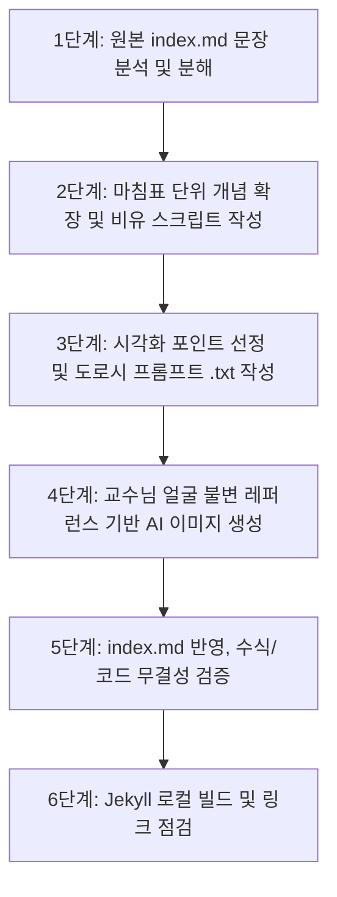

# 📖 강화학습 강의 `index.md` 심층 개선 및 시각화 표준 가이드

> **문서 버전:** 1.0.0  
> **최종 수정일:** 2026-10-29  
> **적용 대상:** `/Users/hojin9/dev/jinysite/강화학습3/src/` 내 모든 단원 (특히 `09_몬테카를로법` 최우선 적용)  
> **핵심 레퍼런스:** [`/Users/hojin9/dev/projects/dorothy/prompt.md`](file:///Users/hojin9/dev/projects/dorothy/prompt.md) 및 [`/Users/hojin9/dev/projects/dorothy/data/images/`](file:///Users/hojin9/dev/projects/dorothy/data/images/)

---

## 🎯 1. 가이드 개요 및 목적

본 가이드는 강화학습 온라인 강의 교재의 핵심 문서인 각 단원별 `index.md`를 **중학생도 단번에 이해할 수 있는 최고 수준의 친절하고 풍부한 교육 콘텐츠로 탈바꿈**시키기 위한 표준 지침서입니다.

단순한 요약이나 정리가 아닌, **"원본의 100% 보존 + 마침표 단위의 문장 분석 및 상세한 개념 확장 + 도로시 세계관 기반의 고품질 2D 지브리풍 생성형 삽화 다수 배치"**를 핵심 원칙으로 삼아 교재의 완성도와 몰입도를 극대화합니다.

---

## 🏛️ 2. 핵심 4대 개선 원칙

### 원칙 1: 무손실 원본 보존 및 마침표 단위 심층 확장 (Lossless & Deep Unpacking)
1. **절대 축약 및 임의 삭제 금지**:
   - 원본 교재에 작성된 단 하나의 수식, 문장, 코드, 용어도 절대 임의로 줄이거나 삭제하지 않습니다.
   - 기존에 존재하는 설명은 100% 유지하며, 그 설명의 이해를 돕기 위한 보충 해설과 배경 지식을 대폭 추가합니다.
2. **마침표(`.`) 기준 문장 단위 심층 분석**:
   - 원문의 문장 하나하나를 마침표 단위로 면밀히 분석합니다.
   - 각 문장이 담고 있는 수학적 전제, 물리적 현상, 컴퓨터 과학적 배경을 쪼개어, "이 문장이 왜 나왔는지", "이 수식이 현실에서 무엇을 뜻하는지"를 친절하게 해설합니다.

---

### 원칙 2: 중학생도 쉽게 이해할 수 있는 눈높이 해설 (Middle School Level)
1. **추상적 전문 용어의 일상 비유화**:
   - 강화학습의 어려운 개념(상태 전이, 가치 함수, 벨만 방정식, 부트스트랩, 몬테카를로법, 표본 평균 등)을 일상적인 사물(주사위 게임, 징검다리 건너기, 롤러코스터, 용돈 기입장, 날씨 예보)로 완벽히 번역합니다.
2. **3단계 설명 공식 (Why $\rightarrow$ Metaphor $\rightarrow$ Math)**:
   - **Why (왜 필요한가?)**: "컴퓨터가 지도가 없는 상황에서 길을 찾아야 한다면 어떻게 해야 할까요?"
   - **Metaphor (직관적 비유)**: "눈을 감고 컵 속에 든 주사위를 100번 굴려 나온 점수들의 평균을 재는 것과 같습니다!"
   - **Math (수학/코드 연결)**: "이것을 수학 기호로 표기하면 $V(s) \approx \frac{1}{N} \sum G$가 됩니다."
3. **친절한 인터랙티브 박스 및 Q&A 구조**:
   - 독자가 읽으며 고개를 갸우뚱할 수 있는 지점마다 `[!NOTE]`, `[!TIP]`, `[!IMPORTANT]` 알림 블록과 **"🤔 중학생 도로시의 궁금증!"**, **"👨‍🏫 이호진 교수님의 명쾌한 답변!"** 코너를 배치합니다.

---

### 원칙 3: 도로시 세계관 이미지 연계 및 이호진 교수님 얼굴 불변 원칙
본 교재에 삽입되는 모든 생성형 이미지는 [`/Users/hojin9/dev/projects/dorothy/prompt.md`](file:///Users/hojin9/dev/projects/dorothy/prompt.md) 규격을 엄격히 따릅니다.

1. **화풍 규격 (Art Style Uniformity)**:
   - **스튜디오 지브리 2D 애니메이션 스타일** (Studio Ghibli 2D anime style, clean crisp dark espresso brown line art `#26211E`, warm vibrant flat cel shading).
   - **무결점 순백색 배경 (`#FFFFFF`, Pure Solid White Background)**: 1:1 정방형(1024×1024), 슬라이드 테두리/박스/배너가 없는 깔끔한 피사체 컷아웃 및 발밑 소프트 접지 그림자.
2. **👨‍🏫 이호진 교수님 얼굴 불변 절대 수칙 (Strict Facial Consistency)**:
   - 교수님의 얼굴이 생성 시마다 달라지거나 늙어 보이는 현상(노안 글리치)을 엄격히 차단합니다.
   - **연령 & 얼굴**: **40대 초반의 스마트하고 인자한 동안** (`early 40s, youthful face, smooth skin without wrinkles, energetic kind face`).
   - **헤어 & 안경**: 단정하게 가르마를 탄 세련된 솔트앤페퍼 흑발 숏헤어, 스티브 잡스 스타일의 얇은 실버 라운드 메탈 와이어테 안경.
   - **표준 착장**: 로고나 뱃지가 일체 없는 단정한 **다크 차콜 네이비 단색 카라 반팔 폴로 셔츠** (`solid dark charcoal navy polo shirt, NO badges, NO name tags, NO SNU text`), 중청 스트레이트 청바지, 뉴발란스 모티브 그레이 스웨이드 스니커즈.
   - **얼굴 레퍼런스 이미지 연계**: 이미지 생성 시 `/Users/hojin9/dev/projects/dorothy/data/images/hojin_character_sheet.jpg` 및 `hojin_thumbs_up.jpg`, `hojin_lab_lecture.jpg`를 참조하여 얼굴 이목구비와 분위기를 100% 동일하게 유지합니다.
3. **등장인물 5대 페르소나 및 역할 분담**:
   - **👧 도로시 (Dorothy)**: 9세 주니어 메이커 (4.5등신 치비, 밤색 양갈래, 줄무늬 티, 'STEM HERO' 오버롤, 빨간 운동화). 개념에 질문을 던지고 직접 행동하는 탐험가.
   - **👨‍🏫 이호진 교수님 (Prof. Hojin)**: 지혜롭고 자상한 AI 멘토. 수학 공식 유도, 칠판 강의, 근본 원리 전수.
   - **🐱 조교 지니 (Jiny)**: 코숏 젖소/턱시도 냥이 조교 (올리브 눈, 핑크 코, 미니 조교 안경, 빨간 방울 목걸이). 파이썬 코드 해설, 버그 팩트 체크, 알고리즘 실습 가이드.
   - **🐶 토토 (Toto)**: 크림화이트 비숑-말티즈 믹스 강아지 (얼룩 없는 순백색 털, 검은 단추 코, 하늘색 반다나). 보상 수령, 직관적 행동 시행.
   - **🤖 로봇 틴맨 (Tinny)**: 매트 실버 휴머노이드 로봇 (스카이블루 LED 도트 눈, 앰버 하트 코어). 그리드월드 타일 탐색, 피지컬 AI 에이전트.
4. **이미지 다다익선 (More Visuals, Better Learning)**:
   - 이미지는 많을수록 좋습니다. 개념 전환, 수식 등장, 코드 블록 전후, 비유가 필요한 지점마다 넉넉하게 배치하여 시각적 직관을 제공합니다.
   - 모든 생성형 이미지는 해당 단원의 `img/` 폴더에 위치하며, 반드시 매칭되는 프롬프트 명세서 파일(`*.txt`)을 함께 생성·보관합니다.

---

### 원칙 4: 시각적 구조화 및 표준 레이아웃
1. **문서 상단 구성**:
   - 소단원 16:9 메인 타이틀 배너 (예: ``)
   - 도로시 세계관 인트로 일러스트 (1:1 순백색 삽화)
   - 소단원 핵심 요약 및 도로시의 호기심 인트로 대화
2. **본문 절(Section) 구성**:
   - `## 소단원 번호.절 번호`
   - 문장 단위 원문 제시 및 대폭 확장된 친절 해설
   - 직관적 비유 삽화 (``) 및 프롬프트 명세 인포박스
   - 수식 기호 풀이 테이블 및 파이썬 실습 코드
   - 소단원 마무리 핵심 요약 카드 및 다음 단계 브릿지

---

## 🚀 3. 표준 작업 워크플로우 (6단계 SOP)

### [1단계] 원본 index.md 문장 분석 및 분해
- 단원의 `index.md`를 열고 전체 흐름을 파악합니다.
- 단락별로 문장을 마침표 기준으로 분해하여, 전문 용어나 비약이 있는 문장을 리스트업합니다.

### [2단계] 마침표 단위 개념 확장 및 비유 스크립트 작성
- 원본 문장의 의미를 훼손하지 않으면서, 일상생활의 비유(주사위, 징검다리, 지도 등)를 덧붙여 설명을 2~3배 이상 풍성하게 확장합니다.
- 수식은 각 변수($s, a, r, \gamma, \alpha, G$)가 무엇을 뜻하는지 테이블이나 설명문으로 하나씩 짚어줍니다.

### [3단계] 시각화 포인트 선정 및 도로시 프롬프트 `.txt` 작성
- 확장이 이루어진 핵심 지점마다 삽화를 기획합니다.
- `/Users/hojin9/dev/projects/dorothy/prompt.md`의 표준 5블록 아키텍처에 맞추어 프롬프트 텍스트를 작성하고, `img/<semantic_name>.txt`로 저장합니다.

### [4단계] 교수님 얼굴 불변 레퍼런스 기반 AI 이미지 생성
- `generate_image` 도구를 호출할 때 `ImagePaths`에 교수님의 공식 레퍼런스 시트([`hojin_character_sheet.jpg`](file:///Users/hojin9/dev/projects/dorothy/data/images/hojin_character_sheet.jpg))를 참조로 전달합니다.
- 교수님의 40대 초반 동안, 솔트앤페퍼 헤어, 얇은 메탈 안경, 무지 네이비 폴로 셔츠 토큰을 완벽히 유지합니다.

### [5단계] `index.md` 반영, 수식/코드 무결성 검증
- 생성된 이미지(`*.png` 또는 `*.jpg`)를 `index.md`에 배치합니다.
- 캡션과 도로시/교수님의 해설 대화를 배치합니다.
- 수식 렌더링(MathJax)과 코드 블록의 문법 하이라이팅이 완벽한지 검증합니다.

### [6단계] Jekyll 로컬 빌드 및 링크 점검
- `bundle exec jekyll build`를 실행하여 exit code 0을 확인합니다.
- 깨진 이미지 링크나 상대 경로 오차가 없는지 파이썬 검증 스크립트로 전수 조사합니다.

---

## 📋 4. CHAPTER 09 (몬테카를로법) 적용 계획서

`src/09_몬테카를로법`의 각 단원별 개선 작업 로드맵입니다:

| 소단원 | 주제 | 핵심 개념 및 확장 포인트 | 추천 시각화 삽화 |
| :--- | :--- | :--- | :--- |
| **09 (루트)** | 몬테카를로법 개요 | • DP(모델 기반)에서 MC(모델 프리)로의 패러다임 전환 • 미지의 세계를 경험으로 탐험하는 철학 | 룰렛과 징검다리 타일 탐험 도로시, 교수님의 칠판 강의, 경험 기록 지니 |
| **09.0** | 수학적 기초 | • 몬테카를로의 역사(울람, 폰 노이만, 뷔퐁의 바늘) • 큰 수의 법칙(LLN)과 원주율($\pi$) 추정 | 연못에 조약돌 던지기, 에니악 룰렛 시뮬레이션, 큰 수의 법칙 수렴 그래프 |
| **09.1** | 몬테카를로법 기초 | • 환경 모델(알려진 모델 vs 미지의 모델) • 주사위 2개 vs 10개의 확률 폭발 • 분포 모델 vs 샘플 모델 비교 | 주사위 매트릭스, 10개 주사위 폭발, 컵으로 주사위 굴리는 샘플링 |
| **09.2** | 몬테카를로법 정책 평가 | • 실제 경험 수익($G_t$)의 표본 평균 계산 • 에피소드 단위 가치 함수 $V(s)$ 갱신 • 역방향 누적 계산법 | 징검다리 에피소드 완주, 역방향 계산 화살표, 표본 평균 계산판 |
| **09.3** | 몬테카를로법 구현 | • 파이썬 코드(`RandomAgent`, `step()`, `eval()`) • 딕셔너리 메모리 구조와 역순 순회 | 코드-수식 매핑 칠판, 지니의 코드 리뷰, 가치 함수 그리드맵 |
| **09.4** | 몬테카를로법 정책 제어 | • 정책 반복(평가 $\leftrightarrow$ 개선)의 핑퐁 메커니즘 • 상태 가치 $V(s)$ vs 행동 가치 $Q(s, a)$의 결정적 차이 • $\epsilon$-탐욕(Epsilon-Greedy) 정책과 탐험/활용 딜레마 | 탐험 vs 활용 저울, $\epsilon$-탐욕 파이 차트, 지수 이동 평균 저울 |
| **09.5** | 오프-정책 & 중요도 샘플링 | • 온-정책(On-policy) vs 오프-정책(Off-policy) • 행동 정책($b$)으로 탐험하고 대상 정책($\pi$) 최적화 • 중요도 샘플링 비율($\rho$)과 분산 폭발 해결 | 두 개의 서로 다른 나침반, 중요도 샘플링 저울 보정, 분산 분산도 |
| **09.6** | 정리 및 마스터 요약 | • 9장 전체 핵심 개념 맵 총정리 • DP vs MC 비교표 • 다음 10장(TD법)으로의 징검다리 연결 | 9장 지식 나침반 로드맵, MC에서 TD로 건너가는 다리 |

---

## 🔍 5. 자가 점검 체크리스트 (QA Checklist)

- [ ] **1. 원본 텍스트가 100% 온전히 보존되었는가?** (축약이나 삭제 0건)
- [ ] **2. 문장의 마침표를 기준으로 개념이 중학생 수준으로 상세히 확장되었는가?**
- [ ] **3. 어려운 수식과 용어가 일상적인 비유로 풀어서 설명되었는가?**
- [ ] **4. 삽입된 이미지가 스튜디오 지브리 2D 스타일과 순백색 배경(`#FFFFFF`)을 만족하는가?**
- [ ] **5. 이호진 교수님의 얼굴이 공식 레퍼런스 시트와 100% 일치하며 40대 초반 동안으로 유지되었는가?**
- [ ] **6. 모든 이미지마다 프롬프트 명세서(`.txt`)가 동일 폴더에 동반 생성되었는가?**
- [ ] **7. `bundle exec jekyll build`가 에러 없이 성공(exit code 0)하는가?**
