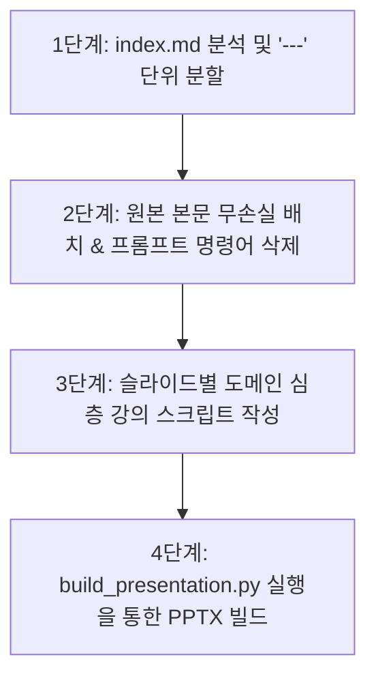

# 📑 마크다운 교재 $\rightarrow$ 강의 슬라이드(`slides.md`) 변환 표준 가이드라인

본 문서는 강화학습 교재의 마크다운 원고(`index.md`)를 분석하여, 고품질 강의 슬라이드 마크다운(`slides.md`)으로 변환하고 최종 프리젠테이션(`pptx`)을 제작하기 위한 **공식 변환 가이드라인(Standard Operating Procedure)**입니다.

---

## 🎯 1. 핵심 4대 원칙 (Core Principles)

### 1.1 `---` 구분자 기반 1:1 슬라이드 분할 원칙
- **분할 기준**: 원본 교재(`index.md`)에 이미 논리적으로 설계된 구분선(`---`)을 슬라이드의 개별 단위로 1:1 매핑합니다.
- **슬라이드 헤더 구조**:
  - `build_presentation.py` 컴파일러와 완벽히 호환되도록 각 슬라이드의 최상단에는 반드시 아래 두 가지 레벨 헤더가 위치해야 합니다.
    - `# [대단원 번호 및 제목]` (예: `# 09.1 몬테카를로법 기초`) $\rightarrow$ PPTX 상단 1행 스카이블루(17pt) 대단원 타이틀로 렌더링
    - `## [소단원 번호 및 슬라이드 제목]` (예: `## 09.1.0.1 알려진 환경 모델과 정밀한 바둑판`) $\rightarrow$ PPTX 상단 2행 다크네이비(28pt) 슬라이드 헤더로 렌더링

### 1.2 원본 텍스트·코드·수식 무손실 보존 (Zero Content Alteration)
- **임의 요약 및 축약 절대 금지**: 기존 교재 본문을 임의로 `핵심 포인트 1, 2`, `💡 핵심 인사이트`와 같은 3~4줄짜리 불릿 포인트로 축약하거나 개조식으로 변형하지 않습니다.
- **원본성 유지**: 원본 교재의 줄글 문단, LaTeX 수식(`$...$`, `$$...$$`), Python 코드 블록(```python ... ```), 인용구 및 캐릭터 대화는 원본 텍스트 그대로 슬라이드 본문 영역에 배치합니다.
- 학생과 청중은 슬라이드 화면을 통해 교재의 상세한 설명과 원본 코드를 온전히 읽고 이해할 수 있어야 합니다.

### 1.3 이미지 프롬프트 명령어 제거 및 캡션 간결화 (Clean Captions)
- **생성형 프롬프트 명령어 삭제**: 원본 교재의 이미지 캡션 또는 프롬프트에 남아있는 메타데이터 명령어를 슬라이드에서 전면 삭제합니다.
  - ❌ 삭제 대상: `(1:1 순백색)`, `(16:9 와이드)`, `순백색 배경`, `지브리 2D 스타일`, `초고화질 4K` 등 이미지 생성기 지시어 일체
- **간결한 교육용 캡션 정제**: 
  - `**그림 09-1-X** [도식의 핵심 개념을 간결하고 명확하게 전달하는 설명]` 형태로 정제합니다.

### 1.4 도메인 심층 30초 강의 스크립트 작성 (`> ` 인용 블록)
- **위치 및 서식**: 각 슬라이드의 맨 마지막(이미지/캡션 아래)에 `> ` 인용 블록으로 작성합니다.
- **분량**: 슬라이드당 약 30초 내외 (한국어 공백 포함 180자 ~ 320자 내외).
- **격식 및 인사말 일체 배제**:
  - ❌ `"안녕하세요"`, `"반갑습니다"`, `"감사합니다"`, `"수고하셨습니다"` 등 인사말 배제 (각 슬라이드별 반복 재생 및 독립 학습 보장).
  - ❌ `"이번 슬라이드는"`, `"다음 슬라이드에서"`, `"N번 슬라이드"` 등 슬라이드라는 단어 언급 금지.
- **도메인 중심의 쉬운 해설**:
  - 화면의 텍스트를 기계적으로 읽는 대본이 아닙니다.
  - 슬라이드에 표시된 도식, 수식, 코드의 핵심 메커니즘을 강화학습 도메인 지식(MDP, 가치 함수, 정책, 오차, 분산 등)을 바탕으로 청중이 가장 이해하기 쉬운 직관적 비유와 원리로 풀어 설명합니다.

---

## 📐 2. `slides.md` 표준 서식 구조

```markdown
# 09.1 몬테카를로법 기초
## 09.1.0.1 알려진 환경 모델과 정밀한 바둑판

우리가 지난 단원들에서 다루었던 강화학습 문제들은 모두 컴퓨터 화면 속의 정밀한 바둑판과 같았습니다. 

에이전트가 어떤 위치에서 어떤 행동을 취했을 때, 다음에 도달할 위치와 주어질 보상이 컴퓨터 메모리 안에 규칙으로 100% 투명하게 정의되어 있었습니다.

```python
# 환경 모델이 알려진 경우의 전이 규칙 예시
next_state = env.transition(state, action)
reward = env.reward(state, action)
```


**그림 09-1-1a** 컴퓨터 화면 속 정밀한 바둑판처럼 상태와 규칙이 100% 투명하게 정해져 있는 알려진 환경 모델

> 알려진 환경 모델은 마치 규칙이 투명한 체스판과 같습니다. 에이전트가 어떤 위치에서 특정 행동을 선택했을 때 다음 상태와 보상이 메모리에 완벽히 기록되어 있습니다. 따라서 에이전트는 실제로 환경을 밟아보지 않고도 머릿속 계산만으로 최적 경로를 계획할 수 있습니다.

---
```

---

## 🚀 3. 변환 및 빌드 4단계 워크플로우



### [1단계] `index.md` 구조 분석 및 구획 분할
1. 원본 `index.md`의 `---` 구분자를 기준으로 문단을 분할합니다.
2. 각 구획의 상위 대단원(`#`)과 현재 소주제(`##`)를 추출하여 슬라이드 첫머리에 배치합니다.

### [2단계] 원본 무손실 배치 및 이미지 캡션 정제
1. 본문 텍스트, 수식, 코드 블록, 인용구를 임의 축약 없이 그대로 복사합니다.
2. 이미지 캡션에서 `(1:1 순백색)`, `(16:9 와이드)` 등의 생성형 지시어를 정규식으로 자동 제거합니다.
3. 원본에 이미지가 있는 경우 `./img/파일명.png` 경로가 유효한지 확인합니다.

### [3단계] 맞춤형 강의 스크립트(`> `) 작성
1. 각 슬라이드의 학습 목표에 맞춰 180~320자 내외의 구어체 해설을 작성합니다.
2. 인사말 없이 바로 도메인 개념의 원리와 직관적 의미를 짚어줍니다.

### [4단계] PPTX 변환 및 검수
1. 아래 스크립트를 실행하여 최종 PPTX를 컴파일합니다.
   ```bash
   python3 /Users/hojin9/dev/jinysite/강화학습3/scripts/build_presentation.py [해당단원 디렉터리 경로]
   ```
2. 생성 결과:
   - 해당 단원 폴더 내 `[단원명].pptx` 생성 (커버 슬라이드 + 본문 슬라이드 + 엔딩 슬라이드)
   - `index.pptx`로 동기화 완료

---

## ✅ 4. 변환 품질 검수 체크리스트 (QA)

| 검수 항목 | 통과 기준 | 점검 방식 |
| :--- | :--- | :--- |
| **무손실성** | 원본의 설명 줄글, 수식, 코드가 누락되거나 불릿으로 요약되지 않았는가? | `index.md`와 `slides.md` 텍스트 비교 |
| **헤더 규격** | 각 슬라이드 상단에 `#`와 `##`가 정확히 1개씩 존재하는가? | `build_presentation.py` 파싱 에러 여부 확인 |
| **프롬프트 태그 제거** | `(1:1 순백색)` 등 이미지 생성기 명령어가 캡션에서 제거되었는가? | 정규식 검색 `\([0-9]:[0-9].*?\)` 미검출 확인 |
| **강의 스크립트** | 슬라이드마다 인사말 없는 도메인 해설(`> `)이 180~320자로 작성되었는가? | 글자 수 및 인사말(`안녕하세요` 등) 포함 여부 검사 |
| **커버 슬라이드** | 단원 전용 16:9 커버 이미지(`9_X_...png`)가 표지로 정상 적용되었는가? | PPTX 첫 장 전폭 이미지 확인 |
