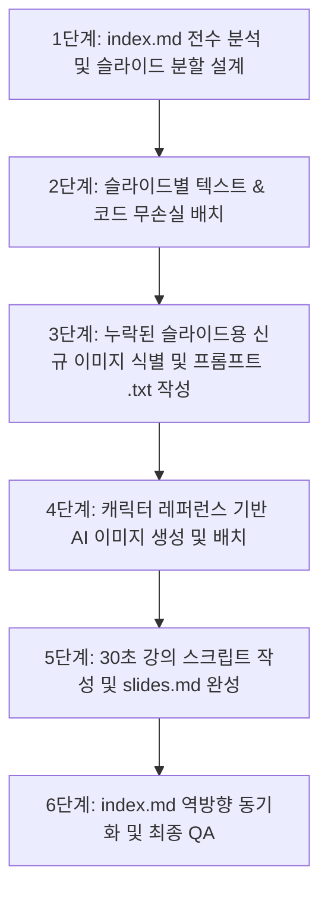

# 📑 마크다운 교재 $\rightarrow$ 슬라이드 분할 문서(`slides.md`) 변환 표준 가이드라인

본 문서는 강화학습 교재의 마크다운 원고(`index.md`)를 읽고, 고품질 강의 슬라이드 마크다운(`slides.md`)을 체계적이고 일관되게 제작하기 위한 **공식 변환 가이드라인(SOP)**입니다.

이 가이드를 준수하면 원본 텍스트의 손실 없이 모든 개념을 슬라이드로 분할하고, 100% 시각 자료와 30초 강의 스크립트를 갖춘 완벽한 강의 교안을 도출할 수 있으며, 개선된 내용을 다시 원본 교재(`index.md`)에 역반영하여 교재의 완성도를 지속해서 높일 수 있습니다.

---

## 🎯 1. 핵심 5대 원칙 (Core Principles)

### 1.1 무손실 원칙 (Zero Content Loss)
- **절대 요약/생략 금지**: 원본 교재의 줄글, 코드 블록, 수식, 주석, 비유를 임의로 축소하거나 생략하지 않습니다.
- **분할(Splitting)을 통한 해결**: 슬라이드 한 장에 담기에 내용이 많다면 요약하는 것이 아니라, **슬라이드를 2장, 3장으로 세분화(`---`)**하여 모든 내용을 빠짐없이 담아냅니다. 슬라이드 수가 많고 설명이 상세할수록 학생들의 학습 효과가 극대화됩니다.

### 1.2 모든 슬라이드 이미지 필수 포함 (100% Visual Coverage)
- **1 슬라이드 1 시각 자료**: 모든 슬라이드는 텍스트 설명과 함께 반드시 해당 개념을 직관적으로 보여주는 이미지를 포함해야 합니다.
- **이미지가 없는 경우 신규 생성**: 원본 교재에 이미지가 없는 슬라이드는 `prompt.md` 마스터 스타일 가이드에 따라 **신규 생성형 이미지(1:1 정사각, 지브리 2D 스타일, 순백색 `#FFFFFF` 컷아웃)**를 생성하여 배치합니다.
- **이미지 중복 배제**: 각 슬라이드의 맥락과 주제에 맞춤형으로 제작하여 시각적 중복을 방지합니다.

### 1.3 30초 맞춤형 강의 스크립트 (`> ` 블록)
- **분량**: 슬라이드당 약 30초 분량(한국어 기준 공백 포함 약 200~350자 내외)의 자연스러운 구어체 대본을 작성합니다.
- **역할 분담**: 화면 텍스트를 그대로 읽는 것이 아니라, 화면의 그림과 수식을 짚어주며 원리와 비유를 친절하게 설명합니다.
- **금지 표현**:
  - ❌ `"이번 슬라이드는"`, `"다음 슬라이드에서"`, `"N번 슬라이드"` 등 슬라이드라는 단어 일체 금지.
  - ❌ `"안녕하세요"`, `"감사합니다"` 등 오프닝/클로징 인사말 배제 (슬라이드별 독립 청취 및 반복 재생 지원).

### 1.4 생성형 이미지 제작 가이드 준수
- **가이드 경로**: `/Users/hojin9/dev/projects/dorothy/prompt.md`
- **캐릭터 시트 레퍼런스**: `/Users/hojin9/dev/projects/dorothy/data/images/`
- **인물 일관성**:
  - **이호진 교수님**: 40대 초반 동안의 피부, 주름 없음, 단정한 솔트앤페퍼 헤어, 얇은 메탈 안경, 무지 다크 네이비 폴로(로고/SNU 마크 절대 금지).
  - **도로시**: 4.5등신 치비, 구슬 방울 양갈래 땋은 머리, 'STEM HERO' 데님 오버롤, 빨간 운동화.
  - **토토**: 단색 크림화이트 모색, 하늘색 반다나.
  - **조교 지니**: 턱시도 냥이, 학사 미니 안경, 빨간 방울 목걸이.

### 1.5 역방향 동기화 (Bi-directional Sync to `index.md`)
- `slides.md`를 구성하면서 추가로 생성된 이미지나 더욱 명쾌하게 다듬어진 설명이 있다면, **반드시 원본 교재(`index.md`)에 역반영**합니다.
- **문서화 변환**: 역반영 시 강의 스크립트(구어체 대본)는 제거하고, 해당 해설을 자연스러운 **문서형 설명(문어체 줄글 해설)**으로 치환하여 `index.md` 본문에 보강 삽입합니다.

---

## 📐 2. `slides.md` 표준 서식 구조

```markdown
# 07.3 더 큰 문제를 향해
## 07.3.X [슬라이드 세부 소제목]

[슬라이드 화면에 노출될 본문: 코드 블록, 수식, 핵심 불릿 포인트]

- 핵심 포인트 1: 개념에 대한 명확한 서술
- 핵심 포인트 2: 동작 원리 및 메커니즘
- 💡 핵심 인사이트: 꼭 기억해야 할 한 줄 요약


> [강의 스크립트: 약 30초 분량의 자연스러운 구어체 설명. 화면의 도식과 코드를 짚어주며 친절한 톤으로 해설. 슬라이드라는 단어 및 인사말 배제.]

---
```

---

## 🚀 3. 변환 및 분할 6단계 워크플로우



### [1단계] `index.md` 전수 분석 및 슬라이드 분할 설계
1. 대단원(#), 중단원(##), 소단원(###), 코드 스텝(step1, step2...)을 기준으로 단락을 나눕니다.
2. 설명이 길거나 코드가 포함된 부분은:
   - `[개념 및 배경 슬라이드]` $\rightarrow$ `[코드 구현 슬라이드]` $\rightarrow$ `[코드 심층 분석 및 주의점 슬라이드]`
   와 같이 2~3장으로 적극 분할합니다.

### [2단계] 슬라이드별 텍스트 & 코드 무손실 배치
1. 원본 텍스트의 내용을 임의로 요약하지 않고 그대로 옮깁니다.
2. 긴 문장은 가독성을 위해 개조식 불릿 목록이나 깔끔한 문단으로 재배치합니다.

### [3단계 & 4단계] 신규 이미지 식별 및 AI 생성
1. 이미지가 배정되지 않은 슬라이드를 식별합니다.
2. `img/{image_name}.txt` 프롬프트 명세서를 작성하고, `prompt.md` 규격에 맞춰 `generate_image`를 실행합니다.
3. 생성된 이미지를 `img/{image_name}.png`로 복사하고 슬라이드에 연결합니다.

### [5단계] 30초 강의 스크립트 집필
1. 각 슬라이드의 학습 목표에 맞춰 200~350자 내외의 강의 대본을 작성합니다.
2. 학생이 질문할 만한 포인트("왜 이렇게 할까요?", "여기서 주의할 점은...")를 자연스럽게 짚어줍니다.

### [6단계] `index.md` 역방향 동기화
1. 슬라이드 작업 과정에서 새로 생성된 이미지(`*.png`)를 `index.md`의 적절한 위치에 삽입합니다.
2. 슬라이드 강의 스크립트에서 다룬 풍부한 해설 내용을 문어체 설명(`> [!NOTE]` 또는 일반 문단)으로 변환하여 `index.md`에 추가합니다.
3. 문서의 오탈자나 중복 문단을 바로잡아 교재의 완성도를 높입니다.

---

## ✅ 4. 최종 검수 체크리스트 (QA)

- [ ] **무손실 검증**: 원본 `index.md`의 모든 코드 라인, 수식, 개념이 `slides.md`에 누락 없이 반영되었는가?
- [ ] **100% 이미지 커버리지**: 단 하나의 슬라이드도 이미지 없이 텍스트만 덩그러니 남아있지 않은가?
- [ ] **30초 스크립트 준수**: 모든 슬라이드 하단에 `> ` 인용구로 200~350자의 강의 스크립트가 존재하는가?
- [ ] **금지어 배제**: 스크립트에 "슬라이드", "안녕하세요", "감사합니다"가 완전히 배제되었는가?
- [ ] **캐릭터 일관성**: 교수님(동안 40대, 무지 네이비 폴로, SNU 배제), 도로시(4.5등신, STEM HERO 오버롤)의 비주얼이 완벽히 유지되었는가?
- [ ] **역반영 완료**: 새로 추가된 이미지와 강화된 해설이 `index.md`에 문어체로 자연스럽게 역반영되었는가?
