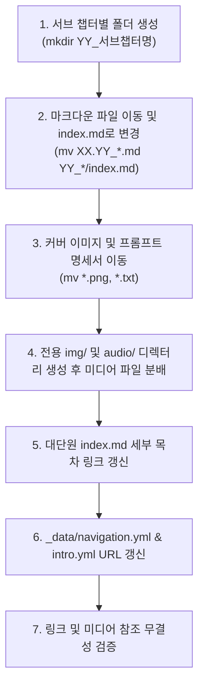

# 강화학습 강좌 폴더 및 파일 관리 표준 가이드

본 문서는 **《밑바닥부터 시작하는 딥러닝 4: 강화학습편》** 교재 및 온라인 강의 사이트의 각 대단원(챕터) 및 소단원(서브 챕터)을 체계적이고 일관성 있게 관리하기 위한 **디렉터리 구조 및 파일 관리 표준 가이드라인(SOP)**입니다.

기준 챕터인 **[02_확률과_기초수학](file:///Users/hojin9/dev/jinysite/강화학습3/src/02_확률과_기초수학)**의 폴더 구조를 모델로 삼아, 모든 강의 콘텐츠가 완벽한 모듈화 및 자립성(Self-contained)을 유지하도록 표준화합니다.

---

## 🏛️ 1. 핵심 설계 철학 (Core Principles)

```
┌───────────────────────────────────────────────────────────────────────────────┐
│ 1. SELF-CONTAINED SUBCHAPTERS (완전 독립형 서브 챕터 모듈화)                   │
│    - 각 서브 챕터는 전용 폴더 내에 마크다운(index.md), 전용 이미지(img/),    │
│      전용 음성(audio/), 커버 에셋(.png, .txt)을 자체 보유합니다.              │
│    - 다른 서브 챕터나 상위 공용 폴더에 의존하지 않으므로 이동 및 배포가 용이합니다.│
├───────────────────────────────────────────────────────────────────────────────┤
│ 2. CLEAN URLS VIA index.md (Jekyll 표준 인덱스 구조)                          │
│    - 모든 강의 본문 파일은 폴더 내 `index.md`로 표준화하여 생성합니다.         │
│    - 브라우저 및 정적 사이트에서 `/01_머신러닝_.../`와 같은 깔끔한 URL을 제공합니다. │
├───────────────────────────────────────────────────────────────────────────────┤
│ 3. RELATIVE PATH STABILITY (상대 경로 일관성 유지)                            │
│    - 본문 내 미디어 경로는 항상 `./img/파일명.png`, `./audio/파일명.mp3`처럼   │
│      현재 폴더 기준 상대 경로를 엄격히 준수합니다.                            │
└───────────────────────────────────────────────────────────────────────────────┘
```

---

## 📁 2. 표준 디렉터리 및 파일 계층 구조

모든 강좌 폴더는 대단원 챕터 폴더 아래에 독립된 소단원 서브 챕터 폴더들이 배치되는 2계층 트리 구조를 따릅니다.

```
src/
└── XX_챕터명/                               # [대단원] 메인 챕터 폴더 (예: 02_확률과_기초수학)
    ├── index.md                             # 대단원 인트로 및 세부 목차 안내 페이지
    ├── XX_챕터명.png                        # 대단원 16:9 와이드 메인 커버 이미지
    ├── XX_챕터명.txt                        # 대단원 커버 생성 프롬프트 규격서
    ├── img/                                 # 대단원 index.md에서 사용하는 이미지들
    │   └── jiny_dorothy_math_intro.png
    │
    ├── 01_서브챕터명/                       # [소단원] 제1강 서브 챕터 폴더
    │   ├── index.md                         # 제1강 본문 강의 콘텐츠
    │   ├── 01_서브챕터명.png                # 제1강 16:9 와이드 커버 이미지
    │   ├── 01_서브챕터명.txt                # 제1강 커버 생성 프롬프트 규격서
    │   ├── img/                             # 제1강 본문 전용 이미지 모음 (격리 보관)
    │   │   ├── concept_diagram.png
    │   │   └── example_flow.png
    │   ├── audio/                           # 제1강 본문 전용 대화 오디오 (옵션)
    │   │   ├── dialogue_1_1_scene1.mp3
    │   │   └── dialogue_1_1_scene2.mp3
    │   └── example_script.py                # 해당 강의 전용 실습 파이썬 코드 (옵션)
    │
    ├── 02_서브챕터명/                       # [소단원] 제2강 서브 챕터 폴더
    │   ├── index.md
    │   ├── 02_서브챕터명.png
    │   ├── 02_서브챕터명.txt
    │   ├── img/
    │   └── audio/
    │
    └── ...
```

---

## 🏷️ 3. 명명 규칙 (Naming Conventions)

### 3.1 챕터 및 서브 챕터 폴더명
- **대단원 챕터 폴더**: `XX_챕터명`
  - 두 자리 숫자(Zero-padded, `01_`, `02_`, ..., `14_`)로 시작합니다.
  - 부록(Appendix)의 경우 영문 대문자(`A_`, `B_`, `C_`, `D_`)로 시작합니다.
  - 공백 대신 언더스코어(`_`)를 사용합니다.
  - *예시: `01_강화학습이란`, `02_확률과_기초수학`, `10_TD법`, `A_오프-정책_몬테카를로법`*

- **소단원 서브 챕터 폴더**: `YY_서브챕터명`
  - 두 자리 순번(`01_`, `02_`, ..., `12_`) 또는 챕터 번호가 포함된 형식(`10_1_`, `10_2_`)을 규칙적으로 사용합니다.
  - *권장 형식*:
    - 챕터 내 순번: `01_머신러닝_딥러닝_강화학습_구분`, `02_왜_강화학습을_배워야_할까`
    - 장-절 번호 연동 시: `10_1_TD법으로_정책_평가하기`, `10_2_SARSA`

### 3.2 파일명 규격
| 파일 종류 | 표준 파일명 | 설명 |
| :--- | :--- | :--- |
| **강의 본문** | `index.md` | Jekyll 빌드 시 폴더명 기반의 깔끔한 URL 생성 |
| **커버 이미지** | `<폴더명>.png` | 폴더명과 동일한 파일명의 16:9 와이드 커버 이미지 (1376×768) |
| **커버 프롬프트** | `<폴더명>.txt` | 커버 이미지 생성 프롬프트 및 메타데이터 명세서 |
| **이미지 폴더** | `img/` | 본문 마크다운에서 참조하는 이미지 파일들 |
| **음성 폴더** | `audio/` | 본문 마크다운에서 재생하는 오디오 mp3 파일들 |

---

## 🖼️ 4. 미디어 격리 및 참조 규칙 (Media Isolation)

### 4.1 이미지 자립 보관 원칙
- **금지 사항**: 모든 강의 이미지를 상위 폴더의 단일 `img/`에 한데 모아 관리하는 방식은 파일 누적 시 종속성 추적과 유지보수가 불가능해집니다.
- **표준 규칙**:
  - 각 서브 챕터의 `index.md`가 사용하는 이미지는 해당 서브 챕터 내부의 `img/` 폴더에만 배치합니다.
  - 대단원 메인의 `index.md`가 사용하는 대표 인트로 이미지만 대단원 루트의 `img/` 폴더에 배치합니다.

### 4.2 마크다운 미디어 링크 작성법
서브 챕터 `index.md` 내부에서는 항상 현재 디렉터리 기준의 상대 경로를 작성합니다.

```markdown
<!-- 이미지 삽입 (상대 경로 ./img/) -->

**그림 1-1** 도로시에게 세 가지 신비로운 마법 렌즈를 건네주는 지니와 토토

<!-- 오디오 플레이어 (상대 경로 ./audio/) -->
<audio src="./audio/dialogue_1_1_scene1.mp3" preload="none"></audio>
```

---

## 🌐 5. 사이트 네비게이션 및 목차 동기화

서브 챕터 구조를 개편할 때는 사이트 전체의 네비게이션 파일과 대단원 인덱스 목차를 함께 업데이트해야 합니다.

### 5.1 대단원 `index.md` 세부 목차 링크
대단원 메인 페이지에서 각 서브 챕터를 연결할 때, 폴더 경로 또는 `index.html`을 명시합니다.

```markdown
### [01.1 AI의 세 가지 마법: 머신러닝, 딥러닝, 강화학습 구분하기](./01_머신러닝_딥러닝_강화학습_구분/index.html)
### [01.2 왜 강화학습을 공부해야 할까?](./02_왜_강화학습을_배워야_할까/index.html)
```

### 5.2 `_data/navigation.yml` 메뉴 등록
사이드바 및 전역 네비게이션에서 폴더 단위의 슬래시(`/`) 종료 URL로 매핑합니다.

```yaml
  - title: "1강 강화학습이란?"
    url: "/01_강화학습이란/"
    subitems:
      - title: "01.1 AI의 세 가지 마법: 머신러닝, 딥러닝, 강화학습 구분하기"
        url: "/01_강화학습이란/01_머신러닝_딥러닝_강화학습_구분/"
      - title: "01.2 왜 강화학습을 공부해야 할까?"
        url: "/01_강화학습이란/02_왜_강화학습을_배워야_할까/"
```

### 5.3 `_data/intro.yml` (필요 시)
인트로 네비게이션 파일이 분리되어 있는 경우 동일하게 폴더 URL로 정렬합니다.

```yaml
main:
  - title: "1강 강화학습이란?"
    url: "/01_강화학습이란/"
  - title: "01.1 머신러닝, 딥러닝, 강화학습 구분"
    url: "/01_강화학습이란/01_머신러닝_딥러닝_강화학습_구분/"
```

---

## 🔄 6. 기존 단일 폴더 챕터의 표준 마이그레이션 절차 (7-Step SOP)

상위 폴더에 여러 강의 파일이 평면적으로 나열되어 있던 기존 챕터를 표준 구조로 전환하는 작업 절차입니다.



### 체크리스트:
- [ ] 서브 챕터 폴더마다 `index.md`, `<서브챕터>.png`, `<서브챕터>.txt`, `img/`, `audio/`가 완비되었는가?
- [ ] 본문 마크다운 내 이미지(``)와 오디오(`<audio>`) 태그가 깨짐 없이 작동하는가?
- [ ] 상위 대단원 폴더에 불필요하게 남아있는 고아(Orphan) 파일이 정리되었는가?
- [ ] 사이트 네비게이션 클릭 시 404 없이 해당 서브 챕터 페이지로 정확히 이동하는가?
