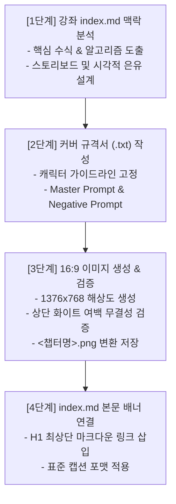

# 강화학습 교재 16:9 챕터 커버 생성 및 표준화 가이드

본 문서는 **《밑바닥부터 시작하는 딥러닝 4: 강화학습편》** 교재 및 온라인 강의 사이트의 **각 챕터별 16:9 와이드스크린 커버 이미지**를 일관된 세계관(도로시 탐험대 & 스튜디오 지브리 2D 애니메이션 화풍)에 맞추어 기획·설계·생성하기 위한 표준 작업 절차서(SOP)입니다.

---

## 📌 1. 개요 및 핵심 설계 원칙

### 1.1 작업 목적
1. **강의 콘텐츠와 유기적으로 결합된 대표 비주얼 구축**:
   - 각 장의 본문(`index.md`) 내용과 수학적 맥락을 정밀 분석하여, 난해한 이론을 직관적이고 친근한 시각적 은유(Visual Metaphor)로 구현합니다.
2. **파워포인트(PPTX) 및 슬라이드 편집 호환성 확보**:
   - 생성형 이미지 자체에 챕터 제목, 번호, 텍스트 배너를 인쇄하지 않고, **상단 영역을 100% 순백색(`#FFFFFF`) 여백**으로 유지합니다.
   - 강의자가 추후 PPT나 키노트에서 편집 가능한 텍스트 상자(타이포그래피)를 자유롭게 배치할 수 있도록 설계합니다.
3. **영구적인 비주얼 및 캐릭터 일관성 유지**:
   - 이호진 교수님, 도로시, 토토, 조교 지니의 외형, 비율, 소품, 배치가 모든 챕터에서 완벽한 일관성을 유지하도록 규격화합니다.

---

## 🏛️ 2. 핵심 3대 불변 규칙 (Three Non-Negotiable Rules)

```
┌────────────────────────────────────────────────────────────────────────┐
│  1. STRICT ZERO UPPER TITLE TEXT (상단 타이포그래피 완전 배제)         │
│     - 이미지 상단(y: 0~120px)에는 어떠한 챕터 제목, 영문/한글 헤드라인,│
│       간판 배너도 넣지 않으며, 100% 순수 솔리드 화이트(#FFFFFF) 유지. │
├────────────────────────────────────────────────────────────────────────┤
│  2. STRICT ZERO CHALKBOARD (구형 칠판 및 분필 완전 배제)               │
│     - 녹색/월넛 우드 칠판, 분필가루, 분필 받침대를 일체 배제.          │
│     - 천칭 저울, 3D 그리드 블록, 홀로그램 루프, 주판 등 현대적 교구 활용.│
├────────────────────────────────────────────────────────────────────────┤
│  3. STRICT FACIAL & CHARACTER CONSISTENCY (이호진 교수님 얼굴 보존)    │
│     - 11_3_신경망.png 및 공식 데이터셋(/dataset/hojin)의 조형을 100%   │
│       영구 보존 (40대 초반 성인 동안, 7:3 은빛 가르마, 얇은 메탈 안경).│
└────────────────────────────────────────────────────────────────────────┘
```

---

## 🔄 3. 표준 작업 워크플로우 (4-Step Pipeline)

모든 강좌별 커버 작업은 반드시 다음 4단계를 순서대로 거치며 진행합니다.



---

### Step 1. 강의 콘텐츠 (`index.md`) 맥락 분석 및 스토리보드 기획
- 해당 폴더의 `index.md` 본문을 정독하여 다음 요소를 추출합니다:
  - **핵심 수학 공식**: 예) 벨만 방정식 $V(s) = R + \gamma V(s')$, 정책 경사 정리 $\nabla_\theta J(\theta)$, 중요도 샘플링 비 $\rho$ 등.
  - **학습 핵심 개념**: 예) 탐색과 이용의 딜레마, 마르코프 성질(비기억성), 환경과의 피드백 루프 등.
  - **캐릭터별 역할 배분**:
    - **도로시 (Center)**: 직접 알고리즘을 수행하거나 선택을 내리는 주인공 에이전트.
    - **토토 (Center-Right)**: 도로시 곁에서 활기차게 반응하며 학습의 긍정적 피드백을 표현.
    - **조교 지니 (Left Desk)**: 목재 책상에서 연산, 기록, 장부 정리, 다이얼 조작을 담당하는 든든한 조교.
    - **이호진 교수님 (Right)**: 전체 연구실 풍경을 조망하며 제자들을 격려하는 멘토(Thumbs-up 포즈).

---

### Step 2. 프롬프트 규격서 (`<챕터명>.txt`) 작성
- 커버 이미지를 생성하기 전, 반드시 대상 디렉토리에 **동일한 이름의 `.txt` 규격서**를 작성합니다.
- 예: `06_벨만_방정식/06_벨만_방정식.txt`, `14_1_심층_강화_학습_알고리즘_분류/14_1_심층_강화_학습_알고리즘_분류.txt`
- 규격서 파일은 아래 **5. 표준 규격서 템플릿**의 구조를 100% 준수해야 합니다.

---

### Step 3. 16:9 와이드스크린 이미지 생성 및 품질 검증
- **해상도**: `1376 × 768` 픽셀 (16:9 와이드스크린 비율).
- **포맷**: 고화질 무손실 `PNG` 포맷 (`<챕터명>.png`).
- **상단 여백 검증**:
  - 생성된 이미지의 상단 직사각형 영역(`y: 0~120px, x: 0~1000px`) 내에 어두운 텍스트 픽셀이 없는지 파이썬 스크립트로 검증합니다.
  - 상단 평균 밝기가 250 이상이어야 하며, 텍스트나 아티팩트가 발견될 경우 재생성 또는 클리닝을 거칩니다.

---

### Step 4. 본문 문서 (`index.md`) 최상단 배너 및 캡션 연결
- `index.md` 문서 최상단 H1 제목 바로 아래에 아래 표준 마크다운을 삽입합니다:

```markdown
# 6강 벨만 방정식


**그림 06-Intro** 현재 가치와 즉시 보상 및 할인된 미래 가치의 완벽한 수평 균형을 정의하는 벨만 방정식 (이호진 교수와 도로시 탐험대)

---
```

---

## 👥 4. 등장인물 표준 설정 및 디자인 스펙

모든 커버 일러스트레이션은 다음 인체 비례와 복장 규정을 엄격히 준수합니다:

| 캐릭터 | 위치 & 체형 | 시각적 특징 및 복장 규정 | 챕터 내 고정 역할 |
| :--- | :--- | :--- | :--- |
| **이호진 교수님<br>(Professor Hojin)** | **우측 (Right)**<br>7등신 성인 남성<br>(Early 40s) | • 11_3_신경망.png 얼굴형 100% 유지 (소년/노안 금지)<br>• 단정한 7:3 가르마 숏 컷 + 관자놀이 은빛 스트릭<br>• 슬림 실버 라운드 메탈 와이어테 안경<br>• 무로고 솔리드 다크 차콜 네이비 폴로 셔츠 (`#1F242C`)<br>• 중청 데님 청바지 (`#3F638A`) & 그레이 스니커즈<br>• 한 손은 주머니, 한 손은 따뜻한 엄지 척(Thumbs-up) | 학문적 원리를 지도하고<br>제자들의 도전을<br>자랑스럽게 격려하는 멘토 |
| **도로시<br>(Dorothy)** | **중앙 (Center)**<br>4.5등신<br>(10세 소녀) | • 밤색 양갈래 땋은 머리와 빨간 리본<br>• 반짝이는 헤이즐럿 눈동자와 생기 있는 표정<br>• 오렌지/노랑 줄무늬 반팔 티셔츠 + 파란 데님 멜빵바지<br>• 빨간 캔버스 스니커즈 | 직접 수식을 조작하고<br>경험을 탐색하는<br>호기심 가득한 에이전트 |
| **토토<br>(Toto)** | **중앙-우측**<br>소형견 | • 복슬복슬한 우윳빛 비숑 프리제 (`#FBF6EB`, 점박이 없음)<br>• 밝은 스카이블루 스카프(반다나) 착용<br>• 밝게 웃으며 꼬리를 흔들고 도로시와 함께 달림 | 탐험의 즐거움과<br>보상 획득의 기쁨을<br>함께 나누는 마스코트 |
| **조교 지니<br>(Assistant Jiny)** | **좌측 책상 (Left)**<br>턱시도 고양이<br>(유일한 고양이) | • 올리브빛 눈동자, 핑크 코, 깔끔한 턱시도 무늬<br>• 미니 라운드 학자 안경 + 골드 방울이 달린 빨간 칼라<br>• 클래식 목재 공부 책상에 착석 | 수치 계산, 주판 알 튕기기,<br>장부 기록, 다이얼 조작,<br>수학 증명 검증 보좌 |

---

## 📝 5. 프롬프트 규격서 (`.txt`) 표준 템플릿

아래 템플릿의 `[챕터 정보]` 및 `[구체적 연출 장면]`을 챕터 내용에 맞게 치환하여 사용합니다.

```text
# Chapter [번호]: [영문명] ([국문명]) YouTube 16:9 Cover Specification & Prompt
# File: [챕터파일명].png (16:9 widescreen ratio, 1376x768)
# Guide Standard: /Users/hojin9/dev/jinysite/강화학습3/guides/커버생성_가이드.md
# Reference Dataset: /Users/hojin9/dev/projects/dorothy/data/dataset/hojin & 11_3_신경망.png (Professor Hojin Facial Style)
# Content Source: /Users/hojin9/dev/jinysite/강화학습3/src/[디렉토리명]/index.md

================================================================================
[1. 이호진 교수님 얼굴 데이터셋 및 11_3 스타일 참조 유의사항 (Facial Consistency Guidelines)]
================================================================================
본 챕터 일러스트레이션의 이호진 교수님(Professor Hojin)은 11_3_신경망.png 및 공식 데이터셋
(/Users/hojin9/dev/projects/dorothy/data/dataset/hojin)의 얼굴 조형을 100% 영구 보존해야 합니다:

1. 얼굴 조형 및 성인 동안 유지 (Anti-Aging & Adult Male Anatomy):
   - 참조 기준: 11_3_신경망.png 원본의 스마트하고 지적인 얼굴형과 이목구비 완전 일치.
   - 신체 비율: 정확한 7등신(7 heads tall) 성인 남성 2D 애니메이션 비율 (절대 소년/치비 체형 금지).
   - 연령대: 40대 초반의 지적이고 건강한 성인 남성 (Early 40s adult Korean professor).
   - 안면 특징: 10대 소년 같은 둥근 얼굴이나 거대한 만화 눈망울을 엄격히 배제하고, 지적이고 온화한 성인 인상 유지.
   - 피부결: 잔주름, 팔자주름, 눈가 처짐(eye bags), 노안 인상이 일체 없는 매끄럽고 건강한 웜톤 살구빛 피부 (#FEEFE6 / #F5CEBA).
   - 턱선 및 윤곽: 갸름하면서도 단정하고 신뢰감을 주는 스마트한 성인 턱선.

2. 헤어스타일 (Hairstyle):
   - 스타일: 세련된 7:3 가르마 숏 컷 (Stylishly parted short hair with forehead exposed).
   - 색상: 자연스러운 다크 차콜 흑발 베이스 (#2C2D30)에 이마 양옆과 구레나룻에 뚜렷하게 섞인 은빛 솔트앤페퍼 스트릭 (#8C9098).

3. 안경 (Glasses):
   - 스티브 잡스 스타일의 슬림하고 얇은 실버 라운드 메탈 와이어테 안경 (Thin minimalist round metal wire-rim glasses, #9EA7B0).
   - 렌즈 투과율이 높아 눈동자를 가리지 않으며, 두꺼운 뿔테나 사각/검은 테 안경 엄격 금지.

4. 눈 & 온화한 표정 (Eyes & Expression):
   - 깊고 지적인 밤색/에스프레소 브라운 눈동자 (Kind warm brown eyes, #422A1D).
   - 제자들을 대견하게 바라보며 부드럽게 반달형으로 가늘어지는 따뜻한 눈매 (성인 멘토의 신뢰감 있는 미소).
   - 권위적이거나 엄격하지 않고, 친근한 멘토로서의 따뜻함.

5. 복장 및 로고 금지 (Strict No SNU / Plain Outfit Rule):
   - 어떠한 대학 마크('SNU'), 기업 로고, 명찰, 배지도 일체 없는 순수 단색 솔리드 다크 차콜 네이비 반팔 폴로 셔츠 (#1F242C).
   - 클래식 스트레이트 핏 중청 데님 청바지 (#3F638A) 및 뉴발란스 모티브의 레트로 그레이 스웨이드 스니커즈 (#7F8287).

6. 상단 간판/칠판 배제와 자연스러운 멘토 자세 (Zero Blackboard & Natural Mentor Pose):
   - 칠판에 분필로 글씨를 쓰거나 허공에 칠판 배너를 배치하는 일체의 연출을 전면 배제.
   - 한 손은 청바지 주머니에 넣고, 다른 손은 제자들을 향해 따뜻한 '엄지 척(Thumbs-up)' 격려를 취함.

7. 상단 강의 텍스트 및 챕터 타이틀 절대 배제 (Strict Zero Lecture / Chapter Title Text Rule):
   - 이미지 상단 여백에 강의 제목, 챕터 타이틀, 영문 헤드라인 텍스트 일체 표기 금지 (PPT 편집용 순수 여백 확보).
   - 캐릭터 머리 위쪽 공간 전체는 타이포그래피 없이 완전히 비어 있는 100% 순수 솔리드 화이트(#FFFFFF) 여백으로 유지.

================================================================================
[2. 최종 이미지 생성 실행 프롬프트 (Master Production Prompt)]
================================================================================
Studio Ghibli 2D anime style, 2D animation aesthetic, clean crisp dark espresso brown line art (#26211E), warm vibrant flat cel shading, storybook educational illustration, masterpiece, highly detailed. Grand 16:9 wide educational concept illustration for Chapter [번호]: [주제 설명]. STRICT RULE: ABSOLUTELY NO text, NO chapter title, NO lecture headline at the top of the image; the upper area above characters must be completely pure empty solid white space (#FFFFFF). CRITICAL: Exactly ONE man in the entire image.
On the right, Professor Hojin: EXACTLY matching the facial appearance, hairstyle, and head shape from 11_3_신경망.png. An adult Korean male engineering professor in his early 40s, 7 heads tall adult proportions (NOT a young boy, NOT teenage), dignified and handsome mature face with smooth healthy skin, stylish neatly parted 7:3 short dark hair with clear visible silver salt-and-pepper streaks along the sides and temples, thin minimalist round metal wire-rim glasses, kind intelligent narrow warm brown eyes with a gentle crinkle, and a proud warm encouraging mentor smile. He wears a plain solid dark charcoal navy short-sleeve collared polo shirt with NO badges or logos, medium-wash blue denim jeans, and classic grey suede sneakers. He stands confidently with one hand in his pocket and gesturing gently with an encouraging thumbs-up toward Dorothy.
In the center, Dorothy: an energetic 10-year-old girl with twin brown pigtails in red ribbons, bright sparkling hazel eyes, coral-orange striped t-shirt under classic blue denim overalls, and red sneakers. [도로시의 구체적 동작 및 조작 소품 묘사]. Next to her, Toto: an adorable fluffy white bichon frise puppy with a bright sky-blue neck bandana, [토토의 반응 묘사].
On the left, Jiny: a charming tuxedo cat wearing small round glasses and a red bell collar, sitting at a classic wooden study desk, [지니의 계산/기록 소품 묘사].
Clean solid pure white background (#FFFFFF) with subtle soft floor contact shadows under feet. Bright, insightful, and academically inspiring atmosphere.
NEGATIVE PROMPT: top title text, lecture header text, chapter title text, typography at top, headline text, words above characters, chalkboard, blackboard, green board, chalk tray, writing on board, SNU, logo, multiple adult men, realistic photo, 3D render, elderly facial features, wrinkles, facial hair.
ASPECT RATIO: 16:9 widescreen (1376x768).
```

---

## 🛠️ 6. 파이썬 품질 검증 및 규격 변환 스크립트

새로운 커버 이미지를 생성한 후, 아래 파이썬 코드를 실행하여 **해상도**, **상단 텍스트 유무**, **무손실 PNG 변환**을 자동으로 검증·수행합니다.

```python
from PIL import Image
import numpy as np
import os

def verify_and_save_cover(src_image_path, target_png_path):
    assert os.path.exists(src_image_path), f"소스 파일 누락: {src_image_path}"
    
    img = Image.open(src_image_path)
    arr = np.array(img)
    
    # 1. 해상도 검증 (1376 x 768)
    assert img.size == (1376, 768), f"해상도 불일치: {img.size} (요구치: 1376x768)"
    
    # 2. 상단 타이틀 텍스트 제로 검증 (y: 0~120px, x: 0~1000px)
    top_area = arr[:120, :1000, :3]
    non_white = np.where((top_area[:, :, 0] < 240) | 
                         (top_area[:, :, 1] < 240) | 
                         (top_area[:, :, 2] < 240))
    non_white_count = len(non_white[0])
    
    print(f"[{os.path.basename(target_png_path)}]")
    print(f"  • 해상도: {img.size[0]}x{img.size[1]} (16:9 Widescreen)")
    print(f"  • 상단 여백 비백색 픽셀 수: {non_white_count} (기준치: 0)")
    
    if non_white_count > 0:
        print("  ⚠️ 경고: 상단 여백에 텍스트 또는 그림자가 감지되었습니다. 확인 필요.")
    else:
        print("  ✅ 완벽: 상단 여백이 100% 순수 화이트(#FFFFFF)로 비어 있습니다.")
        
    # 3. 무손실 PNG 저장
    img.save(target_png_path, format="PNG")
    print(f"  💾 저장 완료 -> {target_png_path}\n")

# 사용 예시:
# verify_and_save_cover("artifact_path.jpg", "src/06_벨만_방정식/06_벨만_방정식.png")
```

---

## 🎯 7. 체크리스트 (작업 완료 확인용)

새로운 강좌 커버 작업을 완료하기 전 아래 체크리스트를 최종 확인합니다:

- [ ] 해당 디렉토리에 `<챕터명>.txt` 규격서 파일이 생성되었는가?
- [ ] `index.md` 본문의 수학적 정의 및 메타포가 프롬프트에 정확히 반영되었는가?
- [ ] 이호진 교수님의 얼굴이 `11_3_신경망.png` 기준의 40대 초반 성인 동안형 7등신으로 일치하는가?
- [ ] 녹색 분필 칠판, 분필 홀더, 칠판 배너가 완전히 배제되었는가?
- [ ] 상단 인물 위쪽 공간에 타이틀 텍스트가 일체 없는 순수 화이트(`#FFFFFF`) 여백인가?
- [ ] 출력 파일이 `1376 × 768` 해상도의 `.png` 파일로 저장되었는가?
- [ ] `index.md` 최상단 H1 제목 바로 아래에 `` 마크다운 링크와 캡션이 정상 등록되었는가?
