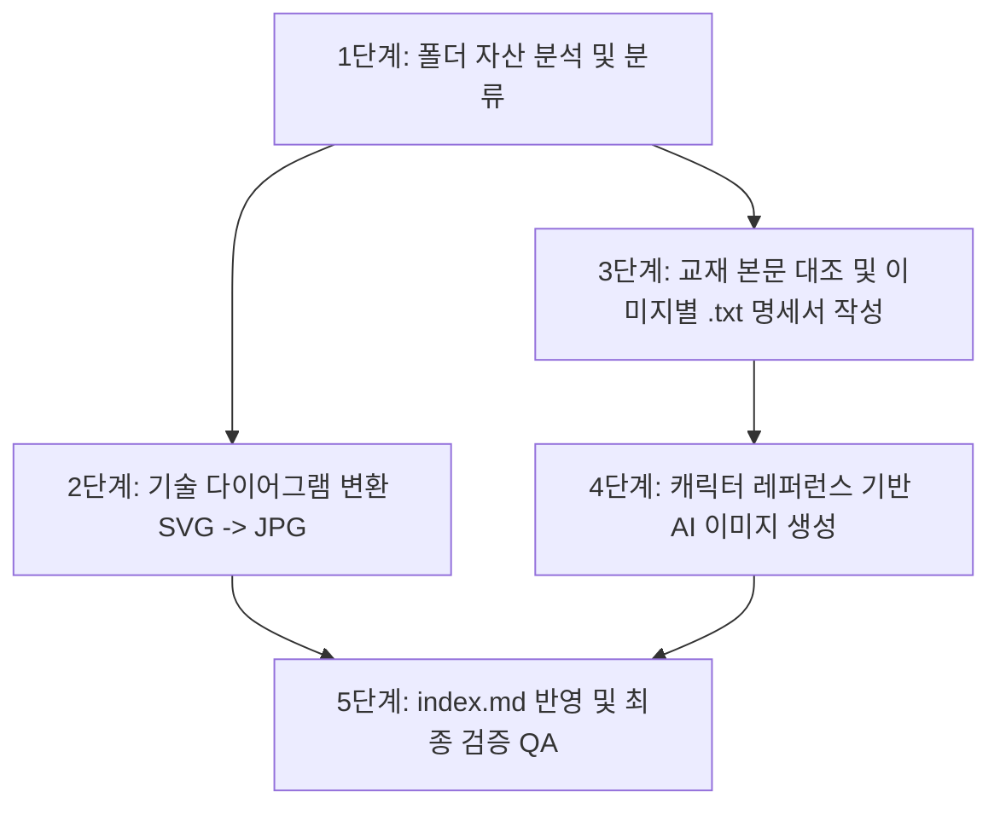

# 강화학습 교재 학습 이미지 개선 및 표준화 작업 가이드

본 문서는 **강화학습 교재 시리즈의 시각 자료 및 생성형 삽화**를 표준화된 스타일(도로시 프로젝트 세계관 및 지브리 2D 애니메이션 화풍)에 맞추어 일관되게 분석·개선·재생성하기 위한 표준 작업 절차서(SOP)입니다.

---

## 📌 1. 작업 개요 및 핵심 원칙

### 1.1 작업 목적
- **비주얼 일관성 확보**: 단원마다 상이하거나 분산된 화풍을 스튜디오 지브리 2D 애니메이션 스타일로 통일.
- **캐릭터 아이덴티티 유지**: 이호진 교수님, 도로시, 토토, 조교 지니의 외형, 복장, 성격 특성을 챕터 전반에서 완벽하게 유지.
- **교육적 전달력 극대화**: 텍스트만으로 이해하기 어려운 수학식, 알고리즘 흐름, 코드 패턴을 직관적인 시각적 은유(Metaphor)로 시각화.
- **포맷 표준화**:
  - 수학/코드/알고리즘 수치 다이어그램: 고해상도 `JPG` (300 DPI 렌더링).
  - 서사/개념 설명형 일러스트: 순백색 배경의 1:1 정사각 `PNG` (단색 `#FFFFFF` 컷아웃).

### 1.2 핵심 레퍼런스 경로
- **스타일 마스터 가이드**: `/Users/hojin9/dev/projects/dorothy/prompt.md`
- **캐릭터 시트 레퍼런스**: `/Users/hojin9/dev/projects/dorothy/data/images/`
  - `hojin_character_sheet.jpg` (이호진 교수님 시트)
  - `dorothy_character_sheet.jpg` (도로시 시트)
  - `toto_character_sheet.jpg` (토토 시트)
  - `jiny_character_sheet.jpg` (조교 지니 시트)
  - `hojin_dorothy_mentoring.jpg` (교수님-도로시 멘토링 구도)

---

## 🚀 2. 전체 작업 워크플로우 (5단계)



---

## 🛠️ 3. 단계별 세부 수행 가이드

### [1단계] 이미지 자산 분석 및 분류
해당 챕터의 `img/` 디렉터리에 존재하는 모든 이미지 파일을 두 가지 유형으로 분류합니다.

1. **기술/수치 다이어그램 (Technical Diagrams)**
   - 예: Matplotlib 그래프, 격자 가치 히트맵, 신경망 구조도, 계산 테이블 등.
   - 주로 `fig_XX_YY.svg` 또는 `fig_XX_YY.png` 형태.
2. **개념/서사형 생성 일러스트 (Storybook Illustrations)**
   - 예: 도로시의 모험, 교수님의 칠판 강의, 조교 지니의 안내 등.
   - 주로 시맨틱한 영문 파일명(예: `action_space_meaning.png`, `reward_map_visual.png` 등).

---

### [2단계] 기술 다이어그램 변환 및 마크다운 정리 (SVG $\rightarrow$ JPG)
웹 렌더링 성능과 호환성을 위해 벡터 다이어그램을 고품질 JPG로 변환하고 기존 SVG/PNG는 정리합니다.

1. **SVG $\rightarrow$ 고해상도 JPG 일괄 변환 (Headless Chrome 사용, 한글 폰트 완벽 지원)**:
   > ⚠️ **주의**: macOS 환경에서 `cairosvg` 사용 시 시스템 한글 폰트(Apple SD Gothic Neo 등)를 인식하지 못해 한글 텍스트가 네모 박스(`□□`)로 깨지는 치명적인 문제가 발생합니다. 따라서 시스템 폰트를 100% 지원하는 **Headless Chrome 렌더링 방식**을 사용해야 합니다.
   ```bash
   python3 -c "
   import glob, os, subprocess, re
   from PIL import Image

   for svg_path in sorted(glob.glob('img/fig_*.svg')):
       jpg_path = os.path.splitext(svg_path)[0] + '.jpg'
       with open(svg_path, 'r', encoding='utf-8') as f:
           svg_content = f.read()
       
       vb_match = re.search(r'viewBox=[\"\']([0-9\.\s-]+)[\"\']', svg_content)
       if vb_match:
           parts = [float(x) for x in vb_match.group(1).split()]
           vb_w, vb_h = parts[2], parts[3]
       else:
           vb_w, vb_h = 800, 600
       
       scale = 1600 / max(vb_w, vb_h)
       tw, th = max(200, int(round(vb_w * scale))), max(200, int(round(vb_h * scale)))
       
       html = f'<!DOCTYPE html><html><head><meta charset=\"utf-8\"><style>html,body{{margin:0;padding:0;width:{tw}px;height:{th}px;background:#FFF;overflow:hidden;}}svg{{width:{tw}px!important;height:{th}px!important;display:block;}}</style></head><body>{svg_content}</body></html>'
       tmp_html = f'/tmp/render_{os.path.basename(jpg_path)}.html'
       tmp_png = f'/tmp/render_{os.path.basename(jpg_path)}.png'
       with open(tmp_html, 'w', encoding='utf-8') as f: f.write(html)
       
       cmd = ['/Applications/Google Chrome.app/Contents/MacOS/Google Chrome', '--headless', '--disable-gpu', f'--window-size={tw},{th}', '--default-background-color=ffffffff', f'--screenshot={tmp_png}', f'file://{tmp_html}']
       subprocess.run(cmd, stdout=subprocess.DEVNULL, stderr=subprocess.DEVNULL, check=True)
       
       im = Image.open(tmp_png).convert('RGB')
       im.save(jpg_path, 'JPEG', quality=95)
       print(f'Converted {svg_path} -> {jpg_path} ({im.size})')
       if os.path.exists(tmp_html): os.remove(tmp_html)
       if os.path.exists(tmp_png): os.remove(tmp_png)
   "
   ```
2. **기존 파일 정리 및 교재 본문 링크 갱신**:
   - `img/fig_*.svg` 및 중복된 구버전 `img/fig_*.png` 삭제.
   - `index.md` 내의 이미지 링크를 `.svg` $\rightarrow$ `.jpg`로 수정:
     ```markdown
     <!-- 수정 전 -->
     
     <!-- 수정 후 -->
     
     ```

---

### [3단계] 교재 본문 대조 및 이미지별 `.txt` 명세서 작성
일러스트를 무작정 생성하지 않고, **교재 본문(`index.md`)의 설명 문맥과 코드를 분석하여 이미지당 1개의 `.txt` 명세서**를 작성합니다. (스타일이 바뀌더라도 전달해야 할 교육적 콘텐츠의 불변성을 유지하기 위함)

#### 📝 `.txt` 명세서 표준 템플릿
```markdown
# [이미지 분석 및 프롬프트 명세서] {파일명}.png

## 1. 교재 내 위치 및 교육적 맥락 (Pedagogical Context)
- 파일명: {파일명}.png
- 교재 챕터: {섹션 제목} (index.md 라인 번호)
- 캡션: {교재 내 캡션}
- 교육적 목표: {해당 삽화가 독자에게 전달해야 하는 핵심 개념}

## 2. 핵심 개념 및 시각적 은유 (Core Concept & Visual Metaphor)
- 핵심 개념: {이론적 개념}
- 시각적 은유: {상황 설정, 사물 은유, 등장인물 행동}
- 유지해야 할 필수 콘텐츠: {반드시 표현되어야 할 오브젝트}

## 3. 등장인물 캐스팅 및 서사적 역할 (Character Casting & Role)
- 이호진 교수님: {역할 및 취할 자세}
- 도로시: {역할, 표정, 동작}
- 토토 / 조교 지니: {동반자로서의 지원 동작}

## 4. 스타일 및 레이아웃 준수 규칙 (Style & Layout Rules)
- 화풍: 스튜디오 지브리 2D 애니메이션 스타일, 다크 에스프레소 클린 라인아트 (#26211E).
- 배경: 무결점 순백색 (#FFFFFF, Solid Pure White), 은은한 접지 그림자.
- 제약 사항: 프레젠테이션 테두리/박스 배제, 일본어 텍스트 금지.

## 5. 최종 이미지 생성 프롬프트 (Universal Master Prompt - English)
Studio Ghibli 2D anime style, 2D animation aesthetic, clean crisp dark espresso brown line art (#26211E), warm vibrant flat cel shading, storybook educational illustration, masterpiece, highly detailed. 
[상세 장면 설명 및 캐릭터 묘사...]
Pure solid clean white background (#FFFFFF), isolated presentation graphic cutout, subtle soft contact shadow at feet, perfectly centered, 1:1 square aspect ratio, no slide frames, no title banner, no text containers, no Japanese text.

## 6. 마스터 네거티브 프롬프트 (Universal Negative Prompt)
3d, photorealistic, realistic photograph, 3d cgi render, oil painting, rough pencil sketch, presentation slide frame, slide border, title banner, header text box, footer card, text containers, powerpoint template, dark background, complex outdoor background, room interior walls, blurry, low resolution, extra fingers, deformed hands, mutated limbs, garbled text, gibberish letters, kanji, hiragana, katakana, japanese text, wrinkles, old man, elderly, snu, snu badge, snu logo, name tag, brown spots on dog, multi-colored dog fur, duplicate cats, multiple cats, extra animals, watermark, signature
```

---

### [4단계] 캐릭터 레퍼런스 기반 AI 이미지 생성

`generate_image` 도구를 호출할 때 캐릭터 시트 이미지를 **`ImagePaths` 파라미터로 최대 3장까지 전달**하여 외형을 고정합니다.

#### 👥 캐릭터별 필수 묘사 규칙 (프롬프트 반영용)

| 캐릭터 | 필수 외형 프롬프트 키워드 | 절대 주의/금지 사항 (Negative) |
| :--- | :--- | :--- |
| **이호진 교수님**<br>*(Prof. Hojin)* | `youthful friendly Korean professor in his early 40s`, `smooth skin, no wrinkles`, `stylish salt-and-pepper hair`, `thin minimalist round metal wire-rim glasses`, `plain solid dark charcoal navy polo shirt with NO badges or logos`, `classic blue jeans, grey sneakers` | ❌ 노안, 깊은 주름, 흰머리 가득한 노교수<br>❌ 서울대 마크(`snu`, `snu badge`), 가슴 명찰<br>❌ 정장 정복, 화려한 패턴 셔츠 |
| **도로시**<br>*(Dorothy)* | `adorable 9-year-old anime girl`, `4.5 heads tall`, `chestnut twin pigtails tied with colorful round beads`, `orange striped short-sleeve t-shirt`, `blue denim overalls with 'STEM HERO' round chest patch`, `red canvas sneakers` | ❌ 성인 체형, 롱다리 모델 비율<br>❌ 땋은 머리 누락, 금발/흑발 변경<br>❌ 복장 임의 변경 |
| **토토**<br>*(Toto)* | `fluffy cream-white puppy`, `uniform solid milk-white coat, no spots`, `black button nose, cheerful brown eyes`, `sky-blue neckerchief bandana` | ❌ 갈색 얼룩, 갈색 푸들/골든리트리버<br>❌ 반다나 누락 또는 색상 변경 |
| **조교 지니**<br>*(Jiny the Cat)* | `chubby black-and-white tuxedo cat`, `olive-green eyes`, `tiny round wire scholar glasses`, `red collar with a small gold bell` | ❌ 줄무늬 치즈냥, 삼색냥<br>❌ 안경/방울 목걸이 누락<br>❌ 다수의 고양이 증식 |

#### 🖼️ 레퍼런스 이미지 조합 가이드
- **교수님 강의 씬**:
  `ImagePaths`: `['hojin_character_sheet.jpg', 'dorothy_character_sheet.jpg', 'hojin_dorothy_mentoring.jpg']`
- **도로시 단독 / 모험 씬**:
  `ImagePaths`: `['dorothy_character_sheet.jpg', 'toto_character_sheet.jpg', 'jiny_character_sheet.jpg']`
- **개념 시각화 / 서랍장 / 도구 은유 씬**:
  `ImagePaths`: `['dorothy_character_sheet.jpg', 'toto_character_sheet.jpg']`

#### 📂 생성된 이미지의 배포
1. 생성된 아티팩트(`.../brain/.../{ImageName}_{timestamp}.jpg`)를 확인합니다.
2. 타깃 챕터의 경로에 `png`로 복사합니다:
   ```bash
   cp /Users/hojin9/.gemini/antigravity-ide/brain/<ID>/<ImageName>_*.jpg /Users/hojin9/dev/jinysite/강화학습3/src/<챕터경로>/img/<ImageName>.png
   ```

---

### [5단계] 품질 검증 및 체크리스트 (QA)

모든 작업이 완료된 후 다음 체크리스트를 통해 최종 품질을 검수합니다:

- [ ] **배경 순백색 검증**: 회색 벽, 교실 벽지, 칠판 테두리 외곽 등이 배경을 채우지 않고 순수 `#FFFFFF` 단색으로 격리되어 있는가?
- [ ] **프레젠테이션 테두리 제거**: 파워포인트 슬라이드 창틀, 제목 배너 박스, 카드 테두리가 없는가?
- [ ] **교수님 얼굴 검증**: 40대 초반 동안의 피부와 단정한 헤어스타일인가? (노인 얼굴 및 SNU 로고 절대 배제)
- [ ] **도로시 복장/비율 검증**: 4.5등신 치비 비율과 오버롤 팬츠의 'STEM HERO' 패치, 빨간 운동화가 일치하는가?
- [ ] **토토/지니 검증**: 토토 모색이 단색 크림화이트인가? 지니가 턱시도 코트에 안경과 방울을 착용했는가?
- [ ] **텍스트 오염 검증**: 일본어(가나/한자)나 왜곡된 외계어 텍스트가 삽화 내에 생성되지 않았는가?
- [ ] **파일 일치성 확인**:
  - `img/*.txt` 명세서 파일이 누락 없이 모두 생성되었는가?
  - `img/*.png` 이미지가 고해상도(약 1MB 안팎)로 정상 갱신되었는가?
  - `index.md` 내의 다이어그램 확장자(`.jpg`) 및 이미지 캡션이 정확히 매핑되었는가?
