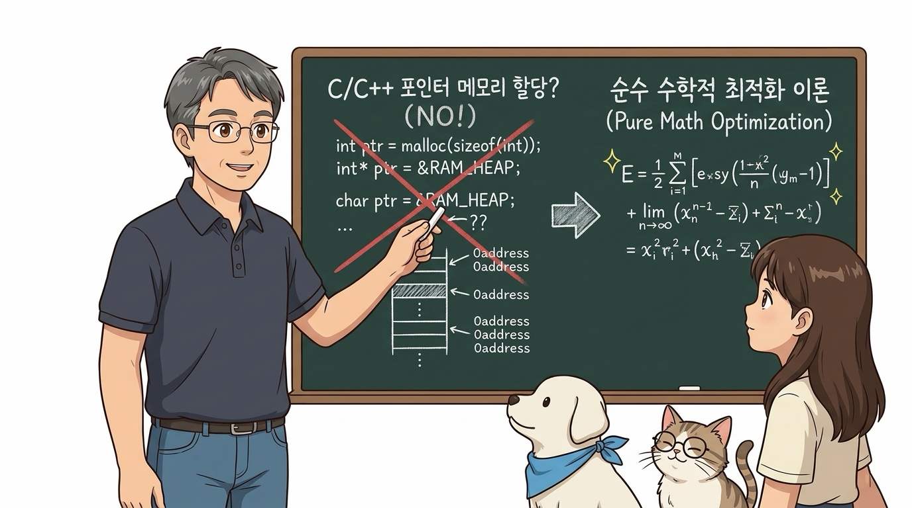
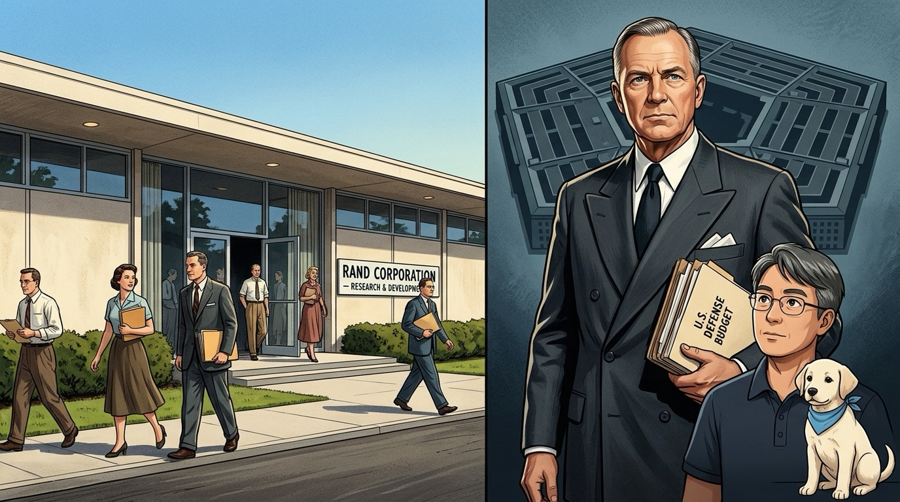
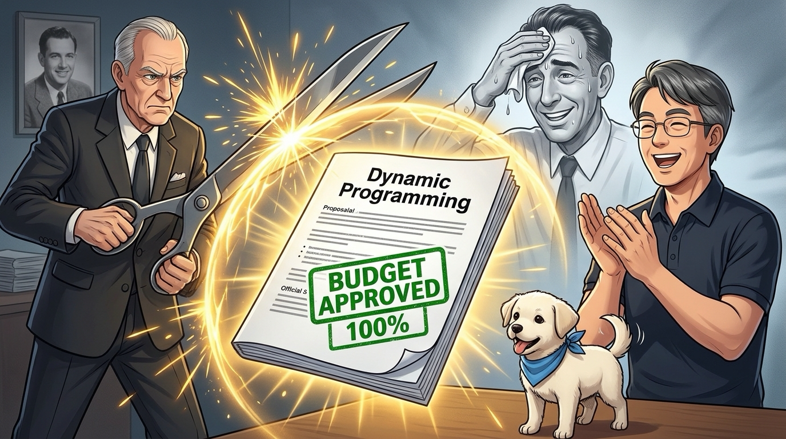
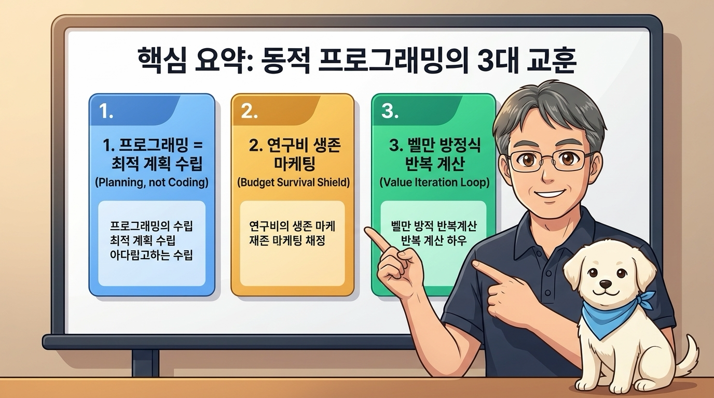

# 07.1 동적 프로그래밍의 유래

강화 학습과 컴퓨터 과학에서 가장 핵심적인 최적화 기둥으로 손꼽히는 **동적 프로그래밍(Dynamic Programming, DP)**이라는 용어는 처음 접하는 이들에게 왠지 모를 기술적 위압감을 줍니다. 많은 사람들이 컴퓨터 메모리를 동적으로 쪼개고 코드를 한 줄 한 줄 극한으로 최적화하는 복잡한 저수준 시스템 프로그래밍 기법을 먼저 연상하곤 합니다.

**그림 07-1-1** 동적 프로그래밍이라는 거창한 이름이 주는 첫인상과 저수준 코딩에 대한 기술적 위압감 (16:9 와이드)

하지만 놀랍게도 이 거창하고 신비로운 이름 뒤에는 1950년대 초, 최적 제어 이론의 대가인 **리처드 벨만(Richard Bellman)**이 미 국방부 장관의 서슬 퍼런 예산 삭감 칼바람으로부터 **자신의 수학 연구비를 지켜내기 위해 기발한 지혜(Public Relations)를 발휘했던 흥미진진한 생존 비화**가 숨어 있습니다.

**그림 07-1-2** 1950년대 수학자 리처드 벨만과 연구비를 지키기 위한 기상천외한 마케팅 비화 (16:9 와이드)

이번 절에서는 딱딱한 최적화 이론 뒤에 숨은 유쾌한 역사적 유래를 통해 동적 프로그래밍의 진정한 본질을 명쾌하게 파헤쳐 봅니다.

---

### 07.1.1 흔히 오해하는 '프로그래밍'의 이미지

사람들이 '동적 프로그래밍'이라는 용어를 들었을 때 가장 흔히 빠지는 함정은 컴퓨터 본체를 뜯어 하드웨어 회로를 납땜하고 수리하거나, C/C++ 포인터로 RAM 메모리를 극단적으로 분할하여 코드의 실행 속도를 높이는 복잡한 엔지니어링 기술로 오해하는 것입니다.

**그림 07-1-3** 컴퓨터 본체를 뜯어 하드웨어 회로를 납땜하고 수리하는 엔지니어링 실습이라는 흔한 오해 (16:9 와이드)

또한 수많은 개발자들은 C나 C++에서 `malloc`이나 포인터를 통해 힙(Heap) 메모리를 동적으로 할당하고 런타임 성능을 극대화하는 저수준 시스템 프로그래밍 기법으로 착각하곤 합니다.

**그림 07-1-4** C/C++ 런타임 메모리 동적 할당(malloc) 및 포인터 관리 기술이라는 흔한 오해 (16:9 와이드)

하지만 역사적 사실을 살펴보면, 리처드 벨만이 이 수학적 이론을 완성했던 1950년대 초반은 오늘날 우리가 사용하는 형태의 현대적 전자식 컴퓨터가 널리 보급되기도 전이었습니다.

**그림 07-1-5** 상용 컴퓨터 보급 이전, 펜과 종이로 다단계 의사결정을 연구하던 순수 수학의 탄생 배경 (16:9 와이드)

벨만이 정의한 동적 프로그래밍은 컴퓨터 하드웨어 구조나 소스 코드 작성 기술과는 완전히 거리가 먼, **순수 수학적 다단계 의사결정 최적화 이론**이었습니다. 그렇다면 벨만은 왜 하필 컴퓨터 코딩을 연상시키는 '프로그래밍'이라는 단어를 골랐을까요?

---

### 07.1.2 찰스 윌슨 국방부 장관의 수학 혐오와 벨만의 딜레마

1950년대 초, 리처드 벨만은 미국의 유명한 군사 싱크탱크인 **랜드(RAND) 연구소**에서 근무하고 있었습니다. 당시 랜드 연구소는 미국 공군과 국방부의 막대한 예산 지원을 받아 다양한 군사 전략과 기초 과학을 연구하고 있었습니다. 그런데 당시 미국의 국방부 장관으로 부임한 인물이 바로 제너럴 모터스(GM)의 최고경영자(CEO) 출신인 **찰스 어윈 윌슨(Charles Erwin Wilson)**이었습니다.

**그림 07-1-6** 미국 군사 싱크탱크 랜드 연구소(RAND)와 GM 최고경영자 출신 찰스 윌슨 국방부 장관의 대면 (16:9 와이드)

윌슨 장관은 GM 시절의 극단적인 비즈니스 실용주의 관점에 사로잡혀 있었기에, 당장 눈앞에서 군용 트럭이나 탱크로 생산되지 않는 기초 학문 연구에 국민의 세금이 쓰이는 것을 극도로 혐오했습니다. 그는 특히 연구 계획서에 아래 두 가지 단어가 보이면 히스테리에 가까운 반응을 보이며 예산을 무차별 삭감했습니다:

1. **'연구 (Research)'**: 당장 써먹을 수 없는 탁상공론의 세금 낭비로 간주
2. **'수학 (Mathematics)'**: 국가 방위에 전혀 쓸모없는 비현실적 학문으로 치부하여 예산 전액 삭감

**그림 07-1-7** 장관의 서슬 퍼런 예산 가위: 제품으로 생산되지 않는 '연구'와 '수학' 단어 전액 삭감 (16:9 와이드)

벨만은 자신이 개발한 다단계 최적화 수학 이론을 국방부에 보고해야 하는 연구 책임자(기안자)였습니다. 그가 개발한 이론은 명백한 순수 수학 연구였지만, 정직하게 제목에 '수학 연구'라는 글자를 적는 순간 제안서는 검토조차 되지 못한 채 파쇄기로 직행할 운명이었습니다.

**그림 07-1-8** 수학 연구비를 보존하면서도 장관의 파쇄기를 피할 기상천외한 작명이 필요했던 벨만의 고뇌 (16:9 와이드)

벨만은 **"학문적 깊이는 최고 수준으로 유지하되, 겉포장만큼은 관료들이 감히 반대할 수 없는 환상적인 단어로 위장해야 한다"**는 절체절명의 생존 딜레마에 부딪혔습니다.

---

### 07.1.3 단어의 완벽한 마케팅적 선택: Dynamic과 Programming

벨만은 연구비를 지켜내기 위해 워싱턴의 관료들과 정치인들이 서류를 보고도 절대 딴지를 걸 수 없는 매력적인 단어를 찾기 시작했고, 마침내 두 개의 핵심 단어를 찾아내어 완벽한 방패를 제조했습니다.

#### 1. 첫 번째 단어: 동적 (Dynamic)
벨만은 시간에 따라 상태가 시시각각 변화하는 시스템(Time-varying Process)을 최적화하고 있었기에 물리적으로도 이 단어가 잘 부합했습니다. 하지만 그보다 더 결정적인 이유는 정치적 뉘앙스였습니다. 벨만은 훗날 자신의 자서전인 *《Eye of the Hurricane: An Autobiography》*에서 다음과 같이 유쾌하게 회고했습니다:

> *"나는 'Dynamic'이라는 단어를 선택했다. 왜냐하면 이 단어는 매우 활기차고 긍정적인 형용사이며, 그 어떤 정치가나 관료도 '동적(Dynamic)'이라는 말에 부정적인 반응을 보일 수 없기 때문이다. '동적이고 활기찬 국방'에 반대표를 던질 사람이 세상에 어디 있겠는가?"*

**그림 07-1-9** 시간에 따른 변화를 뜻하며 관료와 정치가들이 결코 반대할 수 없었던 마법의 단어 Dynamic (16:9 와이드)

#### 2. 두 번째 단어: 프로그래밍 (Programming)
1950년대 당시 '프로그래밍'은 오늘날의 컴퓨터 코딩을 뜻하는 말이 아니었습니다. 군사 작전이나 물류 보급에서 자원을 효율적으로 분배하고 **'최적의 작전 일정표나 계획(Planning/Scheduling)'을 수립하는 행위**를 프로그래밍이라고 불렀습니다. 우리가 텔레비전 편성표를 '프로그램'이라고 부르는 것과 같은 어원입니다.

**그림 07-1-10** 1950년대 프로그래밍의 본래 의미: 군사 물류와 방송 편성표처럼 최적 계획표 수립 (16:9 와이드)

따라서 관료들의 눈에는 복잡한 수학 공식이 아니라, **"국가 방위 활동의 일정을 낭비 없이 완벽하게 짜주는 실용적인 최신 기획 도구"**로 비쳤습니다. 벨만은 시간에 따라 변화하는 물리적 현실의 Dynamic과 최적 일정 계획표의 Programming을 절묘하게 융합했습니다.

**그림 07-1-11** 시간에 따른 변화(Dynamic)와 최적 계획(Programming)이 결합된 무적의 언어적 방패 (16:9 와이드)

---

### 07.1.4 정치적 방패가 된 학문의 이름과 연구비 사수

벨만이 고안해 낸 **'동적 프로그래밍(Dynamic Programming)'**이라는 마법 같은 합성어는 국방부 장관과 정치인들의 예산 삭감 레이더망을 완벽하게 따돌렸습니다.

**그림 07-1-12** 서슬 퍼런 장관의 예산 삭감 가위를 완벽히 막아내고 연구비 100% 전액 승인을 쟁취한 방패 (16:9 와이드)

보고서를 받아 든 관료들은 이것이 국방 예산을 획기적으로 아끼고 군사 일정을 효율적으로 관리해 주는 실무 기획 시스템이라고 판단하여 흔쾌히 예산 전액을 승인했습니다. 

그 덕분에 벨만은 단 한 푼의 예산 삭감도 없이 연구를 지속할 수 있었고, 다단계 의사결정의 핵심인 **벨만의 최적성 원리(Principle of Optimality)**와 **벨만 방정식(Bellman Equation)**을 성공적으로 완수할 수 있었습니다. 정치가들의 가위질을 피하기 위해 만든 기발한 방패막이 표어가 훗날 현대 인공지능과 강화학습의 가장 거대한 주춧돌이 된 것입니다.

**그림 07-1-13** 예산 사수를 통해 탄생한 벨만의 최적성 원리와 현대 인공지능 및 강화학습의 거대한 주춧돌 (16:9 와이드)

---

### 07.1.5 핵심 정리: 동적 프로그래밍의 유래와 3대 교훈

> 👧 **도로시**: "동적 프로그래밍이 컴퓨터 코딩인 줄 알았는데, 수학 연구비를 지키기 위한 벨만 교수님의 마법 같은 작명술이었다니 정말 흥미진진해!"
> 
> 🐱 **조교 지니**: "맞아! 하지만 그 이름 속에는 '시간에 따라 변화하는 상태를 다루고(Dynamic)', '다단계 의사결정의 최적 계획을 수립한다(Programming)'는 본질적인 수학적 의미가 아주 깊숙하게 담겨 있단다!"
> 
> 🐶 **토토**: "멍멍! 이름의 진짜 뜻을 알았으니 이제 본격적인 강화학습 알고리즘 모험도 자신 있어!"

**그림 07-1-14** 동적 프로그래밍 유래의 3대 핵심 교훈 총정리 인포그래픽 (16:9 와이드)

1. **'프로그래밍'의 올바른 정의 (Planning)**:
   * 동적 프로그래밍의 프로그래밍은 컴퓨터 코딩이나 메모리 분할 기술이 아니며, 시간 순서에 따른 **다단계 최적 의사결정 계획표(Optimal Scheduling)**를 의미합니다.
2. **연구비 사수를 위한 리처드 벨만의 마케팅 전략**:
   * 수학과 기초 연구를 혐오하던 찰스 윌슨 미 국방부 장관의 예산 삭감 칼바람을 피하기 위해, 관료들이 시비를 걸 수 없는 역동적이고 실용적인 어휘를 결합한 최고의 PR 방패였습니다.
3. **강화학습에서의 동적 프로그래밍의 본질**:
   * 환경의 전이 확률과 보상 모델을 알고 있을 때, 시간의 흐름에 따라 변화하는 마르코프 결정 과정(MDP)을 수학적으로 분할하여 **벨만 방정식을 반복 갱신 규칙으로 삼아 최적 가치와 최적 정책을 완벽하게 계산해내는 핵심 알고리즘**입니다.

---

### 07.1.6 랩노트 피날레와 다음 실습 예고

**그림 07-1-15** 편안한 연구실에서 07.2절 2칸 방 정책 평가와 부트스트랩 실습을 예고하는 이호진 교수님과 토토 (16:9 와이드)

> 💡 **다음 강의 안내**:
> [07.2 동적 프로그래밍과 정책 평가](../7_2_동적_프로그래밍과_정책_평가/index.html)에서는 2칸짜리 초소형 방에서 손계산과 파이썬 코드를 통해 가치 함수를 스스로 갱신해 나가는 부트스트랩(Bootstrapping)의 놀라운 첫 실습을 진행합니다!
