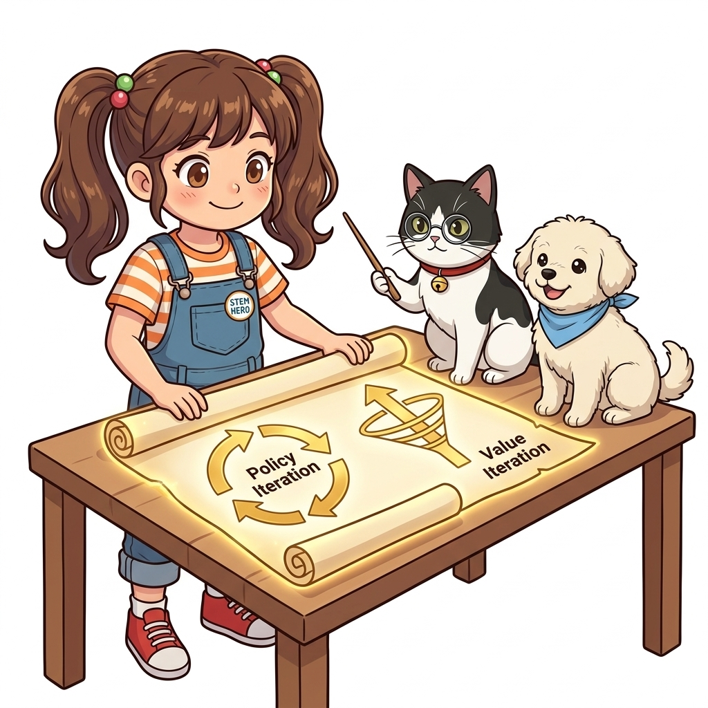
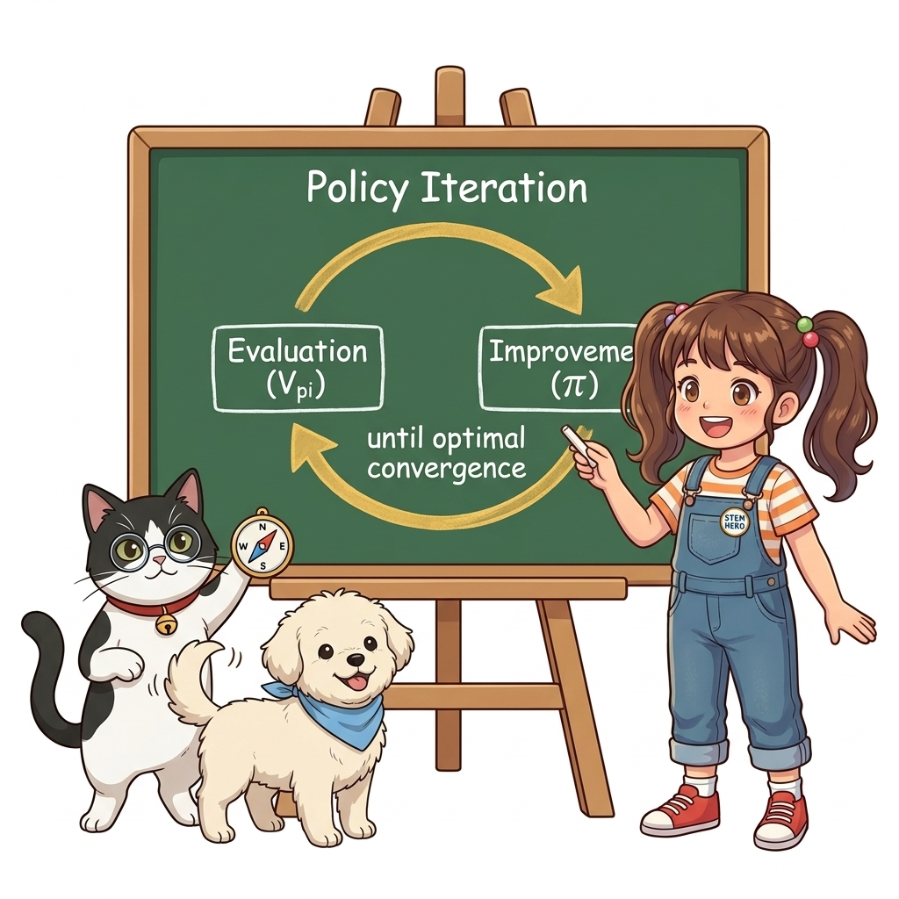

# 07.7 정리

이번 7장에서는 환경의 모델(전이 확률 $p$와 보상 $r$)을 완벽히 알고 있는 상태에서, 컴퓨터의 반복 연산만으로 최적 정책을 찾아내는 **동적 프로그래밍(Dynamic Programming, DP)**의 핵심 이론과 구현을 모두 마스터했습니다. 그 주인공은 바로 **정책 반복법(Policy Iteration)**과 **가치 반복법(Value Iteration)**입니다.

**그림 07-26-1** 동적 프로그래밍의 양대 핵심 축: 정책 반복법(Policy Iteration)과 가치 반복법(Value Iteration)

---

### 07.7.1 정책 반복법 (Policy Iteration) 요약: 평가와 개선의 순환 루프

정책 반복법은 **'평가(Evaluation)'**와 **'개선(Improvement)'**이라는 두 과정을 핑퐁 랠리처럼 번갈아 반복하며 최적해에 도달합니다.

1. **정책 평가 단계**: 현재 정책 $\pi$에 대해 벨만 기대 방정식을 반복 적용하여 가치 함수 $V^\pi$가 완전히 수렴할 때까지 참된 실력을 채점합니다.
2. **정책 개선 단계**: 계산된 가치 함수 $V^\pi$를 바탕으로 $\operatorname{argmax}$ 탐욕적 선택(Greedy Choice)을 취해 더 나은 정책 $\pi'$로 업그레이드합니다.
3. **수렴 판정**: 새로운 정책과 이전 정책이 완전히 일치할 때($\pi' == \pi$) 루프를 탈출하여 최적 정책을 확정합니다.

**그림 07-26-2** 정책 반복법의 핵심 원리: 가치 평가와 정책 개선의 상호작용 순환 루프

---

### 07.7.2 가치 반복법 (Value Iteration) 요약: MAX 깔때기와 원샷 정책 추출

가치 반복법은 정책 반복법에서 매번 가치 함수를 끝까지 수렴시켜야 했던 비효율성을 극복하기 위해 등장한 획기적인 지름길입니다.

$$
V_{k+1}(s) = \max_a \sum_{s'} p(s' \mid s, a) \{ r(s, a, s') + \gamma V_k(s') \}
$$

* **단일 수식 융합**: $\max$ 연산자로 평가와 개선을 한 호흡으로 통합하여 가치 함수 $V$를 직접 갱신합니다.
* **오버헤드 제거**: 중간 정책 변수를 따로 저장하고 관리할 필요 없이 오직 가치 함수 배열 하나만을 갱신하며 최적 가치로 직진합니다.
* **원샷(One-shot) 정책 추출**: 가치 함수가 수렴한 후, 마지막에 **단 1회 $\operatorname{argmax}$를 수행하여 최적 정책을 완성**합니다.

**그림 07-26-3** 가치 반복법의 혁신: MAX 마법 깔때기로 평가와 개선을 융합하여 가치를 직접 갱신

---

### 07.7.3 정책 반복법 vs 가치 반복법 핵심 비교

두 알고리즘은 접근 경로가 다를 뿐, 궁극적으로 수학적으로 완전히 동일한 최적 정책과 최적 가치에 수렴합니다.

| 비교 항목 | 정책 반복법 (Policy Iteration) | 가치 반복법 (Value Iteration) |
| :--- | :--- | :--- |
| **갱신 대상** | 정책($\pi$)과 가치($V$)를 번갈아 갱신 | 가치 함수($V$)만을 직접 갱신 |
| **핵심 연산자** | $\operatorname{argmax}_a$ (개선 단계마다) | $\max_a$ (매 반복 루프마다) |
| **루프 탈출 조건** | 정책 지도가 바뀌지 않을 때 (`new_pi == pi`) | 가치 갱신량이 극소일 때 ($\Delta < \theta$) |
| **정책 도출 시점** | 매 반복마다 새로운 중간 정책 생성 | 가치 수렴 후 **마지막에 단 1회** 추출 |
| **특징** | 정석적이고 투명한 채점과 개선 (GPI의 표본) | 중간 정책 관리 오버헤드를 없앤 초고속 지름길 |

---

### 07.7.4 파이썬 구현과 3 × 4 그리드 월드 완전 정복

이론에 머무르지 않고, 객체지향 파이썬 코드를 작성하여 3 × 4 그리드 월드 환경에 직접 적용했습니다.

* **`policy_iter.py`**: 평가와 개선 루프를 통해 단 4회의 정책 갱신 만에 최적 정책 수렴 완료.
* **`value_iter.py`**: 가치 직접 갱신을 통해 단 3회의 가치 갱신 만에 최적 가치 함수 $V_*$ 수렴 완료.
* **최적 경로 완성**: 빨간색 함정 칸(폭탄, -1)을 영리하게 우회하여 안전하게 목표 지점(사과, +1)으로 도달하는 완벽한 화살표 나침반 지도 확보.

**그림 07-26-4** 파이썬 코드로 검증된 3 × 4 그리드 월드의 완벽한 최적 정책 경로

---

### 07.7.5 7강 완주 자축과 랩노트 피날레

> 👧 **도로시**: "교수님, 지니! 처음에는 수식도 너무 많고 연립방정식 계산 폭발 때문에 아찔했는데, 정책 반복법과 가치 반복법의 원리를 직접 코딩해 보니까 최적 보물 지도가 눈앞에 생생하게 완성되었어요!"
> 
> 👨‍🏫 **이호진 교수님**: "정말 훌륭해 도로시! '현재 가치를 정확히 평가하고, 그 위에서 더 나은 최선의 결정을 내린다'는 동적 프로그래밍의 정수를 완벽하게 터득했단다. 이것이 바로 알파고와 현대 인공지능을 지탱하는 가장 거대한 주춧돌이란다."
> 
> 🐱 **조교 지니**: "맞아! 환경의 규칙(전이 확률과 보상)을 알고 있을 때 컴퓨터가 보여줄 수 있는 가장 완벽하고 지적인 플래닝(Planning)을 마스터한 거야!"
> 
> 🐶 **토토**: "멍멍! 7강 동적 프로그래밍 클리어! 8장 몬테카를로 월드로 힘차게 출발하자, 멍멍! 🐾"

**그림 07-26-5** 07장 동적 프로그래밍(DP) 대단원 정복을 자축하는 이호진 교수님, 도로시, 조교 지니, 토토

---

### 07.7.6 다음 모험을 향해: 계획(Planning)에서 학습(Learning)으로!

지금까지 배운 동적 프로그래밍은 환경의 규칙(확률 $p$와 보상 $r$)을 100% 알고 있어야만 풀 수 있는 **'책상 위의 계획(Planning)'**이었습니다.

하지만 현실의 복잡한 로봇, 자율주행, 게임 환경에서는 환경의 전이 확률과 보상 함수를 사전에 완벽히 모델링하는 것이 불가능합니다. 그렇다면 지도가 없는 야생의 세계에서는 어떻게 길을 찾아야 할까요?

바로 다음 8장에서 다룰 **몬테카를로 방법(Monte Carlo Methods)**이 그 해답을 제시합니다! 지도가 없다면 에이전트가 직접 온몸으로 부딪히며 경험(Sample Episodes)을 쌓고, 그 경험의 평균으로 세상을 배워나가는 **진정한 무모델(Model-Free) 강화학습**의 위대한 서막이 열립니다.

**그림 07-26-6** 지도가 주어지던 안전한 연구실을 넘어, 미지의 야생 세상으로 나침반을 들고 새로운 탐험을 떠나는 도로시 탐험대

> 💡 **다음 강의 안내**:
> [08. 몬테카를로법](../../08_몬테카를로법/index.html)에서는 사전 모델 없이 에이전트가 직접 경험한 에피소드 데이터만으로 참된 가치를 학습해 나가는 놀라운 무모델 강화학습의 첫 걸음을 시작합니다!
