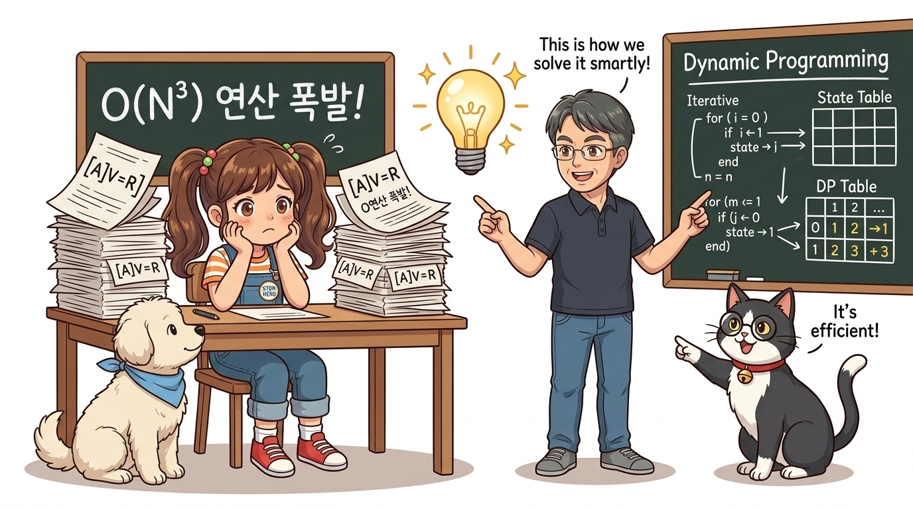
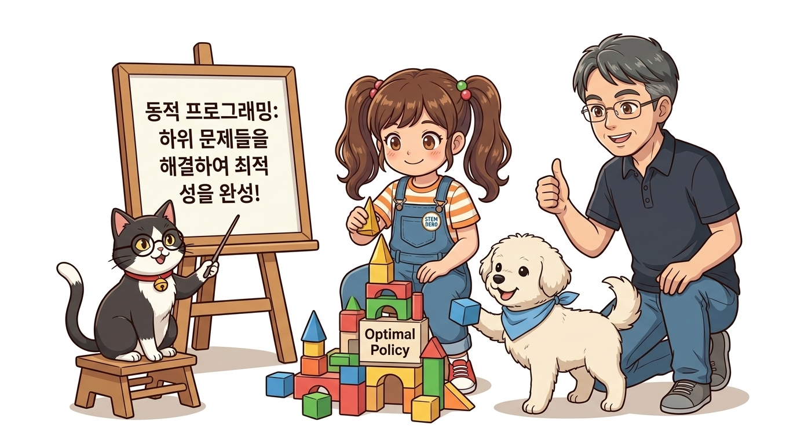
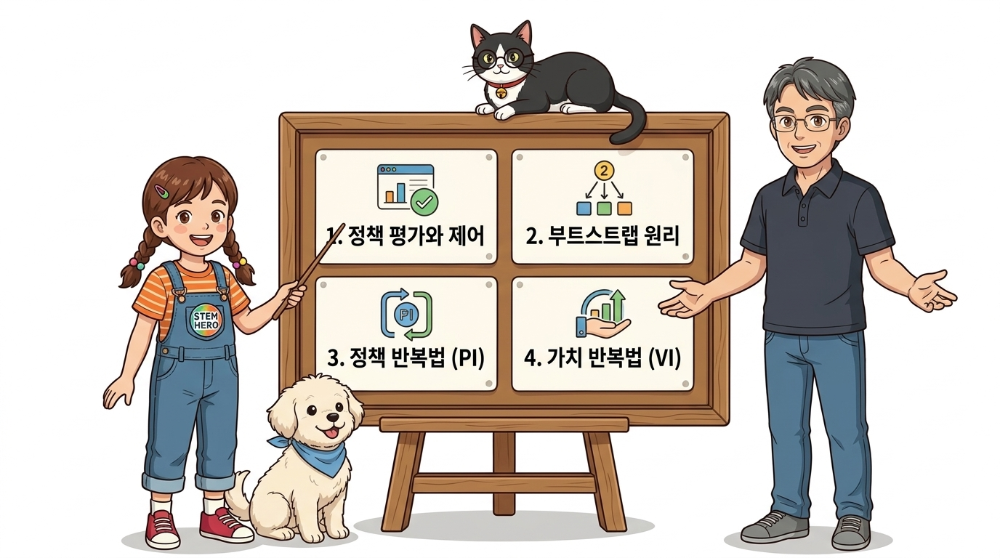
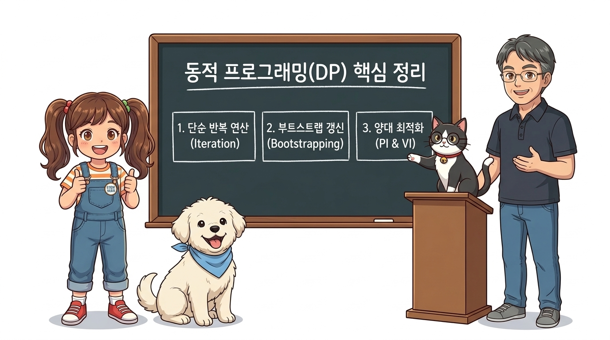

# 7강 동적 프로그래밍

우리가 6강에서 다루었던 **벨만 방정식(Bellman Equation)**을 이용하면 상태 가치에 대한 연립방정식을 유도할 수 있으며, 이 연립방정식을 수학적으로 풀 수 있다면 모든 상태의 가치 함수를 정확히 계산할 수 있었습니다. 

하지만 연립방정식을 직접 푸는 방식은 상태가 몇 개 되지 않는 장난감 문제(Toy Problem)에서만 유효하며, 상태와 행동의 수가 조금만 늘어나도 연산량이 통제할 수 없을 정도로 폭발하게 됩니다.

---

### 연립방정식 직접 풀이의 한계와 계산 복잡도 폭발

벨만 기대 방정식은 상태 가치 *V*(*s*)를 미지수로 두는 선형 연립방정식 체계([*A*]*V* = *R*)로 변환될 수 있습니다. 만약 상태 공간의 크기가 *N*개라면, 이 연립방정식을 행렬 연산으로 단번에 풀기 위해서는 역행렬(*A*-1)을 구해야 합니다.

**그림 07-0-1** 거대한 연립방정식 역행렬 계산의 *O*(*N*3) 복잡도 폭발과 새로운 알고리즘적 발상의 필요성 (16:9 와이드)

일반적인 가우스 소거법이나 역행렬 계산의 시간 복잡도는 ** *O*(*N*3)**에 달합니다. 상태 수가 100개일 때는 100만 번의 연산으로 충분하지만, 상태 수가 1,000개로 늘어나면 무려 10억 번의 연산이 필요하며, 바둑(|*S*| ≈ 10170)이나 자율주행과 같이 현실 세계의 방대한 문제에서는 컴퓨터 메모리가 먼저 가득 차 멈춰 버리고 맙니다.

따라서 우리는 완벽한 수학 공식을 단번에 풀려 하지 않고, 컴퓨터의 가장 강력한 장점인 **빠른 단순 반복 연산(Iteration)**을 빌려 점진적으로 정답에 다가가는 새로운 패러다임을 도입해야 합니다.

---

### 동적 프로그래밍(DP)의 정의와 분할 정복 철학

이러한 문제를 해결하기 위해 등장한 구원투수가 바로 **동적 프로그래밍(Dynamic Programming, DP)**입니다. 

동적 프로그래밍은 거대하고 복잡한 전체 최적화 문제를 시간의 흐름에 따른 **작은 부분 문제(Subproblems)**들로 쪼개어 해결하고, 하위 문제의 계산 결과를 메모리에 저장하여 재활용(Memoization)함으로써 중복 연산을 획기적으로 줄이는 알고리즘입니다.

**그림 07-0-2** 복잡한 전체 의사결정 문제를 작은 하위 문제 블록으로 나누어 최적 정책의 성곽을 완성하는 동적 프로그래밍의 핵심 철학 (16:9 와이드)

도로시가 작은 블록들을 하나씩 차곡차곡 쌓아 올려 거대하고 견고한 최적 정책의 성곽을 완성하듯, 동적 프로그래밍은 이전 상태의 가치 추정치를 발판 삼아 다음 상태의 가치를 점진적으로 갱신해 나가는 **부트스트랩(Bootstrapping)** 방식을 통해 최적 정책에 도달합니다.

---

#### 💡 수식 돋보기: 벨만 기대 방정식과 선형 연립방정식 기호 해부

벨만 기대 방정식이 어떻게 상태 가치들의 선형 연립방정식을 형성하는지 그 수학적 골격을 단계별로 뜯어보겠습니다:

> ### **Vπ(s) = ∑a π(a|s) ∑s' P(s'|s,a) [ R(s,a,s') + γ Vπ(s') ]**

위 수식은 현재 상태 *s*의 가치가 다음 상태 *s*'들의 가치와 어떻게 얽혀 있는지를 보여주는 재귀적 관계식입니다. 수식의 각 기호는 다음과 같은 엄밀한 의미를 갖습니다:

1. **상태 가치 함수 (*V**π*(*s*))**:
   * 정책 *π*를 따르는 에이전트가 상태 *s*에 서 있을 때, 앞으로 얻게 될 할인 보상들의 총합에 대한 참 기댓값(Ground Truth)입니다.
2. **행동 확률 가중합 (∑*a* *π*(*a*|*s*))**:
   * 에이전트가 상태 *s*에서 행동 *a*를 선택할 확률 가중치입니다. 확률적 정책인 경우 가능한 모든 행동에 대해 가중 평균을 냅니다.
3. **환경 전이 확률 가중합 (∑*s*' *P*(*s*'|*s*,*a*))**:
   * 에이전트가 행동 *a*를 실행했을 때 환경의 동역학에 의해 다음 상태 *s*'로 이동할 확률입니다. 환경의 모든 불확실성이 이 전이 확률에 의해 수학적으로 반영됩니다.
4. **한 걸음 전진 기대값 ([*R*(*s*,*a*,*s*') + *γ* *V**π*(*s*')])**:
   * 행동의 결과로 즉시 주어지는 1단계 보상 *R*과, 미래의 가치 *V**π*(*s*')에 할인율 *γ* (0 ≤ *γ* < 1)를 곱해 더한 총 보상입니다.

> 👨‍🏫 **이호진 교수님의 직강 노트**:
> "식의 양변을 유심히 살펴보세요! 좌변에도 가치 함수 *V*가 있고 우변에도 가치 함수 *V*가 들어 있습니다. 상태의 개수가 *N*개라면, 이 방정식은 미지수 *N*개와 식 *N*개로 이루어진 거대한 일차 연립방정식([*A*]*V* = *R*)이 됩니다. 동적 프로그래밍의 위대함은 이 연립방정식을 복잡한 역행렬 연산으로 한 번에 풀지 않고, 우변의 이전 추정치를 좌변의 새 추정치로 덮어쓰는 단순 대입 루프(*V**k*+1 ← *T**π* *V**k*)만으로 오차 없이 완벽하게 수렴시킨다는 점에 있습니다."

---

## 학습 목표

이 7강을 충실히 공부하고 나면 아래 네 가지 중요한 강화학습 핵심 질문에 명확하게 답할 수 있습니다!

**그림 07-0-4** 동적 프로그래밍 단원에서 반드시 정복해야 할 4가지 핵심 질문과 학습 목표를 제시하는 도로시 연구팀 (16:9 와이드)

1. **정책 평가(Policy Evaluation)와 정책 제어(Policy Control)의 구분**:
   * 특정 정책이 주어졌을 때 그 정책의 가치 함수를 채점하는 '평가'와, 채점된 가치를 바탕으로 더 좋은 행동을 선택하도록 정책을 바꾸는 '제어'의 역할을 비교 정의할 수 있다.
2. **부트스트랩(Bootstrapping)의 메커니즘 체화**:
   * 에피소드가 끝날 때까지 기다리지 않고, 다른 상태의 기존 가치 추정치를 빌려 현재 상태의 가치를 갱신하는 강화학습 고유의 부트스트랩 원리를 설명할 수 있다.
3. **정책 반복법(Policy Iteration)의 유도 및 구현**:
   * 정책 평가와 정책 개선(탐욕적 갱신)을 번갈아 수행하며 최적 정책에 수렴시키는 정책 반복법의 수학적 원리를 이해하고 파이썬 객체지향 코드로 구현할 수 있다.
4. **가치 반복법(Value Iteration)의 압도적 효율성 마스터**:
   * 정책 변수를 명시적으로 유지하지 않고, 벨만 최적 방정식을 직접 가치 갱신 루프로 활용하여 단일 수식으로 최적 정책을 도출하는 가치 반복법을 구현할 수 있다.

---

## 학습 목차

7강은 역사적 유래에서 출발하여 작은 장난감 환경 검증, 대규모 그리드월드 객체지향 구현, 그리고 양대 최적화 알고리즘의 완전 정복으로 이어지는 체계적인 로드맵으로 구성되어 있습니다.

**그림 07-0-5** 7.1절 유래부터 7.7절 종합 정리까지 이어지는 7강 동적 프로그래밍 전체 탐험 로드맵 (16:9 와이드)

- [07.1 동적 프로그래밍의 유래](./7_1_유래/index.html)
  - 리처드 벨만이 수학 연구 예산을 지켜내기 위해 국방부 장관의 눈을 피해 'Dynamic Programming'이라는 이름을 고안했던 흥미진진한 비하인드 스토리와 역사적 유래를 배웁니다.
- [07.2 동적 프로그래밍과 정책 평가](./7_2_동적_프로그래밍과_정책_평가/index.html)
  - 동적 계획법의 개념과 부트스트랩 원리, 2칸 초소형 그리드월드에서의 정책 평가 손계산과 파이썬 코드 구현을 배웁니다.
- [07.3 더 큰 문제를 향해](./7_3_더_큰_문제를_향해/index.html)
  - 3 × 4 그리드월드를 다루는 클래스를 구현하고 `defaultdict` 기반의 대규모 상태-행동 정책 평가 구조를 살펴봅니다.
- [07.4 정책 반복법](./7_4_정책_반복법/index.html)
  - 임의의 정책을 탐욕적으로 더 개선시키는 정책 개선 정리(Policy Improvement Theorem)의 이론적 의의와 수학적 증명을 배웁니다.
- [07.5 정책 반복법 구현](./7_5_정책_반복법_구현/index.html)
  - 정책 평가와 탐욕적 개선 루프를 결합하여 그리드월드 상에서 최적 정책 화살표 지도를 도출하는 정책 반복법을 파이썬으로 구현해 봅니다.
- [07.6 가치 반복법](./7_6_가치_반복법/index.html)
  - 정책 없이 가치 함수만을 직접 최적값으로 갱신 수렴시키는 가치 반복법(Value Iteration)의 유도 및 고속 구현 과정을 배웁니다.
- [07.7 정리](./7_7_정리/index.html)
  - 7강 동적 프로그래밍 단원의 전체 핵심 수식 계보도와 정책 반복법 vs 가치 반복법 알고리즘 비교 테이블을 복습합니다.

---

### 07.0.7 핵심 정리: 동적 프로그래밍의 3대 기둥

동적 프로그래밍은 환경의 전이 확률 *P*(*s*'|*s*,*a*)과 보상 함수 *R*(*s*,*a*,*s*')을 완벽히 알고 있을 때(Model-based), 최적 정책을 수학적으로 도출하는 가장 기본적이면서도 강력한 도구입니다.

**그림 07-0-7** 연구실 4인방(도로시, 이호진 교수님, 조교 지니, 토토)이 함께 칠판 앞에서 총정리하는 동적 프로그래밍의 3대 기둥과 다음 강의 예고 (16:9 와이드)

1. **단순 반복 연산 (Iteration)**:
   * 역행렬 풀이의 *O*(*N*3) 계산 복잡도를 회피하고, 컴퓨터의 빠른 단순 대입 연산으로 가치 함수를 참값에 수렴시킵니다.
2. **부트스트랩 갱신 (Bootstrapping)**:
   * 에피소드가 완전히 끝날 때까지 기다리지 않고, 이전 단계의 가치 추정치를 활용하여 다음 단계의 가치를 갱신합니다.
3. **양대 최적화 엔진 (PI & VI)**:
   * 정책 평가와 정책 개선을 핑퐁처럼 반복하는 **정책 반복법(Policy Iteration)**과, 벨만 최적 방정식 단일 루프로 직진하는 **가치 반복법(Value Iteration)**을 통해 어떤 유한 MDP에서도 최적 정책을 찾아냅니다.

> 💡 **다음 강의 안내**:
> [07.1 동적 프로그래밍의 유래](./7_1_유래/index.html)에서는 현대 컴퓨터 과학과 강화학습의 기초를 닦은 천재 수학자 리처드 벨만의 흥미진진한 삶과 이름의 탄생 비화를 함께 탐험해 봅니다!
