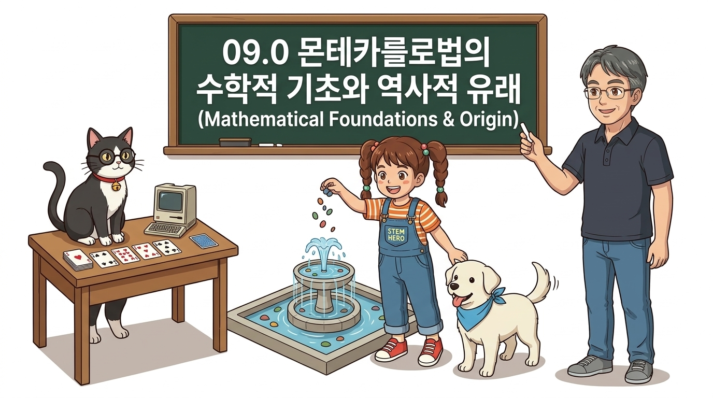
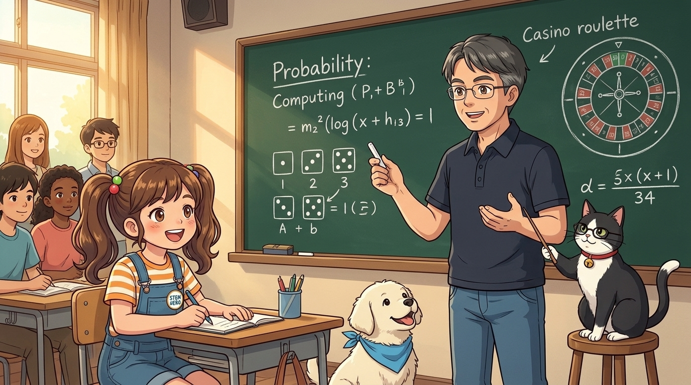
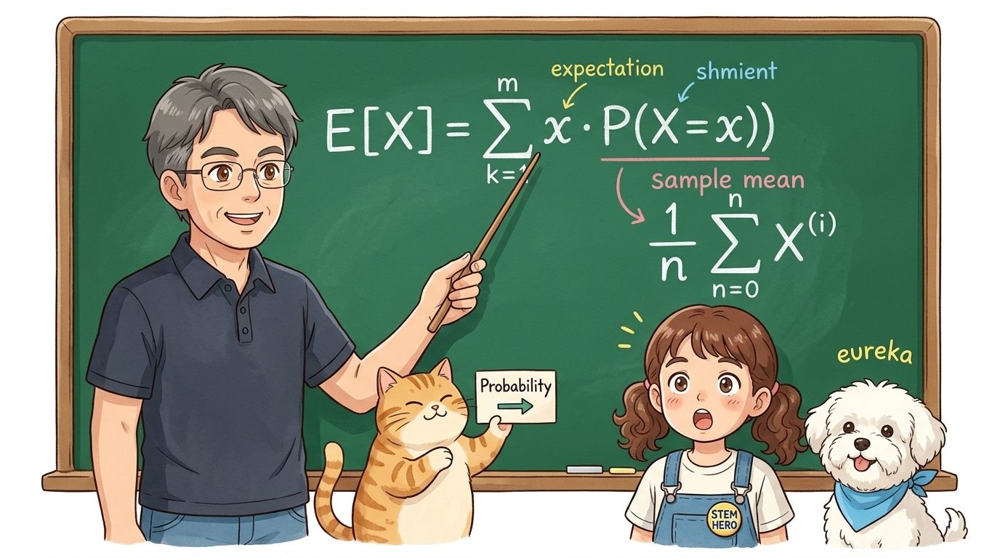
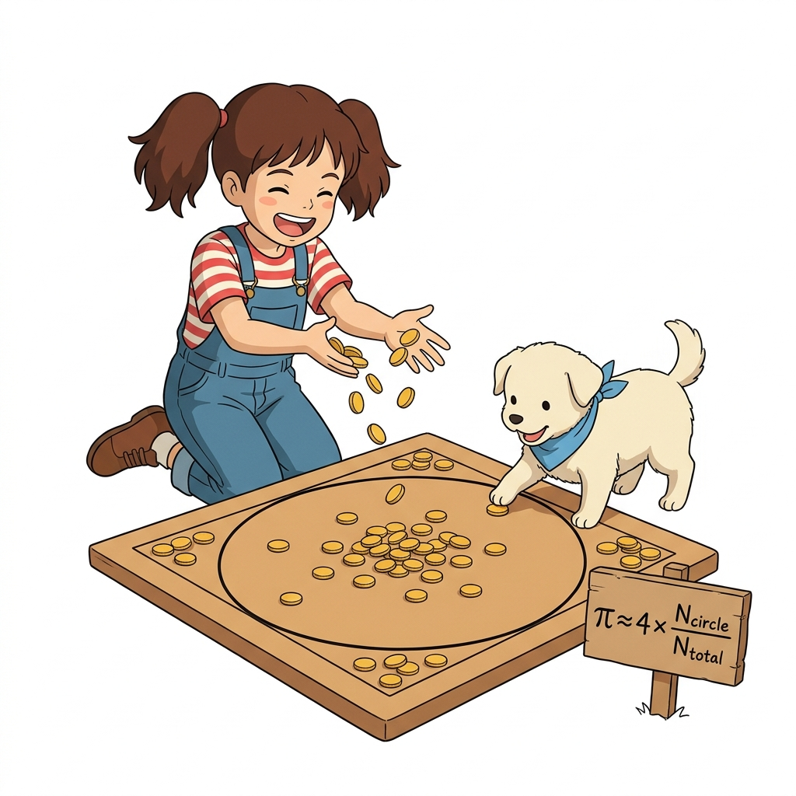
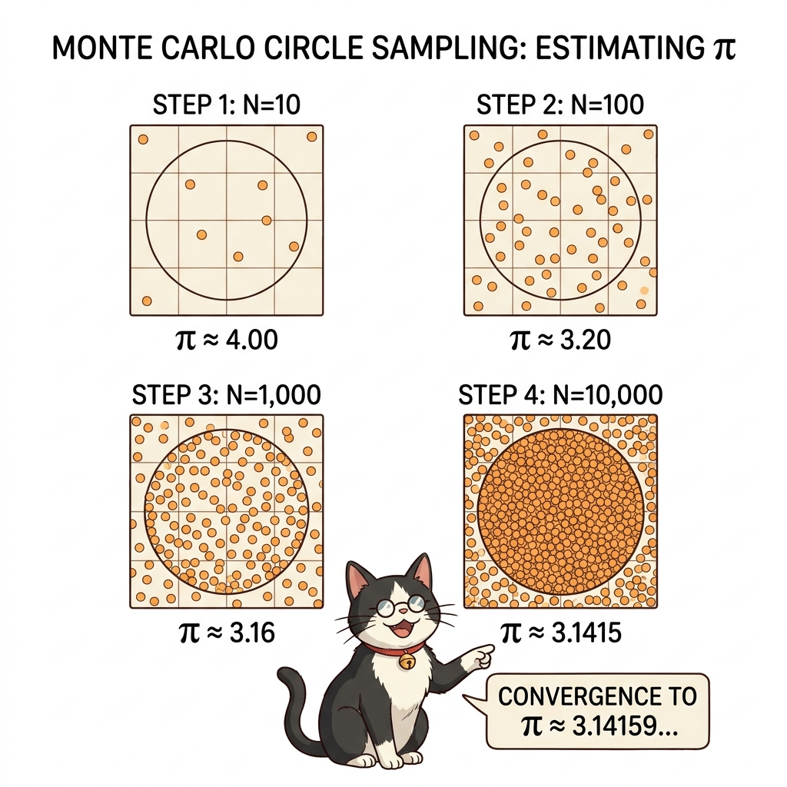
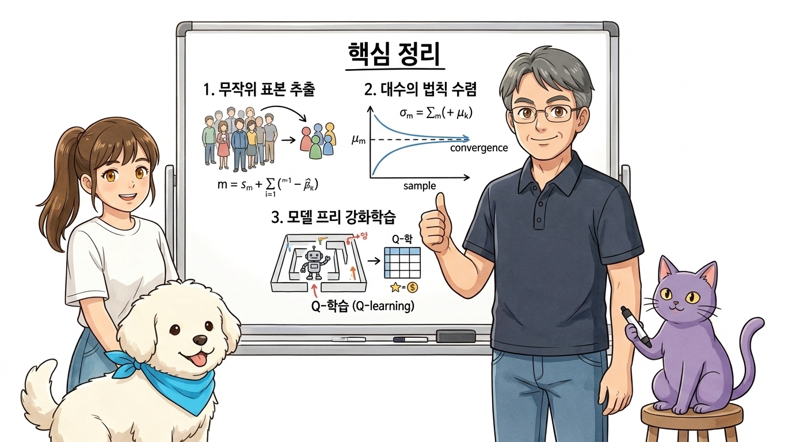

# 09.0 몬테카를로법의 수학적 기초와 역사적 유래

**그림 09-0-1** 이호진 교수님의 몬테카를로법 역사와 원리 특강 — 조교 지니와 함께 룰렛과 컴퓨터의 만남을 강의하고 경청하는 도로시와 토토 (16:9 와이드)

강화학습에서 환경의 수학적 모델(상태 전이 확률과 보상 함수)을 전혀 알지 못해도, 에이전트가 세상에 직접 발을 내딛고 겪은 수많은 실제 모험(에피소드) 샘플들을 모아 평균을 내어 최적 가치와 정책을 찾아내는 기법을 **몬테카를로법(Monte Carlo Method)**이라고 부릅니다.

> 👨‍🏫 **이호진 교수님의 생각 열기**:
> "우리가 지도나 날씨 예보 모델을 전혀 모르는 미지의 섬에 도착했다고 해보자. 어떻게 하면 가장 안전하고 열매가 많은 길을 찾아낼 수 있을까? 가장 확실하고 지혜로운 방법은 **직접 여러 번 길을 걸어보고(시행), 그 경험들의 평균을 내어(통계) 판단하는 것**이란다. 이것이 바로 몬테카를로 기법의 가장 강력한 본질이란다."

> 👧 **도로시와 토토의 비유로 이해하기**:
> "맞아요, 교수님! 제가 정원의 네모난 연못에 조약돌을 신나게 던져보았을 때, 원형 분수대 안쪽에 빠진 돌멩이와 연못 전체에 빠진 돌멩이 개수의 비율을 셌더니, 복잡한 적분 공식 없이도 원주율 *π*의 근사값을 바로 계산해낼 수 있었어요! 토토도 옆에서 돌멩이를 주워다 주며 함께 개수를 세어주었답니다."

**그림 09-0-1-2** 사각형 연못 안의 원형 분수대에 조약돌을 던져 무작위 표본 비율로 면적과 원주율을 직관적으로 유도해보는 도로시와 토토, 지니 (1:1 순백색)

도대체 이 위대한 **무작위 표본 평균 계산 기법**은 어떻게 탄생했을까요? 전쟁의 그늘 속에서 천재 수학자들의 번뜩이는 직관과 도박의 도시 몬테카를로의 이름이 얽힌 흥미진진한 역사 속으로 여행을 떠나봅시다!

---

## 09.0.1 몬테카를로법의 역사적 유래

### 09.0.1.1 병상에서 시작된 솔리테어 카드 놀이

1946년, 맨해튼 프로젝트에 핵심 연구원으로 참여했던 폴란드계 미국인 천재 수학자 **스타니스와프 울람(Stanisław Ulam)**은 뇌염 수술을 받고 병상에 누워 무료하게 요양을 하고 있었습니다. 건강을 회복하던 울람은 침대 위 트레이에서 혼자 카드를 정렬하여 짝을 맞추는 '솔리테어(Solitaire, 패션스)' 카드 게임을 반복해서 즐기고 있었습니다.

**그림 09-0-2** 병상에서 솔리테어 카드 놀이를 하던 중 표본 무작위 추출(Random Sampling)의 위대한 힘을 직관적으로 깨달은 스타니스와프 울람과 조교 지니 (1:1 순백색)

수학자였던 울람은 카드를 섞으며 문득 강렬한 호기심이 일었습니다.
> *"52장의 카드를 무작위로 뒤섞어 판을 깔았을 때, 이 솔리테어 게임이 막힘없이 완벽하게 풀릴 수학적 확률은 과연 얼마나 될까?"*

#### 1) 순수 수학적 접근의 한계
울람은 즉시 조합론과 순열 공식을 동원하여 대수학적으로 정밀한 성공 확률을 계산하려 했습니다. 하지만 52장의 카드가 뒤섞이는 경우의 수는 무려 52! ≈ 8.065 × 1067이라는, 관측 가능한 우주의 원자 수에 필적하는 초거대 숫자였습니다. 아무리 뛰어난 수학자라도 종이와 연필만으로 엄밀한 해석적 해(Analytical Solution)를 구해내는 것은 불가능에 가까웠습니다.

#### 2) 발상의 대전환: "직접 여러 번 해보면 되잖아!"
수식의 벽에 부딪힌 울람은 문득 기발하고 실용적인 생각을 떠올렸습니다:
> *"복잡한 순열 조합 공식으로 머리를 싸맬 필요가 있을까? 실제로 카드를 100번 섞어서 게임을 플레이해보고, 그중 성공한 횟수가 15번이라면 성공 확률은 약 15%라고 바로 추정할 수 있잖아!"*

이것이 바로 **'확률 분포 수식을 몰라도, 실제 무작위 시행(Sampling)의 평균을 내어 참값을 추정한다'**는 몬테카를로법의 최초의 불꽃이었습니다.

---

### 09.0.1.2 맨해튼 프로젝트와 삼촌의 도박 도시

울람은 건강을 회복하자마자 이 번뜩이는 영감을 동료이자 20세기 최고의 천재 과학자 **존 폰 노이만(John von Neumann)**에게 공유했습니다.

**그림 09-0-2-2** 울람의 무작위 표본 추출 아이디어를 맨해튼 프로젝트(중성자 확산) 컴퓨터 수치 해석에 적용할 수 있음을 깨닫고 열띤 토론을 벌이는 존 폰 노이만과 스타니스와프 울람 (16:9 와이드)

컴퓨터 아키텍처의 아버지이자 게임 이론의 대가였던 폰 노이만은 이 이야기를 듣자마자 무릎을 쳤습니다. 당시 연구진은 핵분열 과정에서 무수히 많은 중성자가 물질 속을 이리저리 튕겨 다니며 연쇄 반응을 일으키는 복잡한 충돌 궤적을 미분방정식으로 풀지 못해 난항을 겪고 있었습니다. 폰 노이만은 중성자의 충돌 경로 하나하나를 마치 룰렛을 돌리듯 무작위 수(난수)로 모사(Simulation)하여 거대한 컴퓨터로 수천 번 계산하면 전체 확산율을 완벽히 계산할 수 있음을 간파했습니다.

#### 카지노 도시 '몬테카를로' 암호명의 탄생
당시 핵 연구는 최고 수준의 국가 극비 프로젝트(맨해튼 계획)였기 때문에 이 혁신적인 무작위 시뮬레이션 계산법을 가리킬 비밀 암호명이 필요했습니다.

**그림 09-0-2-3** 조교 지니가 돋보기로 지중해 연안 모나코의 세계적인 카지노 도시 '몬테카를로' 지도를 비추며 암호명의 유래를 재미있게 설명해주는 씬 (1:1 순백색)

> 🐱 **조교 지니의 역사 비화 돋보기**:
> "울람 연구원에게는 카지노 도박을 너무 좋아해서 친척들에게 늘 돈을 빌리러 다니던 삼촌이 한 분 계셨대냥! 그 삼촌이 자주 출몰하던 화려한 도박의 성지가 바로 지중해 모나코 공국의 **'몬테카를로(Monte Carlo)'**였단다냥! 무작위로 돌아가는 룰렛 바퀴와 주사위야말로 이 무작위 시뮬레이션의 본질과 딱 들어맞았기에, 암호명을 '몬테카를로 프로젝트'로 정하게 된 거란다냥!"

**그림 09-0-2-4** 1940년대 거대한 진공관 컴퓨터 회로와 카지노 룰렛의 무작위 난수가 만나 현대 과학 시뮬레이션으로 피어난 역사적인 만남 (16:9 와이드)

이렇게 탄생한 몬테카를로법은 최초의 전자식 컴퓨터 에니악(ENIAC)과 결합하여 물리학, 금융 공학, 분자 생물학, 그리고 오늘날의 **인공지능 강화학습 에이전트의 가치 추정**에 이르는 가장 거대하고 강력한 알고리즘 기둥으로 자리 잡았습니다.

---

## 09.0.2 몬테카를로법의 수학적 의미

**그림 09-0-3-0** 이호진 교수님이 대형 칠판 앞에서 몬테카를로법의 핵심 수학 이론(기댓값과 표본 평균의 수렴)을 명쾌하게 강의하고, 도로시가 손을 들며 깨달음을 얻는 씬 (16:9 와이드)

그렇다면 무작위로 표본을 추출하여 평균을 내는 것이 수학적으로 왜 정당하며, 어떻게 진짜 참값에 도달할 수 있는 것일까요? 이호진 교수님의 칠판 강의를 통해 그 수학적 뼈대를 살펴봅시다.

**그림 09-0-3-0b** 이호진 교수님과 조교 지니가 기댓값 공식 E[*X*] = ∑ *x* · *P*(*X* = *x*)과 표본 평균 (1/*n*) ∑ *X*(*i*)의 기호별 의미를 알기 쉽게 해설하는 칠판 강의 (16:9 와이드)

#### 💡 수식 돋보기: 기댓값 E[*X*]와 표본 평균 기호 해부

기댓값과 표본 평균의 관계를 정확히 이해하기 위해 수식을 구성하는 기호들을 하나씩 뜯어봅시다:

* **E[*X*] (참 기댓값, Expectation)**: 확률 변수 *X*가 취할 수 있는 이론적 참 평균값입니다. 모집단 전체의 확률적 성질을 완벽히 대변하는 참 진리(Ground Truth)입니다.
* **∑ *x* · *P*(*X* = *x*) (확률 가중합)**: 일어날 수 있는 모든 구체적인 사건 값 *x*에 그 사건이 발생할 엄밀한 수학적 확률 *P*(*X* = *x*)를 곱하여 전부 더한 값입니다. 주사위라면 1(1/6) + 2(1/6) + ... + 6(1/6) = 3.5가 됩니다.
* **(1/*n*) ∑*i*=1*n* *X*(*i*) (표본 평균, Sample Mean)**: 에이전트가 현실 세계에서 직접 몸으로 부딪히며 측정한 *n*개의 실제 경험 데이터(*X*(*i*))를 모두 더해 시행 횟수 *n*으로 나눈 산술 평균입니다.
* 💡 **몬테카를로의 핵심 통찰**: 강화학습에서 에이전트는 환경의 복잡한 확률 분포 *P*를 전혀 알지 못합니다. 하지만 **실제로 겪은 무수한 표본들의 평균 (1/*n*) ∑ *X*(*i*)을 계산하면, 확률 분포 *P*를 직접 계산하지 않고도 참 기댓값 E[*X*]에 완벽하게 도달**할 수 있습니다!

---

### 09.0.2.1 대수의 법칙 (Law of Large Numbers)

몬테카를로법이 오차 없이 참값으로 수렴하도록 보장하는 가장 거대한 수학적 기둥은 바로 **대수의 법칙(큰 수의 법칙, Law of Large Numbers)**입니다.

**그림 09-0-3-1** 표본 수(n)가 적을 때는 극심하게 요동치다 표본이 누적될수록 참 기댓값으로 정밀하게 수렴하는 대수의 법칙 다이어그램 (1:1 순백색)

> 👨‍🏫 **이호진 교수님의 수학적 정리**:
> "어떤 확률 변수 *X*로부터 서로 독립적으로 무작위 추출된 표본(샘플) *X*(1), *X*(2), ..., *X*(*n*)이 있을 때, 시행 횟수 *n*이 무한히 커질수록 표본들의 평균값은 원래 모집단의 참 기댓값 E[*X*]로 반드시 수렴한다는 정리란다."

> ### **lim*n* → ∞ (1/*n*) ∑*i*=1*n* *X*(*i*) = E[*X*]**

**그림 09-0-3-1b** 대수의 법칙 극한 수식 lim*n* → ∞ (1/*n*) ∑*i*=1*n* *X*(*i*) = E[*X*]을 3대 블록으로 분해하여 설명하는 이호진 교수님과 도로시, 토토 (16:9 와이드)

#### 💡 수식 돋보기: 대수의 법칙 극한 수식 3대 블록 분석

대수의 법칙을 보장하는 극한 수식은 3개의 핵심 구성 블록으로 완벽히 분해할 수 있습니다:

1. **블록 1: lim*n* → ∞ (무한 시행의 극한)**:
   - 표본의 수(에이전트가 겪은 에피소드 시행 횟수 *n*)를 무한대로 증가시키는 극한 연산자입니다.
   - 표본 수가 적을 때는 우연에 의한 오차가 크게 작용하지만, *n*이 커질수록 우연의 요동(Fluctuation)은 상쇄되어 사라집니다.
2. **블록 2: (1/*n*) ∑*i*=1*n* *X*(*i*) (누적 경험의 표본 평균)**:
   - 에이전트가 환경과 상호작용하며 실제로 기록한 경험값들의 누적 산술 평균입니다.
   - 강화학습에서는 각 에피소드마다 획득한 총 누적 보상(반환값, Return)들의 평균에 해당합니다.
3. **블록 3: = E[*X*] (완전 일치와 오차 0)**:
   - 단순한 근사(`≈`)가 아닌 완벽한 등호(`=`)입니다. 시행 횟수가 무한히 쌓이면 표본 평균과 참 기댓값 사이의 오차가 완벽하게 '0'으로 수렴함을 수학적으로 보증합니다.

#### 🎲 주사위 예시로 살펴보기
* 주사위 한 개를 던졌을 때 나오는 눈금의 참 기댓값:
  > **E[*X*] = ∑*x*=16 *x* · *P*(*X* = *x*) = 1(1/6) + 2(1/6) + ... + 6(1/6) = 3.5**
* 처음에 주사위를 3번 던졌을 때는 `[1, 6, 2]`가 나와 평균이 **3.0**으로 오차가 큽니다.
* 하지만 주사위를 100번, 1,000번, 10,000번 던져서 평균을 내면 정확하게 **3.5000...**으로 수렴합니다.
* 이 법칙 덕분에 우리는 복잡한 상태 전이 확률 행렬 *P*(*s'*|*s*, *a*)를 전혀 몰라도, **실제 환경에서 겪은 수많은 에피소드의 누적 보상(Return)들의 표본 평균을 내는 것만으로 상태 가치 함수 *V*(*s*)와 행동 가치 함수 *Q*(*s*, *a*)를 완벽하게 계산**해낼 수 있습니다!

---

### 09.0.2.2 동전 던지기로 원주율 *π* 구하기

몬테카를로 기법의 놀라운 직관을 가장 직관적으로 체감할 수 있는 교재 실습은 바로 **정사각형 내접원 동전 던지기 실험**입니다.

**그림 09-0-3** 사각형 안에 내접하는 원을 그리고 무작위로 동전을 던져 원주율 *π*를 기하학적으로 추정하는 도로시와 보조견 토토 (1:1 순백색)

1. 한 변의 길이가 2*r*인 정사각형의 넓이:
   > **_S_square = (2*r*) × (2*r*) = 4*r*2**
2. 정사각형 안에 꼭 맞게 들어가는 반지름 *r*인 내접원의 넓이:
   > **_S_circle = *πr*2**

#### 기하학적 확률 비례식 유도
도로시가 정사각형 영역 전체를 향해 눈을 감고 동전을 무작위로 골고루 무수히 많이 던진다고 해봅시다. 전체 사각형 영역에 떨어진 총 동전의 개수를 *N*total, 그중 동그란 원 안쪽에 쏙 들어간 동전의 개수를 *N*circle이라고 하면 다음 비례식이 성립합니다:

> ### ***N*circle / *N*total ≈ (원의 넓이 / 정사각형의 넓이) = *πr*2 / 4*r*2 = *π* / 4**

양변에 4를 곱하면, 복잡한 삼각함수나 미적분 없이 **오직 동전을 던진 개수를 세는 단순 연산만으로 원주율 *π*를 유도**할 수 있습니다!

> ### ***π* ≈ 4 × (*N*circle / *N*total)**

**그림 09-0-3b** 정사각형 면적 4*r*2과 내접원 면적 *πr*2의 기하학적 비례 관계에서 원주율 *π*를 단독으로 유도해내는 과정을 설명하는 도로시와 토토, 지니 (16:9 와이드)

#### 💡 수식 돋보기: 왜 '4'를 곱할까? 원주율 유도 공식 기호 해부

단순히 동전을 던져 센 개수 비율에 왜 숫자 '4'를 곱하면 신기하게도 원주율 *π*가 계산되는지, 기하학적 유도 과정을 단계별로 해부해 봅시다:

* ***N*circle / *N*total (표본 개수 비율)**: 전체 떨어진 동전 수 중 둥근 원 내부에 들어간 동전 개수의 비율입니다. 무작위로 균등하게 던졌으므로, 이 비율은 두 도형의 실제 면적 비율과 근사합니다.
* **면적 비례식의 도출**:
  - 한 변이 2*r*인 외접 정사각형의 넓이: *S*square = (2*r*) × (2*r*) = 4*r*2
  - 반지름이 *r*인 내접원의 넓이: *S*circle = *πr*2
  - 두 면적의 비율: *S*circle / *S*square = (*πr*2) / (4*r*2) = *π* / 4
* **'4 ×'의 수학적 출처**:
  - 비율 식 `*N*circle / *N*total ≈ *π* / 4`의 분모에 있는 4를 없애고 순수한 *π*만 남기기 위해 **양변에 4를 곱해준 결과**입니다.
  - 즉, '4'는 정사각형 면적 공식(4*r*2)에서 *r*2을 소거하고 남은 기하학적 상수 배수입니다!
* **'≈' (근사 기호)의 물리적 의미**:
  - 무한개의 동전을 던질 수 없는 현실의 실험이므로, 유한한 표본 *N*으로 추정한 확률적 근사값임을 나타냅니다.
  - 하지만 대수의 법칙에 따라 동전을 던지는 횟수 *N*이 커질수록 근사치 *π*는 참값 3.14159...로 오차 없이 수렴해 갑니다.

**그림 09-0-4** 동전 던지기 횟수 *N*이 증가할수록 오차가 줄어들며 참값 3.14159...로 수렴해 가는 4단계 시각화 다이어그램 (1:1 순백색)

| 시행 단계 (*N*) | 전체 동전 (*N*total) | 원 내부 동전 (*N*circle) | 계산된 원주율 추정치 (4 × *N*circle / *N*total) | 참값과의 오차 |
| :---: | :---: | :---: | :---: | :---: |
| **STEP 1** | 10 | 10 | **4.0000** | +0.8584 (초기 불안정) |
| **STEP 2** | 100 | 80 | **3.2000** | +0.0584 |
| **STEP 3** | 1,000 | 790 | **3.1600** | +0.0184 |
| **STEP 4** | 10,000 | 7,854 | **3.1416** | +0.00001 (초정밀 수렴) |

### 09.0.3 핵심 정리: 몬테카를로법의 3대 수학적 기둥

몬테카를로 기법은 복잡한 환경 모델과 방대한 확률 전이 공식을 사전에 전혀 알지 못하더라도, 에이전트가 환경 속에서 직접 부딪히며 축적한 **무작위 경험 표본들의 평균만으로 참된 가치와 최적 정책에 도달할 수 있는 강력한 방법론**입니다.

**그림 09-0-5** 몬테카를로법의 3대 핵심 기둥(무작위 표본 추출, 대수의 법칙 수렴, 모델 프리 학습)을 총정리하는 이호진 교수님과 연구실 4인방 (16:9 와이드)

오늘 학습한 몬테카를로법의 본질은 다음 3가지 핵심 기둥으로 요약할 수 있습니다:

1. **무작위 표본 추출 (Random Sampling)**:
   * 복잡한 확률 분포나 해석적 적분이 불가능한 문제에 직면했을 때, 직접 무작위 표본을 대량으로 수집하여 문제를 극적으로 단순화합니다.
2. **대수의 법칙 기반 수렴성 (Law of Large Numbers)**:
   * 시행 횟수 *n*이 증가함에 따라 표본 평균 (1/*n*) ∑*i*=1*n* *X*(*i*)은 오차를 줄여가며 이론적 참 기댓값 E[*X*]로 정밀하게 수렴합니다.
3. **모델 프리 강화학습의 수학적 초석 (Model-free RL)**:
   * 환경의 전이 확률 *P*(*s'*|*s*,*a*)를 알지 못하는 블랙박스 환경에서도, 에이전트가 에피소드를 끝까지 완주하며 얻은 경험 데이터들의 산술 평균만으로 상태 가치 함수 *v*(*s*)와 행동 가치 함수 *q*(*s*,*a*)를 완벽하게 학습할 수 있습니다.

> 👨‍🏫 **이호진 교수님의 직강 노트**:
> "몬테카를로법의 진정한 위력은 '모든 공식을 완벽히 알아야만 문제를 풀 수 있다'는 고정관념을 깨부순 데 있습니다. 환경의 법칙을 몰라도 직접 경험해 보고 평균을 내면 진리에 도달할 수 있다는 이 담대한 발상이, 바로 현대 모델-프리 강화학습의 위대한 첫걸음이 되었습니다."

> 🐱 **조교 지니의 핵심 요약 노트**:
> "몬테카를로법의 본질은 **'복잡한 수학 공식을 모를 때, 무작위 표본(샘플)을 많이 뽑아서 평균을 내면 우주의 참 진리에 도달한다'**는 것이란다냥!  
> 다음 절부터는 도로시가 강화학습의 에피소드 미로를 끝까지 모험하고 얻은 보상들을 역방향으로 차곡차곡 정산하여, 에이전트의 가치 함수를 어떻게 완벽하게 업데이트하는지 함께 배워보자냥!"
