# 09.0 몬테카를로법의 수학적 기초와 역사적 유래
## 무작위 표본 평균으로 참된 기댓값을 추정하는 수학적 원리와 역사

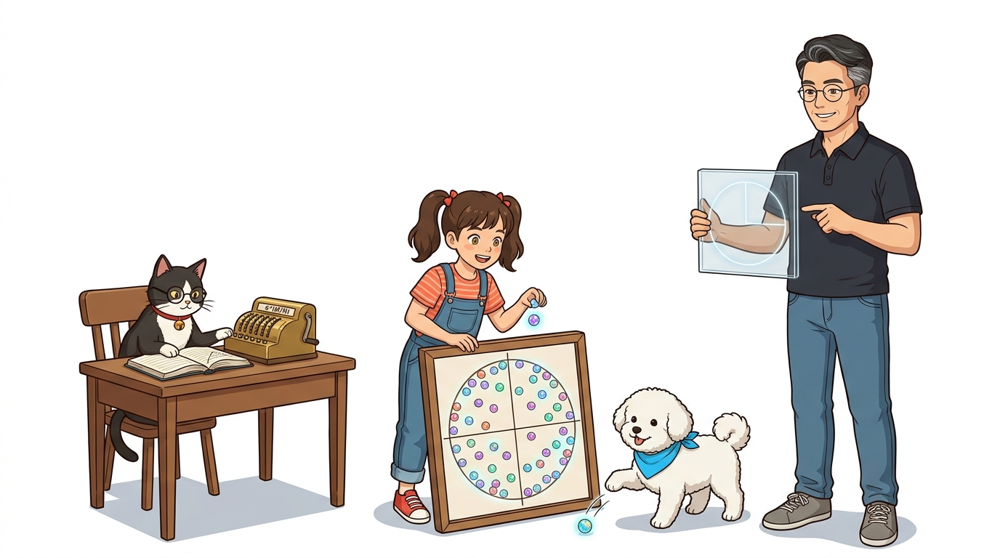
**그림 09-0-Intro** 무작위 점들을 투하하여 원주율(π)을 추정하며 대수의 법칙과 몬테카를로 근사를 체득하는 이호진 교수와 도로시 탐험대

- **핵심 주제**: 몬테카를로 기법의 수학적 정당성과 역사적 탄생 배경
- **주요 내용**:
  - 맨해튼 프로젝트와 스타니스와프 울람의 솔리테어 카드 놀이
  - 대수의 법칙(Law of Large Numbers)과 표본 평균의 수렴성
  - 무작위 동전 던지기로 원주율(π)을 유도하는 기하학적 확률 원리
  - 모델 프리(Model-Free) 강화학습을 지탱하는 3대 수학적 기둥

> **[강의 스크립트]**
> 이번 구점영 장에서는 강화학습에서 가장 매력적인 기법 중 하나인 몬테카를로법의 수학적 원리와 역사적 유래를 함께 탐구해 봅니다. 복잡한 환경의 물리 법칙이나 확률 공식을 전혀 모르는 상태에서도, 에이전트가 세상에 직접 발을 내딛고 겪은 무작위 경험 표본들의 평균만으로 우주의 참된 진리에 도달할 수 있다는 이 놀라운 아이디어가 어떻게 탄생하고 증명되었는지 하나씩 짚어보겠습니다.
---

# 09.0 몬테카를로법의 수학적 기초와 역사적 유래
## 경험으로 미지의 세계를 탐험하는 몬테카를로의 출발점

강화학습에서 환경의 수학적 모델(상태 전이 확률과 보상 함수)을 전혀 알지 못해도, 에이전트가 세상에 직접 발을 내딛고 겪은 수많은 실제 모험(에피소드) 샘플들을 모아 평균을 내어 최적 가치와 정책을 찾아내는 기법을 **몬테카를로법(Monte Carlo Method)**이라고 부릅니다.

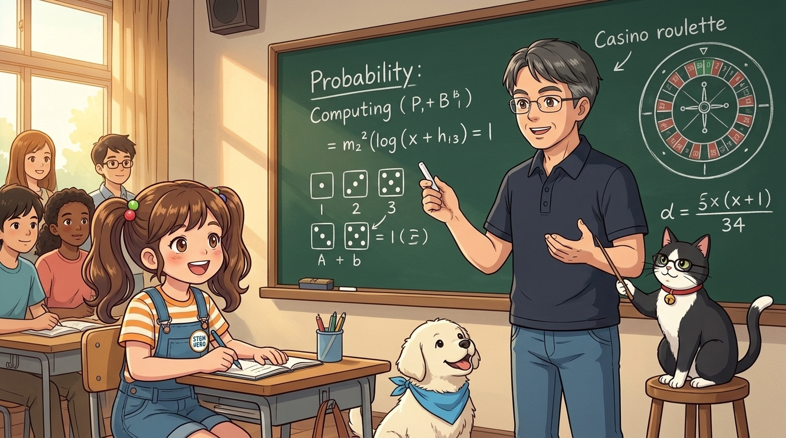
**그림 09-0-1** 이호진 교수님의 몬테카를로법 역사와 원리 특강 — 조교 지니와 함께 룰렛과 컴퓨터의 만남을 강의하고 경청하는 도로시와 토토

- 👨‍🏫 **이호진 교수님의 생각 열기**:
  - "우리가 지도나 날씨 예보 모델을 전혀 모르는 미지의 섬에 도착했다고 해보자."
  - "어떻게 하면 가장 안전하고 열매가 많은 길을 찾아낼 수 있을까?"
  - "가장 확실하고 지혜로운 방법은 **직접 여러 번 길을 걸어보고(시행), 그 경험들의 평균을 내어(통계) 판단하는 것**이란다."
  - "이것이 바로 몬테카를로 기법의 가장 강력한 본질이란다."

> **[강의 스크립트]**
> 화면의 그림을 보십시오. 우리가 만약 지도가 전혀 없는 낯선 무인도에 떨어졌다면 어떻게 해야 할까요? 가장 지혜로운 방법은 직접 여러 번 걸어보고, 넘어지며 얻은 경험들을 기록하여 평균을 내보는 것입니다. 몬테카를로법은 바로 이처럼 환경의 모델이 주어지지 않는 칠흑 같은 어둠 속에서, 에이전트가 스스로 축적한 경험 데이터를 나침반 삼아 최적의 길을 찾아 나서는 진정한 강화학습의 출발점입니다.
---

# 09.0 몬테카를로법의 수학적 기초와 역사적 유래
## 도로시의 연못 돌멩이 비유: 무작위 표본 비율로 원주율 계산하기

도대체 이 위대한 **무작위 표본 평균 계산 기법**은 어떻게 탄생했을까요? 전쟁의 그늘 속에서 천재 수학자들의 번뜩이는 직관과 도박의 도시 몬테카를로의 이름이 얽힌 흥미진진한 역사 속으로 여행을 떠나봅시다!

**그림 09-0-1-2** 사각형 연못 안의 원형 분수대에 조약돌을 던져 무작위 표본 비율로 면적과 원주율을 직관적으로 유도해보는 도로시와 토토, 지니

- 👧 **도로시와 토토의 비유로 이해하기**:
  - "맞아요, 교수님! 제가 정원의 네모난 연못에 조약돌을 신나게 던져보았을 때,"
  - "원형 분수대 안쪽에 빠진 돌멩이와 연못 전체에 빠진 돌멩이 개수의 비율을 셌더니,"
  - "복잡한 적분 공식 없이도 원주율 π의 근사값을 바로 계산해낼 수 있었어요!"
  - "토토도 옆에서 돌멩이를 주워다 주며 함께 개수를 세어주었답니다."

> **[강의 스크립트]**
> 도로시의 직관적인 비유를 들어보지요. 네모난 연못 안쪽에 원형 분수대가 있을 때, 눈을 감고 조약돌을 마구 던집니다. 그리고 분수대 안에 들어간 돌멩이의 비율을 세어보면, 복잡한 적분 기호 하나 없이도 원주율 파이를 놀라울 정도로 정밀하게 계산해낼 수 있습니다. 이처럼 무작위 시행의 결과를 세어서 기하학적 참값을 도출하는 것이 몬테카를로의 마법 같은 원리입니다.
---

# 09.0 몬테카를로법의 수학적 기초와 역사적 유래
## 09.0.1 몬테카를로법의 역사적 유래: 사람 이름이 아니라 카지노 휴양지

이번 절에서는 `몬테카를로법`이란 이름이 어떻게 탄생하게 되었는지 흥미진진한 역사적 유래에 대해 알아봅니다.

**그림 09-0-1-3** "몬테카를로 씨는 위대한 수학자 할아버지인가요?"라며 엉뚱한 상상을 펼치는 도로시와 이를 흐뭇하게 바라보며 카지노 도시의 유래를 들려주는 이호진 교수님

- 👧 **도로시의 엉뚱한 호기심**:
  - "교수님! '몬테카를로'라는 분은 대체 어떤 대단한 수학자이길래 자기 이름을 딴 계산법까지 있는 거예요?"
- 👨‍🏫 **이호진 교수님의 미소 어린 설명**:
  - "하하, 도로시야! 몬테카를로는 사람 이름이 아니란다."
  - "바로 지중해의 따뜻하고 화려한 카지노 도시 모나코의 유명한 휴양지 이름이란다!"
  - "왜 수학 알고리즘에 도박과 카지노의 도시 이름이 붙었는지, 그 기상천외한 탄생 비화를 함께 살펴볼까?"

> **[강의 스크립트]**
> 구점영점일 절에서는 몬테카를로라는 이름의 기원을 살펴봅니다. 많은 학생들이 몬테카를로를 가우스나 뉴턴 같은 역사적인 수학자 이름으로 착각하곤 합니다. 하지만 몬테카를로는 지중해 모나코의 세계적인 카지노 휴양지 이름입니다. 왜 엄밀한 수학 계산법에 룰렛과 도박의 도시 이름이 붙게 되었는지, 그 기상천외한 역사적 배경으로 들어가 보겠습니다.
---

# 09.0 몬테카를로법의 수학적 기초와 역사적 유래
## 09.0.1.1 병상에서 시작된 솔리테어 카드 놀이

1946년, 맨해튼 프로젝트에 핵심 연구원으로 참여했던 폴란드계 미국인 천재 수학자 **스타니스와프 울람(Stanisław Ulam)**은 뇌염 수술을 받고 병상에 누워 무료하게 요양을 하고 있었습니다. 건강을 회복하던 울람은 침대 위 트레이에서 혼자 카드를 정렬하여 짝을 맞추는 '솔리테어(Solitaire, 패션스)' 카드 게임을 반복해서 즐기고 있었습니다.

**그림 09-0-2** 병상에서 솔리테어 카드 놀이를 하던 중 표본 무작위 추출(Random Sampling)의 위대한 힘을 직관적으로 깨달은 스타니스와프 울람과 조교 지니

- **울람의 번뜩이는 호기심**:
  - "52장의 카드를 잘 섞어서 솔리테어 게임을 시작했을 때, 과연 게임이 성공적으로 끝날 확률은 정확히 얼마일까?"

> **[강의 스크립트]**
> 구점영점일점일 절입니다. 몬테카를로법은 병상에서 홀로 카드를 만지작거리던 한 천재 수학자의 호기심에서 출발했습니다. 맨해튼 프로젝트의 핵심 연구원이었던 스타니스와프 울람은 뇌염 수술 후 침대에 누워 솔리테어 카드 놀이를 하다가, 카드를 무작위로 섞었을 때 게임이 완전히 풀릴 확률이 과연 얼마나 될지 깊은 궁금증을 품게 되었습니다.
---

# 09.0 몬테카를로법의 수학적 기초와 역사적 유래
## 1) 순수 수학적 접근의 한계: 52 팩토리얼의 조합론적 폭발

수학자였던 울람은 종이와 펜을 들고 조합론적 확률 계산을 시도해 보았습니다.

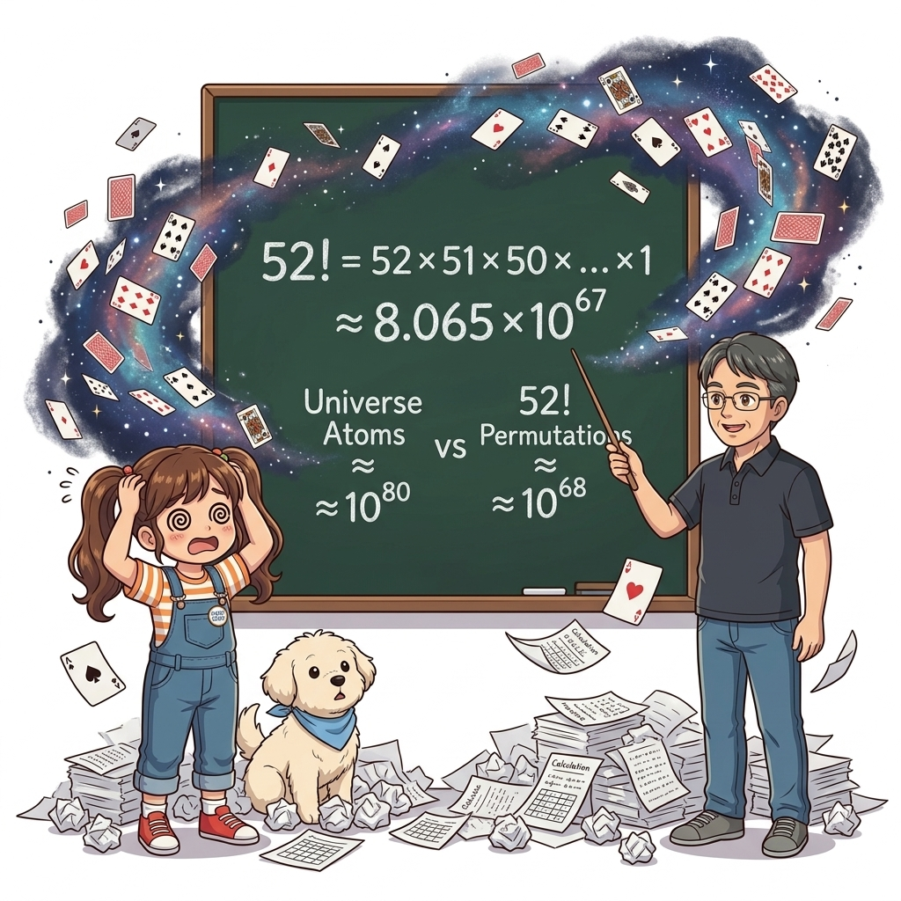
**그림 09-0-2-1** 52장의 카드가 뒤섞이는 우주적 순열 경우의 수(52! ≈ 8.065 × 10⁶⁷)와 순수 해석적 수학의 한계

- **52장의 카드가 섞이는 전체 경우의 수**:
  - $52! = 52 	imes 51 	imes 50 	imes \dots 	imes 1 pprox 8.065 	imes 10^{67}$
- **계산 불가능의 벽**:
  - 이 숫자는 관측 가능한 우주의 모든 원자 수에 필적하는 어마어마한 수치입니다.
  - 여기에 솔리테어 게임의 복잡한 규칙과 조건부 선택까지 반영하여 순수 연필과 종이만으로 확률을 푼다는 것은 **인간의 지성으로 불가능한 해석적 장벽**이었습니다.

> **[강의 스크립트]**
> 울람은 처음에는 순수 수학적으로 조합 공식과 순열을 세어 확률을 유도하려 했습니다. 하지만 오십이 장의 카드가 뒤섞이는 전체 순열의 경우의 수는 오십이 팩토리얼, 즉 십의 육십칠 제곱에 달합니다. 우주의 모든 원자 수에 맞먹는 이 천문학적인 경우의 수를 종이와 연필로 일일이 전개한다는 것은 물리적으로 완전히 불가능한 장벽이었습니다.
---

# 09.0 몬테카를로법의 수학적 기초와 역사적 유래
## 2) 발상의 대전환: "직접 100번 해보고 성공 비율을 세면 되잖아!"

이때 울람의 머릿속에 번개처럼 번뜩이는 직관이 스쳤습니다.

**그림 09-0-2-2** "직접 100번 카드를 섞어보고 성공한 비율을 세어보자!" — 무작위 표본 시행의 평균으로 참값을 찾아내는 발상의 대전환

- **울람의 통찰**:
  - "이론적으로 모든 경우의 수를 계산할 수 없다면, **직접 카드를 100번 섞어서 게임을 해보면 어떨까?**"
  - "만약 100번 중 13번 성공했다면, 성공 확률은 대략 13%라고 실용적으로 결론 내릴 수 있지 않을까?"
- 💡 **핵심 통찰**:
  - 수학적으로 엄밀한 연립방정식을 풀지 못하더라도, **무작위 표본을 대량으로 뽑아 그 평균을 내면 현실적인 참값에 충분히 가까워진다**는 '표본 추출(Sampling)'의 혁명적 발상이었습니다!

> **[강의 스크립트]**
> 여기서 울람의 위대한 발상 전환이 일어납니다. 이론적으로 모든 경우의 수를 풀 수 없다면, 실제로 백 번 카드를 섞어서 플레이해 보고 몇 번 성공하는지 세어보면 되지 않겠는가 하는 생각이었지요. 만약 백 번 중 열세 번 성공했다면, 성공 확률은 대략 십삼 퍼센트라고 추정할 수 있습니다. 복잡한 미적분 대신 무작위 표본의 평균으로 참값을 복원하는 패러다임의 대전환이 일어난 순간입니다.
---

# 09.0 몬테카를로법의 수학적 기초와 역사적 유래
## 09.0.1.2 맨해튼 프로젝트와 폰 노이만의 컴퓨터 수치 해석

울람은 이 아이디어가 단순한 카드 놀이에 그치지 않고, 로스앨러모스 연구소에서 연구 중이던 **맨해튼 프로젝트의 극도로 복잡한 핵분열 물리학 난제**를 해결할 열쇠임을 직감했습니다.

**그림 09-0-2-3** 울람의 무작위 표본 아이디어를 맨해튼 프로젝트 컴퓨터 수치 해석에 적용할 수 있음을 깨닫고 열띤 토론을 벌이는 존 폰 노이만과 스타니스와프 울람

- **핵물리학의 거대한 난제**:
  - 원자로 안에서 무수히 많은 중성자가 원자핵과 충돌하며 사방으로 튕겨 나가는 '중성자 확산(Neutron Diffusion)' 현상
  - 편미분 방정식으로 해석적 해를 구하는 것이 불가능에 가까웠음
- **폰 노이만과의 만남**:
  - 울람은 이 아이디어를 동료인 천재 수학자 **존 폰 노이만(John von Neumann)**에게 제안
  - 폰 노이만은 이 혁신적인 수치 해석 기법의 잠재력을 즉시 간파하고 전폭적인 지지를 보냄

> **[강의 스크립트]**
> 구점영점일점이 절입니다. 울람은 이 통계적 아이디어가 당시 맨해튼 프로젝트에서 직면했던 핵분열 난제를 해결할 열쇠임을 직감했습니다. 우라늄 속에서 중성자가 무수히 충돌하며 튕겨 나가는 확산 현상은 편미분 방정식으로 도저히 풀 수 없었습니다. 울람의 이야기를 들은 당대 최고의 천재 존 폰 노이만은 무작위 난수를 이용한 수치 해석의 위력을 즉각 간파하고 연구에 착수했습니다.
---

# 09.0 몬테카를로법의 수학적 기초와 역사적 유래
## 중성자의 복잡한 충돌 궤적을 난수 시뮬레이션으로 모사하다

폰 노이만은 중성자 하나하나의 이동 거리와 충돌 각도를 난수(Random Number)로 생성하여 궤적을 시뮬레이션하는 기법을 고안했습니다.

**그림 09-0-2-4** 중성자의 충돌 궤적을 난수(Random Walk)로 모사하여 대규모 컴퓨터 계산으로 전체 확산율을 예측해내는 몬테카를로 시뮬레이션

- **중성자 난수 모사의 3단계**:
  - 1단계: 난수를 뽑아 중성자가 다음 원자핵과 충돌할 때까지의 자유 비행 거리를 결정
  - 2단계: 난수를 뽑아 충돌 후 산란될 각도와 흡수 여부를 결정
  - 3단계: 이 과정을 수만 번 반복 추적하여 전체 중성자의 확산율과 임계 질량을 정밀 예측

> **[강의 스크립트]**
> 폰 노이만과 울람이 고안한 방식은 놀라웠습니다. 중성자 하나가 날아가서 다음 원자핵에 부딪힐 때까지의 거리와 산란 각도를 난수로 결정하고, 이를 컴퓨터로 수만 번 시뮬레이션하여 궤적을 추적한 것입니다. 미분방정식을 풀지 않고도 무작위 보행 표본을 대량으로 수집하여 전체 중성자 구름의 물리적 거동을 정확하게 예측해 냈습니다.
---

# 09.0 몬테카를로법의 수학적 기초와 역사적 유래
## 카지노 도시 '몬테카를로' 암호명의 탄생: 니콜라스 메트로폴리스

당시는 제2차 세계대전 중이었으므로, 원자폭탄 개발과 관련된 모든 연구는 철저한 군사 1급 비밀에 부쳐져야 했습니다.

**그림 09-0-2-5** 조교 지니가 돋보기로 지중해 연안 모나코의 세계적인 카지노 도시 '몬테카를로' 지도를 비추며 암호명의 유래를 설명하는 씬

- **암호명이 필요했던 이유**:
  - 논문이나 보고서에 '무작위 난수를 이용한 통계적 핵 시뮬레이션'이라는 표현을 쓸 수 없었음
- **니콜라스 메트로폴리스의 재치**:
  - 프로젝트에 참여했던 물리학자 **니콜라스 메트로폴리스(Nicholas Metropolis)**가 이름을 제안
  - 울람에게는 모나코의 몬테카를로 카지노에서 도박을 즐기다 친척들에게 돈을 자주 빌리던 삼촌이 있었음
  - 룰렛과 주사위의 '우연과 확률'을 다루는 알고리즘에 카지노 도시의 이름을 따 **'몬테카를로(Monte Carlo)'**라는 일급 기밀 암호명을 명명!

> **[강의 스크립트]**
> 당시 원폭 연구는 군사 일급 비밀이었기 때문에 연구 내용을 노출하지 않을 암호명이 절실했습니다. 동료 물리학자였던 니콜라스 메트로폴리스는 울람의 삼촌이 모나코의 카지노 휴양지에서 돈을 자주 빌려 도박을 하던 일화를 떠올렸습니다. 룰렛과 주사위처럼 우연과 난수를 다루는 기법이라는 점에 착안하여, 이 알고리즘에 몬테카를로라는 매혹적인 암호명을 붙였습니다.
---

# 09.0 몬테카를로법의 수학적 기초와 역사적 유래
## 최초의 전자식 컴퓨터 에니악(ENIAC)과 만난 몬테카를로의 비상

이렇게 탄생한 몬테카를로법은 최초의 전자식 컴퓨터 **에니악(ENIAC)**과 결합하여 현대 전산 과학의 문을 활짝 열었습니다.

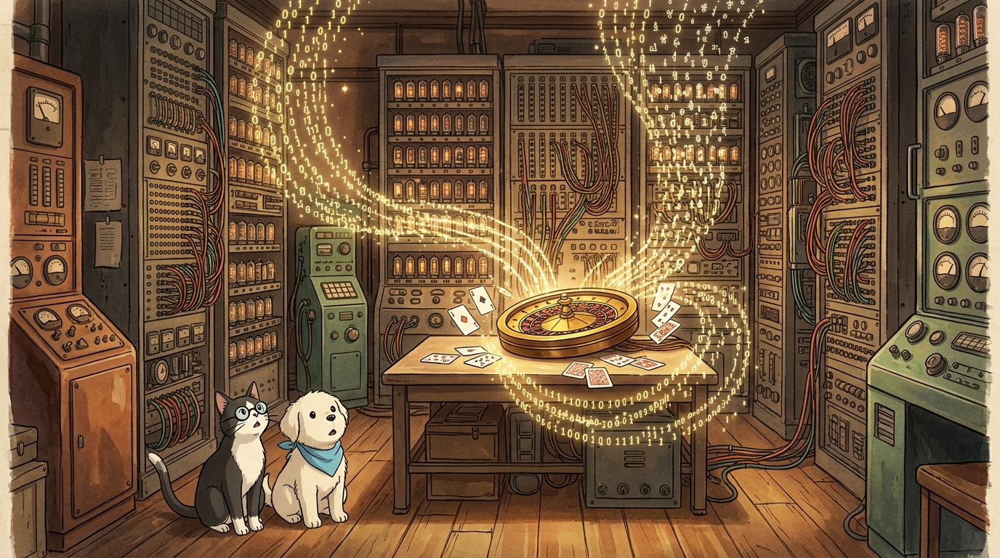
**그림 09-0-2-6** 거대한 진공관 컴퓨터 회로와 카지노 룰렛의 무작위 난수가 만나 현대 과학 시뮬레이션으로 피어난 역사적인 만남

- **컴퓨터와 난수의 폭발적 시너지**:
  - 손으로 카드를 섞거나 주사위를 굴리면 하루에 기껏해야 수백 번밖에 시행할 수 없음
  - 전자식 컴퓨터는 초당 수만 번의 난수를 뿜어내며 복잡한 시뮬레이션을 순식간에 완수
- **오늘날의 위상**:
  - 현대 통계물리학, 금융공학(옵션 가격 결정), 유전체학, 그리고 우리가 배우는 **강화학습**에 이르기까지 복잡계 과학의 핵심 엔진으로 굳건히 자리 잡음

> **[강의 스크립트]**
> 몬테카를로 기법이 진정한 날개를 단 것은 최초의 전자식 컴퓨터 에니악과 만났을 때였습니다. 사람이 손으로 주사위를 굴리면 하루에 몇백 번에 불과하지만, 진공관 컴퓨터는 초당 수만 번의 난수를 생성하며 복잡한 물리 시뮬레이션을 눈 깜짝할 사이에 해치웠습니다. 이로써 몬테카를로는 물리학과 금융, 그리고 오늘날의 강화학습에 이르는 현대 과학의 핵심 계산 엔진이 되었습니다.
---

# 09.0 몬테카를로법의 수학적 기초와 역사적 유래
## 09.0.2 몬테카를로법의 수학적 의미: 기댓값과 표본 평균의 등가성

역사적 유래를 알았으니, 이제 몬테카를로법이 왜 수학적으로 정당하고 완벽하게 동작하는지 그 엄밀한 수학적 뼈대를 살펴봅시다.

**그림 09-0-3-0** 이호진 교수님이 대형 칠판 앞에서 몬테카를로법의 핵심 수학 이론(기댓값과 표본 평균의 수렴)을 명쾌하게 강의하는 씬

- **몬테카를로법의 수학적 정의**:
  - 어떤 확률 변수 $X$의 이론적 기댓값 $\mathbb{E}[X]$를 직접 구하기 어려울 때,
  - 독립적인 무작위 표본 $X^{(1)}, X^{(2)}, \dots, X^{(n)}$을 다수 추출하여
  - 그 **산술 평균(표본 평균)**으로 기댓값을 대신 추정하는 수치 해석 기법!
- **기댓값의 표본 평균 근사식**:
  $$\mathbb{E}[X] pprox rac{1}{n} \sum_{i=1}^n X^{(i)}$$

> **[강의 스크립트]**
> 구점영점이 절에서는 몬테카를로법의 수학적 뼈대를 칠판을 통해 살펴봅니다. 몬테카를로의 수학적 정의는 지극히 명료합니다. 어떤 확률 변수 엑스의 이론적 기댓값을 적분이나 무한급수로 구하기 어려울 때, 독립적인 표본들을 대량으로 뽑아서 그 산술 평균으로 기댓값을 추정하는 것입니다. 이것이 화면에 보이는 기댓값과 표본 평균의 근사식입니다.
---

# 09.0 몬테카를로법의 수학적 기초와 역사적 유래
## 기댓값 E[X]와 표본 평균 근사 수식의 3대 핵심 블록 해부

수학 기호들이 의미하는 물리적 의미를 3개 블록으로 분해하여 직관적으로 이해해 봅시다.

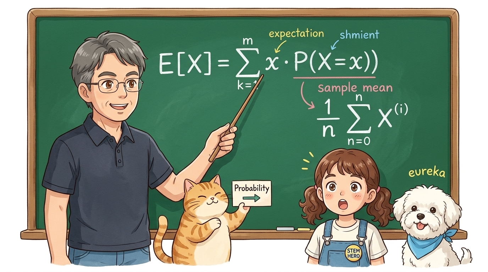
**그림 09-0-3-0b** 기댓값과 표본 평균 근사 수식을 3대 블록으로 분해하여 설명하는 이호진 교수님과 연구실 구성원들

- **1. 좌변 $\mathbb{E}[X]$ (기댓값, Expectation)**:
  - 우리가 알고자 하는 모집단의 참된 중심값(이론적 평균)
  - 연속 확률 변수라면 $\int x \cdot p(x) dx$, 이산 확률 변수라면 $\sum x \cdot p(x)$
- **2. 우변 $rac{1}{n} \sum_{i=1}^n X^{(i)}$ (표본 평균, Sample Average)**:
  - 실제로 에이전트가 환경과 부딪혀 직접 수집한 $n$개의 경험 데이터들의 단순 산술 평균
- **3. 근사 기호 $pprox$ (Approximate)**:
  - 표본의 수 $n$이 유한할 때는 오차가 존재하지만, $n$이 커질수록 두 값의 차이가 완벽히 사라짐을 뜻함

> **[강의 스크립트]**
> 수식의 세 가지 구성 요소를 분석해 봅시다. 좌변의 기댓값 이 엑스는 우리가 구하고자 하는 우주의 참된 평균입니다. 만약 확률 밀도 함수를 모르면 적분을 할 수 없지요. 하지만 우변을 보십시오. 에이전트가 직접 부딪혀 수집한 엔 개의 표본을 단순히 더해서 엔으로 나눈 산술 평균입니다. 표본 수 엔이 커질수록 물결표 근사는 완벽한 등호로 수렴하게 됩니다.
---

# 09.0 몬테카를로법의 수학적 기초와 역사적 유래
## 09.0.2.1 대수의 법칙: 표본이 쌓이면 오차는 필연적으로 0에 수렴한다

"표본을 많이 뽑아서 평균을 내면 정말로 참 기댓값과 완벽히 같아지는가?"라는 질문에 수학은 **대수의 법칙(Law of Large Numbers)**으로 확답을 줍니다.

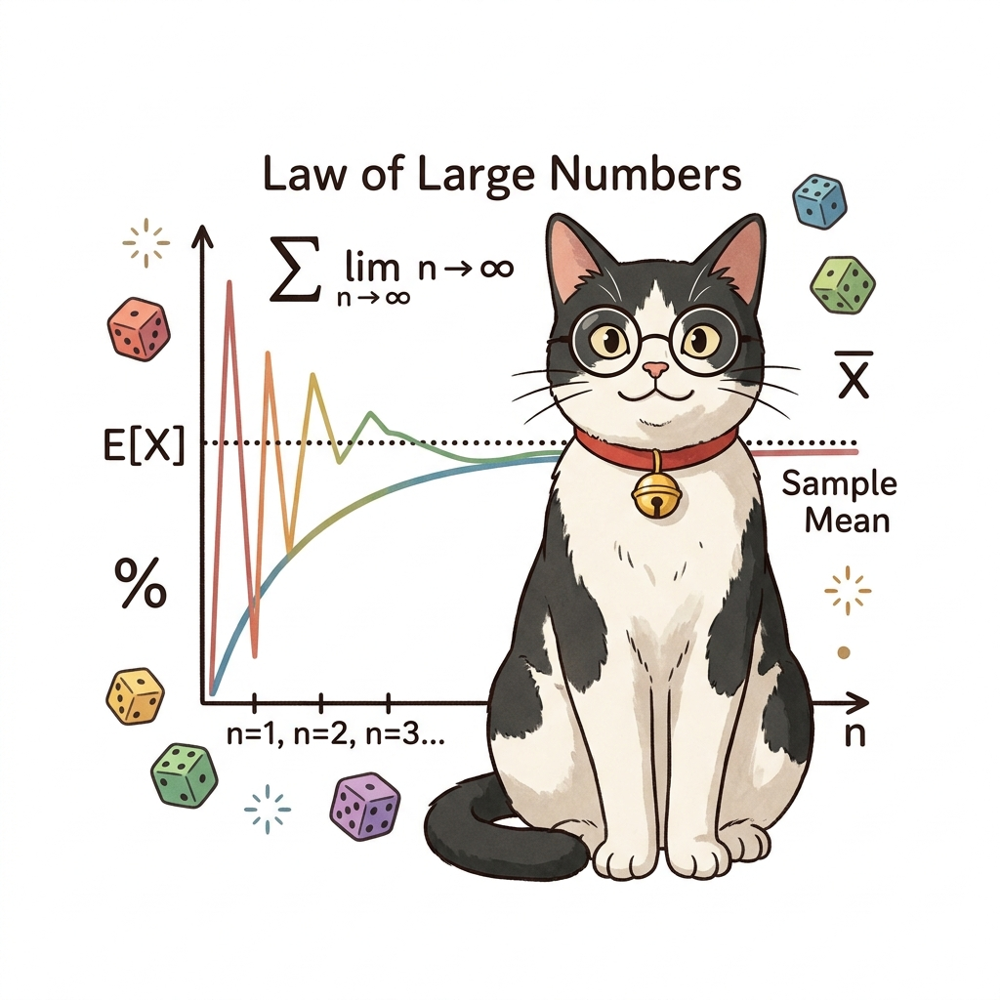
**그림 09-0-3-1** 표본 수(n)가 적을 때는 요동치다 표본이 누적될수록 참 기댓값으로 정밀하게 수렴하는 대수의 법칙 다이어그램

- **대수의 법칙의 핵심**:
  - 표본의 크기 $n$이 무한히 커질수록, 표본 평균은 거의 확실하게(Almost Surely) 참 기댓값 $\mathbb{E}[X]$에 수렴합니다.
  - 표본이 적은 초기($n < 10$)에는 분산 때문에 심하게 요동치지만, 표본이 누적될수록 우연에 의한 편향들이 상쇄되면서 참값으로 안정화됩니다.

> **[강의 스크립트]**
> 구점영점이점일 절입니다. 대수의 법칙은 몬테카를로법의 절대적인 수학적 헌법입니다. 화면의 그래프를 보십시오. 표본 수가 적은 초기에는 평균값이 심하게 위아래로 출렁입니다. 하지만 표본 수가 백 개, 천 개로 늘어남에 따라 우연에 의한 요동이 서로 상쇄되면서, 놀랍도록 반듯한 직선 형태의 참 기댓값으로 수렴해 들어갑니다.
---

# 09.0 몬테카를로법의 수학적 기초와 역사적 유래
## 대수의 법칙 극한 수식의 3대 블록 분석

대수의 법칙을 엄밀한 수학 기호로 표현하면 다음과 같습니다.

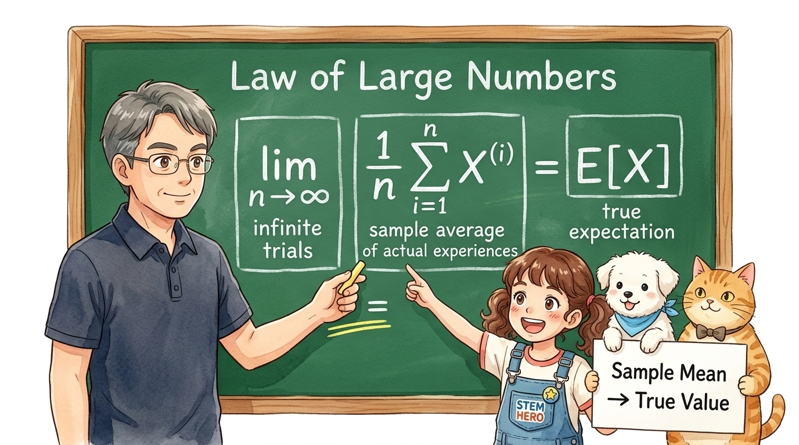
**그림 09-0-3-1b** 대수의 법칙 극한 수식의 3대 블록 분석

$$\lim_{n 	o \infty} rac{1}{n} \sum_{i=1}^n X^{(i)} = \mathbb{E}[X]$$

- **1. 블록 1: $\lim_{n 	o \infty}$ (표본 추출의 극한)**:
  - 에이전트가 환경 속에서 에피소드를 끊임없이 거듭하며 경험 데이터($n$)를 무한히 축적해 나가는 과정
- **2. 블록 2: $rac{1}{n} \sum_{i=1}^n X^{(i)}$ (표본 평균의 누적 집계)**:
  - 수집된 모든 개별 보상과 수익 표본들의 총합을 전체 시행 횟수로 나누어 정산하는 통계적 집계
- **3. 블록 3: $= \mathbb{E}[X]$ (참 기댓값으로의 수렴)**:
  - 근사 기호($pprox$)가 아닌 **완전한 등호($=$)**로 종착하여, 이론적 참값과 오차가 0이 됨을 보장

> **[강의 스크립트]**
> 대수의 법칙 극한 수식을 보십시오. 리미트 엔이 무한대로 갈 때, 표본 평균은 마침내 근사 기호가 아닌 완벽한 등호로 참 기댓값에 도달합니다. 에이전트가 환경 속에서 에피소드를 끊임없이 거듭하며 경험 데이터를 많이 축적하기만 하면, 미지의 가치 함수를 수학적 오차 없이 완벽하게 복원할 수 있다는 절대적인 보증수표인 셈입니다.
---

# 09.0 몬테카를로법의 수학적 기초와 역사적 유래
## 주사위 예시로 살펴보는 대수의 법칙 수렴 과정

공평한 육면체 주사위를 굴릴 때 눈금 $X \in \{1, 2, 3, 4, 5, 6\}$의 이론적 참 기댓값은 정확히 $3.5$입니다.

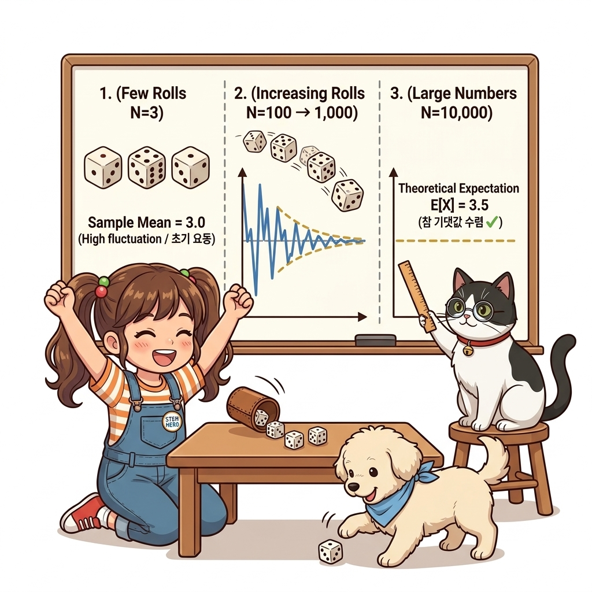
**그림 09-0-3-1c** 주사위를 굴리는 횟수(n)가 증가할수록 표본 평균이 참 기댓값 E[X] = 3.5로 정밀하게 수렴해가는 시각화

- **이론적 기댓값 계산**:
  $$\mathbb{E}[X] = rac{1 + 2 + 3 + 4 + 5 + 6}{6} = 3.5$$
- **시행 횟수에 따른 표본 평균의 변화**:
  - $n = 1$: 눈금 6이 나오면 표본 평균은 6.0 (오차 +2.5)
  - $n = 10$: 주사위 몇 번에 평균이 2.8 ~ 4.2 사이로 출렁임
  - $n = 1,000$: 표본 평균이 3.498...로 참값 3.5에 극도로 근접!

> **[강의 스크립트]**
> 주사위 던지기를 예로 들어보겠습니다. 공평한 주사위의 눈금 기댓값은 삼점오입니다. 주사위를 처음 한 번 던져서 육이 나오면 평균은 육점영이 되어 오차가 큽니다. 하지만 천 번을 굴려 평균을 내면 삼점사구팔처럼 참값 삼점오에 완벽히 달라붙습니다. 확률 공식을 몰라도 던져서 평균만 내면 삼점오라는 물리적 진리를 맞출 수 있는 것입니다.
---

# 09.0 몬테카를로법의 수학적 기초와 역사적 유래
## 09.0.2.2 동전 던지기로 원주율 π 구하기: 기하학적 몬테카를로

이제 몬테카를로 기법의 가장 유명한 고전적 예제인 **'동전 던지기로 원주율 $\pi$ 계산하기'**를 살펴봅시다.

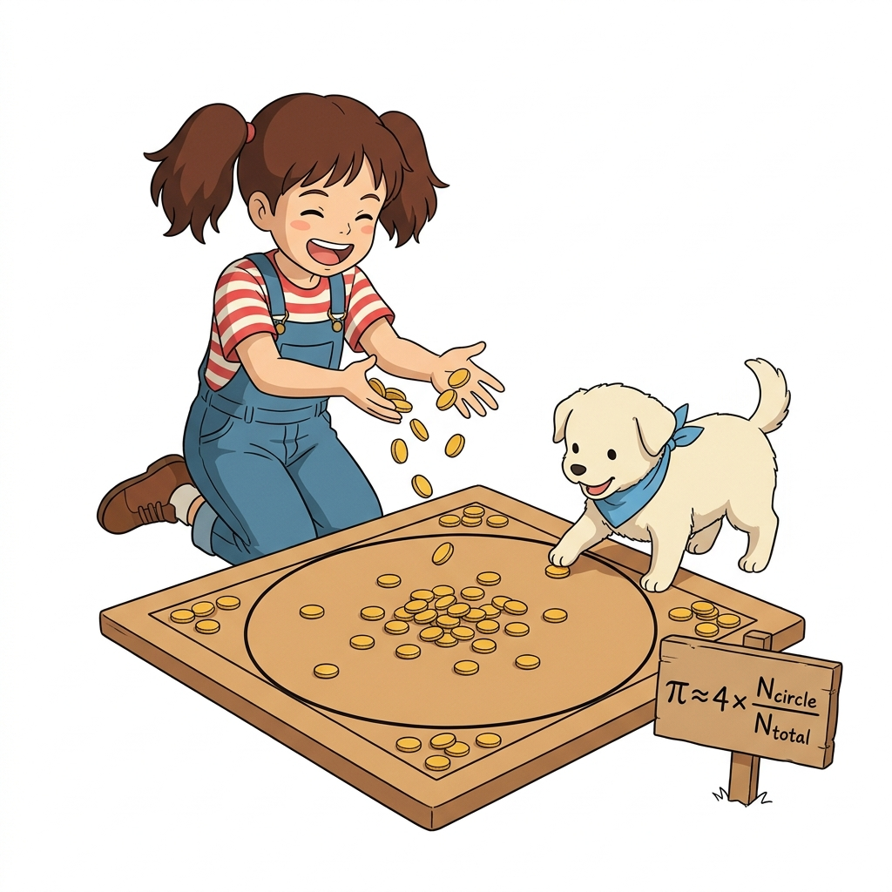
**그림 09-0-3-2** 사각형 안에 내접하는 원을 그리고 무작위로 동전을 던져 원주율 π를 기하학적으로 추정하는 도로시와 토토

- **실험 세팅**:
  - 1. 바닥에 한 변의 길이가 $2r$인 커다란 정사각형을 그림
  - 2. 그 정사각형 안에 딱 맞게 들어가는 반지름 $r$인 원(내접원)을 그림
  - 3. 눈을 감고 정사각형 영역 안에 무작위로 균등하게 동전(점) $N$개를 던짐

> **[강의 스크립트]**
> 구점영점이점이 절에서는 몬테카를로의 백미인 원주율 파이 추정 실험을 다룹니다. 바닥에 한 변의 길이가 이 알인 정사각형을 그리고, 그 안에 반지름이 알인 원을 꼭 맞게 그립니다. 그리고 눈을 감은 채 정사각형 안에 무작위로 동전을 골고루 던집니다. 과연 이 무작위 투척으로 어떻게 원주율 파이를 계산할 수 있을까요?
---

# 09.0 몬테카를로법의 수학적 기초와 역사적 유래
## 정사각형과 내접원의 기하학적 치수 및 면적 공식

두 도형의 면적 공식을 대조해 보면 놀라운 기하학적 비례 관계가 나타납니다.

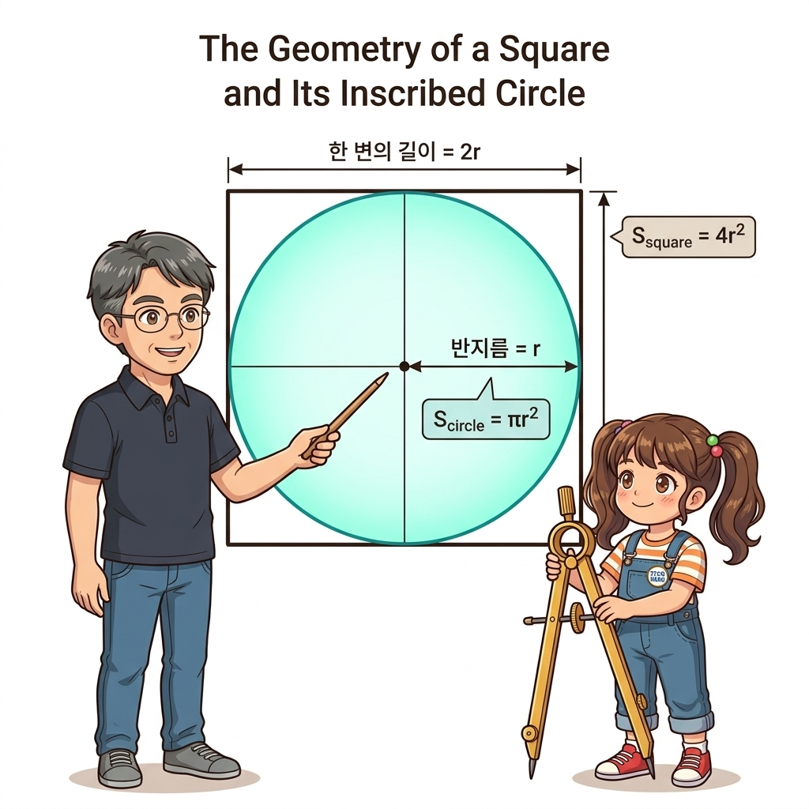
**그림 09-0-3-2a** 한 변이 2r인 외접 정사각형과 반지름 r인 내접원의 기하학적 치수 및 면적 공식 구조도

- **1. 외접 정사각형의 넓이 ($S_{	ext{square}}$)**:
  $$S_{	ext{square}} = 	ext{가로} 	imes 	ext{세로} = 2r 	imes 2r = 4r^2$$
- **2. 내접원의 넓이 ($S_{	ext{circle}}$)**:
  $$S_{	ext{circle}} = \pi r^2$$
- **3. 두 도형의 면적 비율**:
  $$rac{S_{	ext{circle}}}{S_{	ext{square}}} = rac{\pi r^2}{4r^2} = rac{\pi}{4}$$

> **[강의 스크립트]**
> 기하학적 치수를 살펴봅시다. 외접 정사각형의 한 변은 이 알이므로 면적은 사 알 제곱입니다. 반면 안쪽 원의 면적은 파이 알 제곱이지요. 사각형 면적 분의 원의 면적 비율을 구해보면, 반지름 알 제곱이 약분되면서 정확히 사 분의 파이라는 순수한 상수 비율만 남게 됩니다.
---

# 09.0 몬테카를로법의 수학적 기초와 역사적 유래
## 표본 비율과 도형 면적 비율의 기하학적 확률 일치

정사각형 전체 영역에 동전을 무작위로 균등하게 던지면, 어떤 동전이 원 내부에 떨어질 확률은 정확히 두 도형의 면적 비율과 같습니다.

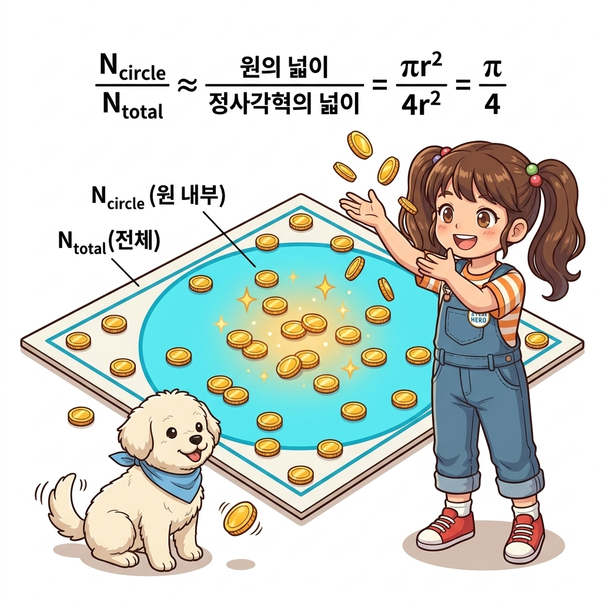
**그림 09-0-3-2b1** 무작위 동전 투척 시 원 내부 동전 비율이 면적 비율 π/4에 수렴하는 기하학적 확률 비례 원리

- **기하학적 확률 비례식**:
  $$P(	ext{원 내부 낙하}) = rac{S_{	ext{circle}}}{S_{	ext{square}}} = rac{\pi}{4}$$
- **표본을 통한 근사**:
  - 전체 던진 동전의 개수를 $N_{	ext{total}}$, 원 내부에 떨어진 동전의 개수를 $N_{	ext{circle}}$이라 하면:
  $$rac{N_{	ext{circle}}}{N_{	ext{total}}} pprox rac{S_{	ext{circle}}}{S_{	ext{square}}} = rac{\pi}{4}$$

> **[강의 스크립트]**
> 동전을 골고루 던졌다면, 어떤 동전이 원 안에 떨어질 물리적 확률은 전체 면적 중 원이 차지하는 면적의 비율과 정확히 일치합니다. 따라서 던진 전체 동전 수 분의 원 안에 들어간 동전 수의 표본 비율은 바로 사 분의 파이라는 기하학적 면적비에 수렴하게 됩니다.
---

# 09.0 몬테카를로법의 수학적 기초와 역사적 유래
## 원주율 π 유도 공식: 왜 '4'를 곱할까?

표본 비율 식의 양변에 4를 곱하면, 놀랍게도 좌변에 **원주율 $\pi$만 단독으로 분리**됩니다!

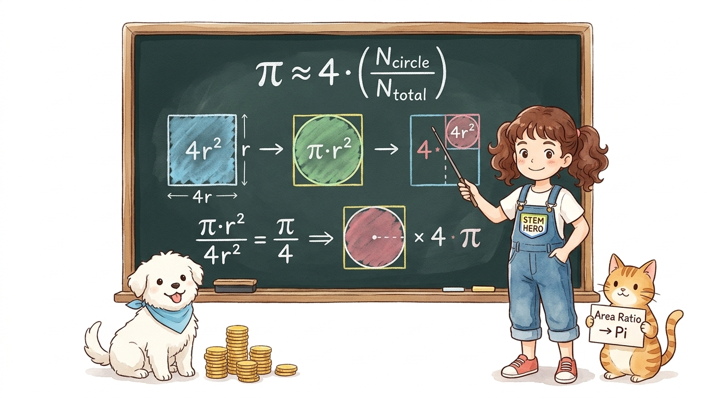
**그림 09-0-3-2b2** 기하학적 비례 관계에서 원주율 π를 유도해내는 과정을 설명하는 도로시와 토토, 지니

$$\pi pprox 4 	imes rac{N_{	ext{circle}}}{N_{	ext{total}}}$$

- **수식 기호의 해부**:
  - $\pi$: 우리가 구하고자 하는 원주율 참값 (3.14159...)
  - $4$: 정사각형 면적($4r^2$)에서 유래된 기하학적 상수
  - $N_{	ext{circle}}$: 원 안에 쏙 들어간 성공 표본의 개수
  - $N_{	ext{total}}$: 바닥에 던진 전체 표본 시행 횟수

> **[강의 스크립트]**
> 화면의 수식을 보십시오. 양변에 사를 곱해주면 좌변에 순수한 원주율 파이만 홀로 남습니다. 즉, 전체 동전 수 분의 원 안의 동전 수 비율에 숫자 사를 곱해주기만 하면, 복잡한 삼각함수나 원주 측정 도구 없이도 원주율 파이를 완벽히 계산해낼 수 있습니다.
---

# 09.0 몬테카를로법의 수학적 기초와 역사적 유래
## 표본 비율의 물리적 의미와 '4'의 수학적 기원

이 간단한 공식이 성립하는 수학적 원리를 한 걸음 더 깊이 파고들어 봅시다.

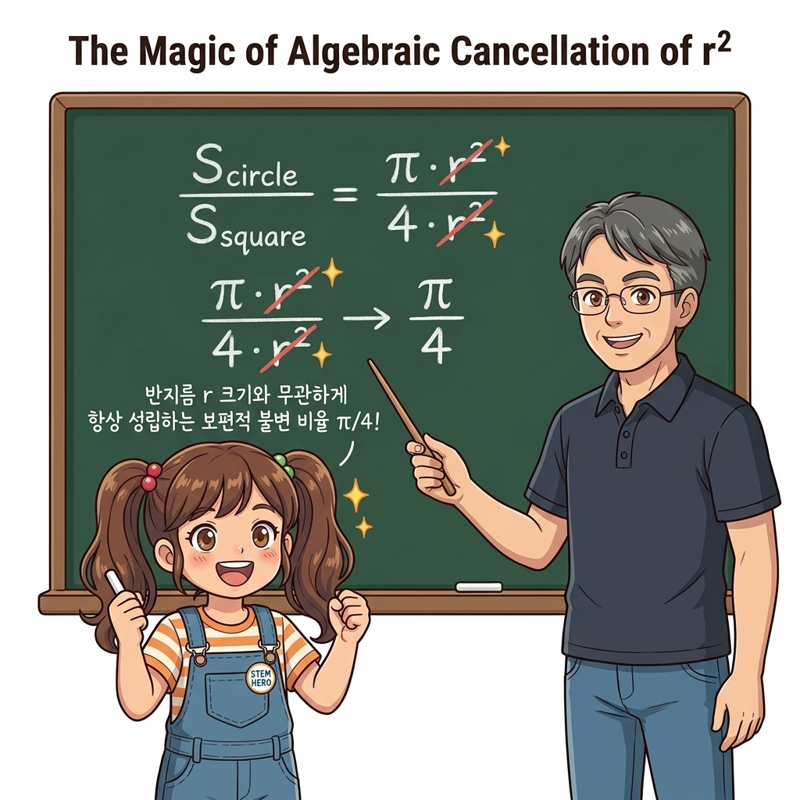
**그림 09-0-3-2c2** 외접 정사각형과 내접원 면적 비례식에서 반지름 r²이 대수학적으로 소거되고 π/4만 남는 약분 과정

- **반지름 $r$의 완전한 소거**:
  - 정사각형 넓이는 $(2r)^2 = 4r^2$, 원의 넓이는 $\pi r^2$
  - 비례식을 세우면 분모와 분자의 $r^2$이 약분되어 사라집니다!
  - 즉, **연못의 크기가 손바닥만 하든 축구장만 하든 결과는 항상 동일**합니다.
- **숫자 '4'의 정체**:
  - 분모에 남아있던 사각형의 기하학적 상수 '4'를 없애기 위해 양변에 4를 곱해준 것입니다.

> **[강의 스크립트]**
> 왜 하필 사를 곱할까요? 정사각형의 넓이는 이 알의 제곱인 사 알 제곱이고, 원의 넓이는 파이 알 제곱입니다. 두 식을 나누면 반지름 알 제곱이 깨끗하게 약분되어 사라집니다. 연못의 크기가 손바닥만 하든 태평양만 하든 전혀 상관없이, 분모의 사를 없애주기 위해 양변에 사를 곱해준 것입니다.
---

# 09.0 몬테카를로법의 수학적 기초와 역사적 유래
## 동전 던지기 횟수 N이 증가함에 따른 단계별 정밀 수렴

시행 횟수 $N$이 커질수록 원주율 추정치가 어떻게 참값에 도달하는지 살펴봅시다.

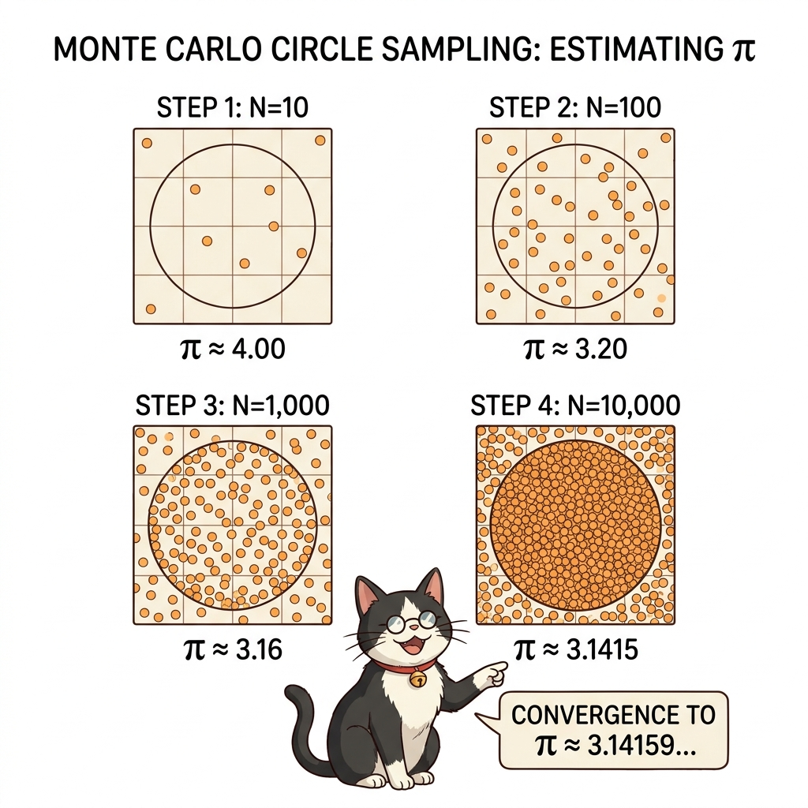
**그림 09-0-3-2d** 동전 던지기 횟수 N이 증가할수록 오차가 줄어들며 참값 3.14159...로 수렴해 가는 4단계 시각화

- **단계별 수렴 현황**:
  - **STEP 1 ($N=10$)**: 동전 10개가 모두 원 안에 떨어지면 $\pi pprox 4.0$ (오차 극심)
  - **STEP 2 ($N=100$)**: 80개가 원 안에 들어가면 $\pi pprox 3.2$ (방향성 확보)
  - **STEP 3 ($N=1,000$)**: 790개가 들어가면 $\pi pprox 3.16$ (소수점 첫째 자리 안정)
  - **STEP 4 ($N=10,000$)**: 7,854개가 들어가면 $\pi pprox 3.1416$ (초정밀 수렴!)

> **[강의 스크립트]**
> 네 단계의 수렴 과정을 보십시오. 동전을 열 번 던졌을 때는 우연히 모두 원 안에 떨어져 사점영이라는 엉뚱한 값이 나옵니다. 하지만 백 번 던지면 삼점이, 천 번 던지면 삼점일육, 만 번을 던지면 삼점일사일육으로 참값 삼점일사에 완벽히 수렴합니다. 표본이 쌓일수록 무작위 오차가 기적처럼 사라지는 현상을 확인할 수 있습니다.
---

# 09.0 몬테카를로법의 수학적 기초와 역사적 유래
## 동전 던지기 시행 횟수별 오차 검증 표

표본 크기 $N$에 따른 오차의 감소 추이를 정량적으로 정리한 표입니다.

| 시행 단계 (*N*) | 전체 동전 (*N*total) | 원 내부 동전 (*N*circle) | 계산된 원주율 추정치 (4 × *N*circle / *N*total) | 참값(3.14159...)과의 오차 |
| :---: | :---: | :---: | :---: | :---: |
| **STEP 1** | 10 | 10 | **4.0000** | +0.8584 (초기 불안정) |
| **STEP 2** | 100 | 80 | **3.2000** | +0.0584 (오차 급감) |
| **STEP 3** | 1,000 | 790 | **3.1600** | +0.0184 (1% 이내 오차) |
| **STEP 4** | 10,000 | 7,854 | **3.1416** | **+0.00001 (초정밀 수렴)** |

- 💡 **핵심 시사점**:
  - 표본의 수 $N$이 10배 증가할 때마다 추정 오차는 대략 $rac{1}{\sqrt{N}}$ 비율로 안정적으로 감소합니다.

> **[강의 스크립트]**
> 정리된 오차 표를 보십시오. 시행 횟수가 열 번에서 만 번으로 늘어남에 따라, 오차가 영점팔오에서 영점영영영영일로 급격히 줄어듭니다. 몬테카를로법의 오차는 표본 수의 제곱근에 반비례하여 줄어든다는 통계학적 특성을 지니며, 충분한 표본만 확보되면 원하는 수준의 정밀도에 반드시 도달할 수 있습니다.
---

# 09.0 몬테카를로법의 수학적 기초와 역사적 유래
## 09.0.3 핵심 정리: 몬테카를로법의 3대 수학적 기둥

몬테카를로 기법은 복잡한 환경 모델과 확률 전이 공식을 전혀 몰라도, 에이전트가 직접 부딪히며 축적한 **무작위 경험 표본들의 평균만으로 참된 가치와 최적 정책에 도달하는 강력한 방법론**입니다.

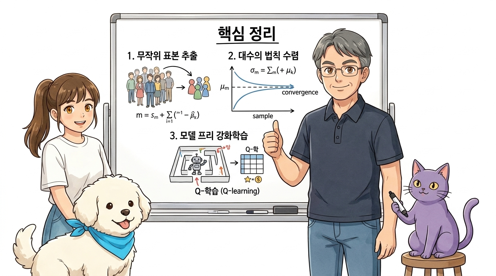
**그림 09-0-3-3** 몬테카를로법의 3대 핵심 기둥(무작위 표본 추출, 대수의 법칙 수렴, 모델 프리 학습)을 총정리하는 이호진 교수님과 연구실 4인방

- **몬테카를로법의 3대 기둥**:
  - 1. **무작위 표본 추출 (Random Sampling)**: 복잡한 수식 대신 무작위 경험 수집
  - 2. **대수의 법칙 기반 수렴성 (Law of Large Numbers)**: 표본이 누적되면 참 기댓값으로 완벽 수렴
  - 3. **모델 프리 강화학습의 수학적 초석 (Model-Free RL)**: 환경 전이 확률 $P(s' \mid s, a)$ 없이도 가치 함수 학습

> **[강의 스크립트]**
> 구점영점삼 절 총정리입니다. 오늘 학습한 몬테카를로법의 본질은 세 개의 기둥으로 요약됩니다. 첫째, 복잡한 공식을 풀지 않고 무작위 표본을 대량으로 수집한다는 점. 둘째, 대수의 법칙에 의해 표본 평균이 참 기댓값으로 필연적으로 수렴한다는 점. 셋째, 이를 통해 환경 모델이 없는 블랙박스 상태에서도 최적 가치와 정책을 찾아낼 수 있다는 점입니다.
---

# 09.0 몬테카를로법의 수학적 기초와 역사적 유래
## 무작위 표본 추출과 모델 프리 강화학습의 결합

몬테카를로법이 어떻게 현대 무모델 강화학습의 굳건한 토대가 되었는지 정리해 봅시다.

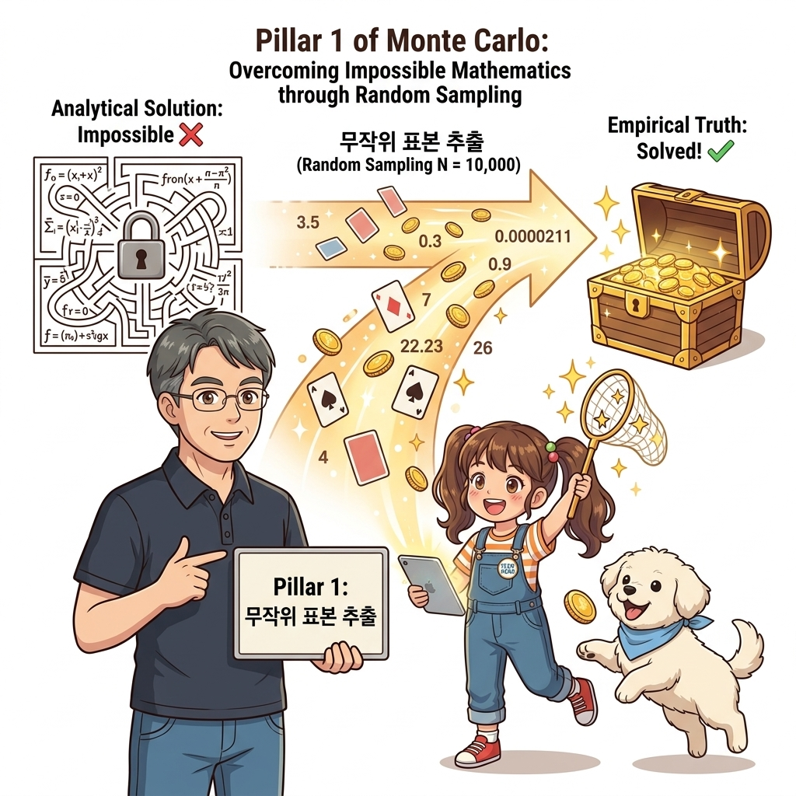
**그림 09-0-3-3a** 복잡한 수식과 해석적 난제를 무작위 표본의 대량 수집으로 극적으로 돌파하는 제1기둥: 무작위 표본 추출

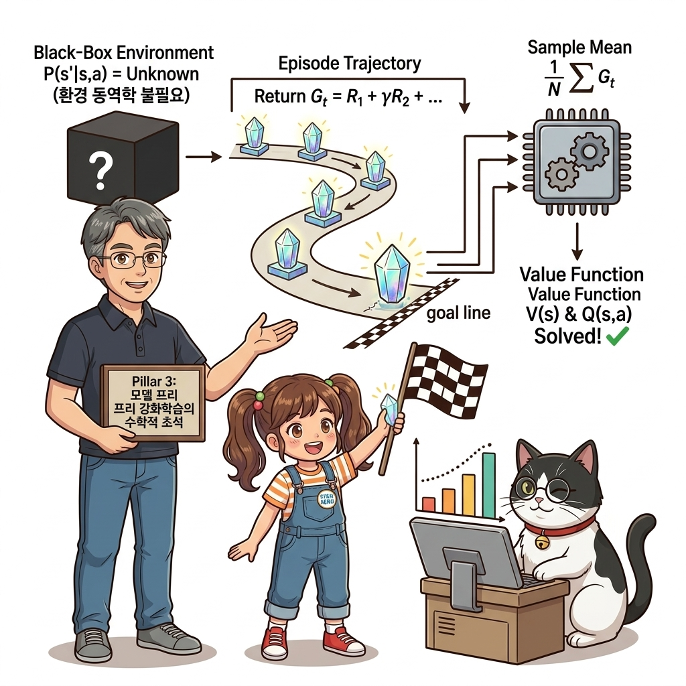
**그림 09-0-3-3b** 환경의 확률 법칙을 모르는 블랙박스 상태에서도 에피소드 경험 표본의 평균만으로 가치 함수를 완벽히 학습하는 제3기둥: 모델 프리 강화학습

- 👨‍🏫 **이호진 교수님의 직강 노트**:
  - "몬테카를로법의 진정한 위력은 '모든 공식을 완벽히 알아야만 문제를 풀 수 있다'는 고정관념을 깨부순 데 있습니다."
  - "환경의 법칙을 몰라도 직접 경험해 보고 평균을 내면 진리에 도달할 수 있다는 이 담대한 발상이, 바로 현대 모델-프리 강화학습의 위대한 첫걸음이 되었습니다."

> **[강의 스크립트]**
> 좌측의 표본 추출 다이어그램과 우측의 모델 프리 학습도를 주목해 주십시오. 몬테카를로법의 위대함은 환경의 수학 공식을 몰라도 직접 부딪혀 평균을 내면 진리에 도달할 수 있다는 고정관념의 파괴에 있습니다. 이 담대한 통계적 직관이 다음 시간부터 배울 파이썬 몬테카를로 정책 평가와 제어 알고리즘의 든든한 초석이 될 것입니다.