# 09.1 몬테카를로법 기초

몬테카를로법(Monte Carlo Method)의 대수적 기초를 공부합니다. 


무작위 샘플링을 반복하여 원하는 참값을 추정해내는 원리를 이해하기 위해, 주사위 던지기 실험 및 알려지지 않은 환경 모델의 비유를 통해 샘플 모델의 핵심을 파악해 봅시다!


**그림 09-1-1** 투명한 규칙으로 시뮬레이션 가능한 알려진 환경 모델과 수식을 알 수 없어 직접 부딪혀야 하는 블랙박스 미지 모델의 비교 (16:9 와이드)

---

### 지금까지는 환경 모델이 알려진 문제를 다뤘습니다

우리가 지난 단원들에서 다루었던 강화학습 문제들은 모두 컴퓨터 화면 속의 정밀한 바둑판과 같았습니다. 

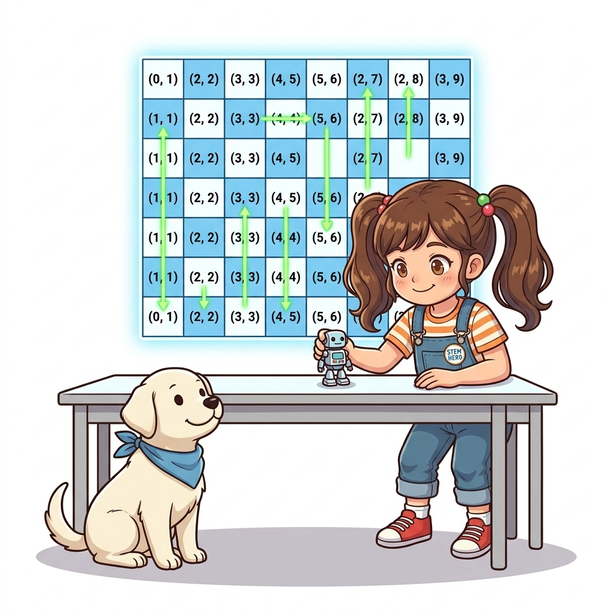
**그림 09-1-1a** 컴퓨터 화면 속 정밀한 바둑판처럼 상태와 규칙이 100% 투명하게 정해져 있는 알려진 환경 모델

---

예를 들어 앞서 다룬 '그리드 월드(Grid World)' 문제에서는 에이전트의 행동에 따른 다음 상태(위치)와 보상이 명확했습니다. 

에이전트가 어떤 칸에서 '오른쪽' 버튼을 눌렀을 때, 벽에 부딪힐지 아니면 다음 칸으로 이동할지, 그리고 그 칸에 도달했을 때 사과 보상을 받을지 독버섯 감점을 받을지가 한 치의 오차도 없이 미리 정해져 있었습니다.

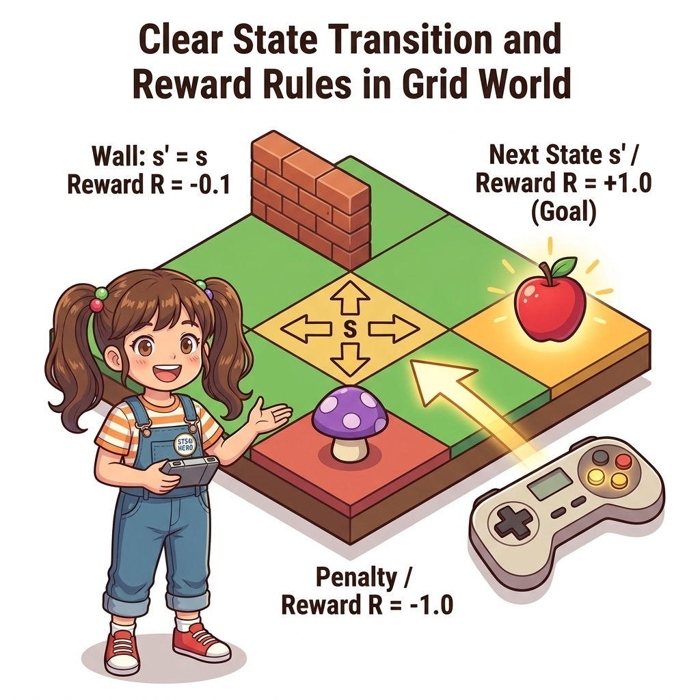
**그림 09-1-1b** 그리드월드에서 에이전트의 행동에 따른 다음 상태 전이와 즉각 보상 규칙이 사전에 명확하게 정해져 있는 구조

---

수식으로 표현하면 **상태 전이 확률 *p*(*s*' | *s*, *a*)**와 **보상 함수 *r*(*s*, *a*, *s'*)**를 완벽하게 이용할 수 있었습니다. 

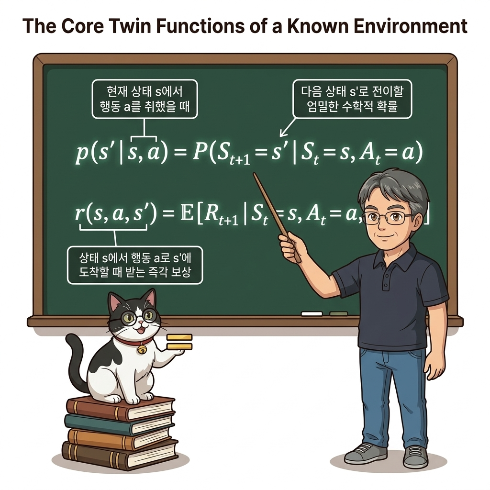
**그림 09-1-1c** 알려진 환경 모델의 2대 수학 기둥: 상태 전이 확률 p(s'|s,a)와 보상 함수 r(s,a,s')의 수식 기호 해부

---

만약 미끄러짐이 없는 완벽한 환경이라면 상태 전이가 결정적(Deterministic)이므로, 다음 상태를 나타내는 수학 함수 *s'* = *f*(*s*, *a*)로 딱 떨어지게 나타낼 수도 있었습니다.

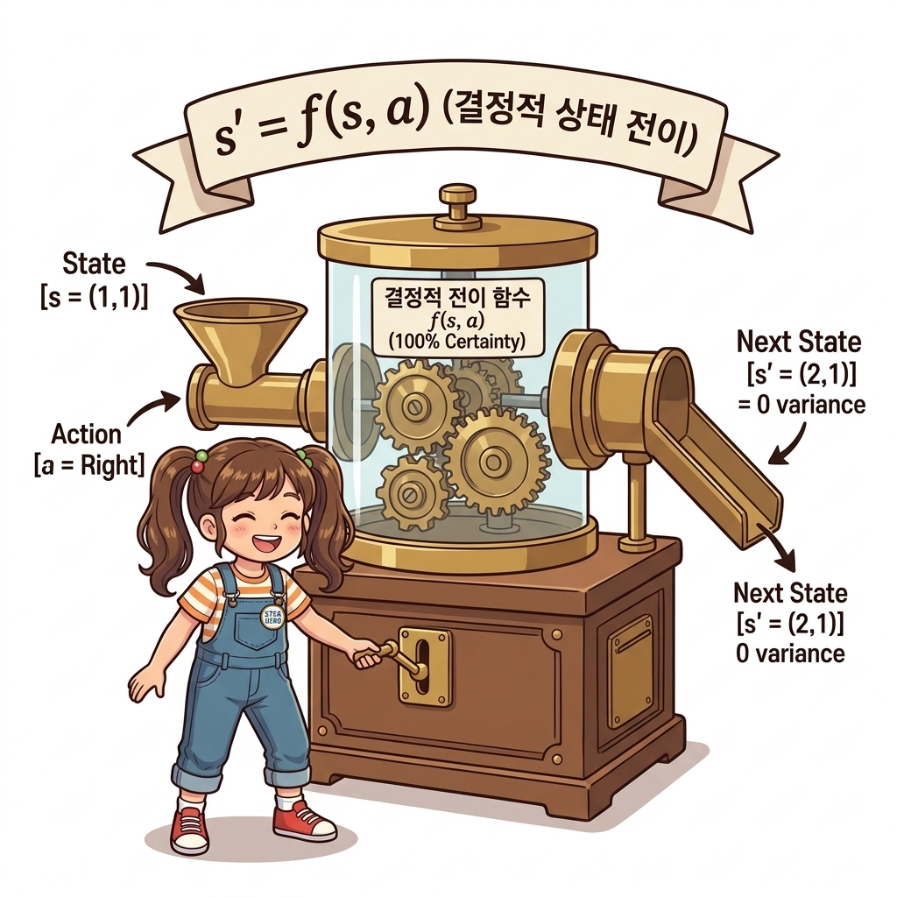
**그림 09-1-1d** 미끄러짐이 없는 완벽한 환경에서의 결정적 상태 전이 함수 s' = f(s, a)

---

이처럼 환경 모델이 알려진 문제에서는 에이전트 측에서 '상태, 행동, 보상'의 전이를 컴퓨터 시뮬레이션으로 완전히 계산할 수 있었습니다. 

마치 게임기 내부의 소스 코드를 에이전트가 손에 쥐고 있는 것과 같아서, 굳이 직접 캐릭터를 움직여보지 않고도 머릿속(메모리 연산)으로만 미래의 모든 가능성을 시뮬레이션하고 최적의 길을 찾아낼 수 있었습니다.

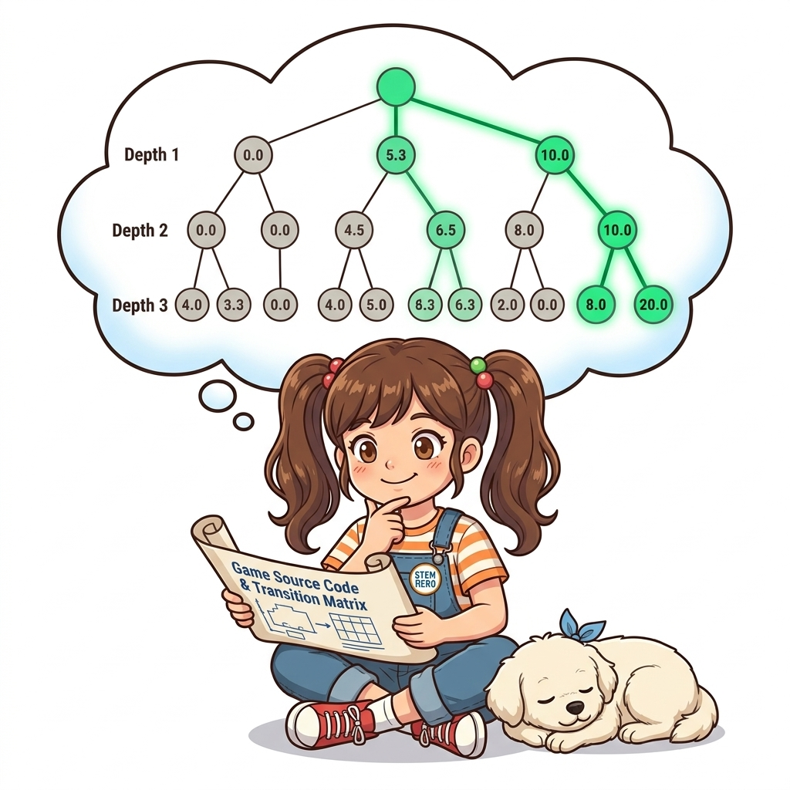
**그림 09-1-1e** 게임기 소스 코드를 쥔 에이전트가 메모리 연산만으로 미래의 모든 가능성을 사전 시뮬레이션하는 계획(Planning)

---

### 하지만, 현실에는 환경 모델을 알 수 없는 문제가 많습니다

온실 밖의 현실 세계로 한 걸음만 나가보면 상황은 180도 달라집니다. 

현실에는 환경 모델을 사전에 알 수 없는 문제가 셀 수 없이 많습니다.


**그림 09-1-1f** 온실 밖으로 나와 예측 불가능한 변수들이 소용돌이치는 미지의 현실 세계로 첫발을 내딛는 도로시

---

예를 들어 편의점의 '상품 재고 관리'나 도로 위를 달리는 '자율주행차의 주행 제어'를 생각해 봅시다. 

재고 관리 문제에서는 '내일 삼각김밥이 몇 개나 팔릴 것인가'가 환경의 상태 전이 확률에 해당합니다. 그런데 내일 삼각김밥의 판매량은 계절의 변화, 당일의 날씨(비나 눈), 주변 학교의 시험 기간, SNS에서 유행하는 최신 먹방 트렌드, 경기 변동, 심지어 손님 한 사람 한 사람의 기분까지 수많은 요인이 복잡하게 얽혀 결정되기 때문에 **사전에 수식으로 완벽하게 알아내기가 현실적으로 불가능**합니다. 

그 어떤 천재 수학자도 '내일 삼각김밥이 17개 팔릴 확률은 0.0842...'와 같은 엄밀한 확률 공식을 작성해 건네줄 수 없습니다.

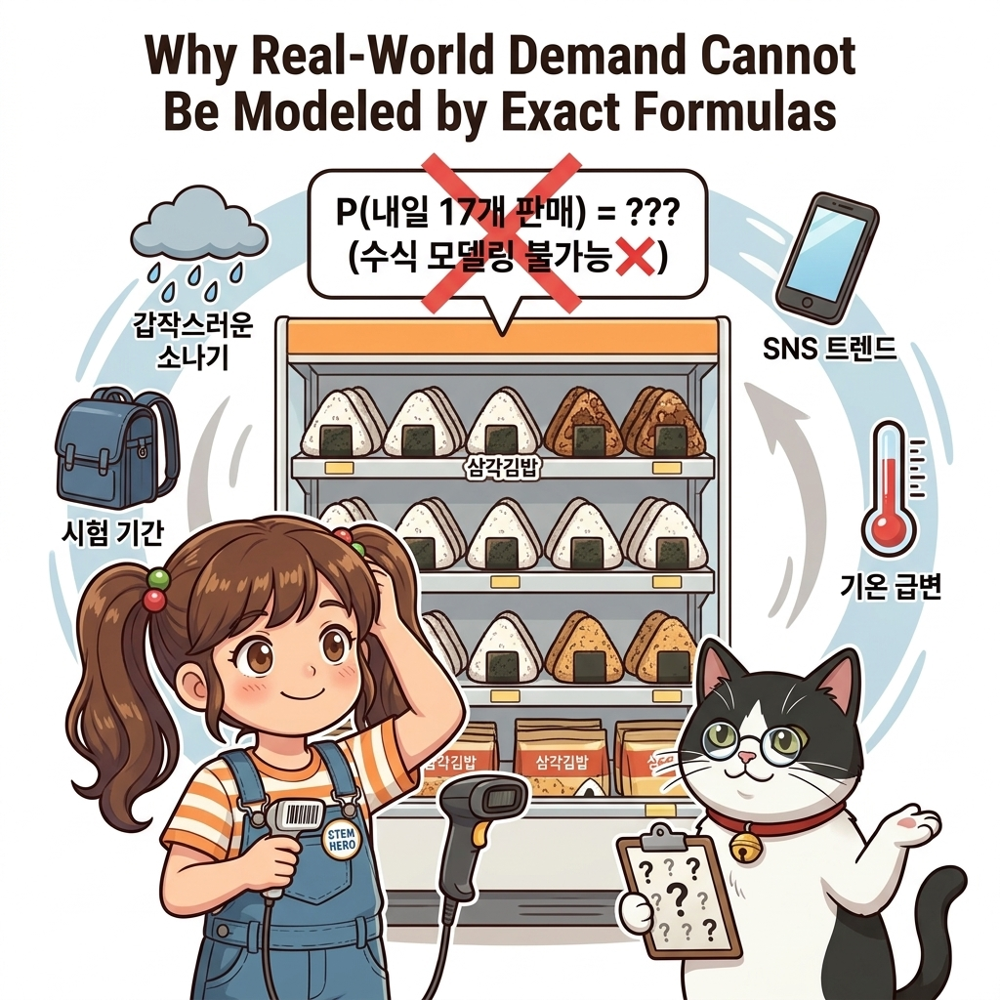
**그림 09-1-1g** 날씨, 시험기간, 트렌드 등 수많은 요인으로 인해 사전에 엄밀한 수식을 세울 수 없는 편의점 삼각김밥 재고 관리의 현실적 불확실성

---

또한, 물리학 법칙을 동원하여 상태 전이 확률을 이론적으로 세울 수 있더라도 **계산량이 너무 방대하여 계산 불능(Tractable)에 빠지는 경우**가 허다합니다. 

바둑이나 체스, 스타크래프트 같은 게임만 해도 가능한 상태와 행동의 조합이 우주의 원자 수(약 10<sup>80</sup>개)보다 훨씬 많습니다. 이 모든 경우의 수를 연립방정식으로 풀려고 들면 최신 슈퍼컴퓨터를 1억 년 동안 돌려도 답을 내지 못하고 멈춰버립니다.

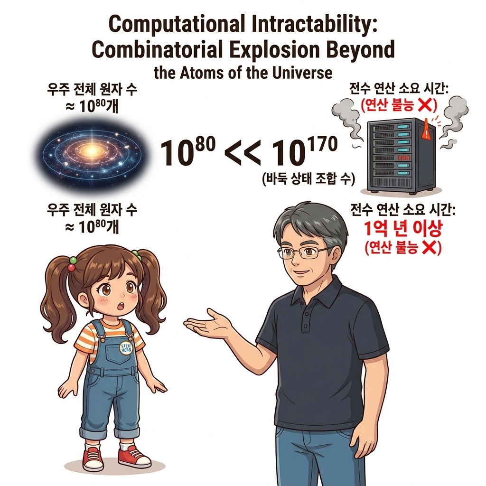
**그림 09-1-1h** 바둑이나 게임에서 우주 전체 원자 수(10^80)를 초과하는 경우의 수로 인한 슈퍼컴퓨터의 계산 불능 한계

---

얼마나 계산이 복잡해지는지 피부로 실감할 수 있도록, 이번 절에서는 우선 우리가 친숙하게 접할 수 있는 '주사위'를 예로 들어 간단한 비교 작업을 해보겠습니다.

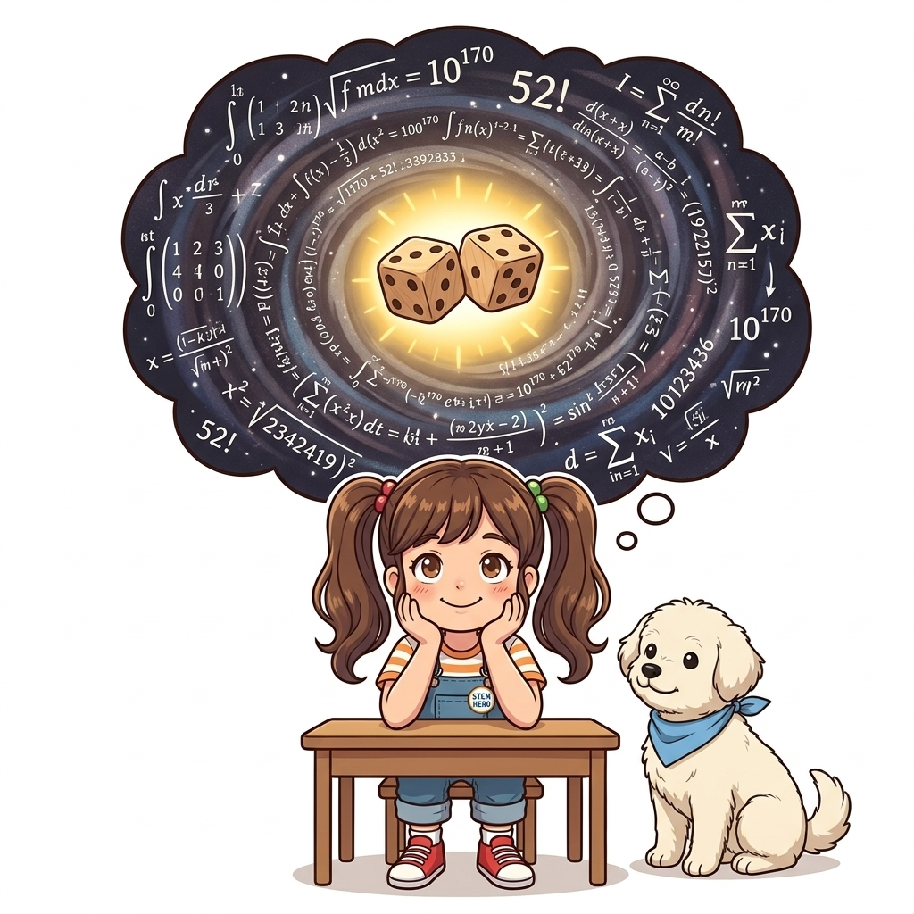
**그림 09-1-1i** 천문학적인 복잡한 계산의 소용돌이를 상상하며 아찔해하다가, 친근한 주사위 예시를 떠올리며 호기심을 반짝이는 도로시와 토토


---

## 09.1.1 주사위 눈의 합

주사위 두 개를 책상 위에 올려놓고 굴리는 문제를 상상해 봅시다. 

주사위는 정육면체이고 모서리가 균일하게 깎여 있어서, 각 눈(1부터 6까지)이 나올 확률은 정확하게 공평한 **1/6**이라고 가정합니다.

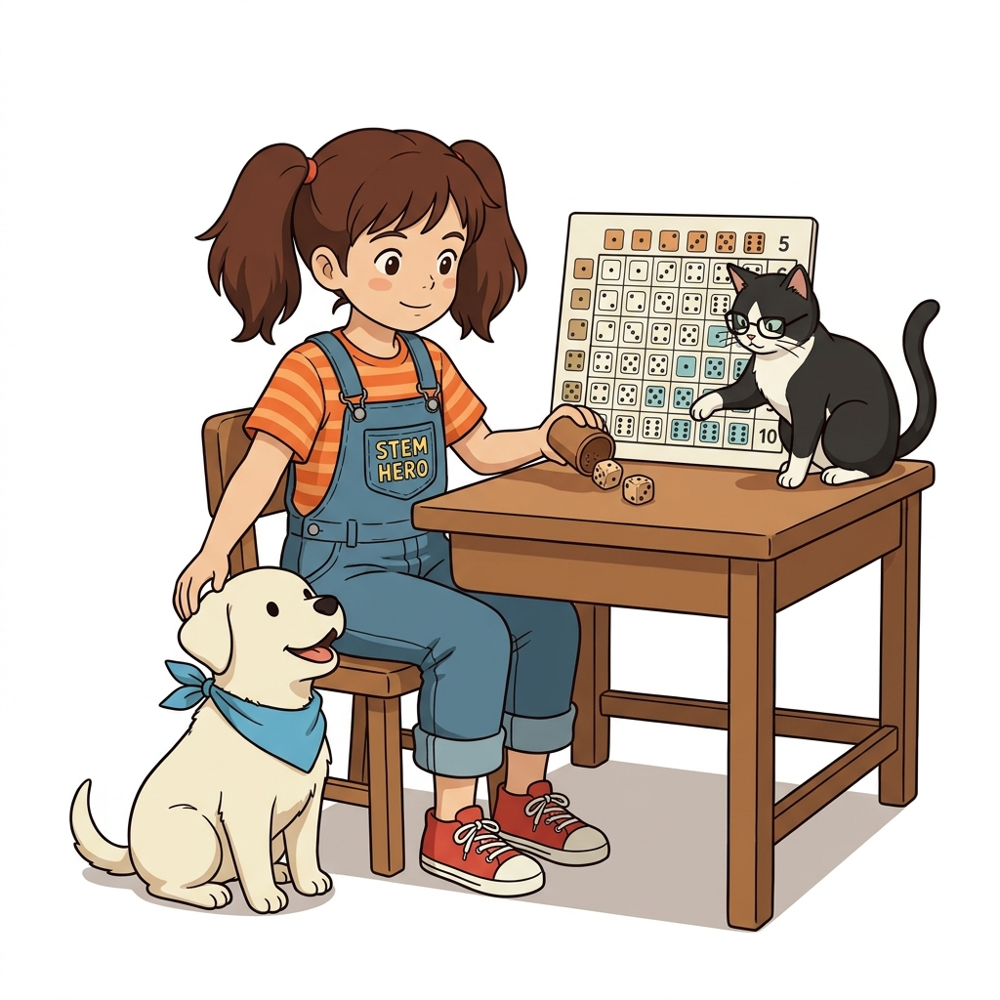
**그림 09-1-2** 주사위 2개를 던졌을 때 나타나는 36가지 눈금 조합 매트릭스와 확률 분포를 분석하는 도로시, 토토, 지니

---


### 2개 주사위의 확률 전개도와 분포

두 주사위를 던졌을 때 나올 수 있는 모든 경우의 수는 첫 번째 주사위의 눈(6가지)과 두 번째 주사위의 눈(6가지)을 곱한 6 × 6 = **36가지**입니다. 


**그림 09-1-2a** 두 주사위를 굴렸을 때 나타나는 6×6 = 36가지 가능한 모든 눈금 쌍의 전개 격자 매트릭스 


---


두 주사위 눈의 합을 집계해 보면, 가장 작은 합은 1 + 1 = 2이고 가장 큰 합은 6 + 6 = 12입니다. 

이때 각 합이 나오는 경우의 수를 세어보면 다음과 같습니다:

- 합이 2가 되는 경우: (1, 1) → 1가지
- 합이 3이 되는 경우: (1, 2), (2, 1) → 2가지
- 합이 4가 되는 경우: (1, 3), (2, 2), (3, 1) → 3가지
- 합이 5가 되는 경우: (1, 4), (2, 3), (3, 2), (4, 1) → 4가지
- 합이 6이 되는 경우: (1, 5), (2, 4), (3, 3), (4, 2), (5, 1) → 5가지
- **합이 7이 되는 경우**: (1, 6), (2, 5), (3, 4), (4, 3), (5, 2), (6, 1) → **6가지 (가장 많음!)**
- 합이 8이 되는 경우: (2, 6), (3, 5), (4, 4), (5, 3), (6, 2) → 5가지
- 합이 9가 되는 경우: (3, 6), (4, 5), (5, 4), (6, 3) → 4가지
- 합이 10이 되는 경우: (4, 6), (5, 5), (6, 4) → 3가지
- 합이 11이 되는 경우: (5, 6), (6, 5) → 2가지
- 합이 12가 되는 경우: (6, 6) → 1가지

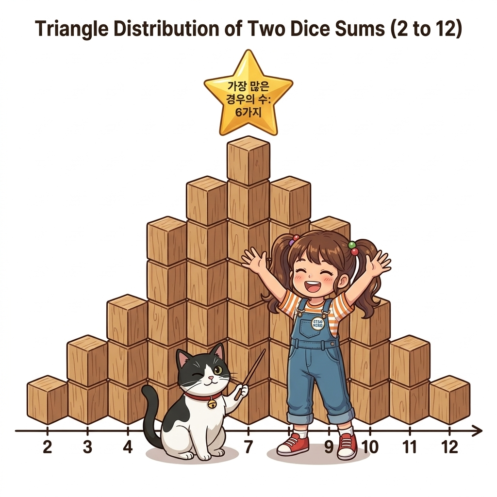
**그림 09-1-2a2** 두 주사위 눈의 합(2~12) 가짓수 집계와 합 7이 6가지로 최정점을 이루는 대칭 삼각형 피라미드 다이어그램


---


두 주사위 눈의 합을 집계하면 다음과 같은 대칭적인 확률 분포를 얻을 수 있습니다:

| 합 (*x*) | 2 | 3 | 4 | 5 | 6 | **7** | 8 | 9 | 10 | 11 | 12 |
| :---: | :---: | :---: | :---: | :---: | :---: | :---: | :---: | :---: | :---: | :---: | :---: | :---: | :---: |
| **나오는 가짓수** | 1 | 2 | 3 | 4 | 5 | **6** | 5 | 4 | 3 | 2 | 1 |
| **확률 *P*(*x*)** | 1/36 | 2/36 | 3/36 | 4/36 | 5/36 | **6/36** | 5/36 | 4/36 | 3/36 | 2/36 | 1/36 |

> [!NOTE]
> **💡 확률분포(Probability Distribution)란?**  
> 어떤 확률 변수(여기서는 '두 주사위 눈의 합 *X*')가 취할 수 있는 모든 개별 값과, 그 값들이 각각 나타날 확률 *P*(*X* = *x*)를 대응시켜 놓은 표나 그래프를 말합니다. 주사위 눈의 합은 최소 2부터 최대 12까지 가능하며, 7이 나올 확률이 6/36(약 16.7%)로 가장 높고 양쪽으로 갈수록 종 모양으로 확률이 낮아집니다.

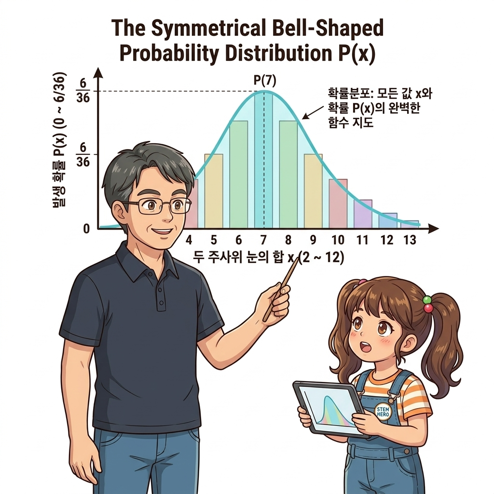
**그림 09-1-2a3** 두 주사위 눈의 합에 대한 대칭 종 모양(Bell-shaped) 확률 분포(Probability Distribution) 그래프

---


### 확률 분포를 통한 기댓값 계산

이 확률 분포를 알면 이론적 기댓값(Expected Value)을 다음과 같이 계산할 수 있습니다:

> ### (식 9.1-1) 이산 확률 변수의 이론적 기댓값
> E[*X*] = ∑<sub>*x*</sub> *x* · *P*(*X* = *x*)

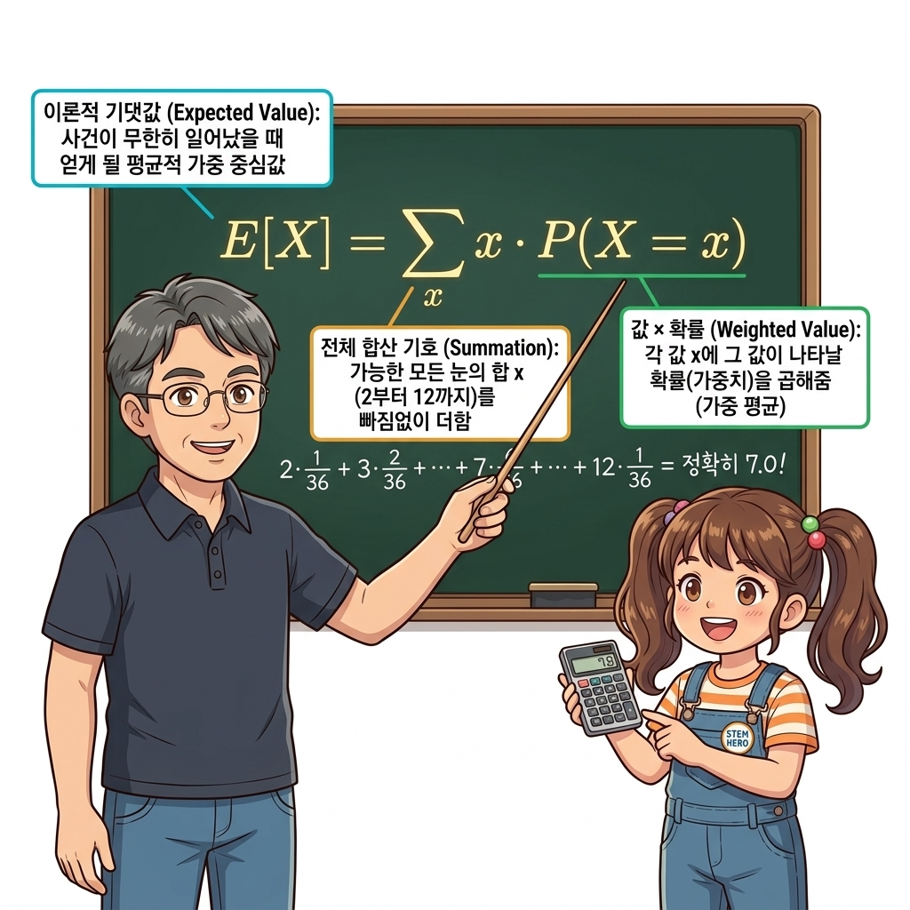
**그림 09-1-2a4** 이산 확률 변수의 이론적 기댓값 공식 E[X] = ∑ x · P(X = x) 기호 해부 및 가중합 원리 인포그래픽


---


수학적으로는 각 합에 해당 확률을 곱해 모두 더하면 정확히 **7.0**이 나옵니다. 

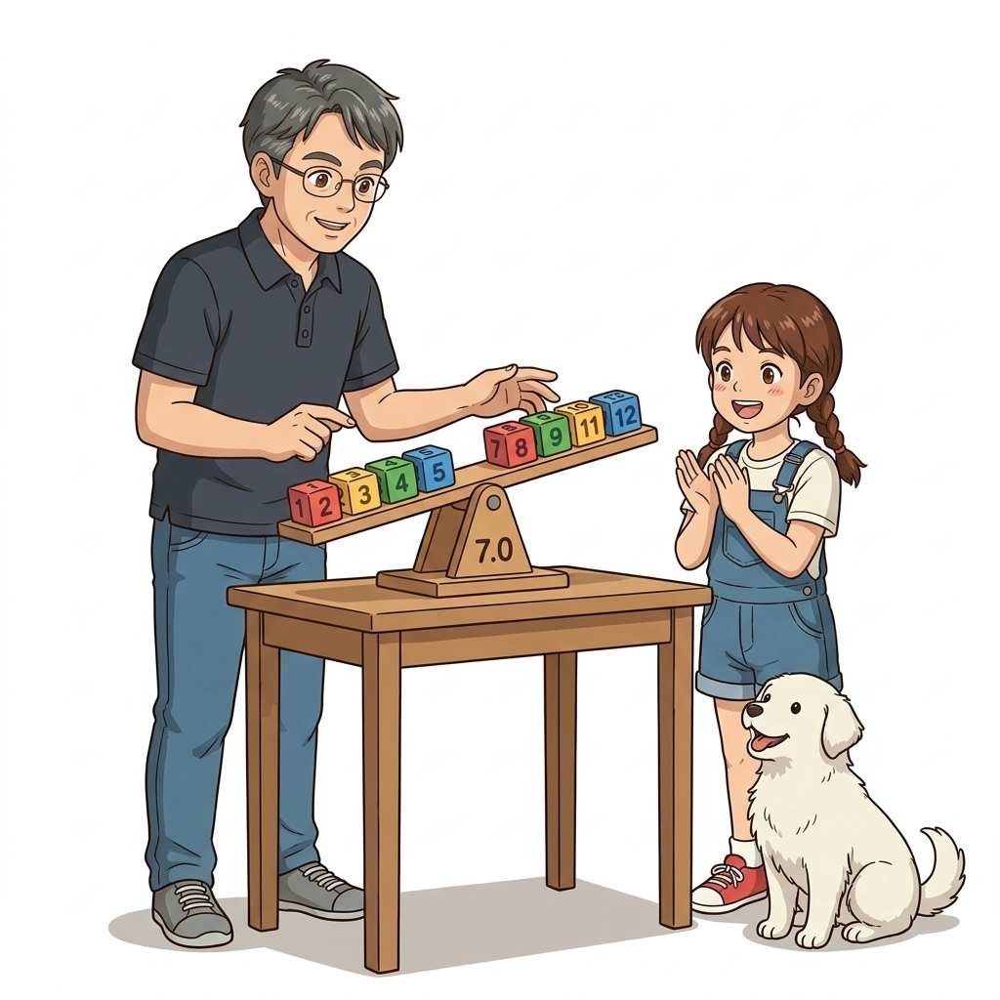
**그림 09-1-2b** 이호진 교수님이 나무 시소(저울) 교구를 활용해 기댓값 7.0의 물리적 무게중심 원리를 도로시와 토토에게 친절하게 설명하는 장면

> 👨‍🏫 **이호진 교수님의 눈높이 특강: 기댓값은 '시소의 무게중심'이란다!**  
> "도로시야, 기댓값이라는 말이 어렵게 느껴질 수 있지만, 사실은 **놀이터에 있는 시소(Seesaw)의 균형점**과 똑같단다.  
> 2부터 12까지 번호가 적힌 긴 나무 널빤지 위에, 각 숫자가 나올 확률만큼의 무게추를 올려놓았다고 상상해 보렴.  
> 7 위에는 가장 무거운 6개의 추(6/36)가 올라가고, 6과 8 위에는 각각 5개, 2와 12 위에는 가장 가벼운 1개씩의 추가 올라가게 되지.  
> 이때 시소 받침대를 정확히 **'7.0'** 위치에 놓아야 시소가 양쪽으로 기울어지지 않고 완벽하게 수평을 유지한단다!  
> 즉, **기댓값 E[*X*]란 모든 확률적 사건들이 평형을 이루는 수학적 무게중심**이란다."

> 👧 **도로시의 깨달음**:  
> "아하! 그래서 2부터 12까지 더해서 단순히 2와 12의 가운데인 7이 나온 게 아니라, 7을 중심으로 양쪽의 확률이 완전히 거울처럼 대칭을 이루기 때문에 시소 받침대가 정확히 7.0에 놓이는 것이군요!"


---


#### 파이썬 코드로 작성해 봅시다:

```python
ps = {2: 1/36, 3: 2/36, 4: 3/36, 5: 4/36, 6: 5/36, 7: 6/36,
      8: 5/36, 9: 4/36, 10: 3/36, 11: 2/36, 12: 1/36}

V = 0
for x, p in ps.items():
    V += x * p
print("계산된 기댓값 V:", V) # [출력 결과] 6.999999999999999
```

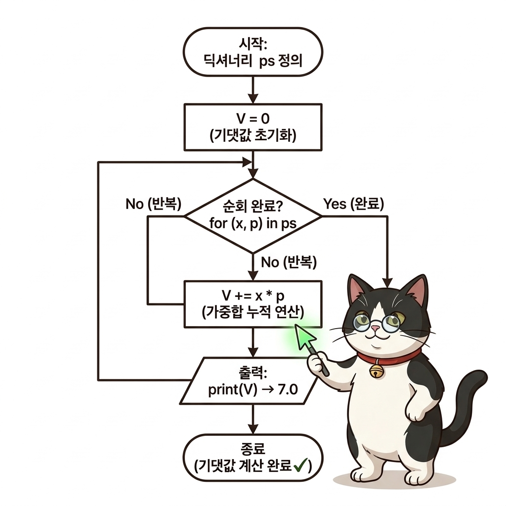
**그림 09-1-2c** 파이썬 기댓값 가중합 누적 계산 알고리즘 실행 순서도

---

#### 💡 왜 7.0이 아니라 6.9999...가 나올까요? (부동소수점 계산 오차)
컴퓨터는 내부적으로 모든 숫자를 0과 1로 이루어진 2진수로 처리합니다. 십진수 분수인 `1/36 = 0.027777...`은 2진수로 바꾸면 무한히 반복되는 무한소수가 됩니다. 컴퓨터는 메모리 한계로 인해 일정 자리에서 숫자를 잘라내므로, 미세한 반올림 오차가 누적되어 수학 이론값인 `7.0` 대신 `6.999999999999999`가 출력됩니다. 컴퓨터의 이러한 계산 오차를 감안하면 출력값은 수학 이론값인 7.0과 완전히 동일합니다.

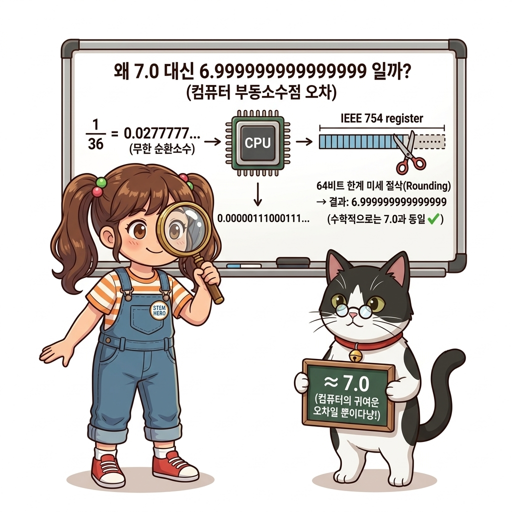
**그림 09-1-2d** 1/36의 2진수 변환 시 발생하는 무한 순환소수와 64비트 메모리 절삭으로 인한 6.9999... 부동소수점 오차 원리


---


이처럼 **확률 분포를 완벽하게 알고 있다면 공식에 대입하여 참 기댓값을 단번에 계산**할 수 있습니다. 

강화학습의 궁극적 목표는 '에이전트가 앞으로 얻을 보상의 총합에 대한 기댓값(기대 수익)'을 극대화하는 것이므로, 기댓값의 계산 원리를 이해하는 것은 매우 중요합니다.


**그림 09-1-2e** 강화학습의 궁극적 목표: 미래에 얻을 모든 보상의 총합에 대한 기댓값(기대 수익 E[G_t])을 극대화하기 위해 나아가는 에이전트와 기댓값 계산의 중요성


---

## 09.1.2 분포 모델과 샘플 모델

환경을 표현하는 수학적 방식에는 크게 **분포 모델**과 **샘플 모델**의 두 가지가 있습니다.

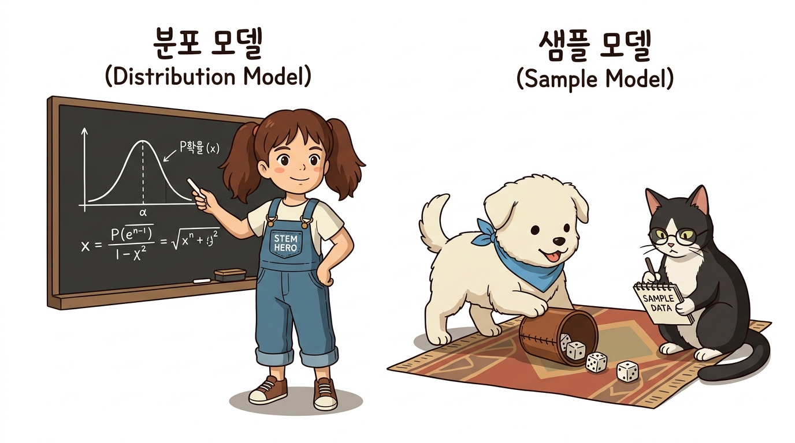
**그림 09-1-3** 완벽한 확률 곡선 지도를 연구하는 분포 모델과, 주사위를 직접 굴려 관측 데이터를 모으는 샘플 모델의 비교 (16:9 와이드)


> 👧 **도로시와 토토의 비유로 이해하기**:
>
> * **분포 모델**은 도로시가 36가지 주사위 눈 조합과 각 확률이 완벽하게 적힌 지도를 들고 칠판에서 공부하는 것과 같습니다. 모든 확률적 가능성을 머릿속으로 사전에 계산해 볼 수 있습니다.
> * **샘플 모델**은 토토가 직접 주사위를 컵에 넣고 수없이 굴려가며 실제로 나온 표본 눈들을 눈으로 확인하며 배우는 것과 같습니다. 전체 지도는 모르지만, 실제 경험(시행)을 통해 표본을 모아 기댓값을 알아냅니다.
>
> 

---


* **분포 모델 (Distribution Model)**:
  * 확률 분포 *P*(*x*)를 완벽하게 알고 있는 모델입니다.
  * 전체 지도를 펼쳐놓고 모든 가능성을 수식으로 정밀하게 계산합니다.
  * 동적 프로그래밍(DP)이 바로 이 분포 모델을 사용했습니다.

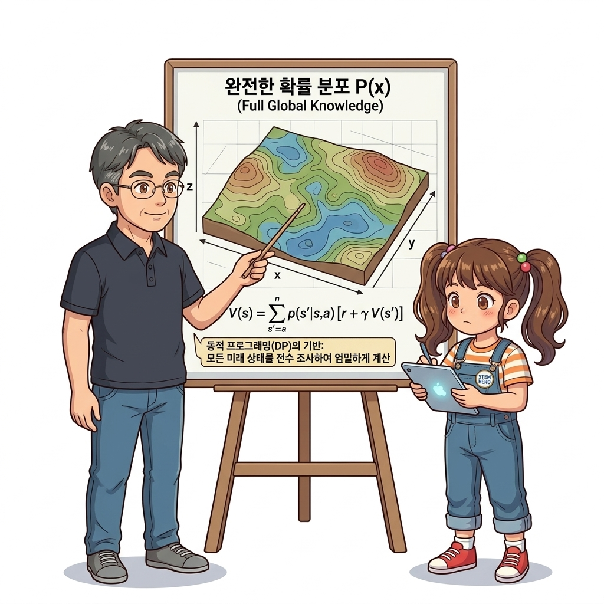
**그림 09-1-3a** 완전한 확률 지도를 펼쳐놓고 모든 미래를 수식으로 전수 조사하는 분포 모델과 동적 프로그래밍(DP)

---

* **샘플 모델 (Sample Model)**:
  * 전체 확률 분포는 전혀 몰라도, **'표본을 추출(샘플링)할 수만 있으면 충분하다'**는 모델입니다.
  * 주사위를 실제로 컵에 넣고 굴려서 나온 눈의 합을 직접 관찰하는 방식입니다.
  * 몬테카를로법(MC)이 바로 이 샘플 모델을 기반으로 동작합니다.

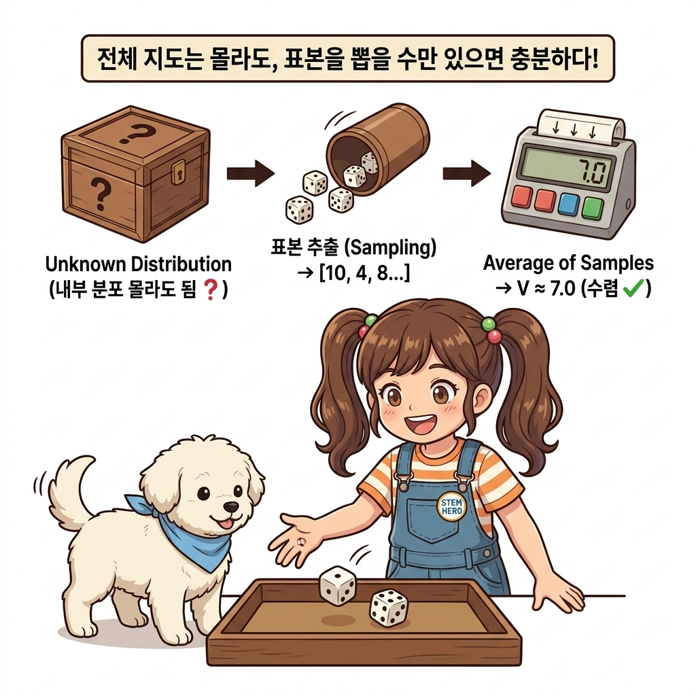
**그림 09-1-3b** 확률 분포를 몰라도 직접 주사위를 굴려 관측한 표본들의 평균으로 가치를 학습하는 샘플 모델과 몬테카를로법(MC)

---

### 파이썬 코드로 샘플 모델 구현하기

주사위 두 개를 굴리는 샘플 모델은 파이썬의 `np.random.choice()`를 이용해 믿을 수 없을 만큼 간단하게 구현할 수 있습니다:

```python
import numpy as np

def sample(dices=2):
    x = 0
    for _ in range(dices):
        x += np.random.choice([1, 2, 3, 4, 5, 6])
    return x

print(sample()) # 실행할 때마다 10, 4, 8 등 무작위 표본 반환
```

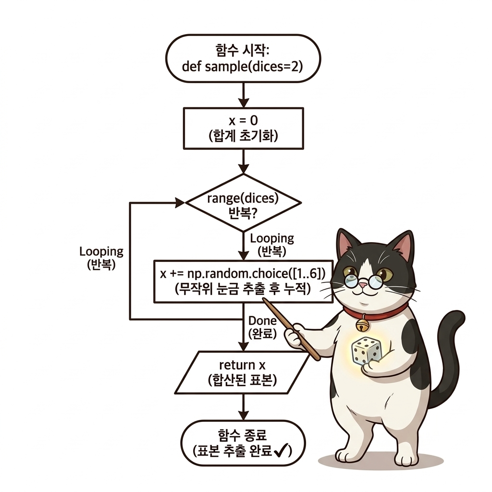
**그림 09-1-3c** 파이썬 `sample(dices=2)` 함수 실행 알고리즘 순서도

전체 확률 분포를 준비할 필요가 전혀 없기 때문에, 환경의 내부 법칙을 모르는 상태에서도 즉시 구현할 수 있습니다. 

---

### 여러 개의 주사위: 샘플 모델이 빛을 발하는 순간!

만약 주사위를 2개가 아니라 **10개** 굴려서 합계를 구해야 한다면 두 모델의 차이는 어떻게 될까요?

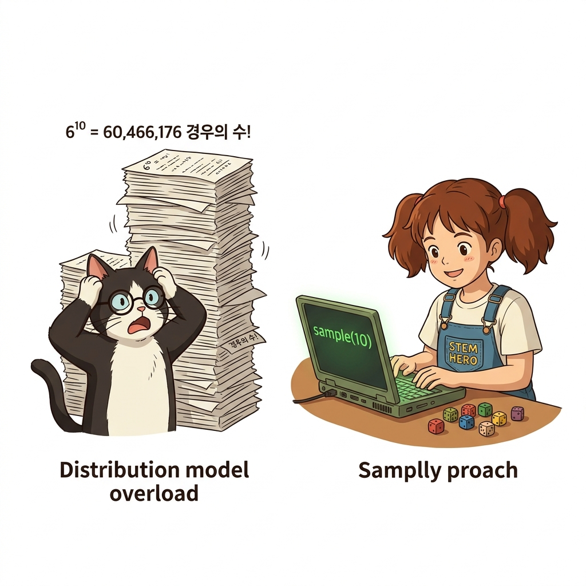
**그림 09-1-4** 6천만 가지 경우의 수에 머리를 쥐어뜯는 지니와, 단 한 줄의 `sample(10)` 코드로 즉시 표본을 뽑아내는 도로시


---


* **분포 모델의 계산 폭발**:
  * 주사위 10개의 합에 대한 이론적인 확률 분포 표를 미리 구하려면 무려 6<sup>10</sup> = **60,466,176가지(약 6천만 가지!)**나 되는 모든 조합을 일일이 전수 조사해야 합니다. 
  * 주사위가 20개, 50개, 100개로 늘어나면 경우의 수가 기하급수적으로 폭발하여 전 세계 슈퍼컴퓨터를 총동원해도 계산이 불가능해집니다.

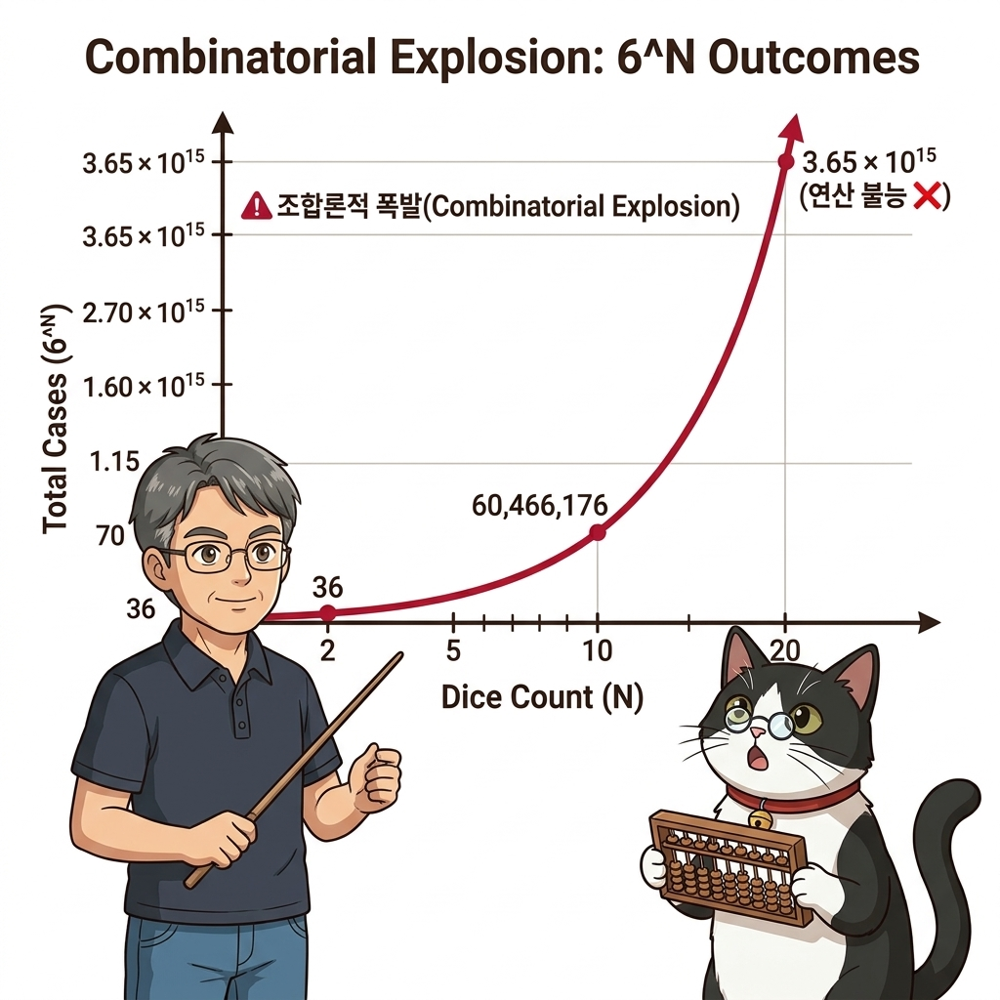
**그림 09-1-4a** 주사위 개수 N에 따른 경우의 수 6^N의 기하급수적 조합론적 폭발 그래프

---

* **샘플 모델의 초간단 해결**:
  * 반면 샘플 모델은 단순히 `sample(10)`이라고 함수 매개변수 숫자만 바꾸어 호출하면 끝입니다. 컴퓨터가 알아서 눈 깜짝할 사이에 10번 던져 합을 구해줍니다. 10개든 1,000개든 컴퓨터에게는 그저 루프를 몇 번 더 도는 사소한 일에 불과합니다.

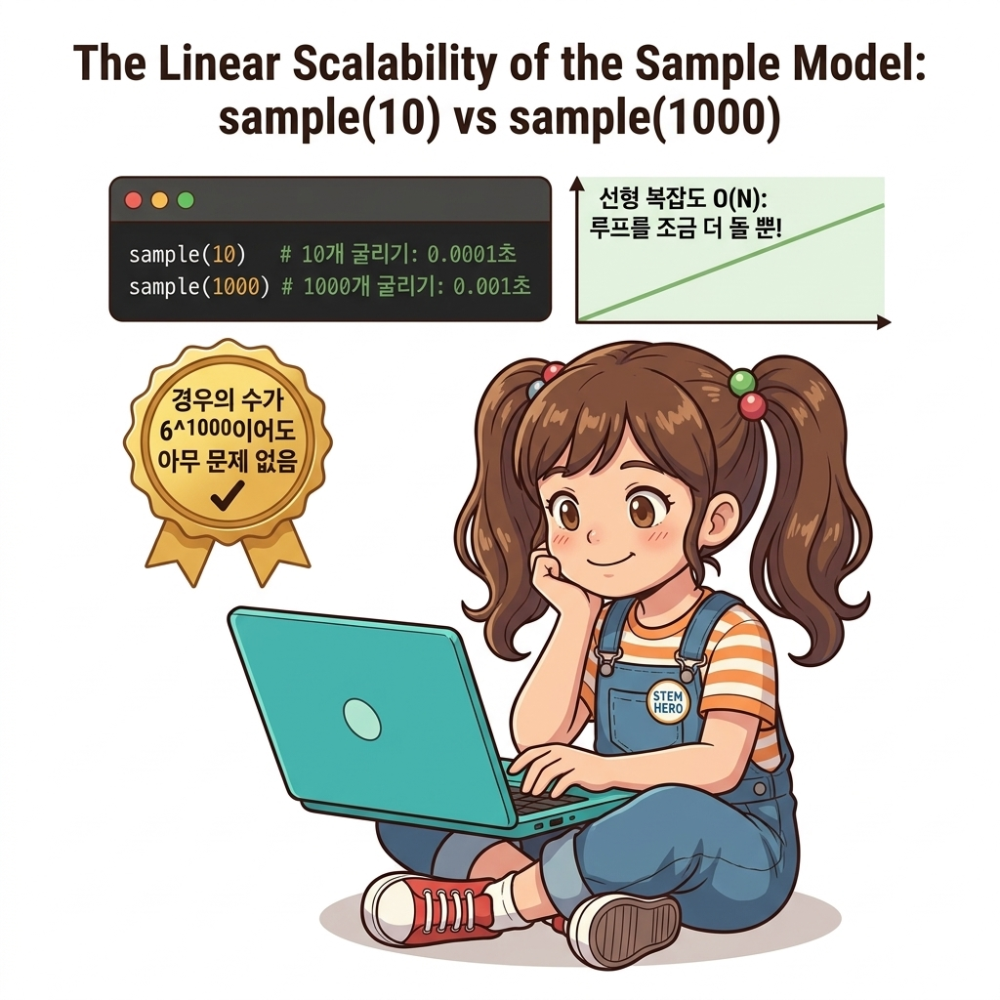
**그림 09-1-4b** 주사위가 10개든 1,000개든 가볍게 O(N) 단일 루프로 표본을 뽑아내는 샘플 모델의 선형적 확장성

---

이처럼 **"모든 경우의 수를 일일이 계산하기가 현실적으로 불가능하거나 환경 모델을 모를 때, 실제로 굴려보면서(샘플링) 그 평균값으로 진짜 값을 찾아가는 과정"**이 바로 몬테카를로법의 위대한 존재 이유입니다.


**그림 09-1-4c** 전수 조사가 불가능할 때 직접 경험하고 평균을 내어 참된 가치를 찾아가는 몬테카를로법의 위대한 철학적 도약

---

## 09.1.3 몬테카를로법 구현

그렇다면 샘플 모델로 어떻게 참 기댓값 7.0을 계산할 수 있을까요? **샘플링을 많이 하고 그 표본들의 산술 평균을 구하면 됩니다.** 표본 수가 커질수록 평균이 참값으로 수렴한다는 통계학의 **대수의 법칙(Law of Large Numbers)**이 이를 완벽하게 보장합니다.

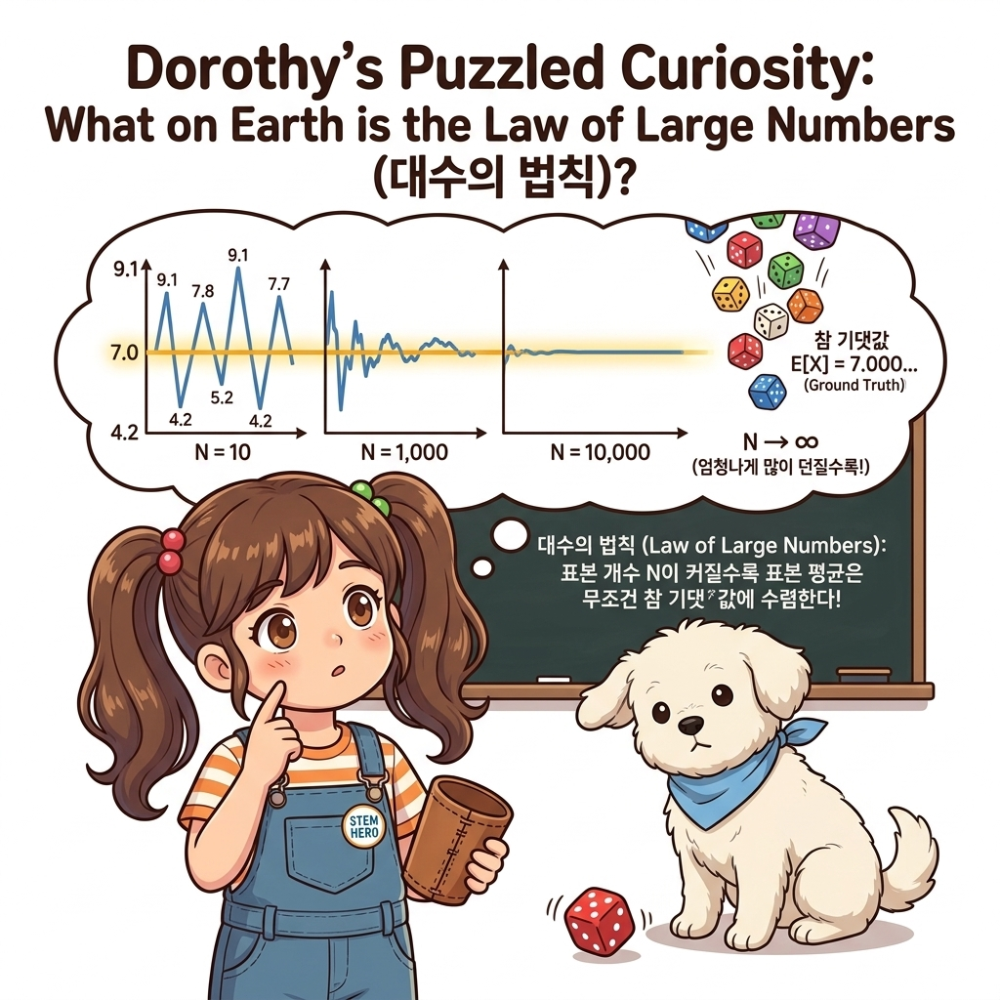
**그림 09-1-4d** "대수의 법칙이 도대체 뭐예요?" 표본 수가 늘어날수록 표본 평균이 참 기댓값 7.0으로 수렴한다는 통계학의 기적에 호기심 어린 의문을 품는 도로시와 토토


---


### 수학적 표현: 표본 평균 공식

수학적으로 몬테카를로법은 수집한 무작위 표본(*s*<sub>*i*</sub>)들의 **표본 평균(Sample Mean)**으로 참 기댓값 *V*를 추정합니다:

> ### (식 9.1-2) 표본 평균을 이용한 가치 추정
> *V* ≈ 1 / *N* ∑<sub>*i*=1</sub><sup>*N*</sup> *s*<sub>*i*</sub>


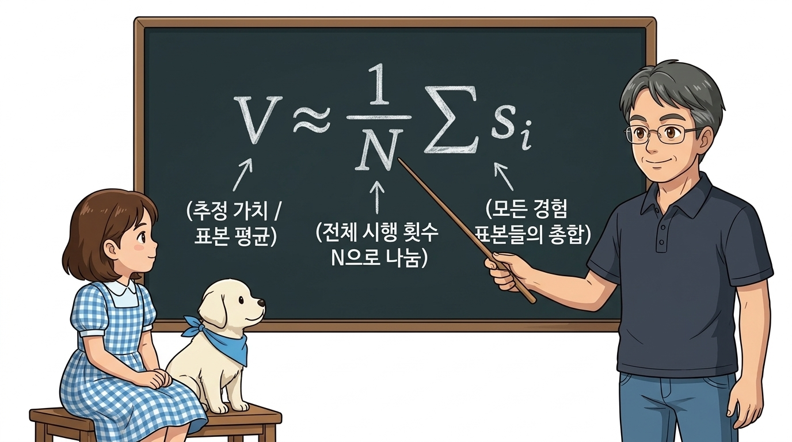
**그림 09-1-5** 이호진 교수님이 칠판에서 표본 평균 기댓값 공식의 3대 블록 기호와 물리적 의미를 알기 쉽게 해설하는 직강 강의 (16:9 와이드)

---


#### 💡 수식 돋보기: 표본 평균 공식 *V* ≈ 1 / *N* ∑ *s*<sub>*i*</sub> 기호 해부

이 간단한 수식은 몬테카를로 기법 전체를 관통하는 핵심 기둥입니다. 기호 하나하나를 뜯어보면 다음과 같습니다:

1. ***V* ≈ (가치 추정치)**:
   * 환경의 완전한 확률 분포를 알 때 구하는 이론적 참값 E[*X*] 대신, 실제 표본들로 추정한 값임을 물결 기호(`≈`)로 나타냅니다.
2. **1 / *N* (시행 횟수 정규화)**:
   * 지금까지 수집한 전체 표본의 개수 *N*으로 나누어 산술 평균을 만드는 정규화 연산자입니다.
3. **∑<sub>*i*=1</sub><sup>*N*</sup> *s*<sub>*i*</sub> (경험 표본의 누적 총합)**:
   * 에이전트가 1번째부터 *N*번째까지 실제로 환경과 부딪히며 관측한 모든 표본 데이터의 합산입니다.

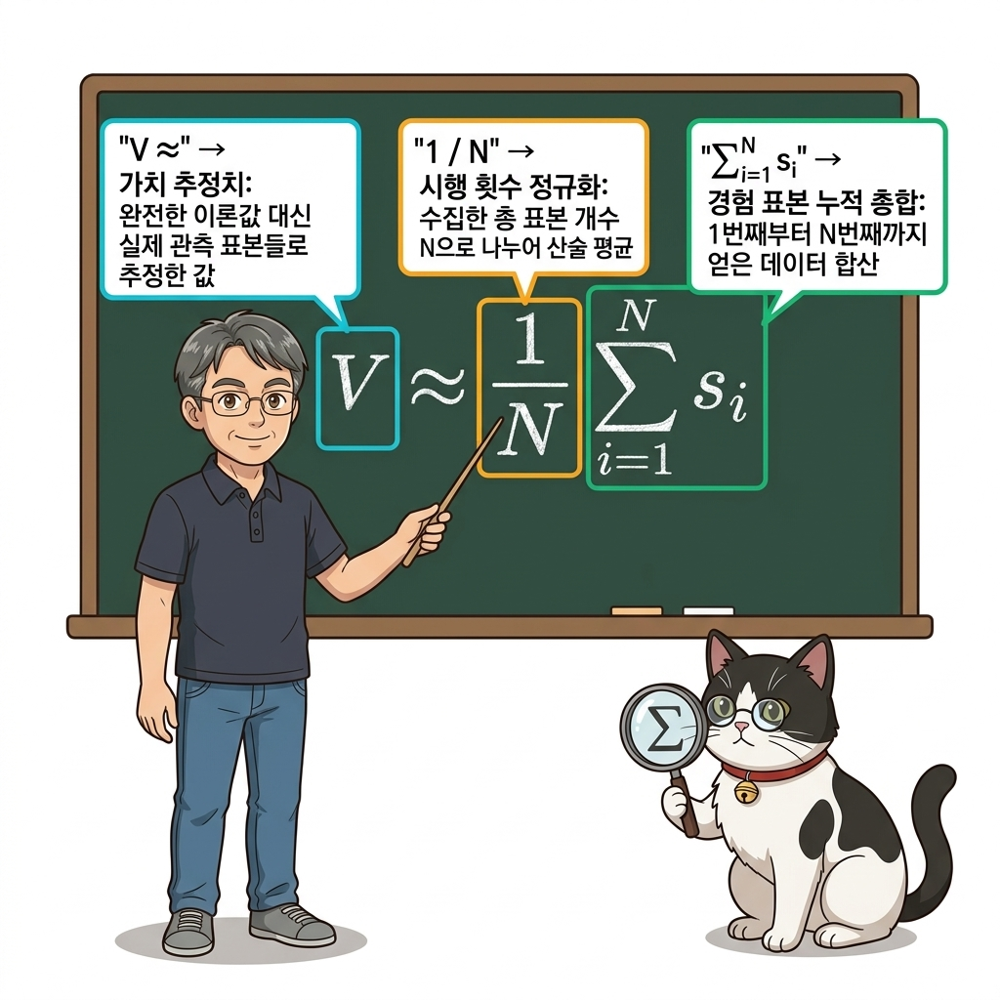
**그림 09-1-5a** 표본 평균 공식 V ≈ (1/N) ∑ s_i의 3대 핵심 블록 기호 해부 인포그래픽

---

### 파이썬 일반 평균 코드 구현

```python
trial = 1000 # 샘플링 횟수

samples = []
for _ in range(trial):
    s = sample()
    samples.append(s)

V = sum(samples) / len(samples) # 표본 평균 계산
print("추정 기댓값 V:", V) # 출력 결과: 6.98 (참값 7.0에 근접!)
```

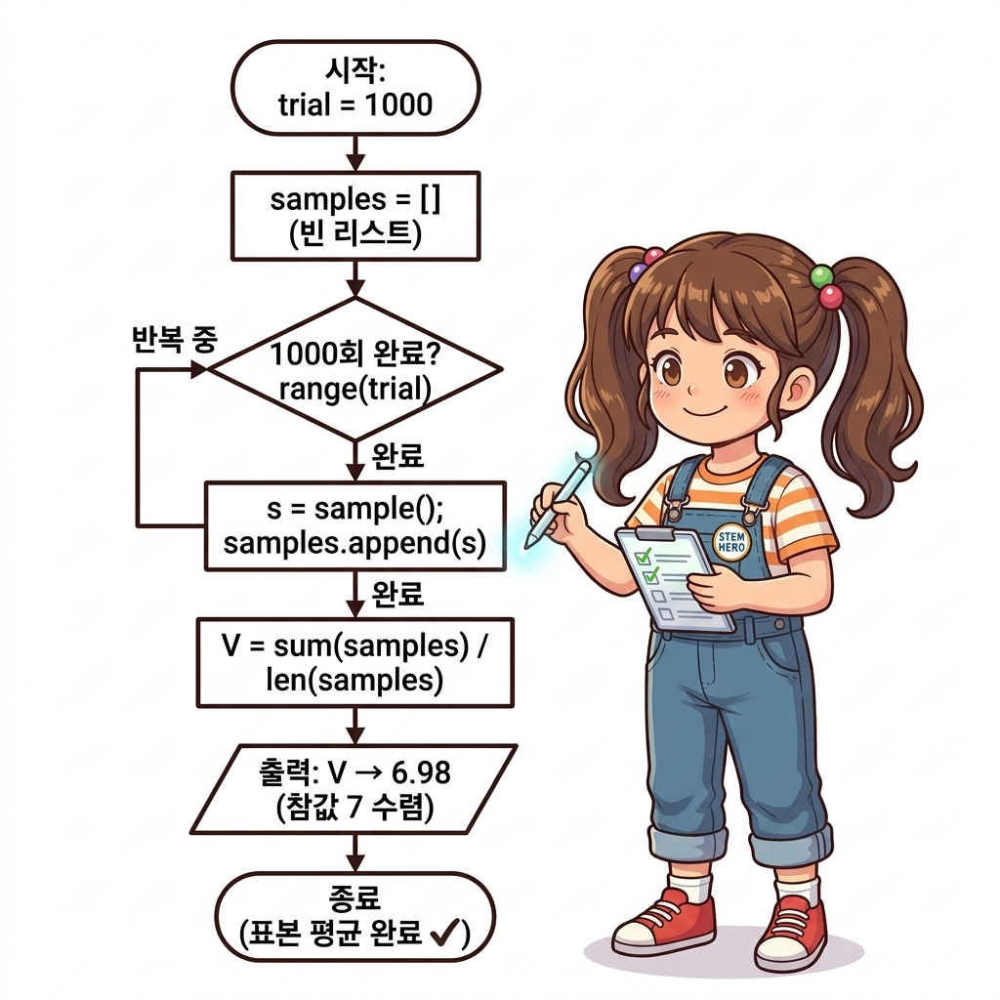
**그림 09-1-5a2** 파이썬 몬테카를로 일반 표본 평균 알고리즘 실행 순서도

1,000번 주사위를 던져 평균을 낸 결과 `6.98`이 나왔으며, 이론적 정답인 7에 매우 근접함을 확인할 수 있습니다. 1만 번, 10만 번으로 횟수를 늘리면 오차는 더욱 줄어듭니다.

---

### 메모리 절약의 혁명: 증분 갱신(Incremental Update)

하지만 샘플 데이터가 100만 개, 1억 개로 늘어난다면 어떨까요? 모든 샘플을 `samples` 리스트에 담아두고 매번 `sum()`을 계산하면 컴퓨터 메모리가 부족해지고 연산 속도가 심각하게 느려집니다. 1억 개의 주사위 눈을 메모리에 보관하려면 수백 메가바이트의 RAM이 소모되고, 새로운 주사위를 던질 때마다 과거 1억 개의 데이터를 처음부터 다시 더해야 하는 끔찍한 비효율이 발생합니다.

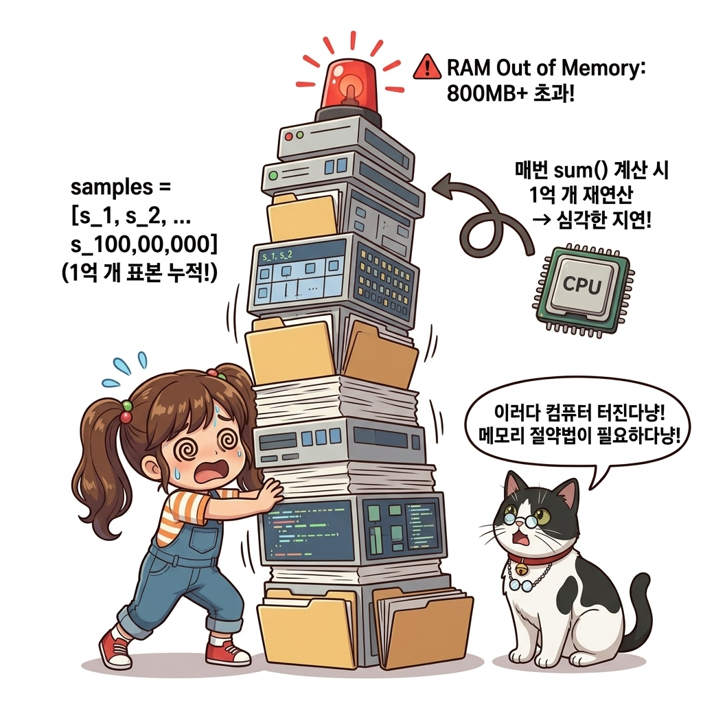
**그림 09-1-5a3** 1억 개의 표본을 리스트에 누적할 때 발생하는 메모리 폭발과 O(N^2) 비효율의 하드웨어적 한계


---


이를 해결하기 위해, 과거 데이터를 일일이 보관하지 않고 오직 **직전 가치 *V*와 시행 횟수 *n* 딱 2개만 기억**하여 실시간으로 평균을 업데이트하는 **증분 갱신(Incremental Update)**을 사용합니다:

> ### (식 9.1-3) 평균의 증분 갱신 점화식
> *V*<sub>new</sub> = *V*<sub>old</sub> + 1 / *n* (*s* − *V*<sub>old</sub>)

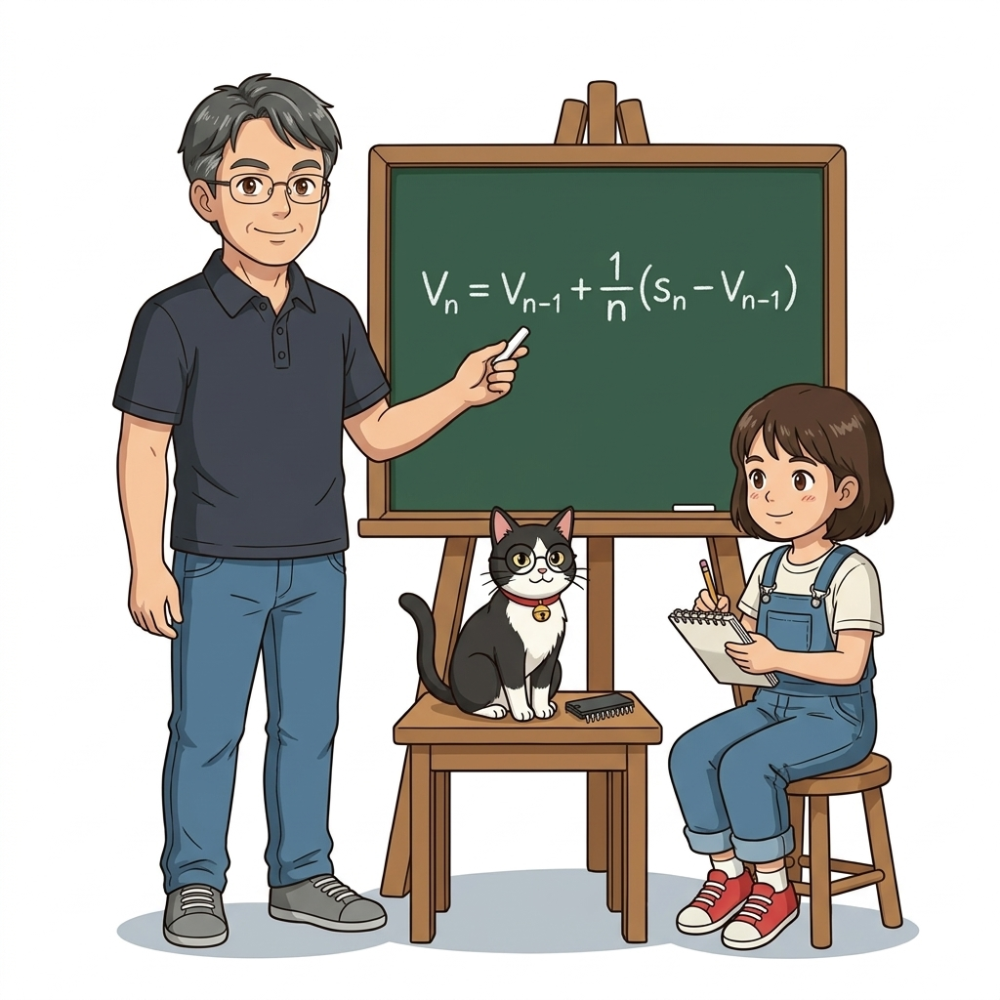
**그림 09-1-5b** 이호진 교수님이 칠판에서 증분 갱신 점화식 *V*<sub>*n*</sub> = *V*<sub>*n*−1</sub> + 1 / *n* (*s*<sub>*n*</sub> − *V*<sub>*n*−1</sub>)의 단계별 수학 유도 과정을 도로시와 지니에게 설명하는 장면

---


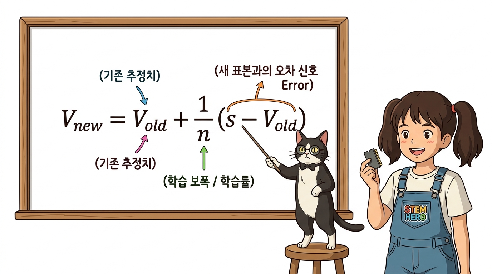
**그림 09-1-6** 조교 지니와 도로시가 가벼운 메모리 칩을 들고 오차 신호 (*s* − *V*<sub>old</sub>)와 학습률 (1 / *n*)의 상호작용을 해설하는 칠판 강의 (16:9 와이드)

---

#### 👨‍🏫 이호진 교수님의 칠판 유도: 증분 갱신 공식은 어떻게 탄생했을까?

중학생도 쉽게 이해할 수 있도록, 칠판에 적힌 유도 과정을 단계별로 풀어보겠습니다:

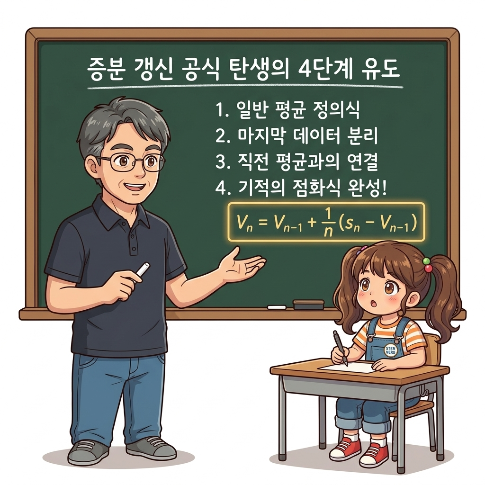
**그림 09-1-6a** 이호진 교수님의 칠판 수학 교실: 증분 갱신 점화식 탄생의 4단계 비밀 유도 오리엔테이션

---

1. **시작점: *n*개의 데이터에 대한 일반 평균 정의식**:
   *V*<sub>*n*</sub> = 1 / *n* ∑<sub>*i*=1</sub><sup>*n*</sup> *s*<sub>*i*</sub> = (*s*<sub>1</sub> + *s*<sub>2</sub> + ... + *s*<sub>*n*−1</sub> + *s*<sub>*n*</sub>) / *n*

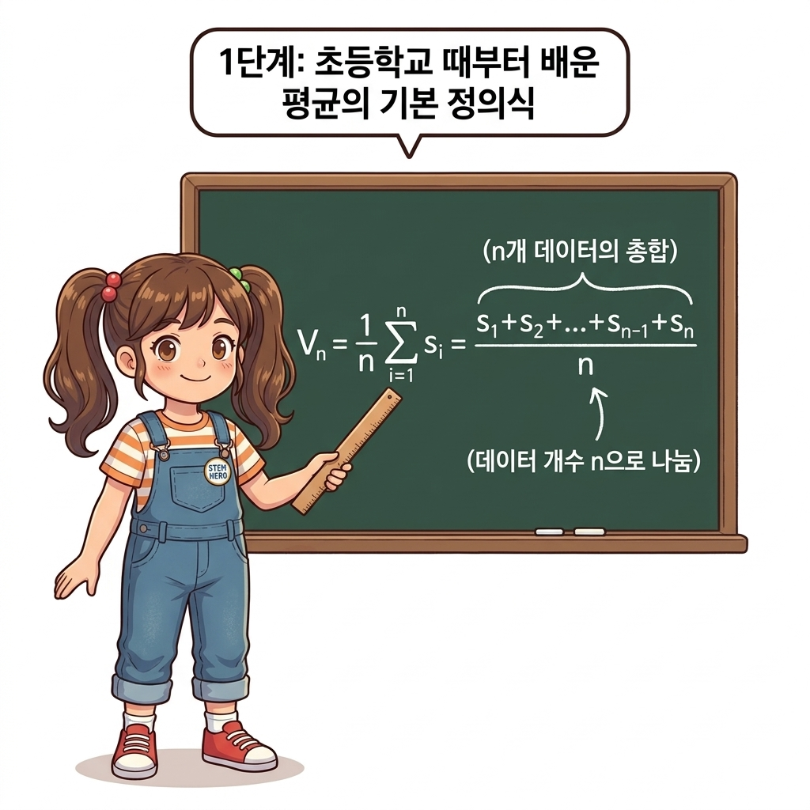
**그림 09-1-6b1** 증분 갱신 유도 1단계: n개 전체 데이터에 대한 일반 산술 평균의 원초적 정의식

---

2. **마지막 데이터 *s*<sub>*n*</sub>만 밖으로 떼어내기**:
   *V*<sub>*n*</sub> = 1 / *n* ( ∑<sub>*i*=1</sub><sup>*n*−1</sup> *s*<sub>*i*</sub> + *s*<sub>*n*</sub> )

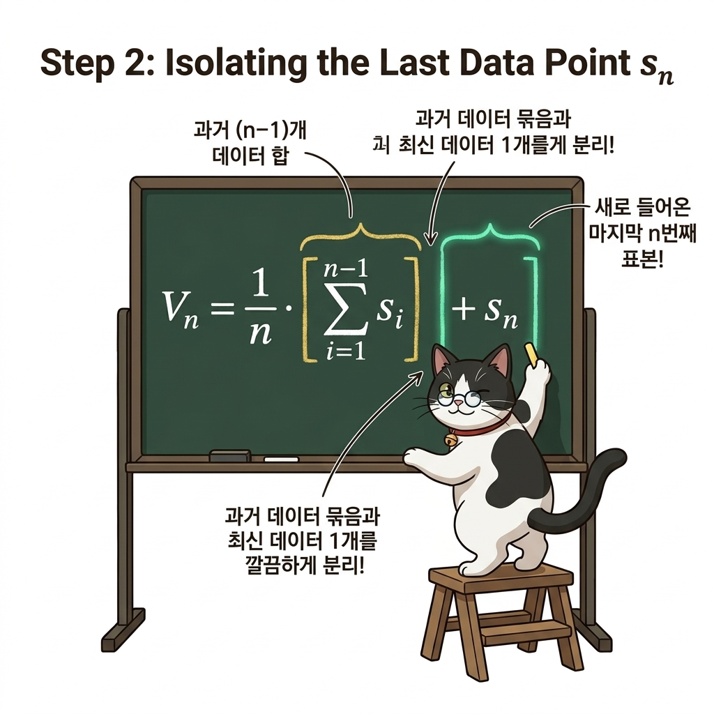
**그림 09-1-6b2** 증분 갱신 유도 2단계: 과거 (n-1)개의 합과 마지막 최신 데이터 s_n의 분리

---

3. **직전 평균 *V*<sub>*n*−1</sub>과의 관계 찾기**:
   직전 *n*−1개까지의 평균은 *V*<sub>*n*−1</sub> = 1 / (*n*−1) ∑<sub>*i*=1</sub><sup>*n*−1</sup> *s*<sub>*i*</sub> 이므로, 양변에 *n*−1을 곱하면:
   ∑<sub>*i*=1</sub><sup>*n*−1</sup> *s*<sub>*i*</sub> = (*n*−1) *V*<sub>*n*−1</sub>  
   이것을 2번 식에 쏙 대입합니다!

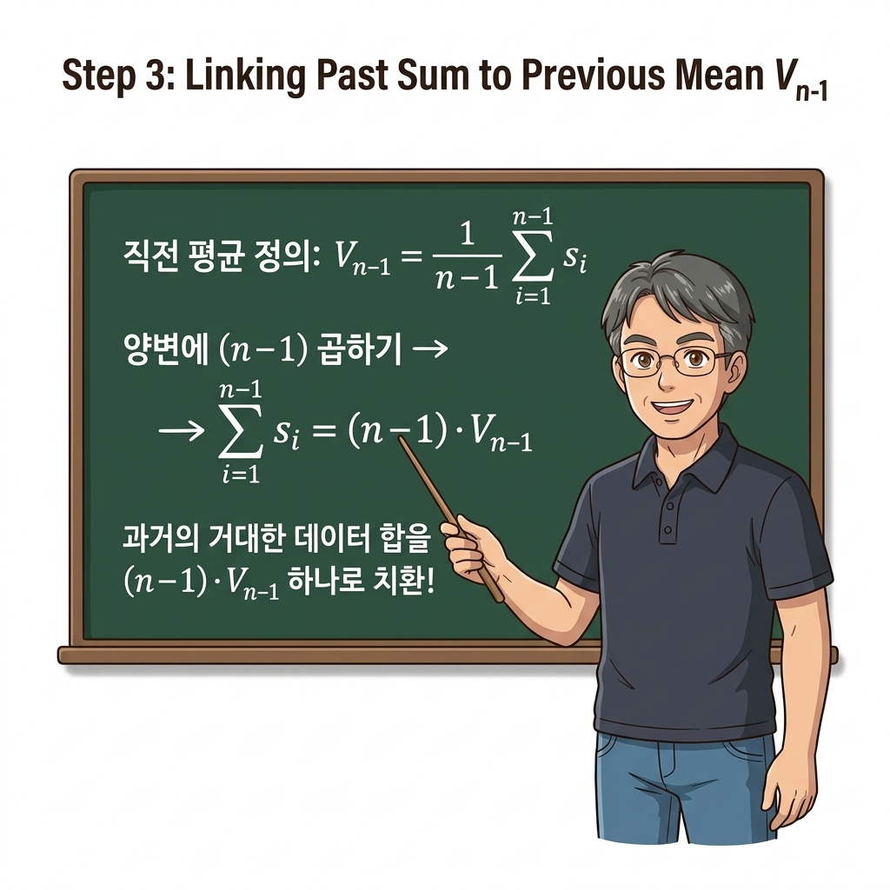
**그림 09-1-6b3** 증분 갱신 유도 3단계: 과거 데이터들의 거대한 합을 직전 평균 (n-1)V_{n-1}로 치환하는 핵심 연결 고리

---

4. **대입하여 정리하기**:
   *V*<sub>*n*</sub> = 1 / *n* ( (*n*−1) *V*<sub>*n*−1</sub> + *s*<sub>*n*</sub> )  
   = 1 / *n* ( *n* *V*<sub>*n*−1</sub> − *V*<sub>*n*−1</sub> + *s*<sub>*n*</sub> )  
   = (*n* *V*<sub>*n*−1</sub>) / *n* + (*s*<sub>*n*</sub> − *V*<sub>*n*−1</sub>) / *n*  
   =  *V*<sub>*n*−1</sub> + 1 / *n* (*s*<sub>*n*</sub> − *V*<sub>*n*−1</sub>) 

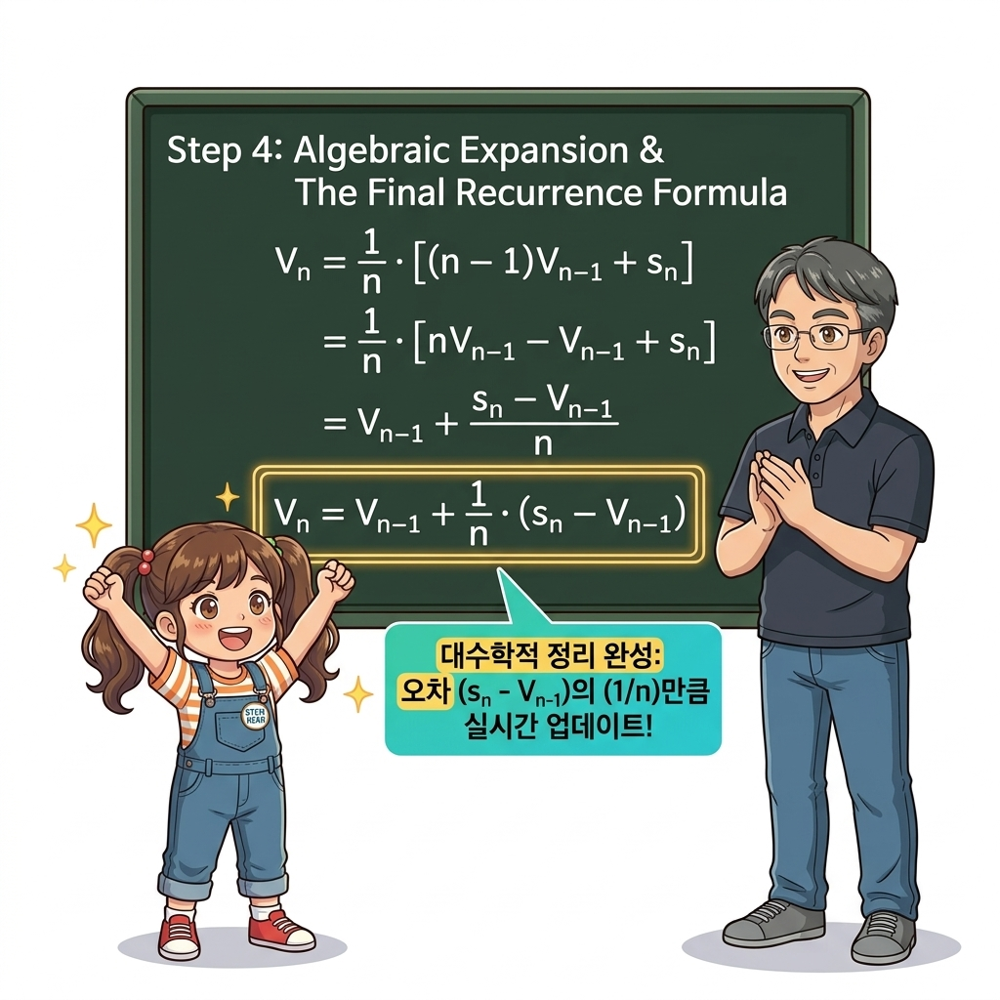
**그림 09-1-6b4** 증분 갱신 유도 4단계: 괄호 전개와 분수 분리를 통한 최종 점화식 V_n = V_{n-1} + (1/n)(s_n - V_{n-1})의 대수적 완성 

---


마침내 우리가 찾던 기적의 점화식이 완성되었습니다!

과거 *s*<sub>1</sub>부터 *s*<sub>*n*−1</sub>까지의 모든 데이터가 단 하나의 숫자 *V*<sub>*n*−1</sub> 속에 압축되어 녹아들어간 것입니다!

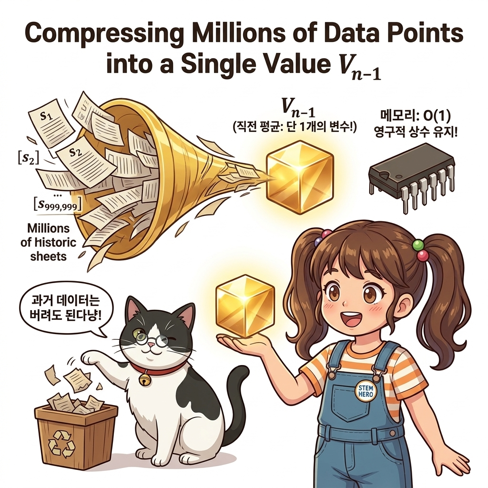
**그림 09-1-6c** 수백만 개의 과거 데이터가 단 1개의 숫자 V_{n-1} 속에 완벽히 압축 보존되는 메모리 절약의 기적

---

#### 수식 돋보기: 증분 갱신 공식 기호 해부

과거 데이터를 모두 버려도 수학적으로 완벽한 평균이 유지되는 비밀은 바로 이 점화식 구조에 있습니다:

1. ***V*<sub>old</sub> (*V*<sub>*n*−1</sub>, 기존 추정치)**:
   * 지금까지 누적된 경험으로 알고 있는 현재의 가치 추정치입니다.
2. ***s* − *V*<sub>old</sub> (*s*<sub>*n*</sub> − *V*<sub>*n*−1</sub>, 오차 신호, Error)**:
   * 이번에 새로 관측한 표본 *s*가 기존 지식 *V*<sub>old</sub>와 얼마나 차이가 나는지를 나타내는 예측 오차입니다.
   * 새 표본이 내 생각보다 컸다면 양수(+), 작았다면 음수(-)가 나와 가치를 밀거나 당겨줍니다.
3. **1 / *n* (학습 보폭 / 학습률)**:
   * 새로운 오차를 기존 지식에 얼마나 반영할 것인가를 조절하는 계수입니다.
   * 시행 횟수 *n*이 커질수록 계수가 1/2 → 1/10 → 1/1000로 줄어듭니다. 즉, 초기에는 새로운 데이터에 민감하게 반응하여 빠르게 학습하다가, 경험이 많이 쌓이면 가치가 단단하게 고정되어 안정화됩니다.

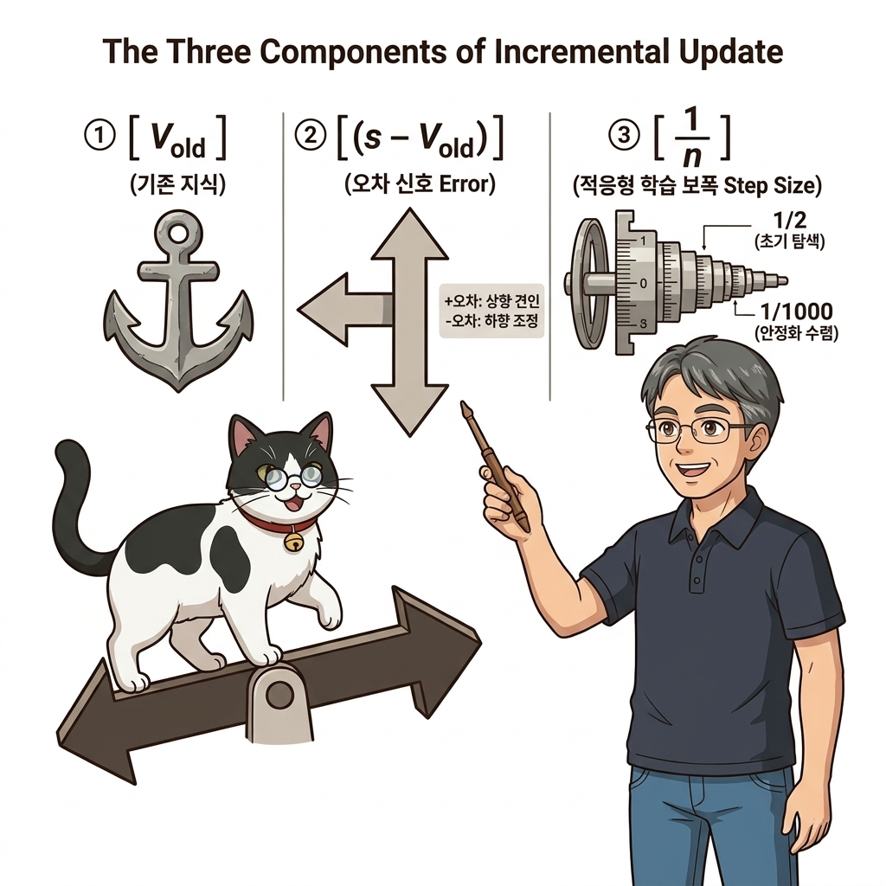
**그림 09-1-6d** 증분 갱신 공식의 3대 요소(기존 가치, 오차 신호, 적응형 학습 보폭 1/n)의 역동적 상호작용 메커니즘

---

> [!NOTE]
> **💡 강화학습의 모든 학습식의 뿌리!**  
> 이 공식은 훗날 강화학습에 등장하는 모든 가치 갱신식:  
> **`새 가치 ← 기존 가치 + 학습률 × (새로운 목표치 - 기존 가치)`**  
> 의 위대한 모태가 됩니다! TD 학습, SARSA, Q-러닝, DQN에 이르기까지 모든 최신 인공지능 알고리즘이 바로 이 형태를 그대로 사용합니다.


**그림 09-1-6e** 강화학습 모든 가치 갱신식의 위대한 원형(Mother Formula)과 TD·SARSA·Q-러닝·DQN으로 이어지는 계통수 가계도

---

### 증분 평균 파이썬 구현

```python
trial = 1000
V, n = 0, 0

for _ in range(trial):
    s = sample()
    n += 1
    V += (s - V) / n # 증분 갱신 공식!
    
print("최종 증분 평균 V:", V) # 출력 결과: 7.0019... (참값 7 수렴)
```

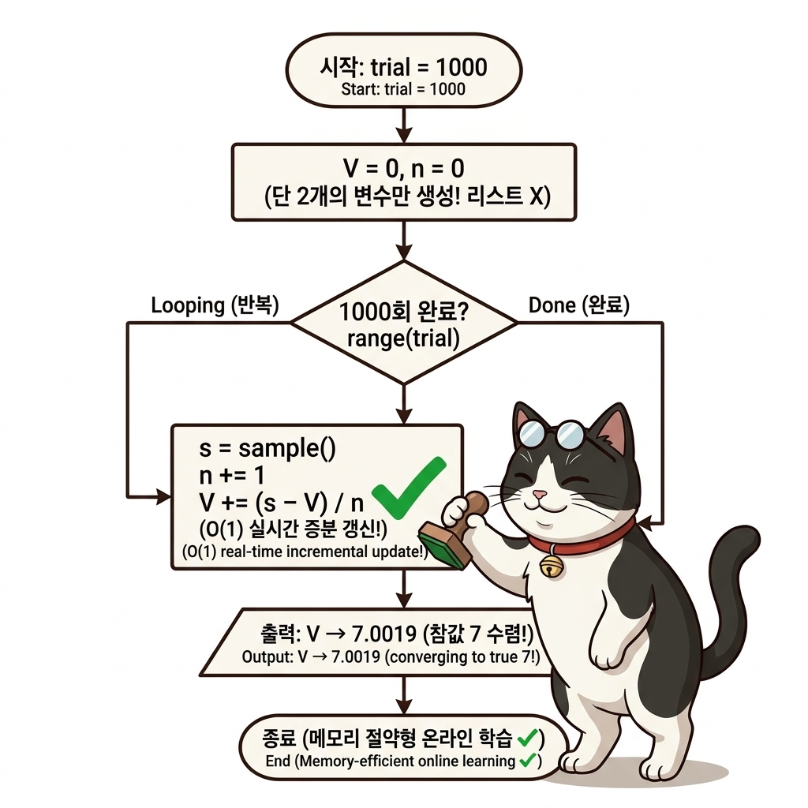
**그림 09-1-6f** 파이썬 초경량 증분 평균 알고리즘 실행 순서도

이 코드는 과거의 수많은 표본을 단 하나도 메모리에 보관하지 않으면서도, 매 루프마다 수학적으로 완전무결한 평균값을 실시간으로 유지합니다. 

메모리 사용량은 표본이 100만 개든 100억 개든 영원히 *O*(1)(상수 크기)입니다!

---

### 09.1.4 핵심 정리: 몬테카를로법 기초의 3대 핵심 기둥

몬테카를로 기법은 복잡한 환경 모델과 방대한 확률 분포 수식을 알지 못하더라도, 에이전트가 직접 부딪히며 축적한 **무작위 경험 표본들의 평균만으로 참된 가치에 도달하는 강력한 방법론**입니다.

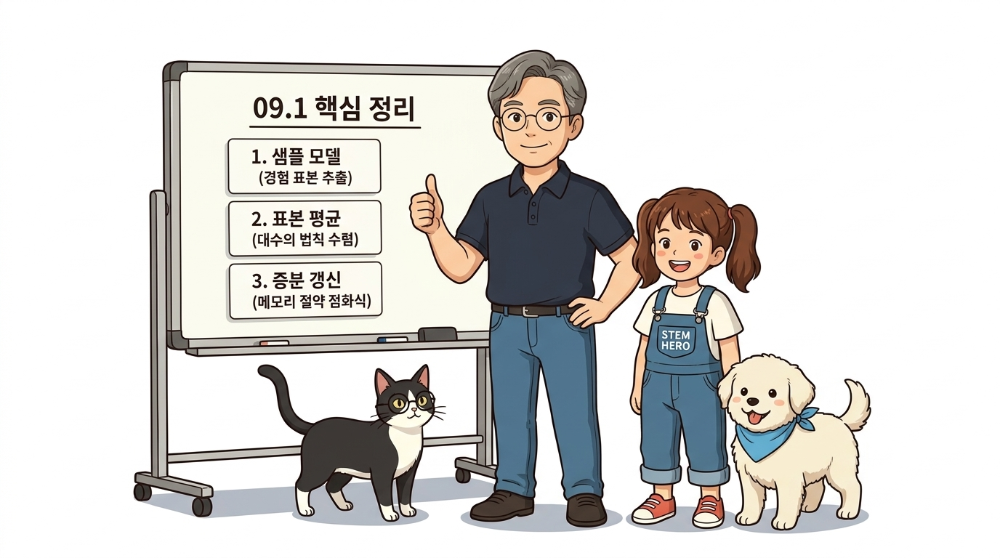
**그림 09-1-7** 몬테카를로법 기초의 3대 핵심 기둥(샘플 모델, 표본 평균, 증분 갱신)을 총정리하며 응원하는 이호진 교수님과 연구실 4인방 (16:9 와이드)

---

오늘 학습한 몬테카를로법 기초의 핵심은 다음 3가지 기둥으로 요약됩니다:

1. **샘플 모델 (Sample Model)**:
   * 확률 분포를 전수 조사하지 않고, '시행하여 표본을 관측할 수만 있으면 충분하다'는 발상의 전환입니다. 조합 폭발이 발생하는 복잡한 환경을 극적으로 단순화합니다.
2. **표본 평균과 대수의 법칙 (Sample Mean & LLN)**:
   * 표본 평균 *V* ≈ 1 / *N* ∑ *s*<sub>*i*</sub> 공식을 통해, 표본 수 *N*이 증가할수록 추정치가 오차를 좁혀가며 참 기댓값으로 정밀 수렴합니다.
3. **초경량 증분 갱신 (Incremental Update)**:
   * *V* ← *V* + 1 / *n* (*s* − *V*) 점화식을 사용하여, 과거의 모든 데이터를 버리고도 단 2개의 변수만으로 실시간 온라인 학습을 완성합니다.


**그림 09-1-7a** 몬테카를로법 기초 3대 핵심 기둥(샘플 모델, 표본 평균, 증분 갱신)의 유기적 알고리즘 파이프라인

---

> 👨‍🏫 **이호진 교수님의 직강 노트**:  
> "몬테카를로법의 본질은 무작위성(Randomness)을 지혜롭게 활용하는 것입니다. 모든 규칙을 다 알아야만 똑똑한 결정을 내릴 수 있는 것은 아닙니다. 직접 부딪혀 보고, 오차를 조금씩 줄여나가는 이 단순한 원리가 바로 현대 강화학습을 움직이는 가장 거대한 엔진입니다."


**그림 09-1-7b** 이호진 교수님의 직강 멘토링 노트: 무작위성을 지혜로 바꾸는 강화학습의 위대한 발상

---

> 🐱 **조교 지니의 핵심 요약 노트**:  
> "샘플 모델과 증분 갱신이라는 든든한 무기를 장착했으니, 다음 절에서는 도로시와 함께 강화학습 에피소드를 끝까지 완주하고 가치 함수를 직접 업데이트하는 **몬테카를로 정책 평가(Policy Evaluation)**의 실전으로 뛰어들어 보자냥!"


**그림 09-1-7c** 다음 절 예고: 09.2 몬테카를로 정책 평가 실전으로 씩씩하게 출발하는 도로시와 지니
