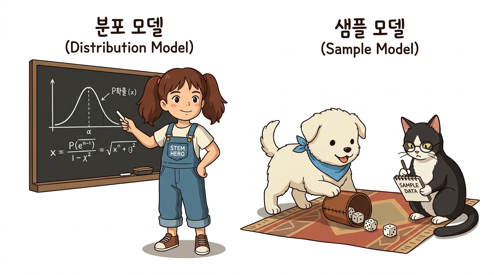
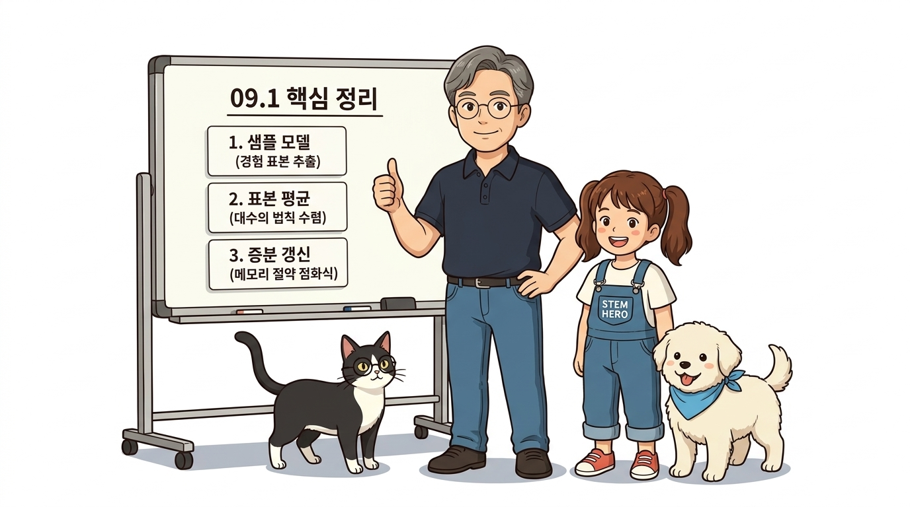

# 09.1 몬테카를로법 기초


**그림 09-1-1** 투명한 규칙으로 시뮬레이션 가능한 알려진 환경 모델과 수식을 알 수 없어 직접 부딪혀야 하는 블랙박스 미지 모델의 비교 (16:9 와이드)

몬테카를로법(Monte Carlo Method)의 대수적 기초를 공부합니다. 무작위 샘플링을 반복하여 원하는 참값을 추정해내는 원리를 이해하기 위해, 주사위 던지기 실험 및 알려지지 않은 환경 모델의 비유를 통해 샘플 모델의 핵심을 파악해 봅시다!

---

### 지금까지는 환경 모델이 알려진 문제를 다뤘습니다

예를 들어 앞서 다룬 '그리드 월드' 문제에서는 에이전트의 행동에 따른 다음 상태(위치)와 보상이 명확했습니다. 수식으로 표현하면 **상태 전이 확률 *p*(*s'* | *s*, *a*)**와 **보상 함수 *r*(*s*, *a*, *s'*)**를 완벽하게 이용할 수 있었습니다(상태 전이가 결정적이라면 *s'* = *f*(*s*, *a*) 함수로 나타낼 수도 있습니다).

이처럼 환경 모델이 알려진 문제에서는 에이전트 측에서 '상태, 행동, 보상'의 전이를 컴퓨터 시뮬레이션으로 완전히 계산할 수 있었습니다.

---

### 하지만, 현실에는 환경 모델을 알 수 없는 문제가 많습니다

예를 들어 '상품 재고 관리'나 '자율주행차의 주행 제어'를 생각해 봅시다. 재고 관리 문제에서는 '내일 상품이 얼마나 팔릴 것인가'가 환경의 상태 전이 확률에 해당합니다.

그런데 상품의 판매량은 계절, 날씨, 트렌드, 경기 등 수많은 요인이 복잡하게 얽혀 결정되기 때문에 **사전에 수식으로 완벽하게 알아내기가 현실적으로 불가능**합니다.

또한 상태 전이 확률을 이론적으로는 세울 수 있더라도 **계산량이 너무 방대하여 계산 불능에 빠지는 경우**가 허다합니다. 얼마나 계산이 복잡해지는지 실감할 수 있도록, 이번 절에서는 우선 '주사위'를 예로 들어 간단한 비교 작업을 해보겠습니다.

---

## 09.1.1 주사위 눈의 합

주사위 두 개를 굴리는 문제를 상상해 봅시다. 각 눈(1~6)이 나올 확률은 정확하게 **1/6**이라고 가정합니다.


**그림 09-1-2** 주사위 2개를 던졌을 때 나타나는 36가지 눈금 조합 매트릭스와 확률 분포를 분석하는 도로시, 토토, 지니 (1:1 순백색)

### 2개 주사위의 확률 전개도와 분포

두 주사위를 던졌을 때 나올 수 있는 모든 경우의 수는 6 × 6 = **36가지**입니다. 두 주사위 눈의 합을 집계하면 다음과 같은 확률 분포를 얻을 수 있습니다:

| 합 (*x*) | 2 | 3 | 4 | 5 | 6 | **7** | 8 | 9 | 10 | 11 | 12 |
| :---: | :---: | :---: | :---: | :---: | :---: | :---: | :---: | :---: | :---: | :---: | :---: |
| **확률 *P*(*x*)** | 1/36 | 2/36 | 3/36 | 4/36 | 5/36 | **6/36** | 5/36 | 4/36 | 3/36 | 2/36 | 1/36 |

> [!NOTE]
> **💡 확률분포(Probability Distribution)란?**
> 어떤 확률 변수(여기서는 '두 주사위 눈의 합 *X*')가 취할 수 있는 모든 개별 값과, 그 값들이 각각 나타날 확률 *P*(*X* = *x*)를 대응시켜 놓은 것을 말합니다. 주사위 눈의 합은 최소 2부터 최대 12까지 가능하며, 7이 나올 확률이 6/36(약 16.7%)로 가장 높습니다.

### 확률 분포를 통한 기댓값 계산

이 확률 분포를 알면 이론적 기댓값(Expected Value)을 다음과 같이 계산할 수 있습니다:

> ### **E[*X*] = ∑<sub>*x*</sub> *x* · *P*(*X* = *x*)**

수학적으로는 각 합에 해당 확률을 곱해 모두 더하면 정확히 **7.0**이 나옵니다. 파이썬 코드로 작성해 봅시다:

```python
ps = {2: 1/36, 3: 2/36, 4: 3/36, 5: 4/36, 6: 5/36, 7: 6/36,
      8: 5/36, 9: 4/36, 10: 3/36, 11: 2/36, 12: 1/36}

V = 0
for x, p in ps.items():
    V += x * p
print("계산된 기댓값 V:", V) # [출력 결과] 6.999999999999999
```

> [!TIP]
> **💡 왜 7.0이 아니라 6.9999...가 나올까요? (부동소수점 계산 오차)**
> 컴퓨터는 내부적으로 숫자를 2진수로 처리합니다. 십진수 분수인 `1/36 = 0.027777...`은 2진수로 바꾸면 무한히 반복되는 무한소수가 됩니다. 컴퓨터는 메모리 한계로 인해 일정 자리에서 숫자를 잘라내므로, 미세한 반올림 오차가 누적되어 수학 이론값인 `7.0` 대신 `6.999999999999999`가 출력됩니다.

이처럼 **확률 분포를 완벽하게 알고 있다면 공식에 대입하여 참 기댓값을 단번에 계산**할 수 있습니다. 강화학습의 궁극적 목표는 '보상의 총합에 대한 기댓값(기대 수익)'을 극대화하는 것이므로, 기댓값의 계산 원리를 이해하는 것은 매우 중요합니다.

---

## 09.1.2 분포 모델과 샘플 모델

환경을 표현하는 수학적 방식에는 크게 **분포 모델**과 **샘플 모델**의 두 가지가 있습니다.


**그림 09-1-3** 완벽한 확률 곡선 지도를 연구하는 분포 모델과, 주사위를 직접 굴려 관측 데이터를 모으는 샘플 모델의 비교 (16:9 와이드)

* **분포 모델 (Distribution Model)**:
  * 확률 분포 *P*(*x*)를 완벽하게 알고 있는 모델입니다.
  * 전체 지도를 펼쳐놓고 모든 가능성을 수식으로 정밀하게 계산합니다.
* **샘플 모델 (Sample Model)**:
  * 전체 확률 분포는 전혀 몰라도, **'표본을 추출(샘플링)할 수만 있으면 충분하다'**는 모델입니다.
  * 주사위를 실제로 컵에 넣고 굴려서 나온 눈의 합을 직접 관찰하는 방식입니다.

> 👧 **도로시와 토토의 비유로 이해하기**:
> * **분포 모델**은 도로시가 36가지 주사위 눈 조합과 각 확률이 완벽하게 적힌 지도를 들고 칠판에서 공부하는 것과 같습니다. 모든 확률적 가능성을 머릿속으로 사전에 계산해 볼 수 있습니다.
> * **샘플 모델**은 토토가 직접 주사위를 컵에 넣고 수없이 굴려가며 실제로 나온 표본 눈들을 눈으로 확인하며 배우는 것과 같습니다. 전체 지도는 모르지만, 실제 경험(시행)을 통해 표본을 모아 기댓값을 알아냅니다.

### 파이썬 코드로 샘플 모델 구현하기

주사위 두 개를 굴리는 샘플 모델은 파이썬의 `np.random.choice()`를 이용해 믿을 수 없을 만큼 간단하게 구현할 수 있습니다:

```python
import numpy as np

def sample(dices=2):
    x = 0
    for _ in range(dices):
        x += np.random.choice([1, 2, 3, 4, 5, 6])
    return x

print(sample()) # 실행할 때마다 10, 4, 8 등 무작위 표본 반환
```

전체 확률 분포를 준비할 필요가 전혀 없기 때문에, 환경의 내부 법칙을 모르는 상태에서도 즉시 구현할 수 있습니다.

---

### 여러 개의 주사위: 샘플 모델이 빛을 발하는 순간!

만약 주사위를 2개가 아니라 **10개** 굴려서 합계를 구해야 한다면 두 모델의 차이는 어떻게 될까요?


**그림 09-1-4** 6천만 가지 경우의 수에 머리를 쥐어뜯는 지니와, 단 한 줄의 `sample(10)` 코드로 즉시 표본을 뽑아내는 도로시 (1:1 순백색)

* **분포 모델의 계산 폭발**:
  * 주사위 10개의 합에 대한 이론적인 확률 분포 표를 미리 구하려면 무려 6<sup>10</sup> = **60,466,176가지(약 6천만 가지!)**나 되는 모든 조합을 일일이 전수 조사해야 합니다. 주사위가 100개, 1,000개로 늘어나면 전 세계 슈퍼컴퓨터를 총동원해도 계산이 불가능해집니다.
* **샘플 모델의 초간단 해결**:
  * 반면 샘플 모델은 단순히 `sample(10)`이라고 함수 매개변수 숫자만 바꾸어 호출하면 끝입니다. 컴퓨터가 알아서 눈 깜짝할 사이에 10번 던져 합을 구해줍니다.

이처럼 **"모든 경우의 수를 일일이 계산하기가 현실적으로 불가능하거나 환경 모델을 모를 때, 실제로 굴려보면서(샘플링) 그 평균값으로 진짜 값을 찾아가는 과정"**이 바로 몬테카를로법의 위대한 존재 이유입니다.

---

## 09.1.3 몬테카를로법 구현

그렇다면 샘플 모델로 어떻게 참 기댓값 7.0을 계산할 수 있을까요? **샘플링을 많이 하고 그 표본들의 산술 평균을 구하면 됩니다.** 표본 수가 커질수록 평균이 참값으로 수렴한다는 통계학의 **대수의 법칙(Law of Large Numbers)**이 이를 완벽하게 보장합니다.

### 수학적 표현: 표본 평균 공식

수학적으로 몬테카를로법은 수집한 무작위 표본(*s*<sub>*i*</sub>)들의 **표본 평균(Sample Mean)**으로 참 기댓값 *V*를 추정합니다:

> ### ***V* ≈ (1/*N*) ∑<sub>*i*=1</sub><sup>*N*</sup> *s*<sub>*i*</sub>**


**그림 09-1-5** 이호진 교수님이 칠판에서 표본 평균 기댓값 공식의 3대 블록 기호와 물리적 의미를 알기 쉽게 해설하는 직강 강의 (16:9 와이드)

#### 💡 수식 돋보기: 표본 평균 공식 *V* ≈ (1/*N*) ∑ *s*<sub>*i*</sub> 기호 해부

이 간단한 수식은 몬테카를로 기법 전체를 관통하는 핵심 기둥입니다. 기호 하나하나를 뜯어보면 다음과 같습니다:

1. ***V* ≈ (가치 추정치)**:
   * 환경의 완전한 확률 분포를 알 때 구하는 이론적 참값 E[*X*] 대신, 실제 표본들로 추정한 값임을 물결 기호(`≈`)로 나타냅니다.
2. **1 / *N* (시행 횟수 정규화)**:
   * 지금까지 수집한 전체 표본의 개수 *N*으로 나누어 산술 평균을 만드는 정규화 연산자입니다.
3. **∑<sub>*i*=1</sub><sup>*N*</sup> *s*<sub>*i*</sub> (경험 표본의 누적 총합)**:
   * 에이전트가 1번째부터 *N*번째까지 실제로 환경과 부딪히며 관측한 모든 표본 데이터의 합산입니다.

### 파이썬 일반 평균 코드 구현

```python
trial = 1000 # 샘플링 횟수

samples = []
for _ in range(trial):
    s = sample()
    samples.append(s)

V = sum(samples) / len(samples) # 표본 평균 계산
print("추정 기댓값 V:", V) # 출력 결과: 6.98 (참값 7.0에 근접!)
```

1,000번 주사위를 던져 평균을 낸 결과 `6.98`이 나왔으며, 이론적 정답인 7에 매우 근접함을 확인할 수 있습니다.

---

### 메모리 절약의 혁명: 증분 갱신(Incremental Update)

하지만 샘플 데이터가 100만 개, 1억 개로 늘어난다면 어떨까요? 모든 샘플을 `samples` 리스트에 담아두고 매번 `sum()`을 계산하면 컴퓨터 메모리가 부족해지고 연산 속도가 심각하게 느려집니다.

이를 해결하기 위해, 과거 데이터를 일일이 보관하지 않고 오직 **직전 가치 *V*와 시행 횟수 *n* 딱 2개만 기억**하여 실시간으로 평균을 업데이트하는 **증분 갱신(Incremental Update)**을 사용합니다:

> ### ***V*<sub>new</sub> = *V*<sub>old</sub> + (1/*n*)(*s* - *V*<sub>old</sub>)**


**그림 09-1-6** 조교 지니와 도로시가 가벼운 메모리 칩을 들고 오차 신호 (*s* - *V*<sub>old</sub>)와 학습률 (1/*n*)의 상호작용을 해설하는 칠판 강의 (16:9 와이드)

#### 💡 수식 돋보기: 증분 갱신 공식 *V*<sub>new</sub> = *V*<sub>old</sub> + (1/*n*)(*s* - *V*<sub>old</sub>) 기호 해부

과거 데이터를 모두 버려도 수학적으로 완벽한 평균이 유지되는 비밀은 바로 이 점화식 구조에 있습니다:

1. ***V*<sub>old</sub> (기존 추정치)**:
   * 지금까지 누적된 경험으로 알고 있는 현재의 가치 추정치입니다.
2. ***s* - *V*<sub>old</sub> (오차 신호, Error)**:
   * 이번에 새로 관측한 표본 *s*가 기존 지식 *V*<sub>old</sub>와 얼마나 차이가 나는지를 나타내는 예측 오차입니다.
3. **1 / *n* (학습 보폭 / 학습률)**:
   * 새로운 오차를 기존 지식에 얼마나 반영할 것인가를 조절하는 계수입니다. 시행 횟수 *n*이 커질수록 0에 수렴하여, 초기에는 활발히 배우다가 경험이 쌓이면 가치가 단단하게 안정화됩니다.

이 공식은 훗날 강화학습의 모든 가치 갱신식:  
`새 가치 ← 기존 가치 + 학습률 × (새로운 목표치 - 기존 가치)`의 모태가 됩니다!

### 증분 평균 파이썬 구현

```python
trial = 1000
V, n = 0, 0

for _ in range(trial):
    s = sample()
    n += 1
    V += (s - V) / n # 증분 갱신 공식!
    
print("최종 증분 평균 V:", V) # 출력 결과: 7.0019... (참값 7 수렴)
```

이 코드는 과거의 수많은 표본을 단 하나도 메모리에 보관하지 않으면서도, 매 루프마다 수학적으로 완전무결한 평균값을 실시간으로 유지합니다.

---

### 09.1.4 핵심 정리: 몬테카를로법 기초의 3대 핵심 기둥

몬테카를로 기법은 복잡한 환경 모델과 방대한 확률 분포 수식을 알지 못하더라도, 에이전트가 직접 부딪히며 축적한 **무작위 경험 표본들의 평균만으로 참된 가치에 도달하는 강력한 방법론**입니다.


**그림 09-1-7** 몬테카를로법 기초의 3대 핵심 기둥(샘플 모델, 표본 평균, 증분 갱신)을 총정리하며 응원하는 이호진 교수님과 연구실 4인방 (16:9 와이드)

오늘 학습한 몬테카를로법 기초의 핵심은 다음 3가지 기둥으로 요약됩니다:

1. **샘플 모델 (Sample Model)**:
   * 확률 분포를 전수 조사하지 않고, '시행하여 표본을 관측할 수만 있으면 충분하다'는 발상의 전환입니다. 조합 폭발이 발생하는 복잡한 환경을 극적으로 단순화합니다.
2. **표본 평균과 대수의 법칙 (Sample Mean & LLN)**:
   * 표본 평균 *V* ≈ (1/*N*) ∑ *s*<sub>*i*</sub> 공식을 통해, 표본 수 *N*이 증가할수록 추정치가 오차를 좁혀가며 참 기댓값으로 정밀 수렴합니다.
3. **초경량 증분 갱신 (Incremental Update)**:
   * *V* ← *V* + (1/*n*)(*s* - *V*) 점화식을 사용하여, 과거의 모든 데이터를 버리고도 단 2개의 변수만으로 실시간 온라인 학습을 완성합니다.

> 👨‍🏫 **이호진 교수님의 직강 노트**:
> "몬테카를로법의 본질은 무작위성(Randomness)을 지혜롭게 활용하는 것입니다. 모든 규칙을 다 알아야만 똑똑한 결정을 내릴 수 있는 것은 아닙니다. 직접 부딪혀 보고, 오차를 조금씩 줄여나가는 이 단순한 원리가 바로 현대 강화학습을 움직이는 가장 거대한 엔진입니다."

> 🐱 **조교 지니의 핵심 요약 노트**:
> "샘플 모델과 증분 갱신이라는 든든한 무기를 장착했으니, 다음 절에서는 도로시와 함께 강화학습 에피소드를 끝까지 완주하고 가치 함수를 직접 업데이트하는 **몬테카를로 정책 평가(Policy Evaluation)**의 실전으로 뛰어들어 보자냥!"
