# 09.2 몬테카를로법으로 정책 평가하기

주어진 정책 *π*에 따라 에피소드 시뮬레이션을 반복하여 상태 가치 함수 *v**π*(*s*)를 근사하는 **정책 평가(Policy Evaluation)** 과정을 배웁니다. 

---

징검다리를 끝까지 건너는 다수의 에피소드 표본 데이터를 기반으로, 각 칸의 기대 가치 카드를 완성해 나가는 도로시의 즐거운 모험을 지니와 함께 살펴봅시다!

**그림 09-2-1** 징검다리를 건너가며 에피소드를 완주하고 각 칸의 상태 가치 카드 V(s)를 갱신해나가는 도로시와 연구실 친구들 (16:9 와이드)

---

### 경험(샘플 데이터)으로 가치 함수를 추정하다

앞서 9.1절에서 우리는 몬테카를로법의 대수적 기초를 배웠습니다. 

몬테카를로법은 복잡한 환경의 수학 공식이나 확률 분포표를 전부 펼쳐놓지 않고도, **실제로 주사위를 굴려보는 무작위 샘플링(Sampling)**을 수행하고 수집한 표본 데이터로부터 **산술 평균(Average)**을 내어 참된 기댓값을 계산해 냅니다.

**그림 09-2-1a** 복잡한 수식 없이 실제 무작위 샘플링(시행)과 산술 평균만으로 참 기댓값을 찾아내는 몬테카를로법의 발상

---

#### 이 기발한 방법은 **강화학습** 문제에 완벽하게 들어맞습니다. 

우리가 해결하려는 미지의 세상에서는 환경의 상태 전이 확률 *p*(*s'* | *s*, *a*)나 보상 함수 *r*(*s*, *a*, *s'*)를 사전에 알 수 없습니다. 

**그림 09-2-1b** 전이 확률과 보상 함수를 모르는 미지의 블랙박스 환경에 완벽히 들어맞는 몬테카를로의 경험 수집 방식

---

#### 하지만 괜찮습니다! 

에이전트가 세상에 직접 발을 내딛고 몸으로 부딪치며 얻은 **경험(실제 누적 수익 샘플 데이터 *G*)**만 모을 수 있다면, 그 경험들을 평균 내는 것만으로도 각 상태의 **참 가치 함수를 놀랍도록 정확하게 추정**할 수 있기 때문입니다.

**그림 09-2-1c** 에이전트가 몸으로 부딪혀 얻은 실제 누적 수익 샘플(G)들을 모아 각 상태의 참 가치를 정밀하게 추정하는 원리

---

이번 절에서는 에이전트의 행동 지침인 **고정된 정책 *π***가 주어졌을 때, 그 정책을 따랐을 때 각 상태가 얼마나 좋은 곳인지를 몬테카를로법으로 계산해내는 '정책 평가(Policy Evaluation)' 과정을 집중적으로 다룹니다.

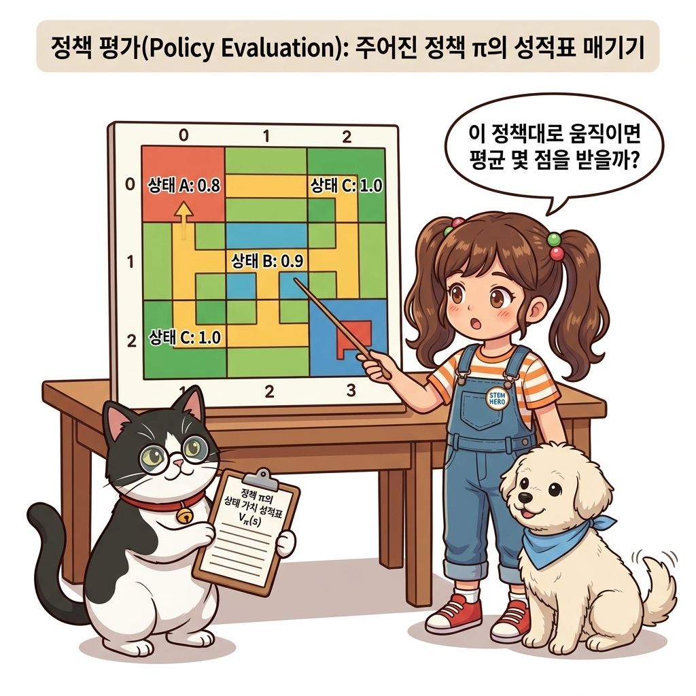
**그림 09-2-1d** 에이전트의 행동 지침인 고정 정책 π를 따를 때 각 상태의 잠재 점수를 매기는 정책 평가(Policy Evaluation)의 개념

---

## 09.2.1 가치 함수를 몬테카를로법으로 구하기

### 가치 함수의 복습과 정의식

강화학습에서 '상태 가치 함수'란 에이전트가 어떤 상태에서 출발하여 앞으로 얻을 수 있는 장기적인 기대 수익의 총합을 뜻합니다:

> ### ***v**π*(*s*) = E*π*[*G**t* | *S**t* = *s*]**

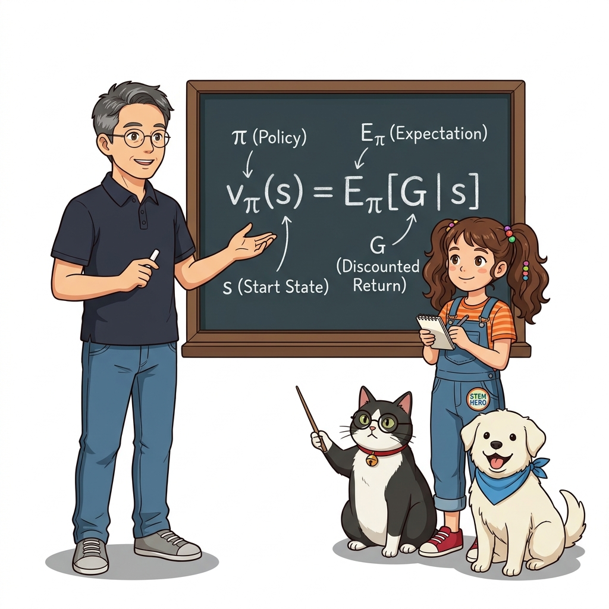
**그림 09-2-2** 가치 함수 정의식 *v**π*(*s*) = E*π*[*G**t* | *S**t* = *s*]의 기호별 의미(정책, 출발 상태, 조건부 기댓값)를 칠판에서 해설하는 장면

---

#### 💡 수식 돋보기: 가치 함수 정의식 기호 해부

가치 함수 수식의 기호를 하나하나 뜯어보면 강화학습의 평가 원리가 한눈에 들어옵니다:

1. ***v**π*(*s*) (상태 *s*의 참 가치)**:
   * 정책 *π*를 고정하고 따랐을 때, 에이전트가 현재 상태 *s*에 서 있다는 사실 자체만으로 기대할 수 있는 장기적인 잠재 가치 점수입니다.
2. **E*π*[&middot;] (정책 조건부 기댓값)**:
   * 미래에 어떤 상태로 미끄러질지(환경의 확률성)와 에이전트가 어떤 행동을 고를지(정책의 확률성)를 모두 고려하여 구한 이론적인 가중 평균값입니다.
3. ***G**t* (시점 *t*의 누적 할인 수익, Return)**:
   * 지금 당장 손에 쥐는 1스텝 보상뿐만 아니라, 게임이 끝날 때까지 미래에 받게 될 모든 보상들을 할인율 *γ*로 깎아서 전부 더한 알짜배기 총수익(*G**t* = *R**t*+1 + *γR**t*+2 + *γ*2*R**t*+3 + &hellip;)입니다.
4. **| *S**t* = *s* (조건부 출발점)**:
   * "시점 *t*에 에이전트가 서 있는 출발 위치가 정확히 상태 *s*일 때"라는 수학적 단서 조건입니다.

**그림 09-2-2a** 가치 함수 정의식 v_π(s) = E_π[G_t | S_t = s]의 4대 핵심 기호 정밀 해부 인포그래픽

---

### 몬테카를로법으로 가치 함수 근사하기

이 가치 함수를 몬테카를로법으로 계산하려면 어떻게 해야 할까요? 

복잡한 적분이나 연립방정식을 풀 필요가 전혀 없습니다! 

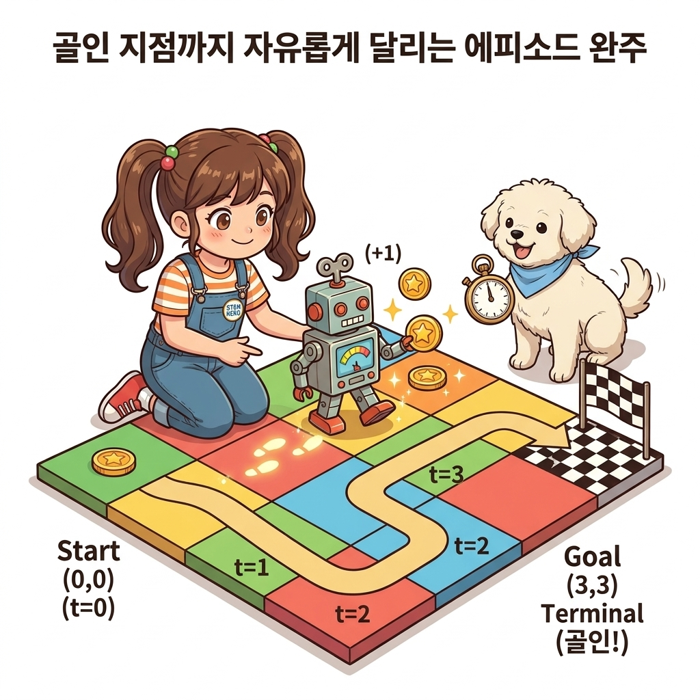
**그림 09-2-2a2** 복잡한 연립방정식이나 적분 수식 없이, 정책에 따라 미로 속을 마음껏 뛰어다니며 경험을 쌓는 몬테카를로 시뮬레이션

---

에이전트에게 정책 *π*에 따라 실제로 환경 속을 마음껏 뛰어다니도록 지시하면 됩니다. 

출발 상태 *s*에서 시작하여 에피소드가 끝날 때까지 완주하면, 골인 지점에 도달했을 때 에이전트의 손에는 실제로 획득한 보상들의 누적 합인 **수익 표본(*G*)**이 쥐어집니다. 

**그림 09-2-2a3** 출발 상태 s에서 시작하여 목표 골 지점에 도달했을 때 에이전트 손에 쥐어지는 누적 수익 표본 G 토큰

---

이러한 모험을 *n*번 반복하여 얻은 실제 수익들이 바로 샘플 데이터(*G*(1), *G*(2), &hellip;, *G*(*n*))가 되며, 이 샘플들의 산술 평균을 구하면 가치 함수의 추정치 *V**π*(*s*)가 완성됩니다:

> ### ***V**π*(*s*) = (*G*(1) + *G*(2) + &hellip; + *G*(*n*)) / *n* = (1/*n*) ∑*i*=1*n* *G*(*i*)**

상태 *s*에서 시작하여 *i*번째 에피소드에서 얻은 실제 수익을 *G*(*i*)라 할 때, *n*번의 에피소드 표본 평균으로 *V**π*(*s*)를 추정합니다.

---

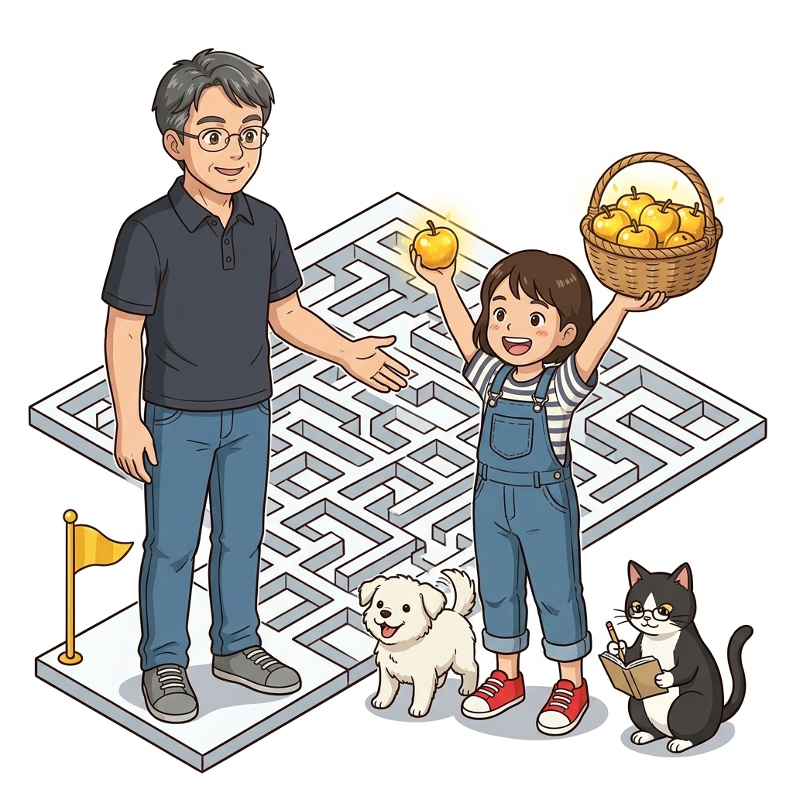
**그림 09-2-2b** 에피소드 완주 지점(Goal Flag)에서 황금 사과 바구니를 들고 기뻐하는 도로시와 토토를 맞이하며, 완주된 총수익 G를 장부에 기록하여 가치 함수 평균을 갱신하는 이호진 교수님과 조교 지니

---

> [!CAUTION]
> **⚠️ 몬테카를로법은 오직 일회성 과제(Episodic Task)에서만 이용할 수 있습니다!**  
> 몬테카를로법은 반드시 **'에피소드가 끝까지 완주되어 골인 지점에 도달해야만'** 총수익 *G*가 확정됩니다.  
> 만약 24시간 365일 멈추지 않고 계속되는 로봇 제어나 주식 거래 같은 지속적 과제(Continuing Task)라면, 게임에 '끝'이 없기 때문에 에피소드가 영원히 종료되지 않고, 따라서 수익 샘플 *G*(*i*)를 영영 계산할 수 없어 몬테카를로법을 적용할 수 없습니다.

**그림 09-2-2c** 명확한 종료 골인 지점이 있는 일회성 과제(Episodic)와 끝없이 회전하는 지속적 과제(Continuing)의 결정적 차이

---

### 구체적인 2회 시도 예시: 표본 평균의 수렴

중학생도 단번에 감을 잡을 수 있도록, 에이전트가 상태 *s*에서 출발하여 딱 2번의 에피소드를 진행한 구체적인 숫자 예시를 살펴봅시다:

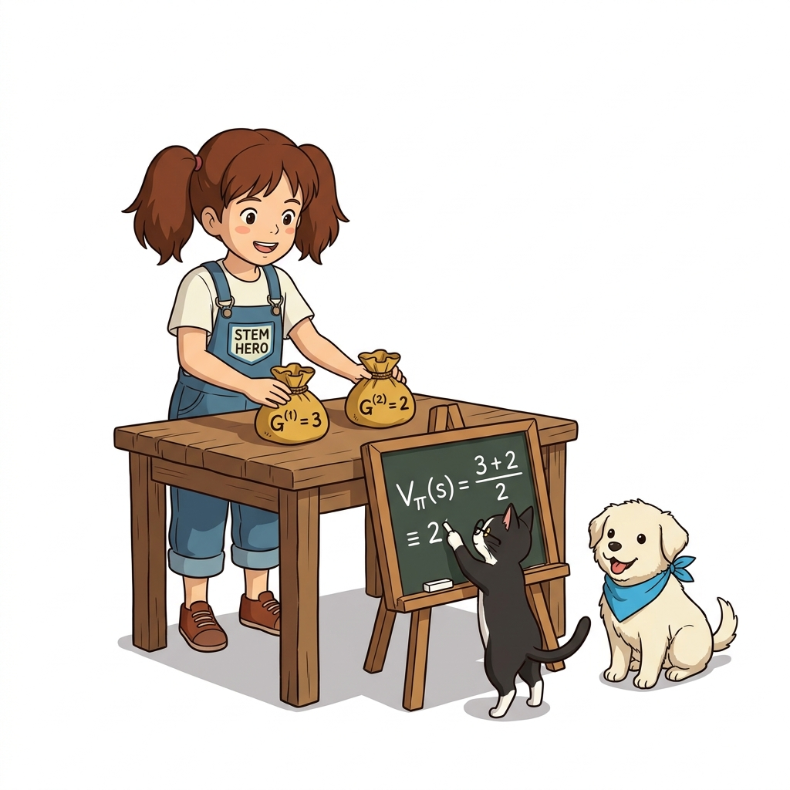
**그림 09-2-3** 1차 시도 수익 G^(1)=3과 2차 시도 수익 G^(2)=2를 모아 산술 평균 2.5로 가치 함수를 갱신하는 도로시와 지니

---

#### 이해를 돕기 위해 미래 보상을 깎지 않는 할인율 *γ* = 1이라고 가정해 봅시다:

* **첫 번째 시도 (에피소드 1)**:
  * 에이전트가 상태 *s*에서 출발하여 골인 지점까지 가며 보상으로 1점, 0점, 2점을 차례로 획득했습니다.
  * 1차 수익 샘플: *G*(1) = 1 + 0 + 2 = **3**
  * 1차 추정 가치: *V**π*(*s*) = *G*(1) = **3.0**
* **두 번째 시도 (에피소드 2)**:
  * 에이전트가 똑같은 출발 상태 *s*에서 다시 출발했습니다. 하지만 환경의 바람이나 에이전트의 주사위 선택이 달라져 이번에는 0점, 0점, 1점, 1점을 얻고 골인했습니다.
  * 2차 수익 샘플: *G*(2) = 0 + 0 + 1 + 1 = **2**
  * 2차 추정 가치 (2회 표본 평균): 
    > ***V**π*(*s*) = (*G*(1) + *G*(2)) / 2 = (3 + 2) / 2 = 2.5**

> 👨‍🏫 **이호진 교수님의 짚어보기**:  
> "첫 번째 시도에서는 3이 나왔고, 두 번째 시도에서는 2가 나왔단다. 만약 세 번째 시도에서 4가 나온다면 평균은 (3 + 2 + 4) / 3 = 3.0이 되겠지?  
> 매 시도마다 우연에 의해 얻는 점수가 조금씩 요동치더라도, 시도 횟수 *n*이 10번, 100번, 1000번으로 늘어나면 **대수의 법칙(큰 수의 법칙)**에 의해 우연한 흔들림이 서로 상쇄되면서 원래 환경이 품고 있던 진짜 참값 *v**π*(*s*)에 자석처럼 오차 없이 수렴하게 된단다!"

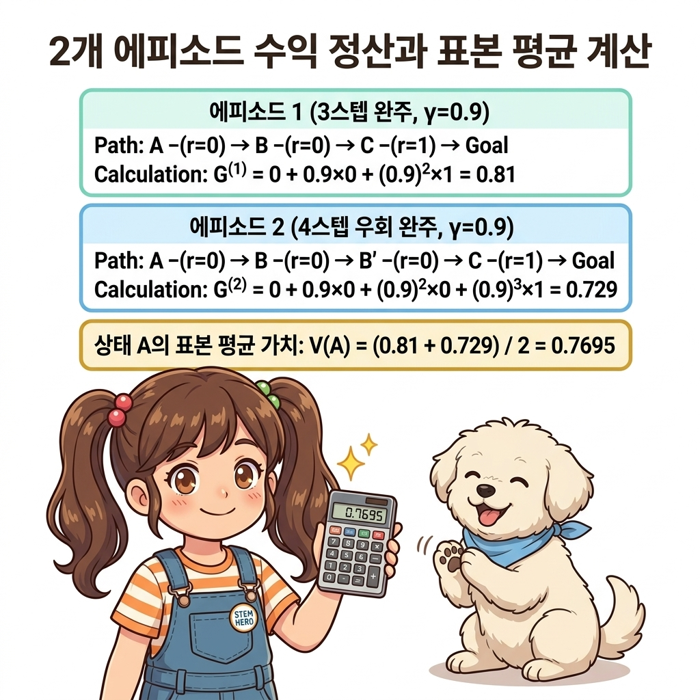
**그림 09-2-3a** 1차(3.0), 2차(2.5), 3차(3.0) 시도가 거듭될수록 우연의 흔들림이 상쇄되며 참값으로 수렴해가는 대수의 법칙 차트

---

## 09.2.2 모든 상태의 가치 함수 구하기: 1타 다피의 혁신

지금까지는 오직 하나의 출발 상태 *s*에 대해서만 이야기했습니다. 

그렇다면 우리가 탐험하는 미로에 상태가 수십 개, 수백 개(예: *A, B, C*, &hellip;) 있다면 이 모든 상태의 가치 함수는 대체 어떻게 구할 수 있을까요?

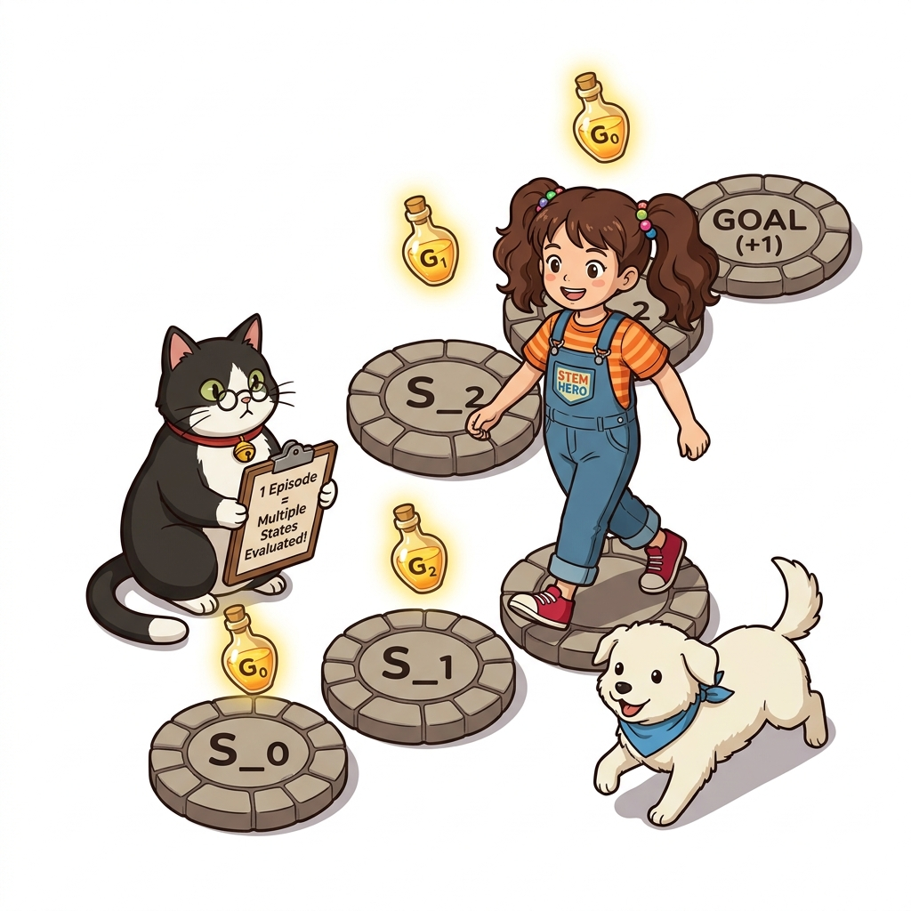
**그림 09-2-4** 하나의 모험 경로(A ➔ B ➔ C)를 완주하면서 상태 A, B, C의 수익 데이터를 동시에 수확하는 스마트한 경로 학습

---

* **비효율적인 독립 출발 방식의 한계**:
  * 가장 단순한 생각은 "상태 *A*의 가치를 알기 위해 *A*에서 100번 출발해 보고, 상태 *B*를 위해 *B*에서 100번 리셋해서 출발하고, 상태 *C*를 위해 *C*에서 또 100번 출발하자!"일 것입니다.
  * 하지만 이 방식은 엄청난 시간과 컴퓨터 자원을 낭비합니다. 무엇보다 **현실의 자율주행차나 로봇은 원하는 임의의 중간 위치로 순간이동(Reset)하여 출발할 수 없는 경우**가 대부분입니다!

**그림 09-2-4a** 상태마다 일일이 순간이동 리셋하여 따로따로 출발할 때 발생하는 막대한 자원 낭비와 현실 로봇의 순간이동 불가능 한계

---

* **1타 다피의 단일 경로 수확 방식 (Single Path Multi-Harvesting)**:
  * 놀랍게도 몬테카를로법에서는 그럴 필요가 전혀 없습니다!
  * 에이전트가 상태 *A*에서 출발하여 *B*를 거치고, *C*를 지나 골인 지점에 도달했다고 가정해 봅시다:
    > **출발(*A*) &rarr; 보상 *R*0 &rarr; *B* &rarr; 보상 *R*1 &rarr; *C* &rarr; 보상 *R*2 &rarr; 골인(종료)**
  * 이때 지나온 각 상태의 입장에서 미래의 누적 수익을 계산해 보면 다음과 같습니다:
    * **상태 *A*의 수익**: *G**A* = *R*0 + *γR*1 + *γ*2*R*2 (상태 *A*를 방문한 이후 얻은 모든 보상의 할인합)
    * **상태 *B*의 수익**: *G**B* = *R*1 + *γR*2 (상태 *B*를 방문한 이후 얻은 모든 보상의 할인합)
    * **상태 *C*의 수익**: *G**C* = *R*2 (상태 *C*를 방문한 이후 얻은 보상)

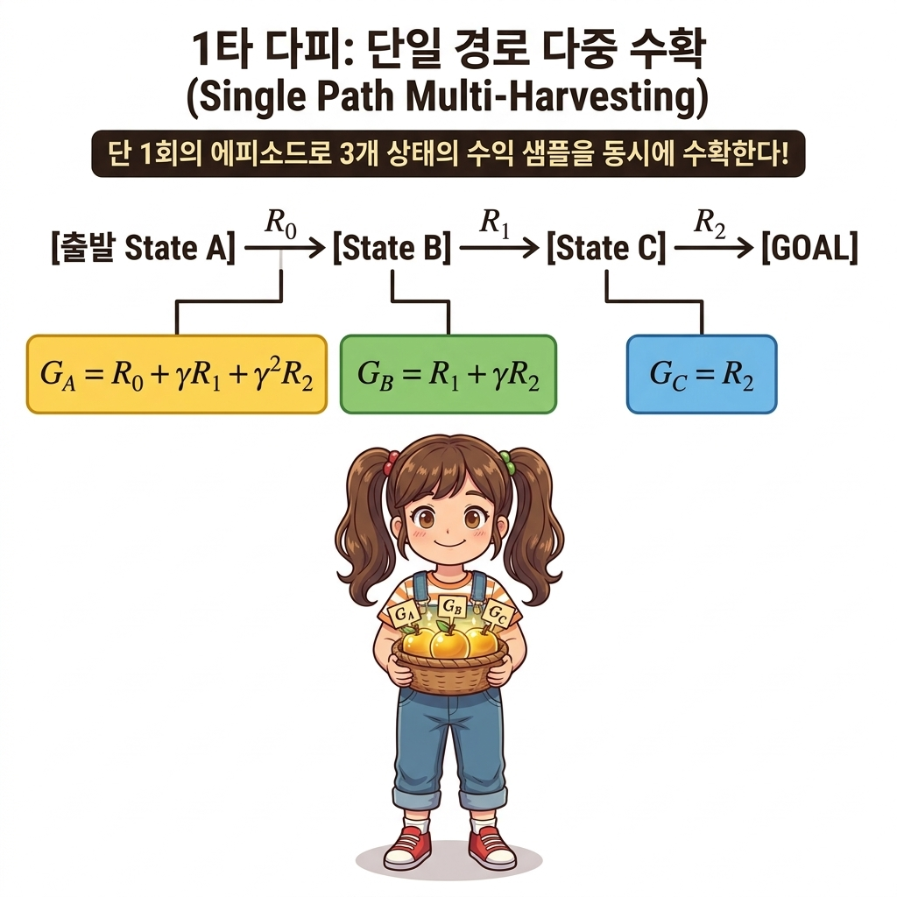
**그림 09-2-4c** 1타 다피 단일 경로 다중 수확: 출발(A)→보상 R0→B→보상 R1→C→보상 R2→골 경로에서 상태 A, B, C의 수익 GA, GB, GC를 단 1회 주행으로 동시 산출하는 수식 기호 분해 인포그래픽

---

> 👧 **도로시의 기차 여행 비유**:  
> "마치 서울역(*A*)에서 출발해 대전역(*B*)과 대구역(*C*)을 지나 부산역(골)에 도착하는 기차 여행 같아요!  
> 기차가 부산에 도착하고 나면, 서울역에서 탄 승객이 느낀 총여행 만족도(*G**A*), 대전역에서 탄 승객의 만족도(*G**B*), 대구역에서 탄 승객의 만족도(*G**C*)를 단 한 번의 기차 운행으로 동시에 정산할 수 있는 것과 똑같네요!"

**그림 09-2-4d** 도로시의 기차 여행 비유: 서울역(A)에서 대전(B), 대구(C)를 거쳐 부산(Goal)에 도착한 기차 승객들의 총 여행 만족도를 단 한 번의 운행으로 동시 정산하는 따뜻한 설명 일러스트

---

이처럼 **단 한 번의 에피소드 완주만으로 경로 상에 방문한 모든 상태(*A, B, C*)에 대한 수익 샘플 데이터를 동시에 수확**할 수 있습니다! 에이전트가 환경 속을 자유롭게 탐색하며 다양한 상태를 거쳐 가기만 하면, 출발점을 억지로 리셋하지 않아도 모든 상태의 가치 함수 카드가 골고루 채워집니다.

**그림 09-2-4e** 억지로 리셋하지 않고 환경을 자유롭게 탐색하며 모든 상태의 가치 카드 표본을 풍성하게 채워 넣고 기뻐하는 도로시와 지니

---

## 09.2.3 몬테카를로법 계산 효율 개선: 역방향 수익 정산

마지막으로 이 수익 데이터를 컴퓨터 코드로 계산할 때 발생하는 중복 연산을 완벽하게 제거하는 알고리즘의 묘수를 살펴봅시다.

위에서 구한 세 상태의 수익 계산식을 나란히 놓아보겠습니다:

> *G**A* = *R*0 + *γR*1 + *γ*2*R*2  
> *G**B* = *R*1 + *γR*2  
> *G**C* = *R*2

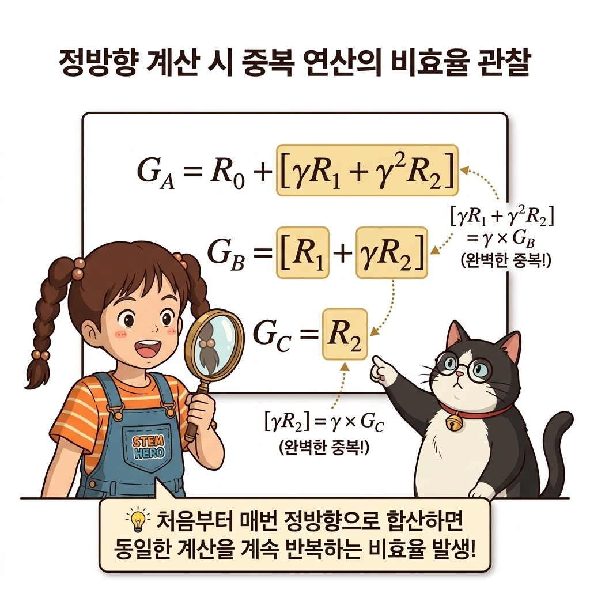
**그림 09-2-5a** 정방향 수익 계산식 GA = R0 + γR1 + γ²R2 와 GB = R1 + γR2, GC = R2 의 나열과 겹치는 항들을 컬러 박스로 짚어보는 수식 인포그래픽

---

식을 유심히 관찰해 보면 기막힌 규칙이 눈에 들어옵니다:

* *G**A*의 뒷부분(*γR*1 + *γ*2*R*2)은 사실 ***γ*(*R*1 + *γR*2) = *γG**B***와 완전히 같습니다!
* 마찬가지로 *G**B*의 뒷부분(*γR*2)은 ***γG**C***와 완전히 같습니다!

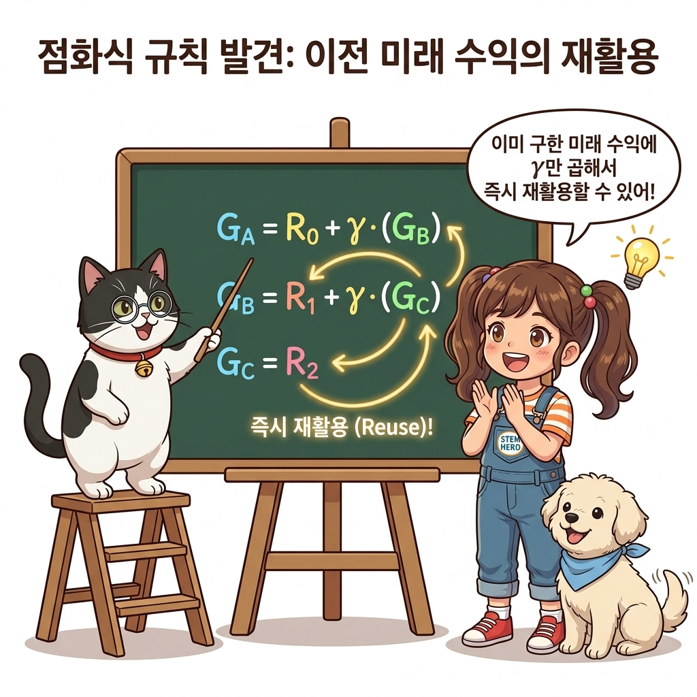
**그림 09-2-5b** 점화식 패턴 발견: GA의 뒷부분이 정확히 γGB와 같음을 돋보기로 발견하고 기뻐하는 지니와 도로시의 수식 연결 인포그래픽

---

즉, 수식을 다음과 같이 점화식 형태로 다시 쓸 수 있습니다:

> *G**C* = *R*2  
> *G**B* = *R*1 + *γG**C*  
> *G**A* = *R*0 + *γG**B*

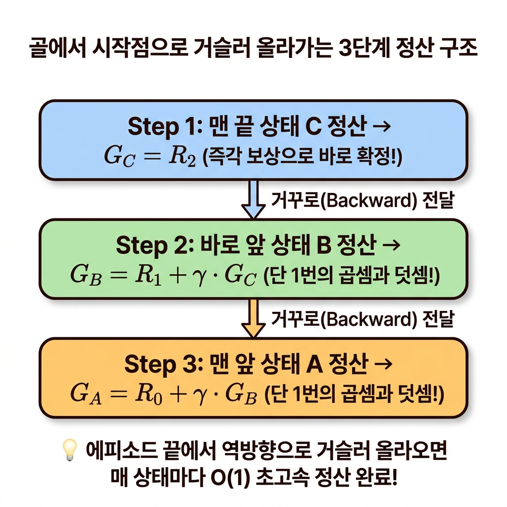
**그림 09-2-5c** 골에서 시작점으로 거슬러 올라가는 3단계 점화식 계산 구조 (GC=R2 → GB=R1+γGC → GA=R0+γGB) 인포그래픽

---

일반화하면 어떤 임의의 시점 *t*에서의 수익 *G**t*는 다음과 같은 아름다운 재귀 점화식으로 표현됩니다:

> ### ***G**t* = *R**t* + *γG**t*+1**

**그림 09-2-4b** 이호진 교수님이 포인터로 골 지점에서 시작 지점으로 거슬러 올라가는 역방향 징검다리 화살표를 가리키며, 이미 구한 미래 수익 *G**t*+1을 재활용하는 *G**t* = *R**t* + *γG**t*+1 점화식을 도로시와 지니에게 설명하는 장면

---

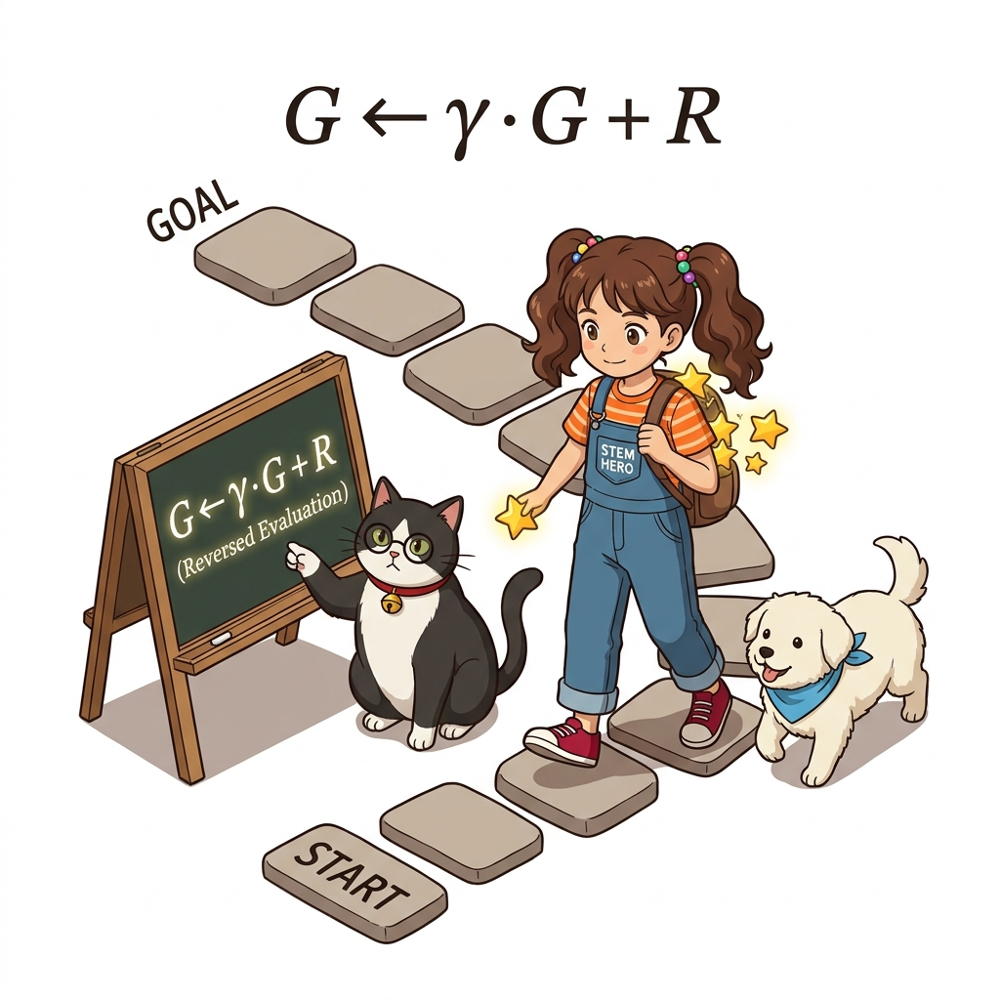
**그림 09-2-5** 골 지점에서부터 뒤로 걸어오며 할인율 *γ*를 곱해 미래 수익을 재사용하는 역방향 수익 정산 점화식 시각화

---

#### 💡 계산 복잡도의 기적: *O*(*T*2)에서 *O*(*T*)로의 대혁신!

만약 계산을 앞에서부터 순서대로(*G**A* &rarr; *G**B* &rarr; *G**C*) 한다면, *G**A*를 구할 때 *R*1, *R*2를 더하고, *G**B*를 구할 때 *R*2를 또 더하는 심각한 중복 덧셈이 발생합니다. 에피소드 길이가 100스텝이라면 약 (100 &times; 101) / 2 &approx; 5,000번의 연산이 필요합니다.

**그림 09-2-5d** 정방향 누적 O(T^2) vs 역방향 누적 O(T) 계산 복잡도 극적 비교: 5,000회 중복 연산의 비효율과 100회 단일 패스의 쾌속 질주

---

하지만 **골(Goal)에서부터 출발지를 향해 거꾸로(*G**C* &rarr; *G**B* &rarr; *G**A*) 거슬러 올라가며 계산**하면:
1. 맨 끝 상태 *C*의 수익은 즉각 보상 *R*2로 바로 확정됩니다 (*G**C* = *R*2).
2. 바로 앞 상태 *B*의 수익은 이미 구해둔 *G**C*에 할인율 *γ*만 곱해서 즉각 보상 *R*1과 더하면 끝납니다 (*G**B* = *R*1 + *γG**C*).
3. 가장 앞선 상태 *A*의 수익 역시 이미 구해둔 *G**B*에 *γ*만 곱해서 *R*0와 더하면 즉시 끝납니다 (*G**A* = *R*0 + *γG**B*).

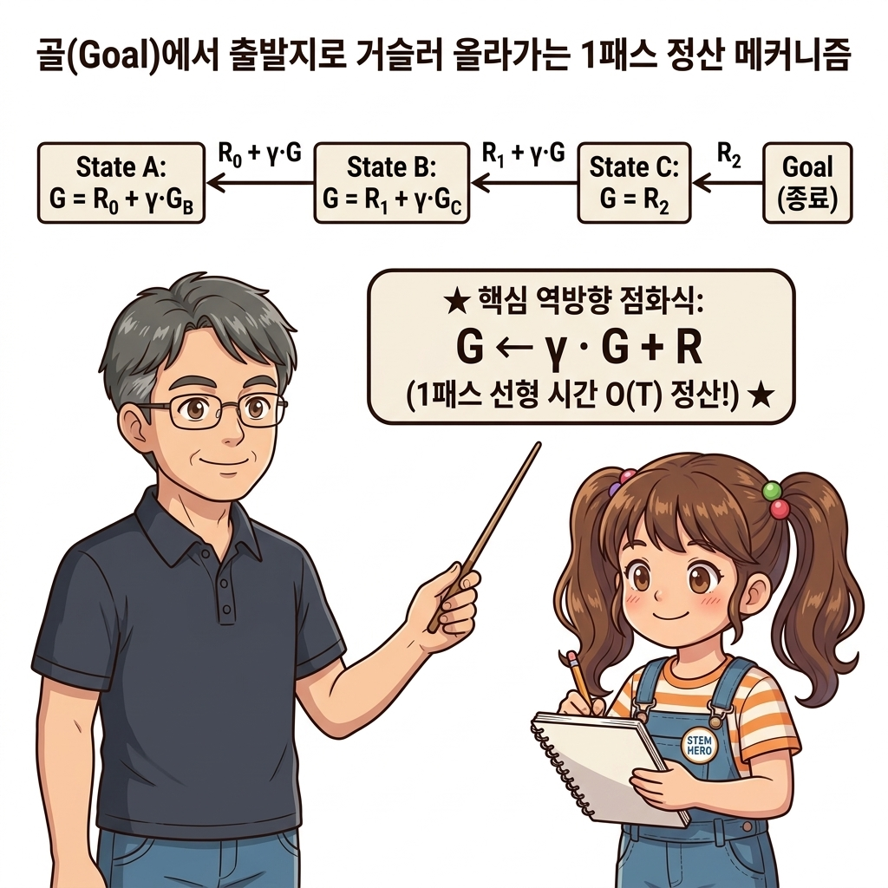
**그림 09-2-5e** 골(Goal)에서 출발지를 향해 거꾸로 거슬러 올라가며 단 1회의 곱셈과 덧셈으로 상태별 수익을 확정 짓는 단계별 정산도

---

에피소드 길이가 100스텝이어도 **단 100번의 곱셈과 덧셈(*O*(*T*) 선형 시간)만으로 모든 상태의 수익 정산이 눈 깜짝할 사이에 완료**됩니다! 파이썬 코드에서 에피소드 메모리 리스트를 `reversed(memory)`로 뒤집어 순회하는 이유가 바로 이 눈부신 계산 최적화 때문입니다.

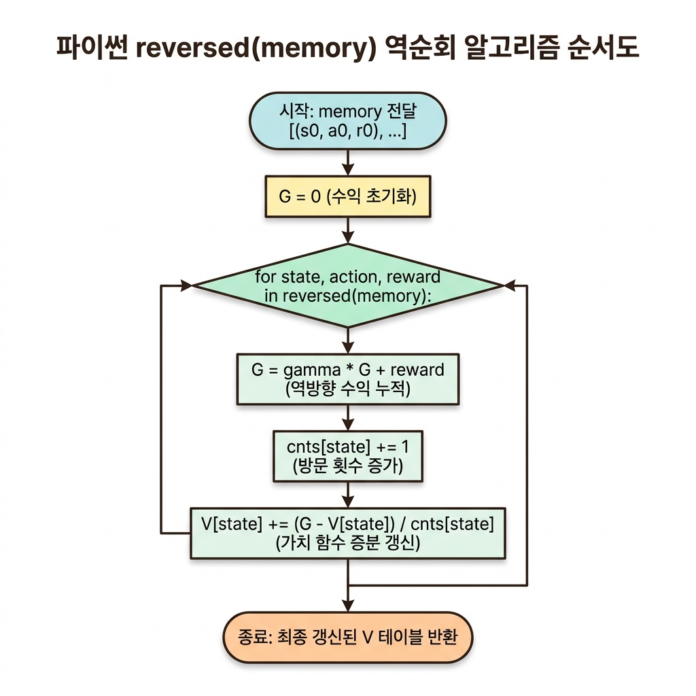
**그림 09-2-5f** 파이썬 reversed(memory) 역순회 알고리즘 순서도: Goal 직전부터 거꾸로 돌며 G = gamma * G + reward 를 누적하고 가치 함수를 갱신하는 표준 순서도

---

### 09.2.4 핵심 정리: 몬테카를로 정책 평가의 3대 핵심 기둥

몬테카를로 기법을 강화학습 정책 평가에 적용하는 핵심 원리는 다음 3가지 기둥으로 요약됩니다:

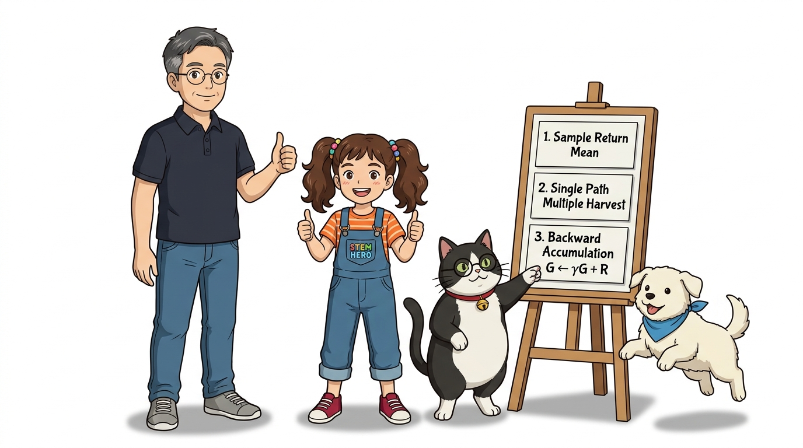
**그림 09-2-6** 몬테카를로 정책 평가의 3대 핵심 기둥(수익 표본 평균, 단일 경로 다중 수확, 역방향 재귀 정산)을 총정리하는 연구실 4인방 (16:9 와이드)

---

1. **경험 수익의 표본 평균 (Return Averaging)**:
   * 환경의 전이 확률 모델 *p*(*s'* | *s*, *a*)를 전혀 몰라도, 에피소드를 끝까지 완주하며 얻은 실제 수익들의 산술 평균 *V**π*(*s*) = (∑ *G*(*i*)) / *n*으로 참 가치 함수를 완벽하게 근사합니다.

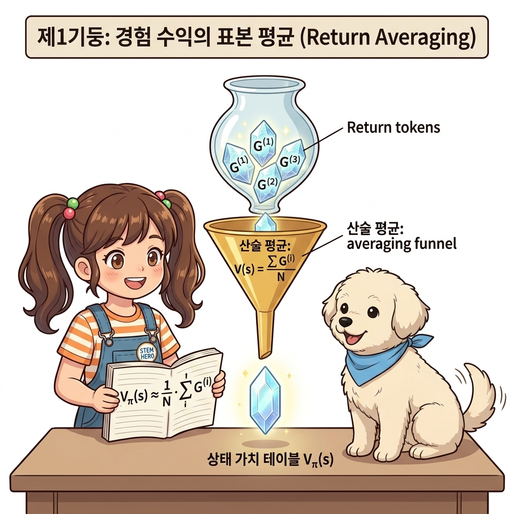
**그림 09-2-6a** 제1기둥: 환경 모델 없이 완주된 에피소드 수익들의 표본 평균으로 참 가치를 수렴시키는 수익 표본 평균 인포그래픽

---

2. **단일 경로 다중 상태 수확 (Multi-state Harvesting)**:
   * 상태마다 따로따로 출발할 필요 없이, 단 한 번의 에피소드 주행으로 경로 상에 방문한 모든 상태(*A, B, C*)의 수익 표본을 동시에 수확합니다.

**그림 09-2-6b** 제2기둥: 단 1회의 주행 경로로 방문한 모든 상태의 수익 표본을 일거에 거두어들이는 1타 다피 수확 인포그래픽

---

3. **초고속 역방향 재귀 정산 (Backward Recursion)**:
   * *G**t* = *R**t* + *γG**t*+1 점화식을 이용하여 골에서부터 거꾸로 계산함으로써, 불필요한 중복 연산 없이 *O*(*T*)의 초고속으로 모든 상태의 가치를 업데이트합니다.

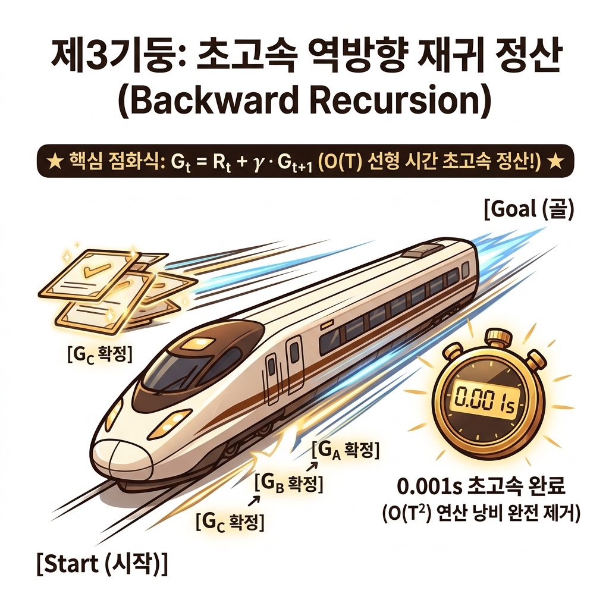
**그림 09-2-6c** 제3기둥: G_t = R_t + gamma * G_{t+1} 점화식으로 O(T) 선형 시간에 모든 가치를 갱신하는 초고속 역방향 재귀 정산 인포그래픽

---

> 👨‍🏫 **이호진 교수님의 직강 노트**:  
> "몬테카를로 정책 평가의 백미는 바로 '끝까지 가보고 거꾸로 정산한다'는 점입니다. 인생에서도 목표를 이룬 뒤 지나온 길을 되돌아볼 때 각 순간의 가치를 비로소 명확히 평가할 수 있듯이, 몬테카를로법은 에피소드 완주 후 골에서부터 거꾸로 보상을 묶어줌으로써 복잡한 미래의 가치를 명쾌하게 밝혀냅니다."

**그림 09-2-6d** 이호진 교수님의 직강 멘토링 노트: 인생에서도 목표를 이룬 후 지나온 길을 되돌아볼 때 각 순간의 가치가 명쾌해지듯, 완주 후 거꾸로 정산하는 몬테카를로의 지혜

---

> 🐱 **조교 지니의 핵심 요약 노트**:  
> "수학적 원리를 완벽하게 마스터했으니, 이제 다음 9.3절에서는 도로시와 함께 그리드월드 환경에서 에피소드를 생성하고 `reversed()` 함수로 가치 함수를 업데이트하는 **순수 파이썬 몬테카를로 코드 구현**으로 신나게 넘어가 보자냥!"

**그림 09-2-6e** 다음 장 예고: 그리드월드에서 에피소드를 생성하고 reversed()로 가치 함수를 갱신하는 9.3 순수 파이썬 구현 코드로 신나게 출발하는 연구실
