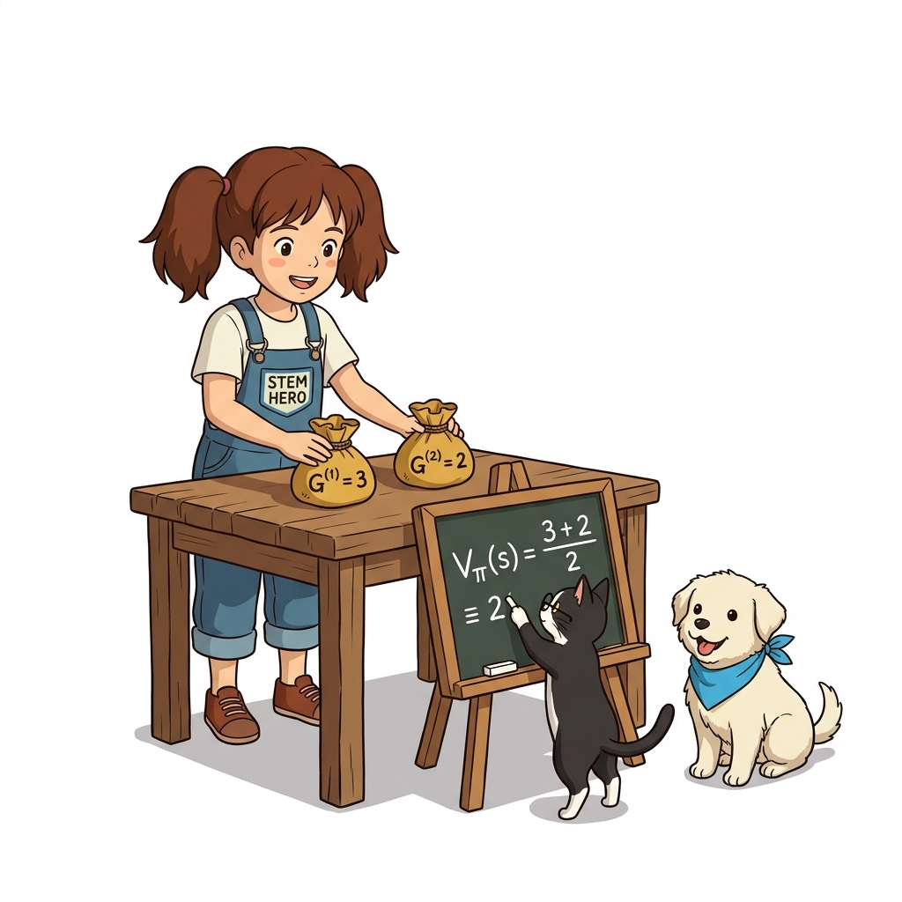
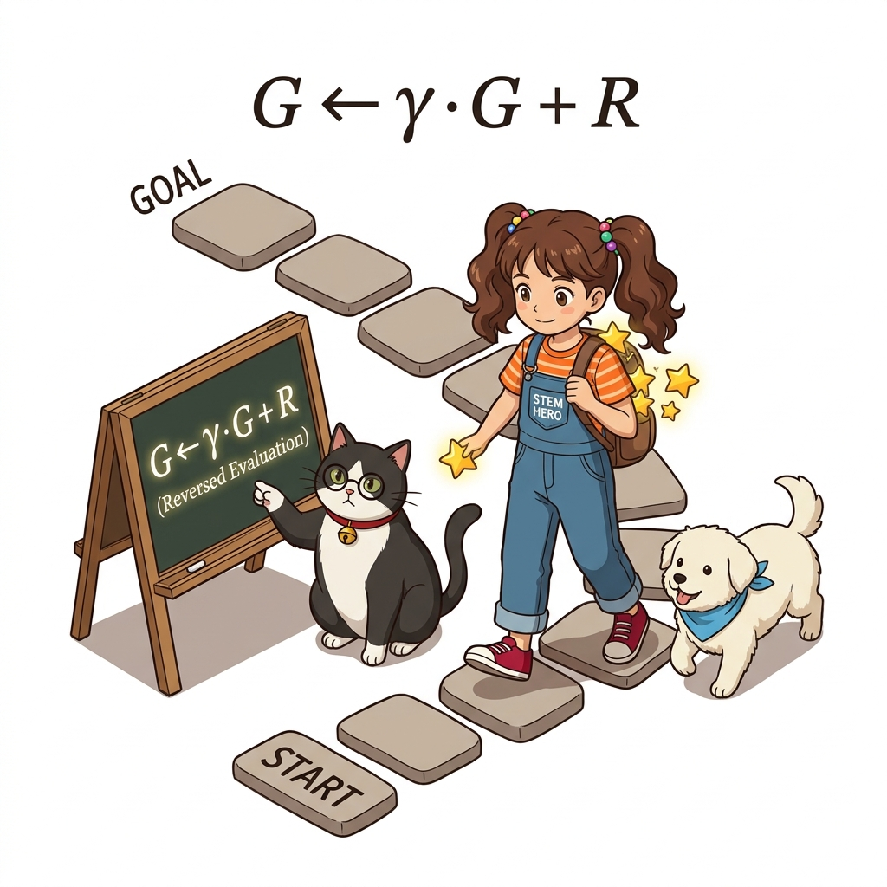

# 09.2 몬테카를로법으로 정책 평가하기

**그림 09-2-1** 징검다리를 건너가며 에피소드를 완주하고 각 칸의 상태 가치 카드 V(s)를 갱신해나가는 도로시와 연구실 친구들 (16:9 와이드)

주어진 정책 *π*에 따라 에피소드 시뮬레이션을 반복하여 상태 가치 함수 *v**π*(*s*)를 근사하는 **정책 평가(Policy Evaluation)** 과정을 배웁니다. 징검다리를 끝까지 건너는 다수의 에피소드 표본 데이터를 기반으로, 각 칸의 기대 가치 카드를 완성해 나가는 도로시의 즐거운 모험을 지니와 함께 살펴봅시다!

---

### 경험(샘플 데이터)으로 가치 함수를 추정하다

앞서 몬테카를로법의 대수적 기초를 배웠습니다. 몬테카를로법은 복잡한 수학 공식 없이도 **실제로 샘플링**을 수행하고 수집한 표본 데이터로부터 **기댓값**을 계산합니다.

이 방법은 **강화학습** 문제에 완벽하게 적용됩니다. 즉, 환경의 전이 확률 *p*(*s'*|*s*,*a*)를 사전에 알지 못해도, **에이전트가 실제로 행동하여 얻은 경험(수익 샘플 데이터)**만으로 각 상태의 **가치 함수를 정확하게 추정**할 수 있습니다.

이번 절에서는 고정된 정책 *π*가 주어졌을 때 그 정책의 참 가치 함수를 몬테카를로법으로 계산하는 '정책 평가' 과정을 집중적으로 다룹니다.

---

## 09.2.1 가치 함수를 몬테카를로법으로 구하기

### 가치 함수의 복습과 정의식

가치 함수는 어떤 상태에서 출발하여 얻을 수 있는 장기적인 기대 수익을 나타냅니다:

> ### ***v**π*(*s*) = E*π*[*G* | *s*]**

**그림 09-2-2** 가치 함수 정의식 v_π(s) = E_π[G | s]의 기호별 의미(정책, 출발 상태, 조건부 기댓값)를 칠판에서 해설하는 장면 (1:1 순백색)

#### 💡 수식 돋보기: 가치 함수 정의식 *v**π*(*s*) = E*π*[*G* | *s*] 기호 해부

가치 함수 수식의 기호를 하나하나 뜯어보면 강화학습의 평가 원리가 명확해집니다:

1. ***v**π*(*s*) (상태 가치)**:
   * 정책 *π*를 고정했을 때, 상태 *s*가 지니는 본질적인 장기적 잠재 가치입니다.
2. **E*π* (정책 조건부 기댓값)**:
   * 확률적인 상태 전이와 에이전트의 확률적 행동 선택을 모두 감안하여 가중 평균을 구함을 뜻합니다.
3. ***G* (기대 수익, Return)**:
   * 당장의 즉각 보상뿐만 아니라 미래에 받게 될 모든 할인 보상들의 총합(*G* = *R*0 + *γR*1 + *γ*2*R*2 + ...)입니다.
4. **| *s* (조건부 출발점)**:
   * "현재 에이전트가 서 있는 출발 위치가 정확히 상태 *s*일 때"라는 전제 조건입니다.

---

### 몬테카를로법으로 가치 함수 근사하기

이 가치 함수를 몬테카를로법으로 계산하려면, 에이전트에게 정책 *π*에 따라 실제로 환경 속에서 행동하도록 지시합니다. 에피소드를 끝까지 완주하여 얻은 실제 수익들이 바로 샘플 데이터가 되며, 이 샘플들의 산술 평균을 구하면 가치 함수가 완성됩니다:

> ### ***V**π*(*s*) = (*G*(1) + *G*(2) + ... + *G*(*n*)) / *n***

상태 *s*에서 시작하여 *i*번째 에피소드에서 얻은 실제 수익을 *G*(*i*)라 할 때, *n*번의 에피소드 표본 평균으로 *V**π*(*s*)를 추정합니다.

> [!CAUTION]
> **몬테카를로법은 일회성 과제(Episodic Task)에서만 이용할 수 있습니다!**  
> 지속적 과제(Continuing Task)에는 '끝'이 없기 때문에 에피소드가 종료되지 않아 수익 샘플 데이터 *G*(*i*)가 확정되지 않기 때문입니다.

---

### 구체적인 2회 시도 예시: 표본 평균의 수렴

에이전트가 상태 *s*에서 출발하는 두 번의 에피소드를 진행한 구체적인 예를 살펴봅시다:

**그림 09-2-3** 1차 시도 수익 G^(1)=3과 2차 시도 수익 G^(2)=2를 모아 산술 평균 2.5로 가치 함수를 갱신하는 도로시와 지니 (1:1 순백색)

* **첫 번째 시도**: 보상으로 1, 0, 2를 차례로 획득 (*γ* = 1 가정)
  * 수익 샘플: *G*(1) = 1 + 0 + 2 = **3**
  * 1차 추정 가치: *V**π*(*s*) = *G*(1) = **3.0**
* **두 번째 시도**: 동일한 상태 *s*에서 출발했으나, 환경의 확률적 전이로 인해 보상으로 0, 0, 1, 1을 획득
  * 수익 샘플: *G*(2) = 0 + 0 + 1 + 1 = **2**
  * 2차 추정 가치 (표본 평균): *V**π*(*s*) = (*G*(1) + *G*(2)) / 2 = (3 + 2) / 2 = **2.5**

이처럼 매 시도마다 획득 보상이 달라지더라도, 에피소드 표본 수를 늘려 평균을 취하면 대수의 법칙에 따라 오차가 줄어들며 참 가치 함수에 완벽하게 수렴해 나갑니다.

---

## 09.2.2 모든 상태의 가치 함수 구하기: 1타 다피의 혁신

지금까지는 하나의 상태 *s*에만 주목했습니다. 그렇다면 환경 내의 **모든 상태(*A, B, C*)**에 대한 가치 함수는 어떻게 구할 수 있을까요?

**그림 09-2-4** 하나의 모험 경로(A ➔ B ➔ C)를 완주하면서 상태 A, B, C의 수익 데이터를 동시에 수확하는 스마트한 경로 학습 (1:1 순백색)

* **비효율적인 독립 출발 방식의 문제점**:
  * 각 상태마다 에이전트의 시작 위치를 리셋하여 따로따로 실험하는 방식은 시간과 연산 낭비가 매우 큽니다. 게다가 현실 세계에서는 시작 위치를 마음대로 임의 설정할 수 없는 경우가 대부분입니다.
* **1타 다피의 단일 경로 수확 방식**:
  * 에이전트가 상태 *A*에서 출발하여 *B*와 *C*를 거쳐 골에 도달했다고 가정해 봅시다 (도중 보상: *R*0, *R*1, *R*2).
  * **상태 *A*의 수익**: *G**A* = *R*0 + *γR*1 + *γ*2*R*2
  * **상태 *B*의 수익**: *G**B* = *R*1 + *γR*2
  * **상태 *C*의 수익**: *G**C* = *R*2

이처럼 **단 한 번의 에피소드 완주만으로 경로 상에 방문한 세 가지 상태(*A, B, C*)에 대한 수익 샘플 데이터를 동시에 획득**할 수 있습니다! 에이전트가 무작위 탐색을 하며 다양한 상태를 경유하기만 하면, 시작 상태를 억지로 변경하지 않아도 모든 상태의 가치 함수를 효율적으로 학습할 수 있습니다.

---

## 09.2.3 몬테카를로법 계산 효율 개선: 역방향 수익 정산

마지막으로 수익을 컴퓨터로 계산할 때 중복 연산을 완벽히 제거하는 알고리즘 최적화를 살펴봅시다. 세 상태의 수익 식을 다시 보면:

> *G**A* = *R*0 + *γR*1 + *γ*2*R*2  
> *G**B* = *R*1 + *γR*2  
> *G**C* = *R*2

식을 유심히 살펴보면 *G**A* 안에 *G**B*가 그대로 포함되어 있고, *G**B* 안에 *G**C*가 포함되어 있음을 알 수 있습니다:

> *G**C* = *R*2  
> *G**B* = *R*1 + *γG**C*  
> *G**A* = *R*0 + *γG**B*

따라서 계산을 앞에서부터 하지 않고, **골(Goal)에서부터 출발지를 향해 거꾸로(*G**C* ➔ *G**B* ➔ *G**A*) 계산**하면 이미 계산된 다음 스텝의 수익을 그대로 재사용할 수 있어 중복 덧셈이 0개로 사라집니다!

**그림 09-2-5** 골 지점에서부터 뒤로 걸어오며 할인율 γ를 곱해 미래 수익을 재사용하는 역방향 수익 정산 점화식 시각화 (1:1 순백색)

#### 💡 수식 돋보기: 역방향 수익 점화식 *G**t* = *R**t* + *γG**t*+1 기호 해부

이 역방향 점화식은 파이썬 코드로 몬테카를로법을 구현할 때 가장 결정적인 역할을 수행합니다:

1. ***G**t* (현재 시점 *t*의 총수익)**:
   * 시점 *t*의 상태 *S**t*에서 에피소드 종료까지 얻게 될 누적 할인 수익입니다.
2. ***R**t* (즉각 보상)**:
   * 상태 *S**t*에서 행동을 취해 즉시 획득한 보상입니다.
3. ***γ* (할인율, Discount Factor)**:
   * 미래에 얻을 수익을 현재 가치로 환산해 주는 감가상각 비율입니다.
4. ***G**t*+1 (다음 시점의 수익)**:
   * 골 쪽에서부터 역순으로 계산해 올라오면서 **이미 구해둔 다음 스텝의 누적 수익**입니다. 이 값을 그대로 재활용하므로 전체 에피소드 정산이 *O*(*T*)의 선형 시간 만에 완료됩니다.

---

### 09.2.4 핵심 정리: 몬테카를로 정책 평가의 3대 핵심 기둥

몬테카를로 기법을 강화학습 정책 평가에 적용하는 핵심 원리는 다음 3가지 기둥으로 요약됩니다:

**그림 09-2-6** 몬테카를로 정책 평가의 3대 핵심 기둥(수익 표본 평균, 단일 경로 다중 수확, 역방향 재귀 정산)을 총정리하는 연구실 4인방 (16:9 와이드)

1. **경험 수익의 표본 평균 (Return Averaging)**:
   * 환경의 전이 확률 모델 *p*(*s'*|*s*,*a*)를 전혀 몰라도, 에피소드를 끝까지 완주하며 얻은 실제 수익들의 산술 평균 *V**π*(*s*) = (∑ *G*(*i*)) / *n*으로 참 가치 함수를 완벽하게 근사합니다.
2. **단일 경로 다중 상태 수확 (Multi-state Harvesting)**:
   * 상태마다 따로따로 출발할 필요 없이, 단 한 번의 에피소드 주행으로 경로 상에 방문한 모든 상태(*A, B, C*)의 수익 표본을 동시에 수집합니다.
3. **초고속 역방향 재귀 정산 (Backward Recursion)**:
   * *G**t* = *R**t* + *γG**t*+1 점화식을 이용하여 골에서부터 거꾸로 계산함으로써, 불필요한 중복 연산 없이 초고속으로 모든 상태의 가치를 업데이트합니다.

> 👨‍🏫 **이호진 교수님의 직강 노트**:
> "몬테카를로 정책 평가의 백미는 바로 '끝까지 가보고 거꾸로 정산한다'는 점입니다. 인생에서도 목표를 이룬 뒤 지나온 길을 되돌아볼 때 각 순간의 가치를 비로소 명확히 평가할 수 있듯이, 몬테카를로법은 에피소드 완주 후 골에서부터 거꾸로 보상을 묶어줌으로써 복잡한 미래의 가치를 명쾌하게 밝혀냅니다."

> 🐱 **조교 지니의 핵심 요약 노트**:
> "수학적 원리를 완벽하게 마스터했으니, 이제 다음 절에서는 도로시와 함께 그리드월드 환경에서 에피소드를 생성하고 `reversed()` 함수로 가치 함수를 업데이트하는 **순수 파이썬 몬테카를로 코드 구현**으로 넘어가 보자냥!"
