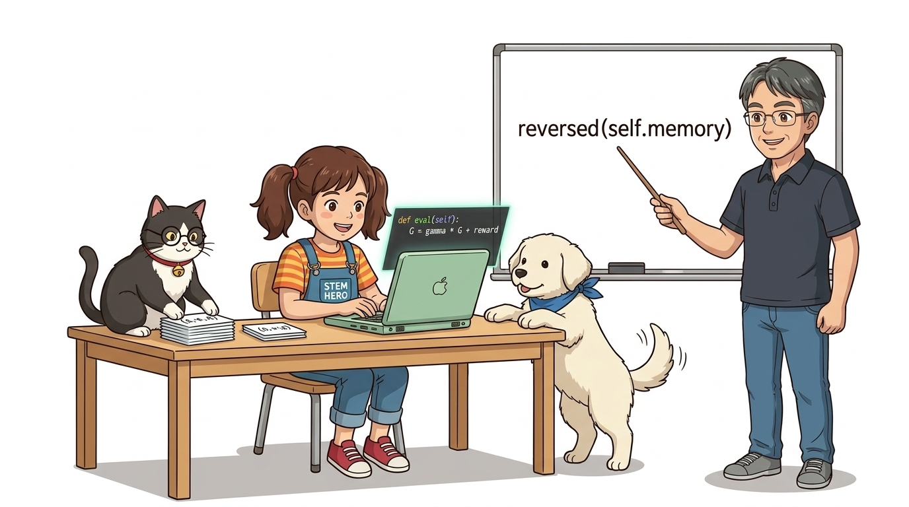

# 09.3 몬테카를로법 구현




**그림 09-3-1** 그리드월드 조작 조종 패드를 쥐고 모니터를 보며, RandomAgent와 eval() 코드 연동을 실행하는 도로시와 지니

파이썬 코드를 기반으로 몬테카를로 정책 평가 알고리즘을 실제로 작성해 봅니다. 환경 클래스 `GridWorld`에 물리적 움직임을 전달하는 `step()` 메서드를 구현하고, 에이전트 클래스에서 실시간으로 경험(경로)을 에피소드 데이터 형태로 담아 가치를 갱신하는 과정을 지니 요정의 칠판 릴레이 코드로 명확하게 실습해봅시다!

---

4장에서 다룬 '3 × 4 그리드 월드' 문제를 이번에는 몬테카를로법으로 풀어보겠습니다.


**그림 09-10** 3 × 4 그리드 월드 환경 구조 (시작, 벽, 골, 함정)

이번에는 환경 모델(상태 전이 확률과 보상 함수)을 이용하지 않고 정책을 평가합니다. 즉, 컴퓨터에게 미로의 전체 지도를 미리 건네주지 않는다는 뜻입니다. 

이렇게 하려면 에이전트가 눈을 감고 미로 속을 직접 걸어 다니며, "한 발짝 앞으로 가보자!"라고 환경에게 실제로 행동을 취하도록 시키는 명령 메서드가 반드시 필요합니다.

---

## 09.3.1 step() 메서드

`GridWorld` 클래스에는 `step()` 메서드가 있습니다. 에이전트에게 행동을 시키는 핵심 메서드죠. 어떻게 사용하는지 함께 코드를 실행해 봅시다.

```python
from common.gridworld import GridWorld

env = GridWorld()
action = 0 # 더미 행동 (0: 상, 1: 하, 2: 좌, 3: 우)
next_state, reward, done = env.step(action) # 행동 수행

print('next_state:', next_state)
print('reward:', reward)
print('done:', done)
```

**출력 결과**
```
next_state: (1, 0)
reward: 0.0
done: False
```

`step()` 메서드는 에이전트가 취하고자 하는 행동 번호(`action`)를 매개변수로 받습니다. `env.step(action)`이라고 호출하면 현재 환경에서 행동 `action`을 즉시 수행하고, 그 물리적 상호작용의 결과로 다음의 세 가지 핵심 값을 한 묶음으로 반환합니다:

1. **`next_state` (다음 상태)**: 에이전트가 행동을 취한 직후 실제로 발을 디딘 새로운 위치 좌표입니다 (예: `(1, 0)`).
2. **`reward` (즉각 보상)**: 해당 칸으로 이동하면서 환경으로부터 즉시 획득한 보상 점수입니다 (일반 칸은 `0.0`, 골인 지점은 `+1.0`, 함정은 `-1.0`).
3. **`done` (에피소드 종료 여부 플래그)**: 에이전트의 모험이 끝났는지를 알려주는 불리언(`True`/`False`) 신호입니다. 목표 지점(골)에 무사히 도착했거나 위험한 함정에 빠지면 `True`가 되어 한 판의 게임이 종료되었음을 알립니다.

`state`, `action`, `reward`, `next_state`의 관계는 [그림 09-11]을 보면 명확하게 알 수 있습니다.


**그림 09-11** 코드 변수와 수식 기호의 1:1 대응 관계

그림과 같이 현재 시간을 *t*라고 했을 때, $S_t$는 `state`, $A_t$는 `action`에 해당합니다. 시간 *t*에 에이전트가 행동을 하면, 보상으로 $R_t$를 얻고 다음 상태 $S_{t+1}$로 전이합니다. 이때 얻은 보상 $R_t$가 `reward`에 해당하고 다음 상태 $S_{t+1}$이 `next_state`에 해당합니다.


**그림 09-3-2** 행동 리모컨의 버튼을 누르고 얻은 보상 사과와 다음 상태 이동 경험을 배낭 속 memory 리스트에 패키징하여 담는 도로시와 지니

> 👧 **도로시와 토토의 비유로 이해하기**:  
> 도로시가 그리드월드 발판 위에서 게임 리모컨의 `step(action)` 버튼을 딸깍 누르면, 화면 속 캐릭터가 한 걸음 이동하고 즉시 얻는 보상 사과(`reward`)와 새 발판 위치(`next_state`), 그리고 게임이 끝났는지(`done`)를 컴퓨터가 친절하게 돌려줍니다.  
> 도로시는 이 값들을 허공에 날려버리지 않고, 등에 메고 있는 배낭(`self.memory`) 속에 `(상태, 행동, 보상)` 구슬 팩으로 묶어 차곡차곡 담아둡니다.

> [!NOTE]
> **💡 상태 전이가 확률적인 환경이라면?**  
> 이번 '3 × 4 그리드 월드' 예제에서는 상태 전이가 100% 결정적으로 이루어지지만, 현실 세계처럼 확률적으로 결정되는 경우도 얼마든지 생각할 수 있습니다.  
> 예를 들어 빙판길에서 에이전트가 오른쪽으로 이동하는 행동을 시도하면 80%의 확률로만 오른쪽으로 정상 이동하고, 나머지 20%의 확률로는 미끄러져 제자리에 머물러 있을 수 있겠지요.  
> 상태 전이가 확률적일 때도 에이전트는 아무런 걱정이 없습니다. 그저 `step()` 메서드를 호출하고 반환되는 실제 결과를 관찰하여 메모리에 적어두기만 하면, 몬테카를로법이 알아서 평균을 내어 참 가치를 찾아주기 때문입니다!

`GridWorld` 클래스에서는 `step()` 메서드를 통해 에이전트에게 행동하도록 하여 샘플 데이터를 얻습니다. 또한, `GridWorld` 클래스에는 `reset()` 메서드도 있습니다. 환경을 초기 상태(미로의 출발점)로 재설정하는 메서드입니다. 사용법은 다음과 같습니다:

```python
env = GridWorld()
state = env.reset() # 상태 초기화
```

`reset()` 메서드는 초기 출발 상태(`state`)를 반환합니다.

---

## 09.3.2 에이전트 클래스 구현

이제 몬테카를로법을 이용하여 정책 평가를 수행하는 에이전트를 구현할 차례입니다. 상, 하, 좌, 우 4가지 방향으로 똑같이 25%씩 무작위로 발걸음을 옮기는 에이전트를 `RandomAgent` 클래스로 구현하겠습니다. 

먼저 코드의 전반부를 살펴봅시다:

<div align="right"><b>ch05/mc_eval.py</b></div>

```python
from collections import defaultdict
import numpy as np

class RandomAgent:
    def __init__(self):
        self.gamma = 0.9
        self.action_size = 4

        random_actions = {0: 0.25, 1: 0.25, 2: 0.25, 3: 0.25}
        self.pi = defaultdict(lambda: random_actions)
        self.V = defaultdict(lambda: 0)
        self.cnts = defaultdict(lambda: 0)
        self.memory = []

    def get_action(self, state):
        action_probs = self.pi[state]
        actions = list(action_probs.keys())
        probs = list(action_probs.values())
        return np.random.choice(actions, p=probs)
```

초기화 메서드인 `__init__()`에서 미래 보상 감가상각률인 할인율 `gamma`(=0.9)와 가능한 행동의 가짓수 `action_size`(=4)를 설정합니다. 

그리고 4방향으로 각각 0.25(25%)의 동일한 확률로 무작위 행동을 취하도록 확률 분포 딕셔너리 `random_actions`를 만들고, 이를 기본 정책 `self.pi`에 연결합니다. 

- `self.V`: 각 상태의 가치 함수 추정치를 저장하는 테이블입니다.
- `self.cnts`: 각 상태를 지금까지 몇 번이나 방문했는지 방문 횟수($n$)를 기록하는 테이블입니다. '증분 방식'으로 평균을 갱신할 때 분모($1/n$)로 사용됩니다.
- `self.memory`: 에이전트가 한 에피소드 동안 실제로 걸어 다니며 얻은 소중한 경험(`(state, action, reward)`)들을 순서대로 담는 리스트 배낭입니다.

> [!TIP]
> **💡 파이썬의 `defaultdict`를 쓰는 이유!**  
> 일반적인 딕셔너리(`dict`)는 한 번도 등록되지 않은 새로운 상태 좌표(예: `(2, 3)`)를 조회하면 "그런 키는 없어!"라며 `KeyError` 에러를 뿜으며 프로그램이 멈춥니다.  
> 하지만 `defaultdict(lambda: 0)`을 사용하면, 에이전트가 난생처음 밟아보는 낯선 상태를 만나더라도 자동으로 기본값 `0`을 생성해 주므로 에러 없이 안전하고 우아하게 코드를 작성할 수 있습니다.

다음은 `get_action(self, state)` 메서드입니다. 이 메서드는 현재 상태 `state`에서 취할 수 있는 행동을 정책 확률에 따라 하나 무작위로 뽑아옵니다. 

가장 중요한 부분은 마지막 줄의 `np.random.choice(actions, p=probs)`입니다. 넘파이(NumPy)의 이 강력한 함수는 `probs`에 정의된 확률 분포(각 25%)에 맞추어 주사위를 굴리듯 행동 번호(0~3)를 단 하나 뽑아냅니다.

> [!NOTE]
> 몬테카를로법에서는 에이전트가 행동을 선택하게 하는 것, 즉 '행동을 샘플링할 수 있다'는 것이 필수 조건입니다. 따라서 행동의 확률 분포를 담는 `self.pi` 변수를 사용하지 않는 방법도 있습니다. 이번 절에서 보여드리는 에이전트는 '분포 모델'에 따른 구현이며, 또 다른 방법으로 '샘플 모델'에 따른 구현도 생각해 볼 수 있습니다. 샘플 모델 방식의 구현은 9.5절에서 상세히 설명합니다.

---

다음은 `RandomAgent` 클래스의 나머지 핵심 코드(후반부)입니다:

<div align="right"><b>ch05/mc_eval.py</b></div>

```python
class RandomAgent:
    ...

    def add(self, state, action, reward):
        data = (state, action, reward)
        self.memory.append(data)

    def reset(self):
        self.memory.clear()

    def eval(self):
        G = 0
        for data in reversed(self.memory): # 역방향으로(reversed) 거슬러 올라가기!
            state, action, reward = data
            G = self.gamma * G + reward
            self.cnts[state] += 1
            self.V[state] += (G - self.V[state]) / self.cnts[state]
```

먼저 실제로 수행한 행동과 보상을 기록해주는 `add()` 메서드를 보겠습니다. 이 메서드를 호출하면 '상태, 행동, 보상'을 `(state, action, reward)` 튜플로 묶어 리스트인 `self.memory`에 추가합니다. 

튜플로 묶는 이유는 무엇일까요? 예를 들어 에이전트가 출발점 $S_0$에서 시작하여 8걸음을 걸어 골인 지점 $S_9$에 도달했다면, 다음과 같은 시계열 데이터를 얻게 됩니다:

$$S_0, A_0, R_0, S_1, A_1, R_1, \dots, S_8, A_8, R_8, S_9$$

이 원천 데이터를 지금 코드에서는 파이썬 리스트 속에 다음과 같은 깔끔한 패키지 형태로 보관합니다:

```python
# agent.memory 구조
[(S0, A0, R0), (S1, A1, R1), ..., (S8, A8, R8)]
```

보다시피 `(state, action, reward)` 단위로 정갈하게 묶여 저장되어 있습니다. 

여기서 한 가지 매우 중요한 점은, **마지막 상태(지금 예에서 $S_9$, 골인 지점)는 `self.memory`에 저장되지 않는다**는 사실입니다. 왜냐하면 골인 지점(종료 상태)은 게임이 끝난 곳이므로 더 이상 미래에 얻을 보상이 없어 그 가치 함수 $V(\text{Goal})$가 항상 수학적으로 **0**이기 때문입니다. 갱신할 필요가 없는 상태이므로 메모리에 굳이 추가하지 않습니다.

다음은 몬테카를로 정책 평가의 심장인 `eval()` 메서드를 보겠습니다. `RandomAgent` 클래스에서 몬테카를로법을 수행하는 주인공이죠. 

먼저 누적 수익 `G`를 0으로 초기화하고, 실제로 얻은 `self.memory`를 **역방향(`reversed`)으로 뒤에서부터 따라가면서** 각 상태에서 얻은 수익을 계산합니다. 그리고 각 상태에서의 가치 함수를 그때까지 얻은 수익의 평균으로 구합니다. 이 코드에서는 평균을 9.1절에서 배웠던 '초경량 증분 방식'으로 계산했습니다.


**그림 09-3-2b** 인공지능 연구실에서 이호진 교수님이 도로시와 조교 지니에게 노트북 화면의 파이썬 코드 `for data in reversed(self.memory):` 루프와 3x4 그리드월드 가치 함수 히트맵의 1:1 연동 원리를 다정하게 지도하는 장면 (1:1 순백색)


**그림 09-3-3** 에피소드가 골 지점(GOAL)에서 종료된 뒤, 역방향(reversed)으로 되짚어가며 할인율 $\gamma$를 정밀하게 곱해 효율적으로 수익 $G$를 누적하는 지니와 도로시

> 👧 **도로시와 토토의 비유로 이해하기**:  
> 도로시는 목표 지점(에피소드의 끝)에 도달한 뒤, 출발지점을 향해 징검다리를 거꾸로 밟고 되돌아가며(`reversed(memory)`) 각 단계마다 할인율 $\gamma$를 꼼꼼하게 곱해줍니다. 이렇게 뒤에서부터 계산해 나가면, 중복 연산 없이 단 한 번의 루프만으로 모든 상태의 누적 할인 수익 $G$를 매우 빠르고 깔끔하게 계산할 수 있습니다!

---

#### 💡 수식 돋보기: eval() 메서드의 핵심 2대 점화식 기호 해부

```
[점화식 1: 역방향 누적 수익]   G ← γ · G + R
[점화식 2: 가치 증분 갱신]     V(s) ← V(s) + (1 / N(s)) · (G - V(s))
```

1. **역방향 누적 수익 기호 해부 (`G ← γ · G + R`)**:
   - $G$ : 미래 시점들로부터 할인되어 거슬러 올라온 누적 수익 (초깃값 0)
   - $\gamma$ (`self.gamma`) : 미래 보상을 현재 가치로 환산해 주는 할인율 ($0 \le \gamma \le 1$)
   - $R$ (`reward`) : 직전 상태에서 해당 행동을 취했을 때 즉시 환경으로부터 획득한 보상
   - **연산의 묘미**: 뒤에서부터 앞으로 거슬러 올라가며 전개하므로 거듭제곱 연산 없이 단일 곱셈과 덧셈만으로 모든 타임스텝의 할인 수익을 $O(T)$ 선형 시간복잡도로 일괄 계산!
2. **가치 증분 갱신 기호 해부 (`V(s) ← V(s) + (1 / N(s)) · (G - V(s))`)**:
   - $V(s)$ (`self.V[state]`) : 현재까지 추정된 상태 $s$의 기댓값 (현재 추정 가치)
   - $N(s)$ (`self.cnts[state]`) : 상태 $s$가 방문된 누적 횟수 (스텝 크기 $\alpha = 1 / N(s)$)
   - $G - V(s)$ : 실제 모험을 통해 관측된 참 수익 $G$와 기존 예측치 $V(s)$ 사이의 오차(오차 신호)
   - **수렴 보장**: 큰 수의 법칙에 의해 방문 횟수 $N(s)$가 증가할수록 새로운 샘플의 가중치는 점차 작아지며 안정적인 참 기댓값으로 완벽히 수렴합니다.

---

## 09.3.3 몬테카를로법 실행

에이전트를 구현한 `RandomAgent` 클래스와 환경을 구현한 `GridWorld` 클래스를 연동하여 파이썬 메인 스크립트를 작성하고 실행해 봅시다.

<div align="right"><b>ch05/mc_eval.py</b></div>

```python
env = GridWorld()
agent = RandomAgent()

episodes = 1000
for episode in range(episodes): # 에피소드 1000번 수행
    state = env.reset()
    agent.reset()

    while True:
        action = agent.get_action(state) # 행동 선택
        next_state, reward, done = env.step(action) # 행동 수행

        agent.add(state, action, reward) # (상태, 행동, 보상) 저장
        if done: # 목표에 도달 시
            agent.eval() # 몬테카를로법으로 가치 함수 갱신
            break # 다음 에피소드 시작

        state = next_state

# 모든 에피소드 종료 후 가치 함수 시각화
env.render_v(agent.V)
```

에피소드를 총 1000번 실행했습니다. 

에피소드가 시작되면 환경(`env.reset()`)과 에이전트 메모리(`agent.reset()`)를 초기화한 다음 `while True:` 무한 루프 안에서 한 걸음씩 상호작용을 처리합니다:
1. 에이전트가 현재 위치에서 행동을 선택합니다 (`action = agent.get_action(state)`).
2. 환경에 행동을 전달하여 한 걸음 걷고 피드백을 받습니다 (`env.step(action)`).
3. 획득한 경험을 메모리에 차곡차곡 저장합니다 (`agent.add(state, action, reward)`).
4. 만약 목표 지점(골 또는 함정)에 도달하여 게임이 끝났다면(`if done:`), 비로소 배낭을 열고 몬테카를로 역방향 정산(`agent.eval()`)을 실행하여 가치 함수를 업데이트하고 루프를 빠져나와 다음 에피소드로 넘어갑니다.
5. 아직 게임이 끝나지 않았다면 `state = next_state`로 위치를 갱신하고 계속 걷습니다.

그리고 1000번의 에피소드가 모두 끝나면 `env.render_v(agent.V)` 코드에서 각 칸의 가치 함수 숫자를 예쁜 히트맵 격자로 시각화합니다.

다음 그림은 이 코드를 실행하여 얻은 가치 함수를 시각화한 모습입니다:


**그림 09-12** 몬테카를로법(1,000회 에피소드)으로 평가하여 도출한 가치 함수 V(s) 히트맵

이번에는 무작위 정책의 가치 함수를 평가했습니다. 에이전트의 시작 위치는 왼쪽 맨 아래의 한 곳(`(2, 0)`)으로 고정되어 있지만, 사방으로 무작위로 발걸음을 옮기는 무작위 정책이기 때문에 충분한 에피소드를 반복하면 미로의 구석구석 모든 위치를 적어도 수십 번 이상 경유할 수 있습니다. 그래서 모든 위치(상태)에서의 가치 함수를 성공적으로 평가할 수 있었습니다.

> [!CAUTION]
> **⚠️ 정책이 결정적이라면 어떻게 될까요?**  
> 만약 에이전트의 시작 위치가 고정되어 있고 정책이 "항상 위로만 간다"처럼 결정적(Deterministic)이라면, 에이전트는 늘 똑같은 외길만을 반복해서 걷게 됩니다.  
> 이렇게 되면 방문하지 못한 다른 수많은 칸들에 대해서는 수익 샘플 데이터를 단 하나도 수집하지 못해 가치 함수를 평가할 수 없게 됩니다. 이 중요한 딜레마를 해결하는 방법은 바로 다음 9.4절에서 배우게 됩니다!

참고 삼아 [그림 09-12]의 결과를 우리가 지난 4장에서 동적 프로그래밍(DP)으로 완벽한 환경 지도를 보고 풀었던 결과와 나란히 비교해 보겠습니다:


**그림 09-13** 몬테카를로법(MC)과 동적 프로그래밍(DP)으로 얻은 가치 함수 비교

동적 프로그래밍으로 얻은 결과(왼쪽)와 몬테카를로법으로 얻은 결과(오른쪽)를 비교해 보면, 각 칸의 숫자 차이가 소수점 둘째 자리 수준으로 거의 완벽하게 일치함을 알 수 있습니다! 

환경 모델의 전이 확률 행렬이나 복잡한 벨만 연립방정식을 전혀 풀지 않았는데도, **오직 실제로 1000번 뛰어본 경험만으로 컴퓨터가 이론적 참 가치 함수를 완벽히 찾아낸 것**입니다. 이처럼 몬테카를로법을 이용하면 환경 모델을 몰라도 정책 평가를 제대로 할 수 있습니다.

---

### 09.3.4 핵심 정리: 몬테카를로법 구현의 3대 핵심 기둥


**그림 09-3-4** 모험 완주 후 3대 핵심 기둥(step 상호작용, reversed 역방향 누적, incremental 실시간 갱신)을 마스터하고 다음 제어 장으로 전진하는 도로시와 지니

1. **상호작용 인터페이스 (`env.step(action)`)**:
   - 에이전트는 환경 내부의 복잡한 전이 확률 행렬이나 보상 공식을 알 필요 없이, 오직 `step()` 메서드가 돌려주는 `(next_state, reward, done)` 3총사 피드백만으로 환경과 완전하게 대화합니다.
2. **역방향 누적 연산 (`reversed(memory)`)**:
   - 에피소드가 종료된 후 경험 버퍼를 뒤에서부터 역순으로 거슬러 올라가며 점화식 $G \leftarrow \gamma \cdot G + R$을 적용함으로써, 중복 계산 없이 $O(T)$의 초고속 연산으로 모든 방문 상태의 참 수익 $G$를 도출합니다.
3. **증분 평균 갱신 (`V[state] += (G - V[state]) / cnts[state]`)**:
   - 과거의 모든 샘플 데이터를 메모리에 영구 보관할 필요 없이, 상태별 방문 횟수 $N(s)$만을 이용해 현재 가치와 오차 신호를 기반으로 평균을 실시간 점진적으로 갱신합니다.

> 👨‍🏫 **이호진 교수님의 직강 노트**:  
> "몬테카를로 코드의 진정한 아름다움은 바로 '극도의 간결함'에 있습니다. 단 3줄의 점화식 루프(`eval`)만으로 환경 모델 없이도 동적 프로그래밍과 완전히 동일한 참 가치 함수에 수렴함을 우리 두 눈으로 직접 확인했습니다. 이제 우리는 단순히 주어진 정책을 '평가'하는 것을 넘어, 최적의 정책을 스스로 찾아내는 '정책 제어(Control)'의 세계로 진입할 준비가 되었습니다!"

> 🐱 **조교 지니의 응원 노트**:  
> "도로시와 여러분, 정말 대단해요! 복잡한 행렬식 하나 없이 파이썬의 `defaultdict`와 리스트 뒤집기(`reversed`)만으로 몬테카를로 평가기를 뚝딱 완성했어요. 다음 9.4절에서는 행동 가치 함수 $Q(s, a)$와 $\epsilon$-탐욕 정책을 결합해 에이전트가 스스로 미로를 탈출하는 최적 정책 제어의 기적을 만들어 봅시다냥!"
