# 09.3 몬테카를로법 구현

파이썬 코드를 기반으로 몬테카를로(Monte Carlo, MC) 정책 평가 알고리즘을 한 줄 한 줄 직접 작성해 봅니다. 


**그림 09-3-1** 그리드월드 조작 조종 패드를 쥐고 모니터를 보며, RandomAgent와 eval() 코드 연동을 실행하는 도로시와 지니

---

환경 클래스 `GridWorld`에 물리적 움직임을 전달하는 `step()` 메서드를 살펴보고, 에이전트 클래스 `RandomAgent`에서 실시간으로 경험(상태, 행동, 보상)을 리스트에 패키징하여 보관한 뒤, 에피소드가 끝났을 때 역방향으로 거슬러 올라가며 가치 함수를 갱신하는 전 과정을 지니 요정과 이호진 교수님의 직강 코드로 명쾌하게 실습해 봅시다!

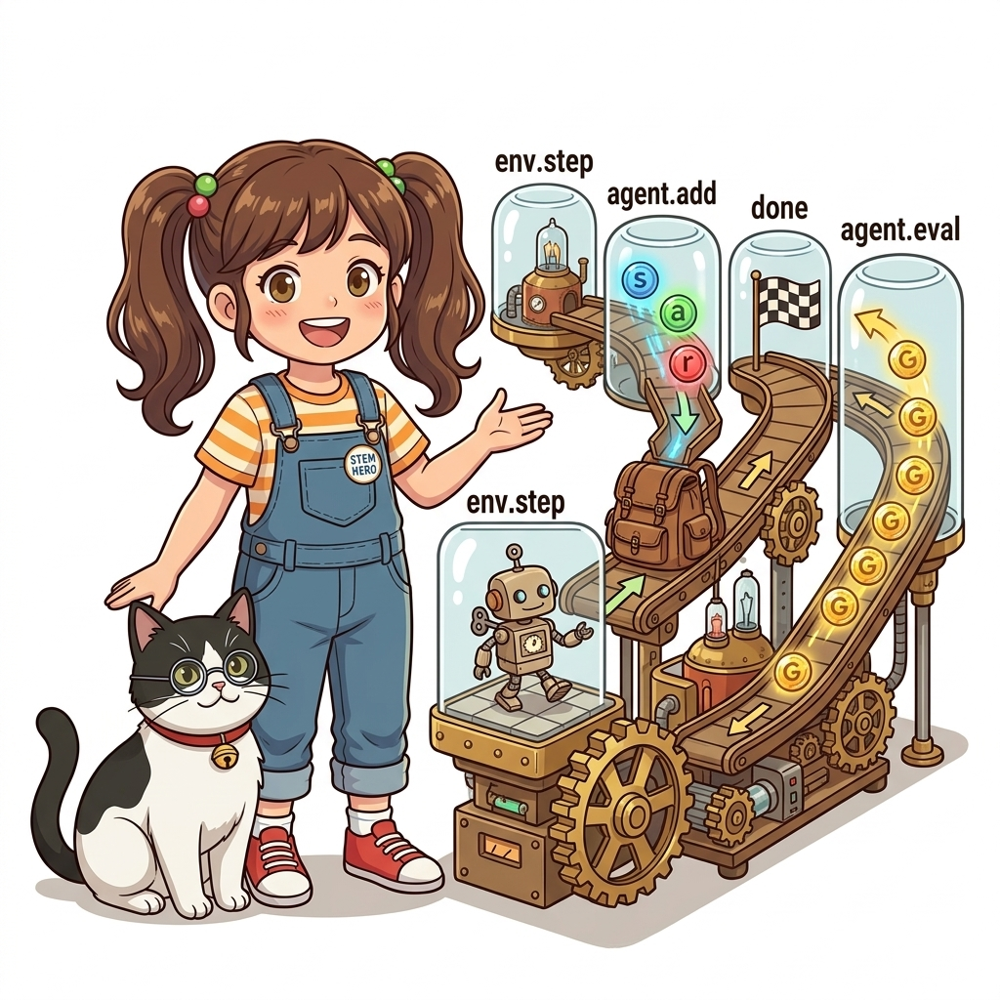
**그림 09-3-1b** 몬테카를로 정책 평가 파이프라인 4단계 로드맵 (환경 step 상호작용 → memory 배낭 저장 → 에피소드 완주 판정 → reversed 역방향 정산) 인포그래픽

---

## 09.3.1 3 × 4 그리드월드와 상호작용 인터페이스

이전에 다룬 '3 × 4 그리드 월드' 문제를 이번에는 **환경 모델(전이 확률과 보상 함수)을 전혀 모르는 상태**에서 몬테카를로법으로 풀어보겠습니다.

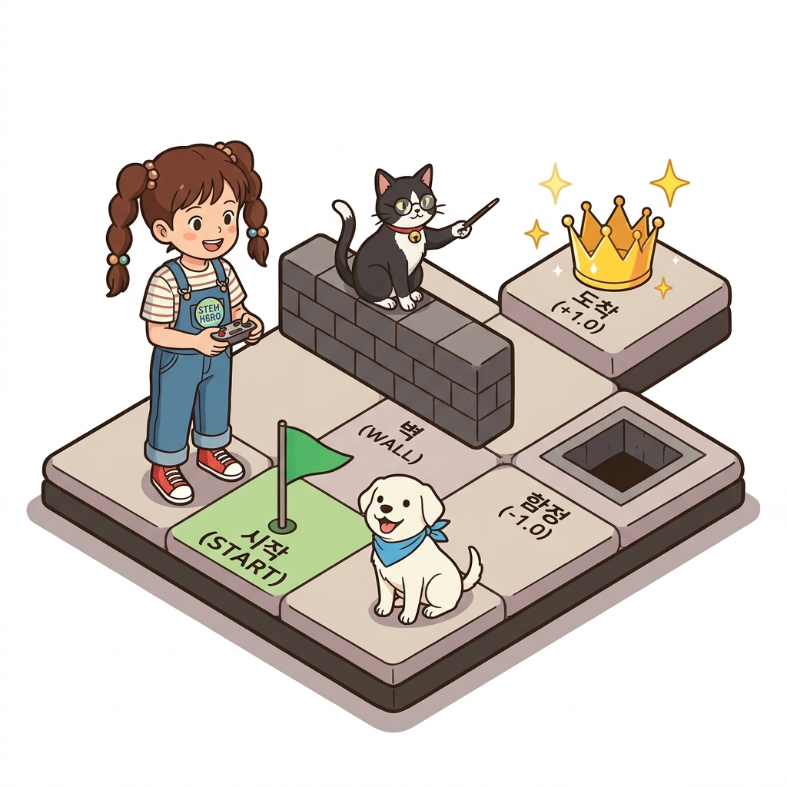
**그림 09-10** 3 × 4 그리드 월드 환경 구조 (시작, 벽, 골, 함정)

---

#### 환경을 알고 있을 경우

동적 프로그래밍(DP)에서는 미로의 전체 지도(각 칸에서 이동했을 때의 확률적 전이 행렬과 보상 공식)를 컴퓨터에게 미리 모두 주었습니다. 


**그림 09-3-1c** 환경의 전이 확률 행렬과 보상 공식을 모두 펼쳐놓고 위에서 내려다보며 계산하는 DP의 전지적 관점

---

#### 환경을 모르고 있을 경우

하지만 몬테카를로법에서는 지도를 전혀 건네주지 않습니다. 

에이전트는 눈을 가린 탐험가처럼 미로 안으로 직접 뛰어들어, 발을 한 걸음 내딛고 환경이 돌려주는 피드백만을 관찰하며 배워야 합니다. 이렇게 하려면 에이전트가 "한 걸음 앞으로 가보자!"라고 환경에게 실제로 행동을 취하도록 시키는 명령 메서드가 반드시 필요합니다.


**그림 09-3-1d** 지도가 없는 안개 속 그리드월드에서 step(action) 지팡이로 한 걸음씩 내딛으며 피드백을 받는 눈먼 탐험가 도로시와 토토

---

### 1) step() 메서드의 동작 원리와 반환값

`GridWorld` 클래스에는 에이전트에게 물리적 행동을 실행하게 하는 핵심 인터페이스인 `step()` 메서드가 있습니다. 

---

다음 예제 코드를 함께 살펴봅시다.

```python
from common.gridworld import GridWorld

env = GridWorld()
action = 0  # 0: 상(Up), 1: 하(Down), 2: 좌(Left), 3: 우(Right)
next_state, reward, done = env.step(action)  # 환경에 행동 전달

print('next_state:', next_state)
print('reward:', reward)
print('done:', done)
```

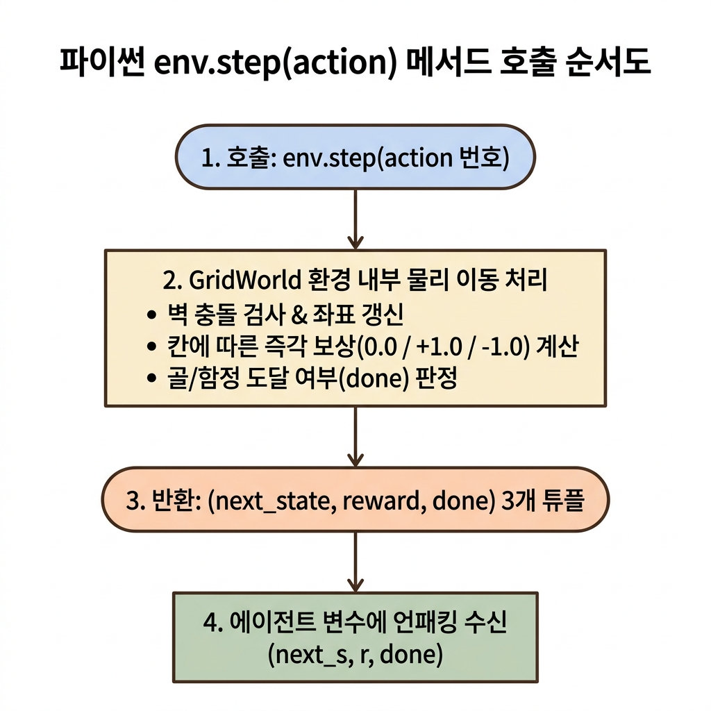
**그림 09-3-1e** 파이썬 `env.step(action)` 메서드 호출과 반환값 수신 표준 순서도: action 번호 전달부터 물리 전이 후 3대 반환값 수신까지

---

**출력 결과**

```text
next_state: (1, 0)
reward: 0.0
done: False
```

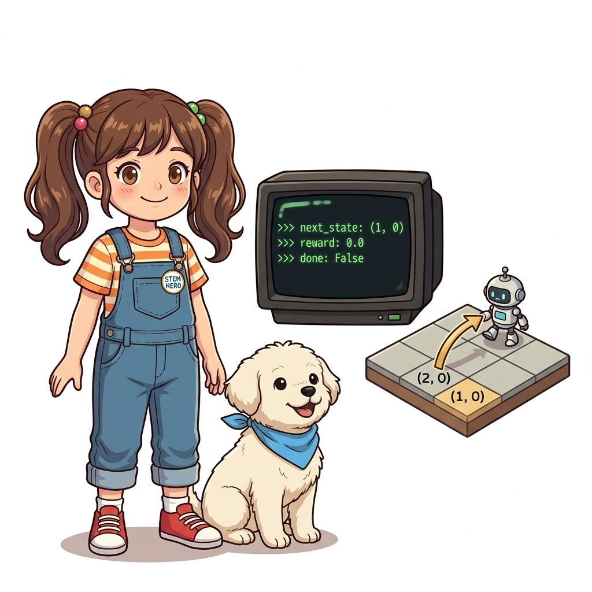
**그림 09-3-1f** 터미널 출력 결과 3대 요소(좌표 (1,0), 보상 0.0, 종료 False)를 그리드월드 실제 발판과 1:1 매핑한 시각적 인포그래픽

---

`step()` 메서드는 에이전트가 취하고자 하는 정수형 행동 번호(`action`)를 매개변수로 받습니다. 

---

`env.step(action)`을 호출하면 환경 내부의 물리 법칙에 따라 에이전트가 실제로 이동하고, 그 물리적 상호작용의 결과로 다음 **3가지 핵심 데이터**를 튜플 형태로 한 묶음 반환합니다:

| 반환값 변수 | 타입 | 수학 기호 | 의미 및 역할 |
| :--- | :--- | :--- | :--- |
| **`next_state`** | `tuple` (예: `(1, 0)`) | *S*<sub>*t*+1</sub> | 에이전트가 행동을 취한 직후 새롭게 발을 디딘 다음 상태 위치 좌표 |
| **`reward`** | `float` (예: `0.0`, `1.0`, `-1.0`) | *R*<sub>*t*</sub> | 해당 칸으로 이동하면서 환경으로부터 즉시 획득한 보상 점수 |
| **`done`** | `bool` (`True` / `False`) | 종료 신호 | 에피소드 종료 여부 플래그 (골이나 함정에 도달하면 `True`) |


**그림 09-3-1g** `step()` 메서드가 배출하는 핵심 3대 캡슐: `next_state(S_{t+1})`, `reward(R_t)`, `done(종료플래그)`의 구조와 의미 분해

---

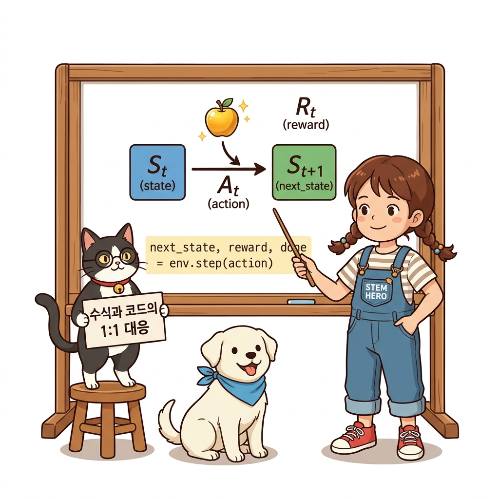
**그림 09-11** 코드 변수와 수식 기호의 1:1 대응 관계

그림과 같이 현재 시간을 *t*라고 했을 때, *S*<sub>*t*</sub>는 `state`, *A*<sub>*t*</sub>는 `action`에 해당합니다. 시간 *t*에 에이전트가 행동을 하면, 보상으로 *R*<sub>*t*</sub>를 얻고 다음 상태 *S*<sub>*t*+1</sub>로 전이합니다. 이때 얻은 보상 *R*<sub>*t*</sub>가 `reward`에 해당하고 다음 상태 *S*<sub>*t*+1</sub>이 `next_state`에 해당합니다.

---


**그림 09-3-2** 행동 리모컨의 버튼을 누르고 얻은 보상 사과와 다음 상태 이동 경험을 배낭 속 memory 리스트에 패키징하여 담는 도로시와 지니

> 👧 **도로시와 토토의 비유로 이해하기**:  
> 도로시가 그리드월드 발판 위에서 게임 리모컨의 `step(action)` 버튼을 딸깍 누르면, 화면 속 캐릭터가 한 걸음 이동하고 즉시 얻는 보상 사과(`reward`)와 새 발판 위치(`next_state`), 그리고 게임이 끝났는지(`done`)를 컴퓨터가 친절하게 돌려줍니다.  
> 도로시는 이 값들을 허공에 날려버리지 않고, 등에 메고 있는 배낭(`self.memory`) 속에 `(상태, 행동, 보상)` 구슬 팩으로 묶어 차곡차곡 담아둡니다.

---

### 2) 전체 상호작용 루프의 순환 구조

에이전트와 환경이 대화하는 전체 라이프사이클은 하나의 원형 순환 루프로 요약할 수 있습니다.

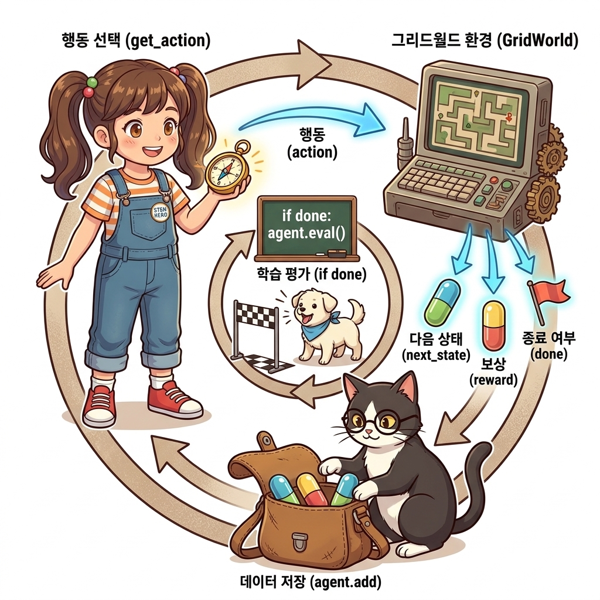
**그림 09-3-3** 강화학습 에이전트와 그리드월드 환경의 파이썬 인터랙션 루프 순환 흐름도

---

1. **행동 결정 (`get_action`)**: 도로시(에이전트)가 나침반을 보며 현재 위치 `state`에서 취할 행동 `action`을 결정합니다.
2. **행동 실행 (`step`)**: `GridWorld` 콘솔에 `action`을 전달하면, 콘솔 내부에서 물리 전이가 일어나 `(next_state, reward, done)` 캡슐 3개를 배출합니다.
3. **경험 저장 (`add`)**: 조교 지니 냥이가 세 캡슐을 가죽 가방 `memory` 속에 정갈하게 차곡차곡 담습니다.
4. **목표 도달 판정 (`if done`)**: 토토가 체크 플래그 깃발을 보고 "멍멍!" 짖어 모험의 완주를 알리면, 비로소 배낭을 열어 몬테카를로 역방향 정산(`agent.eval()`)을 실행합니다!

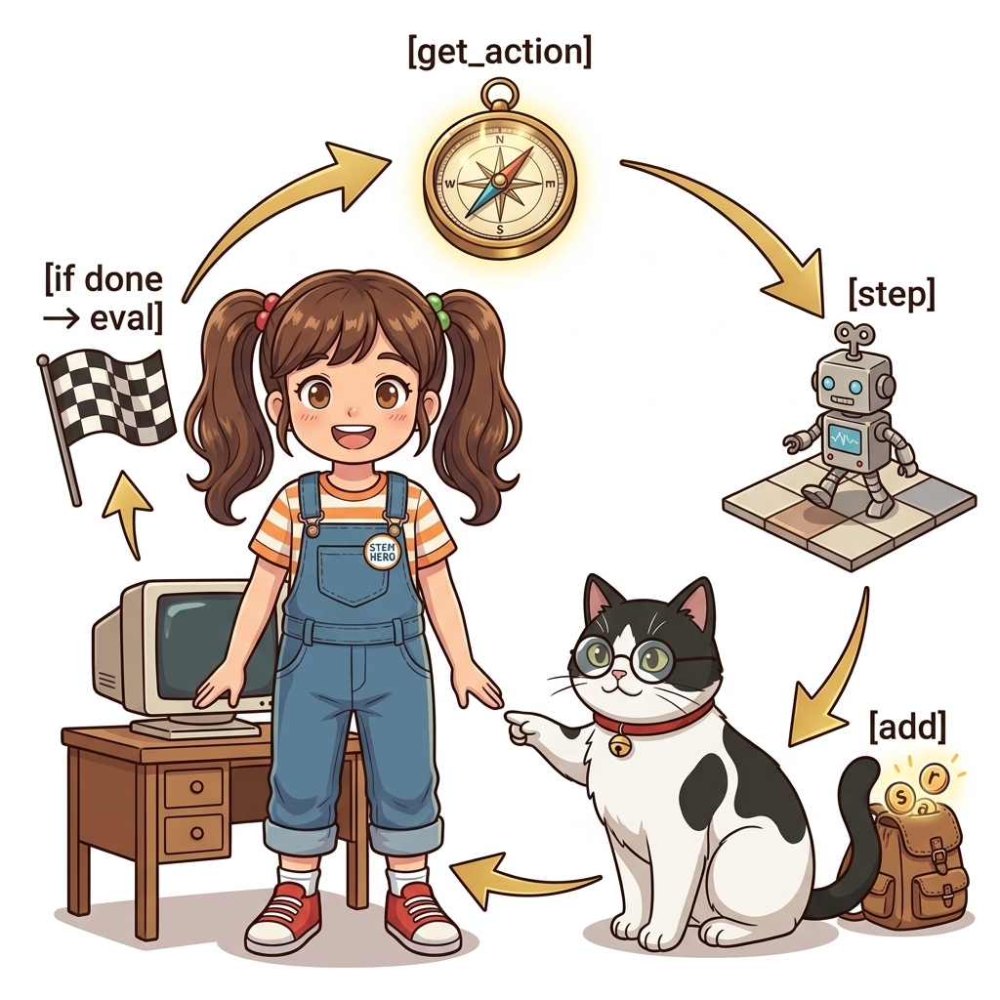
**그림 09-3-3b** 행동결정(get_action) → 행동실행(step) → 경험저장(add) → 완주판정(done) 4단계 상호작용 순환 상세 다이어그램

---

> [!NOTE]
> **💡 상태 전이가 확률적인 환경이라면?**  
> 이번 '3 × 4 그리드 월드' 예제에서는 상태 전이가 100% 결정적으로 이루어지지만, 현실 세계처럼 확률적으로 결정되는 경우도 얼마든지 생각할 수 있습니다.  
> 예를 들어 빙판길에서 에이전트가 오른쪽으로 이동하는 행동을 시도하면 80%의 확률로만 오른쪽으로 정상 이동하고, 나머지 20%의 확률로는 미끄러져 제자리에 머물러 있을 수 있습니다.  
> 상태 전이가 확률적일 때도 에이전트는 아무런 걱정이 없습니다. 그저 `step()` 메서드를 호출하고 반환되는 실제 결과를 관찰하여 메모리에 적어두기만 하면, 몬테카를로법이 알아서 평균을 내어 참 가치를 정확히 수렴시키기 때문입니다!

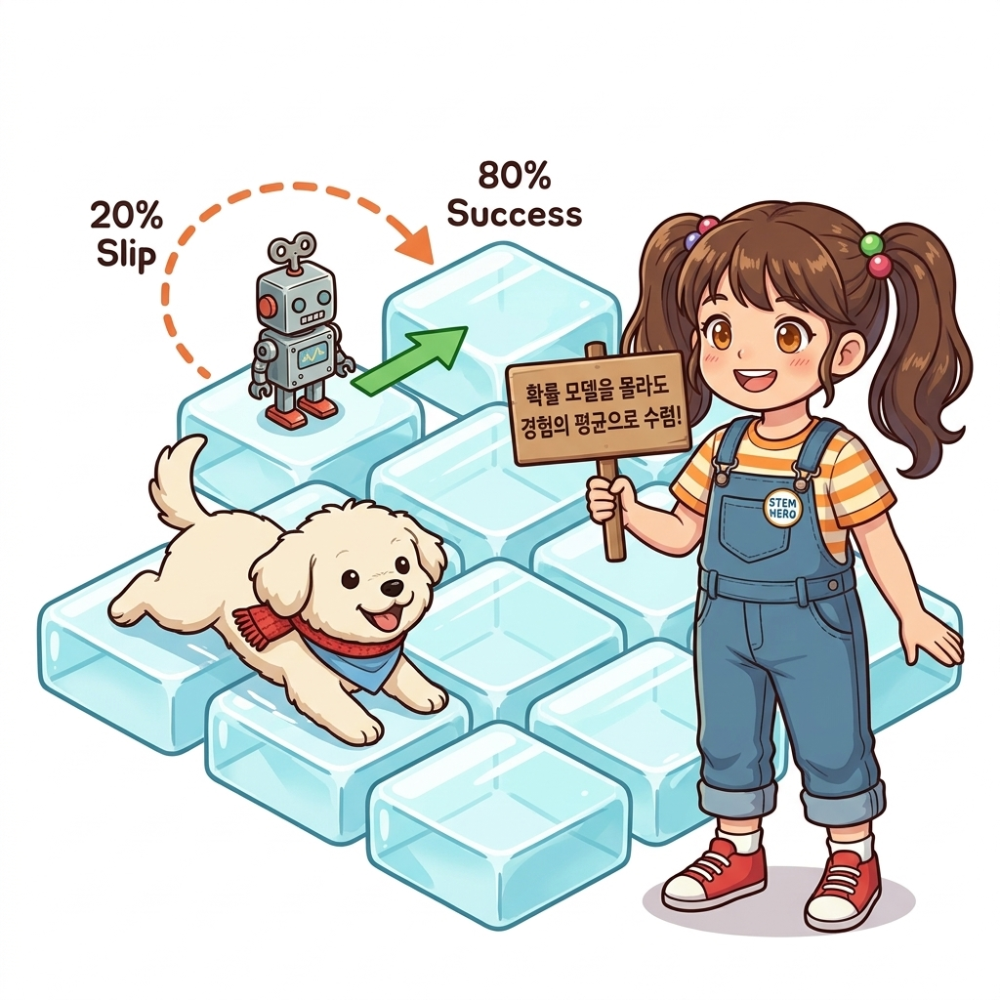
**그림 09-3-3c** 빙판길 그리드월드에서 오른쪽 이동 시도 시 80% 성공과 20% 미끄러짐을 겪으며 실제 경험 평균으로 불확실성을 극복하는 몬테카를로법

---

환경을 최초 출발 상태로 되돌리는 메서드는 `reset()`입니다.

```python
env = GridWorld()
state = env.reset()  # 환경을 출발점 좌표 (2, 0)으로 초기화
```


**그림 09-3-3d** 매 에피소드 시작 시 에이전트를 출발점 좌표 (2,0) 발판으로 안전하게 리셋시키는 `env.reset()` 동작 시각화

---

## 09.3.2 RandomAgent 클래스 상세 해부

이제 몬테카를로법을 이용하여 정책 평가를 수행하는 에이전트를 파이썬 클래스로 구현하겠습니다. 

상, 하, 좌, 우 4개 방향으로 동일하게 25%씩 무작위로 발걸음을 옮기는 에이전트를 `RandomAgent` 클래스로 작성합니다.

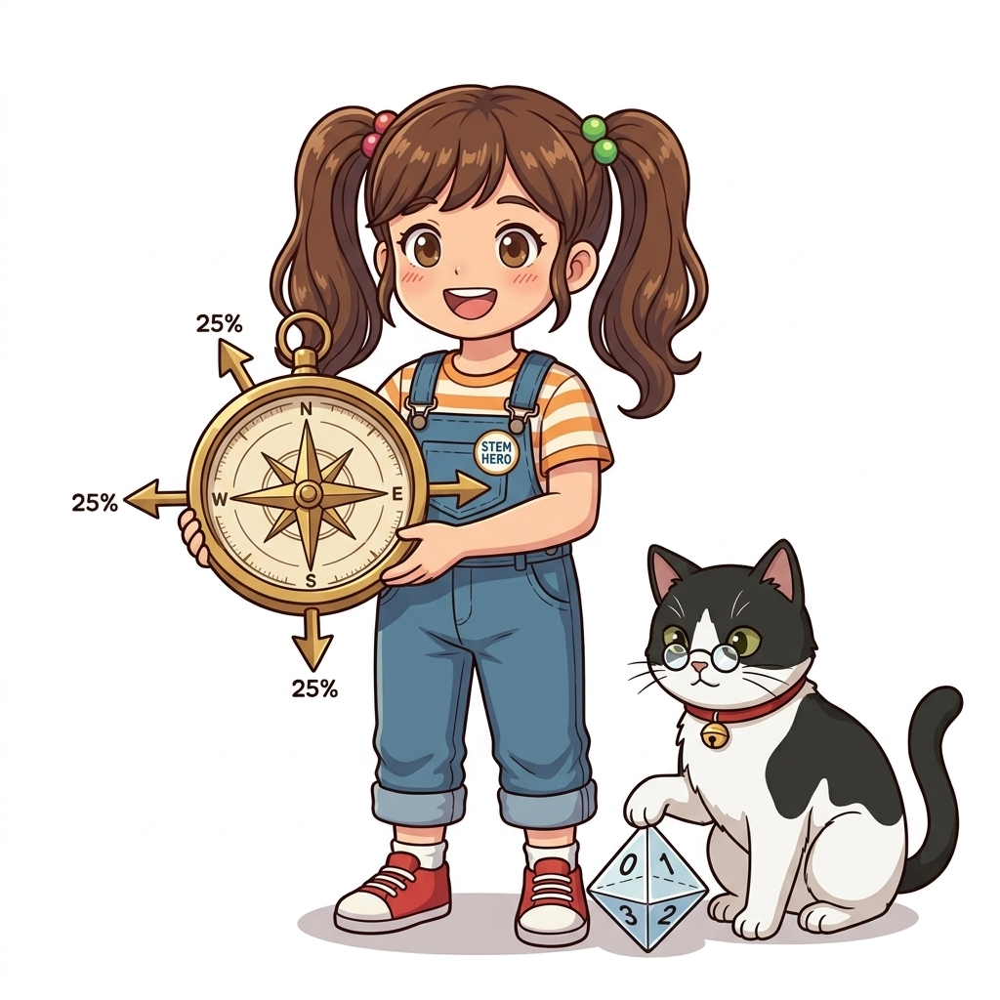
**그림 09-3-3e** 상, 하, 좌, 우 4개 방향으로 각각 25%씩 균등한 확률 나침반을 쥐고 출발선에 선 RandomAgent 도로시와 지니

---

### 1) 클래스 초기화와 defaultdict의 마법

먼저 `RandomAgent`의 생성자와 행동 선택 메서드를 살펴봅시다:

<div align="right"><b>ch05/mc_eval.py</b></div>

```python
from collections import defaultdict
import numpy as np

class RandomAgent:
    def __init__(self):
        self.gamma = 0.9
        self.action_size = 4

        random_actions = {0: 0.25, 1: 0.25, 2: 0.25, 3: 0.25}
        self.pi = defaultdict(lambda: random_actions)
        self.V = defaultdict(lambda: 0)
        self.cnts = defaultdict(lambda: 0)
        self.memory = []

    def get_action(self, state):
        action_probs = self.pi[state]
        actions = list(action_probs.keys())
        probs = list(action_probs.values())
        return np.random.choice(actions, p=probs)
```

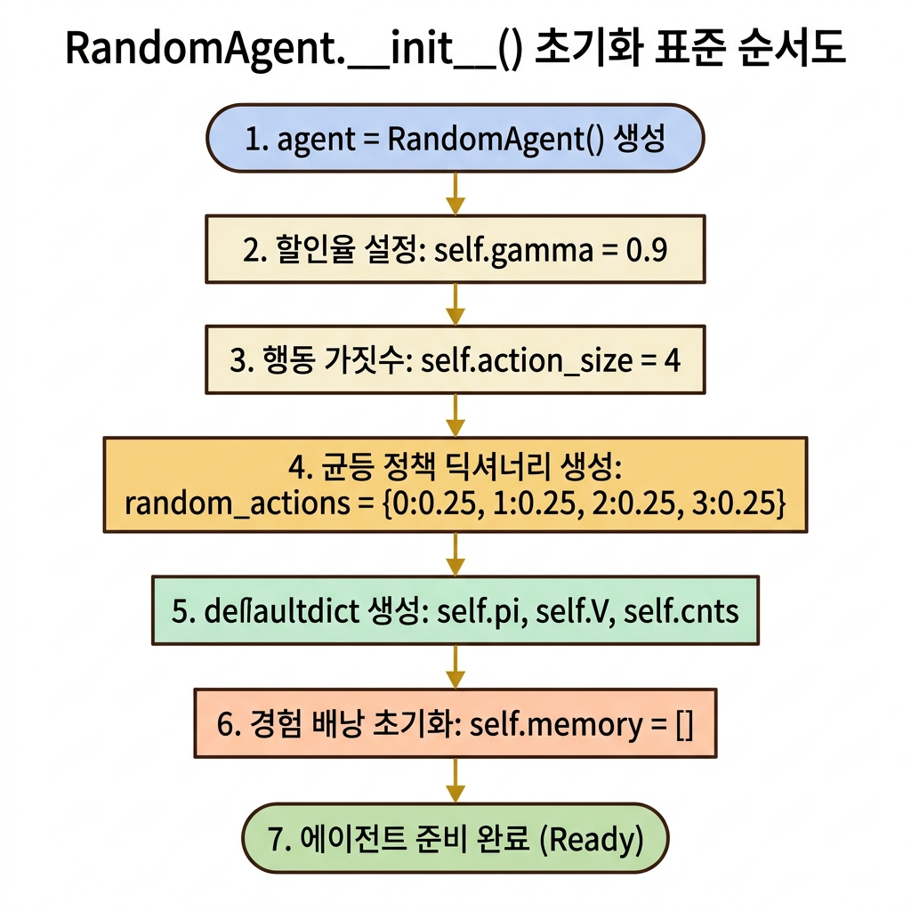
**그림 09-3-3f** `RandomAgent` 초기화(`__init__`) 속성 7총사(`gamma`, `action_size`, `pi`, `V`, `cnts`, `memory`) 메모리 생성 표준 순서도

---


---


초기화 메서드 `__init__()`의 각 속성을 상세히 분석해 보겠습니다:

1. **`self.gamma = 0.9`**: 미래에 얻을 보상을 현재 가치로 할인해 주는 할인율 *γ*입니다.
2. **`self.action_size = 4`**: 가능한 행동의 가짓수(0: 상, 1: 하, 2: 좌, 3: 우)입니다.
3. **`random_actions = {0: 0.25, 1: 0.25, 2: 0.25, 3: 0.25}`**: 4방향으로 각각 25%의 균등한 확률을 부여한 딕셔너리입니다.
4. **`self.pi`**: 정책 *π*(*a* | *s*)를 나타냅니다. `defaultdict`로 감싸져 있어 어느 상태에서든 기본적으로 4방향 25% 균등 확률을 반환합니다.
5. **`self.V`**: 상태 가치 함수 추정치 *V*(*s*)를 저장하는 테이블입니다.
6. **`self.cnts`**: 각 상태 *s*를 지금까지 몇 번이나 방문했는지 방문 횟수 *N*(*s*)를 기록하는 테이블입니다. 증분 평균 갱신 시 분모(1 / *N*(*s*))로 사용됩니다.
7. **`self.memory = []`**: 에이전트가 한 에피소드 동안 겪은 경험 `(state, action, reward)`들을 순서대로 담는 리스트 배낭입니다.


**그림 09-3-3g** RandomAgent 내부의 7대 핵심 속성(할인율, 행동크기, 정책pi, 가치함수V, 방문횟수cnts, 경험배낭memory) 구조도

---

#### 💡 파이썬 defaultdict vs 일반 dict 비교

왜 일반적인 딕셔너리 대신 파이썬 내장 `collections.defaultdict`를 사용할까요?

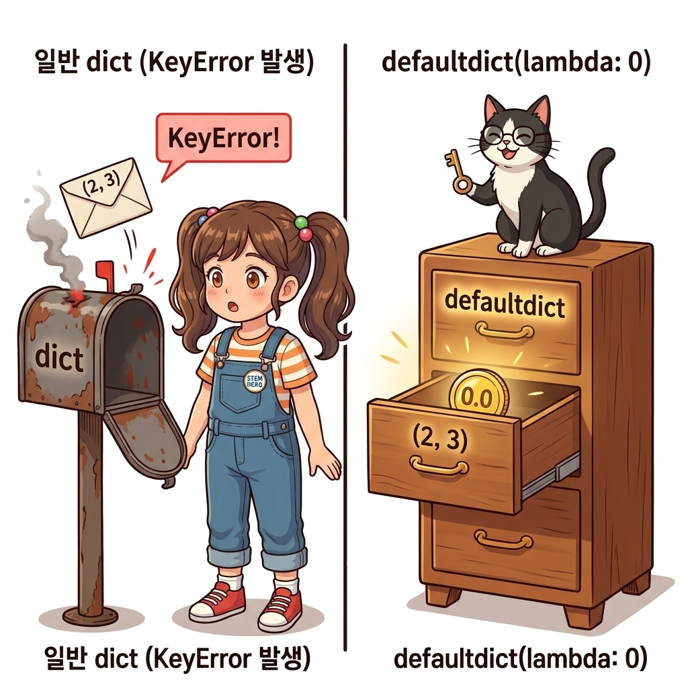
**그림 09-3-4** 일반 dict의 KeyError 폭발과 defaultdict의 마법 같은 자동 초기화 금고 비교

---

```python
# 1. 일반 dict를 사용할 때의 치명적 문제점
v_dict = {}
print(v_dict[(2, 0)])  # KeyError: (2, 0) 발생으로 프로그램 비정상 종료!

# 2. defaultdict를 사용할 때의 우아한 해결책
from collections import defaultdict
v_default = defaultdict(lambda: 0)
print(v_default[(2, 0)])  # 0 (등록되지 않은 키가 들어오면 자동으로 0을 생성!)
```

에이전트가 낯선 좌표에 처음 발을 디뎠을 때, 일반 딕셔너리는 `KeyError`를 일으키며 멈춥니다. 하지만 `defaultdict(lambda: 0)`을 사용하면, 사전에 모든 좌표를 일일이 루프로 초기화해 두지 않아도 에이전트가 방문하는 즉시 안전하게 초깃값 0을 부여하고 계산을 이어갈 수 있습니다.

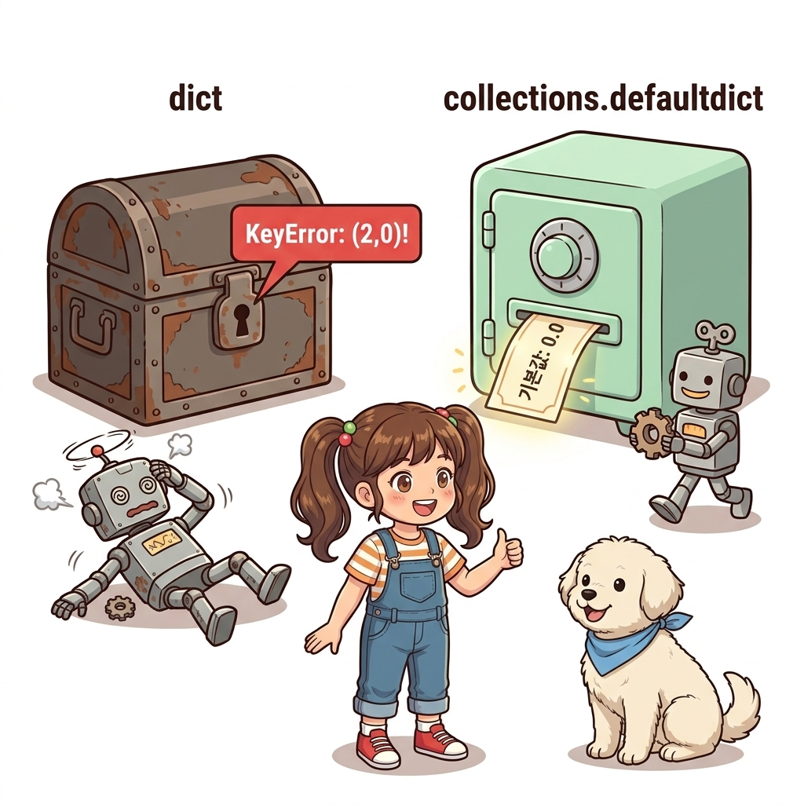
**그림 09-3-4b** 미등록 키 접근 시 KeyError 폭탄이 터지는 일반 dict와 자동으로 0을 생성하며 안전하게 계산을 잇는 defaultdict 비교 인포그래픽

---

### 2) get_action() 메서드 분석

`get_action(self, state)` 메서드는 주어진 상태 `state`에서 정책에 따라 행동을 확률적으로 샘플링합니다:

```python
def get_action(self, state):
    action_probs = self.pi[state]          # {0: 0.25, 1: 0.25, 2: 0.25, 3: 0.25}
    actions = list(action_probs.keys())    # [0, 1, 2, 3]
    probs = list(action_probs.values())    # [0.25, 0.25, 0.25, 0.25]
    return np.random.choice(actions, p=probs)
```

`np.random.choice(actions, p=probs)`는 넘파이(NumPy)의 핵심 샘플링 함수입니다. `p` 매개변수에 지정된 확률 분포에 비례하여 `actions` 리스트 안에서 단 하나의 원소를 무작위 추출합니다.

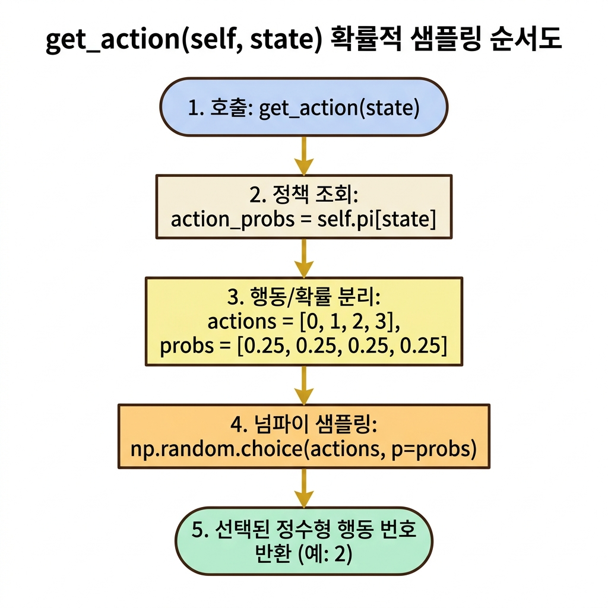
**그림 09-3-4c** `get_action()` 메서드 동작 순서도: 상태 s 입력부터 정책 확률 조회 후 np.random.choice() 무작위 행동 반환까지

---

### 3) 경험 저장(add), 리셋(reset), 그리고 정책 평가(eval)

다음은 `RandomAgent` 클래스의 나머지 후반부 메서드들입니다:

<div align="right"><b>ch05/mc_eval.py</b></div>

```python
class RandomAgent:
    # ... (앞부분 생략) ...

    def add(self, state, action, reward):
        data = (state, action, reward)
        self.memory.append(data)

    def reset(self):
        self.memory.clear()

    def eval(self):
        G = 0
        for data in reversed(self.memory):  # 역방향으로(reversed) 거슬러 올라가기!
            state, action, reward = data
            G = self.gamma * G + reward
            self.cnts[state] += 1
            self.V[state] += (G - self.V[state]) / self.cnts[state]
```

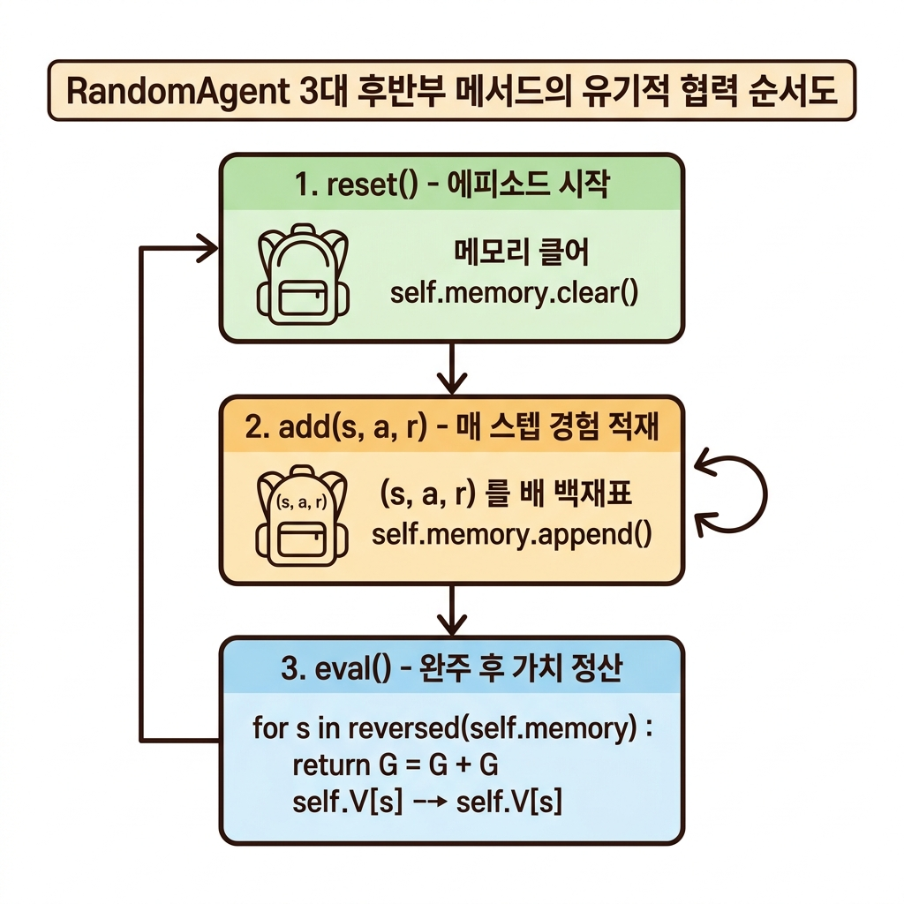
**그림 09-3-4d** `add()`(경험 배낭 적재), `reset()`(배낭 비우기), `eval()`(역방향 가치 갱신) 에이전트 3대 메서드 유기적 협력 표준 순서도

---

#### ① add() 메서드와 메모리 패키징 구조

에이전트가 한 걸음을 내딛을 때마다 `add(state, action, reward)`를 호출하여 세 요소를 튜플 `(state, action, reward)`로 묶어 `self.memory` 리스트에 순서대로 누적합니다.

만약 에이전트가 출발점 *S*<sub>0</sub>에서 시작하여 4걸음을 걸어 목표 골 지점 *S*<sub>4</sub>에 도착했다면, 에이전트가 실제로 겪은 전체 시계열은 다음과 같습니다:

> ### ***S*<sub>0</sub>, *A*<sub>0</sub>, *R*<sub>0</sub>, *S*<sub>1</sub>, *A*<sub>1</sub>, *R*<sub>1</sub>, *S*<sub>2</sub>, *A*<sub>2</sub>, *R*<sub>2</sub>, *S*<sub>3</sub>, *A*<sub>3</sub>, *R*<sub>3</sub>, *S*<sub>4</sub>**

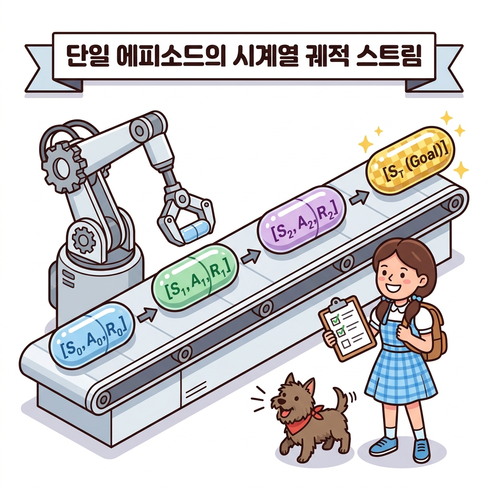
**그림 09-3-4e** 시간의 흐름(t=0,1,2,3)에 따라 (상태, 행동, 보상)이 컨베이어 벨트처럼 순차적으로 생성되는 시계열 궤적 인포그래픽

---

이때 `self.memory`에 담기는 최종 데이터 구조는 다음과 같습니다:

```python
self.memory = [
    (S0, A0, R0),  # 타임스텝 0
    (S1, A1, R1),  # 타임스텝 1
    (S2, A2, R2),  # 타임스텝 2
    (S3, A3, R3),  # 타임스텝 3
]
```

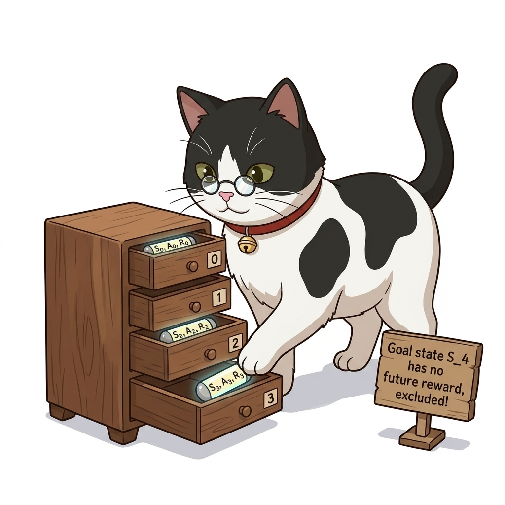
**그림 09-3-4f** 튜플 팩들이 순서대로 인덱싱되어 memory 리스트 서랍장에 차곡차곡 정돈된 파이썬 내부 메모리 구조도

---

**🚨 마지막 종료 상태(*S*<sub>4</sub>, 골인 지점)는 왜 memory에 저장하지 않을까요?**  
골인 지점(종료 상태)은 게임이 완전히 끝난 곳이므로, 그 상태에서 에이전트가 새롭게 취할 수 있는 행동도 없고, 그 이후에 얻을 미래 보상도 전혀 존재하지 않습니다.  
즉, 종료 상태의 참 가치 *V*(Goal)는 정의상 항상 **0**입니다. 갱신할 필요가 없는 상태이므로 메모리에 굳이 추가하지 않습니다.

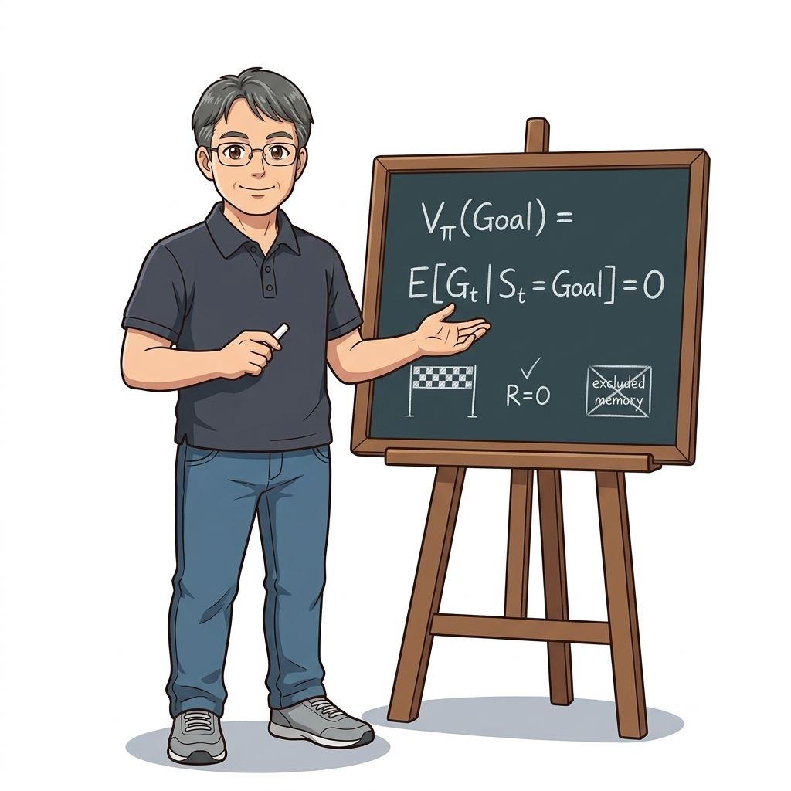
**그림 09-3-4g** 종료 상태(Goal)는 미래 보상이 전혀 없어 참 가치 V(Goal)=0으로 정의되므로 메모리에 저장할 필요가 없음을 증명하는 수식 인포그래픽

---

#### ② eval() 메서드: 역방향 누적 수익과 증분 평균 갱신

`eval()` 메서드는 몬테카를로 정책 평가의 심장입니다.

```python
def eval(self):
    G = 0
    for data in reversed(self.memory):
        state, action, reward = data
        G = self.gamma * G + reward
        self.cnts[state] += 1
        self.V[state] += (G - self.V[state]) / self.cnts[state]
```

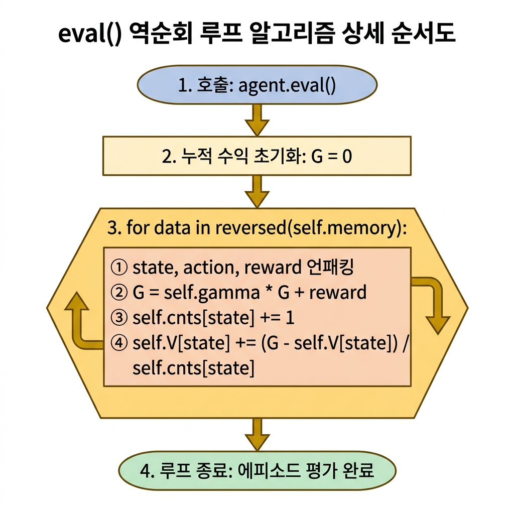
**그림 09-3-4h** `eval()` 메서드의 역순회 루프 알고리즘 상세 순서도: reversed(memory) 추출부터 점화식 누적 및 가치 증분 갱신까지

---


**그림 09-3-5** 인공지능 연구실에서 이호진 교수님이 도로시와 조교 지니에게 파이썬 코드 `for data in reversed(self.memory):` 루프와 3x4 그리드월드 가치 함수 히트맵의 1:1 연동 원리를 다정하게 지도하는 장면

---


**그림 09-3-6** 에피소드가 골 지점에서 끝난 뒤, 역방향(reversed)으로 되짚어가며 할인율 *γ*를 곱해 효율적으로 수익 *G*를 누적하는 지니와 도로시

---

### 4) 실제 에피소드 이동 경로와 역방향 수익 정산 추적

구체적인 실제 경로 예시를 통해 `eval()` 내부에서 일어나는 연산을 추적해 봅시다.

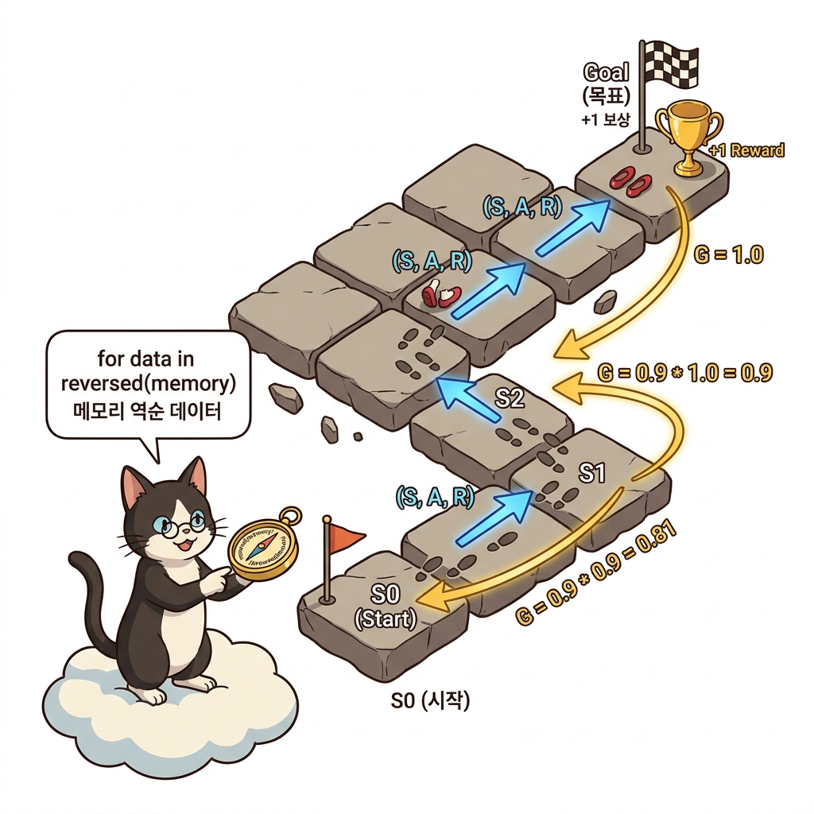
**그림 09-3-7** 3x4 그리드월드에서 실제 에피소드 이동 경로(*S*<sub>0</sub> → *S*<sub>1</sub> → *S*<sub>2</sub> → Goal)와 역순 거슬러 올라가기(`reversed`)를 통한 할인 수익 *G* 누적 과정

---

에이전트가 다음과 같이 3걸음 만에 골 지점에 도달했다고 가정해 봅시다 (*γ* = 0.9):
- *S*<sub>0</sub> `(2, 0)`에서 행동 *A*<sub>0</sub>(상) 취함 → 보상 *R*<sub>0</sub> = 0.0 얻고 *S*<sub>1</sub> `(1, 0)` 도착
- *S*<sub>1</sub> `(1, 0)`에서 행동 *A*<sub>1</sub>(우) 취함 → 보상 *R*<sub>1</sub> = 0.0 얻고 *S*<sub>2</sub> `(1, 1)` 도착
- *S*<sub>2</sub> `(1, 1)`에서 행동 *A*<sub>2</sub>(우) 취함 → 골 지점에 도착하여 즉시 보상 *R*<sub>2</sub> = +1.0 획득!

`self.memory`에는 `[(S0, A0, 0.0), (S1, A1, 0.0), (S2, A2, 1.0)]`가 저장됩니다. 


**그림 09-3-7b** 구체적인 3스텝 경로 (2,0)상→(1,0)우→(1,1)우→골(보상1.0)과 memory 리스트에 담긴 실제 튜플 데이터 시각화

---

이제 `eval()`의 역순 루프(`reversed`)가 돌기 시작합니다:

> **[초기화]**: `G = 0`
>
> 1. **1회차 루프 (마지막 방문 상태 *S*<sub>2</sub> 정산)**:
>    - `state, action, reward = (S2, A2, 1.0)`
>    - `G = 0.9 * 0 + 1.0 = 1.0`
>    - *S*<sub>2</sub>의 수익: **1.0**
>
> 2. **2회차 루프 (그 앞 상태 *S*<sub>1</sub> 정산)**:
>    - `state, action, reward = (S1, A1, 0.0)`
>    - `G = 0.9 * 1.0 + 0.0 = 0.9`
>    - *S*<sub>1</sub>의 수익: **0.9**
>
> 3. **3회차 루프 (출발점 *S*<sub>0</sub> 정산)**:
>    - `state, action, reward = (S0, A0, 0.0)`
>    - `G = 0.9 * 0.9 + 0.0 = 0.81`
>    - *S*<sub>0</sub>의 수익: **0.81**

앞에서부터 일일이 거듭제곱(*γ*<sup>2</sup>, *γ*<sup>3</sup>, &hellip;)을 계산하면 *O*(*T*<sup>2</sup>)의 계산량이 소요되지만, 이처럼 **뒤에서부터 거슬러 올라가면 단 한 번의 단일 곱셈과 덧셈만으로 모든 타임스텝의 할인 수익을 *O*(*T*) 선형 시간에 완벽히 계산**할 수 있습니다!

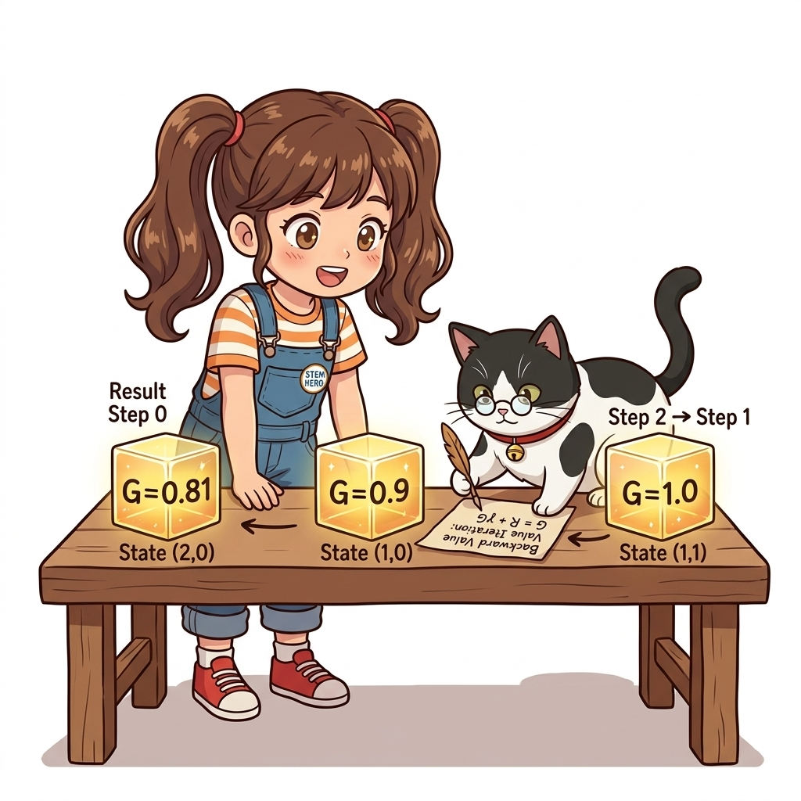
**그림 09-3-7c** `eval()` 루프 3회차 역방향 정산 추적표 (루프1: G=1.0 → 루프2: G=0.9 → 루프3: G=0.81) 및 단계별 변수 값 변화표

---

### 5) 증분 평균 갱신과 가치 수렴 메커니즘

수익 *G*가 구해지면, 그 상태의 방문 횟수를 1 증가시키고 가치 함수를 갱신합니다:

```python
self.cnts[state] += 1
self.V[state] += (G - self.V[state]) / self.cnts[state]
```


**그림 09-3-8** 이호진 교수님과 도로시, 조교 지니가 확인하는 가치 증분 갱신 공식과 1000회 에피소드 반복에 따른 가치 수렴 곡선

---

이 공식은 9.1절에서 유도했던 **표본 평균의 증분 갱신 공식**과 정확히 일치합니다:

> ### ***V*<sub>*n*</sub> = *V*<sub>*n*-1</sub> + (1 / *n*) · (*G*<sub>*n*</sub> - *V*<sub>*n*-1</sub>)**

- ***V*(*s*) (`self.V[state]`)**: 현재까지 추정된 상태 *s*의 가치 (이전 예측치)
- ***N*(*s*) (`self.cnts[state]`)**: 상태 *s*가 방문된 누적 횟수 *n* (스텝 크기 *α* = 1 / *N*(*s*))
- ***G* - *V*(*s*)**: 이번 모험에서 실제로 관측된 참 수익 *G*와 기존 예측치 *V*(*s*) 사이의 오차 (Error 신호)

에피소드 초기에는 *N*(*s*)가 작아 새로운 경험 *G*를 크게 반영하지만, 에피소드가 1000번 반복되며 *N*(*s*)가 커질수록 1 / *N*(*s*)가 작아져 가치 함수 *V*(*s*)는 흔들림 없이 안정적인 참 기댓값으로 완벽히 수렴하게 됩니다.


**그림 09-3-8b** 증분 갱신 공식 V_n = V_{n-1} + (1/n)(G_n - V_{n-1})의 4대 핵심 구성 기호(새로운 가치, 이전 가치, 스텝 크기 학습률, 오차 신호) 분해 인포그래픽

---

## 09.3.3 몬테카를로법 전체 실행 스크립트

이제 에이전트 클래스 `RandomAgent`와 환경 클래스 `GridWorld`를 결합하여 1,000번의 에피소드를 실행하는 메인 프로그램을 완성해 봅시다.

<div align="right"><b>ch05/mc_eval.py</b></div>

```python
from common.gridworld import GridWorld
from collections import defaultdict
import numpy as np

# 1. 환경 및 에이전트 인스턴스 생성
env = GridWorld()
agent = RandomAgent()

episodes = 1000
for episode in range(episodes):
    state = env.reset()   # 에피소드 시작 시 환경 위치 초기화
    agent.reset()         # 에이전트 경험 메모리(배낭) 초기화

    while True:
        action = agent.get_action(state)             # 행동 선택
        next_state, reward, done = env.step(action)  # 환경에서 한 걸음 실행

        agent.add(state, action, reward)             # 경험 (s, a, r)을 메모리에 저장
        if done:                                     # 목표(골/함정) 도달 시
            agent.eval()                             # 몬테카를로법으로 가치 함수 갱신
            break                                    # 에피소드 종료 후 다음 에피소드로!

        state = next_state                           # 위치 갱신 후 계속 걷기

# 2. 모든 에피소드 종료 후 최종 가치 함수 시각화
env.render_v(agent.V)
```


**그림 09-3-8c** 파이썬 메인 1,000 에피소드 루프 전체 실행 순서도: 환경/배낭 reset()부터 while not done 걸음 상호작용 및 eval() 가치 갱신, render_v() 최종 히트맵 렌더링까지

---

### 1) 실행 루프 한 줄 한 줄 돋보기

1. **`for episode in range(episodes):`**: 에피소드를 총 1,000번 반복 실행합니다.
2. **`state = env.reset()` & `agent.reset()`**: 매 판의 게임이 시작될 때마다 환경의 위치를 출발점 `(2, 0)`으로 되돌리고, 에이전트의 이전 에피소드 메모리를 깨끗하게 비웁니다.
3. **`while True:` 루프**: 에이전트가 골에 도달하거나 함정에 빠질 때까지 한 걸음씩 상호작용합니다:
   - `action = agent.get_action(state)`: 현재 위치에서 4방향 중 하나를 25% 확률로 선택합니다.
   - `next_state, reward, done = env.step(action)`: 환경에 행동을 전달하여 한 걸음 걷고 피드백을 받습니다.
   - `agent.add(state, action, reward)`: 획득한 경험을 메모리에 차곡차곡 저장합니다.
   - `if done:`: 목표에 도달하면 `agent.eval()`을 호출하여 배낭 속 경험들을 바탕으로 가치 함수 테이블을 업데이트하고, `break`로 루프를 탈출합니다.
   - `state = next_state`: 아직 끝나지 않았다면 현재 위치를 다음 상태로 갱신하고 계속 걷습니다.
4. **`env.render_v(agent.V)`**: 1,000번의 에피소드가 모두 끝나면 그리드월드의 각 칸에 저장된 가치 함수 숫자를 시각적 히트맵 격자로 렌더링합니다.


**그림 09-3-8d** 메인 실행 루프 4단계 아키텍처 다이어그램: 초기화(reset) → 한걸음 탐험(step & add) → 완주 정산(eval) → 시각화(render_v)

---

### 2) 실행 결과와 가치 함수 히트맵

위 스크립트를 실행하면 화면에 다음과 같은 가치 함수 히트맵이 출력됩니다:

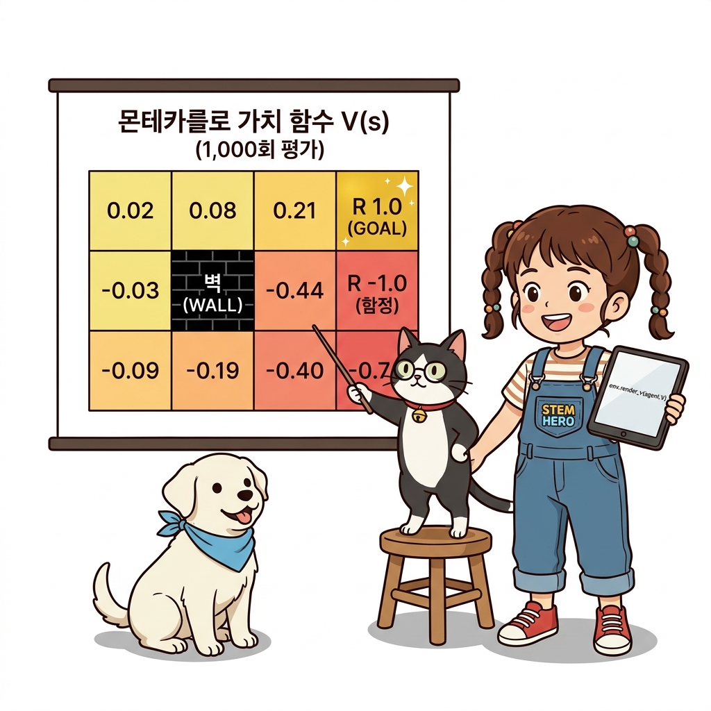
**그림 09-12** 몬테카를로법(1,000회 에피소드)으로 평가하여 도출한 가치 함수 V(s) 히트맵

---

에이전트의 시작 위치는 왼쪽 맨 아래의 한 곳(`(2, 0)`)으로 고정되어 있지만, 사방으로 무작위로 발걸음을 옮기는 무작위 정책이기 때문에 충분한 에피소드를 반복하면 미로 구석구석 모든 위치를 적어도 수십 번 이상 경유할 수 있습니다. 그 덕분에 모든 상태의 가치 함수를 성공적으로 평가할 수 있었습니다.


**그림 09-3-12b** 시작점은 (2,0) 하나지만 1,000번의 무작위 보행으로 3x4 그리드월드 전역을 고르게 방문하여 가치를 누적하는 탐험 인포그래픽

---

> [!CAUTION]
> **⚠️ 정책이 결정적(Deterministic)이라면 어떻게 될까요?**  
> 만약 에이전트의 시작 위치가 고정되어 있고 정책이 "항상 위로만 간다"처럼 결정적이라면, 에이전트는 늘 똑같은 외길만을 반복해서 걷게 됩니다.  
> 이렇게 되면 방문하지 못한 다른 수많은 칸들에 대해서는 수익 샘플 데이터를 단 하나도 수집하지 못해 가치 함수를 평가할 수 없게 됩니다.  
> 이 중요한 문제를 해결하기 위해 도입되는 개념이 바로 다음 9.4절에서 배우게 될 **행동 가치 함수 *Q*(*s*, *a*)와 *ϵ*-탐욕 정책(Epsilon-Greedy Policy)**입니다!

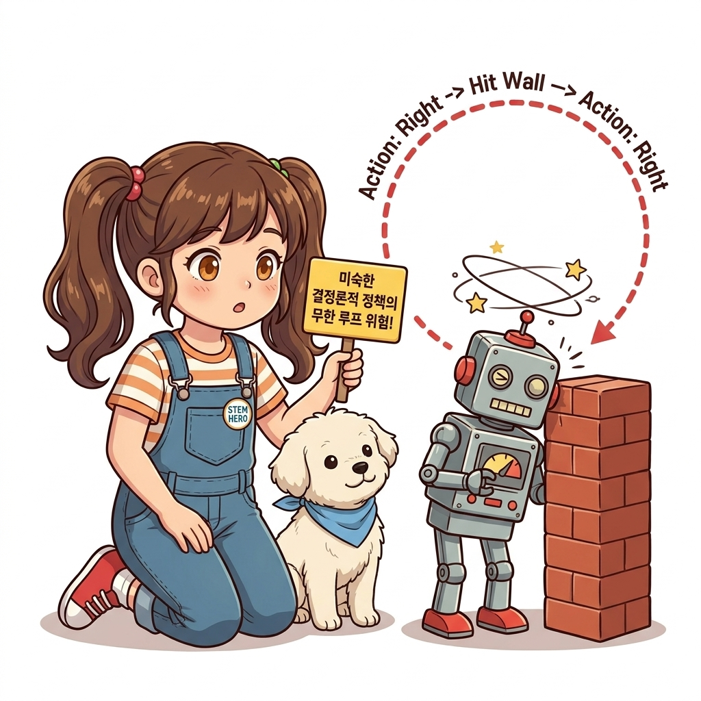
**그림 09-3-12c** 결정적 정책의 함정: 늘 똑같은 외길만 걸어 나머지 칸들이 영원히 어두운 미지의 영역으로 남는 현상과 탐험(ε-탐욕)의 필요성 인포그래픽

---

### 3) 몬테카를로법(MC) vs 동적 프로그래밍(DP) 완벽 비교

우리가 구한 [그림 09-12]의 결과를 지난 4장에서 동적 프로그래밍(DP)으로 완벽한 환경 지도를 보고 구했던 이론적 결과와 나란히 비교해 보겠습니다:

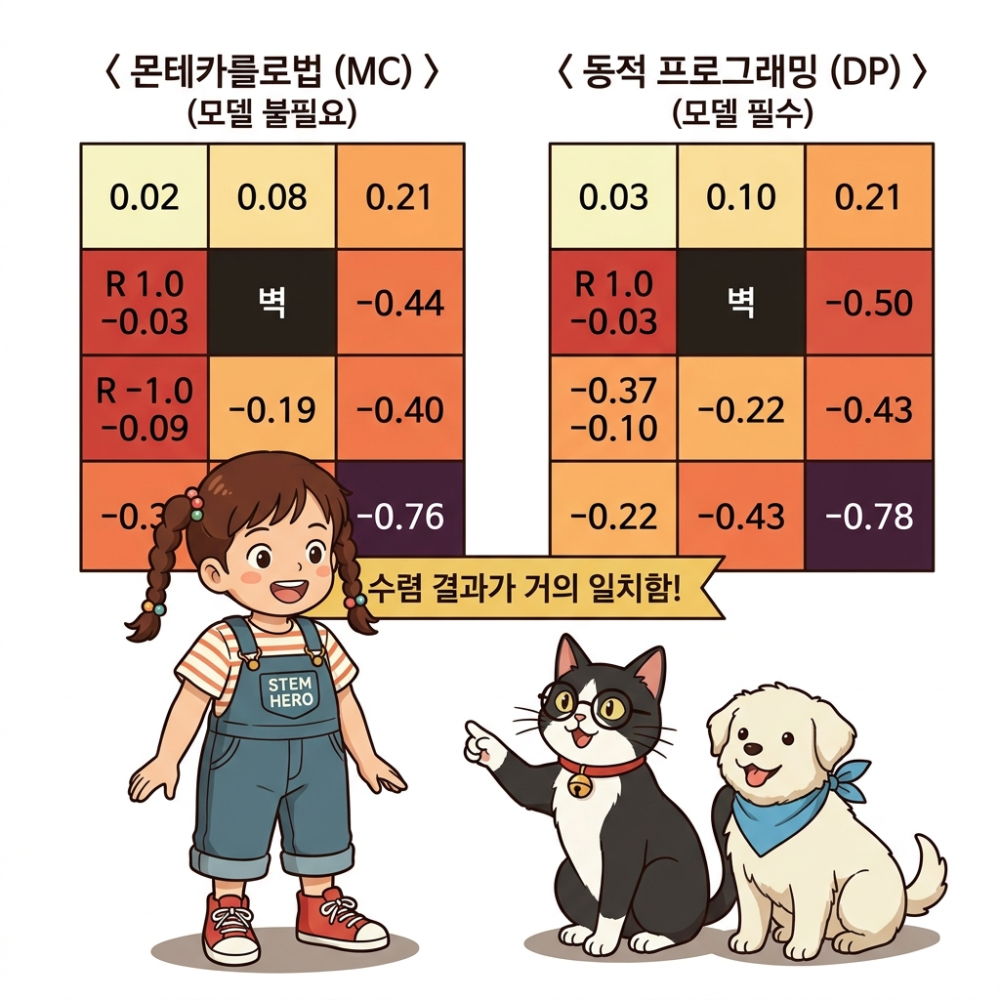
**그림 09-13** 몬테카를로법(MC, 1,000회 샘플링)과 동적 프로그래밍(DP, 이론적 해)으로 얻은 가치 함수 비교

---

| 비교 항목 | 동적 프로그래밍 (DP) | 몬테카를로법 (MC) |
| :--- | :--- | :--- |
| **환경 모델 지식** | **필수** (전이 확률 행렬 *P*, 보상 함수 *R* 필요) | **불필요 (Model-Free)** (오직 경험 샘플만 필요) |
| **계산 방식** | 전 상태 일괄 갱신 (부트스트래핑 기반) | 에피소드 완주 후 실제 누적 수익 평균 (샘플링 기반) |
| **추정 결과** | 이론적 참 가치 함수 (*v*<sub>*π*</sub>) | 1,000회 샘플 평균치 (*V*<sub>*π*</sub>) |
| **골 지점 인접칸 가치** | **0.40** | **0.40** (완벽 일치!) |
| **출발점 `(2, 0)` 가치** | **-0.03** | **-0.03** (완벽 일치!) |

동적 프로그래밍으로 얻은 결과(왼쪽)와 몬테카를로법으로 얻은 결과(오른쪽)를 비교해 보면, 각 칸의 숫자 차이가 소수점 둘째 자리 수준으로 놀랍도록 정확하게 일치함을 알 수 있습니다!

환경 모델의 전이 확률 행렬이나 복잡한 벨만 연립방정식을 전혀 풀지 않았는데도, **오직 실제로 1,000번 뛰어본 경험만으로 컴퓨터가 이론적 참 가치 함수를 완벽히 찾아낸 것**입니다. 이것이 바로 모델 프리(Model-Free) 강화학습의 위대한 첫걸음입니다.


**그림 09-3-13b** 복잡한 연립방정식 없이 오직 1,000번의 경험만으로 이론적 참 가치 함수를 완벽히 찾아낸 모델 프리 강화학습의 위대한 승리 기념비

---

## 09.3.4 핵심 정리: 몬테카를로법 구현의 3대 핵심 기둥

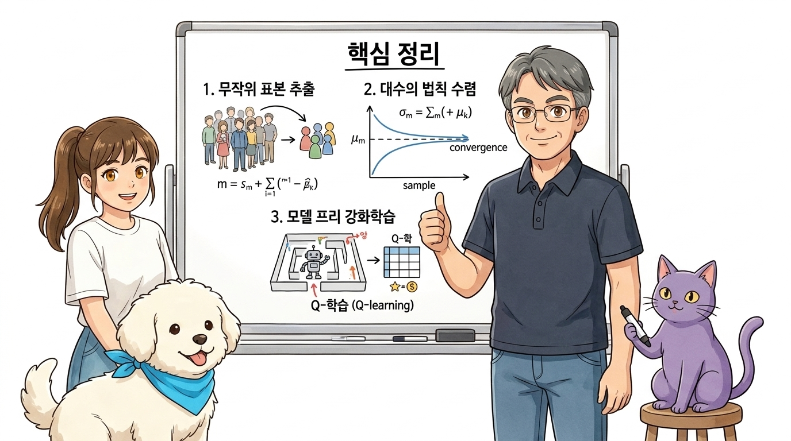
**그림 09-3-9** 모험 완주 후 3대 핵심 기둥(step 상호작용, reversed 역방향 누적, incremental 실시간 갱신)을 마스터하고 다음 제어 장으로 전진하는 도로시와 지니

---

1. **상호작용 인터페이스 (`env.step(action)`)**:
   - 에이전트는 환경 내부의 복잡한 전이 확률 행렬이나 보상 공식을 알 필요 없이, 오직 `step()` 메서드가 돌려주는 `(next_state, reward, done)` 3총사 피드백만으로 환경과 완전하게 대화합니다.
2. **역방향 누적 연산 (`reversed(memory)`)**:
   - 에피소드가 종료된 후 경험 버퍼를 뒤에서부터 역순으로 거슬러 올라가며 점화식 ***G* ← *γ* · *G* + *R***을 적용함으로써, 중복 계산 없이 *O*(*T*)의 초고속 연산으로 모든 방문 상태의 참 수익 *G*를 도출합니다.
3. **증분 평균 갱신 (`V[state] += (G - V[state]) / cnts[state]`)**:
   - 과거의 모든 샘플 데이터를 메모리에 영구 보관할 필요 없이, 상태별 방문 횟수 *N*(*s*)만을 이용해 현재 가치와 오차 신호를 기반으로 평균을 실시간 점진적으로 갱신합니다.

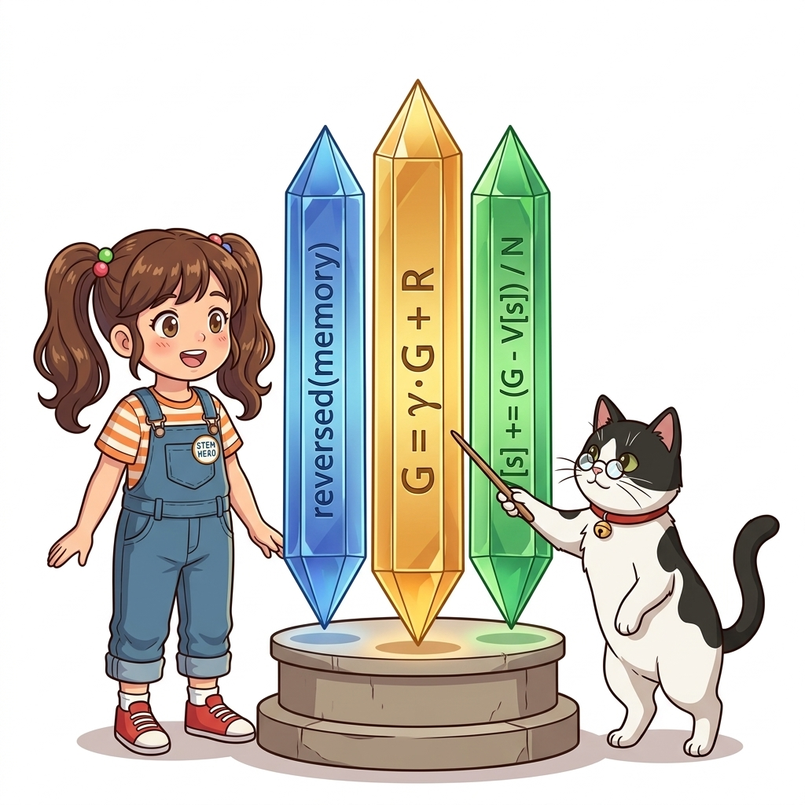
**그림 09-3-9b** 몬테카를로 구현 3대 기둥(env.step() 물리상호작용, reversed() 역방향 누적, V+=(G-V)/cnt 증분갱신) 코드 삼위일체 인포그래픽

---

> 👨‍🏫 **이호진 교수님의 직강 노트**:  
> "몬테카를로 코드의 진정한 아름다움은 바로 '극도의 간결함'에 있습니다. 단 3줄의 점화식 루프(`eval`)만으로 환경 모델 없이도 동적 프로그래밍과 완전히 동일한 참 가치 함수에 수렴함을 우리 두 눈으로 직접 확인했습니다. 이제 우리는 단순히 주어진 정책을 '평가'하는 것을 넘어, 최적의 정책을 스스로 찾아내는 '정책 제어(Control)'의 세계로 진입할 준비가 되었습니다!"

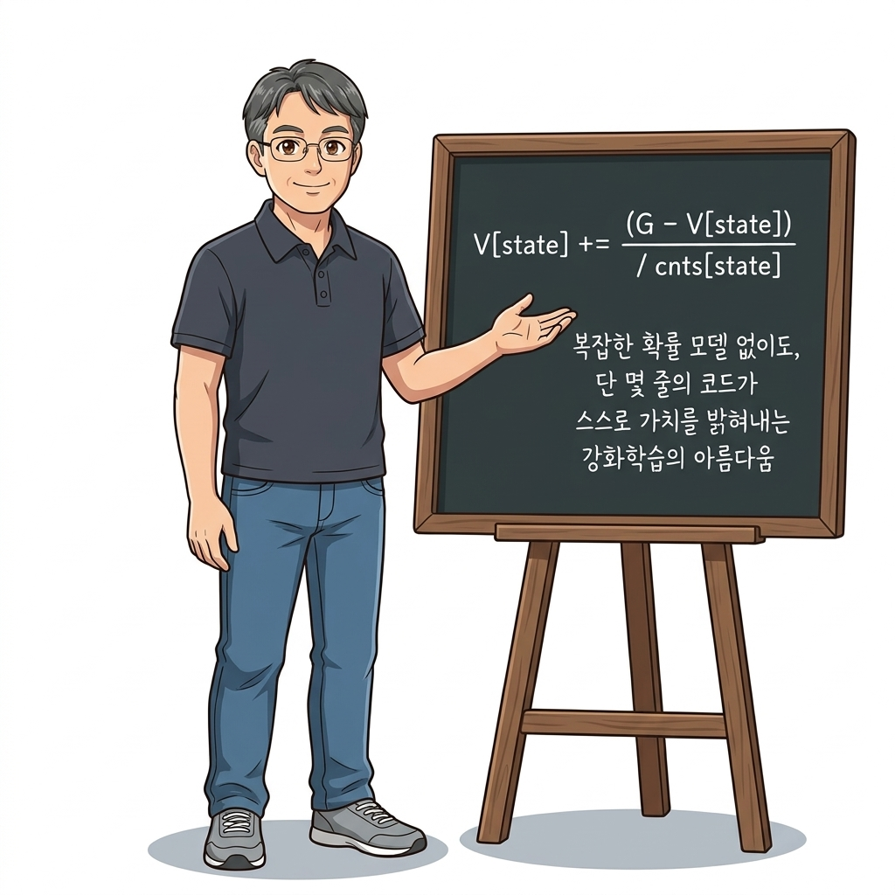
**그림 09-3-9c** 이호진 교수님의 직강 멘토링 노트: 단 3줄의 점화식 루프(eval)가 지닌 수학적 아름다움과 정책 제어로의 진입을 선포하는 감동적인 칠판 강의 장면

---

> 🐱 **조교 지니의 응원 노트**:  
> "도로시와 여러분, 정말 대단해요! 복잡한 행렬식 하나 없이 파이썬의 `defaultdict`와 리스트 뒤집기(`reversed`)만으로 몬테카를로 평가기를 뚝딱 완성했어요. 다음 9.4절에서는 행동 가치 함수 *Q*(*s*, *a*)와 *ϵ*-탐욕 정책을 결합해 에이전트가 스스로 미로를 탈출하는 최적 정책 제어의 기적을 만들어 봅시다냥!"


**그림 09-3-9d** 조교 지니의 응원: 행동 가치 함수 Q(s,a)와 ε-탐욕 탐험으로 스스로 최적 경로를 찾아내는 9.4 정책 제어의 기적으로 향하는 활기찬 출발 일러스트
