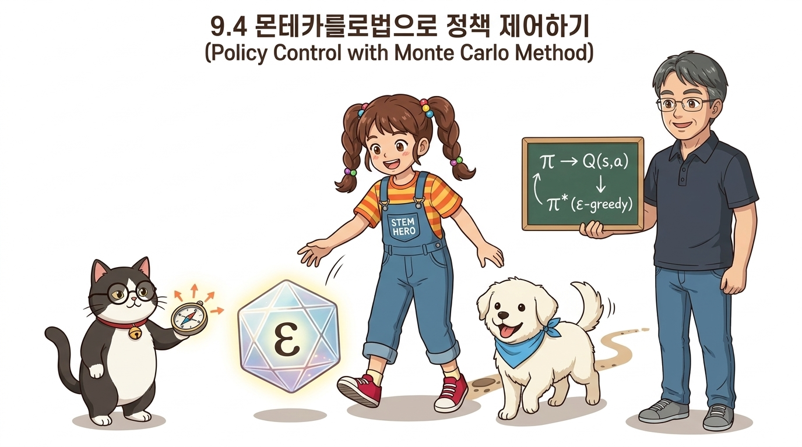
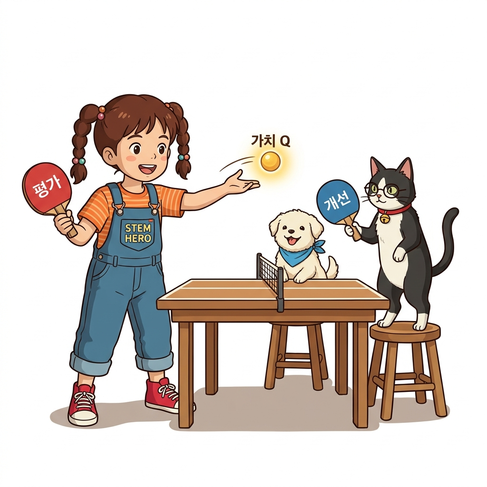
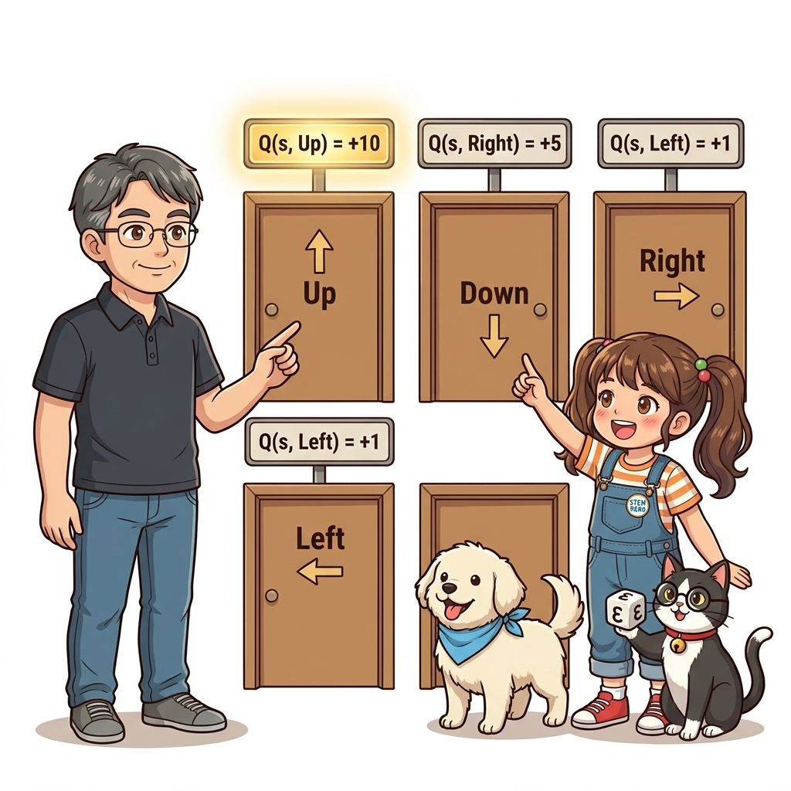
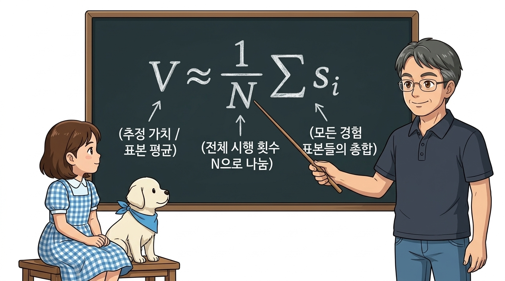
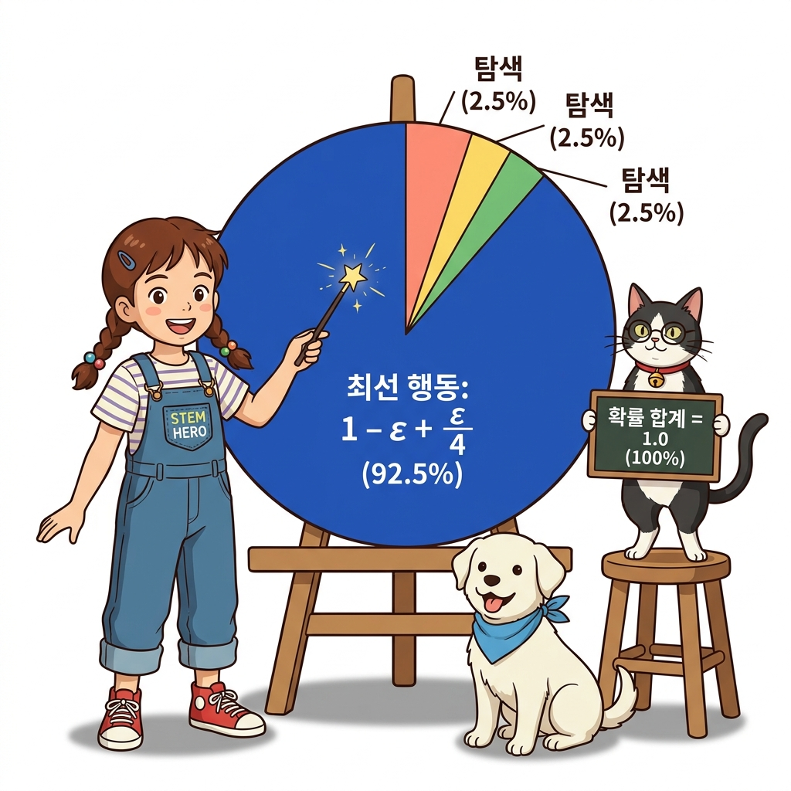
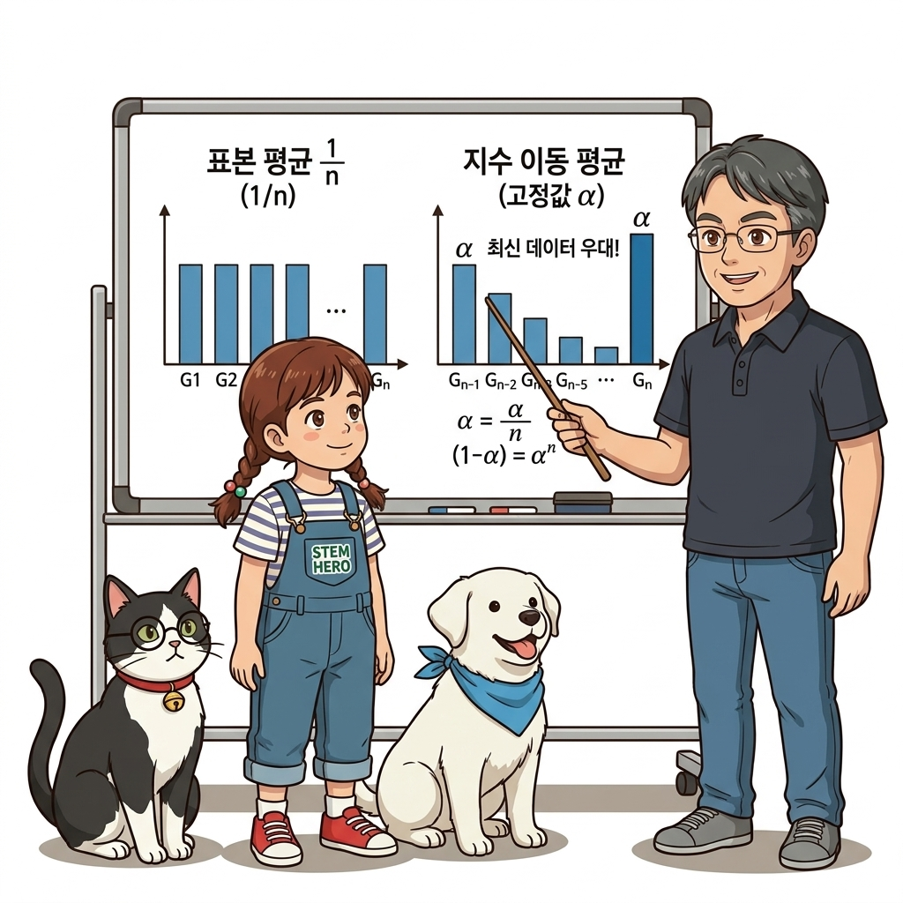
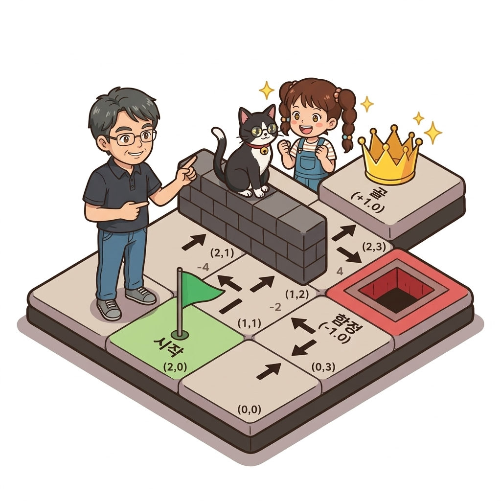

# 09.4 몬테카를로법으로 정책 제어하기




**그림 09-4-1** 탐색-이용(Exploration-Exploitation) 갈림길에서 지니의 입실론 주사위 마법을 보며 나아갈 길을 결정하는 도로시

가치 함수 평가를 넘어 최적 정책을 순차적으로 갱신하는 **정책 제어(Policy Control)**와 탐색-이용의 균형을 다룹니다. 무작위 행동 탐색의 비율을 제어하는 ***ε*-탐욕 정책(*ε*-greedy policy)**과 최신 데이터에 적응하는 **고정 학습률 *α***를 활용하여 몬테카를로법으로 최적 솔루션에 수렴해 나가는 전체 루프를 요정 지니의 딜레마 주사위 놀이와 함께 정복해봅시다!

---

앞서 9.2절과 9.3절에서는 몬테카를로법으로 '정책 평가(Policy Evaluation)'를 수행했습니다. 어떤 고정된 정책이 주어졌을 때 각 칸이 얼마나 좋은지를 평가하는 작업이었죠. 

하지만 강화학습의 궁극적인 꿈은 단순히 남이 준 정책을 채점하는 것에 그치지 않고, **"어떻게 하면 가장 많은 보상을 얻을 수 있는 최고의 행동 지침(최적 정책 $\pi^*$)을 스스로 찾아낼 수 있을까?"**입니다. 이처럼 최적 정책을 찾아 나가는 과정을 **'정책 제어(Policy Control)'**라고 부릅니다.

이번 절에서는 몬테카를로법을 이용한 정책 제어를 설명합니다. 다행히도 핵심 아이디어들은 4장 동적 프로그래밍에서 이미 다 배웠기 때문에 원리는 매우 친숙합니다. 핵심은 바로 **'평가'와 '개선'을 탁구공을 치듯 번갈아 반복하는 것**입니다. 그럼 구현에 앞서 가볍게 복습해보겠습니다.

---

## 09.4.1 평가와 개선


**그림 09-4-2** 정책 평가(Evaluation)와 정책 개선(Improvement)의 과정을 탁구 핑퐁 패들로 주고받는 지니와 도로시

최적 정책은 '평가'와 '개선'을 번갈아 반복하여 얻습니다. 

1. **'평가' 단계**: 현재 정책을 바탕으로 경험을 쌓아 상태나 행동의 가치 함수를 얻습니다.
2. **'개선' 단계**: 가치 함수가 가장 높은 쪽으로 행동을 수정(탐욕화)하여 정책을 한 단계 업그레이드합니다.

이 두 과정을 번갈아 무한히 반복함으로써 에이전트는 처음에는 서툴렀던 정책을 다듬어 최적 정책(과 최적 가치 함수)에 점점 다가갈 수 있습니다.

앞에서는 몬테카를로법으로 정책을 평가했습니다. 예를 들어 $\pi$라는 정책이 있다면, 몬테카를로법을 이용해 $V_\pi(s)$를 얻을 수 있었습니다. 그다음은 개선 단계입니다. 개선 단계에서는 탐욕화(Greedy Selection)를 수행합니다. 

수식으로 다음처럼 표현할 수 있습니다:

$$
\mu(s) = \arg\max_a Q(s, a) \tag{식 9.3}
$$

$$
= \arg\max_a \sum_{s'} p(s' \mid s, a) \left\{ r(s, a, s') + \gamma V(s') \right\} \tag{식 9.4}
$$

개선 단계에서는 가치 함수의 값을 최대로 만드는 행동을 선택합니다(이 책에서는 '탐욕화'라고 부릅니다). 

$Q$ 함수(행동 가치 함수)의 경우 [식 9.3]과 같이 $Q$ 함수가 최댓값을 반환하는 행동을 선택합니다. 이때 행동이 단 하나로 결정되므로 결정적 정책 함수 $\mu(s)$로 나타낼 수 있습니다. 또한 [식 9.4]와 같이 상태 가치 함수 $V$로 나타낼 수도 있습니다.


**그림 09-4-2b** 이호진 교수님이 상·하·좌·우 4개의 문 위에 붙은 행동 가치 표지판($Q(s, \text{Up}) = +10$ 등)을 보여주며, 미지의 미로에서 환경 모델 없이 즉시 최선의 문을 고를 수 있는 $Q$ 함수의 결정적 위력을 도로시와 토토에게 설명하는 장면 (1:1 순백색)


**그림 09-4-3** 환경 모델 전이 확률이 없어 막히는 $V(s)$ 대신, 행동 가치 $Q(s, a)$로 즉시 최적 행동을 선택하는 도로시와 지니

---

### 왜 V(s) 대신 Q(s, a)를 써야만 할까요?

앞 절까지는 상태 가치 함수 $V$에 대한 평가를 진행했습니다. 만약 상태 가치 함수 $V$를 사용하여 정책을 개선한다면 [식 9.4]를 계산하면 됩니다. 하지만 이 식에는 치명적인 제약이 있습니다. 

일반적인 강화학습 문제에서는 **환경 모델, 즉 상태 전이 확률 $p(s' \mid s, a)$와 즉각 보상 함수 $r(s, a, s')$를 알 수 없습니다.** 그런데 [식 9.4]를 자세히 보십시오. $\sum_{s'} p(s' \mid s, a) \dots$ 처럼 환경 모델의 수식이 통째로 들어가 있습니다! 환경 모델의 확률 수식을 모르면 [식 9.4]는 아예 계산기조차 두드릴 수 없습니다.

> 👨‍🏫 **이호진 교수님의 방과 문 비유**:  
> "도로시야, $V(s)$는 **'지금 내가 서 있는 방이 얼마나 좋은 방인가'**를 나타내는 점수란다.  
> 만약 방에 동, 서, 남, 북 4개의 문이 있다면, 어느 문으로 나가야 할지 결정하려면 '각 문을 열었을 때 어떤 방으로 연결되는지' 미로 전체의 설계도($p(s' \mid s, a)$)를 알고 있어야만 다음 방의 점수 $V(s')$를 비교할 수 있지.  
> 하지만 $Q(s, a)$는 **'각 문고리 위에 직접 적혀 있는 점수 표지판'**이란다!  
> 위쪽 문에는 '+10점', 오른쪽 문에는 '+5점'이라고 표지판이 적혀 있으니, 문 뒤에 어떤 미로가 펼쳐져 있는지 설계를 전혀 몰라도 **단순히 가장 큰 숫자가 적힌 위쪽 문($\arg\max_a Q$)을 열고 나가면 끝**이란다!"

따라서 일반적인 모델 프리(Model-Free) 강화학습 문제에서는 환경 모델이 필요 없는 [식 9.3]의 **행동 가치 함수 $Q(s, a)$**를 반드시 이용해야 합니다. 단순히 4방향의 $Q(s, a)$ 숫자 중 가장 큰 값을 찾아내기만 하면 즉시 최적 행동이 결정되기 때문입니다.

---

### Q 함수의 평가: 상태에서 행동으로의 전환

$Q$ 함수를 대상으로 정책을 개선하려면, 먼저 $Q$ 함수를 정확히 '평가'할 수 있어야 합니다. 

앞 절까지는 몬테카를로법으로 상태 가치 함수 $V(s)$를 평가했습니다. 이제 평가 대상을 상태-행동 쌍인 $Q(s, a)$로 바꿔주기만 하면 됩니다. 몬테카를로법의 갱신식에서 $V(s)$ 자리에 $Q(s, a)$를 쏙 넣어주면 끝납니다:

**[상태 가치 함수 평가]**
- 일반적인 표본 평균: 
  $$V_n(s) = \frac{G^{(1)} + G^{(2)} + \cdots + G^{(n)}}{n}$$
- 증분 갱신 점화식: 
  $$V_n(s) = V_{n-1}(s) + \frac{1}{n} \left\{ G^{(n)} - V_{n-1}(s) \right\} \tag{식 9.5}$$

**[Q 함수(행동 가치 함수) 평가]**
- 일반적인 표본 평균: 
  $$Q_n(s, a) = \frac{G^{(1)} + G^{(2)} + \cdots + G^{(n)}}{n}$$
- 증분 갱신 점화식: 
  $$Q_n(s, a) = Q_{n-1}(s, a) + \frac{1}{n} \left\{ G^{(n)} - Q_{n-1}(s, a) \right\} \tag{식 9.6}$$

여기서 $G^{(n)}$은 상태 $s$에서 행동 $a$를 취한 $n$번째 에피소드에서 얻은 실제 수익이고, $V_n(s)$는 $n$번째 에피소드가 끝난 시점의 상태 가치 함수 추정치입니다. 마찬가지로 $Q_n(s, a)$는 $n$번째 에피소드가 끝난 시점의 $Q$ 함수 추정치입니다. 

이 식들에서 알 수 있듯이 상태 가치 함수든 $Q$ 함수든 대상(입력값)이 $s$에서 $(s, a)$로 바뀌었을 뿐, 몬테카를로법으로 하는 표본 평균과 증분 계산 자체는 수학적으로 완전히 동일합니다.

---

## 09.4.2 몬테카를로법으로 정책 제어 구현 (초기 순진한 버전)

이제 몬테카를로법으로 정책을 제어하는 에이전트를 구현하겠습니다. 클래스 이름은 `McAgent`입니다. 먼저 코드 전반부를 보겠습니다:

```python
from collections import defaultdict
import numpy as np

class McAgent:
    def __init__(self):
        self.gamma = 0.9
        self.action_size = 4

        random_actions = {0: 0.25, 1: 0.25, 2: 0.25, 3: 0.25}
        self.pi = defaultdict(lambda: random_actions)
        self.Q = defaultdict(lambda: 0) # V가 아닌 Q를 사용! 키는 (state, action)
        self.cnts = defaultdict(lambda: 0)
        self.memory = []

    def get_action(self, state):
        action_probs = self.pi[state]
        actions = list(action_probs.keys())
        probs = list(action_probs.values())
        return np.random.choice(actions, p=probs)

    def add(self, state, action, reward):
        data = (state, action, reward)
        self.memory.append(data)

    def reset(self):
        self.memory.clear()
```

앞 절에서 구현한 `RandomAgent` 클래스와 거의 같습니다. 유일한 차이는 `self.V` 대신 상태와 행동을 함께 담는 `self.Q`를 테이블로 채택한 부분입니다.

이어서 정책 제어의 핵심인 `update()` 메서드와 완전 탐욕 정책 함수를 작성해 봅시다:

```python
def greedy_probs(Q, state, action_size=4):
    qs = [Q[(state, action)] for action in range(action_size)]
    max_action = np.argmax(qs)

    action_probs = {action: 0.0 for action in range(action_size)}
    action_probs[max_action] = 1.0 # ❶ 완전 탐욕 (오직 최고 가치 행동만 100% 선택)
    return action_probs

class McAgent:
    ...

    def update(self):
        G = 0
        for data in reversed(self.memory):
            state, action, reward = data
            G = self.gamma * G + reward
            key = (state, action)
            self.cnts[key] += 1
            # [식 9.6]에 따라 self.Q 증분 갱신
            self.Q[key] += (G - self.Q[key]) / self.cnts[key] # ❷ 1/n 균일 평균

            # state의 정책을 탐욕적으로 즉시 개선
            self.pi[state] = greedy_probs(self.Q, state)
```

먼저 `greedy_probs()` 함수는 현재 상태 `state`에서 4가지 행동의 $Q$ 값을 비교하여, 가장 큰 값을 가진 행동에 1.0(100%)의 확률을 몰아주는 완전 탐욕 확률 분포를 만듭니다.

그리고 `update()` 메서드에서는 `reversed(self.memory)`로 거슬러 올라가며 `self.Q`를 갱신하고, 곧바로 해당 상태의 정책 `self.pi[state]`를 새로운 탐욕 정책으로 업데이트합니다.

**하지만 잠깐! 이 순진한 코드는 실제로 실행해 보면 미로를 제대로 탈출하지 못하고 심각한 실패에 빠집니다.** 

여기에는 인공지능 역사상 가장 유명한 2가지 치명적인 함정이 도사리고 있습니다:
* **코드의 ❶의 함정**: 100% 완전한 탐욕만을 고집하면 다른 미지의 길을 영영 탐색하지 못합니다. $\rightarrow$ **$\epsilon$-탐욕 정책으로 해결!**
* **코드의 ❷의 함정**: 정책이 매번 바뀌는데 초보 시절의 데이터와 고수 시절의 데이터를 똑같이 $1/n$로 균일하게 평균 내고 있습니다. $\rightarrow$ **고정 학습률 $\alpha$ 지수 이동 평균으로 해결!**

---

## 09.4.3 $\epsilon$-탐욕 정책으로 변경 (첫 번째 개선: 탐색의 확보)

에이전트가 100% 탐욕 행동만을 고집하면 왜 망하게 될까요?


**그림 09-4-4** 초기의 작은 보상 경로에만 갇혀 더 큰 보상이 숨겨진 황금 미로를 발견하지 못하는 탐욕 경로의 함정

초기 에이전트는 무작위로 돌아다니다가 우연히 바로 앞의 작은 사탕(+1점)을 하나 발견합니다. 그러면 탐욕화 알고리즘에 의해 이 사탕을 향해 가는 행동의 확률이 100%로 굳어져 버립니다.

그 뒤로는 평생 그 사탕 길만 걷게 되며, 저 건너편 골짜기에 엄청나게 거대한 황금 보물 상자(+100점)가 숨겨져 있다는 사실을 영원히 알아채지 못합니다!

> [!NOTE]
> **💡 탐색과 활용의 딜레마 (Exploration vs Exploitation Dilemma)**  
> - **활용(Exploitation)**: 지금까지 겪은 내 경험 중에서 현재 가장 좋다고 알려진 최선의 행동을 선택하는 것입니다 (늘 가던 단골 맛집 가기).  
> - **탐색(Exploration)**: 현재 최고는 아닐지 몰라도, 혹시 더 훌륭한 대박이 숨겨져 있을지 모르니 새로운 시도를 해보는 것입니다 (새로 문을 연 낯선 식당 가보기).  
> 인공지능이 진정한 최적해를 찾으려면 항상 이 둘 사이의 균형(Trade-off)을 절묘하게 잡아야 합니다.

에이전트에게 지혜로운 탐색을 시키는 가장 대표적인 해법이 바로 **$\epsilon$-탐욕 정책($\epsilon$-greedy policy)**입니다. 

기본적으로 $Q$ 함수가 가장 큰 최선 행동을 $1 - \epsilon$의 높은 확률(예: 90%)로 선택하되, 그리스 문자 **$\epsilon$(입실론, 보통 0.1 즉 10%)**만큼의 작은 확률을 남겨두어, 주사위를 굴리듯 아무 행동이나 무작위로 시도해 보게 하는 것입니다.


**그림 09-4-5** 최선 행동에 압도적인 확률(1-ε)을 부여하고 나머지 행동들에 고른 탐색 확률(ε/4)을 나누어주는 입실론 탐욕 마법

이제 $\epsilon$-탐욕 버전의 `greedy_probs()` 함수를 구현해 봅시다:

<div align="right"><b>ch05/mc_control.py</b></div>

```python
def greedy_probs(Q, state, epsilon=0, action_size=4):
    qs = [Q[(state, action)] for action in range(action_size)]
    max_action = np.argmax(qs)

    base_prob = epsilon / action_size
    action_probs = {action: base_prob for action in range(action_size)}
    action_probs[max_action] += (1 - epsilon)
    return action_probs
```

이 코드는 모든 4가지 행동에 공평하게 기초 탐색 확률 $\epsilon / 4$ (예: $\epsilon=0.1$이면 각각 $0.025$)를 깔아준 뒤, 오직 최선 행동 `max_action`에만 $1 - \epsilon$ ($0.9$)의 거대한 탐욕 보너스를 얹어줍니다:

- 최선 행동의 확률: $0.9 + 0.025 = 0.925$ (92.5%)
- 나머지 3개 행동의 확률: 각각 $0.025$ (2.5%)
- 총합: $0.925 + 0.025 \times 3 = \mathbf{1.0}$ (100%)

이렇게 하면 평소에는 영리하게 최적 행동을 실천하면서도, 10번에 1번꼴로는 엉뚱한 새로운 길을 용감하게 탐색하여 숨겨진 보물을 놓치지 않게 됩니다!

---

## 09.4.4 고정값 $\alpha$ 방식으로 수행 (두 번째 개선: 비정상 문제 대응)

다음은 두 번째 개선 사항입니다. 표본 평균 공식인 $1/n$ 대신, 고정된 학습률 계수 **$\alpha$(알파, 보통 0.1)**를 곱하는 방식으로 점화식을 수정합니다:

```python
# 수정 전 (표본 평균 방식: 1/n)
# self.Q[key] += (G - self.Q[key]) / self.cnts[key]

# 수정 후 (고정 학습률 α 방식: 지수 이동 평균)
alpha = 0.1
self.Q[key] += (G - self.Q[key]) * alpha # ❷
```

이 작은 코드 한 줄의 차이가 왜 인공지능의 성패를 가를까요?


**그림 09-4-6** 모든 과거 데이터를 똑같이 대우하는 표본 평균(왼쪽)과, 어제의 낡은 기억은 잊고 오늘의 고수 경험을 우대하는 지수 이동 평균(오른쪽)의 가중치 비교

* **수정 전 (표본 평균 $1/n$)의 치명적 결함**:
  * 표본 평균은 1번째 에피소드부터 $n$번째 에피소드까지 모든 데이터에 똑같이 $1/n$의 동일한 가중치를 부여합니다.
  * 하지만 생각해 보십시오! 1번째 에피소드의 에이전트는 미로에서 벽에 쿵쿵 부딪히며 방황하던 **'완전 초보 시절'**의 경험입니다. 반면 10,000번째 에피소드의 에이전트는 정책이 성숙해진 **'베테랑 고수 시절'**의 경험입니다.
  * 초보 시절의 바보 같은 경험과 고수 시절의 현명한 경험을 똑같이 1/n로 대등하게 평균 내는 것은 명백한 넌센스입니다!
* **수정 후 (고정값 $\alpha$ 지수 이동 평균의 마법)**:
  * 점화식을 전개해 보면, 가장 최근에 얻은 경험 $G^{(n)}$에는 온전한 가중치 $\alpha$가 곱해지지만, 과거 $k$스텝 전의 낡은 데이터에는 $(1 - \alpha)^k$ 배율로 가중치가 기하급수적으로 줄어듭니다!
  * 즉, **초보 시절의 낡은 기억은 자연스럽게 잊어버리고(망각), 가장 똑똑해진 최근의 경험을 압도적으로 우대**하게 됩니다.

이처럼 학습이 진행됨에 따라 정책이 진화하고, 그 결과 수익 데이터가 생성되는 확률 분포 자체가 계속해서 변화하는 문제를 통계학에서는 **'비정상 문제(Non-Stationary Problem)'**라고 부릅니다. 비정상 환경에서는 고정 학습률 $\alpha$를 사용한 지수 이동 평균이 절대적인 필수 공식입니다.

---

## 09.4.5 몬테카를로법으로 정책 반복법 구현 (완성 버전)

앞의 2대 개선 사항($\epsilon$-탐욕 탐색 + $\alpha$ 지수 이동 평균)을 완벽하게 반영하여 완성된 `McAgent` 클래스입니다:

<div align="right"><b>ch05/mc_control.py</b></div>

```python
class McAgent:
    def __init__(self):
        self.gamma = 0.9
        self.epsilon = 0.1 # [개선 1] ε-탐욕 정책의 탐색 비율 (10%)
        self.alpha = 0.1   # [개선 2] Q 함수 갱신 시의 고정 학습률 α
        self.action_size = 4

        random_actions = {0: 0.25, 1: 0.25, 2: 0.25, 3: 0.25}
        self.pi = defaultdict(lambda: random_actions)
        self.Q = defaultdict(lambda: 0)
        self.memory = []

    def get_action(self, state):
        action_probs = self.pi[state]
        actions = list(action_probs.keys())
        probs = list(action_probs.values())
        return np.random.choice(actions, p=probs)

    def add(self, state, action, reward):
        data = (state, action, reward)
        self.memory.append(data)

    def reset(self):
        self.memory.clear()

    def update(self):
        G = 0
        for data in reversed(self.memory):
            state, action, reward = data
            G = self.gamma * G + reward
            key = (state, action)
            # ❶ 고정값 α 기반 지수 이동 평균 갱신!
            self.Q[key] += (G - self.Q[key]) * self.alpha
            # ❷ ε-탐욕 탐색을 적용하여 정책 개선!
            self.pi[state] = greedy_probs(self.Q, state, self.epsilon)
```

이제 완성된 `McAgent`를 3×4 그리드 월드 환경에 투입하여 총 10,000번의 에피소드로 학습시켜 보겠습니다:

```python
env = GridWorld()
agent = McAgent()

episodes = 10000
for episode in range(episodes):
    state = env.reset()
    agent.reset()

    while True:
        action = agent.get_action(state)
        next_state, reward, done = env.step(action)

        agent.add(state, action, reward)
        if done:
            agent.update() # 에피소드 완주 시 Q 함수 및 정책 일괄 갱신!
            break

        state = next_state

# 학습 완료 후 최종 수렴된 Q 함수와 최적 정책 화살표 렌더링
env.render_q(agent.Q)
```

학습 완료 후 시각화 결과는 다음과 같습니다:


**그림 09-4-7** 10,000번 에피소드 후 수렴된 4방향 Q 함수와 최적 탈출 경로 화살표 맵

결과 지도를 보십시오! 

출발 지점에서 시작하여 위험천만한 마이너스 함정(-1.0) 칸을 멀리 피해 위쪽 안전 경로로 완벽하게 우회한 뒤, 플러스 골(+1.0) 지점으로 최단거리 진입하는 완벽한 최적 정책 화살표가 뚜렷하게 형성되었습니다!

환경의 상태 전이 확률이나 보상 행렬 수식을 전혀 모르는 완전한 백지상태였지만, **몬테카를로 경험 수집 + $Q$ 함수 탐욕화 + $\epsilon$-탐욕 탐색 + $\alpha$ 지수 이동 평균**이라는 강력한 도구들이 맞물려 스스로 완벽한 인공지능 지도를 그려낸 것입니다.

---

### 09.4.6 핵심 정리: 몬테카를로 정책 제어 3대 기둥


**그림 09-4-8** Q 함수, 입실론 탐욕, 고정 알파의 3대 기둥을 세우고 오프-정책의 새로운 장으로 나아가는 도로시와 지니

1. **행동 가치 함수 $Q(s, a)$의 채택**:
   - 상태 전이 확률 $p(s' \mid s, a)$를 모르는 환경에서는 $V(s)$만으로 다음 최적 행동을 선택할 수 없으므로, $\arg\max_a Q(s, a)$로 즉시 판단 가능한 $Q(s, a)$가 정책 제어의 유일한 나침반입니다.
2. **$\epsilon$-탐욕 정책을 통한 탐색과 활용의 공존**:
   - 조기 수렴과 편향을 방지하기 위해 $1 - \epsilon$의 확률로 최선 행동을 실천하고, $\epsilon$의 확률로 모든 길을 골고루 탐색하여 숨겨진 최적 경로를 빠짐없이 발굴합니다.
3. **고정 학습률 $\alpha$ 기반 지수 이동 평균**:
   - 정책 개선에 따라 데이터의 분포가 시시각각 변화하는 비정상 문제(Non-stationary)를 극복하기 위해, 과거 초보 시절의 데이터는 잊고 최신 고수 데이터에 높은 가중치를 부여합니다.

> 👨‍🏫 **이호진 교수님의 직강 노트**:  
> "몬테카를로 정책 제어의 완성은 강화학습이 단순한 통계 계산기를 넘어, 미지의 환경을 스스로 탐험하고 최선의 길을 개척해 나가는 '진정한 지능(AI)'으로 도약하는 감동적인 순간입니다.  
> 하지만 $\epsilon$-탐욕 정책은 학습이 끝난 후에도 10%의 확률로 실수를 저지른다는 아쉬운 타협점이 있습니다.  
> 이를 완벽하게 극복하기 위해, 다음 9.5절에서는 '마음껏 탐색하는 행동 정책'과 '순수하게 최선만을 달리는 대상 정책'을 분리하는 강화학습의 최고봉, **오프-정책과 중요도 샘플링**의 세계로 떠나보겠습니다!"

> 🐱 **조교 지니의 응원 노트**:  
> "축하합니다냥, 도로시와 여러분! 이제 우리 에이전트는 미로에서 길을 헤매지 않고 스스로 최적의 탈출 지도를 그려냈어요! $Q$ 함수, 입실론($\epsilon$) 탐욕, 그리고 알파($\alpha$) 지수 이동 평균의 삼위일체를 가슴에 품고, 다음 절에서 더욱 마법 같은 오프-정책을 만나보아요!"
