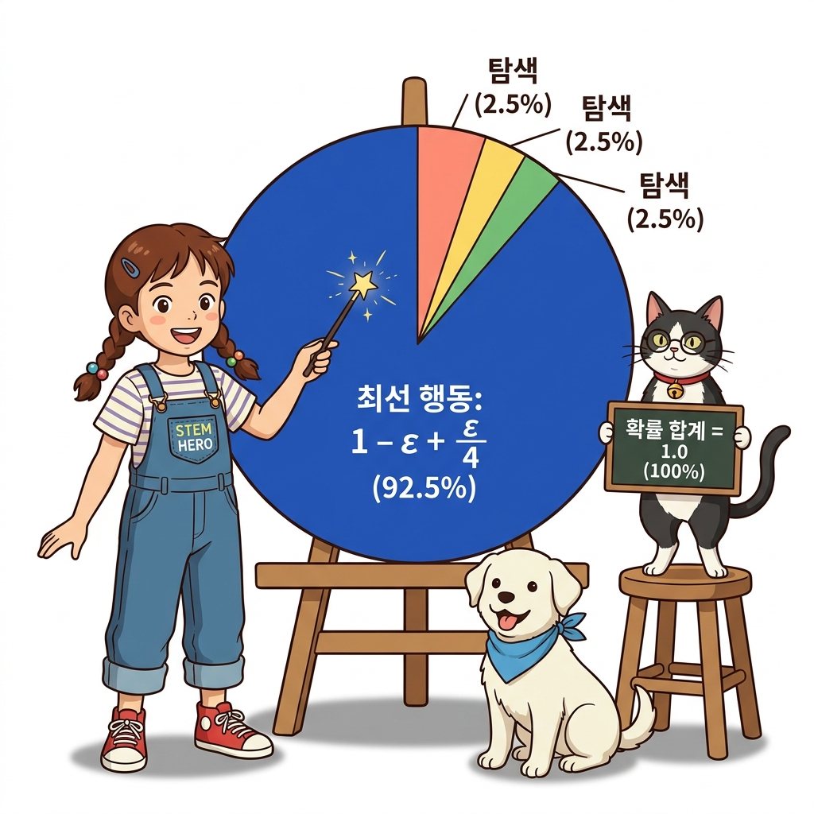
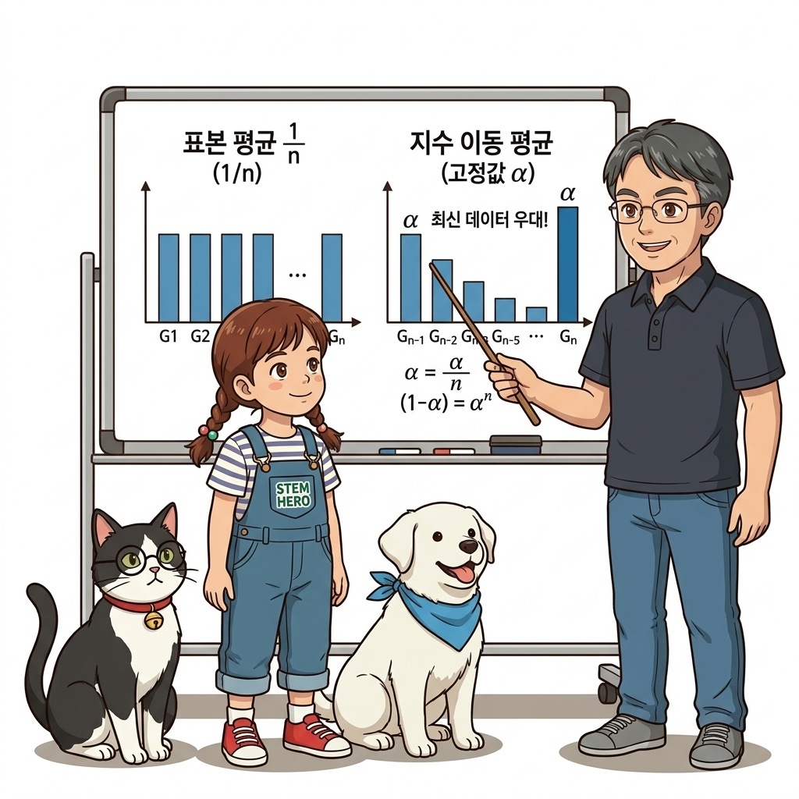

# 09.4 몬테카를로법으로 정책 제어하기


**그림 09-4-1** 탐색-이용(Exploration-Exploitation) 갈림길에서 지니의 입실론 주사위 마법을 보며 나아갈 길을 결정하는 도로시

가치 함수 평가를 넘어 최적 정책을 순차적으로 갱신하는 **정책 제어(Policy Control)**와 탐색-이용의 균형을 다룹니다. 무작위 행동 탐색의 비율을 제어하는 ***ε*-탐욕 정책(*ε*-greedy policy)**과 최신 데이터에 적응하는 **고정 학습률 *α***를 활용하여 몬테카를로법으로 최적 솔루션에 수렴해 나가는 전체 루프를 요정 지니의 딜레마 주사위 놀이와 함께 정복해봅시다!

---

앞서 9.2절과 9.3절에서는 몬테카를로법으로 '정책 평가'를 수행했습니다. 정책 평가의 다음 단계는 최적 정책을 찾는 '정책 제어'입니다. 이번 절에서는 몬테카를로법을 이용한 정책 제어를 설명합니다. 다행히도 핵심 아이디어들은 4장 동적 프로그래밍에서 이미 다 배웠기 때문에 원리는 친숙합니다. 핵심은 바로 평가와 개선을 번갈아 반복하는 것입니다. 그럼 구현에 앞서 가볍게 복습해보겠습니다.

## 09.4.1 평가와 개선


**그림 09-4-2** 정책 평가(Evaluation)와 정책 개선(Improvement)의 과정을 탁구 핑퐁 패들로 주고받는 지니와 도로시

최적 정책은 '평가'와 '개선'을 번갈아 반복하여 얻습니다. '평가' 단계에서는 정책을 평가하여 가치 함수를 얻습니다. 그리고 '개선' 단계에서는 가치 함수를 탐욕화하여 정책을 개선합니다. 이 두 과정을 번갈아 반복함으로써 최적 정책(과 최적 가치 함수)에 점점 다가갈 수 있습니다.

앞에서는 몬테카를로법으로 정책을 평가했습니다. 예를 들어 *π*라는 정책이 있다면, 몬테카를로법을 이용해 *V*<sub>*π*</sub>(*s*)를 얻을 수 있었습니다. 그다음은 개선 단계입니다. 개선 단계에서는 탐욕화를 수행합니다. 수식으로 다음처럼 표현할 수 있습니다.

```
μ(s) = argmax_a Q(s, a)                                                  [식 9.3]
     = argmax_a ∑_{s'} p(s' | s, a) { r(s, a, s') + γ V(s') }             [식 9.4]
```

개선 단계에서는 가치 함수의 값을 최대로 만드는 행동을 선택합니다(이 책에서는 '탐욕화'라고 부릅니다). *Q* 함수(행동 가치 함수)의 경우 [식 9.3]과 같이 *Q* 함수가 최댓값을 반환하는 행동을 선택합니다. 이때 행동이 단 하나로 결정되므로 함수 *μ*(*s*)로 나타낼 수 있습니다. 또한 [식 9.4]와 같이 가치 함수 *V*로 나타낼 수도 있습니다.


**그림 09-4-3** 환경 모델 전이 확률이 없어 막히는 V(s) 대신, 행동 가치 Q(s, a)로 즉시 최적 행동을 선택하는 도로시와 지니

앞 절까지는 가치 함수 *V*에 대한 평가를 진행했습니다. 만약 가치 함수 *V*를 사용하여 정책을 개선한다면 [식 9.4]를 계산하면 됩니다. 하지만 이 식에는 제약이 있습니다. 일반적인 강화 학습 문제에서는 환경 모델, 즉 *p*(*s'* | *s*, *a*)와 *r*(*s*, *a*, *s'*)를 알 수 없습니다. 그런데 [식 9.4]는 환경 모델을 사용하지 않으면 계산할 수 없죠. 따라서 일반적인 강화 학습 문제에서는 *Q* 함수를 이용하는 [식 9.3]을 이용해야 합니다. 이 식에서는 단순히 *Q*(*s*, *a*)가 최대가 되는 행동 *a*를 찾아내기만 하면 되므로 환경 모델이 필요 없습니다.

*Q* 함수를 대상으로 개선할 경우 *Q* 함수를 '평가'해야 합니다. 앞 절까지는 몬테카를로법으로 상태 가치 함수를 평가했습니다. 평가 대상을 *Q* 함수로 바꿔줘야 합니다. 그러려면 몬테카를로법의 갱신식에서 *V*(*s*)에서 *Q*(*s*, *a*)로 전환해야겠죠. 수식으로는 다음과 같습니다.

**[상태 가치 함수 평가]**
- 일반적인 방식: *V*<sub>*n*</sub>(*s*) = (*G*<sup>(1)</sup> + *G*<sup>(2)</sup> + &hellip; + *G*<sup>(*n*)</sup>) / *n*
- 증분 방식: *V*<sub>*n*</sub>(*s*) = *V*<sub>*n*&minus;1</sub>(*s*) + (1 / *n*) &middot; {*G*<sup>(*n*)</sup> &minus; *V*<sub>*n*&minus;1</sub>(*s*)} [식 9.5]

**[Q 함수 평가]**
- 일반적인 방식: *Q*<sub>*n*</sub>(*s*, *a*) = (*G*<sup>(1)</sup> + *G*<sup>(2)</sup> + &hellip; + *G*<sup>(*n*)</sup>) / *n*
- 증분 방식: *Q*<sub>*n*</sub>(*s*, *a*) = *Q*<sub>*n*&minus;1</sub>(*s*, *a*) + (1 / *n*) &middot; {*G*<sup>(*n*)</sup> &minus; *Q*<sub>*n*&minus;1</sub>(*s*, *a*)} [식 9.6]

여기서 *G*<sup>(*n*)</sup>은 *n*번째 에피소드에서 얻을 수 있는 수익이고 *V*<sub>*n*</sub>(*s*)는 *n*번째 에피소드가 끝난 시점의 상태 가치 함수 추정치입니다. 마찬가지로 *Q*<sub>*n*</sub>(*s*, *a*)는 *n*번째 에피소드가 끝난 시점의 *Q* 함수 추정치입니다. 이 식들에서 알 수 있듯이 상태 가치 함수든 *Q* 함수든 대상이 바뀌었을 뿐, 몬테카를로법으로 하는 계산 자체는 변하지 않습니다.

#### 💡 수식 돋보기: Q 함수 평가와 탐욕화 공식 기호 해부

```
[탐욕화 정책]  μ(s) = argmax_a Q(s, a)
[Q 증분 갱신]  Q_n(s, a) ← Q_{n-1}(s, a) + (1 / n) · (G^(n) - Q_{n-1}(s, a))
```

1. **탐욕 정책 결정 기호 해부 (`μ(s) = argmax_a Q(s, a)`)**:
   - *Q*(*s*, *a*) : 상태 *s*에서 행동 *a*를 취했을 때 미래에 기대할 수 있는 누적 할인 수익
   - *argmax*<sub>*a*</sub> : 취할 수 있는 후보 행동 집합 중 *Q* 값이 가장 높은 단 하나의 최적 행동 색인을 반환
   - *μ*(*s*) : 상태 *s*에 대해 100% 결정적으로 최적 행동 하나만을 지정하는 개선된 정책

2. **Q 함수 증분 갱신 기호 해부**:
   - *G*<sup>(*n*)</sup> : 해당 에피소드에서 상태 *s*에서 행동 *a*를 취한 이후 에피소드 끝까지 모은 참 수익
   - *Q*<sub>*n*&minus;1</sub>(*s*, *a*) : 과거 *n*&minus;1번째 에피소드까지 추정된 누적 평균 가치
   - (1 / *n*) : 상태-행동 쌍 (*s*, *a*)의 방문 횟수 *n*에 따른 균등 표본 평균 학습률

## 09.4.2 몬테카를로법으로 정책 제어 구현

이제 몬테카를로법으로 정책을 제어하는 에이전트를 구현하겠습니다. 클래스 이름은 `McAgent`입니다. 먼저 코드 전반부를 보겠습니다.

```python
from collections import defaultdict
import numpy as np

class McAgent:
    def __init__(self):
        self.gamma = 0.9
        self.action_size = 4

        random_actions = {0: 0.25, 1: 0.25, 2: 0.25, 3: 0.25}
        self.pi = defaultdict(lambda: random_actions)
        self.Q = defaultdict(lambda: 0) # V가 아닌 Q를 사용
        self.cnts = defaultdict(lambda: 0)
        self.memory = []

    def get_action(self, state):
        action_probs = self.pi[state]
        actions = list(action_probs.keys())
        probs = list(action_probs.values())
        return np.random.choice(actions, p=probs)

    def add(self, state, action, reward):
        data = (state, action, reward)
        self.memory.append(data)

    def reset(self):
        self.memory.clear()
```

앞 절에서 구현한 `RandomAgent` 클래스와 거의 같습니다. 유일한 차이는 `self.V`에서 `self.Q`로 이름을 바꾼 부분입니다.

이어서 핵심인 정책 제어를 구현합니다.

```python
def greedy_probs(Q, state, action_size=4):
    qs = [Q[(state, action)] for action in range(action_size)]
    max_action = np.argmax(qs)

    action_probs = {action: 0.0 for action in range(action_size)}
    action_probs[max_action] = 1.0 # ❶ 완전 탐욕
    return action_probs

class McAgent:
    ...

    def update(self):
        G = 0
        for data in reversed(self.memory):
            state, action, reward = data
            G = self.gamma * G + reward
            key = (state, action)
            self.cnts[key] += 1
            # [식 9.6]에 따라 self.Q 갱신
            self.Q[key] += (G - self.Q[key]) / self.cnts[key] # ❷

            # state의 정책 탐욕화
            self.pi[state] = greedy_probs(self.Q, state)
```

먼저 `greedy_probs()` 함수를 준비합니다. 이 함수는 매개변수로 받은 `state` 상태에서 *Q* 함수의 값이 가장 큰 행동만을 취하게끔 확률 분포를 만들어줍니다.

`update()` 메서드에서는 `self.Q`를 갱신합니다. 여기서 주의할 점은 `self.Q`의 키가 `(state, action)` 튜플이라는 점입니다. 그리고 증분 방식으로 `self.Q`를 갱신하고, `self.Q` 갱신이 끝나면 `state`의 정책을 탐욕화합니다.

그런데 사실 이 순진한 코드는 제대로 작동하지 못합니다. 개선할 점이 두 가지가 있는데, 바로 다음 부분입니다.

* **코드의 ❶**: 완전한 탐욕이 아닌 *ε*-탐욕 정책으로 변경 (탐색의 확보)
* **코드의 ❷**: *Q* 갱신을 '고정값 *α* 방식'으로 수행 (비정상 문제 대응)

## 09.4.3 *ε*-탐욕 정책으로 변경 (첫 번째 개선)

에이전트는 개선 단계에서 정책을 탐욕화합니다. 탐욕화의 결과로 해당 상태에서 취할 수 있는 행동이 단 하나로 고정됩니다. 예를 들어 정책을 탐욕화하여 [그림 09-4-4]처럼 행동하게 되었다고 가정해봅시다.


**그림 09-4-4** 초기의 작은 보상 경로에만 갇혀 더 큰 보상이 숨겨진 황금 미로를 발견하지 못하는 탐욕 경로의 함정

그림과 같이 탐욕 행동만을 수행하면 에이전트의 경로가 한 가지로 고정됩니다. 그러면 모든 상태와 행동 조합에 대한 수익 샘플 데이터를 수집할 수 없게 됩니다. 이 문제를 해결하려면 에이전트가 '탐색'도 시도하도록 해야 합니다.

> [!NOTE]
> 밴디트 문제에서 설명했듯이 여기에서도 '활용과 탐색의 트레이드오프'가 생깁니다. 지금까지의 경험에 비춰 가장 좋다고 생각되는 행동이 '활용'이고, 다른 시도를 하여 새로운 경험을 늘리는 행동이 '탐색'입니다. 그래서 활용과 탐색은 상충관계입니다.

에이전트에게 '탐색'을 시키는 대표적인 방법이 ***ε*-탐욕 정책**입니다. 기본적으로 *Q* 함수의 값이 가장 큰 행동을 선택하되, 무작위성을 '살짝' 첨가하여 낮은 확률로 아무 행동이나 선택하도록 하는 정책입니다. 이렇게 하면 각 상태에서 정해진 행동만 선택되는 문제를 방지할 수 있습니다.


**그림 09-4-5** 최선 행동에 압도적인 확률(1-ε)을 부여하고 나머지 행동들에 고른 탐색 확률(ε/4)을 나누어주는 입실론 탐욕 마법

이제 *ε*-탐욕 버전의 `greedy_probs()` 함수를 구현해보겠습니다.

<div align="right"><b>ch05/mc_control.py</b></div>

```python
def greedy_probs(Q, state, epsilon=0, action_size=4):
    qs = [Q[(state, action)] for action in range(action_size)]
    max_action = np.argmax(qs)

    base_prob = epsilon / action_size
    action_probs = {action: base_prob for action in range(action_size)}
    action_probs[max_action] += (1 - epsilon)
    return action_probs
```

이전 코드에서는 100% 탐욕스러웠던 확률 분포를 *ε*-탐욕 형태로 변경했습니다. 우선 모든 행동의 확률을 *ε* / 4로 설정하고(행동이 4개), *Q* 함수 값이 가장 큰 행동에 따로 1 &minus; *ε*의 확률을 더했습니다.

#### 💡 수식 돋보기: ε-탐욕 확률 분포 공식 해부

```
[최선 행동 확률]   π(a* | s) = 1 - ε + (ε / |A|)
[비최선 행동 확률] π(a  | s) = ε / |A|   (단, a ≠ a*)
```

- **`|A|`** : 상태 *s*에서 선택할 수 있는 총 행동의 가짓수 (그리드월드는 상·하·좌·우 4가지)
- **`ε / |A|`** : 모든 행동에 공평하게 부여되는 베이스 무작위 탐색 확률 (&epsilon;=0.1일 때 0.1 / 4 = 0.025)
- **`1 - ε`** : 가장 높은 *Q* 값을 기록한 최선 행동 *a*\*에게만 독점적으로 지급되는 탐욕 보너스 (0.9)
- **합계 검증**: (0.9 + 0.025) + 0.025 + 0.025 + 0.025 = **1.0**으로 완전한 확률 분포 성립

## 09.4.4 고정값 *α* 방식으로 수행 (두 번째 개선)

다음은 두 번째 개선 사항입니다. 먼저 수정한 부분의 코드를 보겠습니다.

```python
# 수정 전 (표본 평균 방식)
# self.Q[key] += (G - self.Q[key]) / self.cnts[key]

# 수정 후 (고정 학습률 α 방식)
alpha = 0.1
self.Q[key] += (G - self.Q[key]) * alpha # ❷
```

이와 같이 ❷ 부분을 고정값 `alpha`로 바꿔줍니다. 수정 전과 후의 방식에는 [그림 09-4-6]과 같은 차이가 있습니다.


**그림 09-4-6** '수정 전 방식(왼쪽)'과 '고정값 방식(오른쪽)'에서 각 데이터에 부여되는 가중치 비교

수정 전 방식은 모든 샘플 데이터(*G*<sup>(1)</sup>, *G*<sup>(2)</sup>, &hellip;, *G*<sup>(*n*)</sup>)에 가중치를 '균일'하게 1/*n*씩 부여합니다. '표본 평균'이죠.

반면, 고정값 *α*로 갱신하는 방식은 각 데이터에 대한 가중치가 '기하급수적'으로 커집니다. 이를 **지수 이동 평균<sup>exponential moving average</sup>**이라고 합니다. 지수 이동 평균은 최신 데이터일수록 가중치를 훨씬 크게 줍니다.

몬테카를로법을 이용한 정책 제어에는 지수 이동 평균이 적합합니다. '수익'이라는 샘플 데이터가 생성되는 확률 분포가 시간에 따라 달라지기 때문입니다. 에피소드가 진행될수록 정책이 갱신되기 때문에 수익이 생성되는 확률 분포도 달라집니다. 이를 **비정상 문제<sup>non-stationary problem</sup>**라고 부릅니다. 샘플 데이터를 생성하는 확률 분포가 일정하지 않은 경우에는 지수 이동 평균이 필수적입니다.

#### 💡 수식 돋보기: 지수 이동 평균 점화식 기호 해부

```
[갱신 점화식]    Q_{n+1} = Q_n + α · (G^{(n)} - Q_n)
[가중치 전개]    Q_{n+1} = (1 - α)^n · Q_1 + ∑_{i=1}^n α · (1 - α)^{n-i} · G^{(i)}
```

- **`(1 - α)^n` (과거 망각)**: 에피소드가 거듭될수록 초창기의 미숙했던 데이터 *Q*<sub>1</sub>의 가중치는 (1 &minus; *α*)<sup>*n*</sup> 배율로 급격히 감쇠하여 0으로 잊혀집니다.
- **`α(1 - α)^{n-i}` (최신성 우대)**: 직전 최신 경험 *G*<sup>(*n*)</sup>에는 온전한 가중치 *α*가 곱해지고, 낡은 경험일수록 가중치가 기하급수적으로 축소됩니다.

## 09.4.5 몬테카를로법으로 정책 반복법 구현 (개선 버전)

앞의 두 개선 사항을 반영하여 `McAgent` 클래스를 최종 완성했습니다.

<div align="right"><b>ch05/mc_control.py</b></div>

```python
class McAgent:
    def __init__(self):
        self.gamma = 0.9
        self.epsilon = 0.1 # (첫 번째 개선) ε-탐욕 정책의 ε
        self.alpha = 0.1   # (두 번째 개선) Q 함수 갱신 시의 고정값 α
        self.action_size = 4

        random_actions = {0: 0.25, 1: 0.25, 2: 0.25, 3: 0.25}
        self.pi = defaultdict(lambda: random_actions)
        self.Q = defaultdict(lambda: 0)
        self.memory = []

    def get_action(self, state):
        action_probs = self.pi[state]
        actions = list(action_probs.keys())
        probs = list(action_probs.values())
        return np.random.choice(actions, p=probs)

    def add(self, state, action, reward):
        data = (state, action, reward)
        self.memory.append(data)

    def reset(self):
        self.memory.clear()

    def update(self):
        G = 0
        for data in reversed(self.memory):
            state, action, reward = data
            G = self.gamma * G + reward
            key = (state, action)
            self.Q[key] += (G - self.Q[key]) * self.alpha # ❶ 고정값 α 갱신
            self.pi[state] = greedy_probs(self.Q, state, self.epsilon) # ❷ ε-탐욕 탐색
```

이제 새로운 `McAgent` 클래스를 `GridWorld` 환경과 연동하여 총 10,000 에피소드로 학습시켜 보겠습니다.

```python
env = GridWorld()
agent = McAgent()

episodes = 10000
for episode in range(episodes):
    state = env.reset()
    agent.reset()

    while True:
        action = agent.get_action(state)
        next_state, reward, done = env.step(action)

        agent.add(state, action, reward)
        if done:
            agent.update()
            break

        state = next_state

env.render_q(agent.Q)
```

학습 완료 후 시각화 결과는 다음과 같습니다.


**그림 09-4-7** 10,000번 에피소드 후 수렴된 4방향 Q 함수와 최적 탈출 경로 화살표 맵

그림을 보면 마이너스 함정(-1)을 멀리 우회하고 플러스 골(+1) 지점으로 최단거리 진입하는 완벽한 탐욕 정책 화살표가 형성된 것을 확인할 수 있습니다. 이처럼 몬테카를로법에 *ε*-탐욕 정책과 지수 이동 평균을 결합하면 환경 모델 없이도 훌륭하게 최적 제어를 달성할 수 있습니다!

---

### 09.4.6 핵심 정리: 몬테카를로 정책 제어 3대 기둥


**그림 09-4-8** Q 함수, 입실론 탐욕, 고정 알파의 3대 기둥을 세우고 오프-정책의 새로운 장으로 나아가는 도로시와 지니

1. **행동 가치 함수 *Q*(*s*, *a*)의 필수성**:
   - 상태 전이 확률 *p*(*s'*|*s*, *a*)를 모르는 모델 프리 환경에서는 상태 가치 *V*(*s*)만으로 다음 최적 행동을 고를 수 없으므로, *argmax*<sub>*a*</sub> *Q*(*s*, *a*)로 즉시 선택 가능한 행동 가치 함수가 제어의 필수 초석입니다.
2. ***ε*-탐욕 정책을 통한 탐색-활용 균형**:
   - 100% 탐욕화로 인해 특정 경로에만 갇히는 편향을 방지하기 위해, 1 &minus; *ε*의 높은 확률로 현재 최선의 행동을 활용하고, *ε*의 확률로 모든 행동을 골고루 탐색하여 숨겨진 최적 경로를 빠짐없이 발굴합니다.
3. **고정 학습률 *α* 기반 지수 이동 평균**:
   - 에피소드가 진행되며 정책이 발전함에 따라 수익의 분포가 바뀌는 '비정상 문제'를 극복하기 위해, 과거 초보 시절의 낡은 데이터는 기하급수적으로 망각하고 최신 데이터에 큰 가중치를 주는 점화식을 적용합니다.

> **교수님의 한마디**:
> "몬테카를로 정책 제어의 완성은 강화학습이 단순한 통계 계산을 넘어 스스로 의사결정하고 환경을 정복해 나가는 인공지능으로 거듭나는 순간입니다. 하지만 *ε*-탐욕 정책은 최적 정책을 얻은 후에도 10%의 무작위 실수를 한다는 아쉬움이 있습니다. 이를 극복하기 위해 다음 9.5절에서는 행동하는 정책과 학습하는 목표 정책을 완벽히 분리하는 '오프-정책과 중요도 샘플링'을 다루게 됩니다."

> **지니의 응원**:
> "축하합니다, 도로시와 여러분! 이제 우리 에이전트는 미로에서 길을 헤매지 않고 스스로 최적의 탈출 지도를 그려냈어요! *Q* 함수, 입실론(&epsilon;) 탐욕, 그리고 알파(&alpha;) 지수 이동 평균의 삼위일체를 기억하며, 다음 절에서 더욱 스마트한 오프-정책의 마법을 만나보아요!"
