# 09.4 몬테카를로법으로 정책 제어하기
## 가치 평가를 넘어 최적 정책을 스스로 찾아 나가는 정책 제어와 탐색-이용 균형


**그림 09-4-Intro** 몬테카를로법으로 정책 제어하기 (이호진 교수와 도로시 탐험대)

- **핵심 목표**: 가치 평가를 넘어 스스로 최적 행동을 결정하는 정책 제어 알고리즘 완전 정복
- **주요 내용**:
  - 모델 프리 제어에서 행동 가치 Q(s, a) 채택의 필연성
  - 순진한 제어의 2대 함정: 탐색 실종(No Exploration)과 비정상 문제(Non-Stationary)
  - 첫 번째 개선: ε-탐욕(ε-greedy) 정책을 통한 균형 잡힌 탐색 확보
  - 두 번째 개선: 고정 학습률 α 기반 지수 이동 평균 갱신

> **[강의 스크립트]**
> 이번 구점사 장에서는 가치 함수 평가를 넘어, 에이전트가 최적 정책을 스스로 찾아 나가는 정책 제어의 세계로 진입합니다. 모델이 없는 환경에서는 왜 상태 가치 브이 대신 행동 가치 큐를 써야 하는지, 그리고 순진한 제어 방식이 마주치는 두 가지 치명적인 함정을 입실론 탐욕 정책과 고정 학습률 알파로 어떻게 극복해 나가는지 체계적으로 학습해 보겠습니다.
---

# 09.4 몬테카를로법으로 정책 제어하기
## 09.4 몬테카를로법으로 정책 제어하기 개요

가치 함수 평가를 넘어 최적 정책을 스스로 찾아 나가는 **정책 제어(Policy Control)**와 탐색-이용의 균형을 다룹니다.


**그림 09-4-1** 탐색-이용(Exploration-Exploitation) 갈림길에서 지니의 입실론 주사위 마법을 보며 나아갈 길을 결정하는 도로시

> **[강의 스크립트]**
> 구점사 몬테카를로 정책 제어의 개요입니다. 단순히 주어진 정책의 가치를 채점하는 것을 넘어, 에이전트가 스스로 최선의 길을 찾아 나서는 정책 제어와 탐색-이용의 균형을 다룹니다. 화면의 갈림길에서 보듯, 이미 알고 있는 좋은 길을 선택할 것인가, 더 큰 보상을 찾아 새로운 길을 모험할 것인가의 딜레마를 해결해 보겠습니다.
---

# 09.4 몬테카를로법으로 정책 제어하기
## 09.4 몬테카를로법으로 정책 제어하기 개요

무작위 행동 탐색의 비율을 제어하는 ***ε*-탐욕 정책(*ε*-greedy policy)**과 시시각각 발전하는 최신 데이터에 적응하는 **고정 학습률 *α* 기반 지수 이동 평균**을 활용하여 몬테카를로법으로 최적 솔루션에 수렴해 나가는 전체 라이프사이클을 요정 지니의 딜레마 주사위 놀이와 이호진 교수님의 4개의 문 비유로 완벽히 정복해 봅시다!

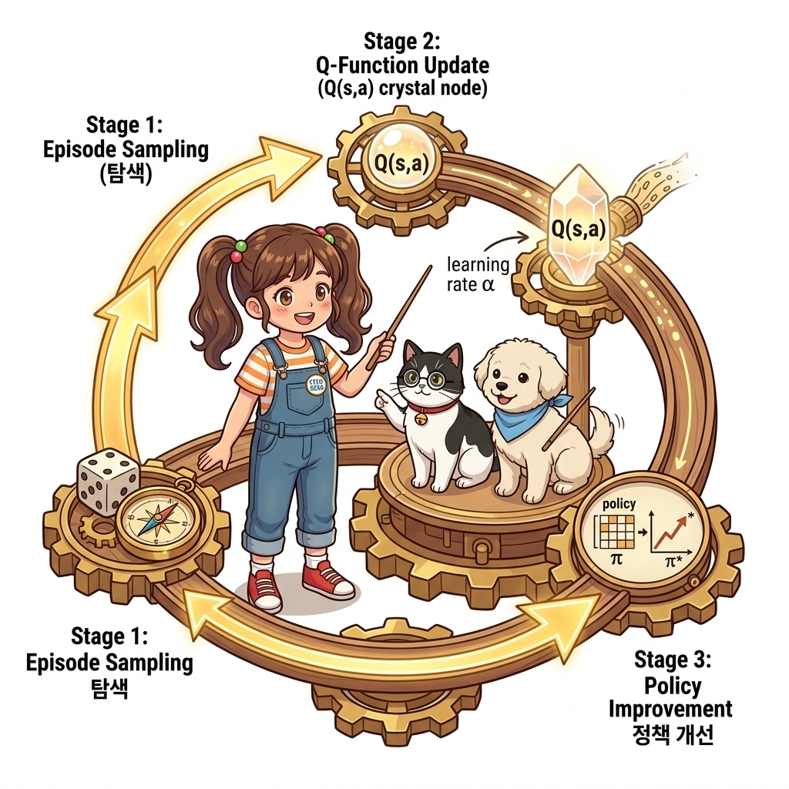
**그림 09-4-1b** 몬테카를로 정책 제어 3단계 라이프사이클 (에피소드 샘플링 → Q 함수 지수이동평균 갱신 → ε-탐욕 정책 개선) 로드맵 인포그래픽

> **[강의 스크립트]**
> 몬테카를로 정책 제어의 삼단계 라이프사이클 로드맵입니다. 에피소드 경험을 샘플링하고, 행동 가치 큐 함수를 지수이동평균으로 갱신하며, 입실론 탐욕법으로 정책을 개선해 나가는 순환 구조를 통해 최적 정책으로 수렴해 갑니다.
---

# 09.4 몬테카를로법으로 정책 제어하기
## 09.4.1 정책 제어의 기초: 평가와 개선의 탁구 핑퐁

앞서 9.2절과 9.3절에서는 몬테카를로법으로 '정책 평가(Policy Evaluation)'를 수행했습니다.

어떤 고정된 정책(예: 4방향 25% 균등 무작위 정책)이 주어졌을 때 각 칸의 가치가 얼마인지를 채점하는 작업이었습니다.


**그림 09-4-1c** 4방향 25% 무작위 정책이 주어졌을 때 각 칸의 성적표(V 가치)를 매기던 9.2~9.3 정책 평가 리캡 인포그래픽

> **[강의 스크립트]**
> 구점사점일 절에서는 정책 제어의 기초 원리를 짚어봅니다. 앞서 구점이 절과 구점삼 절에서는 사방으로 무작위 이동하는 고정된 정책의 가치를 평가했습니다. 이는 학생의 성적표를 매기는 작업이었을 뿐, 성적을 올리기 위한 행동 교정은 아직 하지 않은 상태였습니다.
---

# 09.4 몬테카를로법으로 정책 제어하기
## 09.4.1 정책 제어의 기초: 평가와 개선의 탁구 핑퐁

하지만 강화학습의 궁극적인 목표는 단순히 남이 준 정책을 채점하는 것에 머무르지 않고, **"어떻게 하면 가장 많은 보상을 획득할 수 있는 최고의 행동 지침(최적 정책 *π*<sup

> **[강의 스크립트]**
> 이제 우리는 평가와 개선을 번갈아 수행하는 정책 반복의 핑퐁 게임을 시작합니다. 현재 정책을 바탕으로 가치 함수를 평가하고, 그 가치를 바탕으로 더 나은 행동을 선택하도록 정책을 개선하는 과정을 끊임없이 되풀이합니다.
---

# 09.4 몬테카를로법으로 정책 제어하기
## 09.4.1 정책 제어의 기초: 평가와 개선의 탁구 핑퐁

최적 정책은 4장에서 배운 **'정책 반복(Policy Iteration)'**의 큰 틀과 마찬가지로, '평가'와 '개선'을 탁구공 치듯 번갈아 반복하여 완성됩니다:

1. **'평가(Evaluation)' 단계**: 현재 정책을 바탕으로 환경 속을 직접 걸어 다니며 경험을 쌓고, 각 상태나 행동의 가치 함수를 측정합니다.
2. **'개선(Improvement)' 단계**: 가치 함수가 가장 높은 쪽으로 행동 확률을 수정(탐욕화)하여 정책을 한 단계 업그레이드합니다.

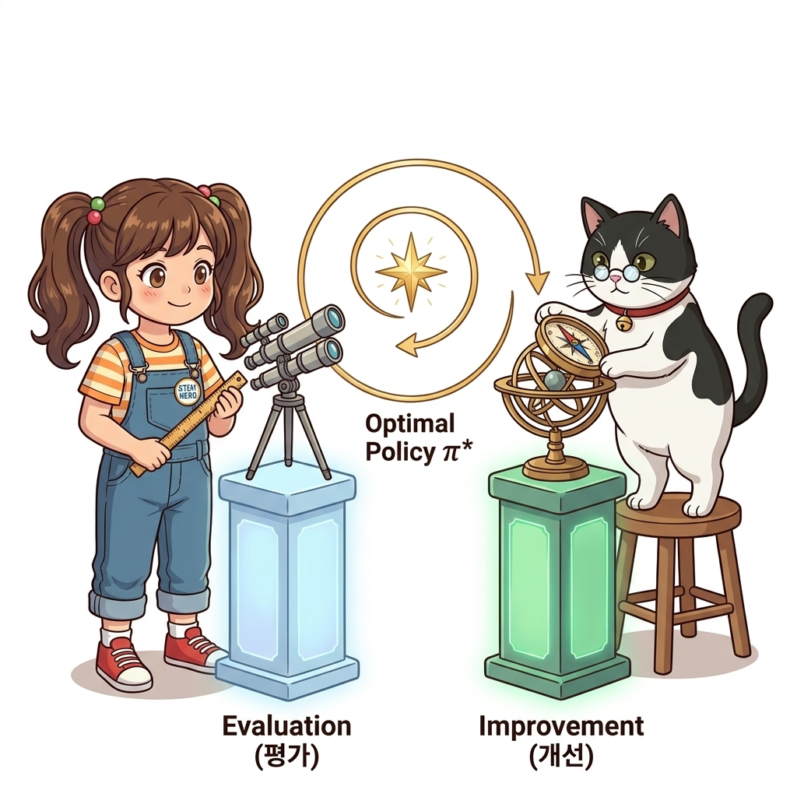
**그림 09-4-2c** 정책 반복의 2단계: 1단계 평가(경험 축적 및 가치 측정)와 2단계 개선(최고 가치 행동 탐욕화) 구조도

> **[강의 스크립트]**
> 정책 반복의 이단계 사이클 구조도를 보십시오. 일단계에서는 에이전트가 환경과 부딪혀 경험을 쌓으며 가치를 평가하고, 이단계에서는 평가된 가치 중 가장 높은 값을 주는 행동을 선택하여 탐욕적으로 정책을 개선합니다.
---

# 09.4 몬테카를로법으로 정책 제어하기
## 09.4.1 정책 제어의 기초: 평가와 개선의 탁구 핑퐁

이 두 단계를 끊임없이 주고받으면, 처음에는 서툴렀던 무작위 정책이 점차 다듬어져 결국 최적 정책에 도달하게 됩니다.


**그림 09-4-2b** 정책 평가(Q ≈ q_π)와 정책 개선(π ← greedy(Q))이 맞물려 최적 정책 π*로 상승 수렴하는 나선형 수식 다이어그램

> **[강의 스크립트]**
> 이 두 단계를 끊임없이 주고받으면, 처음에는 서툴렀던 무작위 정책이 점차 다듬어져 결국 한 치의 오차도 없는 궁극의 최적 정책에 도달하게 됩니다.
---

# 09.4 몬테카를로법으로 정책 제어하기
## 1) 왜 모델 프리 강화학습에서는 V(s) 대신 Q(s, a)를 써야만 할까요?

가치 함수를 개선 단계에서 활용할 때, 우리는 4장에서 배운 탐욕화(Greedy Selection) 공식을 떠올릴 수 있습니다.

수식으로는 다음과 같이 두 가지 방식으로 표현할 수 있습니다:

> **[강의 스크립트]**
> 여기서 가장 중요한 질문이 던져집니다. 모델 프리 강화학습에서는 왜 상태 가치 함수 브이 대신 행동 가치 함수 큐를 써야만 할까요? 화면의 수식을 주의 깊게 비교해 주십시오.
---

# 09.4 몬테카를로법으로 정책 제어하기
## 1) 왜 모델 프리 강화학습에서는 V(s) 대신 Q(s, a)를 써야만 할까요?

그런데 왜 우리는 몬테카를로 정책 제어에서 [식 9.4]의 상태 가치 함수 *V*(*s*)를 버리고 [식 9.3]의 **행동 가치 함수 *Q*(*s*, *a*)**를 필사적으로 선택해야 할까요?

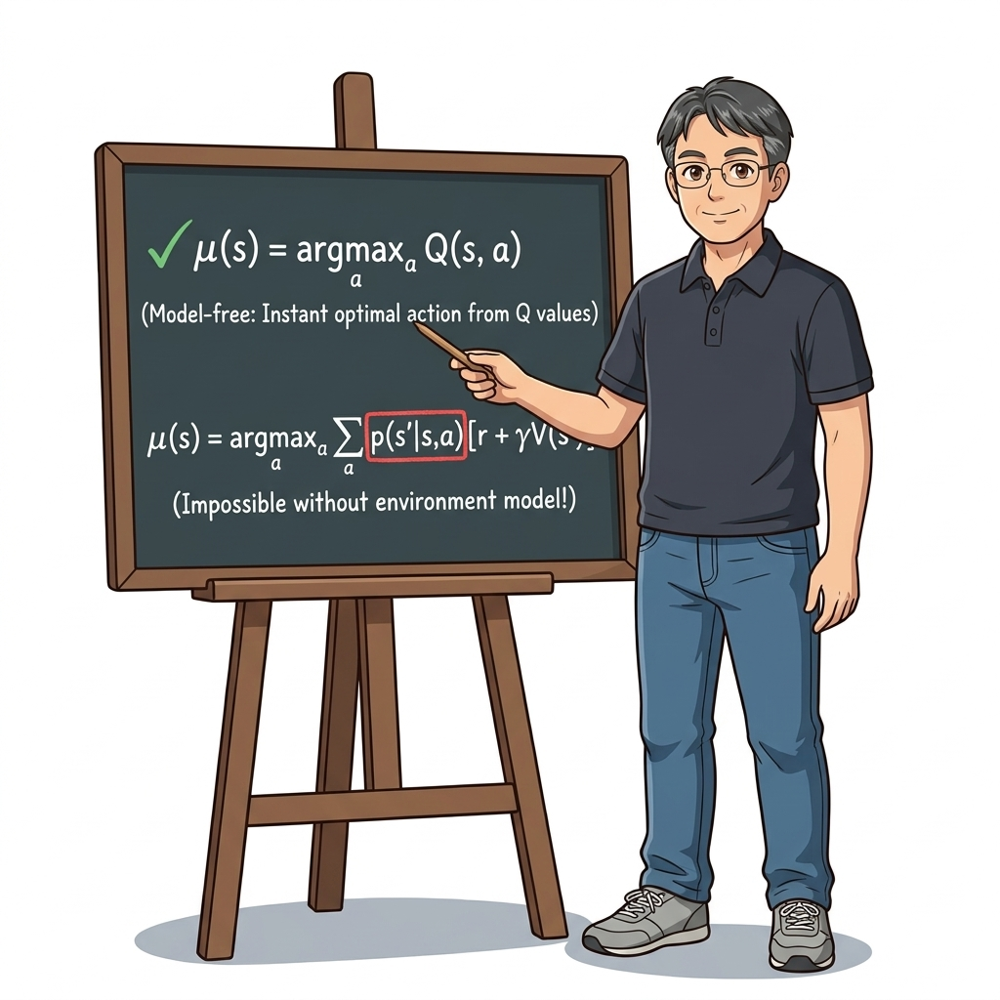
**그림 09-4-2c** 식 9.3(Q 기반 직접 argmax)과 식 9.4(V 기반 전이확률 가중합 argmax)의 수식 기호 분해 및 모델 프리에서 식 9.4 계산 불가능 이유 비교 인포그래픽

> **[강의 스크립트]**
> 두 가지 탐욕화 수식을 분석해 보겠습니다. 상태 가치 브이를 써서 다음 최적 행동을 찾으려면, 식 구점사에서 보듯 상태 전이 확률 피와 보상 함수 알이라는 환경 모델이 반드시 필요합니다. 하지만 몬테카를로는 환경 모델이 전혀 없는 암흑 상태입니다.
---

# 09.4 몬테카를로법으로 정책 제어하기
## 1) 왜 모델 프리 강화학습에서는 V(s) 대신 Q(s, a)를 써야만 할까요?

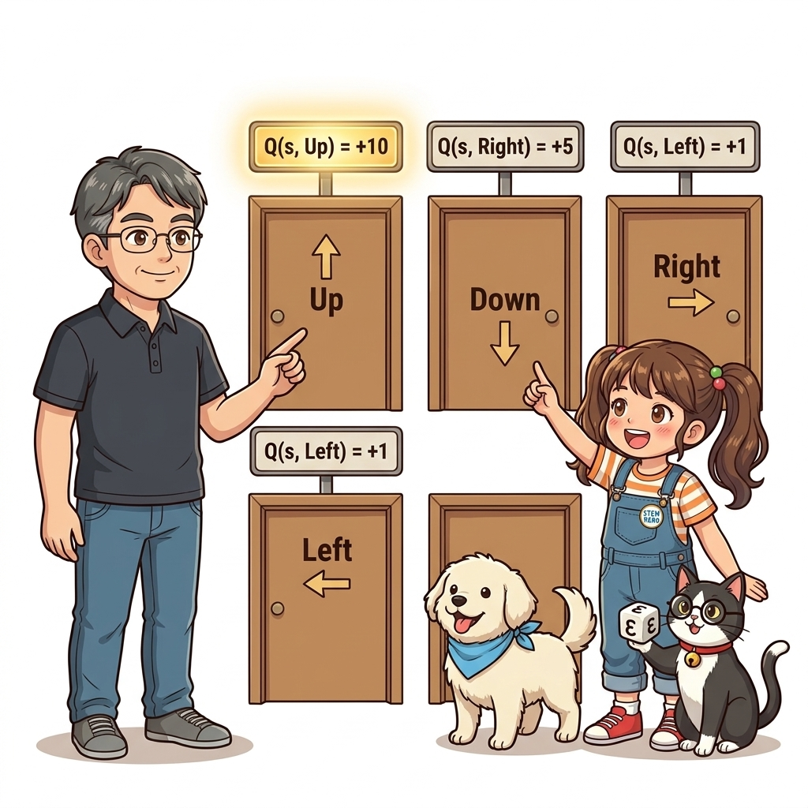
**그림 09-4-3** 이호진 교수님이 상·하·좌·우 4개의 문 위에 붙은 행동 가치 표지판(*Q*(*s*, Up) = +10 등)을 보여주며, 미지의 미로에서 환경 모델 없이 즉시 최선의 문을 고를 수 있는 *Q* 함수의 결정적 위력을 도로시와 토토, 지니에게 설명하는 직강 장면

> **[강의 스크립트]**
> 이호진 교수님의 네 개의 문 비유를 떠올려 보십시오. 방 안에 서 있을 때 문 너머의 방 가치만 알아서는 어느 문으로 가야 할지 알 수 없습니다. 문을 열었을 때 갈 수 있는 확률 지도가 없기 때문이지요. 따라서 문을 열고 나가는 행동 자체에 가치표를 붙여야 합니다.
---

# 09.4 몬테카를로법으로 정책 제어하기
## 1) 왜 모델 프리 강화학습에서는 V(s) 대신 Q(s, a)를 써야만 할까요?

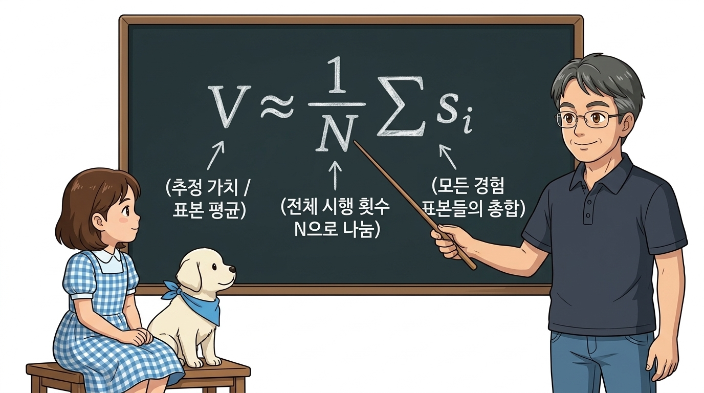
**그림 09-4-4** 환경 모델 전이 확률이 없어 막히는 *V*(*s*) 대신, 행동 가치 *Q*(*s*, *a*)로 즉시 최적 행동을 선택하는 도로시와 지니

> **[강의 스크립트]**
> 환경 전이 확률이 없어 막히는 상태 가치 브이 대신, 각 문 손잡이에 적힌 행동 가치 큐를 직접 바라보면 환경 모델 없이도 단순히 가장 큰 큐값을 주는 문을 열고 나가면 그만입니다. 이것이 바로 모델 프리 강화학습에서 큐 함수를 채택하는 결정적인 이유입니다.
---

# 09.4 몬테카를로법으로 정책 제어하기
## 2) Q 함수의 평가: 상태에서 상태-행동 쌍으로의 확장

*Q* 함수를 바탕으로 정책을 개선하려면, 먼저 *Q* 함수를 정확히 '평가'할 수 있어야 합니다.

9.2절과 9.3절에서 배운 상태 가치 함수 *V*(*s*) 평가 공식과 *Q*(*s*, *a*) 평가 공식을 나란히 비교해 보면, 대상이 단일 상태 *s*에서 상태-행동 쌍 *(s, a)*로 확장되었을 뿐 수학적 뼈대는 완전히 동일합니다:

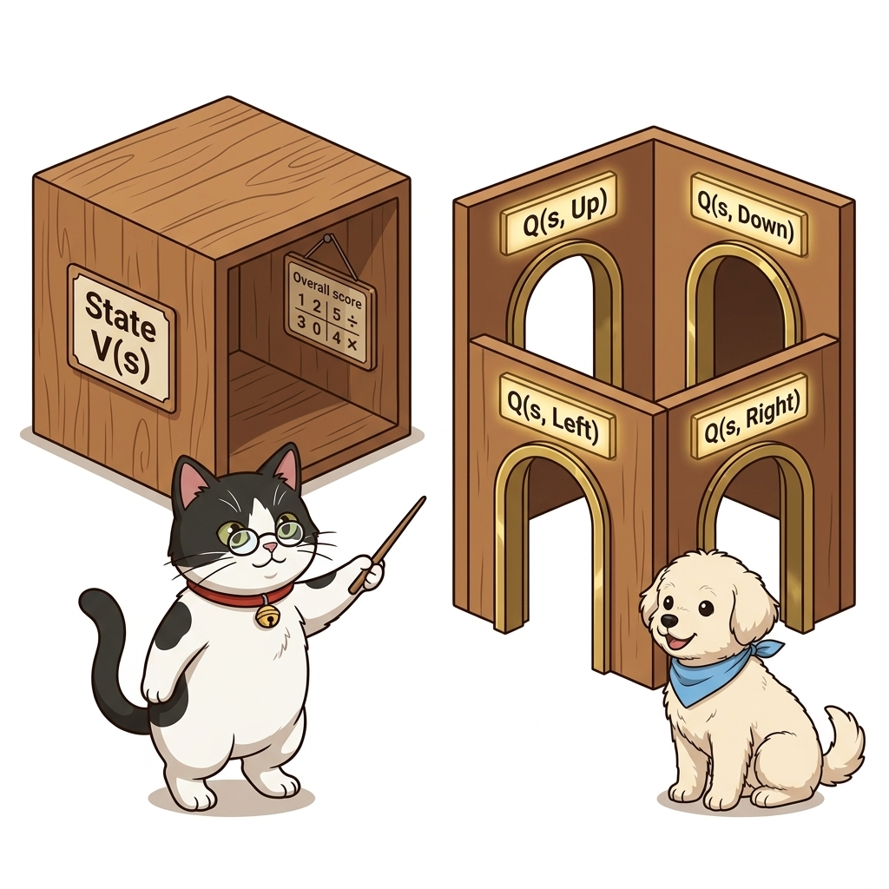
**그림 09-4-4a** 대상의 확장: 단일 상태 s 방에서 상태-행동 쌍 (s, a) 문고리 표지판으로의 2차원 확장 개념도

> **[강의 스크립트]**
> 행동 가치 큐 함수의 평가 메커니즘을 살펴보겠습니다. 과거에는 단일 상태 방 에스를 평가했다면, 이제는 어떤 상태 에스에서 특정 행동 에이를 취하는 상태-행동 순서쌍을 평가 대상으로 확장합니다.
---

# 09.4 몬테카를로법으로 정책 제어하기
## 2) Q 함수의 평가: 상태에서 상태-행동 쌍으로의 확장

**[상태 가치 함수 V(s) 평가]**
- 표본 평균 정의:

> **[강의 스크립트]**
> 상태 가치 함수 브이 에스의 표본 평균 정의식과 증분 갱신 공식입니다. 매 에피소드에서 관측된 누적 수익 지 티를 점진적으로 누적하여 평균을 갱신해 나가는 형태입니다.
---

# 09.4 몬테카를로법으로 정책 제어하기
## 2) Q 함수의 평가: 상태에서 상태-행동 쌍으로의 확장

**[행동 가치 함수 Q(s, a) 평가]**
- 표본 평균 정의:

> **[강의 스크립트]**
> 행동 가치 함수 큐 에스 에이의 표본 평균 정의식입니다. 상태 에스에서 행동 에이를 실행한 후 얻은 누적 수익들을 모아 산술 평균을 계산하며, 수렴 구조는 상태 가치 함수와 완벽히 동일합니다.
---

# 09.4 몬테카를로법으로 정책 제어하기
## 2) Q 함수의 평가: 상태에서 상태-행동 쌍으로의 확장

[식 9.6]에 따라 에이전트는 경험이 쌓일 때마다 *Q*(*s*, *a*) 테이블을 실시간으로 갱신해 나갈 수 있습니다.


**그림 09-4-4b** Q_n(s,a) = Q_{n-1}(s,a) + (1/n)[G^(n) - Q_{n-1}(s,a)] 행동 가치 증분 갱신 공식의 4대 기호 분해 인포그래픽

> **[강의 스크립트]**
> 점진적 증분 갱신 점화식을 보십시오. 이전의 큐값에 새로운 표본 수익 지 티와의 오차를 엔 분의 일 비율로 반영하여 메모리 낭비 없이 실시간으로 가치를 업데이트합니다.
---

# 09.4 몬테카를로법으로 정책 제어하기
## 09.4.2 몬테카를로 정책 제어의 초기 순진한 버전과 2대 함정

이제 몬테카를로법으로 정책을 제어하는 기본 클래스 `McAgent`의 초기 버전을 작성해 보겠습니다.

```python
from collections import defaultdict
import numpy as np

class McAgent:
def __init__(self):
self.gamma = 0.9
self.action_size = 4

random_actions = {0: 0.25, 1: 0.25, 2: 0.25, 3: 0.25}
self.pi = defaultdict(lambda: random_actions)
self.Q = defaultdict(lambda: 0)  # V 대신 Q를 테이블로 채택! 키는 (state, action)
self.cnts = defaultdict(lambda: 0)
self.memory = []

def get_action(self, state):
action_probs = self.pi[state]
actions = list(action_probs.keys())
probs = list(action_probs.values())
return np.random.choice(actions, p=probs)

def add(self, state, action, reward):
data = (state, action, reward)
self.memory.append(data)

def reset(self):
self.memory.clear()
```

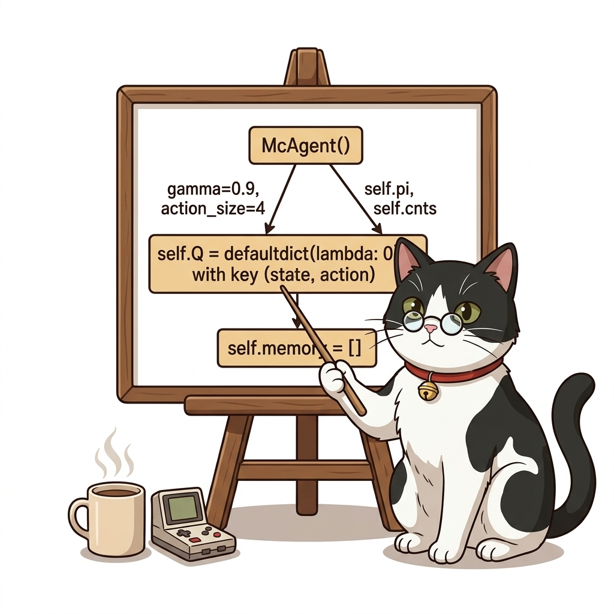
**그림 09-4-4b2** McAgent 초기화 및 memory 배낭, Q 테이블 생성 파이썬 코드 순서도

> **[강의 스크립트]**
> 구점사점이 절에서는 초기 순진한 엠씨 에이전트의 구조와 그 뒤에 도사린 이대 함정을 살펴봅니다. 엠씨 에이전트 클래스는 행동 선택 메모리와 큐 테이블, 그리고 방문 횟수 카운터를 갖추고 있습니다.
---

# 09.4 몬테카를로법으로 정책 제어하기
## 09.4.2 몬테카를로 정책 제어의 초기 순진한 버전과 2대 함정

9.3절의 `RandomAgent`와 비교했을 때, 가치 테이블이 `self.V`에서 `self.Q`로 바뀐 점이 가장 큰 차이점입니다. 이제 키(Key)는 단일 좌표 `state`가 아니라 `(state, action)` 튜플이 됩니다.

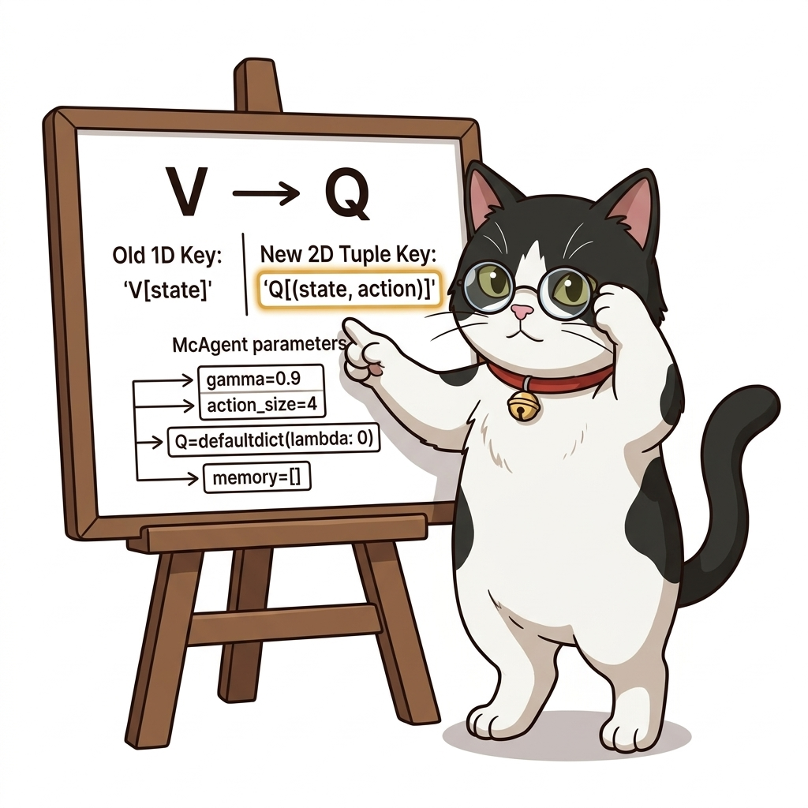
**그림 09-4-4c** 초기 `McAgent` 클래스 구조 및 (state, action) 키 기반 Q 테이블 초기화 순서도

> **[강의 스크립트]**
> 초기 엠씨 에이전트의 내부 데이터 구조도입니다. 상태와 행동의 순서쌍을 키로 삼아 가치와 방문 횟수를 딕셔너리로 관리하는 깔끔한 아키텍처입니다.
---

# 09.4 몬테카를로법으로 정책 제어하기
## 09.4.2 몬테카를로 정책 제어의 초기 순진한 버전과 2대 함정

이어서 정책을 완전 탐욕적으로 개선하는 `greedy_probs()` 함수와 에이전트의 `update()` 메서드를 추가해 봅시다:

```python
def greedy_probs(Q, state, action_size=4):
qs = [Q[(state, action)] for action in range(action_size)]
max_action = np.argmax(qs)

action_probs = {action: 0.0 for action in range(action_size)}
action_probs[max_action] = 1.0  # ❶ 완전 탐욕 (최고 가치 행동에만 100% 확률 부여)
return action_probs

class McAgent:
# ... (앞부분 동일) ...

def update(self):
G = 0
for data in reversed(self.memory):
state, action, reward = data
G = self.gamma * G + reward
key = (state, action)
self.cnts[key] += 1
# ❷ 표본 평균 증분 갱신 (1/n 방식)
self.Q[key] += (G - self.Q[key]) / self.cnts[key]

# 현재 상태의 정책을 탐욕적으로 즉시 개선
self.pi[state] = greedy_probs(self.Q, state)
```

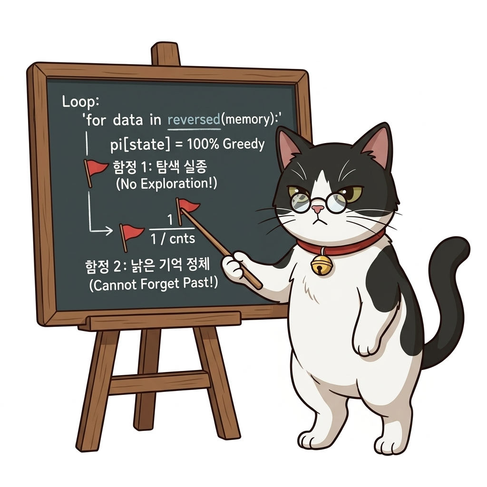
**그림 09-4-4d** 순진한 버전의 탐욕 정책 업데이트 순서도: argmax 완전 탐욕의 경직성과 1/n 평균 갱신의 한계

> **[강의 스크립트]**
> 순진한 버전의 탐욕 정책 업데이트 순서도입니다. 평가된 큐값 중 가장 큰 행동을 골라 그 행동에 확률 일점영을 몰아주는 완벽한 탐욕 정책입니다. 하지만 여기에 인공지능 역사상 가장 치명적인 함정이 숨어 있습니다.
---

# 09.4 몬테카를로법으로 정책 제어하기
## 09.4.2 몬테카를로 정책 제어의 초기 순진한 버전과 2대 함정

겉보기에는 완벽해 보이지만, **이 순진한 코드를 실행하면 에이전트는 미로를 제대로 탈출하지 못하고 심각한 오류에 빠집니다.**


**그림 09-4-4d2** 미로 속에서 완전 탐욕의 오류에 빠져 멈춰버린 초보 McAgent 로봇과 당황하는 도로시

> **[강의 스크립트]**
> 미로 속에서 완전 탐욕의 오류에 빠져 멈춰버린 초보 에이전트를 보십시오. 왜 이 순진한 알고리즘은 최적 정책을 찾지 못하고 길을 잃게 될까요?
---

# 09.4 몬테카를로법으로 정책 제어하기
## 09.4.2 몬테카를로 정책 제어의 초기 순진한 버전과 2대 함정

여기에는 인공지능 역사상 가장 유명한 2가지 치명적인 함정이 숨어 있습니다:

1. **코드 ❶의 함정 (탐색 실종)**: 100% 완전 탐욕만을 고집하면 한 번 발견한 길에만 갇혀 다른 미지의 황금 경로를 영원히 탐색하지 못합니다.
→ **해결책: *ε*-탐욕 정책(Epsilon-Greedy Policy)**


**그림 09-4-4d3** 함정 ❶ 탐색 실종: 눈앞의 작은 사탕(0.1)에 갇혀 뒤쪽 거대한 황금 보물을 보지 못하는 100% 완전 탐욕의 함정 인포그래픽

> **[강의 스크립트]**
> 첫 번째 함정은 바로 탐색의 실종입니다. 우연히 처음 발견한 작은 보상 영점일 점 사탕에 맛을 들이면, 그 길의 큐값만 양수가 되어 다른 길은 평생 거들떠보지도 않게 됩니다. 저 너머에 백 점짜리 황금 보물상자가 숨겨져 있어도 영원히 발견하지 못하는 비극이 발생합니다.
---

# 09.4 몬테카를로법으로 정책 제어하기
## 09.4.2 몬테카를로 정책 제어의 초기 순진한 버전과 2대 함정

2. **코드 ❷의 함정 (비정상 문제 무시)**: 정책이 매 에피소드 발전하는데, 옛날 초보 시절의 바보 같은 경험과 오늘의 고수 경험을 똑같이 1/*n* 가중치로 균일하게 평균 내고 있습니다.
→ **해결책: 고정 학습률 *α* 기반 지수 이동 평균**


**그림 09-4-4d4** 함정 ❷ 비정상 문제: 발전하는 고수 경험에 초보 시절의 어리숙한 경험이 1/n로 발목을 잡는 현상 인포그래픽

> **[강의 스크립트]**
> 두 번째 함정은 비정상 문제입니다. 에이전트의 정책이 발전함에 따라 수집되는 데이터의 분포가 시시각각 변하는데, 초보 시절 벽에 부딪히며 헤매던 과거의 낡은 실패 경험을 고수가 된 후에도 똑같은 가중치로 평균에 반영하고 있다는 치명적인 결함입니다.
---

# 09.4 몬테카를로법으로 정책 제어하기
## 09.4.2 몬테카를로 정책 제어의 초기 순진한 버전과 2대 함정


**그림 09-4-4e** 인공지능 역사상 가장 유명한 2대 치명적 함정 (탐색 실종의 조기 수렴 vs 비정상 문제의 낡은 데이터 발목잡기) 경고 인포그래픽

이 2대 함정을 어떻게 극복하는지 차례대로 살펴봅시다.

> **[강의 스크립트]**
> 이대 치명적 함정을 요약한 경고 인포그래픽입니다. 탐색의 실종과 비정상 문제라는 두 개의 거대한 암초를 돌파하지 못하면 강화학습 에이전트는 결코 진정한 지능으로 진화할 수 없습니다.
---

# 09.4 몬테카를로법으로 정책 제어하기
## 09.4.3 첫 번째 개선: *ε*-탐욕 정책으로 탐색 확보

완전 탐욕(100% Greedy) 정책은 왜 미로 탈출에 실패할까요?


**그림 09-4-5** 초기의 작은 보상 경로에 갇혀 더 큰 보상이 숨겨진 황금 미로를 발견하지 못하는 탐욕 경로의 함정

> **[강의 스크립트]**
> 구점사점삼 절에서는 첫 번째 함정을 극복하기 위한 첫 번째 개선책인 입실론 탐욕 정책을 도입합니다. 눈앞의 사탕 길에 갇혀버린 에이전트에게 어떻게 미지의 황금 보물섬을 탐험할 용기를 불어넣을 수 있을까요?
---

# 09.4 몬테카를로법으로 정책 제어하기
## 09.4.3 첫 번째 개선: *ε*-탐욕 정책으로 탐색 확보

초기 에이전트는 아무것도 모른 채 우연히 바로 앞의 작은 사탕(+0.1점)을 발견합니다.

그러면 탐욕화 알고리즘에 의해 이 사탕을 향해 가는 행동의 확률이 즉시 100%로 굳어집니다.

그 뒤로는 평생 그 사탕 길만 반복해서 걷게 되며, 저 건너편 골짜기에 엄청나게 거대한 황금 보물 상자(+1.0 골인 지점)가 숨겨져 있다는 사실을 영원히 탐색하지 못합니다!


**그림 09-4-5a** 0.1점 사탕 길만 영원히 맴도는 탐욕 경로의 고착화와 숨겨진 1.0점 골짜기 대비 일러스트

> **[강의 스크립트]**
> 영점일 점 사탕 길만 영원히 맴도는 탐욕 경로의 고착화 문제를 해결하기 위해, 우리는 정책에 의도적인 무작위 방황을 부여해야 합니다.
---

# 09.4 몬테카를로법으로 정책 제어하기
## 09.4.3 첫 번째 개선: *ε*-탐욕 정책으로 탐색 확보

> **[강의 스크립트]**
> 도로시와 지니의 맛집 선택 비유를 들어보지요. 매일 가던 익숙한 단골집만 가면 안전하지만 새로운 최고의 맛집을 찾을 수 없습니다. 열 번 중 아홉 번은 단골집에 가더라도, 가끔 한 번은 골목길의 새로운 식당에 들어가 보는 것이 바로 탐험의 지혜입니다.
---

# 09.4 몬테카를로법으로 정책 제어하기
## 09.4.3 첫 번째 개선: *ε*-탐욕 정책으로 탐색 확보

이 딜레마를 해결하는 가장 대표적인 해법이 바로 ***ε*-탐욕 정책(*ε*-greedy policy)**입니다.

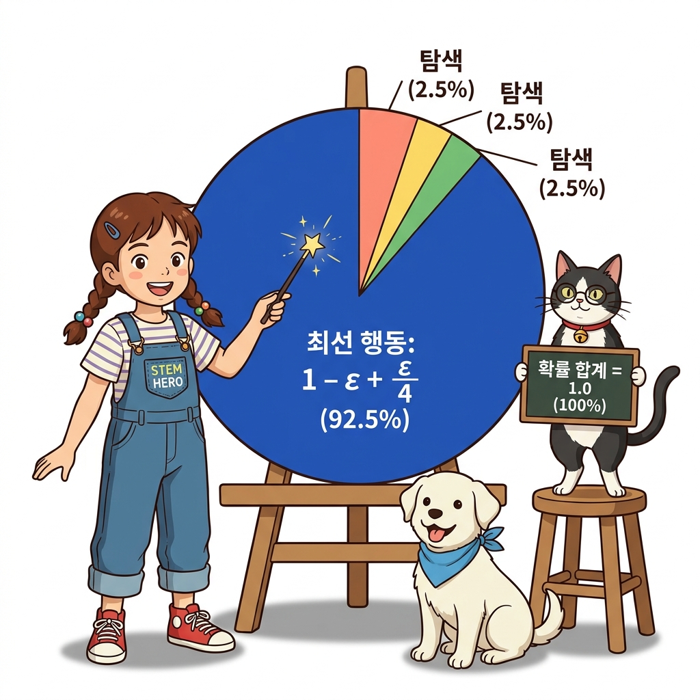
**그림 09-4-6** 최선 행동에 압도적인 확률(1 - ε + ε/4)을 부여하고 나머지 행동들에도 고른 탐색 확률(ε/4)을 나누어주는 입실론 탐욕 마법

> **[강의 스크립트]**
> 입실론 탐욕 정책의 수학적 확률 분배를 보십시오. 최선의 행동에는 일 빼기 입실론에 공평한 몫을 더한 압도적인 확률을 주고, 나머지 행동들에도 입실론 나누기 사의 작은 확률을 배분하여 탐색의 불씨를 꺼뜨리지 않습니다.
---

# 09.4 몬테카를로법으로 정책 제어하기
## 09.4.3 첫 번째 개선: *ε*-탐욕 정책으로 탐색 확보

*Q* 함수가 가장 큰 최선 행동을 1 - *ε*의 높은 확률(예: 90%)로 선택하되, 그리스 문자 ***ε*(입실론, 보통 0.1 즉 10%)**만큼의 작은 확률을 남겨두어, 주사위를 굴리듯 아무 행동이나 무작위로 시도해 보게 하는 것입니다.


**그림 09-4-6a** 90%는 똑똑하게 최적 행동을 선택하고 10%는 신비로운 주사위를 굴려 엉뚱한 길을 모험하는 입실론 마법 주사위 일러스트

> **[강의 스크립트]**
> 구십 퍼센트는 똑똑하게 최적 행동을 고르고, 십 퍼센트는 미지의 모험을 떠나는 아름다운 균형입니다. 이를 통해 에이전트는 사탕 길에 갇히지 않고 언젠가는 반드시 백 점짜리 황금 보물상자를 찾아내게 됩니다.
---

# 09.4 몬테카를로법으로 정책 제어하기
## 09.4.3 첫 번째 개선: *ε*-탐욕 정책으로 탐색 확보

수학적으로 가능한 행동의 가짓수가 |*A*|개(지금 예제에서는 4개)일 때, 각 행동이 선택될 확률은 다음과 같이 계산됩니다:

> **[강의 스크립트]**
> 입실론 탐욕 정책의 공식 기호를 해부해 보겠습니다. 아그맥스로 뽑힌 최선의 행동과 나머지 모든 행동에 확률이 어떻게 공평하고 정밀하게 나누어지는지 확인하십시오.
---

# 09.4 몬테카를로법으로 정책 제어하기
## 09.4.3 첫 번째 개선: *ε*-탐욕 정책으로 탐색 확보

*ε* = 0.1이고 행동의 가짓수가 4개일 때 실제 수치를 대입해 봅시다:

- **최선 행동의 선택 확률**: (1 - 0.1) + (0.1 / 4) = 0.9 + 0.025 = **0.925 (92.5%)**
- **나머지 3개 행동의 선택 확률**: 각각 0.1 / 4 = **0.025 (2.5%)**
- **확률의 총합**: 0.925 + 0.025 × 3 = **1.0 (100%)**

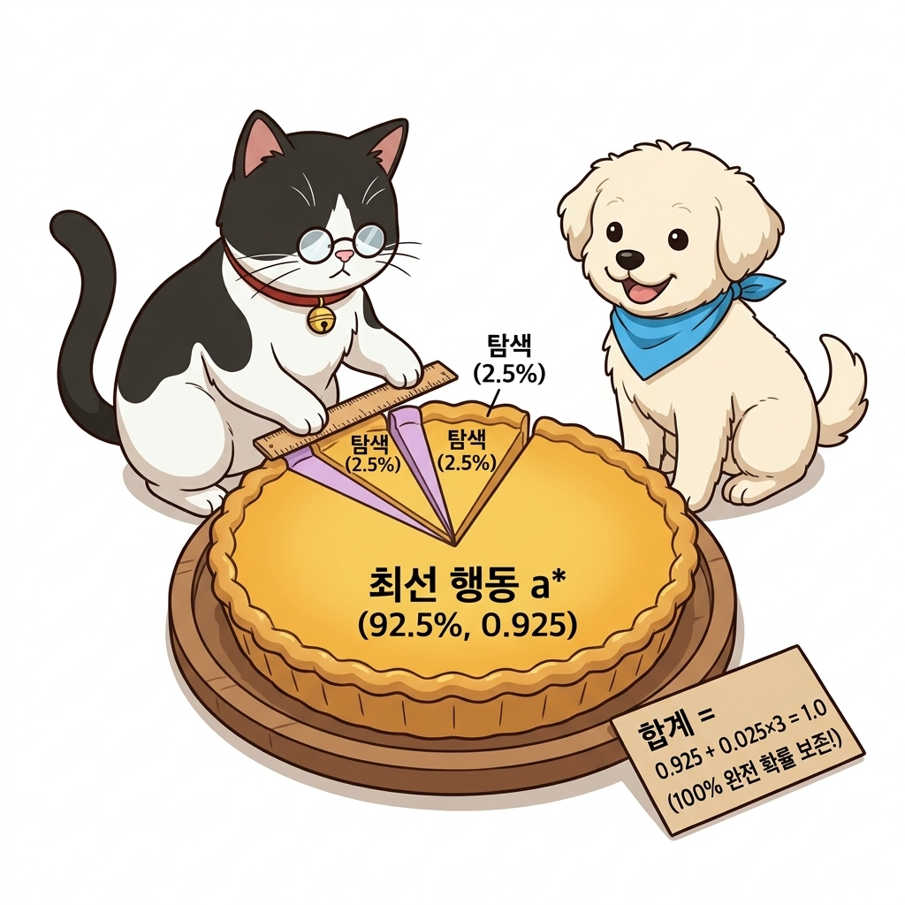
**그림 09-4-6b** ε-탐욕 확률 공식 기호 분해 및 92.5% 최적 부채꼴 vs 3개의 2.5% 균등 탐색 조각 분할 파이차트 인포그래픽

> **[강의 스크립트]**
> 입실론이 영점일일 때의 구체적인 확률 계산입니다. 최선 행동에는 구십이점오 퍼센트의 부채꼴 면적이 주어지고, 나머지 세 행동에도 각각 이점오 퍼센트의 기회가 균등하게 돌아갑니다.
---

# 09.4 몬테카를로법으로 정책 제어하기
## 09.4.3 첫 번째 개선: *ε*-탐욕 정책으로 탐색 확보

이제 *ε*-탐욕 버전의 `greedy_probs()` 함수를 파이썬으로 구현해 보겠습니다:

<div align="right"

> **[강의 스크립트]**
> 파이썬으로 구현한 그리디 프랍스 함수의 동작 원리입니다. 넘파이 배열을 활용하여 최선 행동을 찾고, 모든 행동에 기본 탐색 확률을 깐 뒤 최선 행동에 나머지 확률을 얹어주는 완벽한 벡터 연산입니다.
---

# 09.4 몬테카를로법으로 정책 제어하기
## 09.4.3 첫 번째 개선: *ε*-탐욕 정책으로 탐색 확보

이렇게 수정하면 평소에는 92.5%의 높은 확률로 똑똑하게 최적 행동을 실천하면서도, 10번에 1번꼴로는 새로운 엉뚱한 길을 용감하게 탐색하여 숨겨진 최적 경로를 빠짐없이 찾아낼 수 있게 됩니다!

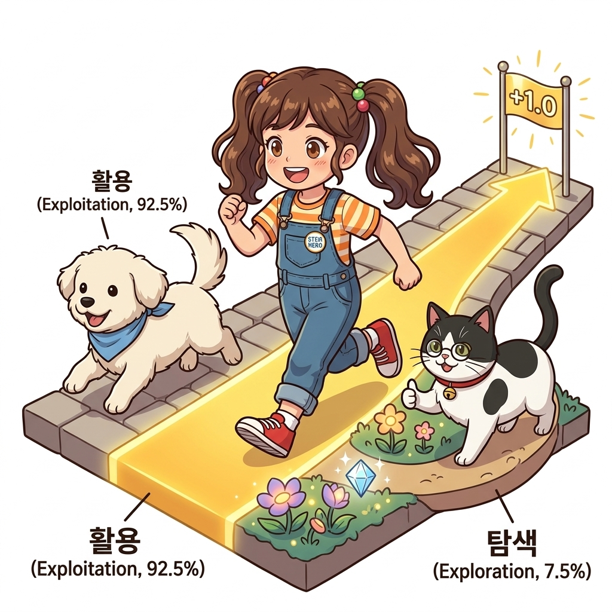
**그림 09-4-6d** 92.5%의 똑똑한 최적 질주와 7.5%의 과감한 탐색이 조화를 이루어 숨겨진 보물 경로를 찾아내는 도로시와 토토

> **[강의 스크립트]**
> 구십이점오 퍼센트의 똑똑한 질주와 칠점오 퍼센트의 과감한 탐색이 어우러져, 에이전트는 마침내 첫 번째 함정인 탐색 실종을 완벽하게 극복해 냅니다.
---

# 수정 후 (고정 학습률 α 방식: 지수 이동 평균)
## 09.4.4 두 번째 개선: 고정 학습률 *α* 방식으로 비정상 문제 극복

다음은 두 번째 치명적 결함인 표본 평균(1/*n*) 공식을 수정할 차례입니다.

```python

alpha = 0.1
self.Q[key] += (G - self.Q[key]) * alpha  # [식 9.7]
```


**그림 09-4-6d** 1/n 표본 평균 코드 vs 고정 학습률 α=0.1 지수 이동 평균 코드의 핵심 변경점 비교 인포그래픽

> **[강의 스크립트]**
> 구점사점사 절에서는 두 번째 함정인 비정상 문제를 해결하기 위한 두 번째 개선책, 고정 학습률 알파 지수 이동 평균을 도입합니다. 화면의 표본 평균과 고정 알파 갱신식을 비교해 보십시오.
---

# 수정 후 (고정 학습률 α 방식: 지수 이동 평균)
## 09.4.4 두 번째 개선: 고정 학습률 *α* 방식으로 비정상 문제 극복

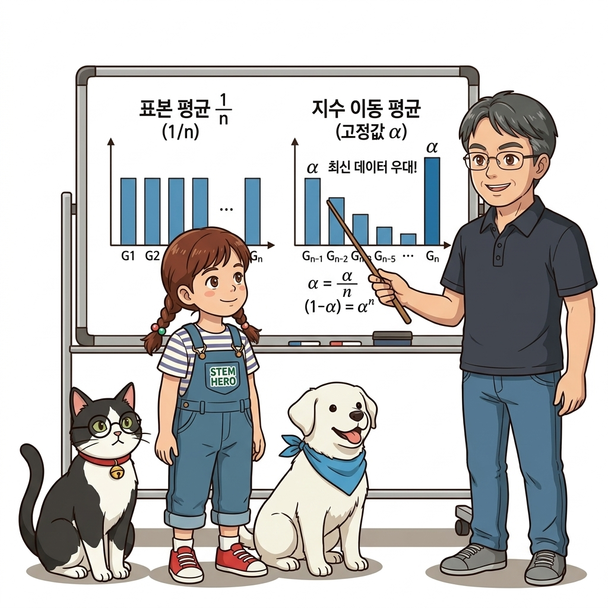
**그림 09-4-7** 모든 과거 데이터를 똑같이 대우하는 표본 평균(왼쪽)과, 어제의 낡은 기억은 잊고 오늘의 고수 경험을 우대하는 지수 이동 평균(오른쪽)의 가중치 비교

> **[강의 스크립트]**
> 과거의 모든 데이터를 똑같이 대우하는 엔 분의 일 표본 평균과 달리, 고정 학습률 알파는 최근에 얻은 새로운 경험에 더 큰 가중치를 부여하고 먼 옛날의 낡은 경험은 기하급수적으로 잊어버립니다.
---

# 수정 후 (고정 학습률 α 방식: 지수 이동 평균)
## 09.4.4 두 번째 개선: 고정 학습률 *α* 방식으로 비정상 문제 극복

왜 1/*n* 대신 고정된 학습률 계수 ***α*(알파, 보통 0.1)**를 곱해야 할까요?

* **수정 전 (표본 평균 1/*n*)의 치명적 결함**:
- 표본 평균은 1번째 에피소드부터 *n*번째 에피소드까지 모든 데이터에 똑같이 1/*n*의 동일한 가중치를 부여합니다.
- 하지만 1번째 에피소드의 에이전트는 미로 벽에 쿵쿵 부딪히며 방황하던 **'완전 초보 시절'**의 경험입니다. 반면 10,000번째 에피소드의 에이전트는 정책이 성숙해진 **'베테랑 고수 시절'**의 경험입니다.
- 초보 시절의 바보 같은 경험과 고수 시절의 현명한 경험을 똑같이 1/*n*로 동등하게 평균 내는 것은 논리적으로 맞지 않습니다!


**그림 09-4-7a** 벽에 부딪히던 초보 시절 1회차 에피소드와 능숙해진 10,000회차 베테랑 고수 에피소드의 극적 대비 인포그래픽

> **[강의 스크립트]**
> 벽에 부딪히던 초보 시절의 일회차 기억과, 미로를 쌩쌩 달리는 만 회차의 경험은 질적으로 다릅니다. 초보 시절의 낡은 데이터를 과감하게 털어내야만 현재 발전된 정책의 참 가치를 오차 없이 추적할 수 있습니다.
---

# 수정 후 (고정 학습률 α 방식: 지수 이동 평균)
## 09.4.4 두 번째 개선: 고정 학습률 *α* 방식으로 비정상 문제 극복

* **수정 후 (고정 학습률 *α* 지수 이동 평균의 마법)**:
- 점화식을 과거로 거슬러 올라가며 전개해 보면 놀라운 수학적 사실이 드러납니다:

> **[강의 스크립트]**
> 지수 감쇠 전개식을 가만히 들여다보십시오. 괄호 일 빼기 알파의 거듭제곱이 곱해지면서, 과거의 수익들은 시간이 흐를수록 지수함수적으로 영향력이 희미해지는 것을 수학적으로 증명할 수 있습니다.
---

# 수정 후 (고정 학습률 α 방식: 지수 이동 평균)
## 09.4.4 두 번째 개선: 고정 학습률 *α* 방식으로 비정상 문제 극복

이처럼 학습이 진행됨에 따라 정책이 진화하고, 그 결과 수익 데이터가 생성되는 확률 분포 자체가 시시각각 변화하는 문제를 통계학에서는 **'비정상 문제(Non-Stationary Problem)'**라고 부릅니다. 정책 제어처럼 데이터 분포가 변하는 비정상 환경에서는 고정 학습률 *α*를 사용한 지수 이동 평균이 절대적인 필수 공식입니다.


**그림 09-4-7c** 비정상 문제(Non-Stationary Problem)의 본질: 정책 발전에 따라 참 가치 목표물(과녁) 자체가 시시각각 이동하는 현상과 고정 알파의 신속한 추적

> **[강의 스크립트]**
> 비정상 문제의 수학적 본질과 시간 가중치 그래프입니다. 고정 학습률 알파를 사용함으로써 우리는 정책이 실시간으로 변하는 역동적인 환경에서도 목표값을 놓치지 않고 끈질기게 추적할 수 있게 됩니다.
---

# 수정 후 (고정 학습률 α 방식: 지수 이동 평균)
## 09.4.5 완성된 몬테카를로 정책 제어 클래스와 전체 실행

앞서 배운 2대 개선 사항(*ε*-탐욕 탐색 + *α* 지수 이동 평균)을 완벽하게 반영한 몬테카를로 정책 제어의 전체 순환 아키텍처를 확인해 봅시다.

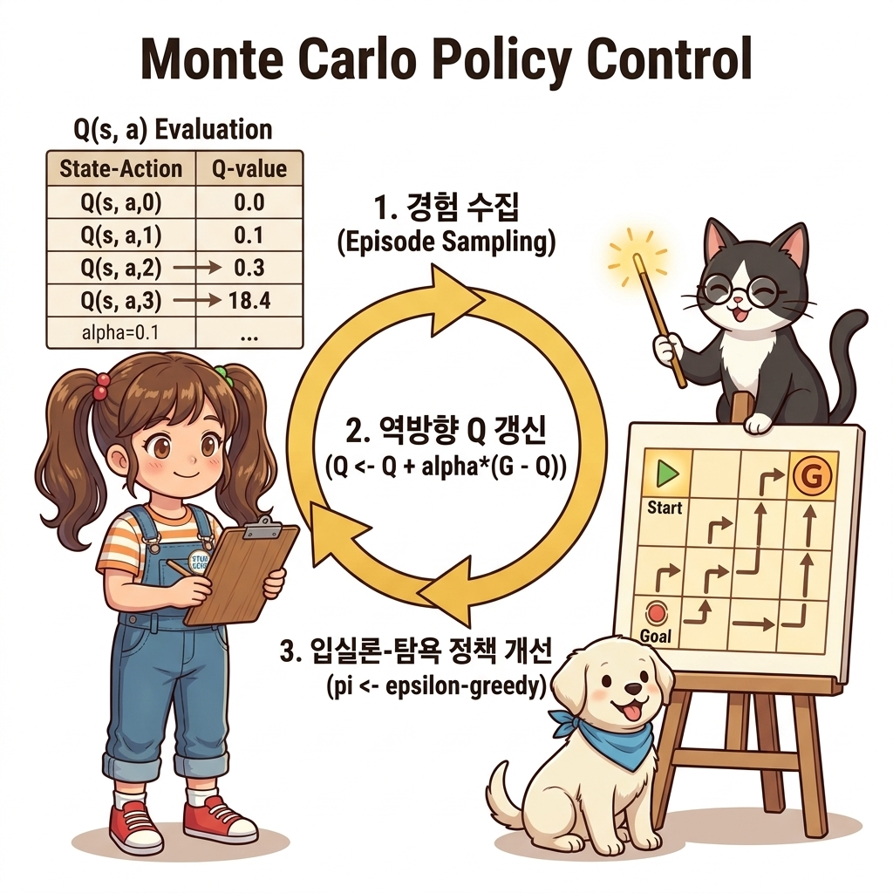
**그림 09-4-8** 몬테카를로 정책 제어의 3단계 순환 아키텍처: 경험 수집(Episode Sampling) → 역방향 Q 갱신(*Q* ← *Q* + *α*(*G* - *Q*)) → 입실론-탐욕 정책 개선(*π* ← *ε*-greedy)

> **[강의 스크립트]**
> 구점사점오 절에서는 완성된 몬테카를로 정책 제어 클래스와 전체 실행 스크립트를 분석합니다. 경험 수집, 큐 함수 갱신, 입실론 탐욕 개선의 삼단계 순환 아키텍처가 마침내 하나로 통합되었습니다.
---

# 수정 후 (고정 학습률 α 방식: 지수 이동 평균)
## 1) 완성된 McAgent 클래스 코드

<div align="right"

> **[강의 스크립트]**
> 완성된 엠씨 에이전트의 업데이트 메서드 소스 코드입니다. 역방향으로 누적 수익 지를 계산하고, 고정 학습률 알파를 적용하여 큐 테이블을 실시간으로 업데이트하는 핵심 로직입니다.
---

# 학습 완료 후 최종 수렴된 Q 함수와 최적 정책 화살표 렌더링
## 2) 10,000회 에피소드 학습 실행 스크립트

이제 완성된 `McAgent`를 3 × 4 그리드 월드 환경에 투입하여 총 10,000번의 에피소드로 학습시켜 보겠습니다:

<div align="right"

> **[강의 스크립트]**
> 만 번의 에피소드를 반복하는 메인 학습 루프입니다. 환경을 리셋하고 스텝을 밟으며 에피소드를 완주한 뒤, 업데이트 메서드를 호출하여 정책을 한 단계 진화시키는 과정이 만 번 깔끔하게 회전합니다.
---

# 학습 완료 후 최종 수렴된 Q 함수와 최적 정책 화살표 렌더링
## 3) 학습 결과 해석: 최적 정책 화살표 맵

학습 완료 후 `env.render_q(agent.Q)`가 화면에 출력한 시각화 결과는 다음과 같습니다:

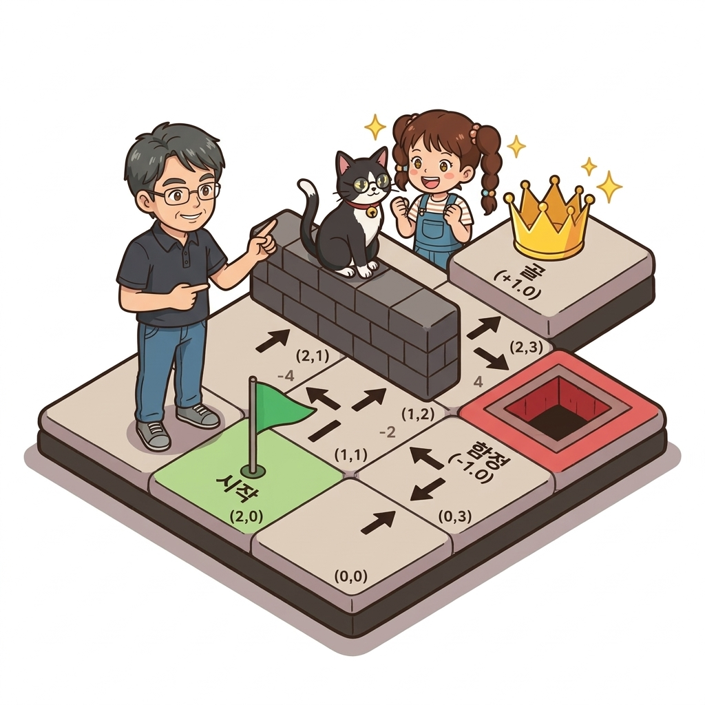
**그림 09-4-9** 10,000번 에피소드 후 수렴된 4방향 Q 함수와 최적 탈출 경로 화살표 맵

> **[강의 스크립트]**
> 만 번의 학습이 끝난 후 수렴된 최적 정책 화살표 맵입니다. 각 칸에서 가장 높은 큐값을 가진 방향으로 완벽한 탈출 경로가 그려졌습니다. 출발점에서부터 위험한 구덩이를 피해 골인 지점으로 직행하는 지능이 완성되었습니다.
---

# 학습 완료 후 최종 수렴된 Q 함수와 최적 정책 화살표 렌더링
## 3) 학습 결과 해석: 최적 정책 화살표 맵

결과 지도를 자세히 분석해 봅시다:

1. **사방 삼각형의 의미**: 격자의 각 칸은 상, 하, 좌, 우 4개의 삼각형으로 분할되어 있으며, 각 삼각형의 색상과 숫자가 바로 해당 방향의 행동 가치 *Q*(*s*, *a*)를 나타냅니다.
2. **최적 경로 화살표**:
- 출발 지점 `(2, 0)`에서 시작한 에이전트는 위험천만한 마이너스 함정(`(1, 3)`, 보상 -1.0) 칸을 멀리 피해 위쪽 안전 경로(`(0, 0) → (0, 1) → (0, 2) → (0, 3)`)로 완벽하게 우회합니다.
- 플러스 골(`(0, 3)`, 보상 +1.0) 지점으로 가장 빠르고 안전하게 도달하는 완벽한 최적 정책 화살표가 뚜렷하게 형성되었습니다!

환경의 상태 전이 확률이나 보상 행렬 공식을 전혀 모르는 완전한 백지상태였지만, **몬테카를로 경험 수집 + *Q* 함수 채택 + *ε*-탐욕 탐색 + *α* 지수 이동 평균**이라는 강력한 도구들이 맞물려 스스로 완벽한 최적 정책 지도를 찾아낸 것입니다.


**그림 09-4-9b** 3x4 그리드 격자 내 상·하·좌·우 4분할 삼각형 Q값 분석 및 함정(-1.0)을 피해 상단 안전 경로로 우회하는 최적 탈출 경로 상세 해석도

> **[강의 스크립트]**
> 삼 곱하기 사 그리드 격자 내 사방향 삼각형 큐값의 수렴 현황을 보십시오. 골인 지점에 가까울수록 큐값이 밝고 높게 형성되며, 위험 구덩이 쪽으로는 음수의 가치가 형성되어 에이전트가 접근을 철저히 기피합니다.
---

# 학습 완료 후 최종 수렴된 Q 함수와 최적 정책 화살표 렌더링
## 09.4.6 핵심 정리: 몬테카를로 정책 제어 3대 기둥


**그림 09-4-10** Q 함수, 입실론 탐욕, 고정 알파의 3대 기둥을 세우고 오프-정책의 새로운 장으로 나아가는 도로시와 지니

> **[강의 스크립트]**
> 구점사점육 절 총정리입니다. 행동 가치 큐 함수, 입실론 탐욕 탐색, 그리고 고정 학습률 알파라는 삼대 기둥이 하나로 맞물려 몬테카를로 정책 제어라는 위대한 지능 알고리즘을 탄생시켰습니다.
---

# 학습 완료 후 최종 수렴된 Q 함수와 최적 정책 화살표 렌더링
## 09.4.6 핵심 정리: 몬테카를로 정책 제어 3대 기둥

| 3대 핵심 기둥 | 핵심 원리 및 수학적 이유 | 미적용 시 발생하는 문제점 |
| :--- | :--- | :--- |
| **① 행동 가치 함수 *Q*(*s*, *a*)** | 전이 확률 *p*(*s*&#39; \| *s*, *a*) 없이도 argmax<sub

> **[강의 스크립트]**
> 삼대 핵심 기둥의 유기적 결합을 한 번 더 머릿속에 각인해 두시기 바랍니다. 모델이 없어도, 환경이 변해도, 우리는 스스로 길을 찾아내는 자율 에이전트를 완성해 냈습니다.
---

# 학습 완료 후 최종 수렴된 Q 함수와 최적 정책 화살표 렌더링
## 09.4.6 핵심 정리: 몬테카를로 정책 제어 3대 기둥

> **[강의 스크립트]**
> 이호진 교수님의 직강 멘토링 노트입니다. 단순한 통계 계산기에 불과했던 표본 평균에 탐험의 용기와 망각의 지혜를 불어넣었을 때, 그것이 비로소 인간을 닮은 지능적인 의사결정체로 진화했다는 강화학습의 철학을 음미해 보십시오.
---

# 학습 완료 후 최종 수렴된 Q 함수와 최적 정책 화살표 렌더링
## 09.4.6 핵심 정리: 몬테카를로 정책 제어 3대 기둥

> **[강의 스크립트]**
> 지니의 축하 메시지와 함께 다음 장을 예고합니다. 이제 다음 구점오 절에서는 탐험을 전담하는 에이전트와 완벽한 최적 정책을 분리하는 강화학습 최고의 심화 기법, 오프 정책과 중요도 샘플링의 신비로운 세계로 나아가겠습니다.