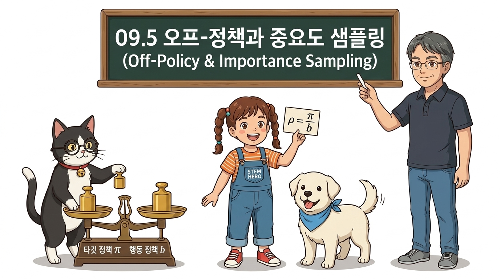
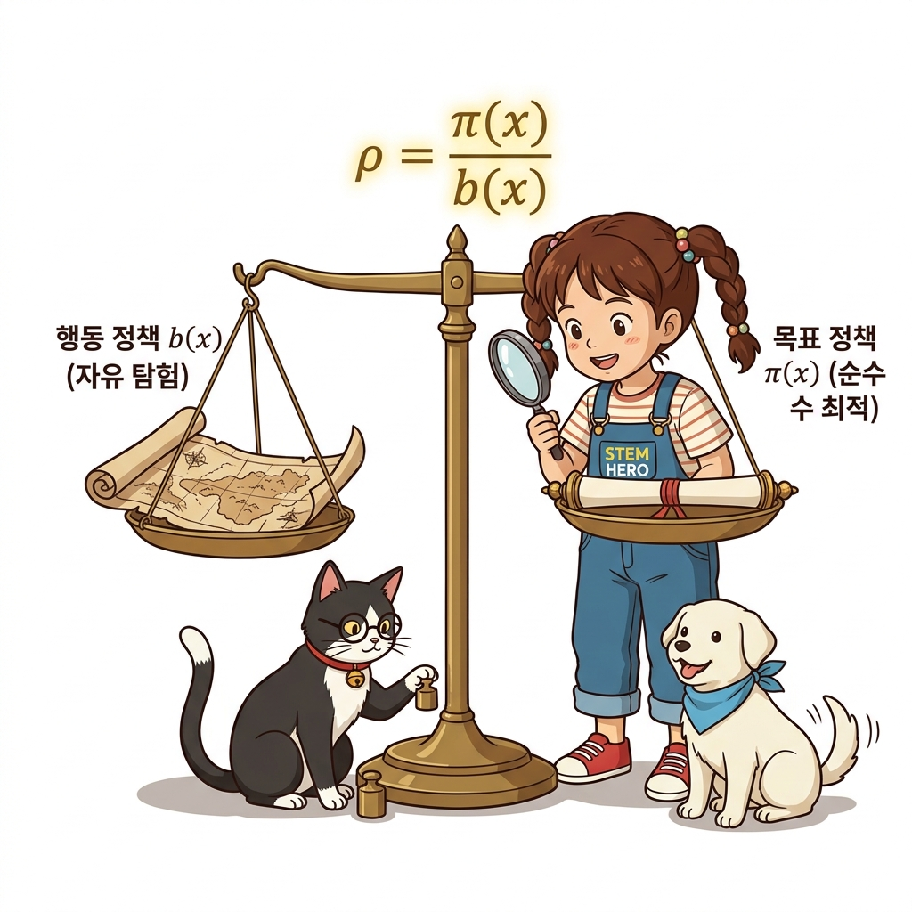
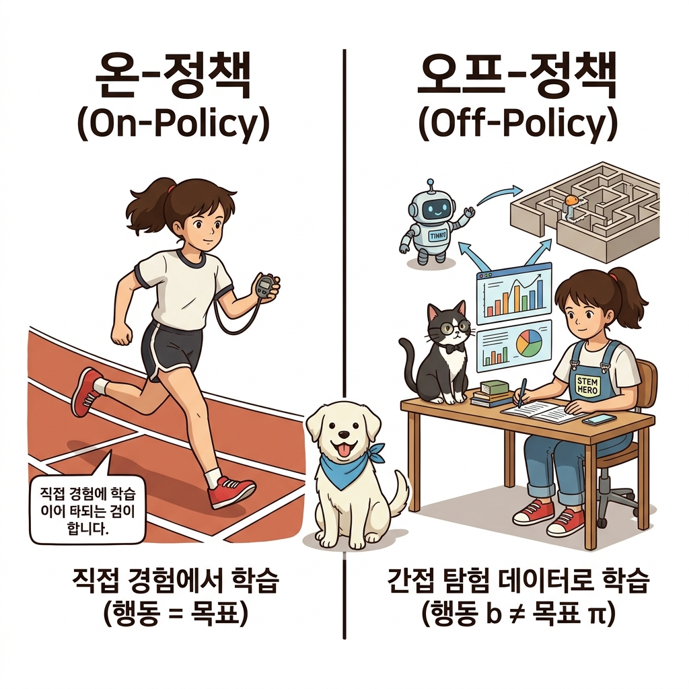
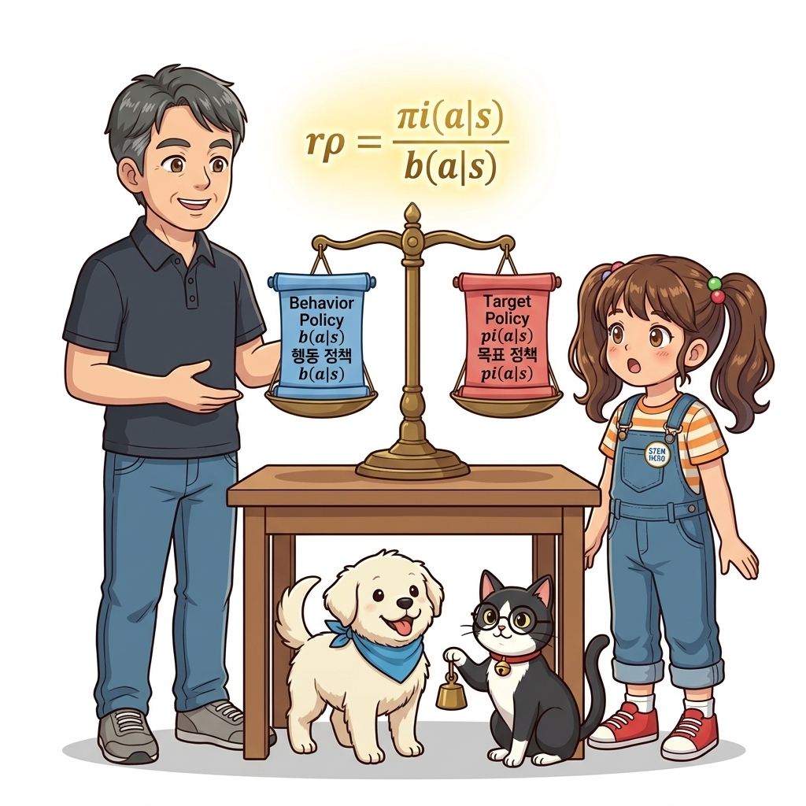
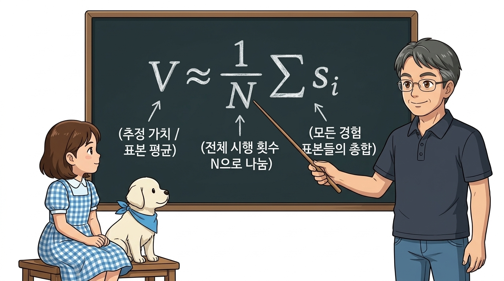
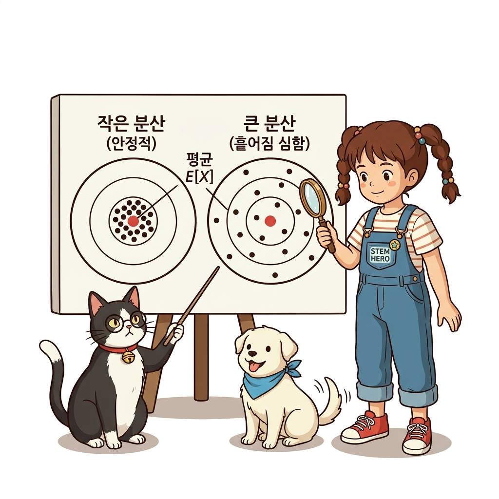
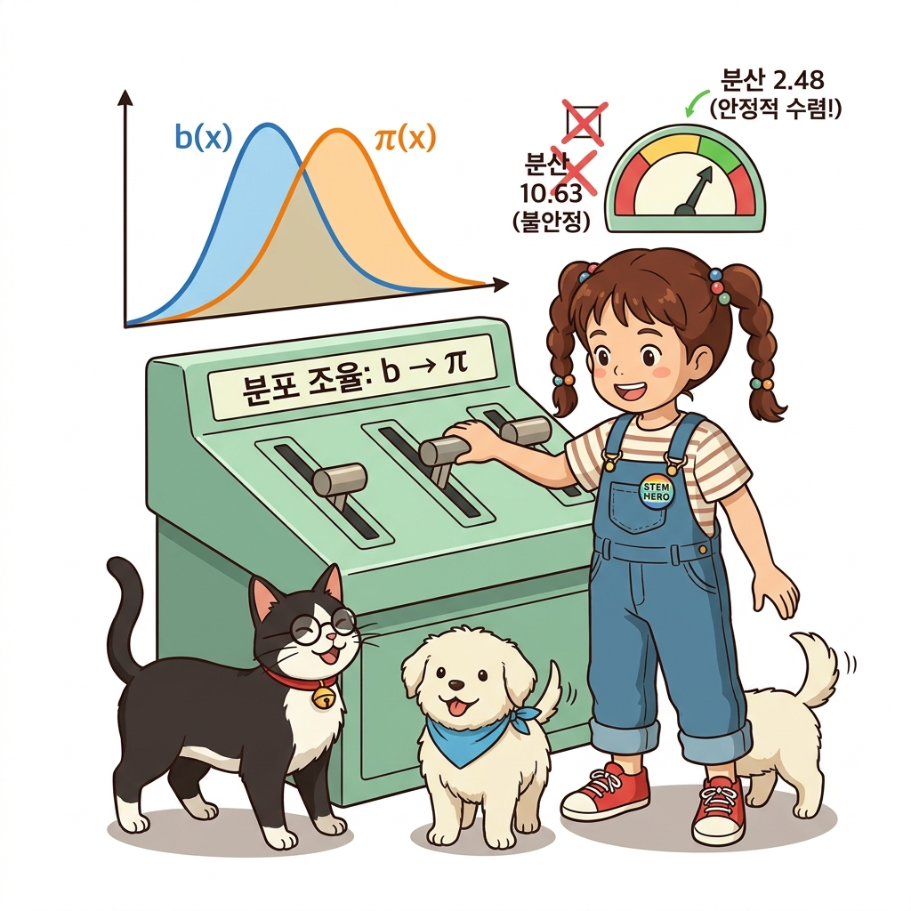
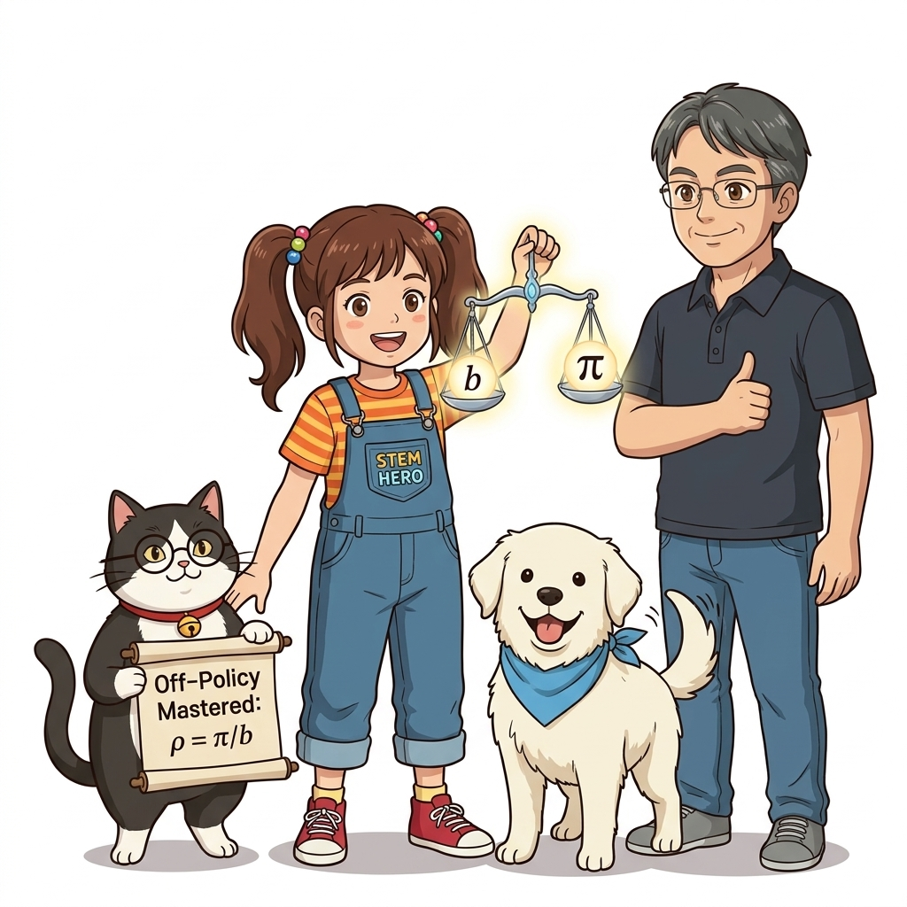

# 09.5 오프-정책과 중요도 샘플링




**그림 09-5-1** 탐험 지도(Behavior Policy)와 타깃 지도(Target Policy)의 확률 비율을 마법 저울에 올리고 오프-정책을 계산하는 지니와 도로시

에이전트가 '행동하는 정책'과 '학습하려는 대상 정책'이 서로 다를 때 활용하는 **오프-정책(Off-policy)** 학습법을 배웁니다. 다른 에이전트가 수행한 간접 데이터로부터 유용한 정보를 추출하기 위해 두 정책의 확률 비율을 계산하여 곱해주는 **중요도 샘플링(Importance Sampling)** 기법을 요정 지니의 대수적 마법 저울 정산법과 이호진 교수님의 직강을 통해 완벽히 마스터해 봅시다!

---

## 09.5.1 온-정책과 오프-정책의 개념

앞서 9.4절에서 우리는 몬테카를로법에 *ε*-탐욕 정책을 결합하여 미로를 훌륭하게 탈출하는 최적에 가까운 정책을 얻었습니다. 

하지만 솔직히 짚고 넘어가야 할 한계가 있습니다. 그 결과는 **100% 순수한 궁극의 최적 정책**은 아닙니다. 왜 그럴까요?

우리는 (할 수만 있다면) *Q* 함수의 값이 가장 큰 행동만을 100% 선택하도록 하고 싶습니다. 즉, 위험한 무작위 실수 없이 오직 '활용(Exploitation)'만 하고 싶은 것입니다. 하지만 탐색을 완전히 포기하면 새로운 길을 영영 찾지 못하므로, 어쩔 수 없이 *ε*(10%)이라는 작은 확률로 무작위 탐색을 하도록 남겨두었습니다. 말하자면, ***ε*-탐욕 정책은 탐색과 활용 사이에서 어쩔 수 없이 선택한 일종의 타협책**인 셈입니다.

그렇다면 **"무작위 탐색으로 인한 실수 없이, 순수하게 100% 최선의 최적 정책만을 깔끔하게 학습할 수는 없을까?"**라는 질문이 자연스럽게 떠오릅니다. 

이 질문에 답하기 위해 강화학습의 거대한 두 갈래인 **'온-정책(On-policy)'**과 **'오프-정책(Off-policy)'**의 차이를 이해해야 합니다.

---

### 1) 테니스 선수와 관찰 학습 비유

사람은 자기 혼자 부딪히며 배울 뿐만 아니라, **다른 사람의 행동을 관찰하여 자신의 능력을 개선할 결정적인 힌트**를 얻기도 합니다.

- 테니스를 배울 때, 다른 프로 선수가 강력하게 스윙하는 모습을 벤치에서 관찰하고 자신의 스윙 폼을 교정합니다.
- 프로게이머의 유튜브 플레이 영상을 보면서, 내가 직접 밟아보지 않은 위험한 보스 맵의 공략법을 학습합니다.

강화학습 용어로는 **'자신과 다른 환경이나 다른 정책에서 얻은 경험 데이터를 토대로 자신의 정책을 개선한다'**고 표현할 수 있습니다.


**그림 09-5-2** 자신이 달리는 트랙에서 바로 배우는 온-정책과, 탐험 로봇의 데이터를 관제실에서 분석해 챔피언 전략을 세우는 오프-정책

- **온-정책(On-policy)**: 에이전트가 환경과 직접 부딪치며 행동을 결정한 바로 그 정책을 그대로 평가하고 개선하는 방식입니다 (학습하는 주체 = 행동하는 주체).
- **오프-정책(Off-policy)**: 실제로 행동을 취하며 데이터를 모아온 정책과, 우리가 최종적으로 완성하려는 목표 정책을 서로 분리하여 학습하는 방식입니다 (학습하는 주체 ≠ 행동하는 주체).

---

### 2) 대상 정책과 행동 정책의 역할 분담

오프-정책에서는 에이전트의 정책을 성격이 다른 두 가지 역할로 명확히 분리합니다:

| 정책 구분 | 표기 기호 | 주요 역할 및 특징 |
| :--- | :--- | :--- |
| **대상 정책 (Target Policy)** | ***π*(*a* \| *s*)** | 우리가 진짜로 갈고닦아 최종 완성하고 싶은 **'학습 및 평가의 주인공'**입니다. 미래의 챔피언 전략으로서, 10%의 실수나 방황 없이 100% 최선의 행동만을 고르는 순수 탐욕 정책입니다. |
| **행동 정책 (Behavior Policy)** | ***b*(*a* \| *s*)** | 실제로 세상에 뛰어들어 발을 디디며 경험 데이터를 수집해 오는 **'현장 탐험 요원'**입니다. 미지의 세계 구석구석을 밝히기 위해 온갖 엉뚱한 행동도 마다하지 않는 과감한 탐색 정책입니다. |

지금까지 9.2절 ~ 9.4절에서는 대상 정책과 행동 정책을 구분하지 않고 동일하게 취급했습니다 (*π* = *b*). 이것이 바로 온-정책(On-policy, 연결되어 있음)이었습니다.

반면 오프-정책(Off-policy, 떨어져 있음)은 **'학습할 목표 정책 *π*와 현장에서 뛸 행동 정책 *b*가 독립적으로 분리되어 있다'**는 뜻입니다:
- **행동 정책 *b***: 미지의 미로를 휘젓고 다니며 과감하고 용감하게 '탐색'을 도맡아 수행합니다.
- **대상 정책 *π***: *b*가 수집해 온 방대한 데이터를 안전한 연구실에서 전달받아, 무작위 탐험의 불필요한 위험 없이 순수한 100% 최적의 '활용' 정책으로 완성됩니다.

하지만 여기서 수학적으로 매우 까다로운 문제가 하나 발생합니다:  
**"행동 정책 *b*라는 엉뚱한 모험가가 주사위를 마구 굴려 가져온 데이터로부터, 어떻게 대상 정책 *π*의 참 기댓값을 왜곡 없이 올바르게 계산해낼 수 있을까?"**

이 문제를 완벽하게 해결해 주는 마법 같은 통계적 도구가 바로 **중요도 샘플링(Importance Sampling)**입니다.

---

## 09.5.2 중요도 샘플링의 수학적 원리

**중요도 샘플링(Importance Sampling)**은 **어떤 확률 분포(*π*)에서의 기댓값을, 전혀 다른 확률 분포(*b*)에서 샘플링한 데이터를 사용하여 오차 없이(Unbiased) 완벽하게 계산해내는 통계학의 위대한 보정 기법**입니다.

이해를 돕기 위해 확률 변수 *X*의 기댓값 E<sub>*π*</sub>[*X*]를 계산하는 과정을 통해 중요도 샘플링의 수학적 원리를 한 단계씩 유도해 보겠습니다.

사건 *x*가 일어날 원래 확률 분포를 *π*(*x*)라고 할 때, 이론적인 기댓값의 정의는 다음과 같습니다:

> ### ***E*<sub>*π*</sub>[*X*] = ∑<sub>*x*</sub> *x* · *π*(*x*)**

기존의 온-정책 몬테카를로법에서는 확률 분포 *π*에서 직접 *x*를 *n*번 샘플링하여 산술 평균을 구했습니다:

> ### ***E*<sub>*π*</sub>[*X*] ≈ (*x*<sup>(1)</sup> + *x*<sup>(2)</sup> + &hellip; + *x*<sup>(*n*)</sup>) / *n* &nbsp;&nbsp;&nbsp;&nbsp; (*x*<sup>(*i*)</sup> ~ *π*)**

---

### 1) 다른 분포에서 가져온 데이터를 보정하는 마법

하지만 지금 우리 손에 쥐어져 있는 데이터는 *π*에서 나온 것이 아니라, **완전히 다른 확률 분포 *b*에서 샘플링된 표본들(*x*<sup>(*i*)</sup> ~ *b*)**입니다!

이 남의 데이터를 가지고 원래 구하려 했던 E<sub>*π*</sub>[*X*]를 어떻게 왜곡 없이 구해낼 수 있을까요? 해결의 열쇠는 초등학교 분수에서 배우는 **'분모·분자 끼워넣기 트릭'**에 있습니다!


**그림 09-5-3** 이호진 교수님이 양팔 저울의 한쪽에는 행동 정책 *b*(*a* | *s*), 다른 쪽에는 대상 정책 *π*(*a* | *s*)를 올리고, 두 정책의 확률 비율인 중요도 가중치 *ρ* = *π* / *b*로 표본의 왜곡을 보정하는 원리를 도로시, 지니, 토토에게 설명하는 직강 장면


**그림 09-5-4** 칠판에 분모·분자 트릭을 전개하며 중요도 가중치 로우(*ρ*)를 도출해내는 도로시와 지니

기댓값 정의식에서 출발해 봅시다:

> ***E*<sub>*π*</sub>[*X*] = ∑<sub>*x*</sub> *x* · *π*(*x*)**

여기에 분수 *b*(*x*) / *b*(*x*) = 1을 살짝 곱해줍니다. 1을 곱했으므로 수식의 값은 전혀 변하지 않습니다:

> **= ∑<sub>*x*</sub> *x* · [*b*(*x*) / *b*(*x*)] · *π*(*x*)**

곱셈의 순서를 바꾸어 *π*(*x*) / *b*(*x*)를 한 묶음으로 묶어줍니다:

> ### **= ∑<sub>*x*</sub> *x* · [*π*(*x*) / *b*(*x*)] · *b*(*x*)** &nbsp;&nbsp;&nbsp;&nbsp; *(식 9.7)*

[식 9.7]을 자세히 보십시오! 수식의 끝이 **&hellip; · *b*(*x*)**로 끝납니다. 어떤 값에 *b*(*x*)를 곱하여 시그마로 모두 더했다는 것은, 바로 **확률 분포 *b*에 대한 기댓값**이라는 뜻입니다!

따라서 [식 9.7]을 기댓값 기호 E<sub>*b*</sub>로 다시 쓰면 다음과 같은 기적의 등식이 탄생합니다:

> ### ***E*<sub>*π*</sub>[*X*] = E<sub>*b*</sub> [*X* · (*π*(*X*) / *b*(*X*))]** &nbsp;&nbsp;&nbsp;&nbsp; *(식 9.8)*

---

### 2) 중요도 가중치 *ρ*(*x*)의 물리적 의미

[식 9.8]에서 표본 *X* 뒤에 곱해지는 비율을 그리스 문자 ***ρ*(*x*)(로우, Rho)**라고 부르며, 이를 **중요도 가중치(Importance Weight)**라고 정의합니다:

> ### ***ρ*(*x*) = *π*(*x*) / *b*(*x*) = (목표 정책의 확률) / (행동 정책의 확률)**

이 가중치 *ρ*(*x*)는 다음과 같이 작동하는 완벽한 '공평한 통계 저울추'입니다:

1. **행동 정책 *b*가 어떤 행동을 너무 자주 뽑았을 때 (*b*(*x*) > *π*(*x*))**:
   - 분모가 더 크므로 *ρ*(*x*) < 1이 됩니다.
   - *"너 그 행동 너무 오버해서 많이 했어! 점수를 깎아서 정산할게!"*라며 가중치를 줄여줍니다.
2. **행동 정책 *b*가 어떤 행동을 너무 드물게 뽑았을 때 (*b*(*x*) < *π*(*x*))**:
   - 분자가 더 크므로 *ρ*(*x*) > 1이 됩니다.
   - *"너 그 귀한 행동을 아주 드물게 성공했구나! 가중치를 몇 배로 부풀려서 점수를 듬뿍 쳐줄게!"*라며 보상해 줍니다.
3. **두 정책의 확률이 완벽히 같을 때 (*b*(*x*) = *π*(*x*))**:
   - *ρ*(*x*) = 1이 되어 일반적인 온-정책 평균과 완벽히 일치합니다.

따라서 행동 정책 *b*에서 수집한 *n*개의 표본 데이터 *x*<sup>(*i*)</sup> ~ *b*에 가중치 *ρ*를 곱해 평균을 내면 목표 정책의 참 기댓값을 얻을 수 있습니다:

> ### ***E*<sub>*π*</sub>[*X*] ≈ [*ρ*(*x*<sup>(1)</sup>) · *x*<sup>(1)</sup> + *ρ*(*x*<sup>(2)</sup>) · *x*<sup>(2)</sup> + &hellip; + *ρ*(*x*<sup>(*n*)</sup>) · *x*<sup>(*n*)</sup>] / *n***

---

## 09.5.3 파이썬 코드로 검증하는 중요도 샘플링

이론이 실제로 맞는지 파이썬 코드로 실험해 보겠습니다.

### 1) 온-정책 vs 균등 탐색 행동 정책의 중요도 샘플링

<div align="right"><b>ch05/importance_sampling.py</b></div>

```python
import numpy as np

# 사건 값과 목표 확률 분포 정의
x = np.array([1, 2, 3])
pi = np.array([0.1, 0.1, 0.8])  # 우리가 학습하려는 목표 분포 (3이 나올 확률 80%)

# 1. 이론적인 기댓값 참값 계산
e_true = np.sum(x * pi)  # 1*0.1 + 2*0.1 + 3*0.8 = 0.1 + 0.2 + 2.4 = 2.7
print('이론적 참값 (E_pi[x]):', e_true)

# 2. 온-정책 몬테카를로법 (pi에서 직접 100개 샘플링)
n = 100
samples_on = [np.random.choice(x, p=pi) for _ in range(n)]
print('온-정책 몬테카를로: {:.2f} (분산: {:.2f})'.format(np.mean(samples_on), np.var(samples_on)))

# 3. 오프-정책 중요도 샘플링 (완전 균등 분포 b에서 샘플링)
b = np.array([1/3, 1/3, 1/3])  # 편향 없는 균등 탐색 분포
samples_off = []
for _ in range(n):
    idx = np.random.choice(len(b), p=b)  # b를 사용하여 샘플링!
    s = x[idx]
    rho = pi[idx] / b[idx]               # 중요도 가중치 ρ = π / b
    samples_off.append(rho * s)          # 가중치를 곱해 저장!

print('오프-정책 중요도 샘플링: {:.2f} (분산: {:.2f})'.format(np.mean(samples_off), np.var(samples_off)))
```

**출력 결과**
```text
이론적 참값 (E_pi[x]): 2.7
온-정책 몬테카를로: 2.78 (분산: 0.27)
오프-정책 중요도 샘플링: 2.95 (분산: 10.63)
```

출력 결과를 보십시오! 전혀 다른 균등 분포 *b*에서 데이터를 뽑았음에도 불구하고, 중요도 가중치 *ρ*를 곱해주니 평균값이 `2.95`로 이론적 참값 `2.7`에 근접하게 복원되었습니다.

**하지만 분산(Variance)을 주목해 주십시오. 분산이 무려 `10.63`으로, 온-정책 때의 `0.27`보다 약 40배나 폭발했습니다!**

---

## 09.5.4 분산의 폭발 원인과 분포 조율을 통한 분산 안정화


**그림 09-5-5** 각 데이터가 2차원상의 점이라고 가정했을 때의 분산 비교 (원의 중심이 평균)

분산은 데이터들이 평균을 중심으로 얼마나 넓게 흩어져 출렁이는가를 나타냅니다. 
분산이 작을수록 적은 개수의 샘플만으로도 참값에 빠르게 안착하지만, 분산이 크면 평균값이 심하게 출렁거리기 때문에 참값에 수렴시키려면 수만 개, 수십만 개의 방대한 샘플을 쏟아부어야 합니다.

### 1) 왜 중요도 샘플링에서 분산이 폭발할까요?

이유는 간단합니다. 행동 정책 *b*에서 숫자 `3`이 뽑혔을 때의 가중치를 계산해 보면:

> ### ***ρ* = *π*(3) / *b*(3) = 0.8 / (1/3) = 2.4**

여기에 데이터 *s* = 3을 곱하면 **3 × 2.4 = 7.2**라는 엄청나게 거대한 숫자가 튀어나옵니다! 참값은 고작 2.7인데 한 번에 7.2라는 거대한 숫자가 들어오니 분산이 요동칠 수밖에 없습니다.

더 심각한 문제는, 에피소드가 10스텝, 100스텝으로 길어지는 다단계 몬테카를로법에서는 각 스텝의 중요도 가중치들이 꼬리에 꼬리를 물고 곱해진다는 점입니다:

> ### ***ρ*<sub>0:*T*-1</sub> = ∏<sub>*t*=0</sub><sup>*T*-1</sup> [*π*(*A*<sub>*t*</sub> | *S*<sub>*t*</sub>) / *b*(*A*<sub>*t*</sub> | *S*<sub>*t*</sub>)]**

열 번만 곱해도 가중치가 수만 배로 폭발하거나 반대로 0으로 소멸해 버리는 극단적인 **'분산 폭발(Variance Explosion)'**이 발생합니다.

---

### 2) 분산을 줄이는 비결: 분포의 조율

해답은 **두 확률 분포(*b*와 *π*)를 너무 동떨어지지 않게 가깝게 맞춰주는 것**입니다. 두 분포가 비슷해질수록 비율 *ρ* = *π* / *b*의 값이 안정적인 1 근처에 머물게 되기 때문입니다.


**그림 09-5-6** 확률 분포 b를 목표 분포 파이(*π*)에 가깝게 조율하여 분산을 안정화시키는 지니와 도로시

행동 분포 `b`를 완전히 엉뚱한 `[1/3, 1/3, 1/3]` 대신, 목표 분포 `pi([0.1, 0.1, 0.8])`의 형태를 적당히 닮은 `[0.2, 0.2, 0.6]`으로 살짝 가깝게 조율하여 다시 실행해 봅시다:

```python
b_tuned = np.array([0.2, 0.2, 0.6])  # pi([0.1, 0.1, 0.8])와 가깝게 조율!
samples_tuned = []
for _ in range(n):
    idx = np.random.choice(len(b_tuned), p=b_tuned)
    s = x[idx]
    rho = pi[idx] / b_tuned[idx]
    samples_tuned.append(rho * s)

print('개선된 중요도 샘플링: {:.2f} (분산: {:.2f})'.format(np.mean(samples_tuned), np.var(samples_tuned)))
```

**출력 결과**
```text
개선된 중요도 샘플링: 2.72 (분산: 2.48)
```

평균은 `2.72`로 참값 `2.7`에 훨씬 더 정밀하게 일치하며, 분산은 기존 `10.63`에서 `2.48`로 무려 **75% 이상 극적으로 감소**했습니다!

---

## 09.5.5 핵심 정리: 오프-정책과 중요도 샘플링 3대 기둥


**그림 09-5-7** 역할 분담, 중요도 가중치, 분산 안정화의 3대 기둥을 세우고 시간차 학습(TD)의 관문으로 향하는 도로시와 지니

| 3대 핵심 기둥 | 핵심 원리 및 수학적 역할 | 실무 적용 시 주의점 |
| :--- | :--- | :--- |
| **① 정책의 역할 분담 (Behavior vs Target)** | 탐색은 행동 정책 *b*에게 맡기고, 대상 정책 *π*는 100% 최선의 활용 정책으로 순수하게 학습 | 두 정책이 완전히 분리되므로 과거의 리플레이 버퍼 데이터나 사람의 시연 데이터 재활용 가능 |
| **② 중요도 가중치 *ρ* = *π* / *b*** | 행동 정책에서 수집된 표본에 확률 비율을 곱해 목표 정책의 참 기댓값으로 무편향 보정 | 분모 *b*(*a* \| *s*)가 0이면 계산 불가 (피복 조건: *π* > 0인 모든 곳에서 *b* > 0 필수) |
| **③ 분산 통제와 Q-러닝으로의 진화** | 두 분포를 가깝게 조율하여 분산 폭발을 억제 | 다단계 MC에서는 *ρ*의 누적 곱으로 분산이 크지만, **10장 Q-러닝은 *ρ*를 곱하지 않고도 완벽한 오프-정책을 달성!** |

> 👨‍🏫 **이호진 교수님의 직강 노트**:  
> "오프-정책과 중요도 샘플링은 강화학습에서 '데이터 수집(Data Collection)'과 '정책 최적화(Policy Optimization)'를 완전히 떼어낸(Decoupling) 거대한 사상적 도약입니다. 비록 몬테카를로법에서는 긴 에피소드 동안 가중치 곱셈이 누적되며 분산이 커지는 아쉬움이 있지만, 이 훌륭한 통찰이 바로 다음 10장의 1스텝 시간차 학습과 현대 심층 강화학습의 최고봉인 Q-러닝의 탄생으로 이어지는 든든한 디딤돌이 됩니다."

> 🐱 **조교 지니의 응원 노트**:  
> "도로시와 여러분, 마법 저울의 비밀을 완벽히 마스터했어요! 다른 모험가의 경험에서 최선의 지혜를 뽑아내는 중요도 가중치 로우(*ρ*)의 놀라운 힘을 잊지 마세요. 이제 9장의 대미를 장식하는 9.6절 최종 총정리로 함께 달려가 봅시다냥!"
