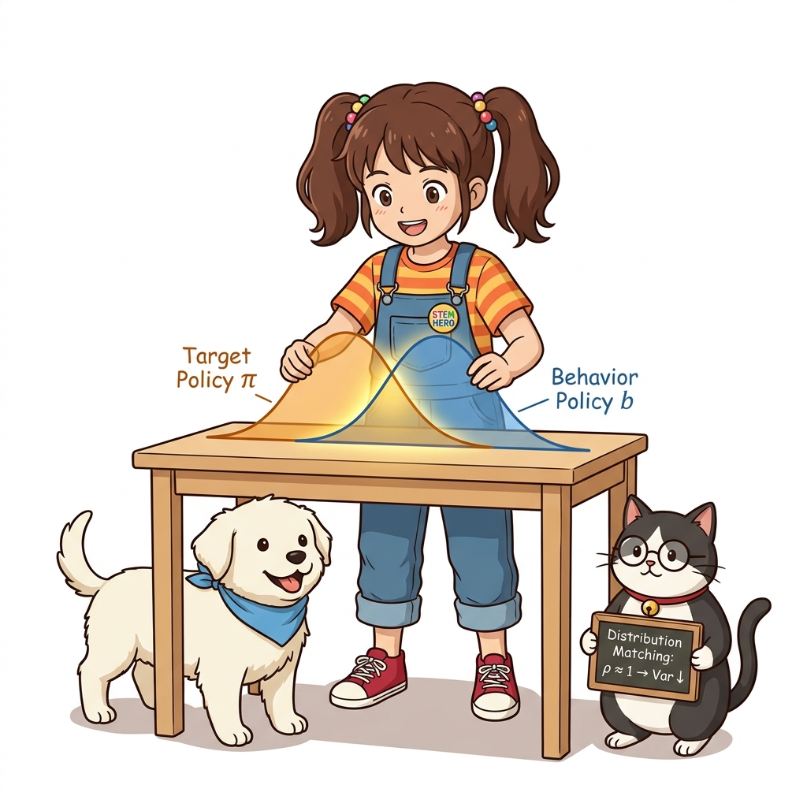

# 09.5 오프-정책과 중요도 샘플링


**그림 09-5-1** 탐험 지도(Behavior Policy)와 타깃 지도(Target Policy)의 확률 비율을 마법 저울에 올리고 오프-정책을 계산하는 지니와 도로시

에이전트가 '행동하는 정책'과 '학습하려는 대상 정책'이 서로 다를 때 활용하는 **오프-정책(Off-policy)** 학습법을 배웁니다. 다른 에이전트가 수행한 간접 데이터로부터 유용한 정보를 추출하기 위해 두 정책의 확률 비율을 계산하여 곱해주는 **중요도 샘플링(Importance Sampling)** 기법을 요정 지니의 대수적 마법 저울 정산법을 통해 마스터해봅시다!

---

앞서 몬테카를로법에 *ε*-탐욕 정책을 결합하여 최적에 가까운 정책을 얻었습니다. 하지만 그 결과는 완벽한 최적 정책이 아닙니다. 우리는 (할 수만 있다면) *Q* 함수의 값이 가장 큰 행동만을 수행하도록 하고 싶습니다. 즉, '활용'만 하고 싶은 것입니다. 하지만 그러려면 '탐색'을 포기해야 합니다. 그래서 *ε*이라는 작은 확률로 탐색을 수행했습니다. 말하자면, *ε*-탐욕 정책은 일종의 타협인 셈입니다.

이번 절에서는 몬테카를로법을 이용해 완벽한 최적 정책을 학습하는 방법을 고민해보겠습니다. 이를 위한 준비 과정으로 먼저 온-정책과 오프-정책에 대해 알아봅니다.

## 09.5.1 온-정책과 오프-정책

사람은 다른 사람의 행동을 관찰하여 자신의 능력을 개선할 힌트를 얻기도 합니다. 예를 들어 다른 테니스 선수가 스윙하는 모습을 보고 자신의 스윙 자세를 고치기도 하죠. 강화 학습 용어로는 '자신과 다른 환경에서 얻은 경험을 토대로 자신의 정책을 개선한다'고 표현할 수 있습니다. 이러한 접근 방식을 강화 학습에서는 **오프-정책<sup>off-policy</sup>**이라고 합니다. 반면 스스로 쌓은 경험을 토대로 자신의 정책을 개선하는 방식은 **온-정책<sup>on-policy</sup>**이라고 합니다.


**그림 09-5-2** 자신이 달리는 트랙에서 바로 배우는 온-정책과, 탐험 로봇의 데이터를 관제실에서 분석해 챔피언 전략을 세우는 오프-정책

> [!NOTE]
> 역할 측면에서 보면 에이전트의 정책은 두 가지입니다. 하나는 평가와 개선의 대상으로서의 정책입니다. 즉, 정책에 대해 평가한 다음 개선합니다. 이러한 정책을 **대상 정책<sup>target policy</sup>**이라고 합니다. 다른 하나는 에이전트가 실제로 행동을 취할 때 활용하는 정책입니다. 이 정책에 따라 '상태, 행동, 보상'의 샘플 데이터가 생성됩니다. 이러한 정책을 **행동 정책<sup>behaviour policy</sup>**이라고 합니다.

지금까지 이 책에서는 '대상 정책'과 '행동 정책'을 구분하지 않았습니다. 즉, '평가와 개선의 대상인 대상 정책'과 '실제 행동을 선택하는 행동 정책'을 동일시한 것입니다. 이처럼 두 정책이 같은 경우를 온-정책, 따로 떼어서 생각하는 경우를 오프-정책이라고 합니다. 여기서 온/오프는 '연결되어 있다'와 '떨어져 있다'라는 뜻으로 해석하면 됩니다. 즉, 오프-정책은 '대상 정책과 행동 정책이 떨어져 있다'라는 의미입니다.

이번 절의 주제는 '오프-정책'입니다. 테니스 선수의 예처럼 다른 정책(행동 정책)에서 얻은 경험을 토대로 자신의 정책(대상 정책)을 평가하고 개선하는 것이죠. 오프-정책이라면 행동 정책에서는 과감한 '탐색'을, 대상 정책에서는 순수한 '활용'만을 할 수 있습니다. 다만, 행동 정책에서 얻은 샘플 데이터로부터 대상 정책과 관련된 기댓값을 계산하는 방법은 고민을 좀 해야 합니다. 이때 등장하는 것이 바로 중요도 샘플링 기법입니다.

## 09.5.2 중요도 샘플링

**중요도 샘플링<sup>importance sampling</sup>**은 어떤 확률 분포의 기댓값을 다른 확률 분포에서 샘플링한 데이터를 사용하여 계산하는 기법입니다. *E*<sub>*π*</sub>[*X*]라는 기댓값 계산을 예로 중요도 샘플링을 설명해보겠습니다. 여기서 *X*는 확률 변수이며 *X*의 확률은 *π*(*x*)로 표기합니다. 그래서 확률 분포의 기댓값은 다음 식으로 표현됩니다.

```
E_π[X] = ∑ x · π(x)
```

이 기댓값을 몬테카를로법으로 근사하려면 *x*를 확률 분포 *π*에서 샘플링하여 평균을 내면 됩니다.

```
샘플링: x^{(i)} ~ π   (i = 1, 2, ..., n)
E_π[X] ≈ (x^{(1)} + x^{(2)} + ... + x^{(n)}) / n
```

이 수식에서 *x*<sup>(*i*)</sup> ~ *π* 표기는 확률 분포 *π*에서 *i*번째 데이터 *x*<sup>(*i*)</sup>가 샘플링되었음을 나타냅니다.

이제 본론으로 들어갑시다. 지금 우리는 *x*가 다른 확률 분포에서 샘플링된 경우의 문제를 풀고자 합니다. 예를 들어 *x*가 (*π*가 아닌) *b*라는 확률 분포에서 샘플링되었다고 가정해봅시다. 이 경우에 기댓값 *E*<sub>*π*</sub>[*X*]는 어떻게 근사할 수 있을까요? 해결의 열쇠는 다음과 같은 식 변형에 있습니다.


**그림 09-5-3** 칠판에 분모·분자 트릭을 전개하며 중요도 가중치 로우를 도출해내는 도로시와 지니

```
E_π[X] = ∑ x · π(x)
       = ∑ x · (b(x) / b(x)) · π(x)
       = ∑ x · (π(x) / b(x)) · b(x)                                      [식 9.7]
```

여기서 핵심은 두 번째 줄에서 *b*(*x*) / *b*(*x*)를 끼워넣는 부분입니다. *b*(*x*) / *b*(*x*)는 항상 1이므로 등식이 성립합니다. 그리고 [식 9.7]과 같이 &sum; &hellip; *b*(*x*) 형태로 바꾸면 확률 분포 *b*(*x*)에서의 기댓값으로 간주할 수 있습니다. 실제로 [식 9.7]을 한 번 더 변형하면 다음 식을 얻을 수 있습니다.

```
E_π[X] = ∑ x · (π(x) / b(x)) · b(x)
       = E_b[ X · (π(X) / b(X)) ]                                        [식 9.8]
```

이 수식에서 주목할 부분은 *E*<sub>*b*</sub>입니다. 확률 분포 *π*에 대한 기댓값을 확률 분포 *b*에 대한 기댓값으로 표현해낸 것입니다. 또한 각각의 *x*에 *π*(*x*) / *b*(*x*)가 곱해진다는 점도 중요합니다. 여기서 *ρ*(*x*) = *π*(*x*) / *b*(*x*)라고 하면, 각각의 *x*에는 '가중치'로서 *ρ*(*x*)가 곱해진다고 볼 수 있습니다(*ρ*는 '로우'로 읽습니다).

[식 9.8]에 근거하여 몬테카를로법을 수식으로 표현하면 다음과 같습니다.

```
샘플링: x^{(i)} ~ b   (i = 1, 2, ..., n)
E_π[X] ≈ (ρ(x^{(1)})·x^{(1)} + ρ(x^{(2)})·x^{(2)} + ... + ρ(x^{(n)})·x^{(n)}) / n
```

이제 다른 확률 분포 *b*에서 샘플링한 데이터를 이용하여 *E*<sub>*π*</sub>[*X*]를 계산할 수 있습니다.

#### 💡 수식 돋보기: 중요도 샘플링 기댓값 유도와 가중치 ρ 해부

```
[가중치 정의]  ρ(x) = π(x) / b(x)
[기댓값 변환]  E_π[X] = E_b[ ρ(X) · X ]
```

1. **분모·분자 트릭의 본질**:
   - 수학적으로 1 = *b*(*x*) / *b*(*x*)를 곱하는 간단한 트릭이지만, 이를 통해 표본 공간을 *π*에서 *b*로 완전히 치환하는 통계적 다리를 놓습니다.
2. **중요도 가중치 *ρ*(*x*)의 통계적 의미**:
   - *b*(*x*)가 샘플을 너무 드물게 뽑을 때 (*b*(*x*) < *π*(*x*)) &rarr; *ρ*(*x*) > 1 : 가중치를 키워 과소평가 방지
   - *b*(*x*)가 샘플을 너무 과하게 뽑을 때 (*b*(*x*) > *π*(*x*)) &rarr; *ρ*(*x*) < 1 : 가중치를 줄여 과대평가 삭감
   - *b*(*x*) = *π*(*x*) 일 때 &rarr; *ρ*(*x*) = 1 : 일반 온-정책 몬테카를로 평균과 완벽히 일치!

그럼 이어서 중요도 샘플링을 파이썬 코드로 구현해봅시다.

<div align="right"><b>ch05/importance_sampling.py</b></div>

```python
import numpy as np

x = np.array([1, 2, 3])          # 확률 변수
pi = np.array([0.1, 0.1, 0.8])   # 목표 확률 분포

# 기댓값의 참값 계산
e = np.sum(x * pi)
print('참값(E_pi[x]):', e)

# 온-정책 몬테카를로법으로 계산
n = 100 # 샘플 개수
samples = []
for _ in range(n):
    s = np.random.choice(x, p=pi) # pi를 이용한 직접 샘플링
    samples.append(s)
mean = np.mean(samples) # 샘플들의 평균
var = np.var(samples)   # 샘플들의 분산

print('몬테카를로법: {:.2f} (분산: {:.2f})'.format(mean, var))
```

**출력 결과**
```
참값(E_pi[x]): 2.7
몬테카를로법: 2.78 (분산: 0.27)
```

먼저 기댓값을 정의식에 맞게 구합니다. 그 결과는 2.7입니다(이 값이 참값입니다).
이어서 온-정책 몬테카를로법으로 100개 샘플을 추출하여 평균을 구하면 2.78로 참값에 가깝게 나오고, 분산은 0.27로 매우 작습니다.

참고로 분산은 데이터가 얼마나 흩어져 있는가를 나타냅니다.

```
Var[X] = E[(X - E[X])^2]
```


**그림 09-5-4** 각 데이터가 2차원상의 점이라고 가정했을 때의 분산 비교 (원의 중심이 평균)

이어서 다른 분포 `b`로부터 중요도 샘플링을 이용하여 기댓값을 구해보겠습니다.

<div align="right"><b>ch05/importance_sampling.py</b></div>

```python
b = np.array([1/3, 1/3, 1/3]) # 균등 탐색 분포
n = 100 # 샘플 개수
samples = []

for _ in range(n):
    idx = np.arange(len(b))         # b의 인덱스([0, 1, 2])
    i = np.random.choice(idx, p=b)  # b를 사용하여 샘플링
    s = x[i]
    rho = pi[i] / b[i]              # 가중치 ρ
    samples.append(rho * s)         # 샘플 데이터에 가중치를 곱해 저장

mean = np.mean(samples)
var = np.var(samples)
print('중요도 샘플링: {:.2f} (분산: {:.2f})'.format(mean, var))
```

**출력 결과**
```
중요도 샘플링: 2.95 (분산: 10.63)
```

이번에는 확률 분포 `b`를 사용하여 샘플링했습니다. 평균은 2.95로 참값인 2.7에 근사합니다. 하지만 분산은 무려 10.63으로, 몬테카를로법 때의 0.27보다 약 40배나 커졌습니다!

## 09.5.3 분산을 작게 하기

분산이 작을수록 적은 샘플로도 정확하게 근사할 수 있습니다. 반대로 분산이 클수록 샘플을 더 많이 사용해야 합니다. 중요도 샘플링에서 분산이 커지는 이유는 샘플 데이터로 3을 선택했을 때 가중치 *ρ* = 0.8 / (1/3) = 2.4가 곱해져 3 &times; 2.4 = 7.2라는 큰 값이 되기 때문입니다. 참값이 2.7인데 첫 샘플부터 7.2가 들어오면 편차가 극단적으로 벌어집니다.

그렇다면 어떻게 해야 분산을 줄일 수 있을까요? 두 확률 분포(*b*와 *π*)를 가깝게 만들면 됩니다. 이렇게 하면 가중치 *ρ*의 값을 1에 가깝게 만들 수 있습니다.


**그림 09-5-5** 확률 분포 b를 목표 분포 파이에 가깝게 조율하여 분산을 안정화시키는 지니와 도로시

실험을 해봅시다. 직전 코드에서 확률 분포 `b`의 값을 `[0.2, 0.2, 0.6]`으로 변경해 보겠습니다.

```python
b = np.array([0.2, 0.2, 0.6]) # pi([0.1, 0.1, 0.8])와 가깝게 조율
n = 100
samples = []

for _ in range(n):
    idx = np.arange(len(b))
    i = np.random.choice(idx, p=b)
    s = x[i]
    rho = pi[i] / b[i]
    samples.append(rho * s)

mean = np.mean(samples)
var = np.var(samples)
print('중요도 샘플링: {:.2f} (분산: {:.2f})'.format(mean, var))
```

**출력 결과**
```
중요도 샘플링: 2.72 (분산: 2.48)
```

결과는 평균이 2.72로 참값에 훨씬 정밀하게 일치하며, 분산은 10.63에서 2.48로 대폭 줄어들었습니다!

이처럼 중요도 샘플링 시 두 확률 분포를 비슷하게 설정하면 분산을 획기적으로 줄일 수 있습니다. 단, 강화 학습에서 핵심은 한쪽 정책은 '탐색'에, 다른 쪽 정책은 '활용'에 이용하는 것입니다. 이 조건을 염두에 둔 상태에서 두 확률 분포를 현명하게 조정하면 분산을 안정적으로 다스릴 수 있습니다.

---

### 09.5.4 핵심 정리: 오프-정책과 중요도 샘플링 3대 기둥


**그림 09-5-6** 역할 분담, 중요도 가중치, 분산 안정화의 3대 기둥을 세우고 시간차 학습(TD)의 관문으로 향하는 도로시와 지니

1. **정책의 역할 분담 (Behavior vs Target)**:
   - 행동 정책 *b*는 미지의 환경을 과감하게 탐색하고, 대상 정책 *π*는 불필요한 무작위 행동 없이 순수한 최적 정책만을 깔끔하게 추정합니다.
2. **중요도 가중치 *ρ* = *π* / *b*의 수학적 정산**:
   - 행동 정책에서 수집된 경험 표본에 두 정책의 확률 비율을 곱하여, 다른 분포에서 온 데이터를 목표 정책의 참 기댓값으로 완벽하게 보정합니다.
3. **분산 통제와 Q-러닝으로의 연결 고리**:
   - 중요도 샘플링의 분산 폭발 문제는 두 분포를 가깝게 정렬하여 완화할 수 있으며, 나아가 10장 시간차 학습(TD)에서 다룰 Q-러닝(Q-learning)은 중요도 가중치를 전혀 곱하지 않고도 완벽한 오프-정책을 달성하는 혁신을 이뤄냅니다.

> **교수님의 한마디**:
> "오프-정책과 중요도 샘플링은 강화학습에서 데이터 수집과 정책 최적화를 완전히 디커플링(Decoupling)한 거대한 도약입니다. 비록 몬테카를로법에서는 긴 에피소드 동안 가중치 곱셈이 누적되며 분산이 커지는 한계가 있지만, 이 통찰이 바로 다음 10장의 1스텝 시간차 학습과 Q-러닝의 탄생으로 이어집니다."

> **지니의 응원**:
> "도로시와 여러분, 마법 저울의 비밀을 완벽히 마스터했어요! 다른 모험가의 경험에서 최선의 지혜를 뽑아내는 중요도 가중치 로우(*ρ*)의 놀라운 힘을 잊지 마세요. 이제 9장의 대미를 장식하는 9.6절 최종 총정리로 달려가 봅시다!"
