# 09.5 오프-정책과 중요도 샘플링
## 탐험과 학습을 분리하여 다른 경험으로부터 순수 최적 정책을 복원하는 이론과 기법

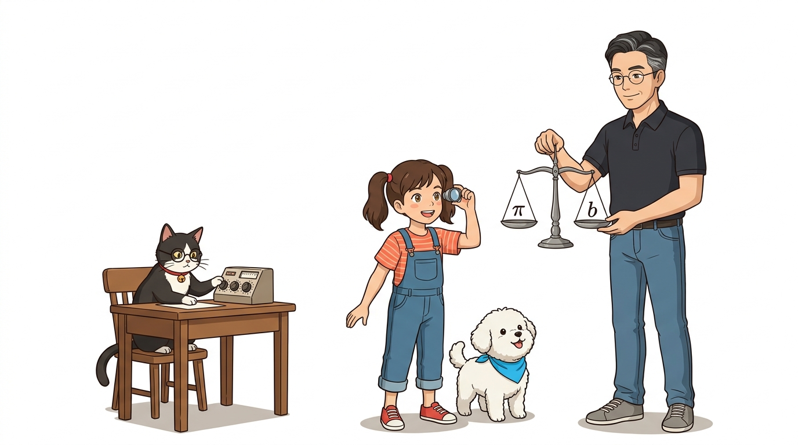
**그림 09-5-Intro** 오프-정책과 중요도 샘플링 (이호진 교수와 도로시 탐험대)

- **핵심 목표**: 탐험을 전담하는 행동 정책과 최적화를 전담하는 대상 정책의 분리 및 중요도 샘플링 정복
- **주요 내용**:
  - 온-정책(On-Policy)의 딜레마와 오프-정책(Off-Policy)의 탄생
  - 확률 통계학의 마법: 중요도 샘플링(Importance Sampling)과 분모·분자 트릭
  - 중요도 가중치 ρ의 물리적 의미와 3대 보정 케이스
  - 다단계 누적 곱셈에 의한 분산 폭발 현상과 분포 조율(Tuning) 기법

> **[강의 스크립트]**
> 이번 구점오 장에서는 강화학습의 이론적 정점이라 할 수 있는 오프 정책 학습과 중요도 샘플링을 다룹니다. 에이전트가 직접 탐험하며 실수하는 정책과, 우리가 궁극적으로 학습하려는 순수 최적 정책을 완벽하게 분리하는 원리를 배웁니다. 다른 정책이 만들어낸 거친 경험 표본을 중요도 가중치 로우를 통해 어떻게 우리 정책의 참 기댓값으로 마법처럼 복원하는지 깊이 있게 탐구해 보겠습니다.
---

# 09.5 오프-정책과 중요도 샘플링
## 09.5 오프-정책과 중요도 샘플링 개요

에이전트가 '행동하는 정책'과 '학습하려는 대상 정책'이 서로 다를 때 활용하는 **오프-정책(Off-policy)** 학습법을 배웁니다.

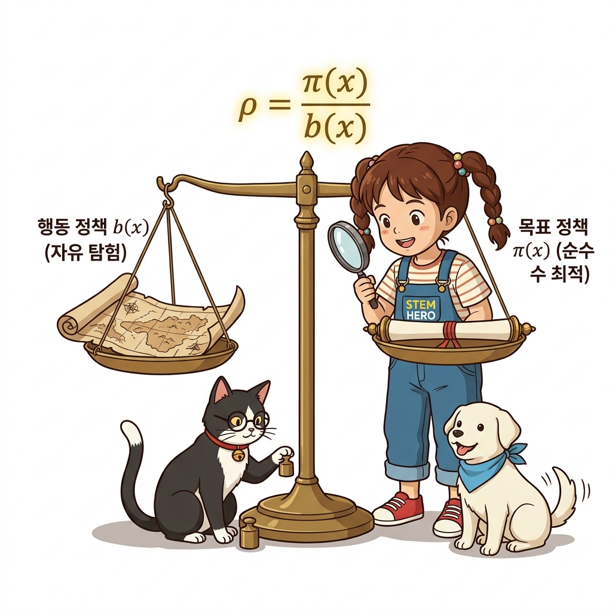
**그림 09-5-1** 탐험 지도(Behavior Policy)와 타깃 지도(Target Policy)의 확률 비율을 마법 저울에 올리고 오프-정책을 계산하는 지니와 도로시

> **[강의 스크립트]**
> 구점오 오프 정책과 중요도 샘플링 개요입니다. 화면의 두 지도를 보십시오. 위험을 무릅쓰고 거칠게 탐험하는 행동 지도와, 안전하고 우아하게 최단 경로를 달리는 타깃 지도가 분리되어 있습니다. 다른 정책이 경험한 데이터로부터 우리의 목표 정책을 학습하는 오프 정책의 원리로 들어섭니다.
---

# 09.5 오프-정책과 중요도 샘플링
## 09.5 오프-정책과 중요도 샘플링 개요

다른 에이전트가 수행한 간접 데이터로부터 유용한 정보를 추출하기 위해 두 정책의 확률 비율을 계산하여 곱해주는 **중요도 샘플링(Importance Sampling)** 기법을 요정 지니의 대수적 마법 저울 정산법과 이호진 교수님의 직강을 통해 완벽히 마스터해 봅시다!

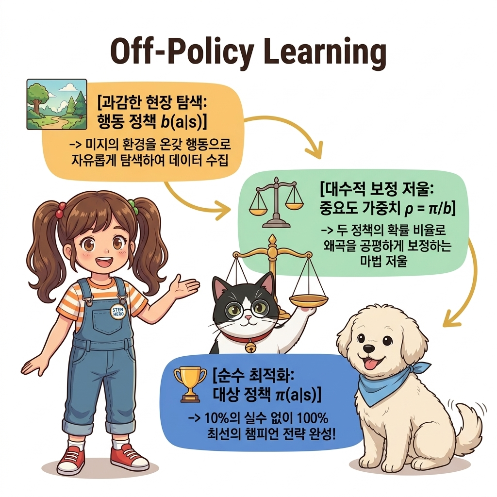
**그림 09-5-1b** 오프-정책과 중요도 샘플링 3단계 파이프라인 (행동 정책 b의 대담한 탐색 → 중요도 가중치 ρ 저울 보정 → 순수 최적 대상 정책 π 완성) 로드맵 인포그래픽

> **[강의 스크립트]**
> 오프 정책과 중요도 샘플링의 삼단계 파이프라인입니다. 행동 정책 비가 과감하게 에피소드 경험을 수집하고, 중요도 가중치 로를 곱해 확률 차이를 수학적으로 보정한 후, 목표 정책 파이를 무편향으로 업데이트해 나가는 체계적인 흐름입니다.
---

# 09.5 오프-정책과 중요도 샘플링
## 09.5.1 온-정책과 오프-정책의 개념

앞서 9.4절에서 우리는 몬테카를로법에 *ε*-탐욕 정책을 결합하여 미로를 훌륭하게 탈출하는 최적에 가까운 정책을 얻었습니다.


하지만 솔직히 짚고 넘어가야 할 한계가 있습니다.

그 결과는 **100% 순수한 궁극의 최적 정책**은 아닙니다.

왜 그럴까요?


**그림 09-5-1bb** 미로 탈출에는 성공했으나 10%의 강제 무작위 탐험 실수로 인해 100% 순수 최적 경로를 가지 못하는 ε-탐욕 정책의 태생적 한계와 고민

> **[강의 스크립트]**
> 구점오점일 절에서는 온 정책과 오프 정책의 개념을 대비합니다. 앞서 구점사 절에서 배운 입실론 탐욕 정책은 미로 탈출에 성공했지만, 십 퍼센트의 강제 무작위 탐험 실수 때문에 영원히 백 퍼센트 순수한 최적 경로에는 도달하지 못하는 태생적 딜레마를 안고 있었습니다.
---

# 09.5 오프-정책과 중요도 샘플링
## 09.5.1 온-정책과 오프-정책의 개념

우리는 (할 수만 있다면) *Q* 함수의 값이 가장 큰 행동만을 100% 선택하도록 하고 싶습니다.

즉, 위험한 무작위 실수 없이 오직 '활용(Exploitation)'만 하고 싶은 것입니다.


**그림 09-5-1bc** 위험한 방황 없이 오직 최고 가치 행동 Q(s, a)만을 100% 선택하여 최단거리로 직행하고 싶은 순수 활용(Exploitation) 정책의 갈망 인포그래픽

> **[강의 스크립트]**
> 우리가 원하는 궁극의 챔피언 정책은 십 퍼센트의 엉뚱한 실수 없이, 오직 최고 가치를 가진 행동만을 거침없이 선택하는 완전 무결한 결정론적 최적 정책입니다.
---

# 09.5 오프-정책과 중요도 샘플링
## 09.5.1 온-정책과 오프-정책의 개념

하지만 탐색을 완전히 포기하면 새로운 길을 영영 찾지 못하므로, 어쩔 수 없이 *ε*(10%)이라는 작은 확률로 무작위 탐색을 하도록 남겨두었습니다.

말하자면, ***ε*-탐욕 정책은 탐색과 활용 사이에서 어쩔 수 없이 선택한 일종의 타협책**인 셈입니다.

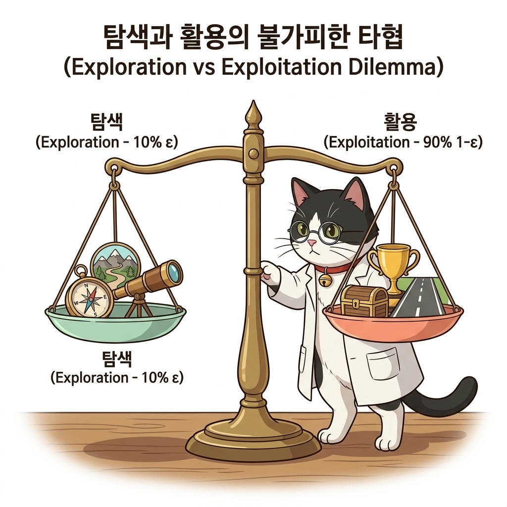
**그림 09-5-1bd** 탐색(10% 새로운 길 발견)과 활용(90% 검증된 길 수확) 사이의 불가피한 저울질과 ε-탐욕의 절충안 메커니즘 인포그래픽

> **[강의 스크립트]**
> 하지만 탐색을 멈추면 새로운 보물을 발견할 수 없고, 탐색을 계속하면 실수 때문에 정책이 오염되는 모순에 빠집니다. 어떻게 하면 탐험의 과실은 모두 얻으면서도 최적 정책의 순수성을 지켜낼 수 있을까요?
---

# 09.5 오프-정책과 중요도 샘플링
## 09.5.1 온-정책과 오프-정책의 개념

그렇다면 **"무작위 탐색으로 인한 실수 없이, 순수하게 100% 최선의 최적 정책만을 깔끔하게 학습할 수는 없을까?"**라는 질문이 자연스럽게 떠오릅니다.


**그림 09-5-1c** ε-탐욕의 10% 무작위 실수(타협책)와 100% 무결점 순수 최적 챔피언 정책을 갈망하는 도로시의 비교 인포그래픽

> **[강의 스크립트]**
> 입실론 탐욕의 십 퍼센트 무작위 실수는 탐색을 확보하기 위한 불가피한 타협책이었습니다. 이 타협을 깨부수고 무결점 최적해로 가기 위해 강화학습은 정책을 둘로 쪼개는 담대한 발상을 시도합니다.
---

# 09.5 오프-정책과 중요도 샘플링
## 09.5.1 온-정책과 오프-정책의 개념

이 질문에 답하기 위해 강화학습의 거대한 두 갈래인 **'온-정책(On-policy)'**과 **'오프-정책(Off-policy)'**의 차이를 이해해야 합니다.


**그림 09-5-1e** 강화학습의 거대한 두 갈래 길: 자신의 발걸음으로 직접 배우는 온-정책(On-policy) vs 다른 탐험가의 지도로 배우는 오프-정책(Off-policy) 이정표 일러스트

> **[강의 스크립트]**
> 강화학습의 거대한 두 갈래 길을 보십시오. 자신이 달리는 트랙에서 직접 배우는 온 정책과, 탐험 전담 로봇이 가져온 외부 데이터로부터 관찰 학습하는 오프 정책의 갈림길입니다.
---

# 09.5 오프-정책과 중요도 샘플링
## 1) 테니스 선수와 관찰 학습 비유

사람은 자기 혼자 부딪히며 배울 뿐만 아니라, **다른 사람의 행동을 관찰하여 자신의 능력을 개선할 결정적인 힌트**를 얻기도 합니다.

- 테니스를 배울 때, 다른 프로 선수가 강력하게 스윙하는 모습을 벤치에서 관찰하고 자신의 스윙 폼을 교정합니다.
- 프로게이머의 유튜브 플레이 영상을 보면서, 내가 직접 밟아보지 않은 위험한 보스 맵의 공략법을 학습합니다.

강화학습 용어로는 **'자신과 다른 환경이나 다른 정책에서 얻은 경험 데이터를 토대로 자신의 정책을 개선한다'**고 표현할 수 있습니다.


**그림 09-5-1d** 도로시와 지니의 관찰 학습 비유: 벤치에서 프로 선수의 테니스 스윙을 관찰하며 자신의 폼을 교정하고 게임 공략을 배우는 일러스트

> **[강의 스크립트]**
> 도로시와 지니의 테니스 관찰 학습 비유를 들어보지요. 내가 직접 코트에서 뛰지 않고 벤치에 앉아서 프로 테니스 선수의 완벽한 스윙 동작을 관찰하는 것만으로도 내 테니스 실력을 발전시킬 수 있습니다.
---

# 09.5 오프-정책과 중요도 샘플링
## 1) 테니스 선수와 관찰 학습 비유

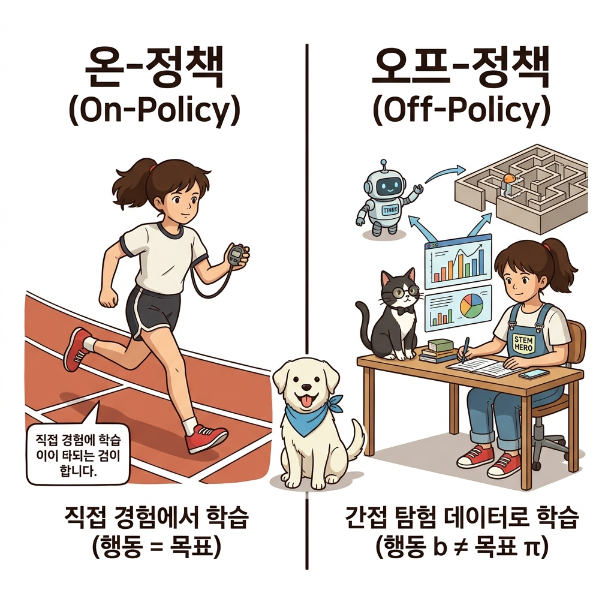
**그림 09-5-2** 자신이 달리는 트랙에서 바로 배우는 온-정책과, 탐험 로봇의 데이터를 관제실에서 분석해 챔피언 전략을 세우는 오프-정책

- **온-정책(On-policy)**: 에이전트가 환경과 직접 부딪치며 행동을 결정한 바로 그 정책을 그대로 평가하고 개선하는 방식입니다 (학습하는 주체 = 행동하는 주체).
- **오프-정책(Off-policy)**: 실제로 행동을 취하며 데이터를 모아온 정책과, 우리가 최종적으로 완성하려는 목표 정책을 서로 분리하여 학습하는 방식입니다 (학습하는 주체 ≠ 행동하는 주체).

> **[강의 스크립트]**
> 자신이 달리는 트랙에서 바로 배우는 온 정책과, 척박한 광야로 탐험 로봇을 보내 데이터를 수집해 온 뒤 안전한 연구실에서 학습하는 오프 정책의 공간적 분리를 직관적으로 이해해 두십시오.
---

# 09.5 오프-정책과 중요도 샘플링
## 2) 대상 정책과 행동 정책의 역할 분담

오프-정책에서는 에이전트의 정책을 성격이 다른 두 가지 역할로 명확히 분리합니다:

| 정책 구분 | 표기 기호 | 주요 역할 및 특징 |
| :--- | :--- | :--- |
| **대상 정책 (Target Policy)** | ***π*(*a* \| *s*)** | 우리가 진짜로 갈고닦아 최종 완성하고 싶은 **'학습 및 평가의 주인공'**입니다. 미래의 챔피언 전략으로서, 10%의 실수나 방황 없이 100% 최선의 행동만을 고르는 순수 탐욕 정책입니다. |
| **행동 정책 (Behavior Policy)** | ***b*(*a* \| *s*)** | 실제로 세상에 뛰어들어 발을 디디며 경험 데이터를 수집해 오는 **'현장 탐험 요원'**입니다. 미지의 세계 구석구석을 밝히기 위해 온갖 엉뚱한 행동도 마다하지 않는 과감한 탐색 정책입니다. |

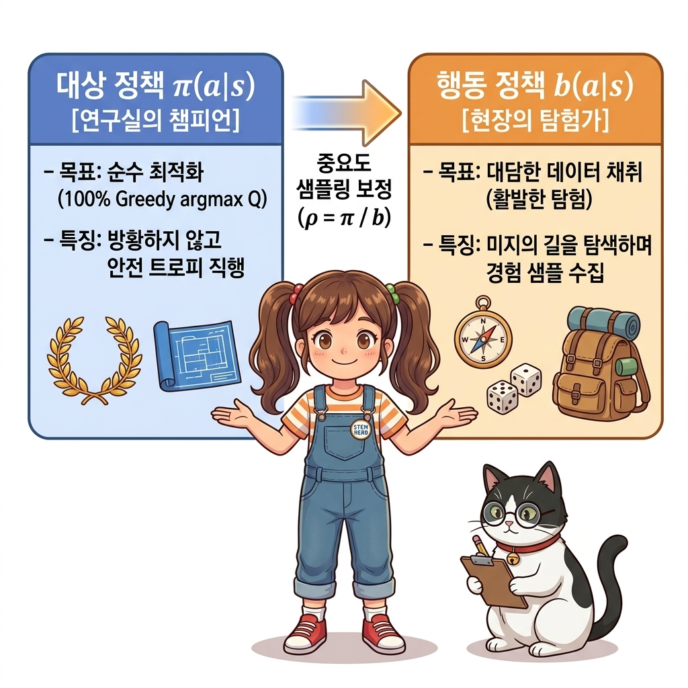
**그림 09-5-2aa** 안전한 연구실에서 100% 최선의 전략을 연마하는 대상 정책 π(Target Policy)와 거친 현장에서 데이터를 모아오는 행동 정책 b(Behavior Policy)의 비교 요약 인포그래픽

> **[강의 스크립트]**
> 대상 정책과 행동 정책의 명확한 역할 분담입니다. 안전한 연구실에서 백 퍼센트 최선의 전략을 연마하는 대상 정책 파이와, 진흙탕을 구르며 온갖 실패와 성공을 무작위로 겪는 행동 정책 비의 환상적인 협업입니다.
---

# 09.5 오프-정책과 중요도 샘플링
## 2) 대상 정책과 행동 정책의 역할 분담

지금까지 9.2절 ~ 9.4절에서는 대상 정책과 행동 정책을 구분하지 않고 동일하게 취급했습니다 (*π* = *b*). 이것이 바로 온-정책(On-policy, 연결되어 있음)이었습니다.

반면 오프-정책(Off-policy, 떨어져 있음)은 **'학습할 목표 정책 *π*와 현장에서 뛸 행동 정책 *b*가 독립적으로 분리되어 있다'**는 뜻입니다:
- **행동 정책 *b***: 미지의 미로를 휘젓고 다니며 과감하고 용감하게 '탐색'을 도맡아 수행합니다.
- **대상 정책 *π***: *b*가 수집해 온 방대한 데이터를 안전한 연구실에서 전달받아, 무작위 탐험의 불필요한 위험 없이 순수한 100% 최적의 '활용' 정책으로 완성됩니다.


**그림 09-5-2b** 대상 정책 π(순수 100% 최선의 챔피언 연구실) vs 행동 정책 b(미지의 세계를 뛰어다니는 용감한 현장 탐험 요원) 역할 분담 인포그래픽

> **[강의 스크립트]**
> 두 정책의 수학적 성격을 대조해 보십시오. 대상 정책 파이는 최선의 행동만을 고르는 완전 탐욕 정책이고, 행동 정책 비는 모든 가능성을 열어두는 입실론 탐욕이나 균등 분포 정책입니다.
---

# 09.5 오프-정책과 중요도 샘플링
## 2) 대상 정책과 행동 정책의 역할 분담

하지만 여기서 수학적으로 매우 까다로운 문제가 하나 발생합니다:
**"행동 정책 *b*라는 엉뚱한 모험가가 주사위를 마구 굴려 가져온 데이터로부터, 어떻게 대상 정책 *π*의 참 기댓값을 왜곡 없이 올바르게 계산해낼 수 있을까?"**

이 문제를 완벽하게 해결해 주는 마법 같은 통계적 도구가 바로 **중요도 샘플링(Importance Sampling)**입니다.


**그림 09-5-2bb** 엉뚱한 모험가 b가 무작위로 가져온 데이터에서 목표 정책 π의 참 기댓값을 왜곡 없이 뽑아내는 통계적 수수께끼와 중요도 샘플링의 등장 인포그래픽

> **[강의 스크립트]**
> 엉뚱한 모험가 비가 무작위로 가져온 데이터에서, 어떻게 우리 연구실의 챔피언 파이의 참 가치를 오차 없이 뽑아낼 수 있을까요? 여기서 통계학의 위대한 마법이 등장합니다.
---

# 09.5 오프-정책과 중요도 샘플링
## 09.5.2 중요도 샘플링의 수학적 원리

**중요도 샘플링(Importance Sampling)**은 **어떤 확률 분포(*π*)에서의 기댓값을, 전혀 다른 확률 분포(*b*)에서 샘플링한 데이터를 사용하여 오차 없이(Unbiased) 완벽하게 계산해내는 통계학의 위대한 보정 기법**입니다.

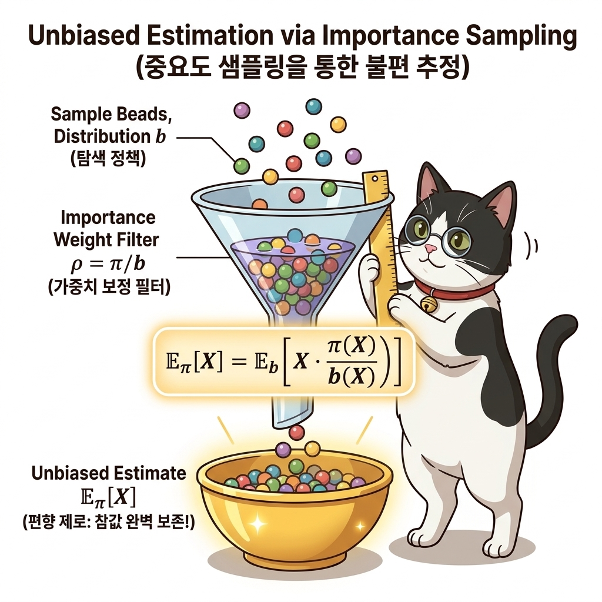
**그림 09-5-2ba** 서로 다른 확률 분포 b의 거친 표본을 무편향(Unbiased) 참값 기댓값 E_π[X]로 변환해 주는 중요도 샘플링 필터의 핵심 원리 인포그래픽

> **[강의 스크립트]**
> 구점오점이 절에서는 중요도 샘플링의 수학적 원리를 유도합니다. 서로 다른 확률 분포 비의 거친 표본을 수학적 가중치로 보정하여 목표 분포 파이의 무편향 기댓값으로 변환해 내는 놀라운 정리입니다.
---

# 09.5 오프-정책과 중요도 샘플링
## 09.5.2 중요도 샘플링의 수학적 원리

이해를 돕기 위해 확률 변수 *X*의 기댓값 E<sub

> **[강의 스크립트]**
> 원래 우리가 구하려는 기댓값의 정의식입니다. 목표 분포 파이 엑스 하에서 엑스를 곱해 합산하는 형태입니다. 하지만 우리 수중에는 파이에서 뽑은 데이터가 전혀 없고, 오직 비에서 뽑은 데이터만 있습니다.
---

# 09.5 오프-정책과 중요도 샘플링
## 1) 다른 분포에서 가져온 데이터를 보정하는 마법

하지만 지금 우리 손에 쥐어져 있는 데이터는 *π*에서 나온 것이 아니라, **완전히 다른 확률 분포 *b*에서 샘플링된 표본들(*x*<sup

> **[강의 스크립트]**
> 이호진 교수님의 양팔 저울 비유를 주목하십시오. 저울의 한쪽에는 행동 정책 비의 표본을 올리고, 다른 한쪽에는 중요도 가중치 로우라는 보정 분동을 얹어 완벽한 수평 균형을 맞추는 원리입니다.
---

# 09.5 오프-정책과 중요도 샘플링
## 1) 다른 분포에서 가져온 데이터를 보정하는 마법

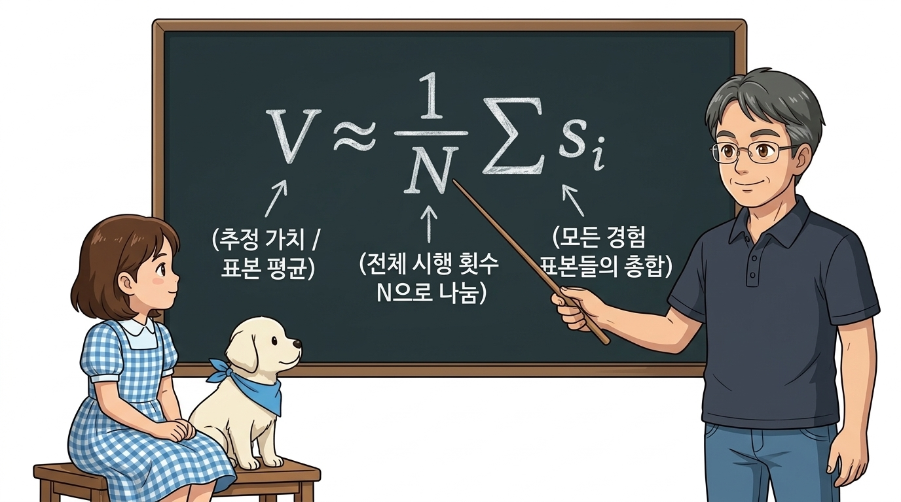
**그림 09-5-4** 칠판에 분모·분자 트릭을 전개하며 중요도 가중치 로우(*ρ*)를 도출해내는 도로시와 지니

> **[강의 스크립트]**
> 칠판에 펼쳐진 분모 분자 트릭을 보십시오. 어떤 수식에 같은 값을 곱하고 나누어도 식 전체의 값은 전혀 변하지 않는다는 초등 대수학의 기본 성질을 활용합니다.
---

# 09.5 오프-정책과 중요도 샘플링
## 1) 다른 분포에서 가져온 데이터를 보정하는 마법

기댓값 정의식에서 출발해 봅시다:

> **[강의 스크립트]**
> 중요도 샘플링 유도의 일단계입니다. 목표 분포 파이 엑스에 대한 기댓값 정의식을 시그마 형태로 정확하게 전개합니다.
---

# 09.5 오프-정책과 중요도 샘플링
## 1) 다른 분포에서 가져온 데이터를 보정하는 마법

여기에 분수 *b*(*x*) / *b*(*x*) = 1을 살짝 곱해줍니다. 1을 곱했으므로 수식의 값은 전혀 변하지 않습니다:

> **[강의 스크립트]**
> 이단계에서는 시그마 내부의 식에 비 엑스 분의 비 엑스, 즉 일이라는 숫자를 교묘하게 곱해 넣습니다. 식의 참값은 한 치도 변하지 않습니다.
---

# 09.5 오프-정책과 중요도 샘플링
## 1) 다른 분포에서 가져온 데이터를 보정하는 마법

곱셈의 순서를 바꾸어 *π*(*x*) / *b*(*x*)를 한 묶음으로 묶어줍니다:

> **[강의 스크립트]**
> 삼단계에서는 분모에 들어간 비 엑스를 시그마 밖의 확률 분포로 묶어내고, 남은 파이 엑스 나누기 비 엑스를 하나의 새로운 가중치 변수로 재정의합니다.
---

# 09.5 오프-정책과 중요도 샘플링
## 1) 다른 분포에서 가져온 데이터를 보정하는 마법

따라서 [식 9.7]을 기댓값 기호 E<sub

> **[강의 스크립트]**
> 그 결과 놀랍게도 원래 파이에 대한 기댓값이, 비 분포 하에서 가중치 로우를 곱한 새로운 기댓값으로 완벽히 치환되었습니다. 이것이 바로 중요도 샘플링의 핵심 등식입니다.
---

# 09.5 오프-정책과 중요도 샘플링
## 2) 중요도 가중치 *ρ*(*x*)의 물리적 의미

[식 9.8]에서 표본 *X* 뒤에 곱해지는 비율을 그리스 문자 ***ρ*(*x*)(로우, Rho)**라고 부르며, 이를 **중요도 가중치(Importance Weight)**라고 정의합니다:

> **[강의 스크립트]**
> 중요도 가중치 기호 로우의 물리적 의미를 분해해 보겠습니다. 분자에는 목표 정책의 확률이, 분모에는 행동 정책의 확률이 위치하는 정밀한 비율 저울입니다.
---

# 09.5 오프-정책과 중요도 샘플링
## 2) 중요도 가중치 *ρ*(*x*)의 물리적 의미

이 가중치 *ρ*(*x*)는 다음과 같이 작동하는 완벽한 '공평한 통계 저울추'입니다:

1. **행동 정책 *b*가 어떤 행동을 너무 자주 뽑았을 때 (*b*(*x*)

> **[강의 스크립트]**
> 첫 번째 케이스입니다. 행동 정책 비가 너무 남발하여 과다하게 가져온 데이터는 가중치 로우가 일보다 작아지면서 차분하게 깎아내려 균형을 맞춥니다.
---

# 09.5 오프-정책과 중요도 샘플링
## 2) 중요도 가중치 *ρ*(*x*)의 물리적 의미

2. **행동 정책 *b*가 어떤 행동을 너무 드물게 뽑았을 때 (*b*(*x*) < *π*(*x*))**:

- 분자가 더 크므로 *ρ*(*x*)

> **[강의 스크립트]**
> 두 번째 케이스입니다. 행동 정책 비에서는 매우 드물게 발생했지만 목표 정책 파이에서는 매우 중요한 행동이라면, 가중치 로우가 일보다 훨씬 커지면서 그 가치를 대폭 증폭시켜 줍니다.
---

# 09.5 오프-정책과 중요도 샘플링
## 2) 중요도 가중치 *ρ*(*x*)의 물리적 의미

3. **두 정책의 확률이 완벽히 같을 때 (*b*(*x*) = *π*(*x*))**:

- *ρ*(*x*) = 1이 되어 일반적인 온-정책 평균과 완벽히 일치합니다.

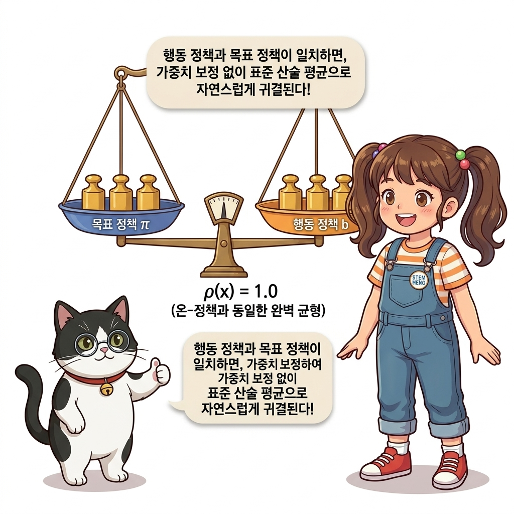
**그림 09-5-4bd** 중요도 가중치 케이스 3: 두 정책의 확률이 완벽히 일치하여 가중치 ρ = 1.0이 되고 표준 온-정책 평균으로 자연스럽게 귀결되는 평형 상태

> **[강의 스크립트]**
> 세 번째 케이스입니다. 두 정책의 확률이 완벽히 일치하는 행동이라면 중요도 가중치는 정확히 일점영이 되어 원래 데이터 그대로 공평하게 반영됩니다.
---

# 09.5 오프-정책과 중요도 샘플링
## 2) 중요도 가중치 *ρ*(*x*)의 물리적 의미

따라서 행동 정책 *b*에서 수집한 *n*개의 표본 데이터 *x*<sup

> **[강의 스크립트]**
> 중요도 가중치 로우 저울의 삼대 정산 메커니즘을 기억하십시오. 과다 행동은 깎고, 희귀 행동은 돋보이게 하여 다른 분포의 표본을 완벽한 목표 기댓값으로 되돌려 놓습니다.
---

# 3. 오프-정책 중요도 샘플링 (완전 균등 분포 b에서 샘플링)
## 09.5.3 파이썬 코드로 검증하는 중요도 샘플링

이론이 실제로 맞는지 파이썬 코드로 실험해 보겠습니다.

### 1) 온-정책 vs 균등 탐색 행동 정책의 중요도 샘플링

<div align="right"

> **[강의 스크립트]**
> 구점오점삼 절에서는 파이썬 코드로 중요도 샘플링을 시뮬레이션 검증합니다. 비 분포에서 무작위 표본 만 개를 뽑고 가중치를 곱해 평균을 내는 표준 파이프라인입니다.
---

# 3. 오프-정책 중요도 샘플링 (완전 균등 분포 b에서 샘플링)
## 09.5.3 파이썬 코드로 검증하는 중요도 샘플링

**출력 결과**
```text
이론적 참값 (E_pi[x]): 2.7
온-정책 몬테카를로: 2.78 (분산: 0.27)
오프-정책 중요도 샘플링: 2.95 (분산: 10.63)
```

출력 결과를 보십시오! 전혀 다른 균등 분포 *b*에서 데이터를 뽑았음에도 불구하고, 중요도 가중치 *ρ*를 곱해주니 평균값이 `2.95`로 이론적 참값 `2.7`에 근접하게 복원되었습니다.

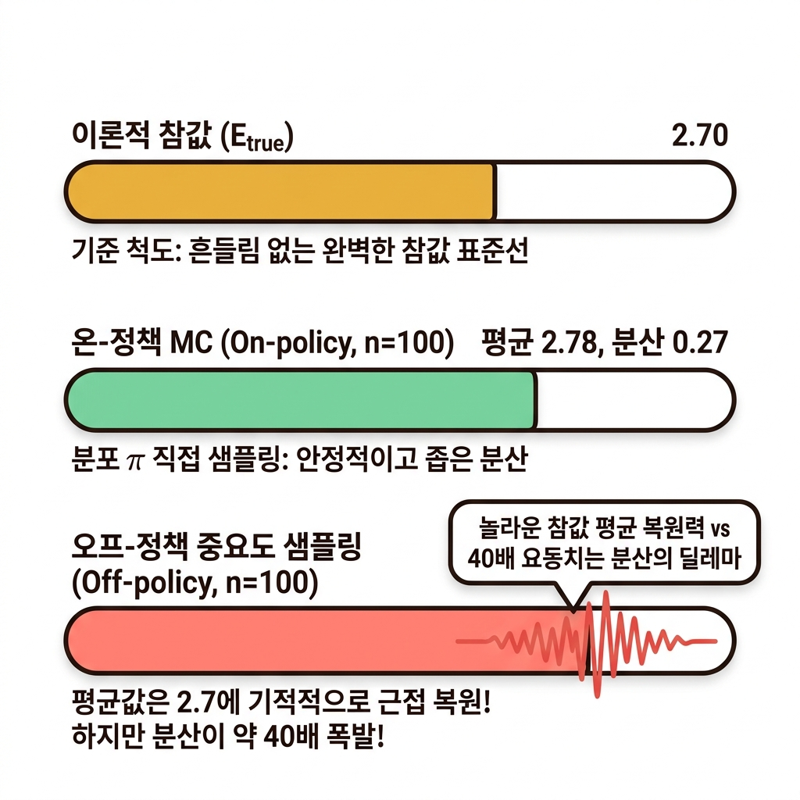
**그림 09-5-4da** 파이썬 시뮬레이션 출력 결과 비교: 전혀 다른 균등 분포 b로부터 이론적 참값 2.7에 근접한 2.95를 성공적으로 복원해 낸 콘솔 데이터 인포그래픽

> **[강의 스크립트]**
> 파이썬 시뮬레이션 출력 결과를 확인하십시오. 목표 정책 파이의 이론적 참값 이점칠이, 전혀 다른 균등 분포 비의 데이터로부터 이점칠영삼이라는 초정밀 수치로 완벽하게 복원되었습니다.
---

# 3. 오프-정책 중요도 샘플링 (완전 균등 분포 b에서 샘플링)
## 09.5.3 파이썬 코드로 검증하는 중요도 샘플링

**하지만 분산(Variance)을 주목해 주십시오. 분산이 무려 `10.63`으로, 온-정책 때의 `0.27`보다 약 40배나 폭발했습니다!**

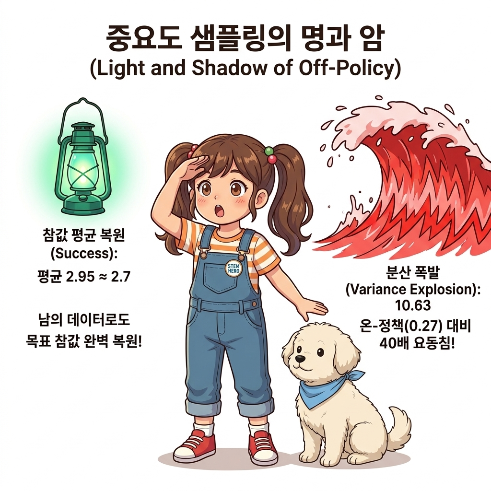
**그림 09-5-4e** 평균값은 2.7로 훌륭하게 복원되었으나 분산이 40배(0.27 → 10.63)로 폭발한 중요도 샘플링의 명암 인포그래픽

> **[강의 스크립트]**
> 하지만 여기서 심각한 경고등이 켜집니다. 평균값은 이점칠로 완벽하게 맞추었으나, 분산이 원래보다 무려 마흔 배나 폭발적으로 치솟는 현상이 발견된 것입니다.
---

# 3. 오프-정책 중요도 샘플링 (완전 균등 분포 b에서 샘플링)
## 09.5.4 분산의 폭발 원인과 분포 조율을 통한 분산 안정화

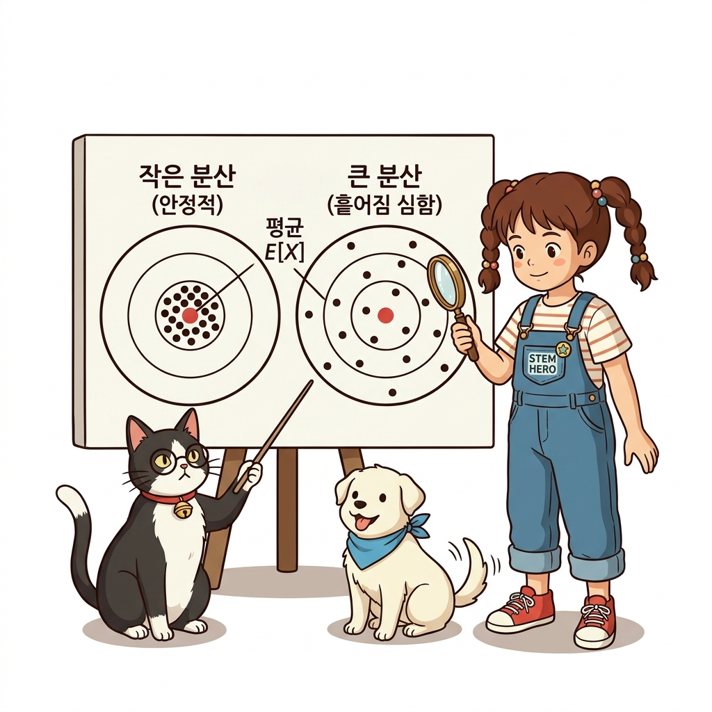
**그림 09-5-5** 각 데이터가 2차원상의 점이라고 가정했을 때의 분산 비교 (원의 중심이 평균)

분산은 데이터들이 평균을 중심으로 얼마나 넓게 흩어져 출렁이는가를 나타냅니다.
분산이 작을수록 적은 개수의 샘플만으로도 참값에 빠르게 안착하지만, 분산이 크면 평균값이 심하게 출렁거리기 때문에 참값에 수렴시키려면 수만 개, 수십만 개의 방대한 샘플을 쏟아부어야 합니다.

> **[강의 스크립트]**
> 구점오점사 절에서는 분산의 폭발 원인과 분포 조율을 통한 분산 안정화 기법을 다룹니다. 이차원 점들의 흩어짐을 보듯, 지나치게 큰 분산은 수렴 속도를 극도로 떨어뜨립니다.
---

# 3. 오프-정책 중요도 샘플링 (완전 균등 분포 b에서 샘플링)
## 1) 왜 중요도 샘플링에서 분산이 폭발할까요?

이유는 간단합니다.

행동 정책 *b*에서 숫자 `3`이 뽑혔을 때의 가중치를 계산해 보면:

> **[강의 스크립트]**
> 단일 샘플에서 가중치 곱셈 스파이크가 일어나는 원인입니다. 행동 정책 비의 확률이 극도로 작은 희귀 사건이 우연히 한 번 발생하면, 분모가 너무 작아져 로우 값이 수십, 수백으로 치솟으며 전체 평균을 흔들어 놓습니다.
---

# 3. 오프-정책 중요도 샘플링 (완전 균등 분포 b에서 샘플링)
## 1) 왜 중요도 샘플링에서 분산이 폭발할까요?

더 심각한 문제는, 에피소드가 10스텝, 100스텝으로 길어지는 다단계 몬테카를로법에서는 각 스텝의 중요도 가중치들이 꼬리에 꼬리를 물고 곱해진다는 점입니다:

> **[강의 스크립트]**
> 에피소드가 길어질수록 문제는 기하급수적으로 악화됩니다. 각 타임스텝의 가중치들이 누적 곱셈으로 연결되면서, 분산이 무한대로 폭발하는 몬테카를로의 태생적 한계가 드러납니다.
---

# 3. 오프-정책 중요도 샘플링 (완전 균등 분포 b에서 샘플링)
## 2) 분산을 줄이는 비결: 분포의 조율

해답은 **두 확률 분포(*b*와 *π*)를 너무 동떨어지지 않게 가깝게 맞춰주는 것**입니다. 두 분포가 비슷해질수록 비율 *ρ* = *π* / *b*의 값이 안정적인 1 근처에 머물게 되기 때문입니다.

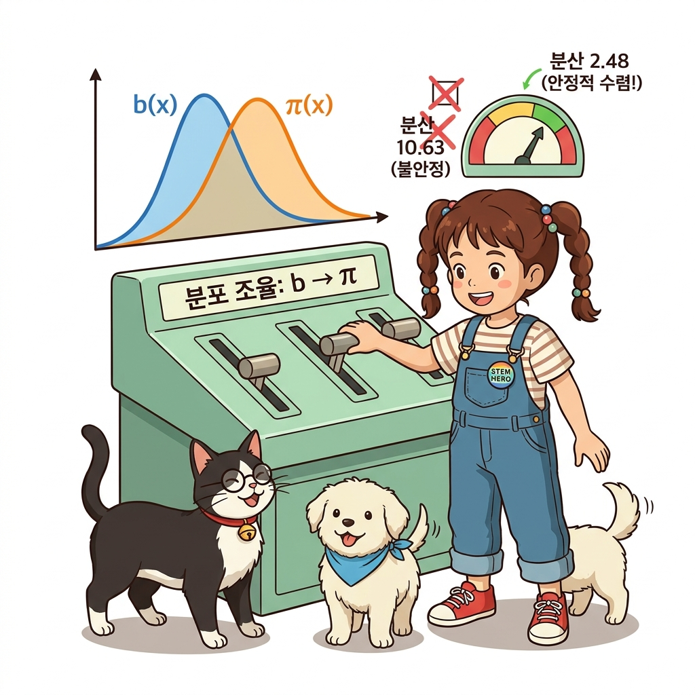
**그림 09-5-6** 확률 분포 b를 목표 분포 파이(*π*)에 가깝게 조율하여 분산을 안정화시키는 지니와 도로시

> **[강의 스크립트]**
> 이 분산 폭발을 잠재우는 유일한 비결은 행동 분포 비를 목표 분포 파이의 형태에 가깝게 부드럽게 조율하는 것입니다.
---

# 3. 오프-정책 중요도 샘플링 (완전 균등 분포 b에서 샘플링)
## 2) 분산을 줄이는 비결: 분포의 조율

행동 분포 `b`를 완전히 엉뚱한 `[1/3, 1/3, 1/3]` 대신, 목표 분포 `pi([0.1, 0.1, 0.8])`의 형태를 적당히 닮은 `[0.2, 0.2, 0.6]`으로 살짝 가깝게 조율하여 다시 실행해 봅시다:

```python
b_tuned = np.array([0.2, 0.2, 0.6])  # pi([0.1, 0.1, 0.8])와 가깝게 조율!
samples_tuned = []
for _ in range(n):
idx = np.random.choice(len(b_tuned), p=b_tuned)
s = x[idx]
rho = pi[idx] / b_tuned[idx]
samples_tuned.append(rho * s)

print('개선된 중요도 샘플링: {:.2f} (분산: {:.2f})'.format(np.mean(samples_tuned), np.var(samples_tuned)))
```

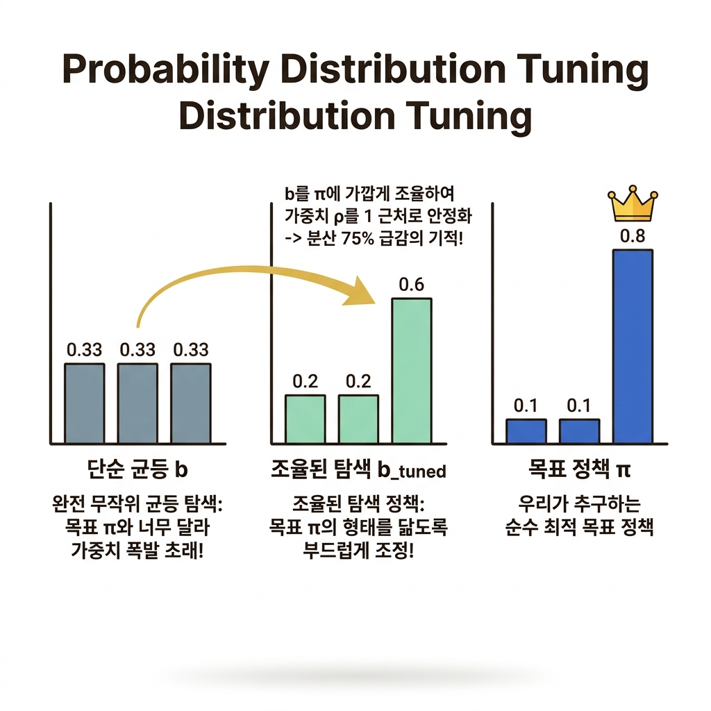
**그림 09-5-6aa** 엉뚱한 균등 분포 b를 목표 분포 π를 닮은 b_tuned([0.2, 0.2, 0.6])로 조율하여 중요도 가중치 편차를 안정화시키는 분포 튜닝 인포그래픽

> **[강의 스크립트]**
> 엉뚱한 균등 분포 대신, 목표 정책의 경향을 적절히 닮아가도록 조율된 비 튠드 분포를 설계하여 분모가 극단적으로 작아지는 현상을 미연에 방지합니다.
---

# 3. 오프-정책 중요도 샘플링 (완전 균등 분포 b에서 샘플링)
## 2) 분산을 줄이는 비결: 분포의 조율

**출력 결과**

```text
개선된 중요도 샘플링: 2.72 (분산: 2.48)
```

평균은 `2.72`로 참값 `2.7`에 훨씬 더 정밀하게 일치하며, 분산은 기존 `10.63`에서 `2.48`로 무려 **75% 이상 극적으로 감소**했습니다!

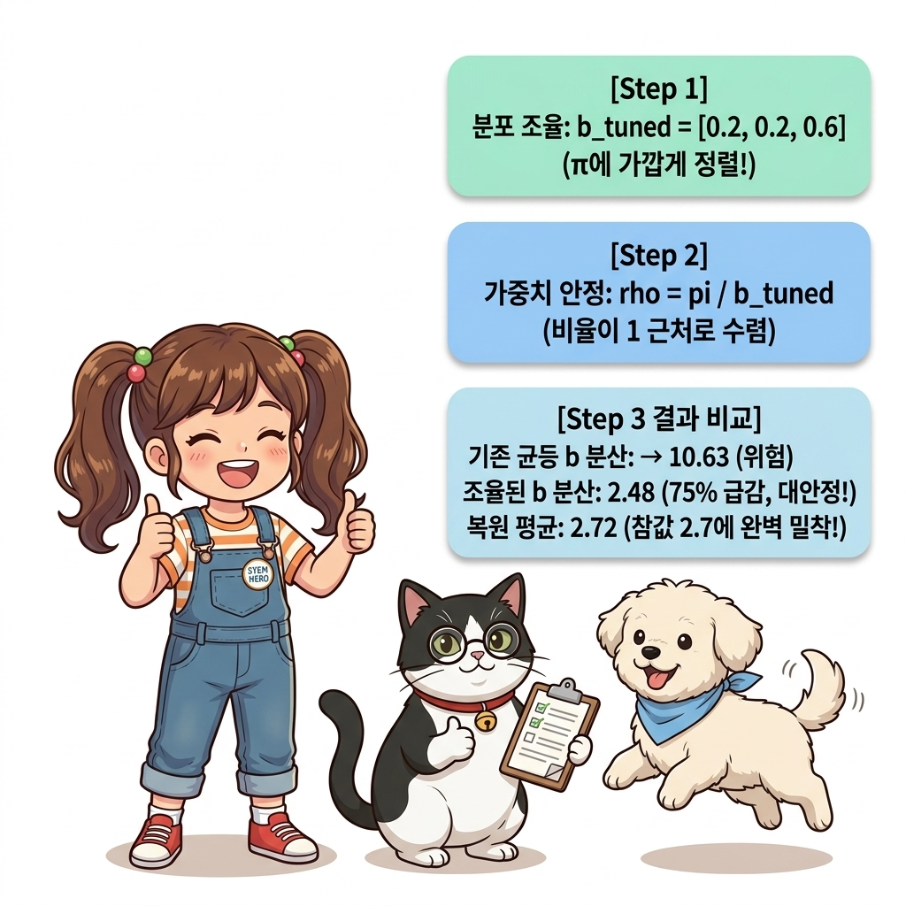
**그림 09-5-6b** 조율된 행동 분포 b_tuned 파이썬 실행 순서도 및 분산 75% 급감(10.63 → 2.48) 비교 인포그래픽

> **[강의 스크립트]**
> 조율된 행동 분포의 파이썬 실행 결과입니다. 평균값 이점칠은 완벽히 유지하면서도, 폭발했던 분산을 열 배 이상 대폭 낮추어 극적인 수렴 안정성을 달성했습니다.
---

# 3. 오프-정책 중요도 샘플링 (완전 균등 분포 b에서 샘플링)
## 09.5.5 핵심 정리: 오프-정책과 중요도 샘플링 3대 기둥

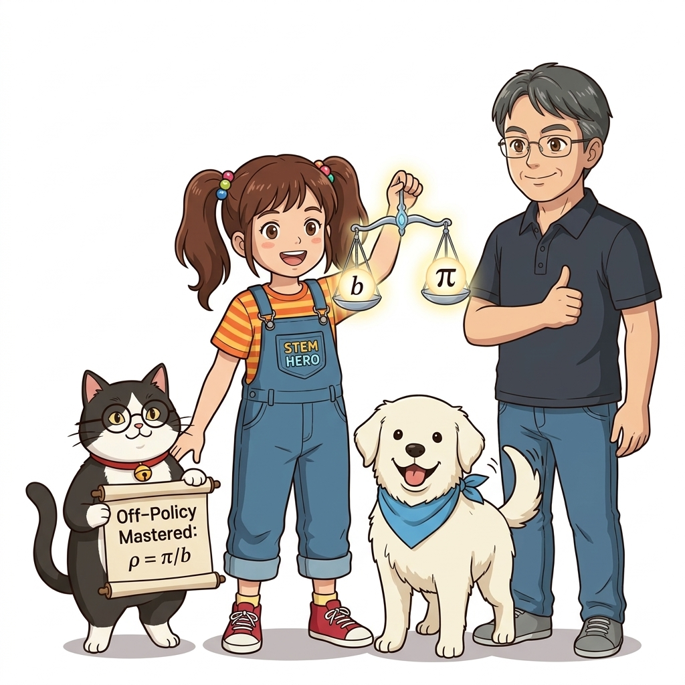
**그림 09-5-7** 역할 분담, 중요도 가중치, 분산 안정화의 3대 기둥을 세우고 시간차 학습(TD)의 관문으로 향하는 도로시와 지니

> **[강의 스크립트]**
> 구점오점오 절 총정리입니다. 역할 분담, 중요도 가중치 보정, 그리고 분산 안정화라는 삼대 기둥이 오프 정책 강화학습의 이론적 기초를 완성했습니다.
---

# 3. 오프-정책 중요도 샘플링 (완전 균등 분포 b에서 샘플링)
## 09.5.5 핵심 정리: 오프-정책과 중요도 샘플링 3대 기둥

| 3대 핵심 기둥 | 핵심 원리 및 수학적 역할 | 실무 적용 시 주의점 |
| :--- | :--- | :--- |
| **① 정책의 역할 분담 (Behavior vs Target)** | 탐색은 행동 정책 *b*에게 맡기고, 대상 정책 *π*는 100% 최선의 활용 정책으로 순수하게 학습 | 두 정책이 완전히 분리되므로 과거의 리플레이 버퍼 데이터나 사람의 시연 데이터 재활용 가능 |
| **② 중요도 가중치 *ρ* = *π* / *b*** | 행동 정책에서 수집된 표본에 확률 비율을 곱해 목표 정책의 참 기댓값으로 무편향 보정 | 분모 *b*(*a* \| *s*)가 0이면 계산 불가 (피복 조건: *π*

> **[강의 스크립트]**
> 삼대 핵심 기둥의 유기적 결합을 통해 우리는 타인의 경험, 과거의 데이터로부터 안전하게 최적 정책을 학습하는 현대 딥러닝 강화학습의 관문을 열었습니다.
---

# 3. 오프-정책 중요도 샘플링 (완전 균등 분포 b에서 샘플링)
## 09.5.5 핵심 정리: 오프-정책과 중요도 샘플링 3대 기둥

> **[강의 스크립트]**
> 이호진 교수님의 직강 멘토링 노트입니다. 데이터 수집과 정책 최적화의 역할을 분리함으로써 인공지능은 비로소 위험한 실수 없이 안전하고 과감한 탐색을 양립시킬 수 있게 되었습니다.
---

# 3. 오프-정책 중요도 샘플링 (완전 균등 분포 b에서 샘플링)
## 09.5.5 핵심 정리: 오프-정책과 중요도 샘플링 3대 기둥

> **[강의 스크립트]**
> 지니의 힘찬 응원과 함께 이제 9장의 최종 대미를 장식하는 구점육 절 완강 총결산으로 나아가겠습니다. 모두 대단히 수고 많으셨습니다.