# 09.6 정리

환경 모델을 전혀 모르는 완전한 백지상태에서도 오직 실제 부딪히며 얻은 경험만으로 가치 함수를 평가하고 최적 정책을 자율 제어해 낸 9장의 대장정을 총결산합니다.

**그림 09-6-1** 몬테카를로 정상에 올라 경험 학습의 전체 지도를 벅찬 감동으로 내려다보는 도로시, 지니, 토토

---

 실제 경험에 기반하여 환경의 전체 지도를 알지 못해도 가치와 최적 경로를 찾아낸 도로시처럼, 다음 장인 10장 TD법(시간차 학습)으로 나아가기 위한 몬테카를로식 통찰을 최종 복습해 봅시다!

**그림 09-6-1b** 9.0 수학적 기초부터 9.5 오프-정책까지 몬테카를로법 정복의 6대 봉우리를 완등한 연구실 4인방 (1:1 순백색)

---

## 09.6.1 경험 기반 학습과 모델 프리 패러다임

강화학습에서는 에이전트가 주어진 환경 속에서 실제로 행동하고 거기서 얻은 경험을 바탕으로 더 나은 정책을 스스로 찾아냅니다. 환경과 에이전트의 이러한 역동적인 상호작용이야말로 강화학습이 지도학습이나 비지도학습과 구별되는 가장 본질적인 특징입니다.

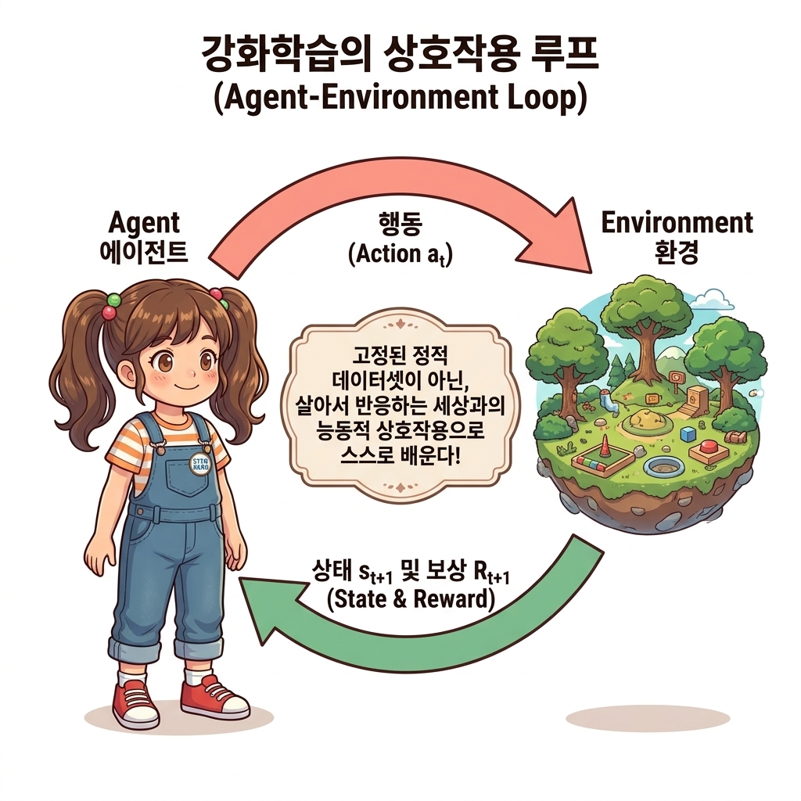
**그림 09-6-1c** 에이전트와 환경의 역동적인 상호작용(상태 관측 → 행동 실행 → 보상 획득)과 경험 기반 학습의 본질 인포그래픽 (1:1 순백색)

---

이번 9장에서 우리가 배운 핵심 기술은 **몬테카를로법(Monte Carlo Method)**이었습니다. 몬테카를로법을 이용하면 환경의 상태 전이 확률 행렬 *p*(*s*&#39; | *s*, *a*)나 보상 함수 *r*(*s*, *a*, *s*&#39;)를 사전에 전혀 알지 못해도, 에이전트가 온몸으로 부딪쳐 수집한 실제 경험 데이터(누적 할인 수익 *G*)의 표본 평균을 계산함으로써 참 가치 함수를 오차 없이 근사적으로 구해낼 수 있습니다.

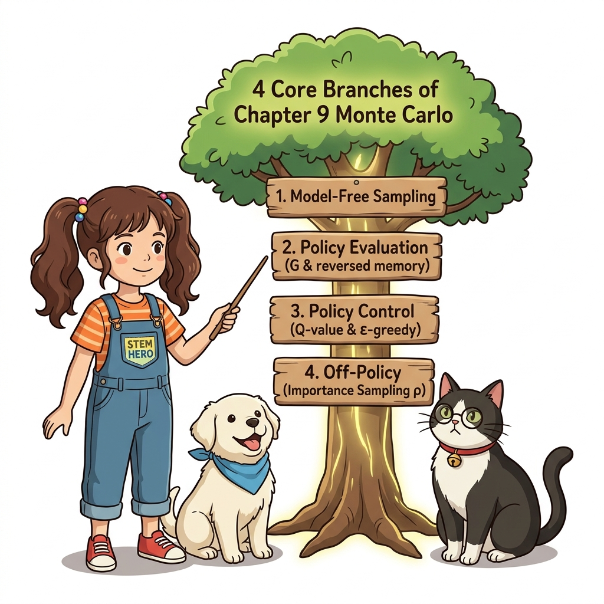
**그림 09-6-2** 샘플링에서 시작해 역방향 평가, Q 함수 제어, 중요도 샘플링으로 뻗어나가는 몬테카를로 지식 나무

---

몬테카를로법의 본질은 **'경험(Experience)에 의한 직접 학습'**입니다:

1. **표본 평균과 대수의 법칙 (Sample Mean & Law of Large Numbers)**:
   - 무수히 많은 에피소드를 반복하며 관측된 실제 누적 할인 수익 *G*의 표본 평균을 계산하면, 통계학의 대수의 법칙에 의해 참 기댓값인 가치 함수 *V*(*s*)와 *Q*(*s*, *a*)에 오차 없이 정확히 수렴합니다.

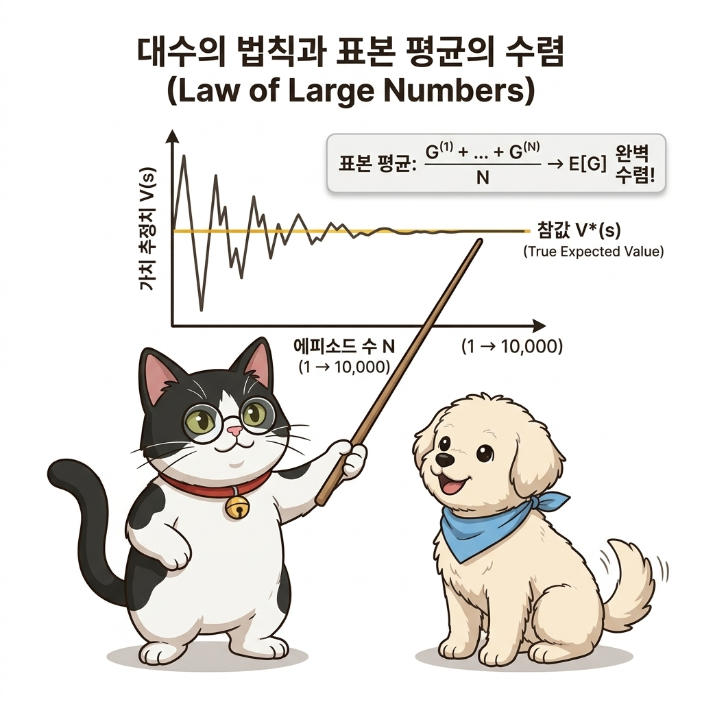
**그림 09-6-2aa** 대수의 법칙에 의한 표본 평균의 수렴: 에피소드 수가 늘어날수록 참 가치 함수에 오차 없이 근사하는 메커니즘 (1:1 순백색)

---

2. **무편향 추정 (Unbiased Estimation)**:

- 다음 상태의 불확실한 추정 가치에 의존(부트스트랩)하지 않고, 에피소드가 끝날 때까지 실제로 모은 참 보상들의 누적 할인 합 *G*만을 온전하게 사용하므로, 추정치에 어떤 수학적 편향(Bias)도 끼어들지 않습니다.

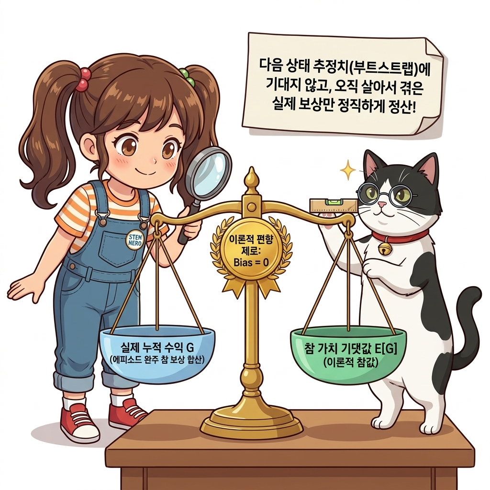
**그림 09-6-2ab** 부트스트랩 없이 에피소드 완주 참 보상들의 합 G만을 정직하게 사용하여 편향(Bias = 0)을 원천 차단하는 무편향 추정의 원리 (1:1 순백색)

---

3. **역방향 누적 연산 (`reversed(memory)`)**:

- 에피소드가 골 지점에서 종료된 후, 배낭에 담아둔 경험 버퍼를 뒤에서부터 거슬러 올라가며 점화식 ***G* ← *γ* · *G* + *R***을 적용함으로써, 중복 연산 없이 단 한 번의 순회로 모든 상태의 수익을 *O*(*T*) 선형 시간에 계산해 내는 극도로 효율적인 파이썬 구현을 완성했습니다.

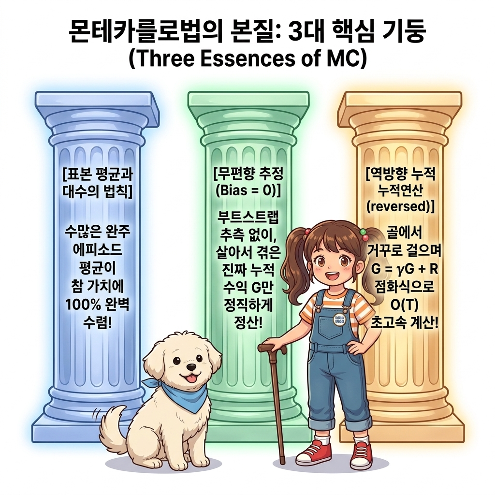
**그림 09-6-2b** 몬테카를로법의 3대 본질 (대수의 법칙 표본 평균, 편향 없는 참 보상 정산, O(T) 선형 시간 역방향 순회) 입체 인포그래픽 (1:1 순백색)

---

## 09.6.2 동적 프로그래밍(DP) vs 몬테카를로법(MC) 총괄 비교

동적 프로그래밍과 몬테카를로법의 구조적 차이를 종합 비교하면 다음과 같습니다:

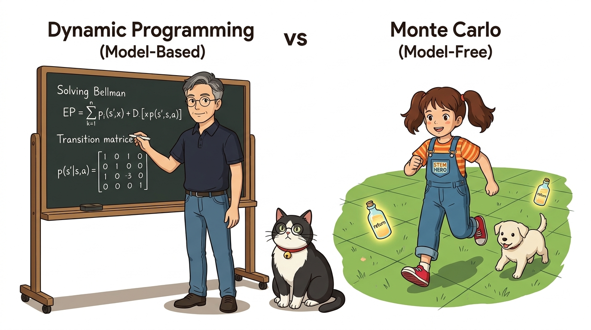
**그림 09-6-3** 환경 지도를 펼쳐놓고 연립방정식을 푸는 DP 거울과, 발걸음으로 미로를 직접 개척하는 MC 거울의 대비

---

| 비교 항목 | 📐 동적 프로그래밍 (DP) | 🎲 몬테카를로법 (MC) |
| :--- | :--- | :--- |
| **환경 모델 (Model)** | 상태 전이 확률 *p*(*s*&#39; \| *s*, *a*), 보상 함수 *r* 필수 | **환경 모델 불필요 (Model-Free)** |
| **학습 원천 (Source)** | 벨만 연립방정식의 이론적 수학 전개 | **실제 에피소드 상호작용 경험 샘플 (*G*)** |
| **부트스트랩 (Bootstrap)** | **사용** (다음 상태의 추정 가치 *V*(*s*&#39;)를 빌려 씀) | **미사용** (에피소드 완주 참 수익 *G*만 정직하게 사용) |
| **학습 단위 (Unit)** | 1스텝 상태 전이 기대치 일괄 계산 | **에피소드 완주 단위 (Episodic)** |
| **수렴 속도와 분산** | 편향이 존재할 수 있으나 분산이 0 | **무편향(Unbiased)이나 표본 분산이 큼** |
| **적용 현실성** | 환경 모델을 이미 아는 이상적 시뮬레이션에 국한 | **환경을 모르는 미지의 실세계 로봇/게임 문제에 적용 가능** |

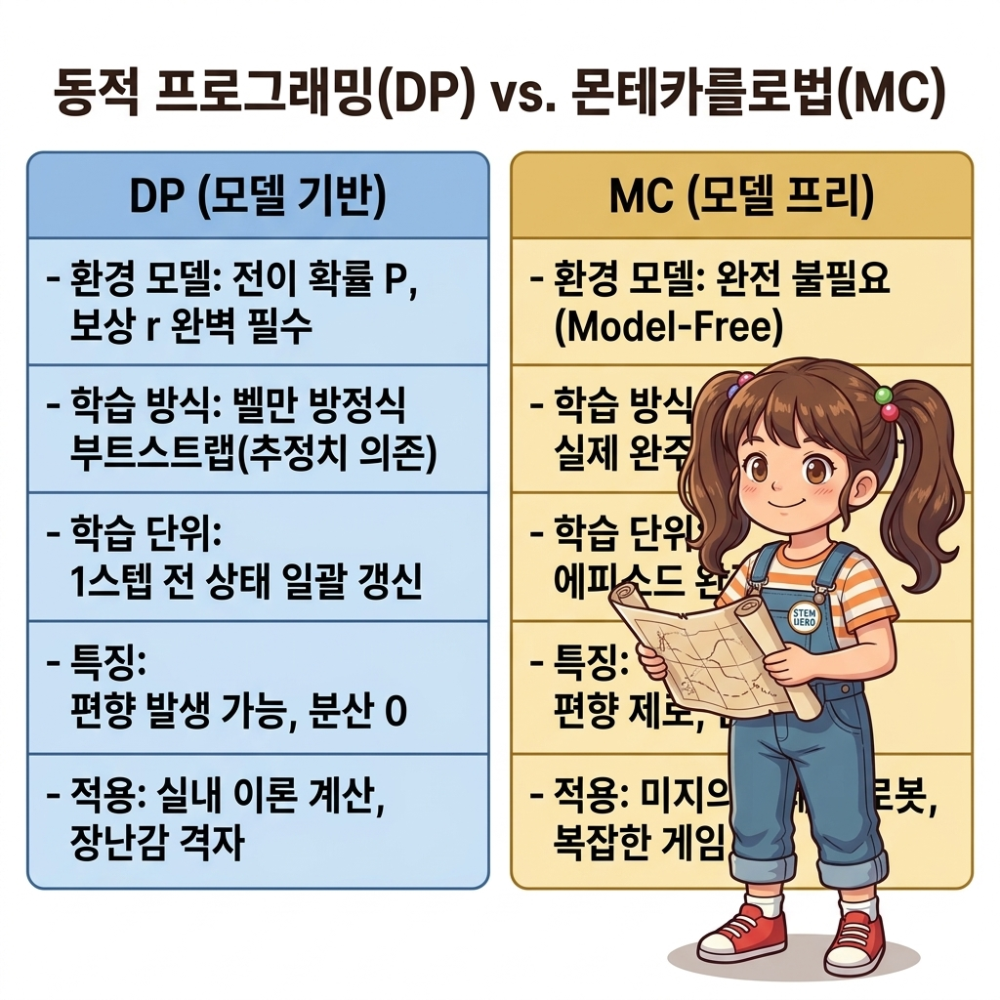
**그림 09-6-3aa** 이상적인 책상 위 모델 기반 DP vs 미지의 거친 현실을 직접 개척하는 모델 프리 MC의 6대 핵심 비교 요약 인포그래픽 (1:1 순백색)

---

동적 프로그래밍은 환경의 완벽한 지도가 주어졌을 때 책상 위에서 연립방정식을 우아하게 풀어내는 방식인 반면, 몬테카를로법은 지도 한 장 없이도 직접 발을 내딛으며 부딪혀가며 지도를 스스로 완성해 가는 방식입니다. 바로 이 점 때문에 몬테카를로법이 진정한 현대 자율 강화학습의 출발점이 됩니다.

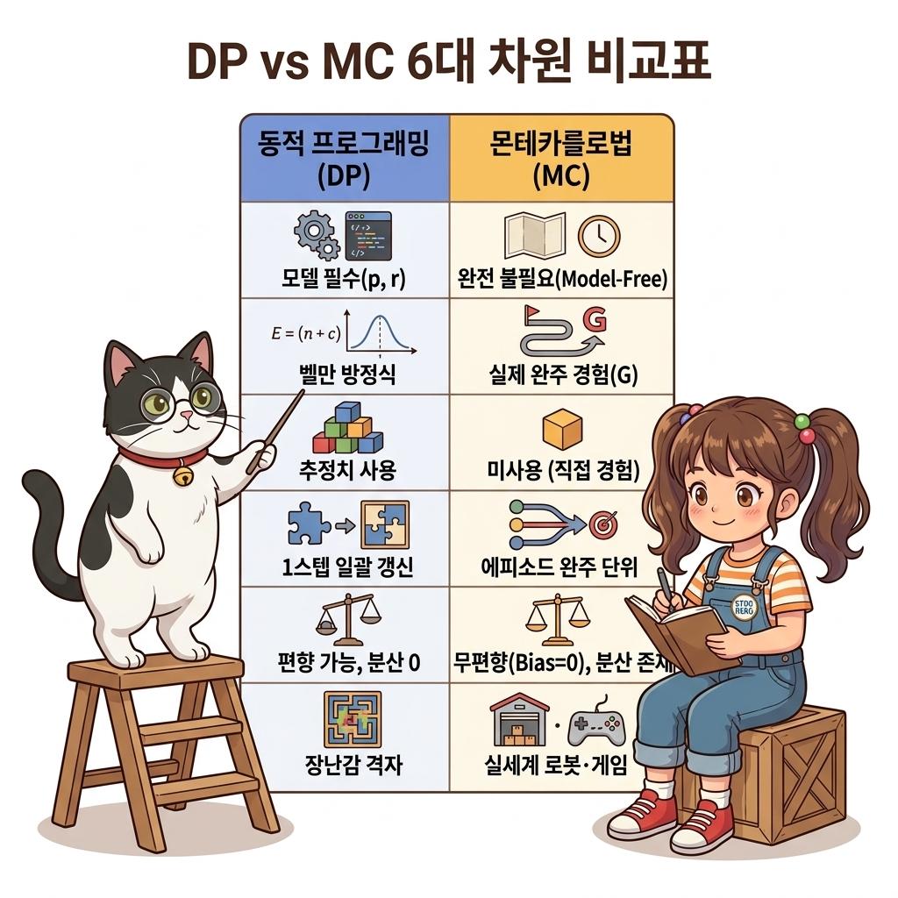
**그림 09-6-3b** 모델 유무, 학습 원천, 부트스트랩, 학습 단위 등 6대 핵심 차원으로 정밀 대비한 DP vs MC 인포그래픽 (1:1 순백색)

---

## 09.6.3 정책 제어: Q 함수, *ε*-탐욕, 지수 이동 평균의 삼위일체

몬테카를로법으로 행동 가치 함수 *Q*(*s*, *a*)를 평가할 수 있다면, 이어서 *Q* 함수를 이용하여 정책을 더 우수하게 개선할 수 있습니다. 이 평가와 개선을 번갈아 반복하면 최적 정책에 도달할 수 있습니다:

> ### ***μ*(*s*) = argmax*a* *Q*(*s*, *a*)** &nbsp;&nbsp;&nbsp;&nbsp; *(식 9.9: 탐욕적 정책 개선)*
> 
> ### **최선 행동: *π*(*a*\* | *s*) = 1 - *ε* + (*ε* / |*A*|)**
> ### **일반 행동: *π*(*a* | *s*) = *ε* / |*A*| &nbsp;&nbsp;&nbsp;&nbsp; (*a* ≠ *a*\*)** &nbsp;&nbsp;&nbsp;&nbsp; *(식 9.10: 입실론-탐욕 정책)*
> 
> ### ***Q*(*s*, *a*) ← *Q*(*s*, *a*) + *α* · [*G* - *Q*(*s*, *a*)]** &nbsp;&nbsp;&nbsp;&nbsp; *(식 9.11: 고정 학습률 지수 이동 평균)*

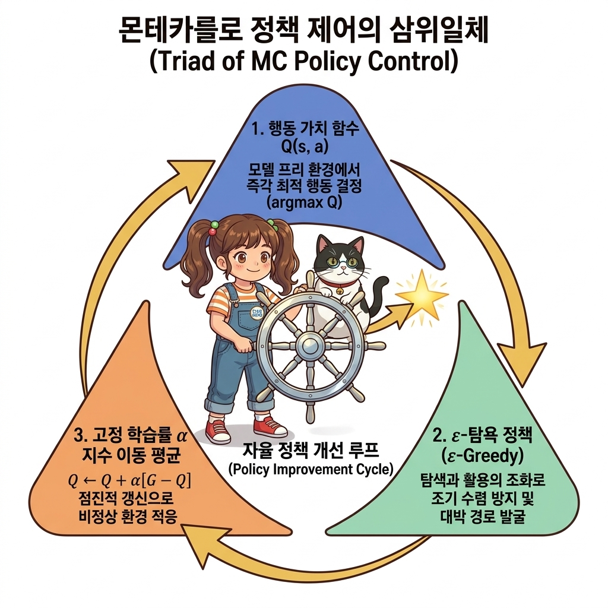
**그림 09-6-3ba** 정책 제어의 삼위일체: Q 함수 채택(argmax 비교), ε-탐욕(탐색 보장), 고정 알파 지수이동평균(비정상 환경 적응)의 순환 루프 다이어그램 (1:1 순백색)

---

1. **행동 가치 함수 *Q*(*s*, *a*)의 채택**:
   - 상태 전이 확률을 모를 때는 상태 가치 *V*(*s*)만으로 다음 최적 행동을 선택할 수 없으므로, 환경 모델 없이도 크기 비교(argmax*a*)만으로 즉시 결정을 내릴 수 있는 행동 가치 함수 *Q*(*s*, *a*)가 정책 제어의 유일한 해법입니다.
2. ***ε*-탐욕 정책을 통한 탐색과 활용의 균형**:
   - 정책 개선을 완전히 100% 탐욕스럽게 하면 조기 수렴으로 인해 미방문 상태가 생기고 좁은 경로에 갇히게 됩니다. 따라서 1 - *ε*의 높은 확률로 현재 최선의 행동을 활용하되, *ε*의 작은 확률로 무작위 탐험을 지속하도록 하여 숨겨진 대박 경로를 발굴합니다.
3. **고정 학습률 *α* 기반 지수 이동 평균**:
   - 정책이 발전함에 따라 수익의 생성 분포가 계속 바뀌는 '비정상 문제(Non-stationary)'에 적응하기 위해, 균일 가중치(1/*n*)의 표본 평균 대신 최신 데이터에 큰 가중치를 부여하고 낡은 초보 기억은 지수적으로 잊어버리는 지수 이동 평균 점화식을 적용합니다.

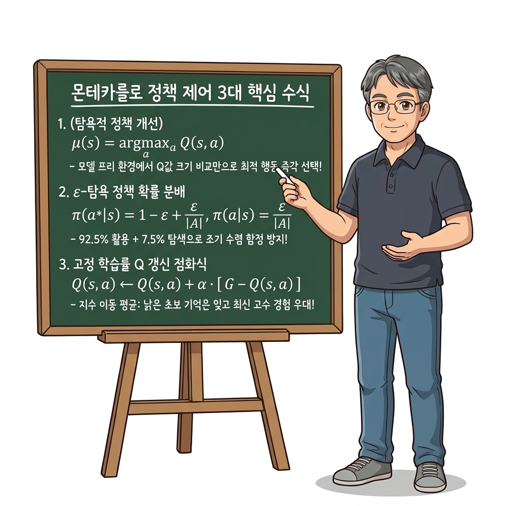
**그림 09-6-3c** 정책 제어 3대 핵심 수식 (식 9.9 argmax 탐욕화, 식 9.10 입실론-탐욕, 식 9.11 고정 알파 지수이동평균) 통합 수식 분해 인포그래픽 (1:1 순백색)

---

## 09.6.4 오프-정책과 중요도 샘플링

에이전트의 정책은 역할 측면에서 볼 때, **대상 정책(Target Policy, *π*)**과 **행동 정책(Behavior Policy, *b*)**으로 나뉩니다:

- **온-정책 (On-policy)**: 행동 정책과 대상 정책이 동일 (*π* = *b*). 자신이 직접 뛴 발걸음으로 자신을 학습.
- **오프-정책 (Off-policy)**: 행동 정책과 대상 정책을 분리 (*π* ≠ *b*). 탐험은 행동 정책 *b*에게 맡겨 자유롭게 모험하게 하고, 대상 정책 *π*는 100% 최선의 탐욕 정책만을 순수하게 학습.

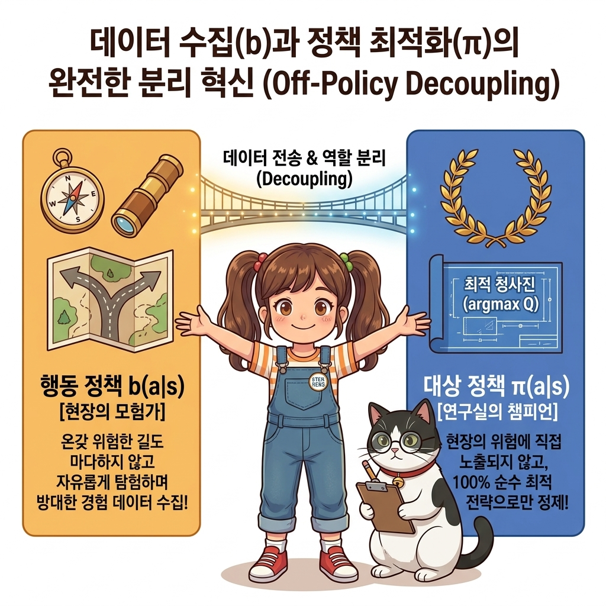
**그림 09-6-3ca** 오프-정책의 핵심: 탐험을 도맡는 행동 정책 b와 100% 최선의 활용만을 연구하는 대상 정책 π의 사상적 역할 분리 인포그래픽 (1:1 순백색)

---

오프-정책에서는 행동 정책 *b*에서 얻은 경험 데이터를 바탕으로 대상 정책 *π*에 대한 기댓값을 계산해야 합니다. 이때 사용하는 통계적 도구가 바로 **중요도 샘플링(Importance Sampling)**입니다:

> ### ***E**π*[*X*] = E*b* [*X* · (*π*(*X*) / *b*(*X*))] = E*b* [*X* · *ρ*(*X*)]**

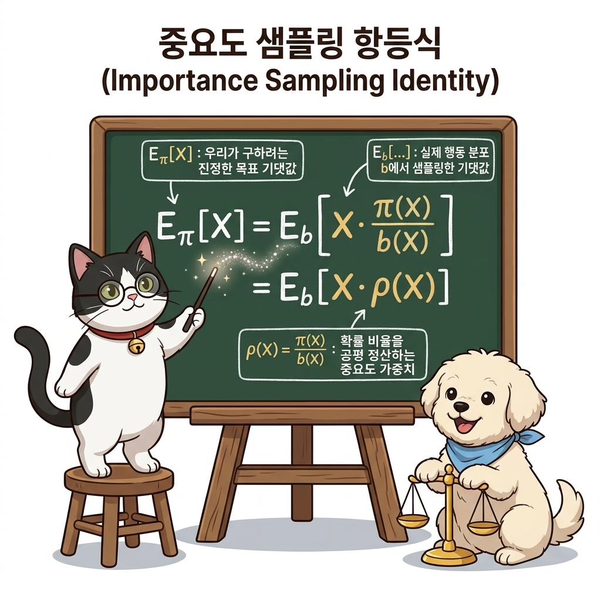
**그림 09-6-3cb** 중요도 샘플링 등식 E_π[X] = E_b[X · ρ(X)]의 통계적 마법 저울 정산 원리 칠판 인포그래픽 (1:1 순백색)

---

두 정책의 확률 비율인 **중요도 가중치 *ρ*(*x*) = *π*(*x*) / *b*(*x*)**를 각 표본에 곱해줌으로써 다른 분포에서 온 데이터를 목표 정책의 참 기댓값으로 완벽하게 보정합니다. 비록 두 분포가 크게 벌어지면 분산이 폭발하는 문제가 발생하지만, 분포를 가깝게 조율함으로써 안정적인 근사를 달성할 수 있습니다.

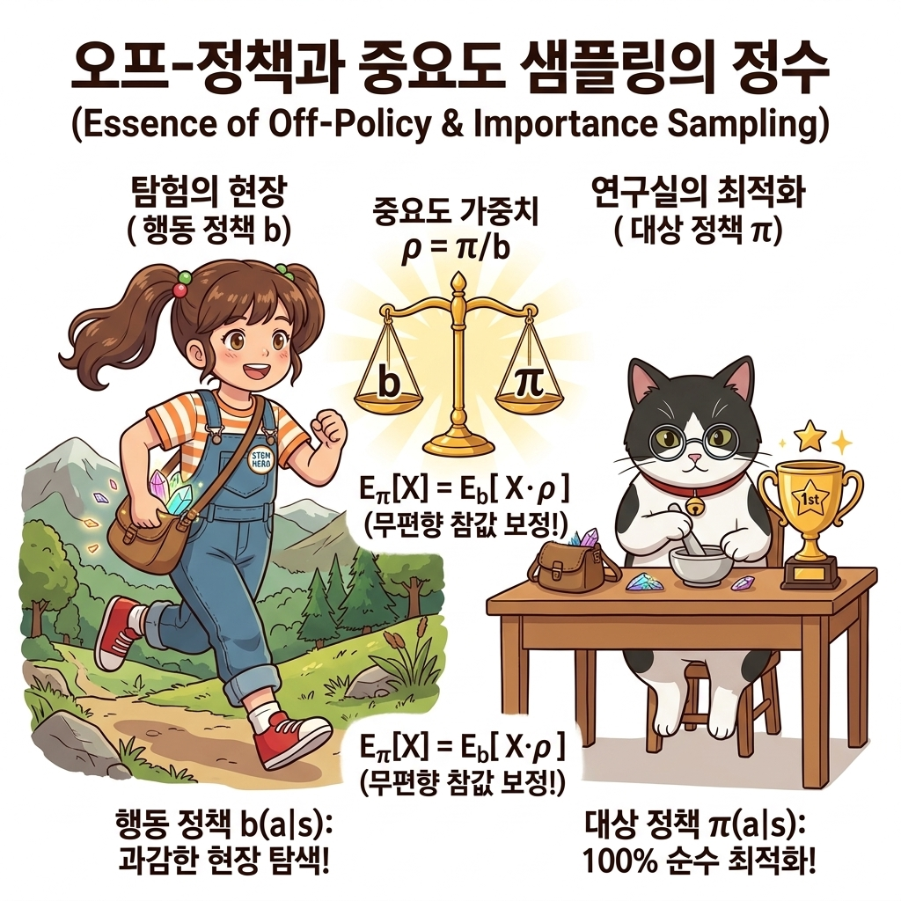
**그림 09-6-3d** 오프-정책의 정수: 탐험과 최적화의 역할 분담 및 중요도 가중치 ρ로 다른 분포 데이터를 완벽 보정하는 메커니즘 인포그래픽 (1:1 순백색)

---

## 09.6.5 몬테카를로법의 한계와 10장 TD법(시간차 학습)으로의 가교

몬테카를로법은 모델 프리 강화학습의 신기원을 열었지만, 현대 인공지능이 마주하는 복잡한 환경에서는 2가지 결정적인 한계점을 가지고 있습니다:

**그림 09-6-4** 에피소드 완주를 기다리는 몬테카를로의 문을 지나, 매 스텝 실시간으로 학습하는 시간차 학습(TD)의 다리로 나아가는 도로시와 토토

---

1. **에피소드 완주 필수 (Episodic 제약)**:
   - 에피소드가 완전히 끝날 때까지 기다려야만 비로소 누적 할인 수익 *G*를 계산할 수 있습니다. 따라서 주식 거래나 자율주행 자세 제어처럼 에피소드가 끝나지 않고 영구히 지속되는 연속적(Continuing) 환경에서는 몬테카를로법을 적용할 수 없습니다.
2. **높은 분산 (High Variance)**:
   - 에피소드가 길어질수록 수많은 확률적 상태 전이와 행동 선택의 보상이 곱해지고 더해지며 누적 수익 *G*의 분산이 매우 커집니다. 분산이 크면 참 기댓값에 수렴하기 위해 수만 번 이상의 방대한 에피소드 표본이 필요합니다.

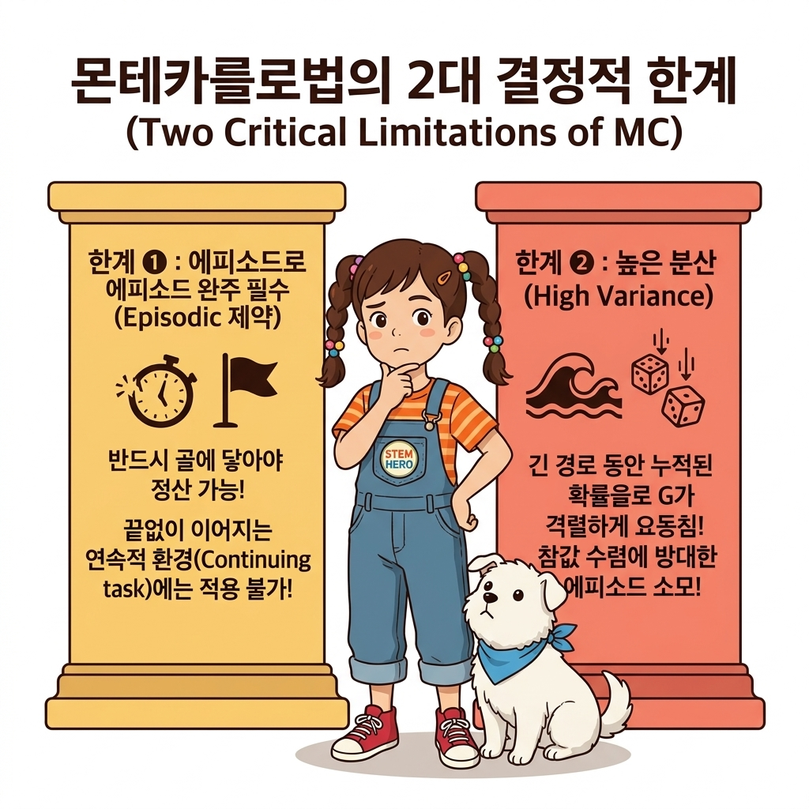
**그림 09-6-4b** 몬테카를로법의 2대 결정적 한계: 에피소드 완주 대기 피로(Episodic 제약)와 누적곱으로 인한 높은 분산(High Variance) 인포그래픽 (1:1 순백색)

---

**그림 09-6-5** 이호진 교수님이 엄지 척을 하며 9장 몬테카를로법을 우수하게 마스터한 도로시에게 수료증을 수여하고, 조교 지니와 토토와 함께 찬란한 무지개다리로 이어진 '10장 TD법(시간차 학습)'을 향해 힘찬 출발을 응원하는 장면

---

이러한 몬테카를로법의 한계를 극복하기 위해 등장하는 차세대 혁신이 바로 **10장 시간차 학습(Temporal Difference, TD법)**입니다!

> 👨‍🏫 **이호진 교수님의 10장 시간차 학습(TD) 예고 특강**:  
> "도로시야, 에피소드가 끝날 때까지 기다리지 않고, **단 한 걸음(1-Step)만 내딛어도 즉시 가치를 갱신할 수 있다면 어떨까?**  
> 몬테카를로법의 '경험 샘플링(Model-Free)'과 동적 프로그래밍의 '부트스트랩(Bootstrap)'을 절묘하게 융합한 시간차 학습의 기적이 바로 다음 10장에서 펼쳐진단다!"

**그림 09-6-5b** 이호진 교수님의 칠판 강의: MC(Model-Free) + DP(Bootstrap) = TD(시간차 학습)! 단 1걸음만으로 즉시 가치를 갱신하는 차세대 강화학습 예고 장면 (1:1 순백색)

---

## 09.6.6 핵심 정리: 9장 몬테카를로 완주 3대 금자탑

**그림 09-6-6** 몬테카를로 3대 금자탑을 세우고, 찬란하게 열린 10장 시간차 학습의 황금 문을 향해 당당하게 걸어가는 도로시와 지니

---

1. **모델 프리 가치 평가의 달성 (Model-Free Evaluation)**:
   - 환경의 전이 확률 행렬 *P*를 몰라도, 실제 에피소드를 밟아 얻은 누적 할인 수익 *G*의 표본 평균만으로 참 가치 함수에 완벽히 수렴함을 증명했습니다.
2. **행동 가치 기반 정책 제어 (Q-Control & *ε*-Greedy)**:
   - *Q*(*s*, *a*) 함수를 채택하여 환경 모델 없이 즉각적인 탐욕화를 수행하고, *ε*-탐욕 정책으로 탐색을 보장하며, 지수 이동 평균(*α*)으로 비정상 환경에 민첩하게 적응하는 자율 제어 루프를 완성했습니다.
3. **오프-정책과 중요도 샘플링 (Off-Policy & Importance Sampling)**:
   - 행동하는 정책과 학습하는 목표 정책을 분리하고 중요도 가중치 *ρ*로 정산함으로써, 탐험과 최적화라는 두 마리 토끼를 동시에 잡는 현대 강화학습의 핵심 패러다임을 확립했습니다.

**그림 09-6-6b** 9장 몬테카를로법이 세운 3대 위대한 금자탑(모델 프리 평가, Q 함수 자율 제어, 오프-정책 중요도 샘플링) 황금 기념비 인포그래픽 (1:1 순백색)

---

> 👨‍🏫 **이호진 교수님의 직강 노트**:  
> "우리는 마침내 환경의 수학 공식을 몰라도 스스로 경험을 통해 지혜를 쌓는 진정한 의미의 강화학습에 성공했습니다. 몬테카를로법이 세운 이 위대한 3대 금자탑은 다음 10장 시간차 학습(TD법)과 Q-러닝, 그리고 더 나아가 심층 강화학습(DQN)으로 뻗어나가는 가장 든든한 반석이 될 것입니다."

**그림 09-6-6c** 이호진 교수님의 감동적인 9장 종강 멘토링 노트: 진정한 인공지능 강화학습의 기틀을 완성하고 10장으로 나아가는 따뜻한 격려 칠판 장면 (1:1 순백색)

---

> 🐱 **조교 지니의 축하 노트**:  
> "와아, 도로시와 여러분! 9장 몬테카를로법의 거대한 여정을 완벽하게 완주했어요! 주사위 놀이에서 시작해 그리드월드의 최적 탈출 지도를 직접 코딩해 내다니 정말 자랑스러워요. 이제 에피소드 완주를 기다리지 않고 매 순간 깨달음을 얻는 10장 시간차 학습의 모험으로 힘차게 출발해 볼까요? 퐁퐁!"

**그림 09-6-6d** 조교 지니의 감동적인 축하 파티: 9장 완주 골든 수료증을 들고 환호하며 10장 시간차 학습의 모험으로 닻을 올리는 도로시, 토토, 지니 (1:1 순백색)
