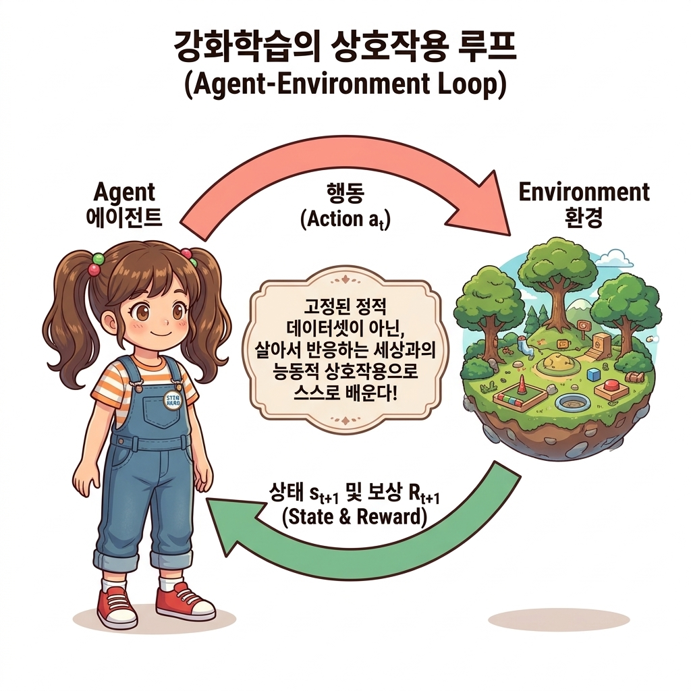
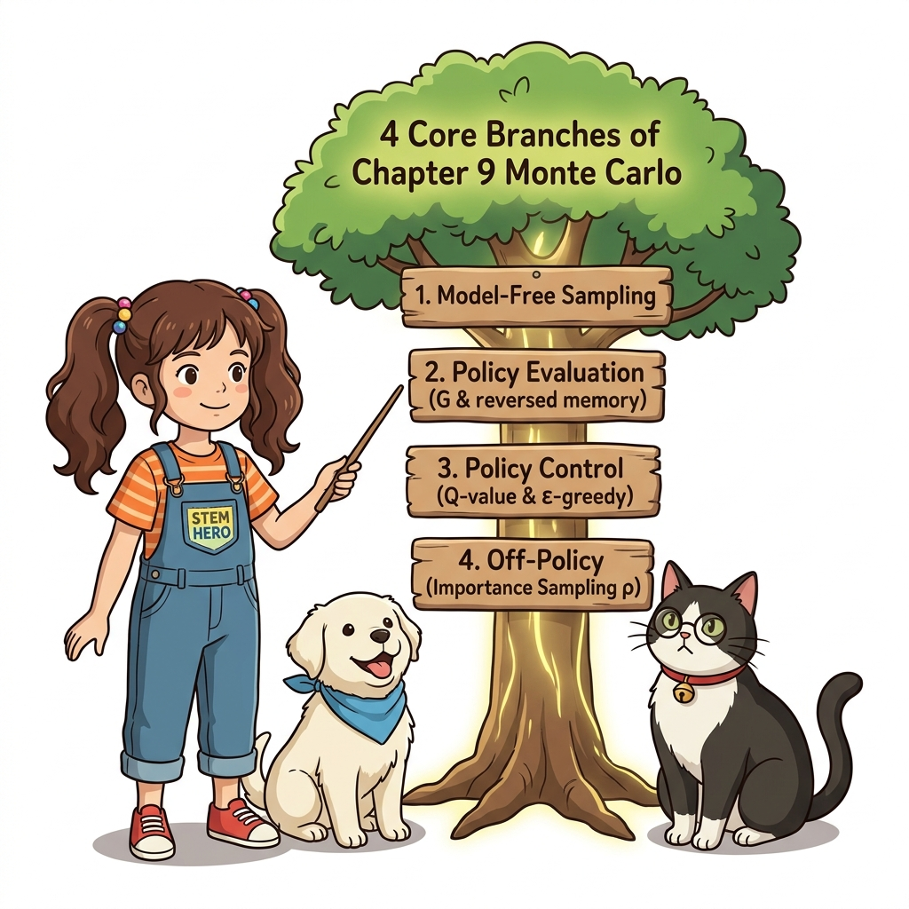
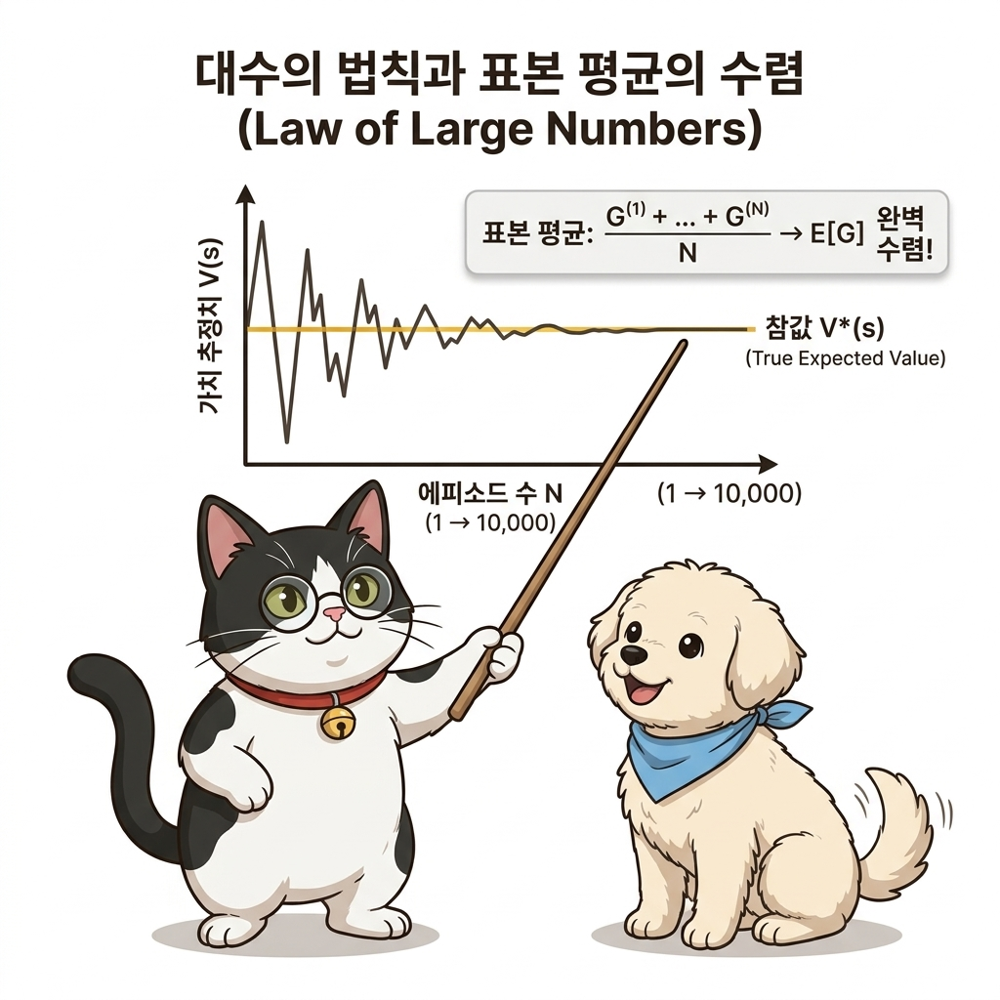
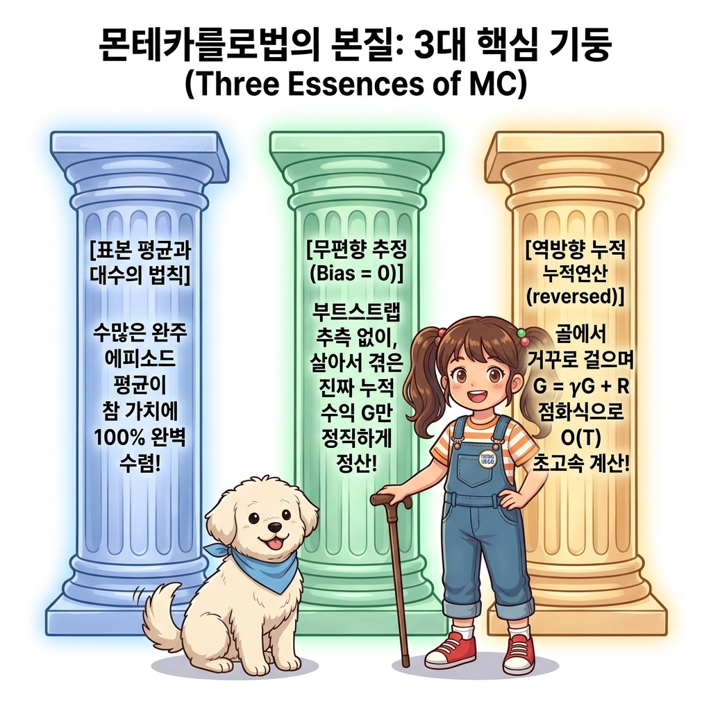
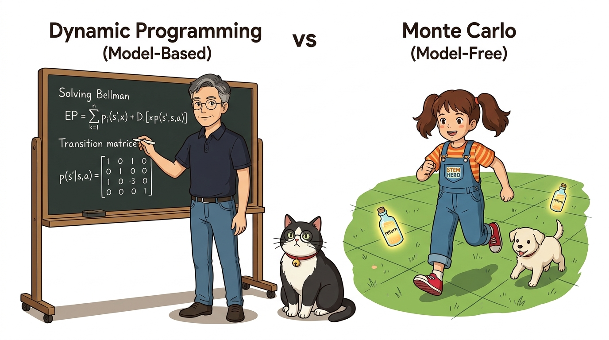
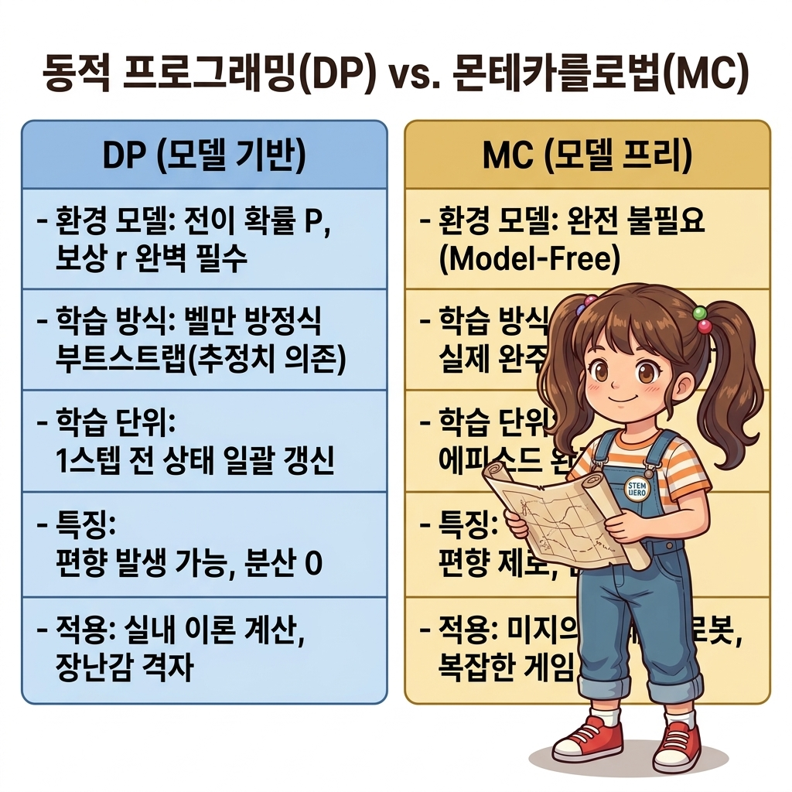
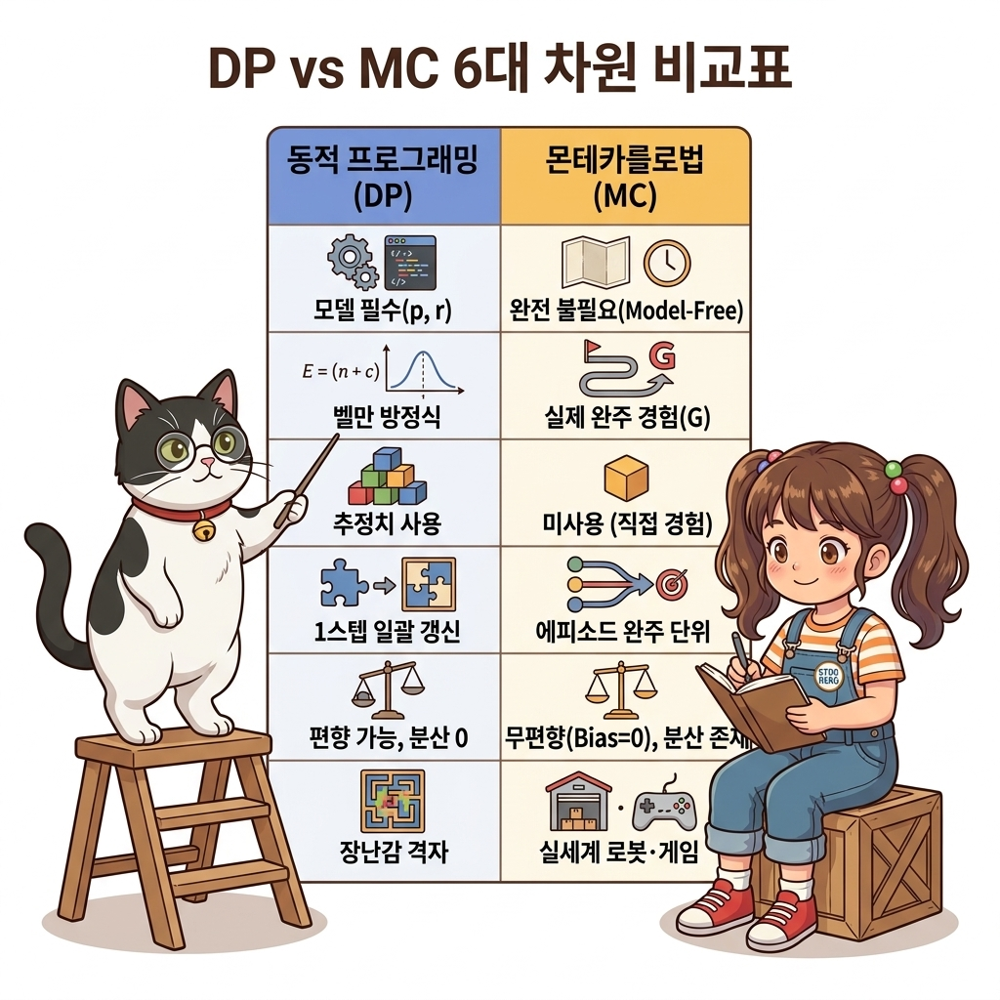
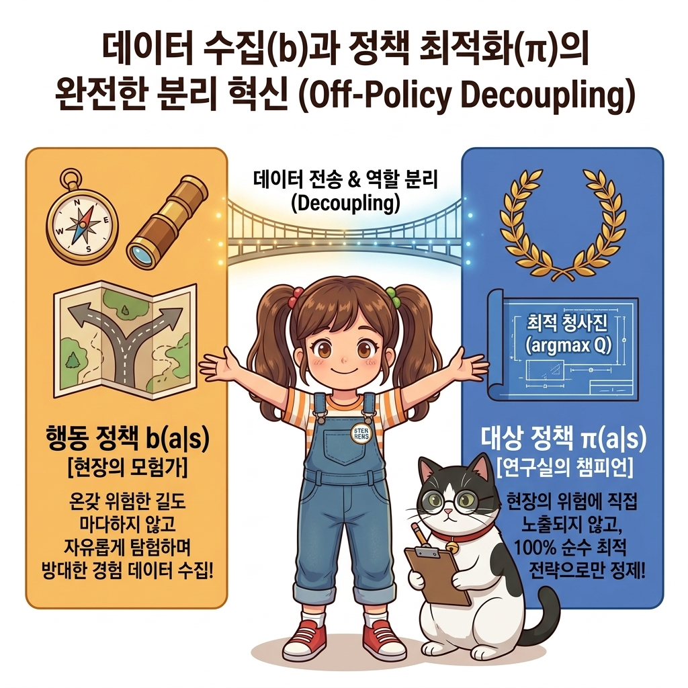
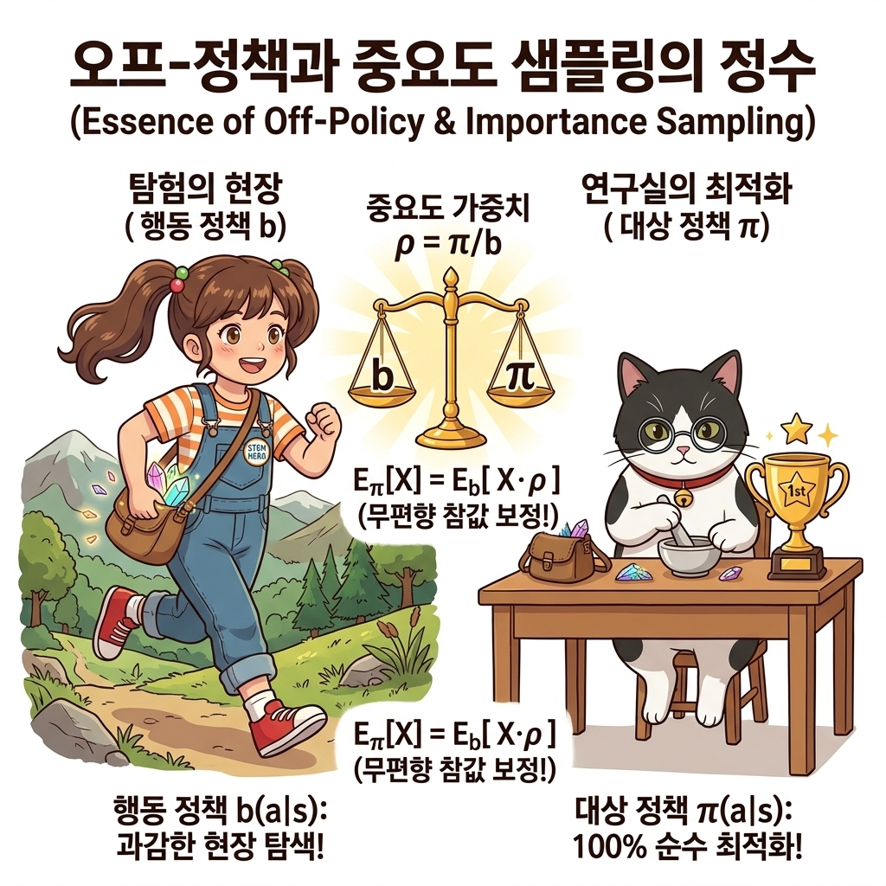
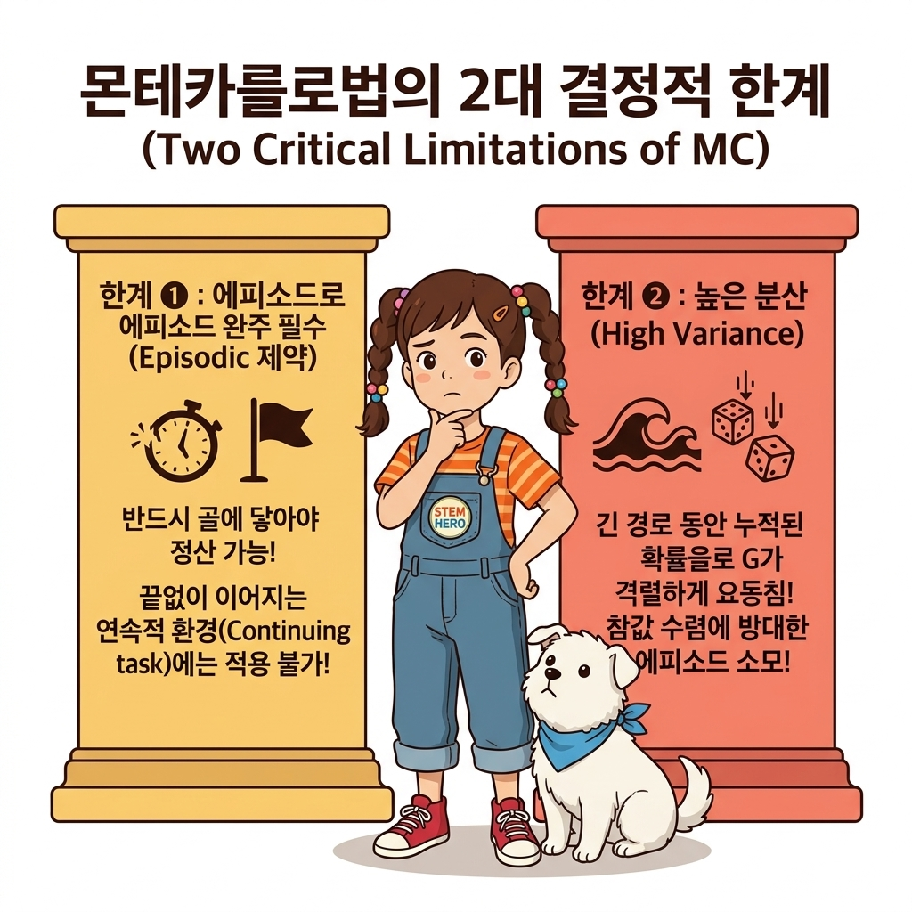

# 09.6 정리
## 경험으로 미지의 세계를 정복한 몬테카를로법 총결산과 10장 TD법으로의 도약

**그림 09-6-Intro** 몬테카를로법 총정리 (이호진 교수와 도로시 탐험대)

- **핵심 목표**: 9장에서 학습한 모델 프리 경험 학습의 전 과정을 총괄 정리하고 차세대 학습 패러다임 조망
- **주요 내용**:
  - 모델 기반(DP) vs 경험 기반(MC) 패러다임의 완벽한 대조
  - 정책 제어의 삼위일체: Q 함수, ε-탐욕, 지수 이동 평균
  - 오프-정책과 중요도 샘플링의 핵심 의의
  - 몬테카를로의 한계(완주 대기, 분산)와 10장 TD(시간차) 학습으로의 필연적 연결

> **[강의 스크립트]**
> 이번 구점육 장에서는 9장 몬테카를로법의 긴 탐험을 마무리하며, 우리가 개척해 온 모델 프리 강화학습의 핵심 원리들을 총정리합니다. 환경의 사전 지도가 없는 완벽한 암흑 속에서도 에이전트의 경험 표본만으로 가치를 평가하고 최적 정책을 제어했던 위대한 성취를 되짚어보고, 몬테카를로의 한계를 극복하기 위해 이어질 10장 시간차 학습으로의 도약을 준비해 보겠습니다.
---

# 09.6 정리
## 09.6 정리 개요

환경 모델을 전혀 모르는 완전한 백지상태에서도 오직 실제 부딪히며 얻은 경험만으로 가치 함수를 평가하고 최적 정책을 자율 제어해 낸 9장의 대장정을 총결산합니다.

**그림 09-6-1** 몬테카를로 정상에 올라 경험 학습의 전체 지도를 벅찬 감동으로 내려다보는 도로시, 지니, 토토

> **[강의 스크립트]**
> 구점육 정리 개요입니다. 환경 모델을 전혀 모르는 백지상태에서도 오직 실제 부딪히며 쌓은 에피소드 경험으로 최적 정책을 찾아내는 몬테카를로 대장정의 정상에 섰습니다. 화면의 일러스트처럼 발아래 펼쳐진 광활한 경험 학습의 전체 지형을 조망하며 핵심 이론을 하나로 꿰어보겠습니다.
---

# 09.6 정리
## 09.6 정리 개요

실제 경험에 기반하여 환경의 전체 지도를 알지 못해도 가치와 최적 경로를 찾아낸 도로시처럼, 다음 장인 10장 TD법(시간차 학습)으로 나아가기 위한 몬테카를로식 통찰을 최종 복습해 봅시다!

**그림 09-6-1b** 9.0 수학적 기초부터 9.5 오프-정책까지 몬테카를로법 정복의 6대 봉우리를 완등한 연구실 4인방

> **[강의 스크립트]**
> 구점영 수학적 기초부터 구점오 오프 정책 중요도 샘플링까지 일곱 개의 관문을 모두 통과했습니다. 주사위 던지기에서 시작된 통계적 아이디어가 어떻게 자율적인 인공지능 제어 시스템으로 완성되었는지 로드맵을 통해 전체 맥락을 점검해 봅시다.
---

# 09.6 정리
## 09.6.1 경험 기반 학습과 모델 프리 패러다임

강화학습에서는 에이전트가 주어진 환경 속에서 실제로 행동하고 거기서 얻은 경험을 바탕으로 더 나은 정책을 스스로 찾아냅니다. 환경과 에이전트의 이러한 역동적인 상호작용이야말로 강화학습이 지도학습이나 비지도학습과 구별되는 가장 본질적인 특징입니다.

**그림 09-6-1c** 에이전트와 환경의 역동적인 상호작용(상태 관측 → 행동 실행 → 보상 획득)과 경험 기반 학습의 본질 인포그래픽

> **[강의 스크립트]**
> 구점육점일 절에서는 경험 기반 학습의 본질을 되짚어봅니다. 에이전트가 환경과 상호작용하며 상태를 관측하고, 행동을 취해 보상을 얻는 동적 루프야말로 강화학습 본연의 정체성입니다. 정답 라벨이 없어도 보상 신호만으로 스스로 지능을 진화시킵니다.
---

# 09.6 정리
## 09.6.1 경험 기반 학습과 모델 프리 패러다임

이번 9장에서 우리가 배운 핵심 기술은 **몬테카를로법(Monte Carlo Method)**이었습니다. 몬테카를로법을 이용하면 환경의 상태 전이 확률 행렬 *p*(*s*&#39; | *s*, *a*)나 보상 함수 *r*(*s*, *a*, *s*&#39;)를 사전에 전혀 알지 못해도, 에이전트가 온몸으로 부딪쳐 수집한 실제 경험 데이터(누적 할인 수익 *G*)의 표본 평균을 계산함으로써 참 가치 함수를 오차 없이 근사적으로 구해낼 수 있습니다.

**그림 09-6-2** 샘플링에서 시작해 역방향 평가, Q 함수 제어, 중요도 샘플링으로 뻗어나가는 몬테카를로 지식 나무

> **[강의 스크립트]**
> 경험 표본 수집에서 시작하여 역방향 수익 정산, 행동 가치 큐 함수를 통한 정책 평가, 그리고 입실론 탐욕 정책 제어로 이어지는 몬테카를로 전체 파이프라인입니다. 모든 과정이 외부 지도가 아닌 에이전트 자신의 발자취만으로 굴러갑니다.
---

# 09.6 정리
## 09.6.1 경험 기반 학습과 모델 프리 패러다임

몬테카를로법의 본질은 **'경험(Experience)에 의한 직접 학습'**입니다:

1. **표본 평균과 대수의 법칙 (Sample Mean & Law of Large Numbers)**:
- 무수히 많은 에피소드를 반복하며 관측된 실제 누적 할인 수익 *G*의 표본 평균을 계산하면, 통계학의 대수의 법칙에 의해 참 기댓값인 가치 함수 *V*(*s*)와 *Q*(*s*, *a*)에 오차 없이 정확히 수렴합니다.

**그림 09-6-2aa** 대수의 법칙에 의한 표본 평균의 수렴: 에피소드 수가 늘어날수록 참 가치 함수에 오차 없이 근사하는 메커니즘

> **[강의 스크립트]**
> 몬테카를로 수렴성의 든든한 헌법은 바로 대수의 법칙입니다. 에피소드 표본이 누적될수록 초기 요동이 상쇄되고 표본 평균이 참 기댓값으로 반듯하게 수렴해 들어가는 수학적 안정성을 항상 기억해야 합니다.
---

# 09.6 정리
## 09.6.1 경험 기반 학습과 모델 프리 패러다임

2. **무편향 추정 (Unbiased Estimation)**:

- 다음 상태의 불확실한 추정 가치에 의존(부트스트랩)하지 않고, 에피소드가 끝날 때까지 실제로 모은 참 보상들의 누적 할인 합 *G*만을 온전하게 사용하므로, 추정치에 어떤 수학적 편향(Bias)도 끼어들지 않습니다.

**그림 09-6-2ab** 부트스트랩 없이 에피소드 완주 참 보상들의 합 G만을 정직하게 사용하여 편향(Bias = 0)을 원천 차단하는 무편향 추정의 원리

> **[강의 스크립트]**
> 몬테카를로법의 가장 큰 강점 중 하나는 부트스트랩을 하지 않는다는 점입니다. 다른 상태의 불완전한 추정치를 빌려 쓰지 않고, 에피소드 완주 시점의 실제 관측 보상들로 계산하므로 어떤 편향도 끼어들지 않는 순수한 무편향 추정치를 얻습니다.
---

# 09.6 정리
## 09.6.1 경험 기반 학습과 모델 프리 패러다임

3. **역방향 누적 연산 (`reversed(memory)`)**:

- 에피소드가 골 지점에서 종료된 후, 배낭에 담아둔 경험 버퍼를 뒤에서부터 거슬러 올라가며 점화식 ***G* ← *γ* · *G* + *R***을 적용함으로써, 중복 연산 없이 단 한 번의 순회로 모든 상태의 수익을 *O*(*T*) 선형 시간에 계산해 내는 극도로 효율적인 파이썬 구현을 완성했습니다.

**그림 09-6-2b** 몬테카를로법의 3대 본질 (대수의 법칙 표본 평균, 편향 없는 참 보상 정산, O(T) 선형 시간 역방향 순회) 입체 인포그래픽

> **[강의 스크립트]**
> 몬테카를로의 삼대 본질 속성을 한눈에 정리했습니다. 대수의 법칙에 기반한 표본 평균의 수렴성, 부트스트랩 없는 무편향 추정, 그리고 환경의 전이 확률을 전혀 요구하지 않는 완전한 모델 프리라는 세 개의 기둥이 강화학습의 혁명을 이끌었습니다.
---

# 09.6 정리
## 09.6.2 동적 프로그래밍(DP) vs 몬테카를로법(MC) 총괄 비교

동적 프로그래밍과 몬테카를로법의 구조적 차이를 종합 비교하면 다음과 같습니다:

**그림 09-6-3** 환경 지도를 펼쳐놓고 연립방정식을 푸는 DP 거울과, 발걸음으로 미로를 직접 개척하는 MC 거울의 대비

> **[강의 스크립트]**
> 구점육점이 절에서는 전통의 거인 동적 프로그래밍과 신흥 강자 몬테카를로법을 전면 비교합니다. 동적 프로그래밍이 온실 속에서 완벽한 지도를 펼쳐놓고 연립방정식을 풀던 계획이었다면, 몬테카를로는 안개 낀 미지의 광야를 직접 겪어보며 지도를 그려나가는 학습입니다.
---

# 09.6 정리
## 09.6.2 동적 프로그래밍(DP) vs 몬테카를로법(MC) 총괄 비교

| 비교 항목 | 📐 동적 프로그래밍 (DP) | 🎲 몬테카를로법 (MC) |
| :--- | :--- | :--- |
| **환경 모델 (Model)** | 상태 전이 확률 *p*(*s*&#39; \| *s*, *a*), 보상 함수 *r* 필수 | **환경 모델 불필요 (Model-Free)** |
| **학습 원천 (Source)** | 벨만 연립방정식의 이론적 수학 전개 | **실제 에피소드 상호작용 경험 샘플 (*G*)** |
| **부트스트랩 (Bootstrap)** | **사용** (다음 상태의 추정 가치 *V*(*s*&#39;)를 빌려 씀) | **미사용** (에피소드 완주 참 수익 *G*만 정직하게 사용) |
| **학습 단위 (Unit)** | 1스텝 상태 전이 기대치 일괄 계산 | **에피소드 완주 단위 (Episodic)** |
| **수렴 속도와 분산** | 편향이 존재할 수 있으나 분산이 0 | **무편향(Unbiased)이나 표본 분산이 큼** |
| **적용 현실성** | 환경 모델을 이미 아는 이상적 시뮬레이션에 국한 | **환경을 모르는 미지의 실세계 로봇/게임 문제에 적용 가능** |

**그림 09-6-3aa** 이상적인 책상 위 모델 기반 DP vs 미지의 거친 현실을 직접 개척하는 모델 프리 MC의 6대 핵심 비교 요약 인포그래픽

> **[강의 스크립트]**
> 두 패러다임의 설계 철학 대조를 보십시오. 이상적인 책상 위에서 벨만 방정식을 풀 것인가, 아니면 불확실성이 가득한 현실의 물리 환경에서 시행착오를 겪으며 경험을 축적할 것인가의 근본적인 차이를 보여줍니다.
---

# 09.6 정리
## 09.6.2 동적 프로그래밍(DP) vs 몬테카를로법(MC) 총괄 비교

동적 프로그래밍은 환경의 완벽한 지도가 주어졌을 때 책상 위에서 연립방정식을 우아하게 풀어내는 방식인 반면, 몬테카를로법은 지도 한 장 없이도 직접 발을 내딛으며 부딪혀가며 지도를 스스로 완성해 가는 방식입니다. 바로 이 점 때문에 몬테카를로법이 진정한 현대 자율 강화학습의 출발점이 됩니다.

**그림 09-6-3b** 모델 유무, 학습 원천, 부트스트랩, 학습 단위 등 6대 핵심 차원으로 정밀 대비한 DP vs MC 인포그래픽

> **[강의 스크립트]**
> 사대 핵심 축 비교표입니다. 환경 모델 유무, 학습 원천, 부트스트랩 여부, 그리고 갱신 단위에서 두 기법은 완벽히 대칭을 이룹니다. 동적 프로그래밍의 한계를 극복하고 현실 문제로 나아가기 위해 몬테카를로가 왜 필연적이었는지를 명쾌하게 보여줍니다.
---

# 09.6 정리
## 09.6.3 정책 제어: Q 함수, *ε*-탐욕, 지수 이동 평균의 삼위일체

몬테카를로법으로 행동 가치 함수 *Q*(*s*, *a*)를 평가할 수 있다면, 이어서 *Q* 함수를 이용하여 정책을 더 우수하게 개선할 수 있습니다. 이 평가와 개선을 번갈아 반복하면 최적 정책에 도달할 수 있습니다:

> **[강의 스크립트]**
> 구점육점삼 절에서는 몬테카를로 정책 제어를 완성한 삼위일체 엔진을 정리합니다. 다음 상태 확률을 몰라도 최적 행동을 고를 수 있게 해주는 행동 가치 큐 함수, 탐험과 이용의 균형을 잡아주는 입실론 탐욕 정책, 그리고 점진적 수렴을 이끄는 지수 이동 평균의 결합입니다.
---

# 09.6 정리
## 09.6.3 정책 제어: Q 함수, *ε*-탐욕, 지수 이동 평균의 삼위일체

1. **행동 가치 함수 *Q*(*s*, *a*)의 채택**:
- 상태 전이 확률을 모를 때는 상태 가치 *V*(*s*)만으로 다음 최적 행동을 선택할 수 없으므로, 환경 모델 없이도 크기 비교(argmax **[강의 스크립트]**
> 정책 제어의 삼대 핵심 수식을 주목하십시오. 아그맥스로 최선의 행동을 찾는 식, 입실론 확률로 새로운 길을 탐색하는 정책 식, 그리고 학습률 알파를 보폭 삼아 점진적으로 가치를 갱신하는 큐 업데이트 식의 조화로운 오케스트라입니다.
---

# 09.6 정리
## 09.6.4 오프-정책과 중요도 샘플링

에이전트의 정책은 역할 측면에서 볼 때, **대상 정책(Target Policy, *π*)**과 **행동 정책(Behavior Policy, *b*)**으로 나뉩니다:

- **온-정책 (On-policy)**: 행동 정책과 대상 정책이 동일 (*π* = *b*). 자신이 직접 뛴 발걸음으로 자신을 학습.
- **오프-정책 (Off-policy)**: 행동 정책과 대상 정책을 분리 (*π* ≠ *b*). 탐험은 행동 정책 *b*에게 맡겨 자유롭게 모험하게 하고, 대상 정책 *π*는 100% 최선의 탐욕 정책만을 순수하게 학습.

**그림 09-6-3ca** 오프-정책의 핵심: 탐험을 도맡는 행동 정책 b와 100% 최선의 활용만을 연구하는 대상 정책 π의 사상적 역할 분리 인포그래픽

> **[강의 스크립트]**
> 구점육점사 절에서는 오프 정책과 중요도 샘플링을 재조명합니다. 안전하고 자유롭게 탐험하는 거동 정책과, 우리가 궁극적으로 달성하려는 백 퍼센트 순수 최적 정책을 완벽하게 분리해 낸 혁신적인 접근법이었습니다.
---

# 09.6 정리
## 09.6.4 오프-정책과 중요도 샘플링

오프-정책에서는 행동 정책 *b*에서 얻은 경험 데이터를 바탕으로 대상 정책 *π*에 대한 기댓값을 계산해야 합니다. 이때 사용하는 통계적 도구가 바로 **중요도 샘플링(Importance Sampling)**입니다:

> **[강의 스크립트]**
> 중요도 샘플링의 핵심 등식을 보십시오. 서로 다른 정책에서 수집된 데이터일지라도, 두 정책의 확률 비율인 로를 가중치로 곱해주기만 하면 다른 사람의 경험으로도 우리 정책의 참 기댓값을 수학적으로 정확히 복원할 수 있습니다.
---

# 09.6 정리
## 09.6.4 오프-정책과 중요도 샘플링

두 정책의 확률 비율인 **중요도 가중치 *ρ*(*x*) = *π*(*x*) / *b*(*x*)**를 각 표본에 곱해줌으로써 다른 분포에서 온 데이터를 목표 정책의 참 기댓값으로 완벽하게 보정합니다. 비록 두 분포가 크게 벌어지면 분산이 폭발하는 문제가 발생하지만, 분포를 가깝게 조율함으로써 안정적인 근사를 달성할 수 있습니다.

**그림 09-6-3d** 오프-정책의 정수: 탐험과 최적화의 역할 분담 및 중요도 가중치 ρ로 다른 분포 데이터를 완벽 보정하는 메커니즘 인포그래픽

> **[강의 스크립트]**
> 오프 정책이 선사하는 삼대 강점입니다. 탐색 실수 없는 완벽한 결정론적 최적 정책 학습, 과거의 경험 데이터 재활용, 그리고 사람 전문가의 주행 데이터를 통한 모방 학습까지 심층 강화학습으로 나아가는 문을 활짝 열어주었습니다.
---

# 09.6 정리
## 09.6.5 몬테카를로법의 한계와 10장 TD법(시간차 학습)으로의 가교

몬테카를로법은 모델 프리 강화학습의 신기원을 열었지만, 현대 인공지능이 마주하는 복잡한 환경에서는 2가지 결정적인 한계점을 가지고 있습니다:

**그림 09-6-4** 에피소드 완주를 기다리는 몬테카를로의 문을 지나, 매 스텝 실시간으로 학습하는 시간차 학습(TD)의 다리로 나아가는 도로시와 토토

> **[강의 스크립트]**
> 구점육점오 절에서는 몬테카를로의 치명적인 두 가지 한계를 짚어봅니다. 에피소드가 끝날 때까지 하염없이 기다려야 한다는 점과, 긴 에피소드 동안 여러 무작위성이 곱해지며 분산이 지나치게 커진다는 현실적인 장벽입니다.
---

# 09.6 정리
## 09.6.5 몬테카를로법의 한계와 10장 TD법(시간차 학습)으로의 가교

1. **에피소드 완주 필수 (Episodic 제약)**:
- 에피소드가 완전히 끝날 때까지 기다려야만 비로소 누적 할인 수익 *G*를 계산할 수 있습니다. 따라서 주식 거래나 자율주행 자세 제어처럼 에피소드가 끝나지 않고 영구히 지속되는 연속적(Continuing) 환경에서는 몬테카를로법을 적용할 수 없습니다.
2. **높은 분산 (High Variance)**:
- 에피소드가 길어질수록 수많은 확률적 상태 전이와 행동 선택의 보상이 곱해지고 더해지며 누적 수익 *G*의 분산이 매우 커집니다. 분산이 크면 참 기댓값에 수렴하기 위해 수만 번 이상의 방대한 에피소드 표본이 필요합니다.

**그림 09-6-4b** 몬테카를로법의 2대 결정적 한계: 에피소드 완주 대기 피로(Episodic 제약)와 누적곱으로 인한 높은 분산(High Variance) 인포그래픽

> **[강의 스크립트]**
> 두 가지 결정적 한계의 상세 구조도입니다. 에피소드가 끝나지 않는 연속 과제에는 적용할 수 없고, 분산이 크기 때문에 수렴에 지나치게 많은 표본이 필요합니다. 바로 이 한계를 깨부수기 위해 10장에서 시간차 학습이 등장하게 됩니다.
---

# 09.6 정리
## 09.6.5 몬테카를로법의 한계와 10장 TD법(시간차 학습)으로의 가교

**그림 09-6-5** 이호진 교수님이 엄지 척을 하며 9장 몬테카를로법을 우수하게 마스터한 도로시에게 수료증을 수여하고, 조교 지니와 토토와 함께 찬란한 무지개다리로 이어진 '10장 TD법(시간차 학습)'을 향해 힘찬 출발을 응원하는 장면

> **[강의 스크립트]**
> 9장의 위대한 여정을 완주하신 여러분을 진심으로 축하합니다. 모델 프리 강화학습의 수학적 기원부터 파이썬 실전 구현까지 온전히 여러분의 지식으로 체화되었습니다.
---

# 09.6 정리
## 09.6.5 몬테카를로법의 한계와 10장 TD법(시간차 학습)으로의 가교

이러한 몬테카를로법의 한계를 극복하기 위해 등장하는 차세대 혁신이 바로 **10장 시간차 학습(Temporal Difference, TD법)**입니다!

> **[강의 스크립트]**
> 칠판의 삼대 패러다임 브릿지를 보십시오. 동적 프로그래밍의 부트스트랩 장점과, 몬테카를로의 모델 프리 장점을 하나로 결합한 최강의 하이브리드, 그것이 바로 다음 장에서 배울 시간차 학습, 즉 티디 학습입니다.
---

# 09.6 정리
## 09.6.6 핵심 정리: 9장 몬테카를로 완주 3대 금자탑

**그림 09-6-6** 몬테카를로 3대 금자탑을 세우고, 찬란하게 열린 10장 시간차 학습의 황금 문을 향해 당당하게 걸어가는 도로시와 지니

> **[강의 스크립트]**
> 구점육점육 절 총결산입니다. 무모델 패러다임의 확립, 파이썬 엔지니어링 구현 완성, 그리고 오프 정책 이론 정복이라는 삼대 금자탑을 우리는 훌륭히 세워냈습니다.
---

# 09.6 정리
## 09.6.6 핵심 정리: 9장 몬테카를로 완주 3대 금자탑

1. **모델 프리 가치 평가의 달성 (Model-Free Evaluation)**:
- 환경의 전이 확률 행렬 *P*를 몰라도, 실제 에피소드를 밟아 얻은 누적 할인 수익 *G*의 표본 평균만으로 참 가치 함수에 완벽히 수렴함을 증명했습니다.
2. **행동 가치 기반 정책 제어 (Q-Control & *ε*-Greedy)**:
- *Q*(*s*, *a*) 함수를 채택하여 환경 모델 없이 즉각적인 탐욕화를 수행하고, *ε*-탐욕 정책으로 탐색을 보장하며, 지수 이동 평균(*α*)으로 비정상 환경에 민첩하게 적응하는 자율 제어 루프를 완성했습니다.
3. **오프-정책과 중요도 샘플링 (Off-Policy & Importance Sampling)**:
- 행동하는 정책과 학습하는 목표 정책을 분리하고 중요도 가중치 *ρ*로 정산함으로써, 탐험과 최적화라는 두 마리 토끼를 동시에 잡는 현대 강화학습의 핵심 패러다임을 확립했습니다.

**그림 09-6-6b** 9장 몬테카를로법이 세운 3대 위대한 금자탑(모델 프리 평가, Q 함수 자율 제어, 오프-정책 중요도 샘플링) 황금 기념비 인포그래픽

> **[강의 스크립트]**
> 삼대 금자탑 인포그래픽을 통해 여러분이 성취한 이론적, 실전적 도약을 한 번 더 정리해 두시기 바랍니다.
---

# 09.6 정리
## 09.6.6 핵심 정리: 9장 몬테카를로 완주 3대 금자탑

> **[강의 스크립트]**
> 이호진 교수님의 9장 종강 멘토링 노트입니다. 완벽한 지도가 주어지지 않는 험난한 현실에서도 에이전트의 작은 발걸음과 경험이 모이면 우주의 참된 가치에 도달할 수 있다는 몬테카를로의 교훈을 가슴에 깊이 새겨두십시오.
---

# 09.6 정리
## 09.6.6 핵심 정리: 9장 몬테카를로 완주 3대 금자탑

> **[강의 스크립트]**
> 지니와 함께하는 완강 축하 파티입니다. 9장의 단단한 기초를 완벽히 다진 여러분은 이제 강화학습의 진정한 심장부인 10장 시간차 학습과 11장 심층 큐러닝으로 거침없이 나아갈 준비를 마쳤습니다. 대단히 수고 많으셨습니다.