# CHAPTER 9 몬테카를로법

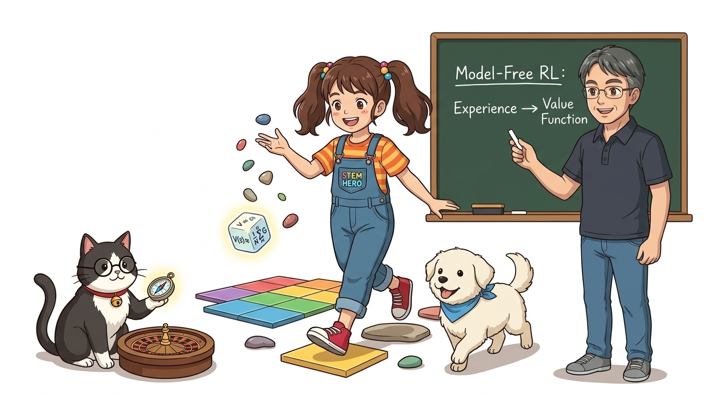

---

## 09.0.1 경험으로 미지의 세계를 탐험하는 진정한 강화학습

동적 프로그래밍(DP)은 환경의 규칙과 확률 분포를 완벽하게 알고 있다는 가정하에 최적 정책을 계산해냈습니다. 하지만 우리가 마주하는 현실 세계는 지도가 주어지지 않는 미지의 광야와 같습니다. 이제 우리는 환경 모델이라는 사전 지식 없이, 오직 에이전트가 환경과 직접 부딪치며 쌓은 '경험(Experience)' 데이터만으로 가치를 평가하고 최적 정책을 찾아 나서는 진정한 강화학습의 영역으로 진입합니다.

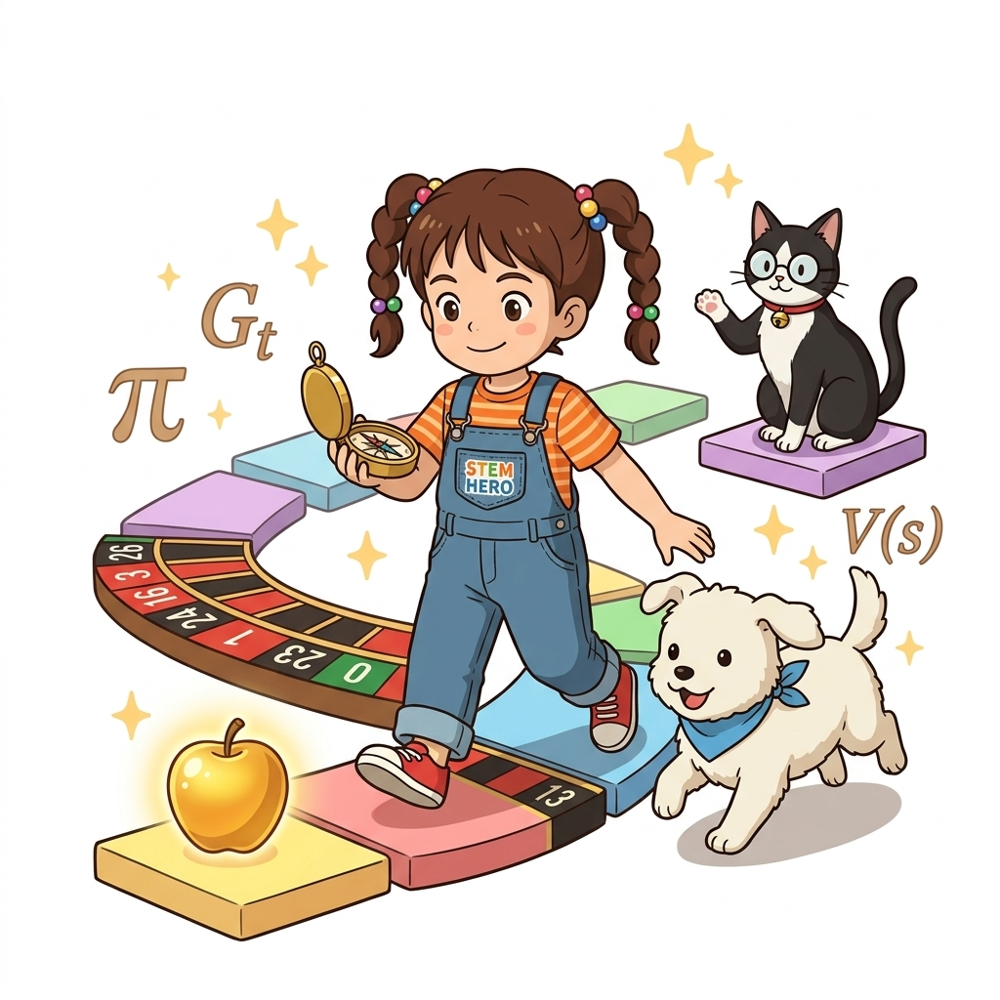
**그림 09-Intro-1** 거대한 카지노 룰렛과 그리드 타일 징검다리를 나침반을 들고 탐험하는 도로시와 토토, 조교 지니의 몬테카를로 대모험

동적 프로그래밍이 모든 확률과 보상 규칙이 투명하게 공개된 온실 속에서의 계획(Planning)이었다면, 몬테카를로법은 안개 낀 미지의 세상에서 에이전트가 직접 발을 내딛고 넘어져 보며 스스로 길을 개척하는 학습(Learning)입니다.

- **동적 프로그래밍(DP)에서 몬테카를로(MC)로의 도약**:
  - 완벽한 환경 모델(지도)이 주어진 이상적인 세계에서, 아무런 사전 정보가 없는 현실 세계로의 전환
  - 환경의 물리적 법칙이나 내부 메커니즘을 몰라도 실제 행동 결과(Sample)를 축적하여 최적해 도출 가능
- **진정한 강화학습의 출발점**:
  - 교사나 정답 라벨 없이, 환경과의 상호작용에서 주어지는 보상 신호만으로 스스로 지능을 발전시킴
  - 몬테카를로법은 이후 이어질 TD 학습, Q-러닝, DQN 등 현대 무모델(Model-Free) 강화학습의 사상적 뿌리
- 💡 **핵심 통찰**: "지도가 없다고 해서 길을 찾지 못하는 것은 아닙니다. 한 걸음씩 발을 내딛고 경험을 기록하면, 그 경험의 통계적 평균이 가장 정확한 나침반이 됩니다."


**그림 09-Intro-1b** 모델 기반 온실 속 계획(DP)에서 실제 경험 기반의 광야 개척(MC)으로의 거대한 패러다임 전환 브릿지 인포그래픽

---

## 09.0.2 동적 프로그래밍(DP)의 복습과 완벽한 환경 모델의 전제

동적 프로그래밍으로 벨만 방정식을 풀기 위해서는 반드시 두 가지 핵심 수학 함수가 사전에 완벽히 주어져야만 했습니다. 바로 상태 전이 확률 $p(s' \mid s, a)$와 즉각 보상 함수 $r(s, a, s')$입니다. 강화학습 이론에서는 이 두 요소를 합쳐 **'환경 모델(Environment Model)'**이라고 부릅니다.

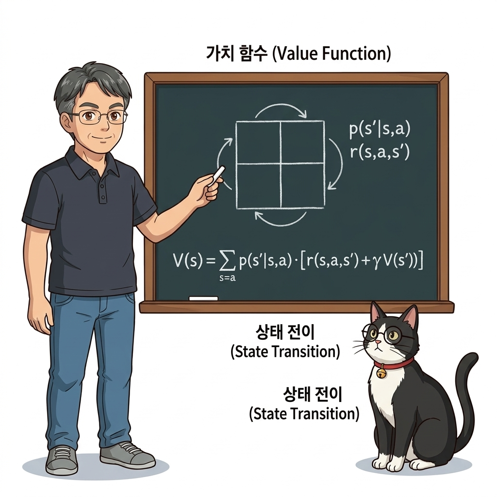
**그림 09-Intro-2** 칠판 앞에서 상태 전이 확률과 보상 함수의 환경 모델을 열정적으로 강의하는 이호진 교수님과 조교 지니

동적 프로그래밍에서 벨만 기대 방정식을 연립방정식으로 풀어낼 수 있었던 이유는, 현재 위치에서 특정 행동을 취했을 때 어느 상태로 몇 퍼센트 확률로 이동하는지, 그리고 어떤 보상을 받는지에 대한 전체 확률 지도가 주어져 있었기 때문입니다.

- **환경 모델의 두 기둥**:
  - **상태 전이 확률 $p(s' \mid s, a)$**: 상태 $s$에서 행동 $a$를 취했을 때 다음 상태 $s'$에 도달할 조건부 확률 분포
  - **보상 함수 $r(s, a, s')$**: 상태 전이가 일어날 때 환경이 에이전트에게 지급하는 즉각적인 보상 수식
- **벨만 방정식의 해법 메커니즘**:
  - 환경 모델이 주어지면 기댓값 수식을 명시적인 가중합(연립방정식)으로 전개 가능
  - 환경 내 모든 상태의 가치를 오차 없이 수학적으로 계산
- 💡 **핵심 요약**: 동적 프로그래밍은 환경의 모든 물리 법칙과 보상 분포를 사전에 100% 알고 있다는 전제하에서만 성립하는 '모델 기반(Model-Based)' 기법이었습니다.

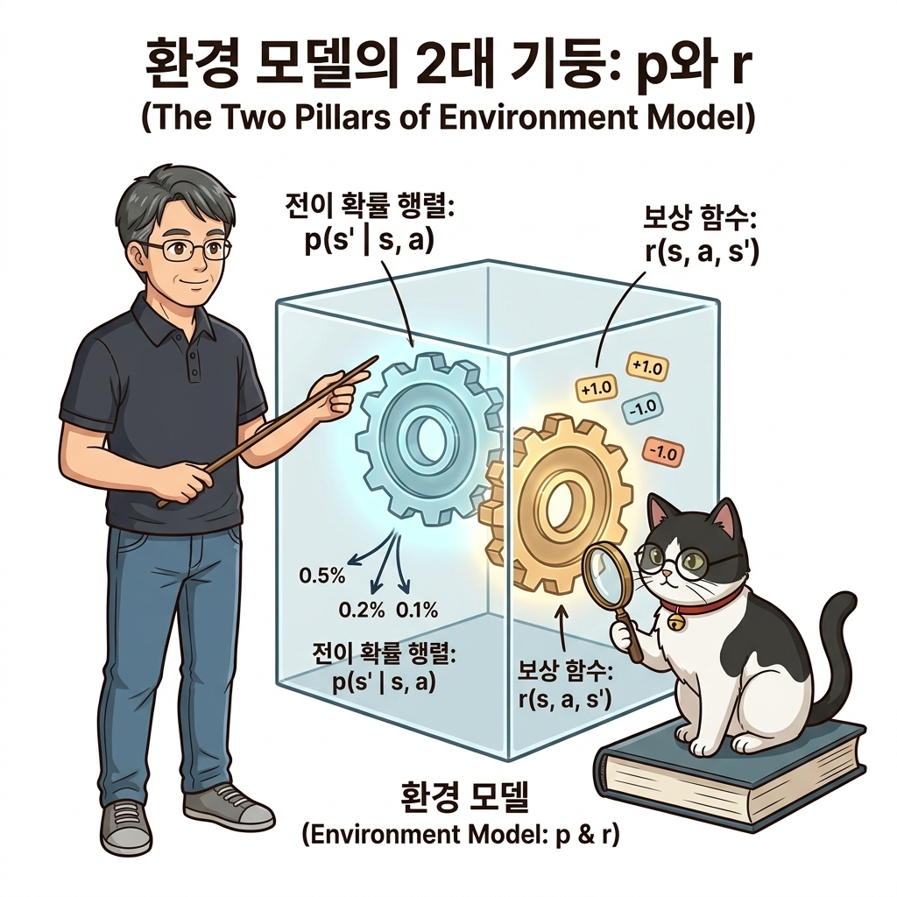
**그림 09-Intro-2b** 모델 기반 강화학습(DP)의 필수 전제: 상태 전이 확률 $p(s' \mid s, a)$와 보상 함수 $r(s, a, s')$의 내부 메커니즘 인포그래픽

---

## 09.0.3 현실 세계의 벽과 모델 프리(Model-Free)의 필연성

하지만 현실 세계의 복잡한 문제들은 환경 모델을 수학적으로 엄밀하게 기술하는 것이 사실상 불가능합니다. 바둑판의 가능한 상태 수는 우주 전체의 원자 수보다 많으며, 자율주행차가 주행하는 도로는 날씨, 노면 상태, 보행자의 돌발 행동 등 셀 수 없이 많은 불확실성으로 가득 차 있습니다.


**그림 09-Intro-3** 안개 낀 미지의 그리드 월드 앞에서 나침반을 들고 고민하는 도로시와 호기심 가득한 토토

비가 내리고 빙판길이 있는 도로에서 핸들을 15도 꺾었을 때 차량의 다음 위치 좌표를 나타내는 물리적 확률 분포를 완벽하게 수식화할 수 있을까요? 설령 수식을 세운다 하더라도 계산량이 폭발하여 컴퓨터 연산으로 해결할 수 없습니다. 따라서 현대 강화학습은 환경의 수학적 모델을 몰라도 해결할 수 있는 **'모델 프리(Model-Free)'** 접근법을 채택하게 되었습니다.

- **현실 세계에서 환경 모델을 정의하기 어려운 이유**:
  - **차원의 저주와 복잡성 폭발**: 상태 공간이 방대해지면 전이 확률 행렬을 메모리에 저장하는 것조차 불가능
  - **물리적 불확실성**: 기상 변화, 주식 시장의 흐름, 상대방의 심리 등은 단일 수식으로 모델링 불가
- **모델 프리(Model-Free)의 혁신**:
  - 상태 전이 확률 $p$와 보상 함수 $r$의 명시적 수식이 전혀 필요 없음
  - 환경을 블랙박스로 취급하고, 오직 행동을 입력하여 돌아오는 관찰 결과(상태, 보상)만으로 학습
- 💡 **핵심 통찰**: 복잡한 미분 방정식이나 확률 분포를 전부 유도하지 않아도, 현실 속에서 직접 겪은 상호작용 결과들을 관찰하는 것만으로 충분히 최적의 의사결정을 학습할 수 있습니다.

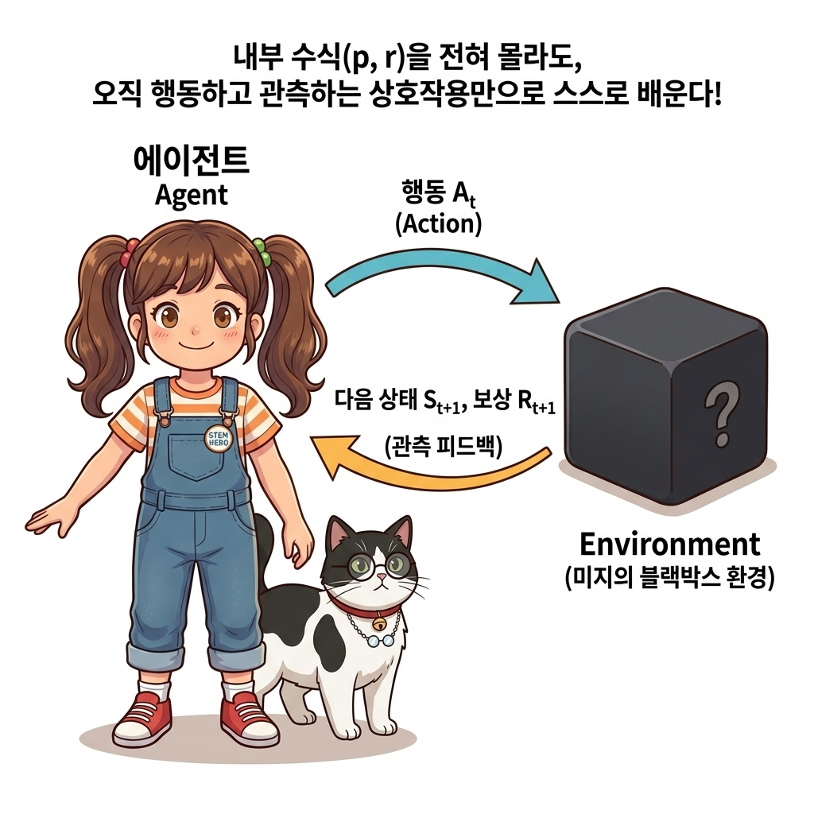
**그림 09-Intro-3b** 모델 프리(Model-Free) 패러다임: 복잡한 내부 수식을 몰라도 행동(Action)을 입력하고 상태/보상 피드백을 관찰하여 최적 정책을 학습하는 시스템 구조도

---

## 09.0.4 강화학습의 돌파구: '경험' 데이터의 수집과 가치

환경 모델을 모른다면 에이전트는 무엇을 기반으로 학습해야 할까요? 해답은 바로 **'경험(Experience)'**입니다. 에이전트가 특정 상태에서 어떤 행동을 취했고, 그 결과 어떤 다음 상태에 도달하여 얼마의 보상을 받았는지를 순차적으로 기록한 시계열 데이터가 학습의 나침반이 됩니다.


**그림 09-Intro-4** 돋보기로 발자국 궤적과 타일 데이터를 흥미진진하게 살피는 도로시와 수첩에 메모하는 조교 지니

출발점에서 오른쪽으로 이동했더니 보상이 0이었고, 위로 전진했더니 목표 지점에 도달해 +1.0의 보상을 얻었다는 구체적인 사실들의 나열, 즉 '상태, 행동, 보상'의 궤적이 바로 강화학습에서 말하는 경험입니다.

- **경험(Experience)의 정의**:
  - 에이전트와 환경이 매 타임스텝마다 주고받은 상호작용의 순차적 기록
  - 1스텝 전이 데이터 튜플: $(S_t, A_t, R_{t+1}, S_{t+1})$
- **에피소드 궤적 (Trajectory)**:
  - 시작 상태 $S_0$부터 종료 상태 $S_T$까지 에이전트가 지나온 전체 여정의 기록
  - $\tau = (S_0, A_0, R_1, S_1, A_1, R_2, \dots, S_{T-1}, A_{T-1}, R_T, S_T)$
- 💡 **핵심 요약**: 강화학습에서 경험은 단순한 과거의 기록이 아니라, 환경의 숨겨진 물리 법칙과 보상 구조를 통계적으로 복원해내는 가장 값진 데이터 자산입니다.

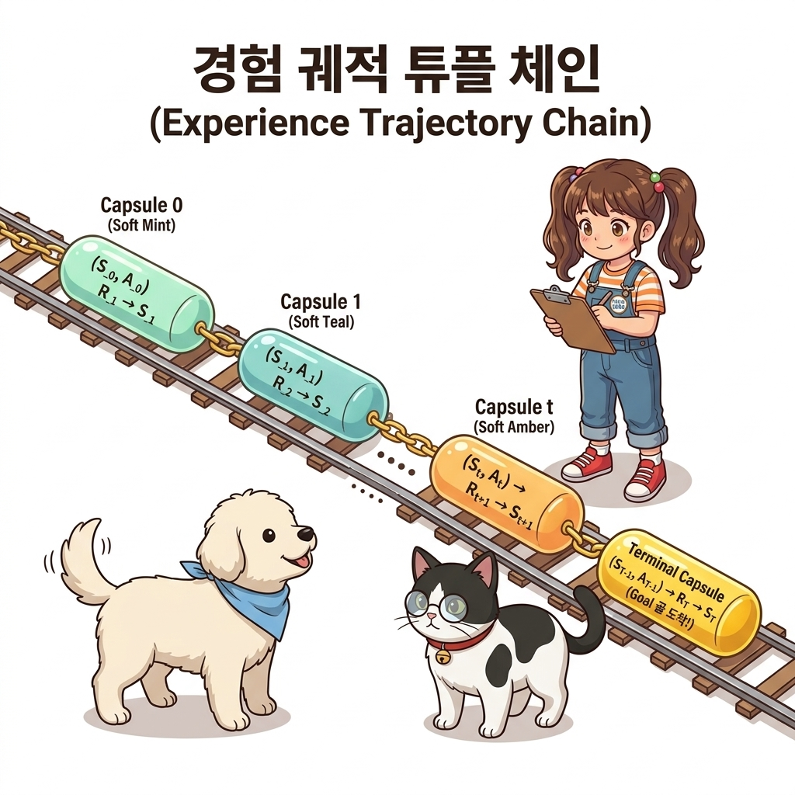
**그림 09-Intro-4b** 에피소드 경험 궤적(Trajectory): $(S_t, A_t, R_{t+1}, S_{t+1})$ 튜플들의 연속적인 시계열 사슬 구조 인포그래픽

---

## 09.0.5 몬테카를로법의 본질: 무작위 샘플링과 대수의 법칙

'몬테카를로(Monte Carlo)'라는 이름은 지중해 모나코의 유명한 카지노 도시에서 유래했습니다. 룰렛이나 주사위처럼 무작위성이 지배하는 게임에서 착안하여, **수많은 무작위 표본(Sample)을 반복 추출하고 그 평균값으로 참값을 추정하는 수학적 통계 기법**을 뜻합니다.

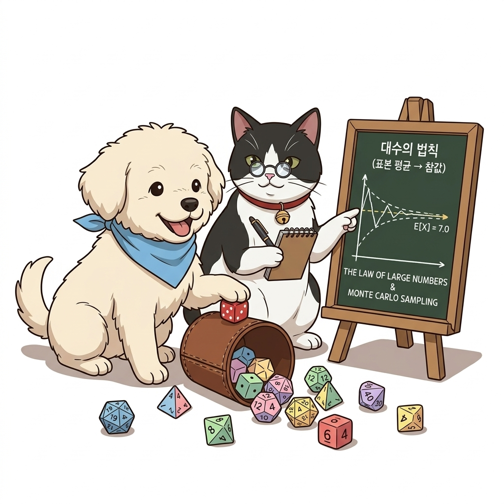
**그림 09-Intro-5** 컵에서 쏟아져 나온 알록달록 주사위들을 굴리며 노는 토토와 안경을 쓰고 관찰하는 조교 지니

주사위 두 개를 던졌을 때 눈의 합의 기댓값이 7이라는 것은 이론적인 수식으로도 계산할 수 있지만, 실제로 주사위를 수백 번, 수천 번 굴려 그 합의 산술 평균을 구해도 정확히 7에 도달합니다. 시행 횟수가 적을 때는 평균값이 위아래로 크게 흔들리지만, 표본이 쌓일수록 오차 없이 참값으로 수렴합니다. 이것이 바로 통계학의 위대한 **대수의 법칙(Law of Large Numbers)**입니다.

- **몬테카를로 계산의 3단계 메커니즘**:
  1. **무작위 표본 추출 (Sampling)**: 에이전트가 환경 속에서 에피소드를 무작위로 여러 번 완주
  2. **표본값 기록**: 각 시행에서 얻은 결과값인 누적 수익($G$)을 수집
  3. **산술 평균 계산**: 수집된 누적 수익들의 평균을 계산하여 상태의 참 가치 $v_\pi(s)$로 추정
- **대수의 법칙 (Law of Large Numbers)**:
  - 표본의 수 $N$이 증가할수록, 표본 평균은 모집단의 참 기댓값 $\mathbb{E}[X]$에 오차 없이 수렴
  - 수식: $V(s) = \frac{1}{N} \sum_{i=1}^N G_i(s) \xrightarrow{N \to \infty} v_\pi(s)$
- 💡 **핵심 통찰**: 아무리 복잡한 고차원 적분식이라도, 주사위를 충분히 많이 던져 평균을 내면 누구나 정확한 참값을 구해낼 수 있습니다.

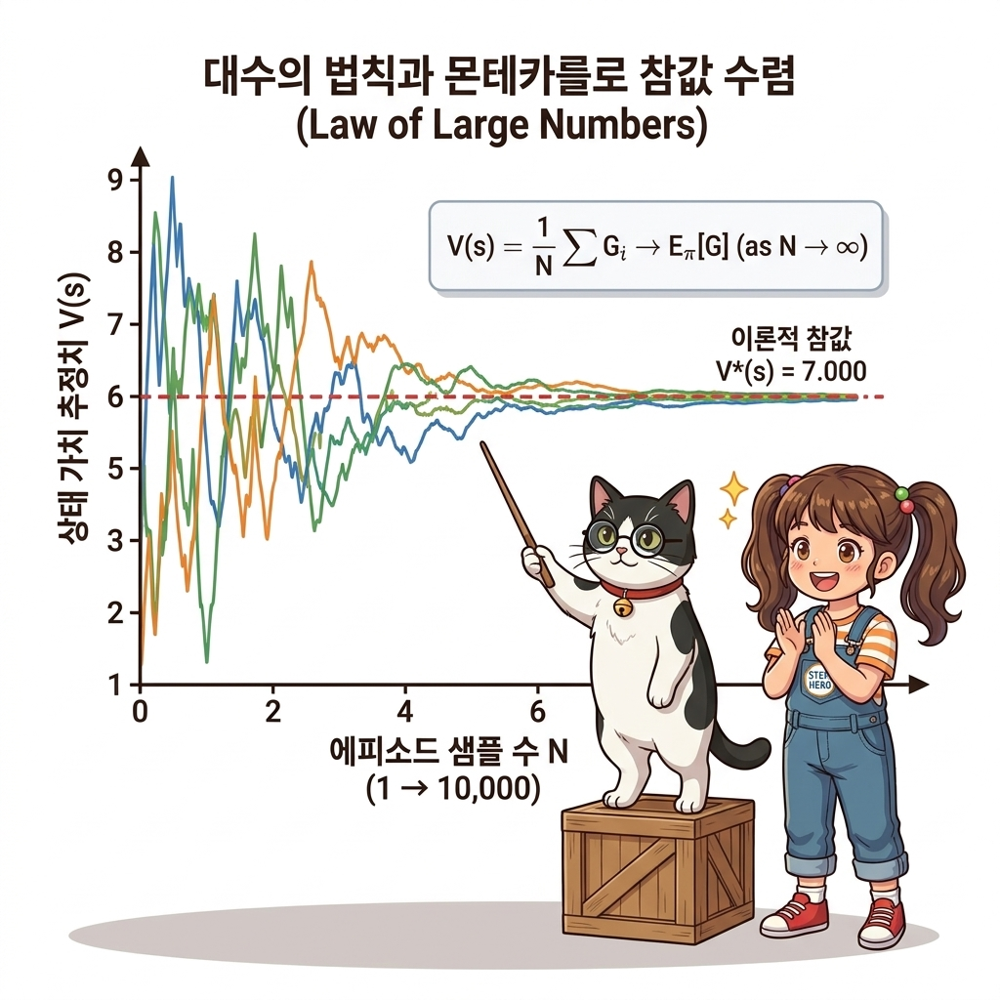
**그림 09-Intro-5b** 대수의 법칙 통계 그래프: 표본 수 $N$이 증가함에 따라 요동치던 표본 평균이 참 기댓값 수평선에 오차 없이 수렴하는 시뮬레이션 곡선

---

## 09.0.6 에피소드 완주와 역방향 수익(Return) 계산 메커니즘

몬테카를로법이 동적 프로그래밍이나 다른 기법들과 구별되는 결정적인 특징은 **'에피소드가 끝날 때까지 기다린다'**는 점입니다. 중간 상태에서 다른 상태의 불완전한 추정치를 빌려 쓰지 않고, 에피소드가 목표 지점에 도달하거나 종료될 때까지 상호작용한 뒤, 마지막 순간부터 시간을 거꾸로 거슬러 올라가며 실제 누적 수익 $G_t$를 정산합니다.

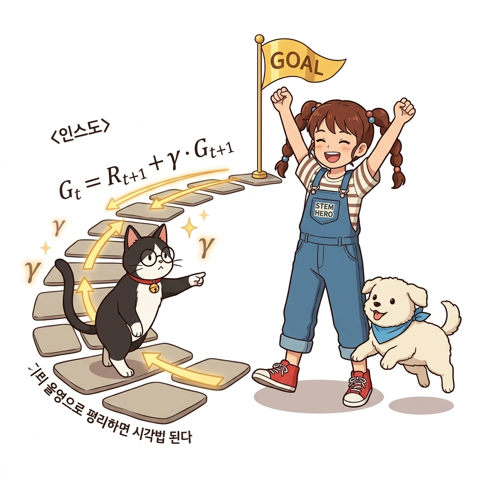
**그림 09-Intro-6** 골인 지점에서 환호하는 도로시와 출발점을 향해 역방향으로 시간을 거슬러 올라가는 궤적을 짚어주는 조교 지니

여행이 완전히 끝나고 집에 돌아왔을 때 여정 전체의 만족도를 가장 정직하게 평가할 수 있듯이, 몬테카를로 에이전트는 종료 시점까지 얻은 모든 실제 보상을 온전히 확인한 후 가치를 평가합니다.

- **부트스트랩(Bootstrapping)의 배제**:
  - DP는 다음 상태의 '추정 가치'를 가져와 현재 가치를 갱신함 (부트스트랩 사용)
  - 몬테카를로는 추정치가 아닌, 에피소드가 끝나서 확정된 **실제 총수익(Return $G$)**만을 순수하게 사용
- **역방향 계산(Reversed Calculation)의 효율성**:
  - 누적 수익 점화식: $G_t = R_{t+1} + \gamma G_{t+1}$
  - 마지막 스텝 $T-1$부터 시작점 $t=0$까지 역순으로 전진하면, 중복 덧셈 없이 단 한 번의 순회만으로 모든 타임스텝의 수익 $G_t$를 $\mathcal{O}(T)$ 선형 시간에 계산 완료
- 💡 **핵심 요약**: 끝까지 도달해본 경험만이 전체 여정의 진짜 가치를 증명합니다. 몬테카를로는 완주된 실제 결과를 토대로 편향(Bias) 없는 가치 평가를 수행합니다.

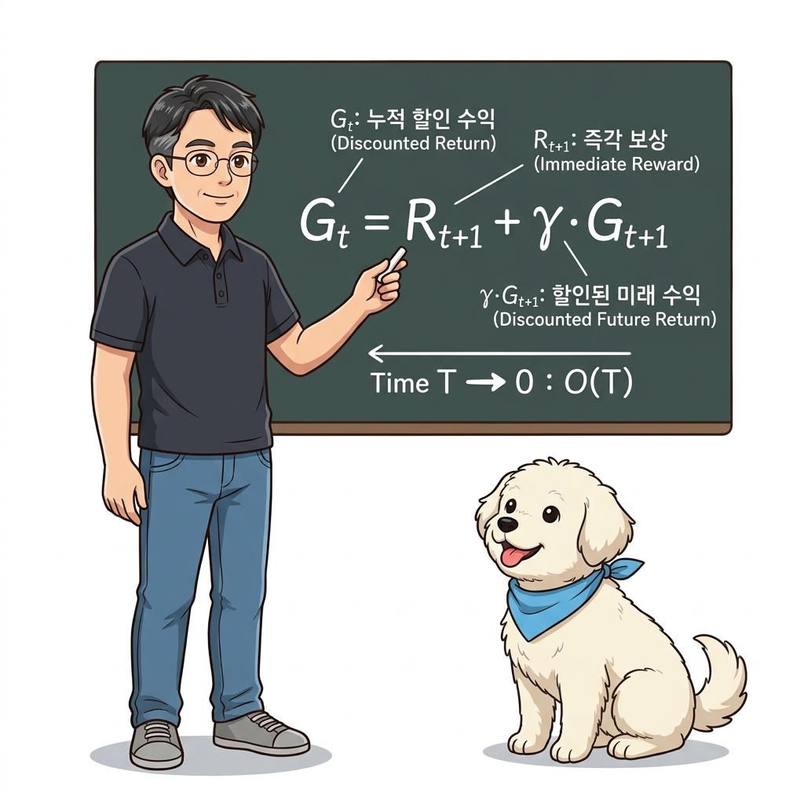
**그림 09-Intro-6b** 역방향 할인 수익 점화식 $G_t = R_{t+1} + \gamma G_{t+1}$ 수식 분해 및 $\mathcal{O}(T)$ 선형 시간 순회 원리 인포그래픽

---

## 09.0.7 모델 패러다임의 전환: 분포 모델 vs 샘플 모델

강화학습에서 환경을 수학적으로 정의하는 관점은 **'분포 모델(Distribution Model)'**과 **'샘플 모델(Sample Model)'**로 나뉩니다. 동적 프로그래밍이 주사위의 36가지 모든 확률 분포표를 펼쳐놓고 계산하는 분포 모델이었다면, 몬테카를로법은 주사위를 직접 굴려 나오는 결과를 관찰하는 샘플 모델의 대표 주자입니다.

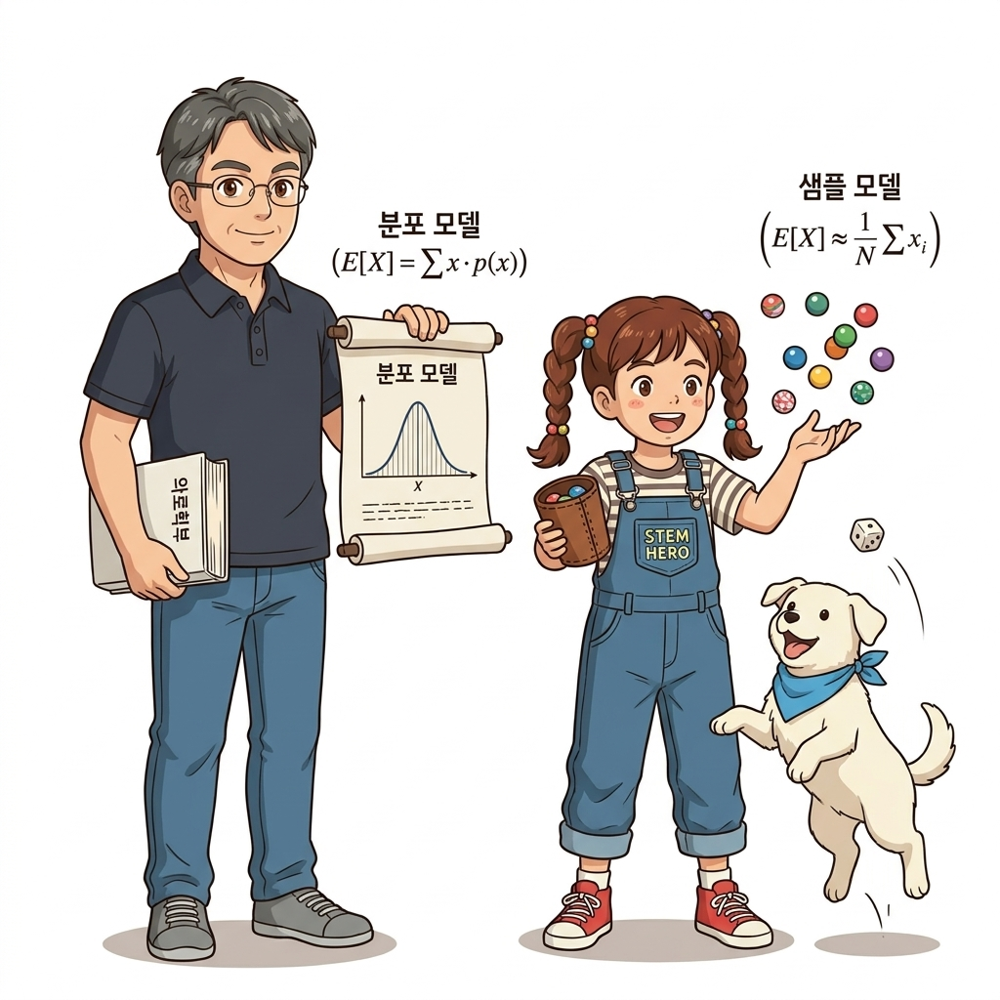
**그림 09-Intro-7** 이론 책을 든 이호진 교수님(분포 모델)과 주사위 컵과 표본 구슬을 든 도로시와 토토(샘플 모델)의 대비

분포 모델은 모든 경우의 수와 전이 확률을 수식으로 완벽히 알고 있어야 하므로 현실의 복잡한 문제에 적용하기 어렵습니다. 반면 샘플 모델은 환경 내부의 세부 물리 공식을 몰라도, 시뮬레이터를 실행하여 결과(Sample)를 생성할 수만 있다면 얼마든지 가치를 추정할 수 있습니다.

| 비교 항목 | 📐 분포 모델 (Distribution Model) | 🎲 샘플 모델 (Sample Model) |
| :--- | :--- | :--- |
| **대표 알고리즘** | 동적 프로그래밍 (DP), 벨만 연립방정식 | **몬테카를로법 (MC)**, TD 학습 |
| **필수 전제 조건** | 상태 전이 확률 $p$와 보상 함수 $r$ 완벽 파악 | 확률 분포식 불필요, **시행(시뮬레이터)만 가능하면 됨** |
| **기댓값 계산식** | $\mathbb{E}[X] = \sum x \cdot p(x)$ (가중합 수학 연산) | $\mathbb{E}[X] \approx \frac{1}{N} \sum_{i=1}^N x_i$ (표본 산술 평균) |
| **현실 적용성** | 상태 공간이 크거나 복잡하면 적용 불가 | 복잡한 아케이드 게임, 로봇 제어, 자율주행 전반에 적용 가능 |

- 💡 **핵심 통찰**: 복잡한 시스템 내부의 모든 톱니바퀴 수식을 풀지 못하더라도, 시스템을 작동시켜 얻은 출력 결과의 빈도를 집계하는 것만으로 전체 시스템의 통계적 특성을 완벽히 장악할 수 있습니다.

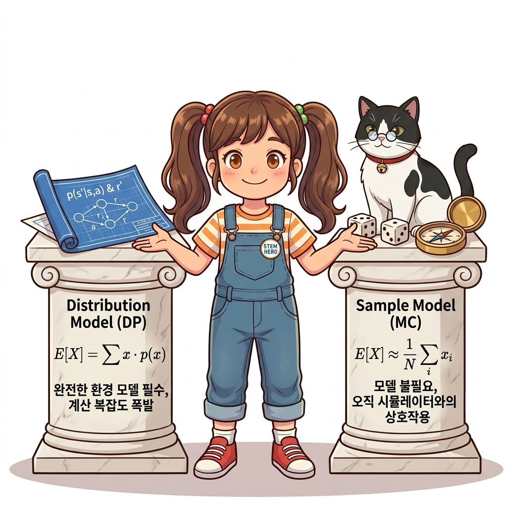
**그림 09-Intro-7b** 분포 모델(이론적 확률 분포 전수 합산) vs 샘플 모델(실제 표본 경험 산술 평균) 4대 축 비교 인포그래픽

---

## 09.0.8 에이전트의 step 메서드와 메모리 버퍼 궤적 저장

파이썬 코드로 몬테카를로 에이전트를 구현할 때 핵심 뼈대를 이루는 구조는 **`env.step()`에 의한 환경 상호작용**과 **메모리 버퍼(`agent.memory`)에 경험을 적재하는 메커니즘**입니다.


**그림 09-Intro-8** 연구실 워크벤치에서 파이썬 코딩을 하는 도로시와 모니터 화면을 함께 검토하는 조교 지니

에이전트는 환경 속에서 발걸음을 내딛을 때마다 `env.step()`을 호출하여 다음 상태와 보상을 받아옵니다. 그리고 이 경험들을 즉시 소모하지 않고 `agent.add()`를 통해 파이썬 리스트에 튜플 형태로 차곡차곡 보관합니다. 에피소드가 종료되는 순간(`done == True`), 비로소 메모리에 담긴 전체 궤적을 꺼내어 역방향으로 가치를 갱신합니다.

```python
# 에이전트와 환경의 1스텝 상호작용 루프
action = agent.get_action(state)                  # 1. 현재 정책에 따른 행동 선택
next_state, reward, done = env.step(action)        # 2. 환경에서 한 걸음 실행 및 피드백 수신
agent.add(state, action, reward)                   # 3. 메모리 버퍼에 경험 튜플 저장
state = next_state                                 # 4. 다음 상태로 상태 갱신
```

- **코드 구조의 3대 핵심 단계**:
  1. `get_action(state)`: 현재 상태에서 탐색(Exploration)과 이용(Exploitation)을 고려하여 행동 결정
  2. `env.step(action)`: 환경에 행동을 전달하고 다음 상태, 즉각 보상, 종료 플래그(`done`) 반환
  3. `agent.add(...)`: 한 에피소드가 끝날 때까지 튜플 형태로 메모리 리스트에 순차 적재
- 💡 **핵심 요약**: 복잡해 보이는 몬테카를로 알고리즘도 본질은 간결합니다. 파이썬 리스트(`memory`)에 한 스텝씩 경험을 채워 넣고, 에피소드가 끝나면 한 번에 정산하는 직관적인 루프로 완성됩니다.

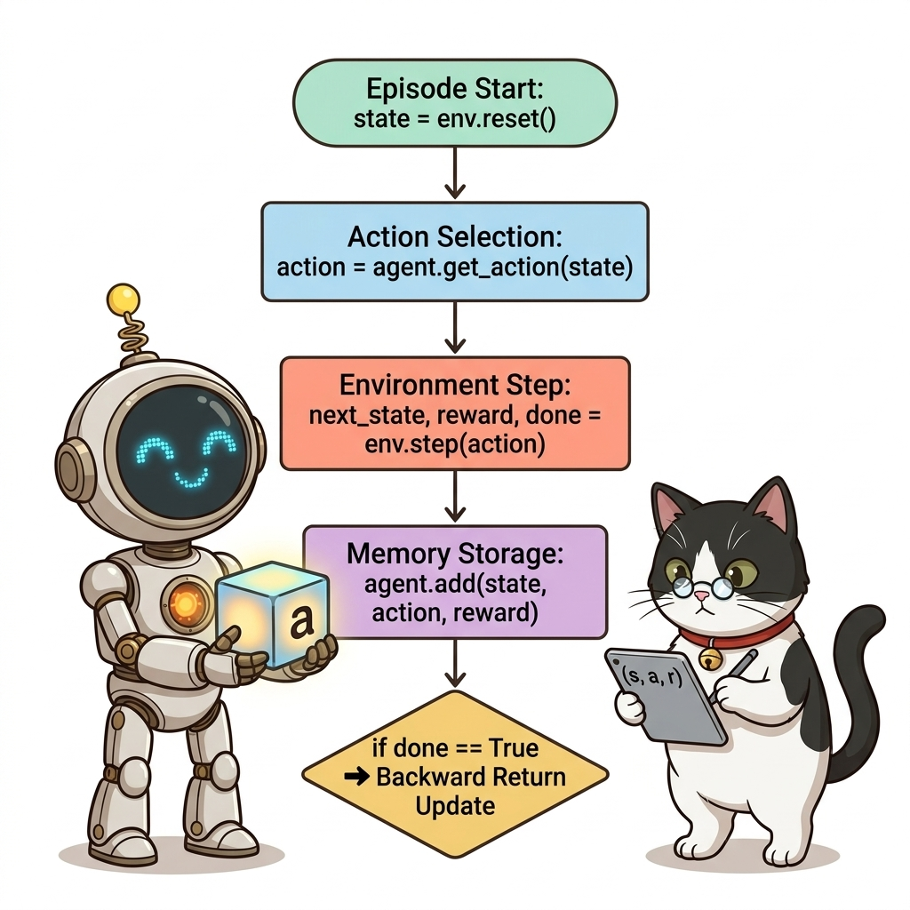
**그림 09-Intro-8b** 에이전트의 1스텝 상호작용 및 메모리 버퍼 저장 알고리즘 표준 순서도

---

## 09.0.9 몬테카를로의 최종 목표: 가치 평가에서 최적 정책 제어까지

경험 데이터를 모아 가치 함수 $V(s)$를 평가할 수 있게 되었다면, 강화학습의 궁극적인 목표인 **'가장 높은 보상을 획득하는 최적 정책 $\pi^*$을 찾는 정책 제어(Policy Control)'**로 나아가야 합니다. 평가와 개선을 끊임없이 맞물려 순환시키는 **일반화된 정책 반복(GPI, Generalized Policy Iteration)**이 그 해답입니다.

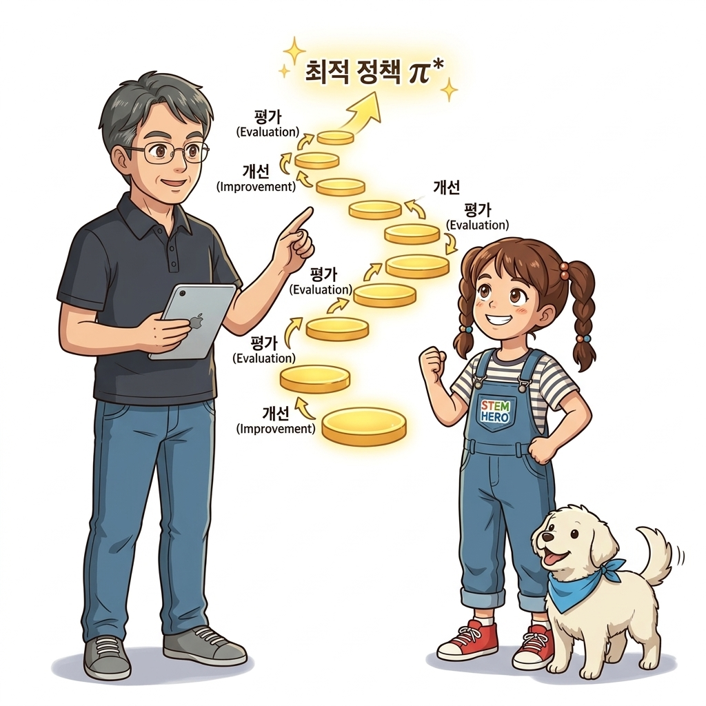
**그림 09-Intro-9** 태블릿으로 더 높은 최적 정책으로 향하는 나선형 계단을 안내하는 이호진 교수님과 자신감 넘치는 도로시

상태의 가치를 평가하는 것은 그 자체로 최종 목적이 아니라, 더 훌륭한 정책을 빚어내기 위한 징검다리입니다. 환경 모델이 없을 때는 상태 가치 $V(s)$만으로는 다음 행동을 선택할 수 없으므로, 어떤 행동을 취했을 때의 가치를 직접 평가하는 **행동 가치 함수 $Q(s, a)$**를 도입합니다.

- **1단계: 정책 평가 (Policy Evaluation)**:
  - 현재 정책 $\pi$를 따르며 환경에서 수많은 에피소드 경험을 수집
  - 각 상태-행동 쌍의 누적 수익 평균을 계산하여 행동 가치 함수 $Q(s, a)$ 추정
- **2단계: 정책 개선 (Policy Improvement)**:
  - 추정된 $Q(s, a)$ 중 가치가 가장 높은 행동을 선택하도록 정책을 탐욕적(Greedy) 갱신
  - **탐색과 이용의 균형**: 가보지 않은 새로운 경로를 지속적으로 탐색하기 위해 $\varepsilon$-탐욕법($\varepsilon$-Greedy) 적용
- 💡 **핵심 요약**: 경험으로 가치를 평가하고, 평가된 가치를 토대로 정책을 개선하는 과정을 끊임없이 반복하면, 모델이 주어지지 않아도 에이전트는 반드시 최적 정책에 도달합니다.

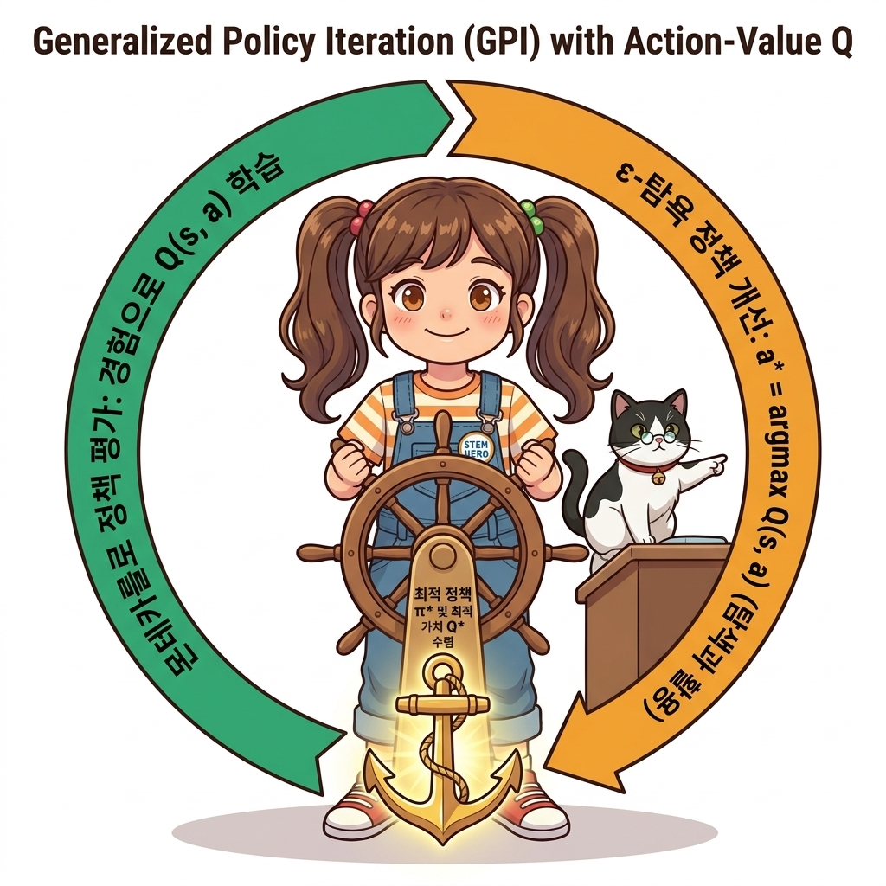
**그림 09-Intro-9b** 행동 가치 함수 $Q(s, a)$를 통한 몬테카를로 일반화된 정책 반복(GPI) 및 $\varepsilon$-탐욕 제어 순환 다이어그램

---

## 09.0.10 CHAPTER 9 몬테카를로법 7대 탐험 로드맵

9장 몬테카를로법 단원은 수학적 기원부터 파이썬 실전 구현, 그리고 심화 이론인 중요도 샘플링까지 체계적인 7개의 관문으로 구성되어 있습니다. 각 단계를 차근차근 밟아 나가면 모델 프리 강화학습의 전모를 확실하게 마스터할 수 있습니다.


**그림 09-Intro-10** 대형 모험 지도를 앞에 두고 함께 힘차게 출발을 알리는 4인방 (이호진 교수님, 도로시, 조교 지니, 토토)

### 9장의 7대 탐험 관문 목차

1. **[09.0 몬테카를로법의 수학적 기초와 역사적 유래](./9_0_수학적기초/index.html)**:
   - 맨해튼 프로젝트와 스타니스와프 울람의 솔리테어 카드놀이, 폰 노이만의 컴퓨터, 원주율($\pi$) 무작위 추정의 역사적 기원 학습
2. **[09.1 몬테카를로법 기초](./9_1_몬테카를로법_기초/index.html)**:
   - 두 주사위 눈의 합 시뮬레이션, 대수의 법칙 수렴 증명, 메모리를 절약하는 스마트한 증분 평균법 공식 유도
3. **[09.2 몬테카를로법으로 정책 평가하기](./9_2_몬테카를로법으로_정책_평가하기/index.html)**:
   - 에피소드 경험 데이터로부터 상태 가치 함수 $V(s)$를 추정하는 최초 방문(First-Visit) MC 평가 알고리즘 정립
4. **[09.3 몬테카를로법 구현](./9_3_몬테카를로법_구현/index.html)**:
   - $3 \times 4$ 그리드 월드 환경에서 에이전트 클래스 작성, 에피소드 수집, 역방향 수익 계산의 완전한 파이썬 코드 구현
5. **[09.4 몬테카를로법으로 정책 제어하기](./9_4_몬테카를로법으로_정책_제어하기/index.html)**:
   - 행동 가치 함수 $Q(s, a)$ 도입, 탐색과 이용 딜레마를 해결하는 $\varepsilon$-탐욕 정책 개선 루프 완성
6. **[09.5 오프-정책과 중요도 샘플링](./9_5_오프-정책과_중요도_샘플링/index.html)**:
   - 행동하는 정책(탐색)과 학습하는 정책(타깃)을 분리하는 오프-정책(Off-Policy)의 원리와 수학적 중요도 샘플링 유도
7. **[09.6 정리](./9_6_정리/index.html)**:
   - 9장 전체 핵심 공식 요약, 온-정책 vs 오프-정책 비교표, 몬테카를로법의 장단점 최종 마스터


**그림 09-Intro-10b** 9.0 수학적 기초부터 9.6 정리까지 무모델 강화학습의 정상을 정복하는 7대 관문 파이프라인 인포그래픽
