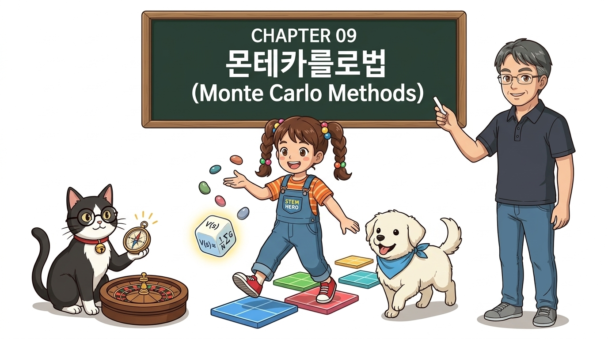
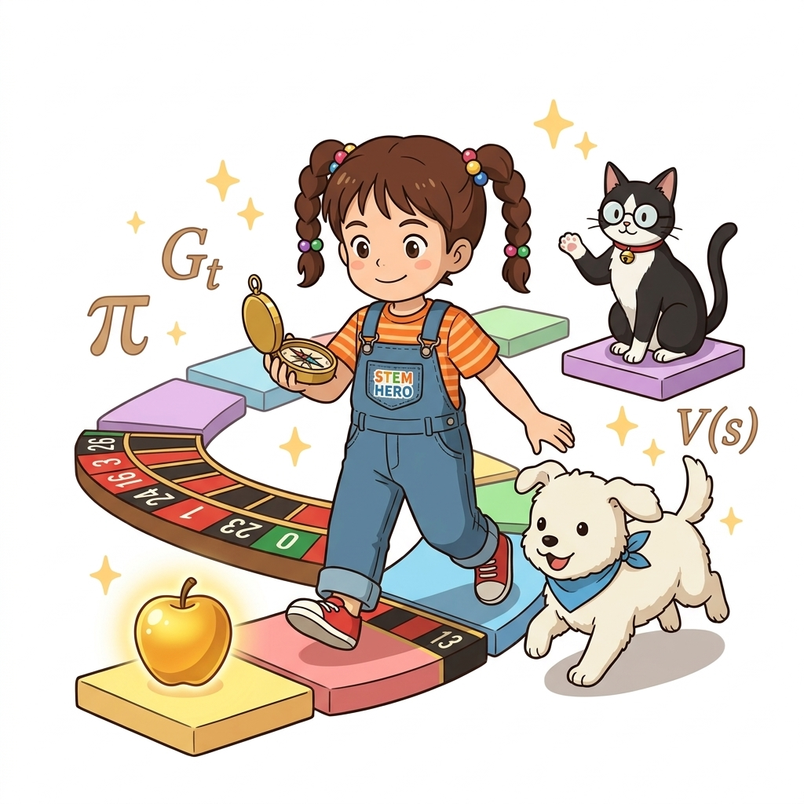
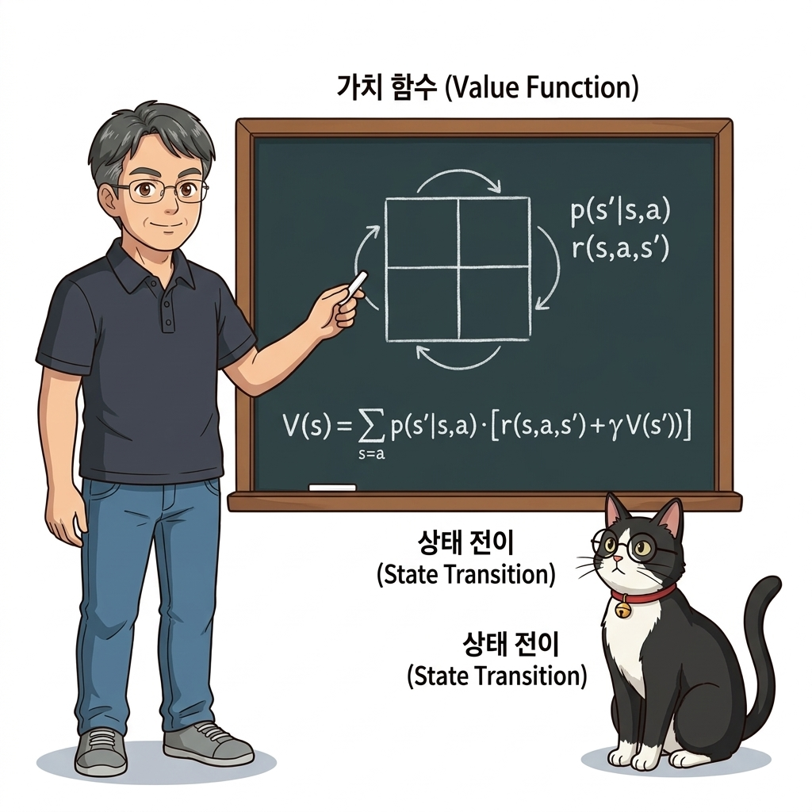
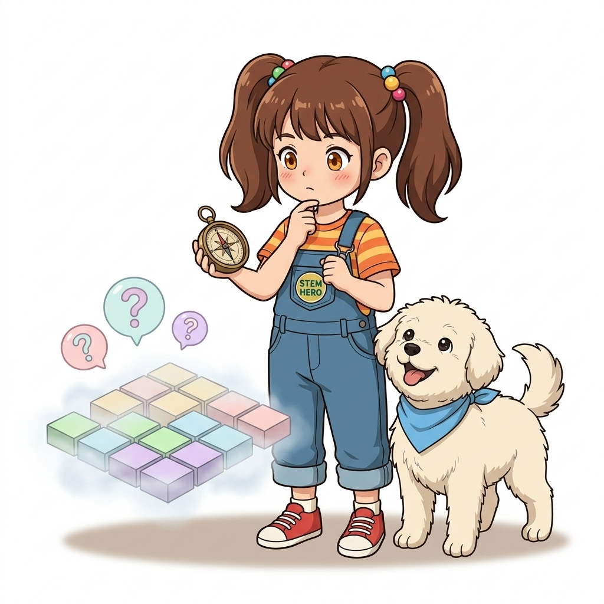
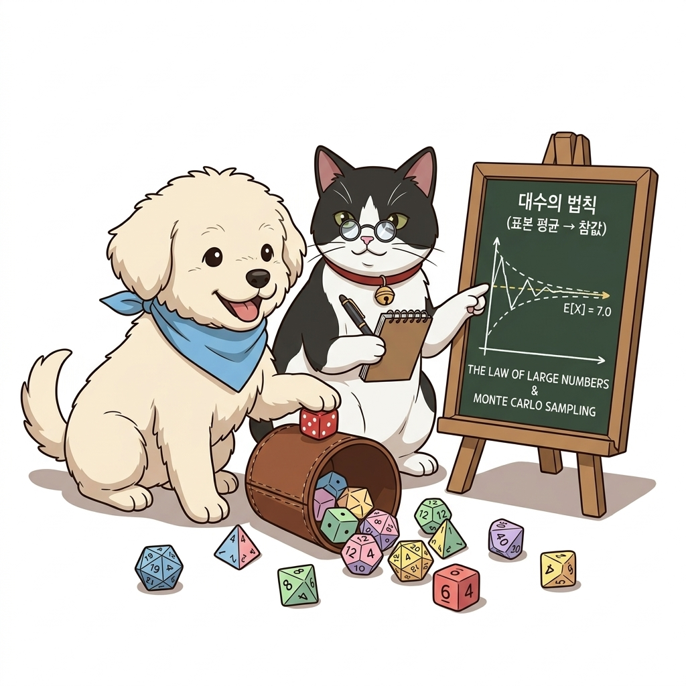
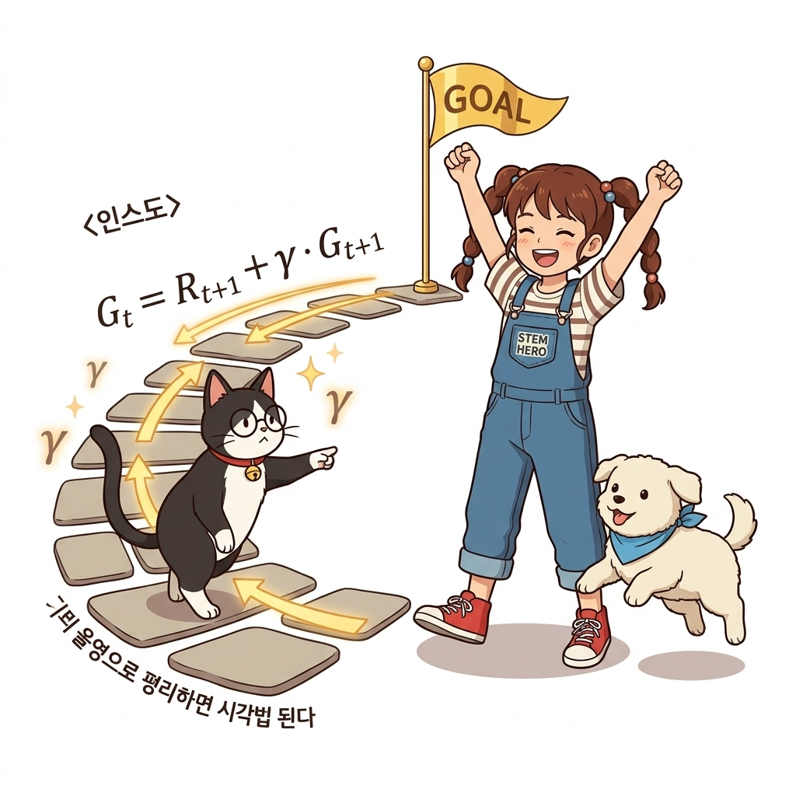
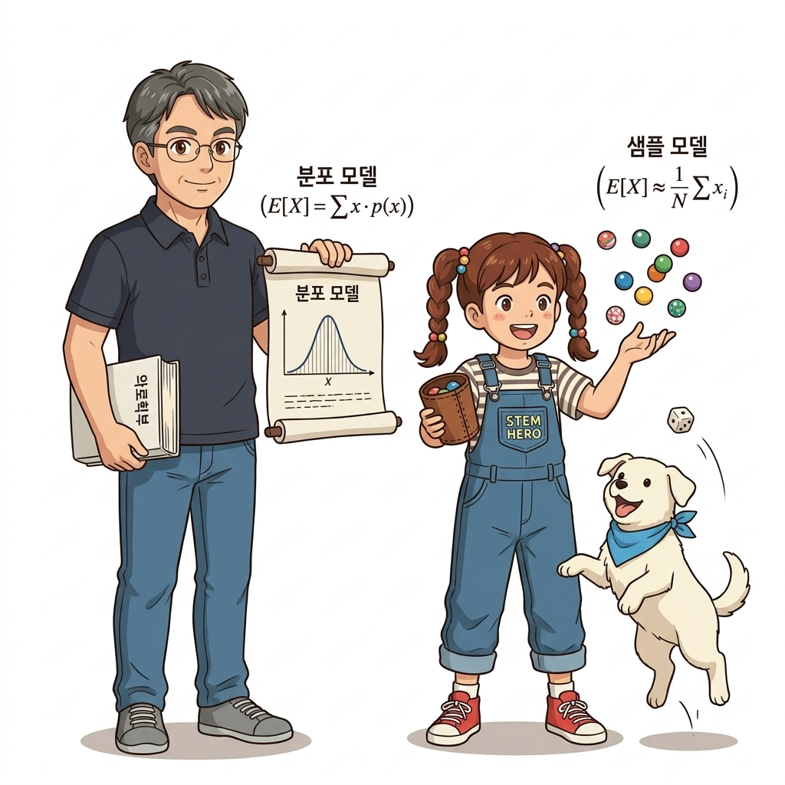
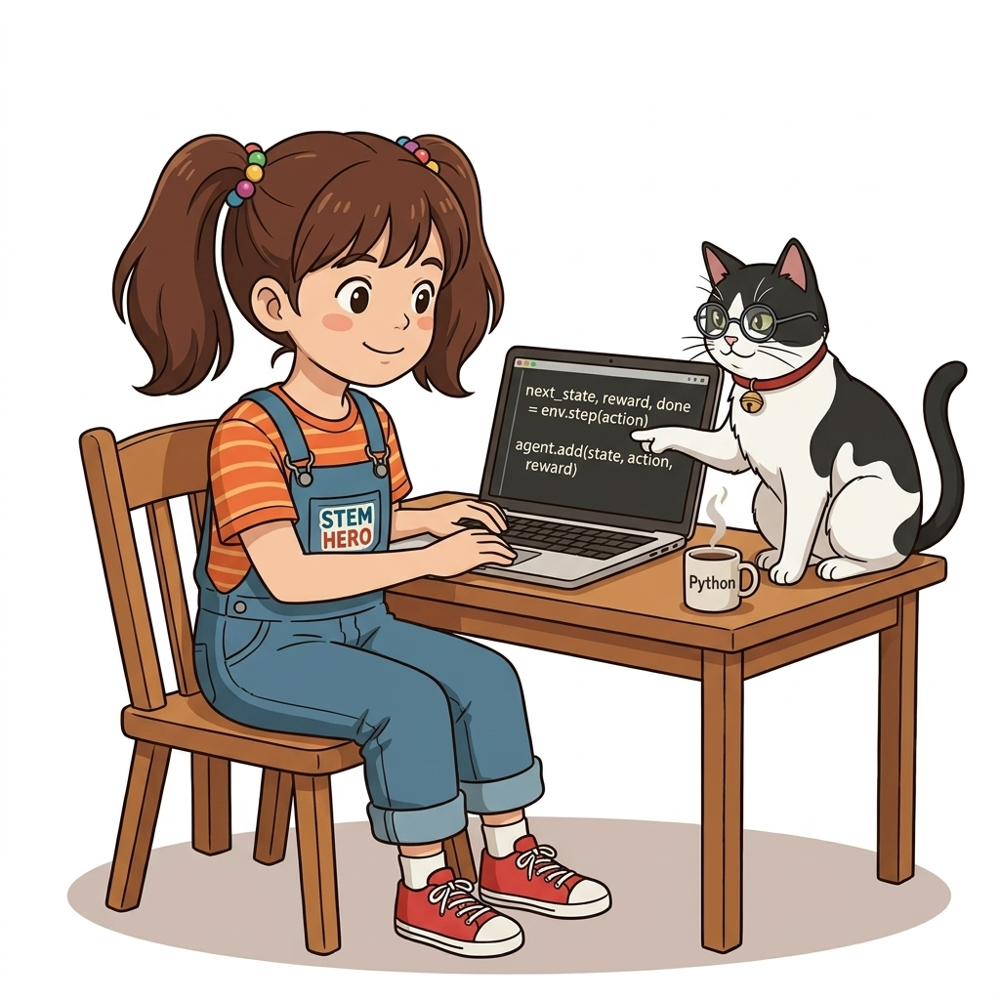
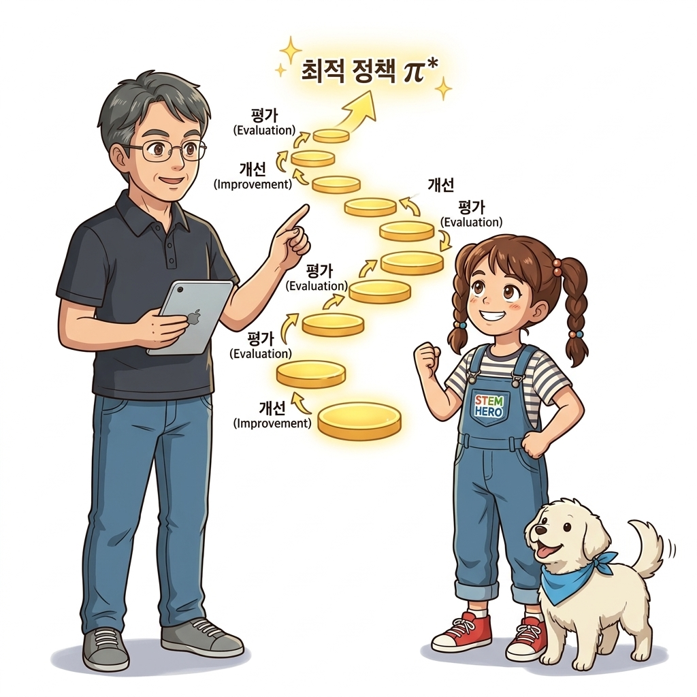
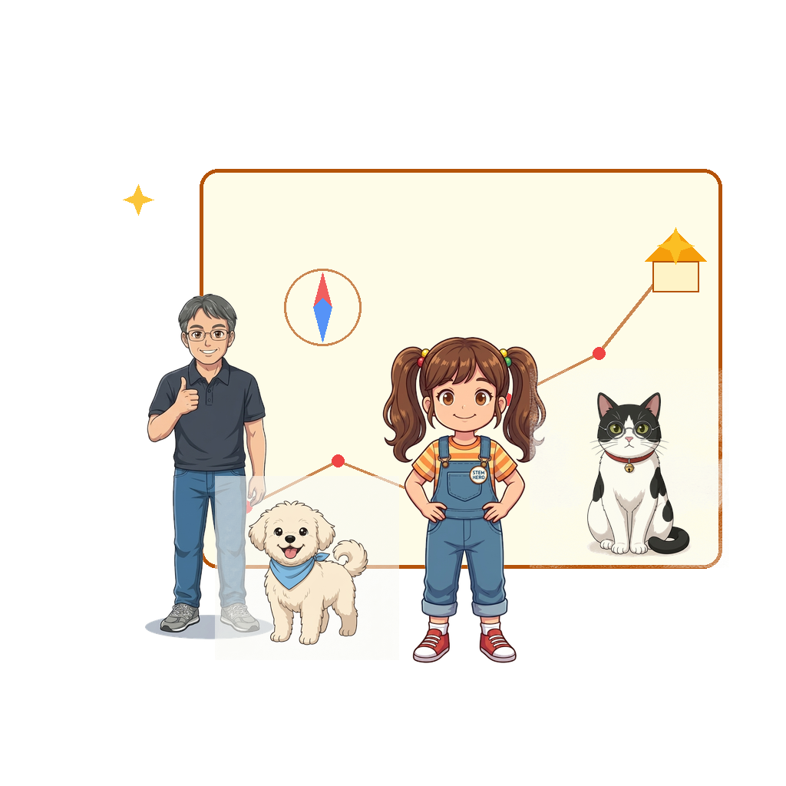

# CHAPTER 9 몬테카를로법



## 09.0.1 경험으로 미지의 세계를 탐험하는 진정한 강화학습

우리가 지난 7장에서 다루었던 동적 프로그래밍(DP)은 환경의 규칙을 완벽하게 알고 있다는 가정하에 최적 정책을 찾아냈습니다. 하지만 우리가 마주하는 현실 세계는 지도가 없는 미지의 숲과 같습니다. 이제 우리는 환경 모델 없이 오직 에이전트가 직접 부딪치며 쌓은 '경험'만으로 가치를 평가하고 최적의 정책을 찾아 나서는 진정한 강화학습의 문턱에 들어섭니다.



> [infographic_prompt]
> - **목적**: 몬테카를로법 대문 커버 보조 삽화: 거대한 카지노 룰렛과 그리드 타일 징검다리를 나침반을 들고 탐험하는 도로시와 토토, 조교 지니의 모험 장면
> - **프롬프트**: 2D premium anime storybook illustration, clean anime line art, vibrant flat cel shading, pure solid white background (#FFFFFF). Dorothy in denim overalls stepping forward on colorful casino roulette and floating isometric grid tiles towards a glowing golden apple, accompanied by Toto the fluffy white puppy running happily, and Jiny the tuxedo cat floating playfully. No slide frames, no text boxes.
> - **시각화 유형**: 단일 보조 일러스트 (1:1 정방형 삽화)

- **동적 프로그래밍(DP)에서 몬테카를로(MC)로의 도약**:
  - 완벽한 환경 모델(지도)이 주어진 이상적인 세계에서, 아무런 사전 정보가 없는 현실 세계로의 전환
  - 환경의 내부 원리를 몰라도 에이전트의 실제 행동 결과(Sample)를 모아 학습 가능
- **진정한 강화학습의 시작**:
  - 교사나 정답 라벨 없이, 환경과의 상호작용에서 얻어지는 보상 신호만으로 스스로 성장
  - 몬테카를로법은 이후 배울 TD 학습, Q-러닝, 딥마인드의 DQN으로 이어지는 모든 무모델(Model-Free) 강화학습의 뿌리
- 💡 **핵심 통찰**: "지도가 없다고 해서 길을 찾지 못하는 것은 아닙니다. 발걸음을 내딛고 경험을 기록하면, 그 경험이 모여 가장 완벽한 나침반이 됩니다."

> 그림을 보시면 거대한 카지노 룰렛과 그리드 타일 위로 새로운 모험을 시작하는 장면이 펼쳐져 있습니다. 지금까지 우리가 공부했던 동적 프로그래밍은 환경의 확률과 보상 규칙을 손바닥 들여다보듯 완벽히 알고 있는 온실 속의 학습이었습니다. 하지만 현실의 인공지능은 그 누구도 미리 환경의 모든 상태 전이 확률을 수식으로 건네주지 않습니다. 이제부터 배울 몬테카를로법은 안개 낀 미지의 세상에서 에이전트가 직접 발을 내딛고 넘어져 보며, 오직 온몸으로 겪은 경험 데이터만으로 참된 가치를 계산해내는 진정한 강화학습의 출발점입니다.

---

## 09.0.2 동적 프로그래밍(DP)의 복습과 완벽한 환경 모델의 전제

동적 프로그래밍으로 벨만 방정식을 풀기 위해서는 반드시 두 가지 수학적 함수가 사전에 주어져야만 했습니다. 바로 상태 전이 확률 *p*(*s'* | *s*, *a*)와 즉각 보상 함수 *r*(*s*, *a*, *s'*)입니다. 이 두 요소를 합쳐 '환경 모델(Environment Model)'이라고 부릅니다.



> [infographic_prompt]
> - **목적**: 동적 프로그래밍 전제조건 복습 보조 삽화: 칠판 앞에서 상태 전이와 보상 다이어그램을 열정적으로 강의하는 이호진 교수님과 관찰하는 조교 지니
> - **프롬프트**: 2D premium anime storybook illustration, clean anime line art, vibrant flat cel shading, pure solid white background (#FFFFFF). Professor Hojin lecturing passionately in front of a green chalkboard with chalk grid diagram and equations, with Jiny the cat TA sitting peacefully like a scholar. No slide frames, no text boxes.
> - **시각화 유형**: 단일 보조 일러스트 (1:1 정방형 삽화)

- **환경 모델의 두 기둥**:
  - **상태 전이 확률 *p*(*s'* | *s*, *a*)**: 현재 상태 *s*에서 행동 *a*를 취했을 때 다음 상태 *s'*로 이동할 조건부 확률
  - **보상 함수 *r*(*s*, *a*, *s'*)**: 상태가 전이될 때 환경이 에이전트에게 지급하는 즉각적인 보상 수식
- **벨만 방정식의 해법 메커니즘**:
  - 환경 모델이 주어지면 기대수익 수식을 정확한 연립방정식으로 전개할 수 있음
  - 모든 상태의 가치를 한 치의 오차도 없이 이론적으로 계산 가능
- 💡 **핵심 요약**: 동적 프로그래밍은 환경의 모든 물리 법칙과 보상 분포를 100% 알고 있다는 전제하에서만 성립하는 '모델 기반(Model-Based)' 기법이었습니다.

> 화면의 칠판을 살펴보시면 교수님이 동적 프로그래밍의 핵심 뼈대를 짚어주고 계십니다. 7장에서 우리가 벨만 방정식을 아주 우아하게 풀어낼 수 있었던 이유는, 현재 위치에서 오른쪽으로 갈 때 정확히 몇 퍼센트 확률로 미끄러지는지, 또 그 칸에 도착하면 사과를 몇 개 받는지 환경의 모든 확률 지도가 우리 손에 쥐어져 있었기 때문입니다. 이처럼 상태 전이 확률과 보상 함수를 모두 알고 있는 상태를 환경 모델을 안다고 말합니다. 하지만 이러한 완벽한 지도가 주어지는 환경은 학술적 예제나 아주 단순한 보드게임에 불과합니다.

---

## 09.0.3 현실 세계의 벽과 모델 프리(Model-Free)의 필연성

안타깝게도 현실의 복잡한 문제들은 환경 모델을 수학적으로 기술하는 것이 불가능에 가깝습니다. 바둑판의 돌 배치 경우의 수는 우주의 원자 수보다 많고, 자율주행차가 마주치는 도로는 시시각각 날씨와 보행자의 돌발 행동으로 변화합니다. 설령 모델을 알 수 있다 하더라도 계산량이 폭발하여 연립방정식을 푸는 것은 불가능합니다.



> [infographic_prompt]
> - **목적**: 모델 프리(Model-Free) 필요성 보조 삽화: 안개 낀 미지의 그리드 타일 앞 나침반을 들고 고민하는 도로시와 호기심 가득한 토토
> - **프롬프트**: 2D premium anime storybook illustration, clean anime line art, pure solid white background (#FFFFFF). Dorothy thinking curiously with hand on chin beside Toto looking puzzled, in front of foggy pastel grid tiles with soft question mark clouds floating in the air. Pure clean white background, no text frames, no UI cards.
> - **시각화 유형**: 단일 보조 일러스트 (1:1 정방형 삽화)

- **현실 세계에서 환경 모델을 알기 어려운 이유**:
  - **복잡성의 폭발**: 상태의 수가 수억 개를 넘어가면 전이 확률 행렬을 메모리에 저장조차 할 수 없음
  - **확률 분포의 불가해성**: 바람의 요동, 주식 시장의 흐름, 상대 게이머의 심리를 단일 수식으로 모델링 불가
- **모델 프리(Model-Free)의 혁신**:
  - 상태 전이 확률 *p*와 보상 함수 *r*의 수식을 몰라도 됨
  - 환경과 직접 상호작용하여 나오는 '출력 결과'만을 관찰하여 학습
- 💡 **핵심 통찰**: 복잡한 미분 방정식이나 확률 분포를 전부 유도하지 않아도, 현실 속에서 직접 겪은 결과물들을 관찰하는 것만으로 충분히 최적의 의사결정을 내릴 수 있습니다.

> 안개 낀 격자 타일 앞에서 도로시와 토토가 깊은 고민에 빠진 모습을 보실 수 있습니다. 만약 자율주행 인공지능을 만든다고 생각해 보십시오. 비가 내리고 빙판길이 있는 도로에서 핸들을 15도 꺾었을 때 차량의 다음 위치 좌표가 어떻게 될지, 그 엄밀한 확률 분포 수식을 물리학적으로 완벽히 수식화할 수 있을까요? 불가능합니다. 설령 수식을 세운다 해도 계산하느라 컴퓨터가 멈춰버릴 것입니다. 그래서 현대 강화학습은 환경의 수학적 모델을 몰라도 풀 수 있는 '모델 프리' 접근법을 선택하게 되었고, 그 핵심 기법이 바로 이번 장의 주인공인 몬테카를로법입니다.

---

## 09.0.4 강화학습의 돌파구: '경험' 데이터의 수집과 가치

환경 모델을 모른다면 에이전트는 무엇을 밑천 삼아 학습해야 할까요? 해답은 바로 **'경험(Experience)'**입니다. 에이전트가 어떤 상태에서 어떤 행동을 취했고, 그 결과 어떤 다음 상태에 도달하여 얼마의 보상을 받았는지를 꼼꼼하게 기록한 시계열 데이터가 학습의 나침반이 됩니다.


> [infographic_prompt]
> - **목적**: 경험 데이터 수집 보조 삽화: 돋보기로 발자국 궤적과 타일 데이터를 흥미진진하게 살피는 도로시와 수첩에 메모하는 조교 지니
> - **프롬프트**: 2D premium anime storybook illustration, clean anime line art, vibrant flat cel shading, pure solid white background (#FFFFFF). Dorothy with a magnifying glass inspecting glowing footprint marks along grid world stepping stones, while Jiny the cat takes notes in a leather journal. Pure solid white background, no slide frames.
> - **시각화 유형**: 단일 보조 일러스트 (1:1 정방형 삽화)

- **경험(Experience)의 정의**:
  - 에이전트와 환경이 타임스텝마다 주고받은 상호작용의 순차적 기록
  - 하나의 스텝 데이터: `(상태 St, 행동 At, 보상 Rt+1, 다음 상태 St+1)`
- **에피소드 궤적 (Trajectory)**:
  - 시작 상태 *S*<sub>0</sub>부터 게임이 끝나는 종료 상태 *S*<sub>*T*</sub>까지의 전체 이동 경로
  - `S0, A0, R1, S1, A1, R2, ..., ST-1, AT-1, RT, ST`
- 💡 **핵심 요약**: 강화학습에서 경험이란 단순한 과거의 흔적이 아니라, 환경의 숨겨진 확률 분포를 통계적으로 복원해내는 가장 값진 보물 원석입니다.

> 그림에서 도로시가 돋보기를 들고 자신이 걸어온 발자취를 하나하나 들여다보고 조교 지니가 이를 메모리에 꼼꼼히 기록하고 있습니다. 환경 모델의 확률 수식을 모른다면, 직접 뛰어들어 데이터를 모으면 됩니다. 출발점에서 오른쪽으로 걸어갔더니 보상이 없었고, 위로 올라갔더니 맛있는 사과를 얻었다는 이 구체적인 사실들의 나열, 즉 '상태, 행동, 보상'의 궤적이 바로 강화학습에서 말하는 경험입니다. 이 풍부한 경험 데이터들이 차곡차곡 쌓이면, 우리는 보이지 않던 환경의 진짜 모습을 통계적으로 밝혀낼 수 있게 됩니다.

---

## 09.0.5 몬테카를로법의 본질: 무작위 샘플링과 대수의 법칙

'몬테카를로(Monte Carlo)'라는 이름은 지중해 모나코의 유명한 카지노 도시에서 유래했습니다. 룰렛이나 주사위처럼 무작위성이 지배하는 게임에서 영감을 받아, **수많은 무작위 표본(Sample)을 반복 추출하여 그 평균값으로 참값을 추정하는 수학적 기법**을 뜻합니다.



> [infographic_prompt]
> - **목적**: 몬테카를로 주사위와 대수의 법칙 보조 삽화: 컵에서 쏟아져 나온 알록달록 주사위들을 굴리며 노는 토토와 안경을 쓰고 관찰하는 조교 지니
> - **프롬프트**: 2D premium anime storybook illustration, clean anime line art, pure solid white background (#FFFFFF). Cute cartoon dice scattered from a leather cup with Toto the puppy playing cutely with a die, and Jiny the cat TA with spectacles watching. Gentle convergence ribbon in background. Pure solid white background, no text frames.
> - **시각화 유형**: 단일 보조 일러스트 (1:1 정방형 삽화)

- **몬테카를로 계산의 3단계 메커니즘**:
  1. 무작위 표본 추출(Sampling): 주사위를 굴리듯 에피소드를 무작위로 여러 번 생성
  2. 표본값 기록: 각 시행에서 얻은 결과값(수익 *G*)을 수집
  3. 산술 평균 계산: 표본들의 평균을 내어 상태의 참 가치 *v*(*s*)로 추정
- **대수의 법칙 (Law of Large Numbers)**:
  - 표본의 개수 *N*이 커질수록, 표본 평균은 모집단의 참 기댓값 *E*[*X*]에 오차 없이 수렴
  - 수식: `V(s) ≈ (1 / N) ∑ G_i  ➔  v_π(s)  (N ➔ ∞)`
- 💡 **핵심 통찰**: 아무리 복잡하고 난해한 수학적 적분식이라도, 주사위를 충분히 많이 던져 평균을 내면 누구나 정확한 참값을 구해낼 수 있습니다.

> 그래프와 주사위 그림을 보시면 몬테카를로 방법의 본질이 직관적으로 드러납니다. 주사위 두 개를 던졌을 때 눈의 합의 기댓값이 7이라는 것은 이론적으로 계산할 수도 있지만, 실제로 컵에 주사위를 넣고 백 번, 천 번 굴려서 그 눈금들을 전부 더한 뒤 횟수로 나누어도 정확히 7에 도달합니다. 시행 횟수가 적을 때는 평균값이 위아래로 출렁이지만, 시도가 거듭될수록 빨간색 참값 라인에 오차 없이 달라붙는 현상, 이것이 바로 수학의 위대한 '대수의 법칙'입니다. 몬테카를로법은 이 단순하고도 강력한 원리로 복잡한 인공지능을 학습시킵니다.

---

## 09.0.6 에피소드 완주와 역방향 수익(Return) 계산 메커니즘

몬테카를로법이 동적 프로그래밍과 결정적으로 다른 점은 **'에피소드가 끝날 때까지 기다린다'**는 것입니다. 중간 상태에서 다른 상태의 추정치를 빌려 쓰지 않고, 에피소드가 골(Goal)에 도달해 완전히 종료된 후, 마지막 보상부터 시간을 거꾸로 거슬러 올라가며 실제 누적 수익 *G*<sub>*t*</sub>를 정산합니다.



> [infographic_prompt]
> - **목적**: 에피소드 완주와 역방향 계산 보조 삽화: 골인 지점에서 환호하는 도로시와 출발점을 향해 역방향으로 시간을 거슬러 올라가는 궤적을 짚어주는 조교 지니
> - **프롬프트**: 2D premium anime storybook illustration, clean anime line art, pure solid white background (#FFFFFF). Dorothy celebrating with arms up at a goal tile with golden trophy flag, Toto cheering, and Jiny walking along the reverse arrow path pointing backwards. Pure clean white background, no text frames.
> - **시각화 유형**: 단일 보조 일러스트 (1:1 정방형 삽화)

- **부트스트랩(Bootstrapping)의 배제**:
  - DP는 다음 상태의 '추정 가치'를 가져와 현재 가치를 갱신함 (부트스트랩)
  - 몬테카를로는 추정치가 아닌, 에피소드가 끝나서 확정된 **실제 총수익(Return *G*)**만을 사용
- **역방향 계산(Reversed Calculation)의 효율성**:
  - `G_t = R_{t+1} + γ × G_{t+1}`
  - 끝에서부터 앞으로 한 단계씩 전진하면 중복 덧셈 없이 단 한 번의 순회로 모든 상태의 수익 *G*를 *O*(*T*) 시간 내에 계산 완료
- 💡 **핵심 요약**: 끝까지 가본 자만이 전체 여정의 진짜 가치를 논할 수 있습니다. 몬테카를로는 완주된 결과만을 토대로 정직하게 가치를 평가합니다.

> 골인 지점에서 환호하는 도로시와 역방향 정산 다이어그램을 보십시오. 우리가 여행을 할 때, 첫날 묵은 호텔이 좋았는지는 여행 전체가 끝나고 집에 돌아왔을 때 가장 정확하게 평가할 수 있는 법입니다. 몬테카를로법은 에피소드가 진행 중일 때는 어설프게 가치를 짐작하지 않습니다. 일단 목표 지점까지 끝까지 달려가 에피소드를 마친 뒤, 골인 지점에서부터 시작점 방향으로 시간을 거꾸로 거슬러 올라가며 각 칸에서 얻은 사과 보상에 할인율 감마를 곱해 누적 수익을 계산합니다. 이것이 바로 몬테카를로의 역방향 가치 정산법입니다.

---

## 09.0.7 모델 패러다임의 전환: 분포 모델 vs 샘플 모델

강화학습에서 환경을 바라보는 관점은 크게 **'분포 모델'**과 **'샘플 모델'**로 나뉩니다. 동적 프로그래밍이 주사위의 36가지 모든 확률 분포표를 들여다보는 분포 모델이었다면, 몬테카를로법은 주사위를 직접 굴려 나오는 결과를 관찰하는 샘플 모델의 대표 주자입니다.



> [infographic_prompt]
> - **목적**: 모델 패러다임 비교 보조 삽화: 이론 책을 든 이호진 교수님(분포 모델)과 주사위 컵과 표본을 든 도로시와 토토(샘플 모델)의 대비
> - **프롬프트**: 2D premium anime storybook illustration, clean anime line art, pure solid white background (#FFFFFF). Professor Hojin on the left with theory textbooks, Dorothy and Toto on the right with a dice cup and colorful floating sample spheres. Pure solid white background, no text frames.
> - **시각화 유형**: 단일 보조 일러스트 (1:1 정방형 삽화)

| 비교 항목 | 📐 분포 모델 (Distribution Model) | 🎲 샘플 모델 (Sample Model) |
| :--- | :--- | :--- |
| **대표 알고리즘** | 동적 프로그래밍 (DP), 벨만 방정식 연립풀이 | **몬테카를로법 (MC)**, TD 학습 |
| **필수 전제 조건** | 상태 전이 확률 *p*와 보상 함수 *r* 완벽 파악 | 확률식 몰라도 됨, **시뮬레이터(시행)만 가능하면 됨** |
| **기댓값 계산식** | `E[X] = ∑ x · p(x)` (가중합 수학 연산) | `E[X] ≈ (1 / N) ∑ x_i` (표본 산술 평균) |
| **현실 적용성** | 상태가 많거나 복잡하면 적용 불가능 | 복잡한 비디오 게임, 로봇, 자율주행 어디든 적용 가능 |

- 💡 **핵심 통찰**: 복잡한 카지노의 모든 톱니바퀴 내부 구조를 분해하지 않아도, 구슬이 들어가는 칸의 빈도를 기록하는 것만으로 카지노의 승률을 완벽히 정복할 수 있습니다.

> 두 가지 접근법을 비교한 도표를 살펴보시면 강화학습의 패러다임이 어떻게 바뀌었는지 한눈에 알 수 있습니다. 왼쪽의 분포 모델은 교수님처럼 36가지 주사위 눈 조합과 각각의 수학적 확률 공식을 종이에 적어두고 계산하는 방식입니다. 완벽하지만 지도가 없으면 한 발짝도 못 나갑니다. 반면 오른쪽의 샘플 모델은 도로시와 토토처럼 주사위 내부의 무게중심이나 물리 공식을 몰라도, 그냥 컵에 넣고 흔들어 던져서 나온 숫자들을 모아 평균을 내는 방식입니다. 현실의 복잡한 게임이나 로봇 제어에서 몬테카를로가 압도적인 위력을 발휘하는 이유가 바로 여기에 있습니다.

---

## 09.0.8 에이전트의 step 메서드와 메모리 버퍼 궤적 저장

파이썬 코드로 몬테카를로 에이전트를 구현할 때 가장 중심이 되는 구조는 **`step()` 메서드에 의한 환경 상호작용**과 **메모리 버퍼(`agent.memory`)에 경험을 쌓는 메커니즘**입니다.



> [infographic_prompt]
> - **목적**: 스텝과 메모리 코딩 실습 보조 삽화: 연구실 워크벤치에서 파이썬 코딩을 하는 도로시와 모니터 옆에서 화면을 함께 검토하는 조교 지니
> - **프롬프트**: 2D premium anime storybook illustration, clean anime line art, pure solid white background (#FFFFFF). Dorothy sitting and typing on a laptop at a warm wooden workbench, with Jiny the cat TA sitting on the desk reviewing the code screen. Pure clean white background, no text frames.
> - **시각화 유형**: 단일 보조 일러스트 (1:1 정방형 삽화)

```python
# 에이전트와 환경의 1스텝 상호작용 루프
action = agent.get_action(state)                  # 1. 행동 선택
next_state, reward, done = env.step(action)        # 2. 환경에서 한 걸음 실행
agent.add(state, action, reward)                   # 3. 메모리에 경험 저장
state = next_state                                 # 4. 상태 갱신
```

- **코드 구조의 3대 핵심 단계**:
  1. `get_action(state)`: 현재 상태에서 탐색(Exploration)을 고려하여 행동을 결정
  2. `env.step(action)`: 환경에 행동을 전달하여 다음 상태, 즉각 보상, 종료 여부(`done`) 수신
  3. `agent.add(...)`: 한 에피소드가 끝날 때까지 튜플 형태로 메모리에 연속 저장
- 💡 **핵심 요약**: 복잡해 보이는 강화학습 알고리즘도 결국 파이썬의 리스트(`memory`)에 한 스텝씩 경험을 채워 넣고 에피소드가 끝나면 정산하는 깔끔한 루프로 구현됩니다.

> 파이썬 코드와 메모리 버퍼 다이어그램을 보시면 구현 원리가 대단히 명쾌합니다. 에이전트는 환경 속에서 발걸음을 내딛을 때마다 `env.step()` 함수를 호출하여 다음 위치와 보상을 받아옵니다. 그리고 이 값들을 즉시 허공에 날려버리지 않고 `agent.add()`를 통해 파이썬 리스트에 튜플 형태로 차곡차곡 쌓아둡니다. 에피소드가 끝나는 순간(`done == True`), 비로소 에이전트는 메모리에 쌓인 궤적을 꺼내어 역방향으로 수익을 계산하고 가치 함수 테이블을 업데이트합니다. 이 간결한 구조가 9장 전체 구현의 척추 역할을 합니다.

---

## 09.0.9 몬테카를로의 최종 목표: 가치 평가에서 최적 정책 제어까지

경험으로 상태의 가치 함수 *V*(*s*)를 평가할 수 있게 되었다면, 우리의 궁극적인 목표인 **'가장 많은 보상을 얻는 최적 정책 *π*<sup>\*</sup>을 찾는 정책 제어(Policy Control)'**로 나아가야 합니다. 평가와 개선을 끊임없이 맞물려 돌리는 **일반화된 정책 반복(GPI)**이 그 해답입니다.



> [infographic_prompt]
> - **목적**: 평가에서 제어로의 멘토링 보조 삽화: 태블릿으로 더 높은 최적 정책으로 향하는 나선형 계단을 안내하는 이호진 교수님과 자신감 넘치는 도로시
> - **프롬프트**: 2D premium anime storybook illustration, clean anime line art, pure solid white background (#FFFFFF). Professor Hojin with digital tablet pointing towards an ascending golden spiral of steps, Dorothy nodding with a confident smile, Toto cheering happily. Pure solid white background, no text frames.
> - **시각화 유형**: 단일 보조 일러스트 (1:1 정방형 삽화)

- **1단계: 정책 평가 (Policy Evaluation)**:
  - 현재 정책 *π*를 따르며 수많은 에피소드를 생성
  - 각 상태-행동 쌍의 누적 수익 평균을 계산하여 행동 가치 함수 *Q*(*s*, *a*) 추정
- **2단계: 정책 개선 (Policy Improvement)**:
  - 추정된 *Q*(*s*, *a*) 중 가장 높은 가치를 주는 행동으로 정책을 탐욕적(Greedy) 갱신
  - **탐험과 이용의 균형**: 새로운 길을 시도하는 *ε*-탐욕법(*ε*-Greedy) 필수 도입
- 💡 **핵심 요약**: 경험으로 가치를 재고, 더 나은 방향으로 정책을 다듬는 과정을 무한히 반복하면, 모델이 없어도 반드시 최적 정책에 수렴합니다.

> 나선형으로 상승하는 평가와 개선의 순환 다이어그램을 주목해 주시기 바랍니다. 가치를 평가하는 것 자체는 목적이 아니라 더 훌륭한 정책을 만들기 위한 징검다리입니다. 에이전트는 현재 정책으로 주사위를 굴려 경험을 쌓고 가치 함수 Q를 평가합니다. 그런 다음 더 많은 보상을 주는 쪽으로 화살표를 꺾어 정책을 업그레이드합니다. 새로운 정책으로 다시 에피소드를 뛰고, 또 개선하기를 반복하면 환경 모델의 도움 없이도 스스로 최적의 길을 찾아내게 됩니다. 이것이 바로 9장에서 우리가 정복할 정책 제어의 완성된 청사진입니다.

---

## 09.0.10 CHAPTER 9 몬테카를로법 7대 탐험 로드맵

9장 몬테카를로법 단원은 수학적 기원부터 파이썬 실전 구현, 그리고 심화 이론인 중요도 샘플링까지 체계적인 7개의 관문으로 구성되어 있습니다. 한 단계씩 밟아 올라가면 누구든 무모델 강화학습의 마스터가 될 수 있습니다.



> [infographic_prompt]
> - **목적**: 9장 전체 7대 탐험 관문 출정 단체 보조 삽화: 대형 모험 지도를 앞에 두고 함께 힘차게 출발을 알리는 4인방(교수님, 도로시, 지니, 토토)
> - **프롬프트**: 2D premium anime storybook illustration, clean anime line art, pure solid white background (#FFFFFF). All four characters (Prof. Hojin, Dorothy, Jiny, Toto) happily gathered around a large illustrated adventure map, waving warmly to the viewer. Pure solid white background, no text frames.
> - **시각화 유형**: 단일 보조 일러스트 (1:1 정방형 삽화)

### 🧭 9장의 7대 탐험 관문 목차

1. **[09.0 몬테카를로법의 수학적 기초와 역사적 유래](./9_0_수학적기초/index.html)**:
   - 맨해튼 프로젝트와 스타니스와프 울람의 솔리테어 카드놀이, 폰 노이만의 컴퓨터, 원주율(π) 무작위 추정의 역사적 기원 학습
2. **[09.1 몬테카를로법 기초](./9_1_몬테카를로법_기초/index.html)**:
   - 두 주사위 눈의 합 시뮬레이션, 대수의 법칙 수렴 증명, 메모리를 아끼는 스마트한 증분 평균법 공식 유도
3. **[09.2 몬테카를로법으로 정책 평가하기](./9_2_몬테카를로법으로_정책_평가하기/index.html)**:
   - 에피소드 경험 데이터로부터 상태 가치 함수 *V*(*s*)를 추정하는 최초 방문(First-Visit) MC 평가 알고리즘 정립
4. **[09.3 몬테카를로법 구현](./9_3_몬테카를로법_구현/index.html)**:
   - 3×4 그리드 월드 환경에서 에이전트 클래스 작성, 에피소드 수집, 역방향 수익 계산의 완전한 파이썬 코드 구현
5. **[09.4 몬테카를로법으로 정책 제어하기](./9_4_몬테카를로법으로_정책_제어하기/index.html)**:
   - 행동 가치 함수 *Q*(*s*, *a*) 도입, 탐색과 이용 딜레마를 해결하는 *ε*-탐욕 정책 개선 루프 완성
6. **[09.5 오프-정책과 중요도 샘플링](./9_5_오프-정책과_중요도_샘플링/index.html)**:
   - 행동하는 정책(탐색)과 학습하는 정책(타깃)을 분리하는 오프-정책(Off-Policy)의 원리와 수학적 중요도 샘플링 유도
7. **[09.6 정리](./9_6_정리/index.html)**:
   - 9장 전체 핵심 공식 요약, 온-정책 vs 오프-정책 비교표, 몬테카를로법의 장단점 최종 마스터

> 마지막 로드맵 화면에는 우리가 앞으로 나아갈 일곱 개의 관문이 일목요연하게 정리되어 있습니다. 09.0절에서 2차 세계대전 맨해튼 프로젝트의 흥미진진한 역사 비화로 시작하여, 주사위 시뮬레이션의 기초를 다지고, 그리드 월드에서 파이썬 코드를 한 줄씩 직접 타이핑하며 가치 함수를 추정해 볼 것입니다. 나아가 최적의 길을 찾아내는 제어 기법과 최신 심층 강화학습의 밑거름이 되는 오프-정책 중요도 샘플링까지 정복하게 됩니다. 든든한 토대를 쌓아갈 준비가 되셨다면, 이제 첫 번째 관문인 몬테카를로의 역사적 기원으로 힘차게 출발해 보겠습니다.
