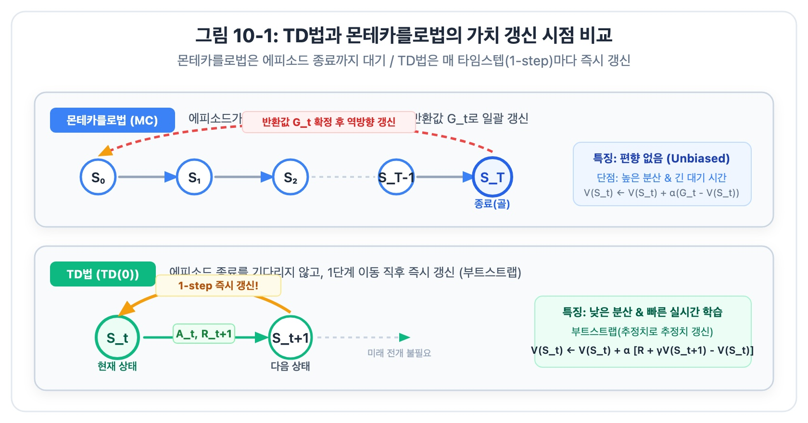
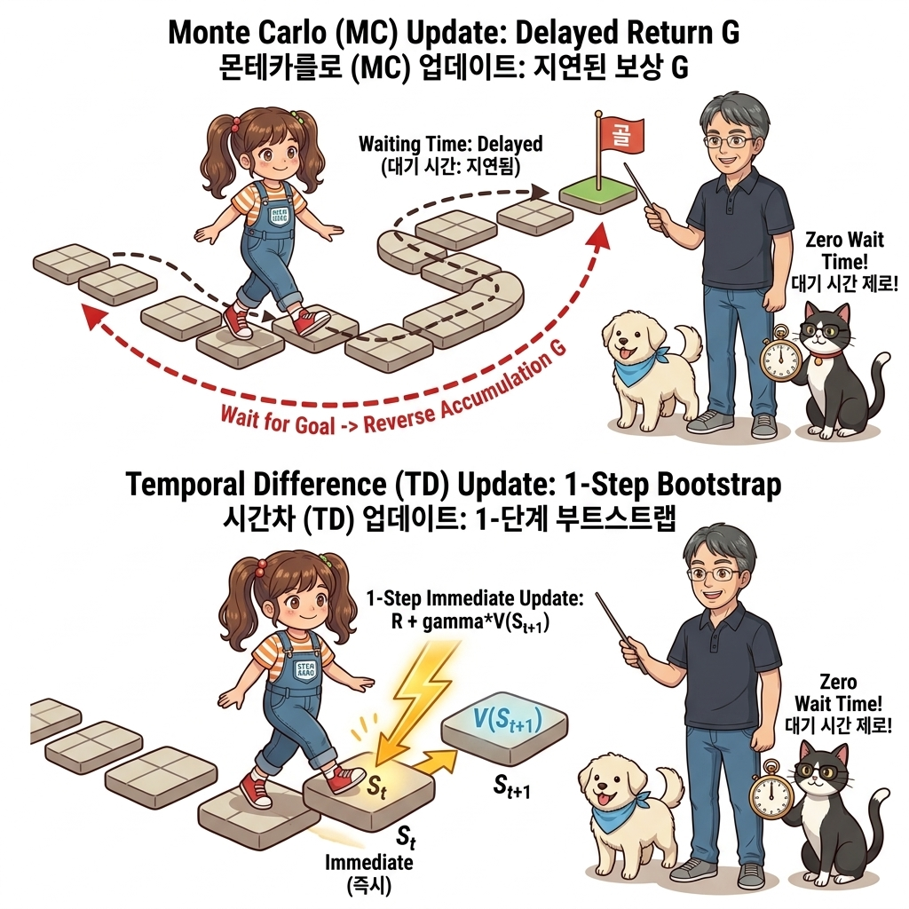

# 10.1 TD법으로 정책 평가하기


**그림 10-1-1** 도로시가 징검다리를 한 걸음 내딛자마자 칠판의 점화식 공식을 이용해 즉시 상태 가치 *V*(*s*)를 갱신해 주는 지니와 이호진 교수님

동적 계획법(DP)의 부트스트랩과 몬테카를로법(MC)의 모델 프리 샘플링이라는 양대 산맥의 강력한 장점을 융합하여 탄생한 **TD(시간차, Temporal Difference) 정책 평가** 기법을 공부합니다. 에피소드가 완결되기 전이라도, 행동을 취하자마자 한 단계 뒤의 다음 상태 가치를 이용해 가치 평가 카드를 실시간 갱신하는 공식을 요정 지니의 칠판 필기법과 이호진 교수님의 직강으로 통쾌하게 유도해 봅시다!

---

## 10.1.1 TD법의 탄생: DP와 MC의 위대한 융합

TD법은 지금까지 우리가 배운 **'몬테카를로법(MC법)'**과 **'동적 프로그래밍(DP법)'**의 장점만을 취합하여 합친 기법입니다. 따라서 먼저 이 두 기법의 수학적 뼈대를 복습한 후 TD법을 유도해 보겠습니다.

### 1) 수익과 가치 함수의 재귀적 전개

먼저 '수익(Return)'의 정의를 복습해 봅시다. 시간 *t*부터 시작하여 할인율 *γ*를 적용한 누적 보상의 합은 다음과 같습니다:

> ### ***G*<sub>*t*</sub> = *R*<sub>*t*</sub> + *γR*<sub>*t*+1</sub> + *γ*<sup>2</sup>*R*<sub>*t*+2</sub> + &hellip;** &nbsp;&nbsp;&nbsp;&nbsp; *(식 10.1)*
> 
> ### **= *R*<sub>*t*</sub> + *γG*<sub>*t*+1</sub>** &nbsp;&nbsp;&nbsp;&nbsp; *(식 10.2: 재귀적 표현)*

시간 *t*에 에이전트가 행동을 취하여 즉각 보상 *R*<sub>*t*</sub>를 얻고, 그 이후의 모든 미래 수익을 *G*<sub>*t*+1</sub>로 묶어 [식 10.2]처럼 아름다운 재귀식으로 나타낼 수 있습니다.

이 수익을 바탕으로 정책 *π*를 따를 때의 '상태 가치 함수'를 정의하면 다음과 같은 두 가지 형태로 전개됩니다:

> ### ***v*<sub>*π*</sub>(*s*) = E<sub>*π*</sub> [*G*<sub>*t*</sub> | *S*<sub>*t*</sub> = *s*]** &nbsp;&nbsp;&nbsp;&nbsp; *(식 10.3: 몬테카를로법의 출발점)*
> 
> ### **= E<sub>*π*</sub> [*R*<sub>*t*</sub> + *γG*<sub>*t*+1</sub> | *S*<sub>*t*</sub> = *s*]** &nbsp;&nbsp;&nbsp;&nbsp; *(식 10.4: 동적 프로그래밍의 출발점)*

가치 함수는 이처럼 기댓값으로 정의됩니다. 여기서 두 기법이 기댓값을 구하는 방식이 완전히 갈라집니다:

1. **MC법 (몬테카를로법)**: [식 10.3]에서 출발하여, 기댓값을 계산하는 대신 실제로 에피소드가 끝날 때까지 뛰어보고 얻은 **실제 누적 수익의 샘플 평균**으로 근사합니다.
2. **DP법 (동적 프로그래밍)**: [식 10.4]에서 출발하여, 환경의 전이 확률 행렬 *p*(*s*&#39; | *s*, *a*)를 이용해 **벨만 방정식을 통해 모든 가능한 미래의 기댓값을 엄밀하게 계산**합니다.

---

### 2) MC법과 DP법의 갱신 점화식 복습

두 기법의 가치 갱신식을 나란히 비교해 봅시다:

* **MC법의 갱신식 (고정 학습률 *α* 기반)**:
  > ### ***V*<sub>*π*</sub>(*S*<sub>*t*</sub>) ← *V*<sub>*π*</sub>(*S*<sub>*t*</sub>) + *α* · [*G*<sub>*t*</sub> - *V*<sub>*π*</sub>(*S*<sub>*t*</sub>)]** &nbsp;&nbsp;&nbsp;&nbsp; *(식 10.5)*
  - 에피소드가 완전히 끝난 뒤, 실제로 획득한 참 수익 *G*<sub>*t*</sub>를 목표(Target)로 삼아 가치를 갱신합니다.
* **DP법의 갱신식 (벨만 기대 방정식 기반)**:
  > ### ***V*<sub>*π*</sub>(*s*) ← ∑<sub>*a*, *s*&#39;</sub> *π*(*a* | *s*) *p*(*s*&#39; | *s*, *a*) [*r*(*s*, *a*, *s*&#39;) + *γV*<sub>*π*</sub>(*s*&#39;)]** &nbsp;&nbsp;&nbsp;&nbsp; *(식 10.6)*
  - 환경 모델(*p*, *r*)을 바탕으로, **'다음 상태의 추정 가치 *V*<sub>*π*</sub>(*s*&#39;)'를 빌려와서 현재 상태의 가치를 갱신**합니다. 이 원리를 **부트스트랩(Bootstrapping)**이라고 부릅니다.


**그림 10-1-2** 몬테카를로법(MC)과 시간차 학습(TD)의 가치 갱신 시점 비교 (MC: 에피소드 종료 대기 vs TD: 1-스텝 즉시 갱신)


**그림 10-1-3** 에피소드 끝까지 완주한 후 거꾸로 거슬러 올라가는 MC 방식과, 단 1걸음 이동 즉시 이전 발판을 번개처럼 갱신하는 TD 방식의 시각적 대조

[그림 10-1-2]와 [그림 10-1-3]을 보십시오.
- **DP법**: 환경 지도를 완벽히 알고 있으므로 모든 경로를 계산할 수 있지만, 지도가 없는 실세계에서는 아예 사용할 수 없습니다.
- **MC법**: 환경 지도가 없어도 실제 샘플 경험으로 학습할 수 있지만, 에피소드가 끝날 때까지 하염없이 기다려야만 합니다.

이 두 기법의 장점만을 뽑아내면 어떨까요?  
**"환경 모델 없이 오직 실제 1걸음 샘플 데이터만으로 학습(MC의 장점)하면서도, 에피소드 완주를 기다리지 않고 다음 상태의 가치를 빌려와 즉시 갱신(DP의 부트스트랩 장점)하자!"**  
이것이 바로 **시간차 학습(TD법, Temporal Difference Learning)**의 위대한 탄생 배경입니다!

---

### 3) TD법의 수식 도출과 TD 목표

DP법의 벨만 방정식 [식 10.6]을 기댓값 형태로 다시 표현해 봅시다:

> ### ***v*<sub>*π*</sub>(*s*) = E<sub>*π*</sub> [*R*<sub>*t*</sub> + *γv*<sub>*π*</sub>(*S*<sub>*t*+1</sub>) | *S*<sub>*t*</sub> = *s*]** &nbsp;&nbsp;&nbsp;&nbsp; *(식 10.7)*

DP법은 모든 가능한 전이를 계산하여 이 기댓값을 구했습니다. 반면 TD법은 **실제로 한 걸음 이동하여 관측된 단 하나의 샘플 데이터 (*R*<sub>*t*</sub>, *S*<sub>*t*+1</sub>)로 이 기댓값을 대담하게 근사**합니다!

이 샘플 근사를 가치 갱신 점화식에 대입하면, 마침내 **TD(0) 가치 갱신 공식**이 유도됩니다:

> ### ***V*<sub>*π*</sub>(*S*<sub>*t*</sub>) ← *V*<sub>*π*</sub>(*S*<sub>*t*</sub>) + *α* · [*R*<sub>*t*</sub> + *γV*<sub>*π*</sub>(*S*<sub>*t*+1</sub>) - *V*<sub>*π*</sub>(*S*<sub>*t*</sub>)]** &nbsp;&nbsp;&nbsp;&nbsp; *(식 10.8: TD 정책 평가 공식)*

[식 10.8]의 구조를 돋보기로 들여다보면 3개의 핵심 요소가 들어 있습니다:

| 핵심 구성 요소 | 수학 표현식 | 물리적 의미 및 역할 |
| :--- | :--- | :--- |
| **현재 추정치** | ***V*<sub>*π*</sub>(*S*<sub>*t*</sub>)** | 현재 상태 *S*<sub>*t*</sub>에 대해 에이전트가 지금까지 예상하고 있던 가치 |
| **TD 목표 (TD Target)** | ***R*<sub>*t*</sub> + *γV*<sub>*π*</sub>(*S*<sub>*t*+1</sub>)** | 실제로 얻은 보상 *R*<sub>*t*</sub>와 다음 상태의 추정 가치 *γV*<sub>*π*</sub>(*S*<sub>*t*+1</sub>)를 합친 **새로운 목표 기준점** |
| **TD 오차 (TD Error, *δ*<sub>*t*</sub>)** | ***R*<sub>*t*</sub> + *γV*<sub>*π*</sub>(*S*<sub>*t*+1</sub>) - *V*<sub>*π*</sub>(*S*<sub>*t*</sub>)** | 새로운 기준점(목표)과 기존 예측 사이의 차이 (학습의 나침반 역할) |


**그림 10-1-4** 과녁판의 TD 목표(*R* + *γV*(*S*&#39;))와 현재 예측 상자 사이의 간격인 TD 오차(*δ*)를 줄자로 정밀 측정하는 도로시와 지니

> 👧 **도로시와 토토의 비유로 이해하기**:  
> 도로시가 현재 예상하는 가치 상자 *V*(*S*<sub>*t*</sub>)를, 한 걸음 걷고 발견한 더 믿을 만한 기준 상자인 *R*<sub>*t*</sub> + *γV*(*S*<sub>*t*+1</sub>) (TD 목표)에 맞추려고 합니다.  
> 두 상자의 차이인 **TD 오차(*δ*<sub>*t*</sub>)**를 측정한 뒤, 학습 속도를 제어하는 다이얼인 **학습률 *α***만큼만 살짝 그 방향으로 당겨주어 가치를 실시간으로 보정해 나가는 것입니다!


**그림 10-1-5** TD(0)의 백업 다이어그램 (Backup Diagram): 다음 상태 *S*<sub>*t*+1</sub>의 가치를 샘플링하여 현재 상태 *S*<sub>*t*</sub>의 가치를 즉시 백업

---

## 10.1.2 MC법과 TD법의 심층 비교: 편향과 분산의 트레이드오프

환경 모델을 전혀 모를 때, 우리는 MC법과 TD법 중 무엇을 선택해야 할까요?

| 비교 기준 | 🎲 몬테카를로법 (MC) | ⚡ 시간차 학습 (TD) |
| :--- | :--- | :--- |
| **갱신 공식** | *V*(*S*<sub>*t*</sub>) ← *V*(*S*<sub>*t*</sub>) + *α*[*G*<sub>*t*</sub> - *V*(*S*<sub>*t*</sub>)] | *V*(*S*<sub>*t*</sub>) ← *V*(*S*<sub>*t*</sub>) + *α*[*R*<sub>*t*</sub> + *γV*(*S*<sub>*t*+1</sub>) - *V*(*S*<sub>*t*</sub>)] |
| **갱신 목표 (Target)** | 에피소드 완주 후 누적 참 수익 *G*<sub>*t*</sub> | 1-스텝 보상 + 다음 가치 *R*<sub>*t*</sub> + *γV*(*S*<sub>*t*+1</sub>) |
| **갱신 시점** | **에피소드 종료 시점 (지연 갱신)** | **매 타임스텝 즉시 (실시간 1-Step 갱신)** |
| **적용 과제** | 일회성 과제(Episodic)만 가능 | 일회성 과제 및 **영구 지속 과제(Continuing) 모두 가능** |
| **편향 (Bias)** | **편향 없음 (Zero Bias, 완벽한 무편향)** | **초기 편향 존재** (부트스트랩 추정치 *V*를 사용하므로) |
| **분산 (Variance)** | **매우 높음 (High Variance)** | **매우 낮음 (Low Variance, 안정적)** |
| **학습 속도** | 분산이 커서 수많은 에피소드 표본 필요 | **실제 대부분의 환경에서 훨씬 빠르고 안정적으로 수렴** |

---

### 1) 왜 MC법은 분산이 크고, TD법은 분산이 작을까요?

운전자가 안개 낀 고속도로를 달리는 상황을 상상해 보십시오.

- **MC법의 목표 *G*<sub>*t*</sub>**: 운전자가 10분, 1시간 동안 핸들을 이리저리 꺾으며 수없이 마주친 무작위 돌발 상황들의 결과가 꼬리에 꼬리를 물고 누적된 값입니다. 경로가 길어질수록 운이나 우연의 개입이 심해져 **값의 출렁임(분산)이 극도로 커집니다.**
- **TD법의 목표 *R*<sub>*t*</sub> + *γV*(*S*<sub>*t*+1</sub>)**: 방금 지나간 **단 1초(1스텝)** 동안의 결과만을 바탕으로 계산합니다. 단 1단계 앞의 사건만 반영하므로 무작위성이 적게 개입하여 **값의 출렁임(분산)이 매우 작고 안정적입니다.**

---

### 2) 편향(Bias)의 차이

- **MC법**: 실제 발생한 진짜 보상들의 누적 합 *G*<sub>*t*</sub>만을 온전히 사용하므로, 어떠한 가짜 추정치도 섞이지 않아 **수학적으로 편향이 0(Unbiased)**입니다.
- **TD법**: 아직 정확하지 않은 다음 상태의 추정 가치 *V*(*S*<sub>*t*+1</sub>)를 빌려 써서 갱신하므로, 학습 초기에는 **약간의 편향(Bias)**이 존재합니다. 하지만 학습이 반복될수록 *V*(*S*<sub>*t*+1</sub>) 자체가 참 가치로 수렴해 가기 때문에, 편향은 결국 0으로 사라지게 됩니다.

대부분의 실세계 강화학습 문제에서는 **"약간의 초기 편향을 감수하더라도 분산이 훨씬 작은 TD법"**이 훨씬 적은 데이터로도 압도적으로 빠르게 참 가치에 수렴합니다!

---

## 10.1.3 TD 정책 평가 에이전트 구현

이제 파이썬으로 TD 정책 평가를 수행하는 `TdAgent` 클래스를 구현해 보겠습니다. 상, 하, 좌, 우 4방향으로 25%씩 무작위로 이동하는 에이전트를 작성합니다.

<div align="right"><b>ch06/td_eval.py</b></div>

```python
from collections import defaultdict
import numpy as np

class TdAgent:
    def __init__(self):
        self.gamma = 0.9      # 할인율 γ
        self.alpha = 0.01     # TD 학습률 α (0.01)
        self.action_size = 4  # 상, 하, 좌, 우 4가지 행동

        random_actions = {0: 0.25, 1: 0.25, 2: 0.25, 3: 0.25}
        self.pi = defaultdict(lambda: random_actions)
        self.V = defaultdict(lambda: 0)  # 상태 가치 함수 V(s) 테이블

    def get_action(self, state):
        action_probs = self.pi[state]
        actions = list(action_probs.keys())
        probs = list(action_probs.values())
        return np.random.choice(actions, p=probs)

    def eval(self, state, reward, next_state, done):
        # ❶ 종료 상태(Goal/Trap)의 가치 함수는 정의상 항상 0!
        next_V = 0 if done else self.V[next_state]
        
        # ❷ TD 목표 계산: R + γ * V(S_{t+1})
        target = reward + self.gamma * next_V

        # ❸ TD 오차를 이용한 즉시 가치 갱신: V(s) ← V(s) + α * (target - V(s))
        self.V[state] += (target - self.V[state]) * self.alpha
```

### 1) eval() 메서드 한 줄 한 줄 돋보기

1. **`eval(self, state, reward, next_state, done)`의 매개변수**:
   - `state` (*S*<sub>*t*</sub>): 행동을 취하기 직전의 현재 상태 좌표입니다.
   - `reward` (*R*<sub>*t*</sub>): 행동 직후 환경으로부터 즉시 획득한 보상입니다.
   - `next_state` (*S*<sub>*t*+1</sub>): 에이전트가 새롭게 도달한 다음 상태 좌표입니다.
   - `done`: 에피소드가 종료되었는지 여부(`True`/`False`) 플래그입니다.
2. **`next_V = 0 if done else self.V[next_state]`**:
   - 만약 목표 지점(골 또는 함정)에 도달하여 게임이 끝났다면(`done == True`), 더 이상 미래에 얻을 보상이 없으므로 종료 상태의 참 가치는 항상 **0**입니다.
   - 게임이 계속 진행 중이라면 테이블에서 다음 상태의 현재 추정치 `self.V[next_state]`를 부트스트랩하여 가져옵니다.
3. **`target = reward + self.gamma * next_V`**:
   - [식 10.8]의 **TD 목표 (*R*<sub>*t*</sub> + *γV*(*S*<sub>*t*+1</sub>))**를 계산합니다.
4. **`self.V[state] += (target - self.V[state]) * self.alpha`**:
   - TD 오차 `(target - self.V[state])`에 학습률 `self.alpha`를 곱해 현재 상태의 가치를 즉각 갱신합니다.

> [!NOTE]
> **💡 MC법과 코드 구조의 결정적 차이!**  
> 9장에서 구현한 `McAgent`는 에피소드가 진행되는 동안 `self.memory.append(data)`로 경험을 가방 속에 계속 담아두었다가, 에피소드가 완전히 끝났을 때 비로소 `eval()`을 딱 한 번 호출했습니다.  
> 하지만 `TdAgent`는 **경험을 저장하는 `memory` 리스트가 아예 없습니다!** 한 걸음 내딛자마자 그 자리에서 즉시 `eval()`을 호출하여 가치를 갱신해 버리므로, 메모리를 전혀 차지하지 않는 초경량 실시간 학습이 가능합니다.

---

### 2) 전체 학습 스크립트 실행 (1,000 에피소드)

이제 `GridWorld` 환경과 `TdAgent`를 연결하여 1,000번의 에피소드를 실행해 봅시다:

<div align="right"><b>ch06/td_eval.py</b></div>

```python
from common.gridworld import GridWorld

env = GridWorld()
agent = TdAgent()

episodes = 1000
for episode in range(episodes):
    state = env.reset()

    while True:
        action = agent.get_action(state)
        next_state, reward, done = env.step(action)

        # ⚡ 한 걸음 걸을 때마다 즉시 가치 함수 평가 갱신!
        agent.eval(state, reward, next_state, done)

        if done:
            break
        state = next_state

# 학습 완료 후 최종 수렴된 상태 가치 함수 시각화
env.render_v(agent.V)
```

---

### 3) TD법으로 평가한 가치 함수 히트맵 결과

스크립트를 실행하면 화면에 다음과 같은 가치 함수 히트맵 격자가 렌더링됩니다:


**그림 10-1-6** 3 × 4 그리드 월드에서 TD법(1,000회 에피소드)으로 평가한 무작위 정책의 상태 가치 함수 *V*(*s*)

결과 지도를 살펴봅시다:
- 플러스 골 지점(`(0, 3)`, 보상 +1.0)에 가까운 위쪽 칸들(`0.22`, `0.10`, `0.04`)은 밝은 초록색의 높은 양수 가치를 띱니다.
- 마이너스 함정 지점(`(1, 3)`, 보상 -1.0)에 가까운 아래쪽 칸들(`-0.80`, `-0.42`, `-0.47`)은 짙은 붉은색의 음수 가치를 띱니다.
- 환경 모델(전이 확률과 보상 함수)을 전혀 모르고, 에피소드 완주를 기다리는 지연 정산도 없이, **오직 매 순간 한 걸음씩 밟으며 TD 오차를 갱신했을 뿐인데도 환경의 공간적 참 가치 지도가 놀랍도록 정확하게 완성**되었습니다!

---

## 10.1.4 핵심 정리: TD 정책 평가 3대 핵심 기둥

1. **DP와 MC의 하이브리드 결합**:
   - MC처럼 환경 모델 없이 1-스텝 샘플 데이터만으로 학습하며, DP처럼 다음 상태의 추정 가치를 부트스트랩하여 실시간 갱신합니다.
2. **TD 목표와 TD 오차**:
   - 현재 예측치 *V*(*S*<sub>*t*</sub>)를 1단계 미래의 더 신뢰할 수 있는 기준점인 TD 목표 ***R*<sub>*t*</sub> + *γV*(*S*<sub>*t*+1</sub>)** 방향으로 오차 신호만큼 당겨서 갱신합니다.
3. **낮은 분산과 실시간 온라인 학습**:
   - 장기 누적 수익 *G*<sub>*t*</sub> 대신 1스텝 앞의 데이터만을 참조하므로 분산이 매우 작아 수렴이 안정적이며, 에피소드가 끝나지 않는 지속적 과제에도 완벽하게 적용할 수 있습니다.

> 👨‍🏫 **이호진 교수님의 직강 노트**:  
> "TD법의 진정한 위력은 '기다리지 않는 성격'에 있습니다. 바둑을 둘 때 대국이 완전히 끝나 계가를 마칠 때까지 기다리는 것이 몬테카를로법이라면, 돌을 한 수 놓자마자 판세를 즉시 재평가하는 것이 바로 시간차 학습(TD)입니다. 이 놀라운 평가 방식을 행동 가치 *Q* 함수와 정책 개선에 결합하면, 마침내 스스로 최적의 수를 두는 **SARSA와 Q-러닝**이라는 전설적인 제어 알고리즘이 탄생하게 됩니다!"

> 🐱 **조교 지니의 응원 노트**:  
> "도로시와 여러분, 한 걸음 걸을 때마다 번개처럼 가치를 업그레이드하는 TD법의 짜릿함을 느끼셨나요? 이제 배낭에 경험을 무겁게 모아둘 필요 없이, 발을 딛는 즉시 깨달음을 얻을 수 있어요! 다음 10.2절에서는 이 TD법을 행동 가치 함수 *Q*에 적용해 에이전트가 스스로 움직임을 제어하는 **SARSA**를 만나봅시다냥!"
