# 10.1 TD법으로 정책 평가하기

동적 계획법(DP)의 부트스트랩과 몬테카를로법(MC)의 모델 프리 샘플링이라는 양대 산맥의 강력한 장점을 융합하여 탄생한 **TD(시간차, Temporal Difference) 정책 평가** 기법을 공부합니다.


**그림 10-1-1** MC(몬테카를로) 산과 DP(동적 계획법) 강 사이에서 새로운 실시간 학습의 황금 다리인 'TD(시간차 학습)'로 향하는 도로시와 친구들

---

에피소드가 완결되기 전이라도, 행동을 취하자마자 한 단계 뒤의 다음 상태 가치를 이용해 가치 평가 카드를 실시간 갱신하는 공식을 요정 지니의 칠판 필기법과 이호진 교수님의 직강으로 통쾌하게 유도해 봅시다!

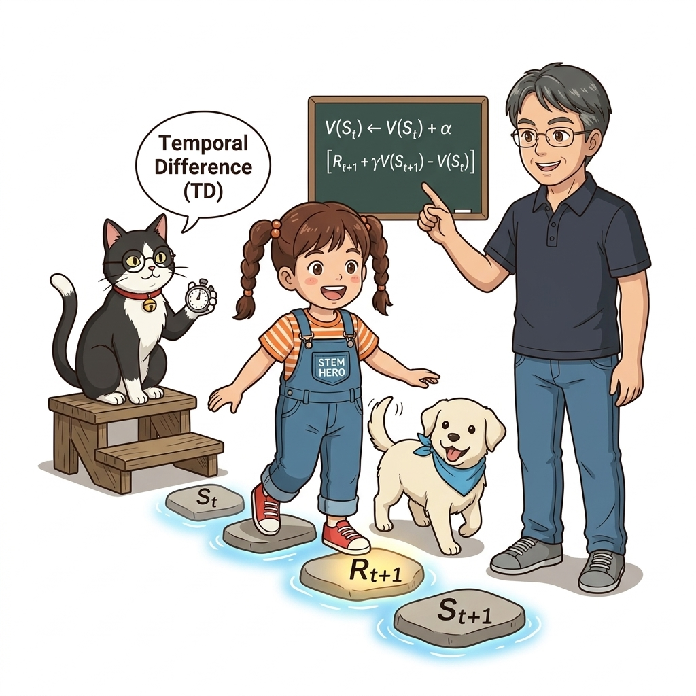
**그림 10-1-2** 도로시가 징검다리를 한 걸음 내딛자마자 칠판의 점화식 공식을 이용해 즉시 상태 가치 *V*(*s*)를 갱신해 주는 지니와 이호진 교수님

---

- **학습 목표**:
  - 몬테카를로법(MC)의 한계인 '에피소드 완주 대기'와 동적 계획법(DP)의 한계인 '환경 모델 의존성'을 극복하는 TD 원리 이해
  - 벨만 기대 방정식의 기댓값을 단 1-스텝 샘플로 근사하는 TD(0) 가치 갱신 공식 유도
  - TD 목표(TD Target)와 TD 오차(TD Error, *δ*<sub>*t*</sub>)의 수학적 구조 및 물리적 의미 파악
  - 편향(Bias)과 분산(Variance) 관점에서 MC와 TD의 트레이드오프 분석
  - 메모리 버퍼(`memory`) 없이 실시간 1-스텝으로 동작하는 `TdAgent` 클래스 파이썬 실전 구현

---

## 10.1.1 TD법의 탄생: DP와 MC의 위대한 융합

TD법은 지금까지 우리가 배운 **'몬테카를로법(MC법)'**과 **'동적 프로그래밍(DP법)'**의 장점만을 취합하여 합친 기법입니다. 

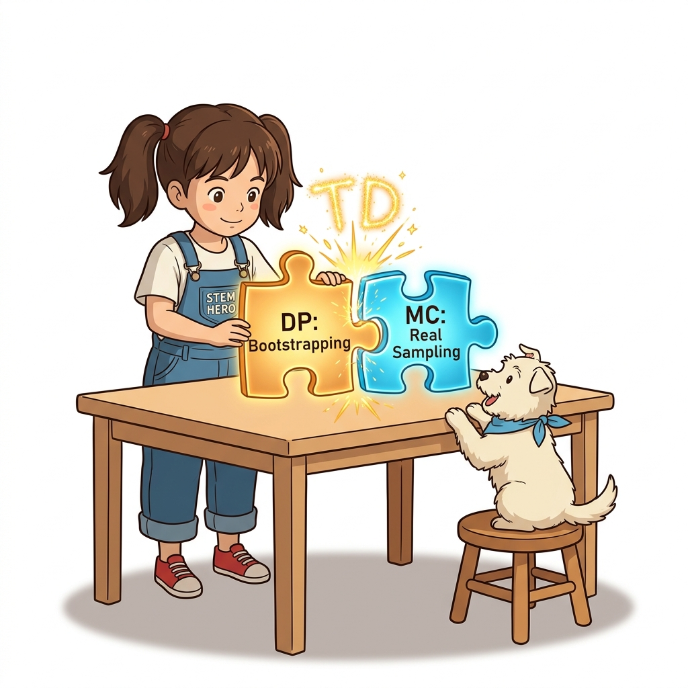
**그림 10-1-3** 동적 계획법(DP)의 부트스트랩 퍼즐 조각과 몬테카를로법(MC)의 실제 샘플링 퍼즐 조각이 맞물려 TD법의 황금빛 섬광을 일으키는 개념 융합

따라서 먼저 이 두 기법의 수학적 뼈대를 복습한 후 TD법을 유도해 보겠습니다.

---

### 1) 수익과 가치 함수의 재귀적 전개

먼저 '수익(Return)'의 정의를 복습해 봅시다. 

시간 *t*부터 시작하여 할인율 *γ*를 적용한 누적 보상의 합은 다음과 같습니다:

> ### ***G*<sub>*t*</sub> = *R*<sub>*t*</sub> + *γR*<sub>*t*+1</sub> + *γ*<sup>2</sup>*R*<sub>*t*+2</sub> + &hellip;** &nbsp;&nbsp;&nbsp;&nbsp; *(식 10.1)*
> 
> ### **= *R*<sub>*t*</sub> + *γG*<sub>*t*+1</sub>** &nbsp;&nbsp;&nbsp;&nbsp; *(식 10.2: 재귀적 표현)*


**그림 10-1-4** 누적 할인 수익의 재귀적 점화식 $G_t = R_t + \gamma G_{t+1}$의 유도 과정을 칠판에 적어주며 기초를 다져주시는 이호진 교수님

---

#### 아름다운 재귀식

시간 *t*에 에이전트가 행동을 취하여 즉각 보상 *R*<sub>*t*</sub>를 얻고, 그 이후의 모든 미래 수익을 *G*<sub>*t*+1</sub>로 묶어 [식 10.2]처럼 아름다운 재귀식으로 나타낼 수 있습니다.

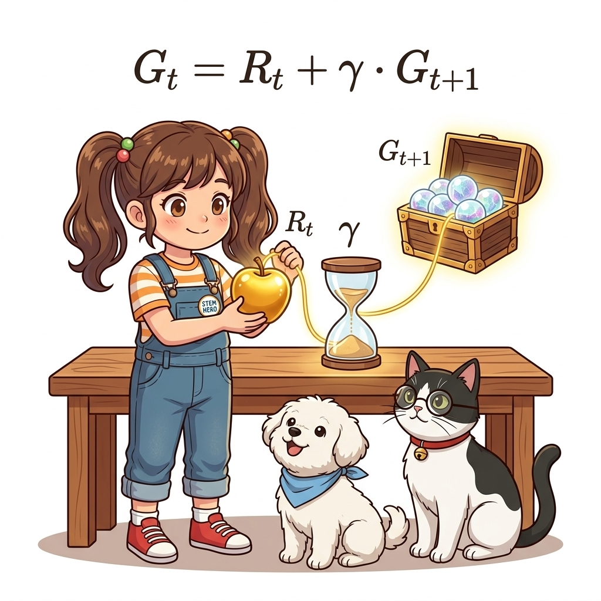
**그림 10-1-5** 즉각 보상 *R*<sub>*t*</sub>(황금 사과)와 할인율 *γ*(모래시계), 미래 누적 수익 *G*<sub>*t*+1</sub>(보물상자)의 재귀적 연쇄 사슬 구조

---

#### 상태 가치함수 정의

이 수익을 바탕으로 정책 *π*를 따를 때의 '상태 가치 함수'를 정의하면 다음과 같은 두 가지 형태로 전개됩니다:

> ### ***v*<sub>*π*</sub>(*s*) = E<sub>*π*</sub> [*G*<sub>*t*</sub> | *S*<sub>*t*</sub> = *s*]** &nbsp;&nbsp;&nbsp;&nbsp; *(식 10.3: 몬테카를로법의 출발점)*
> 
> ### **= E<sub>*π*</sub> [*R*<sub>*t*</sub> + *γG*<sub>*t*+1</sub> | *S*<sub>*t*</sub> = *s*]** &nbsp;&nbsp;&nbsp;&nbsp; *(식 10.4: 동적 프로그래밍의 출발점)*

가치 함수는 이처럼 기댓값으로 정의됩니다. 


**그림 10-1-6** 상태 가치 함수 $v_\pi(s)$의 기댓값 정의에서 뻗어나오는 두 갈래의 길: 전체 수익의 기댓값(MC)과 재귀적 벨만 전개 기댓값(DP)

---

#### 여기서 두 기법이 기댓값을 구하는 방식이 완전히 갈라집니다:

1. **MC법 (몬테카를로법)**: [식 10.3]에서 출발하여, 기댓값을 계산하는 대신 실제로 에피소드가 끝날 때까지 뛰어보고 얻은 **실제 누적 수익의 샘플 평균**으로 근사합니다.
2. **DP법 (동적 프로그래밍)**: [식 10.4]에서 출발하여, 환경의 전이 확률 행렬 *p*(*s*' | *s*, *a*)를 이용해 **벨만 방정식을 통해 모든 가능한 미래의 기댓값을 엄밀하게 계산**합니다.

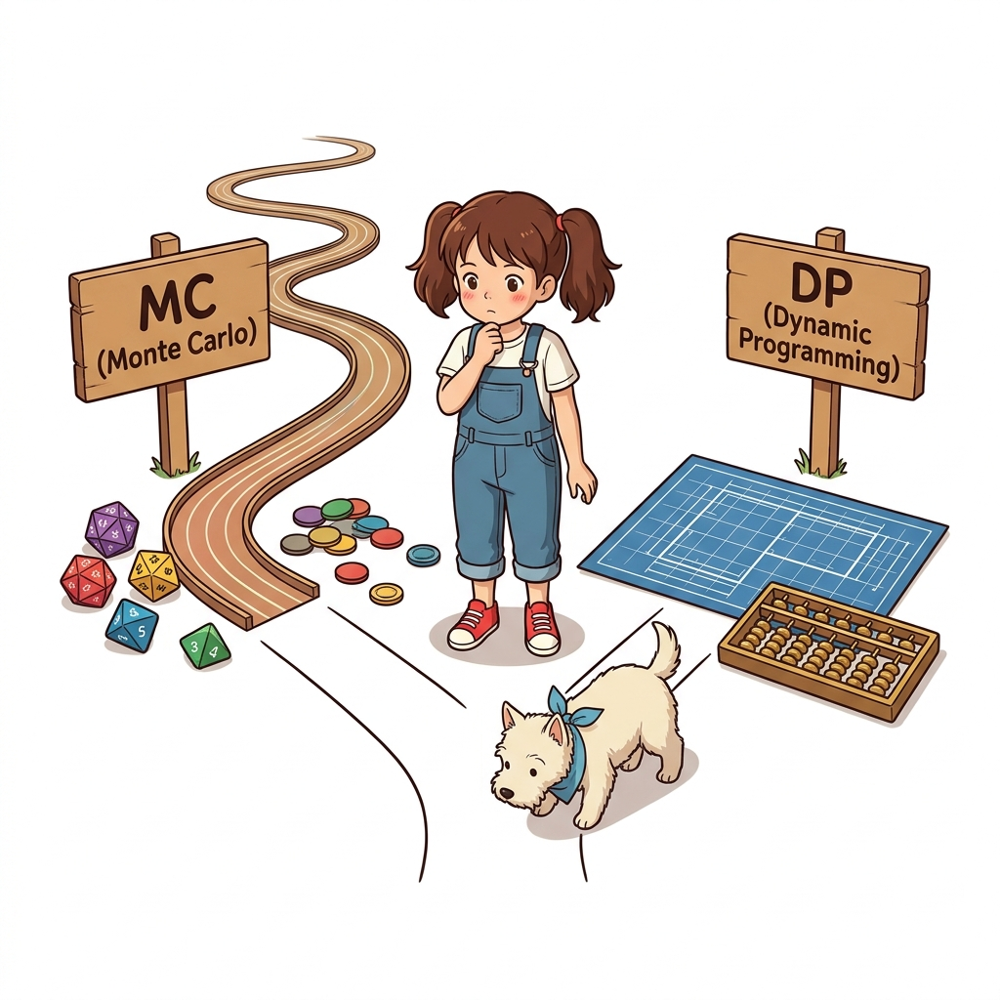
**그림 10-1-7** 실제 경험 주사위와 트랙으로 근사하는 MC 스테이션과 전이 행렬 청사진으로 엄밀 계산하는 DP 스테이션의 대조

---

### 2) MC법과 DP법의 갱신 점화식 복습

두 기법의 가치 갱신식을 나란히 비교해 봅시다:


**그림 10-1-8** 에피소드 완주 후 누적 참 수익을 쓰는 MC 갱신 카드와 전이 행렬로 가중합을 구하는 DP 갱신 카드를 비교하며 고민하는 도로시와 지니

---

#### MC법의 갱신식 (고정 학습률 *α* 기반):

> ### ***V*<sub>*π*</sub>(*S*<sub>*t*</sub>) ← *V*<sub>*π*</sub>(*S*<sub>*t*</sub>) + *α* · [*G*<sub>*t*</sub> - *V*<sub>*π*</sub>(*S*<sub>*t*</sub>)]** &nbsp;&nbsp;&nbsp;&nbsp; *(식 10.5)*
- 에피소드가 완전히 끝난 뒤, 실제로 획득한 참 수익 *G*<sub>*t*</sub>를 목표(Target)로 삼아 가치를 갱신합니다.


**그림 10-1-9** 에피소드가 끝까지 완주되어 결승선에 도달할 때까지 모래시계를 보며 하염없이 기다려야만 가치를 갱신할 수 있는 MC법의 지연 특성

---

#### DP법의 갱신식 (벨만 기대 방정식 기반):

> ### ***V*<sub>*π*</sub>(*s*) ← ∑<sub>*a*, *s*'</sub> *π*(*a* | *s*) *p*(*s*' | *s*, *a*) [*r*(*s*, *a*, *s*') + *γV*<sub>*π*</sub>(*s*')]** &nbsp;&nbsp;&nbsp;&nbsp; *(식 10.6)*
- 환경 모델(*p*, *r*)을 바탕으로, **'다음 상태의 추정 가치 *V*<sub>*π*</sub>(*s*')'를 빌려와서 현재 상태의 가치를 갱신**합니다. 이 원리를 **부트스트랩(Bootstrapping)**이라고 부릅니다.


**그림 10-1-10** 다음 상태 발판의 추정 가치 $V(S_{t+1})$를 황금 부트스트랩 열쇠로 빌려와 현재 상태 $V(S_t)$를 즉시 계산하는 DP의 가치 갱신 원리

---

#### 그림으로 두 가지 방식의 갱신 시점을 비교

몬테카를로법(MC)과 시간차 학습(TD)이 상태 가치를 갱신하는 시점을 다이어그램으로 나누어 살펴보면, 왜 두 기법의 학습 속도와 대기 시간에 본질적인 차이가 발생하는지 명쾌하게 파악할 수 있습니다.

##### ① 몬테카를로법 (MC): 에피소드 종료 대기 후 반환값 $ 확정 시 역방향 일괄 갱신

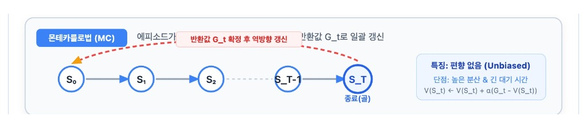
**그림 10-1-11** 몬테카를로법(MC)의 가치 갱신 시점: 에피소드가 완전히 끝날 때까지 골(Goal) 지점($)까지 도달하기를 기다린 후, 확정된 누적 반환값  이용해 지나온 상태들을 역방향으로 일괄 갱신

- **상태 전이 흐름**:  \rightarrow S_1 \rightarrow S_2 \dots \rightarrow S_{T-1} \rightarrow S_T$
- **갱신 메커니즘**: 에피소드가 완전히 끝나는 종료 상태($)에 도달해야만 참 수익  확정할 수 있습니다. 확정된  목표(Target)로 삼아 이전 상태들로 거슬러 올라가며 가치를 한 번에 사후 정산합니다.
- **핵심 특징 및 트레이드오프**:
  - **장점**: 실제 발생한 진짜 누적 보상만을 사용하므로 **편향이 전혀 없습니다 (Zero Bias, Unbiased)**.
  - **단점**: 에피소드가 끝날 때까지 아무런 가치 갱신도 일어나지 않아 **긴 대기 시간**이 발생하며, 긴 경로 동안 겪은 모든 무작위 사건들이 누적되어 **분산(Variance)이 매우 높습니다**.
- **가치 갱신 공식**:
  > ### ***V*(*S*<sub>*t*</sub>) ← *V*(*S*<sub>*t*</sub>) + *α* · [*G*<sub>*t*</sub> - *V*(*S*<sub>*t*</sub>)]**

---

##### ② 시간차 학습 (TD(0)): 1-스텝 이동 직후 부트스트랩 즉시 갱신

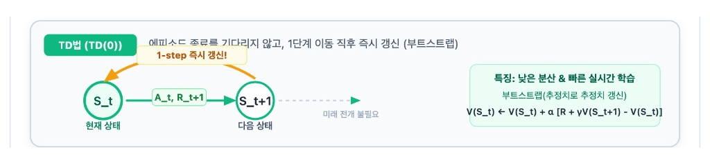
**그림 10-1-12** 시간차 학습(TD(0))의 가치 갱신 시점: 에피소드 종료를 기다리지 않고, 1단계 행동 직후 관측된 보상과 다음 상태 가치 추정치 (S_{t+1}) 현재 상태 가치를 즉시 갱신 (미래 전개 불필요)

- **상태 전이 흐름**:  \xrightarrow{A_t, R_{t+1}} S_{t+1}$ (미래 궤적 전개 불필요)
- **갱신 메커니즘**: 단 1단계 행동($)을 취해 즉각 보상 {t+1} 받고 다음 상태 {t+1} 도달하자마자, 아직 가보지 않은 미래를 기다리지 않고 **다음 상태의 현재 추정 가치 (S_{t+1}) 빌려와(Bootstrapping)** 현재 상태  가치를 실시간으로 즉시 갱신합니다.
- **핵심 특징 및 트레이드오프**:
  - **장점**: 단 1스텝 뒤의 결과만을 반영하므로 무작위성이 적게 개입하여 **분산이 매우 낮고(Low Variance)**, 에피소드가 끝나지 않는 지속적 과제에서도 **즉각적인 온라인 실시간 학습**이 가능합니다.
  - **단점**: 아직 참값이 아닌 추정치 (S_{t+1}) 바탕으로 갱신하므로 학습 초기에 **약간의 편향(Bias)**이 존재합니다 (학습이 반복될수록 참값으로 수렴하여 소멸).
- **가치 갱신 공식**:
  > ### ***V*(*S*<sub>*t*</sub>) ← *V*(*S*<sub>*t*</sub>) + *α* · [*R*<sub>*t*+1</sub> + *γV*(*S*<sub>*t*+1</sub>) - *V*(*S*<sub>*t*</sub>)]**

---

### 3) 갱신 시점과 백업 흐름의 본질적 차이

몬테카를로법(MC)과 시간차 학습(TD)의 백업 흐름을 각각 징검다리 경로 그림으로 나누어 살펴보면, 가치 갱신이 일어나는 시점과 메커니즘의 결정적 차이를 선명하게 파악할 수 있습니다.

#### ① 몬테카를로법(MC)의 백업 흐름: 에피소드 완주 후 역방향 지연 갱신


**그림 10-1-13** 몬테카를로법(MC)의 백업 흐름: 에피소드가 끝날 때까지 골인(Goal) 지점까지 완주한 후, 전체 경로를 역방향으로 거슬러 올라가며 가치를 지연 갱신 (대기 시간 발생)

- 에이전트 도로시가 출발점에서 출발하여 최종 골(Goal) 깃발에 도달할 때까지 가치는 전혀 갱신되지 않습니다.
- 에피소드가 끝난 뒤에야 비로소 실제로 획득한 보상들의 총합(수익 $)을 바탕으로, 지나온 발판들을 거꾸로 거슬러 올라가며 가치를 한 번에 사후 정산합니다.

---

#### ② 시간차 학습(TD)의 백업 흐름: 1-스텝 이동 즉시 부트스트랩 갱신

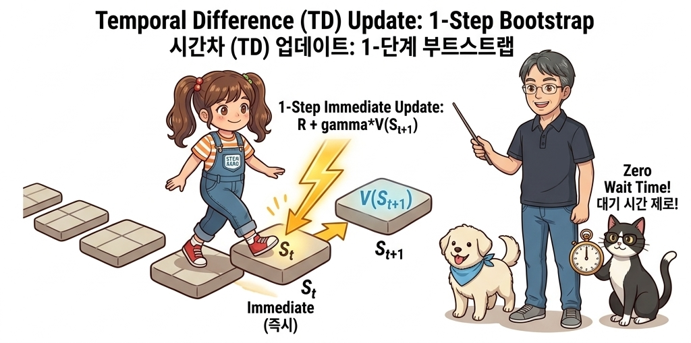
**그림 10-1-14** 시간차 학습(TD)의 백업 흐름: 단 1걸음 이동 직후 다음 상태의 추정 가치 (S_{t+1}) 빌려와 번개(⚡)처럼 즉시 현재 발판  갱신 (대기 시간 제로!)

- 에이전트 도로시가 발판  다음 발판 {t+1} 단 한 걸음 내딛자마자, 즉시 보상  다음 상태의 가치 (S_{t+1}) 이용해  가치를 실시간으로 갱신합니다.
- 에피소드가 끝나기를 기다릴 필요가 전혀 없으므로 대기 시간이 0(Zero Wait Time)이며, 메모리 버퍼 없이 극도로 가볍고 기민하게 학습이 진행됩니다.

---

[그림 10-1-11]부터 [그림 10-1-14]까지의 갱신 시점과 백업 흐름을 종합 비교해 보면 각 기법의 장단점이 극명하게 드러납니다:

- **DP법**: 환경 지도를 완벽히 알고 있으므로 모든 경로를 수학적으로 계산할 수 있지만, 지도가 없는 실세계에서는 아예 사용할 수 없습니다.
- **MC법**: 환경 지도가 없어도 실제 샘플 경험으로 학습할 수 있지만, 에피소드가 끝날 때까지 하염없이 기다려야만 합니다.
- **TD법**: 환경 지도 없이 오직 1걸음 실제 경험만으로 학습하면서도, 에피소드 완주를 기다리지 않고 매 순간 실시간으로 가치를 갱신합니다.

---

### 4) 하이브리드의 탄생: DP의 부트스트랩 + MC의 샘플링

이 두 기법의 장점만을 뽑아내면 어떨까요?  

> **"환경 모델 없이 오직 실제 1걸음 샘플 데이터만으로 학습(MC의 장점)하면서도, 에피소드 완주를 기다리지 않고 다음 상태의 가치를 빌려와 즉시 갱신(DP의 부트스트랩 장점)하자!"**


**그림 10-1-15** DP의 황금 부트스트랩 열쇠와 MC의 경험 나침반이 융합하여 탄생한 시간차 학습(TD)의 탄생

---

#### TD 탄생 배경

이것이 바로 **시간차 학습(TD법, Temporal Difference Learning)**의 위대한 탄생 배경입니다! 

- 모델이 없어도 학습할 수 있는 **모델 프리(Model-Free)** 속성을 유지하면서,
- 에피소드가 끝날 때까지 기다리지 않고 매 스텝 즉시 가치를 갱신하는 **온라인 실시간 갱신(Online Real-time Update)**을 완벽히 실현합니다.

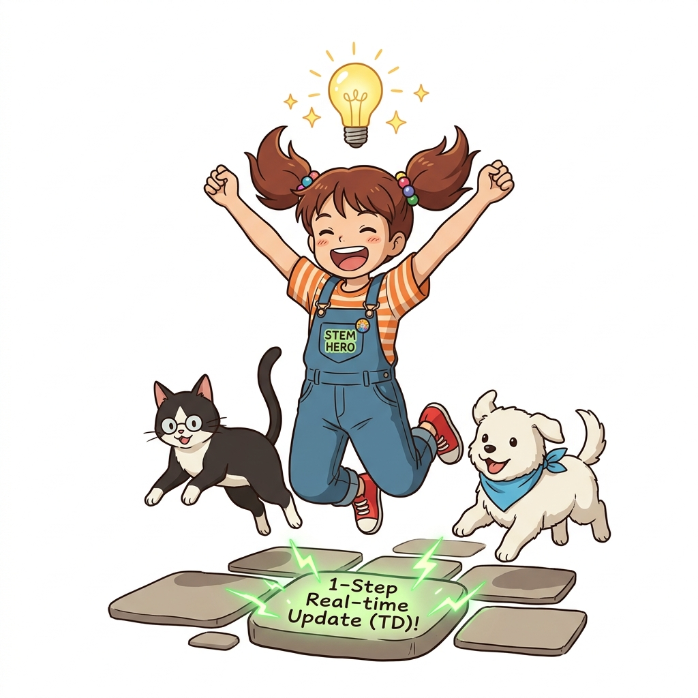
**그림 10-1-16** 한 걸음 딛자마자 번개처럼 실시간 가치 갱신이 일어나는 TD 학습의 기적을 발견하고 환호하는 도로시와 지니, 토토

---

### 5) TD법의 수식 도출: 단 1스텝 샘플에 의한 기댓값 근사

DP법의 벨만 방정식 [식 10.6]을 기댓값 형태로 다시 표현해 봅시다:

> ### ***v*<sub>*π*</sub>(*s*) = E<sub>*π*</sub> [*R*<sub>*t*</sub> + *γv*<sub>*π*</sub>(*S*<sub>*t*+1</sub>) | *S*<sub>*t*</sub> = *s*]** &nbsp;&nbsp;&nbsp;&nbsp; *(식 10.7)*

---

DP법은 모든 가능한 전이 확률 *p*(*s*' | *s*, *a*)를 알고 있어야만 이 기댓값을 **연립방정식 가중합**으로 풀 수 있었습니다.

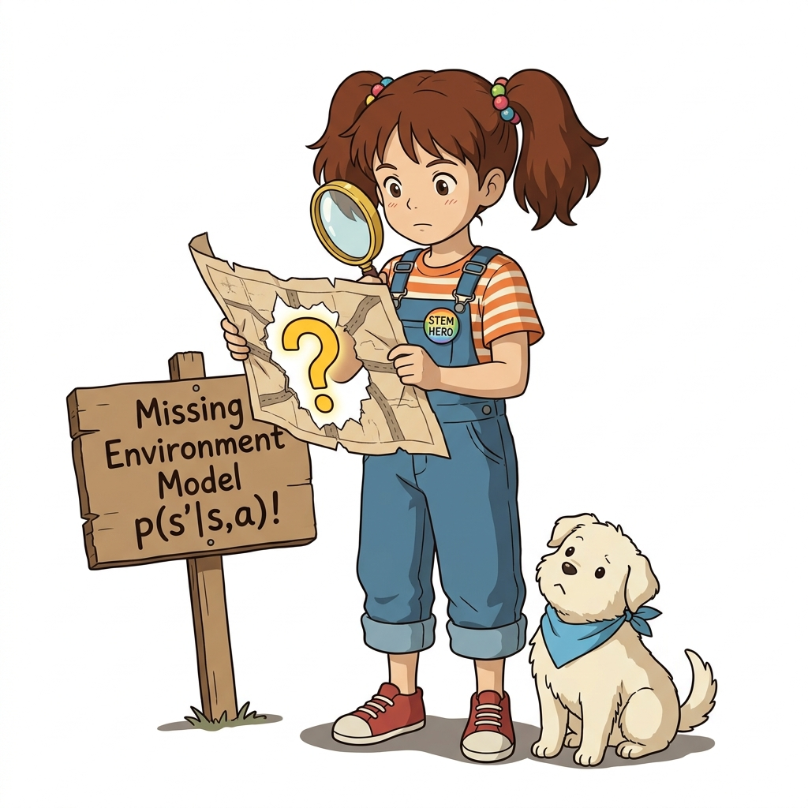
**그림 10-1-17** 복잡한 실세계 환경 지도가 찢겨져 물음표로 가려졌을 때 전이 확률 행렬을 구할 수 없어 멈춰 서는 DP법의 치명적 한계

---

반면 TD법은 **실제로 한 걸음 이동하여 관측된 단 하나의 샘플 데이터 (*R*<sub>*t*</sub>, *S*<sub>*t*+1</sub>)로 이 기댓값을 대담하게 근사**합니다!

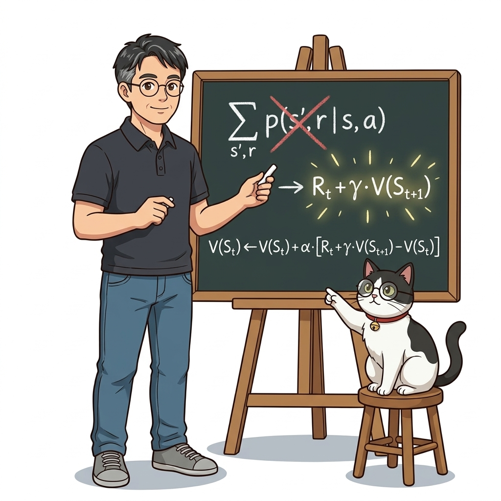
**그림 10-1-18** DP의 거대한 전수조사 합 기호(∑)를 소거하고 단 1스텝 관측치 *R*<sub>*t*</sub> + *γV*(*S*<sub>*t*+1</sub>)로 대담하게 근사하는 TD(0) 유도 칠판 강의

---

이 샘플 근사를 가치 갱신 점화식에 대입하면, 마침내 **TD(0) 가치 갱신 공식**이 유도됩니다:

> ### ***V*<sub>*π*</sub>(*S*<sub>*t*</sub>) ← *V*<sub>*π*</sub>(*S*<sub>*t*</sub>) + *α* · [*R*<sub>*t*</sub> + *γV*<sub>*π*</sub>(*S*<sub>*t*+1</sub>) - *V*<sub>*π*</sub>(*S*<sub>*t*</sub>)]** &nbsp;&nbsp;&nbsp;&nbsp; *(식 10.8: TD 정책 평가 공식)*


**그림 10-1-19** 칠판에 황금빛으로 빛나는 TD(0) 가치 갱신 공식 [식 10.8]을 열강하시는 이호진 교수님과 열정적으로 호응하는 도로시

---

### 6) TD 공식의 3대 핵심 기둥: 현재 예측, TD 목표, TD 오차

[식 10.8]의 구조를 돋보기로 들여다보면 3개의 핵심 요소가 들어 있습니다:

| 핵심 구성 요소 | 수학 표현식 | 물리적 의미 및 역할 |
| :--- | :--- | :--- |
| **현재 추정치** | ***V*<sub>*π*</sub>(*S*<sub>*t*</sub>)** | 현재 상태 *S*<sub>*t*</sub>에 대해 에이전트가 지금까지 예상하고 있던 가치 |
| **TD 목표 (TD Target)** | ***R*<sub>*t*</sub> + *γV*<sub>*π*</sub>(*S*<sub>*t*+1</sub>)** | 실제로 얻은 보상 *R*<sub>*t*</sub>와 다음 상태의 추정 가치 *γV*<sub>*π*</sub>(*S*<sub>*t*+1</sub>)를 합친 **새로운 목표 기준점** |
| **TD 오차 (TD Error, *δ*<sub>*t*</sub>)** | ***R*<sub>*t*</sub> + *γV*<sub>*π*</sub>(*S*<sub>*t*+1</sub>) - *V*<sub>*π*</sub>(*S*<sub>*t*</sub>)** | 새로운 기준점(목표)과 기존 예측 사이의 차이 (학습의 나침반 역할) |

---

도로시가 현재 예상하는 가치 상자 *V*(*S*<sub>*t*</sub>)를, 한 걸음 걷고 발견한 더 믿을 만한 기준 상자인 *R*<sub>*t*</sub> + *γV*(*S*<sub>*t*+1</sub>) (TD 목표)에 맞추려고 합니다.

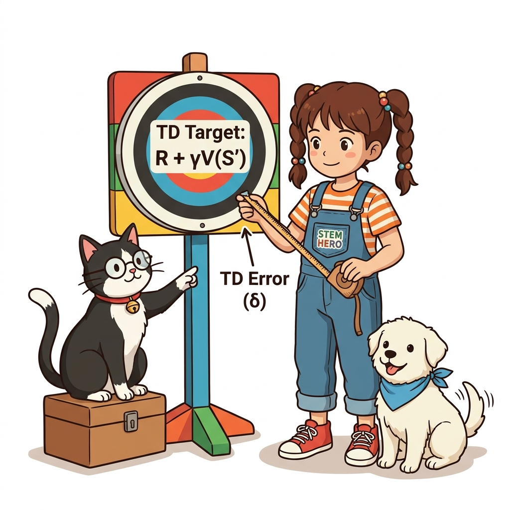
**그림 10-1-20** 과녁판의 TD 목표(*R* + *γV*(*S*'))와 현재 예측 상자 사이의 간격인 TD 오차(*δ*)를 줄자로 정밀 측정하는 도로시와 지니

두 상자의 차이인 **TD 오차(*δ*<sub>*t*</sub>)**를 측정한 뒤, 학습 속도를 제어하는 다이얼인 **학습률 *α***만큼만 살짝 그 방향으로 당겨주어 가치를 실시간으로 보정해 나가는 것입니다!

---

### 7) TD(0)의 백업 다이어그램

백업 다이어그램은 강화학습 알고리즘의 갱신 구조를 시각화한 트리 구조입니다:

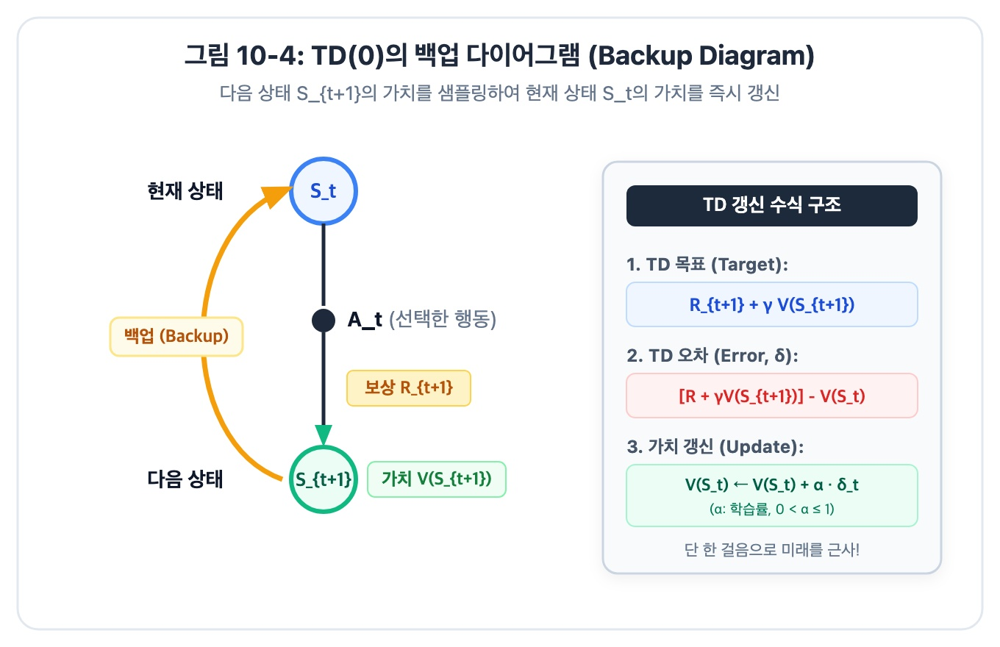
**그림 10-1-21** TD(0)의 백업 다이어그램 (Backup Diagram): 다음 상태 *S*<sub>*t*+1</sub>의 가치를 샘플링하여 현재 상태 *S*<sub>*t*</sub>의 가치를 즉시 백업

---

- **현재 상태 *S*<sub>*t*</sub> (빈 원)**에서 행동 하나를 취합니다.
- 행동 결과 즉각 보상 *R*<sub>*t*</sub>를 받고 **다음 상태 *S*<sub>*t*+1</sub>**에 도달합니다.
- 에피소드 끝까지 내려가지 않고, 오직 **1스텝 아래의 *S*<sub>*t*+1</sub> 가치**만을 빌려와서 현재 상태 *S*<sub>*t*</sub>로 즉시 되돌려 보냅니다(Backup).
- 이처럼 단 1스텝 앞만 바라보고 즉시 갱신하는 방식을 **TD(0)** 또는 **1-스텝 TD**라고 부릅니다.

---

## 10.1.2 MC법과 TD법의 심층 비교: 편향과 분산의 트레이드오프

환경 모델을 전혀 모를 때, 우리는 MC법과 TD법 중 무엇을 선택해야 할까요? 


**그림 10-1-22** 저울의 양쪽에 MC(무편향 고분산)와 TD(저분산 신속수렴)를 올려놓고 어떤 알고리즘을 선택할지 저울질하는 도로시

---

두 기법의 특성을 체계적으로 비교해 봅시다.

| 비교 기준 | 🎲 몬테카를로법 (MC) | ⚡ 시간차 학습 (TD) |
| :--- | :--- | :--- |
| **갱신 공식** | *V*(*S*<sub>*t*</sub>) ← *V*(*S*<sub>*t*</sub>) + *α*[*G*<sub>*t*</sub> - *V*(*S*<sub>*t*</sub>)] | *V*(*S*<sub>*t*</sub>) ← *V*(*S*<sub>*t*</sub>) + *α*[*R*<sub>*t*</sub> + *γV*(*S*<sub>*t*+1</sub>) - *V*(*S*<sub>*t*</sub>)] |
| **갱신 목표 (Target)** | 에피소드 완주 후 누적 참 수익 *G*<sub>*t*</sub> | 1-스텝 보상 + 다음 가치 *R*<sub>*t*</sub> + *γV*(*S*<sub>*t*+1</sub>) |
| **갱신 시점** | **에피소드 종료 시점 (지연 갱신)** | **매 타임스텝 즉시 (실시간 1-Step 갱신)** |
| **적용 과제** | 일회성 과제(Episodic)만 가능 | 일회성 과제 및 **영구 지속 과제(Continuing) 모두 가능** |
| **편향 (Bias)** | **편향 없음 (Zero Bias, 완벽한 무편향)** | **초기 편향 존재** (부트스트랩 추정치 *V*를 사용하므로) |
| **분산 (Variance)** | **매우 높음 (High Variance)** | **매우 낮음 (Low Variance, 안정적)** |
| **학습 속도** | 분산이 커서 수많은 에피소드 표본 필요 | **실제 대부분의 환경에서 훨씬 빠르고 안정적으로 수렴** |

---

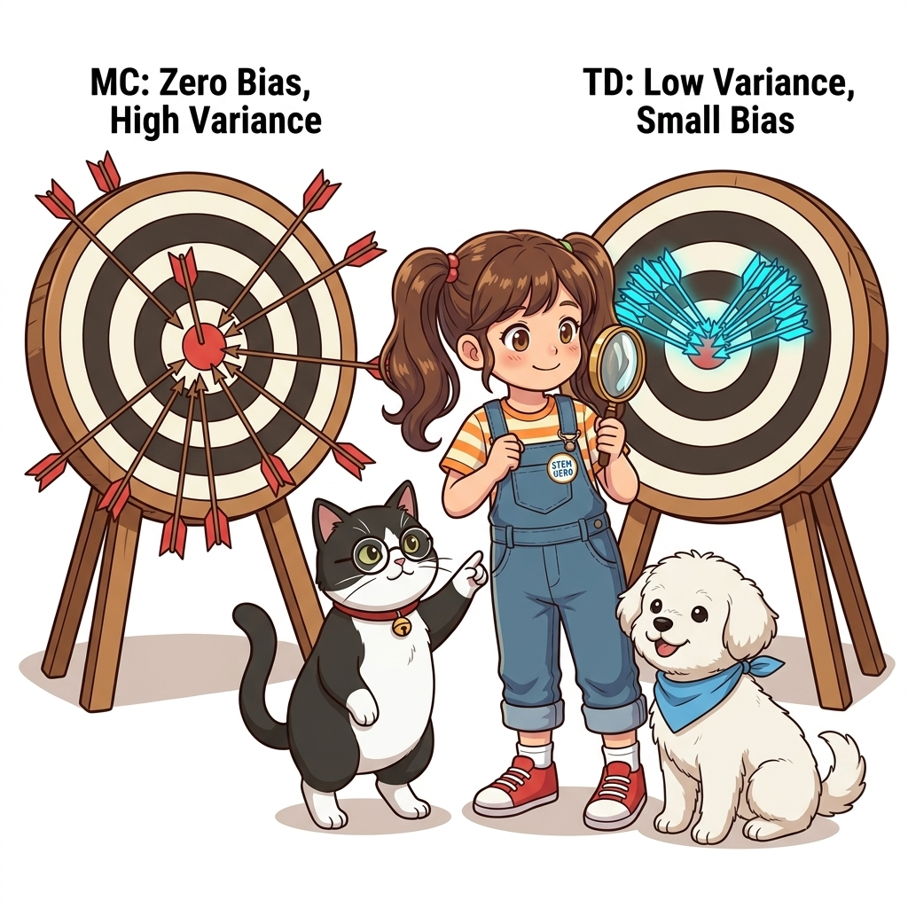
**그림 10-1-23** 편향(조준 오차)과 분산(탄착군 퍼짐도)의 양궁 과녁 비교: MC(무편향 + 고분산) vs TD(약간의 초기 편향 + 초저분산)

---

### 1) 왜 MC법은 분산이 크고, TD법은 분산이 작을까요?

운전자가 안개 낀 고속도로를 달리는 상황을 상상해 보십시오.


**그림 10-1-24** 안개 낀 도로 주행 비유: 1시간 장기 항해의 요동치는 궤적(MC 고분산) vs 1초 전조등 앞길의 안정적인 직진(TD 저분산)

---

- **MC법의 목표 *G*<sub>*t*</sub>**:
  - 운전자가 10분, 1시간 동안 핸들을 이리저리 꺾으며 수없이 마주친 무작위 돌발 상황들의 결과가 꼬리에 꼬리를 물고 누적된 값입니다.
  - 경로가 길어질수록 운이나 우연의 개입이 심해져 **값의 출렁임(분산)이 극도로 커집니다.**


**그림 10-1-25** 수많은 불확실한 돌발 상황과 우연의 주사위가 꼬리를 물며 누적되어 극심하게 요동치는 MC의 고분산 롤러코스터

---

- **TD법의 목표 *R*<sub>*t*</sub> + *γV*(*S*<sub>*t*+1</sub>)**:
  - 방금 지나간 **단 1초(1스텝)** 동안의 결과만을 바탕으로 계산합니다.
  - 단 1단계 앞의 사건만 반영하므로 무작위성이 적게 개입하여 **값의 출렁임(분산)이 매우 작고 안정적입니다.**


**그림 10-1-26** 단 한 걸음 앞의 확실한 발판만을 밝히며 극도의 안정성과 저분산으로 직진하는 TD법의 전조등 효과

---

### 2) 편향(Bias)의 차이와 신속한 수렴

다음으로 편향(Bias)의 차이를 살펴봅시다. 편향이란 에이전트의 추정치가 참값으로부터 구조적으로 얼마나 치우쳐 있는가를 나타냅니다.

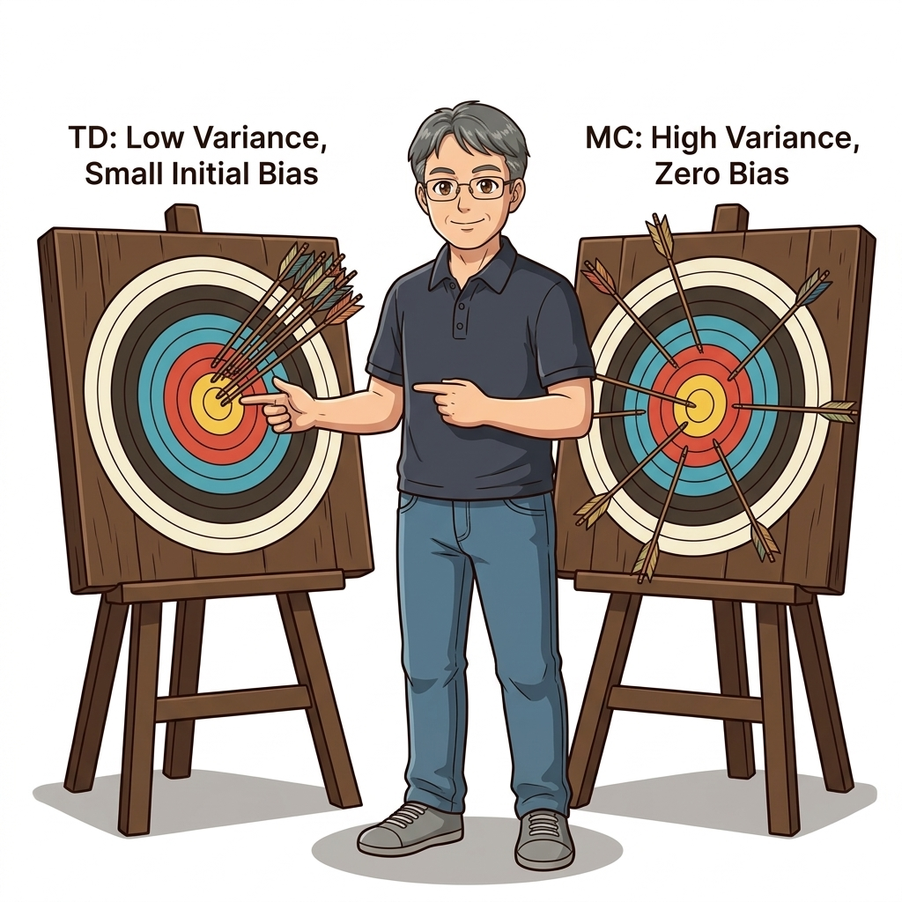
**그림 10-1-27** 과녁판을 통해 영점 오차(편향)와 탄착군 산포도(분산)의 통계적 차이를 도로시에게 쉽게 풀어주시는 이호진 교수님

---

- **MC법**: 실제 발생한 진짜 보상들의 누적 합 *G*<sub>*t*</sub>만을 온전히 사용하므로, 어떠한 가짜 추정치도 섞이지 않아 **수학적으로 편향이 0(Unbiased)**입니다.

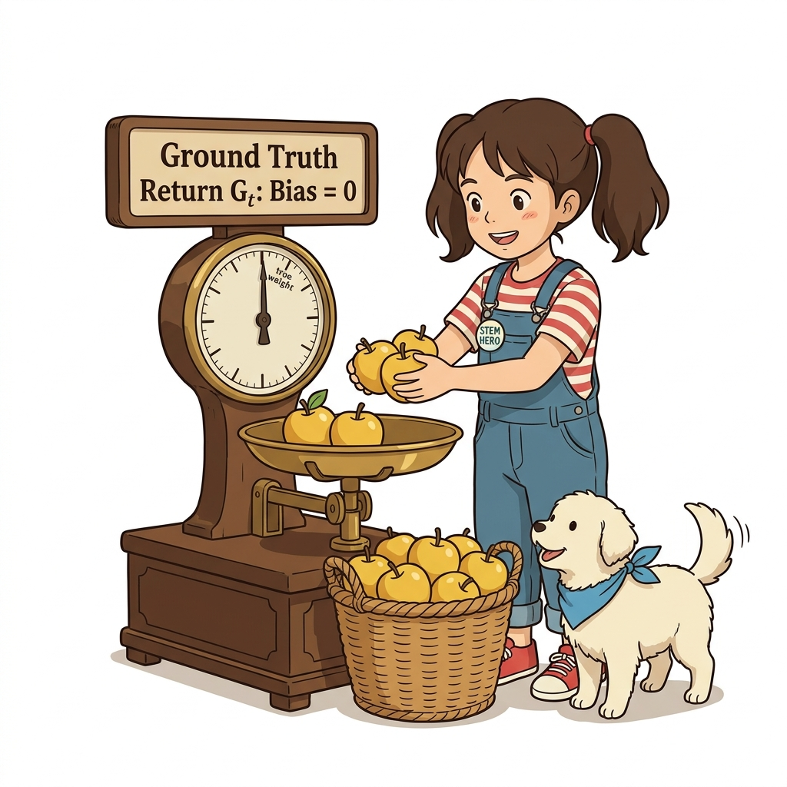
**그림 10-1-28** 실제 수확한 진짜 황금 사과를 저울에 달아 어떠한 가공이나 추정도 섞이지 않은 100% 무편향 참 수익 G_t를 달아보는 도로시

---

- **TD법**: 아직 정확하지 않은 다음 상태의 추정 가치 *V*(*S*<sub>*t*+1</sub>)를 빌려 써서 갱신하므로, 학습 초기에는 **약간의 편향(Bias)**이 존재합니다. 하지만 학습이 반복될수록 *V*(*S*<sub>*t*+1</sub>) 자체가 참 가치로 수렴해 가기 때문에, 편향은 결국 0으로 사라지게 됩니다.

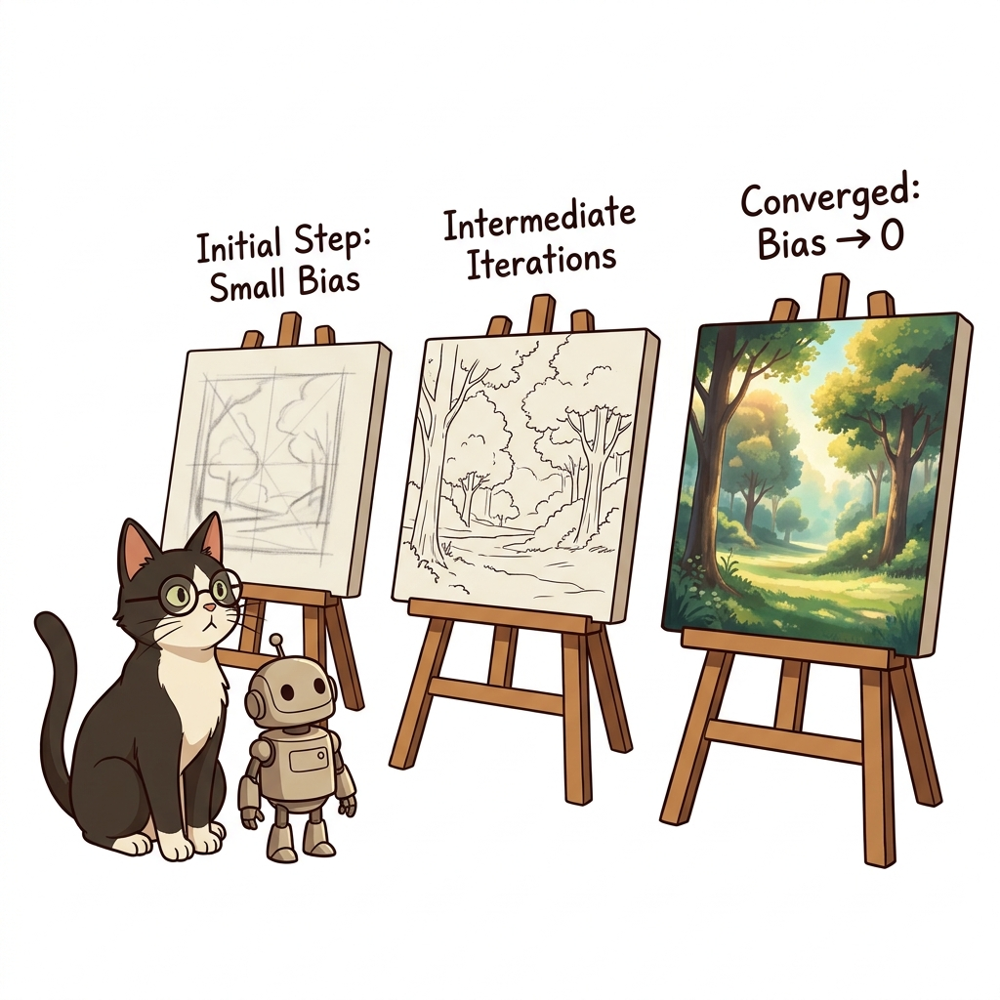
**그림 10-1-29** 초기 스케치의 거친 오차(초기 편향)가 학습이 반복될수록 자가 교정되어 완전한 명화(참값)로 수렴해가는 3단계 변화

---

대부분의 실세계 강화학습 문제에서는 **"약간의 초기 편향을 감수하더라도 분산이 훨씬 작은 TD법"**이 훨씬 적은 데이터로도 압도적으로 빠르게 참 가치에 수렴합니다!

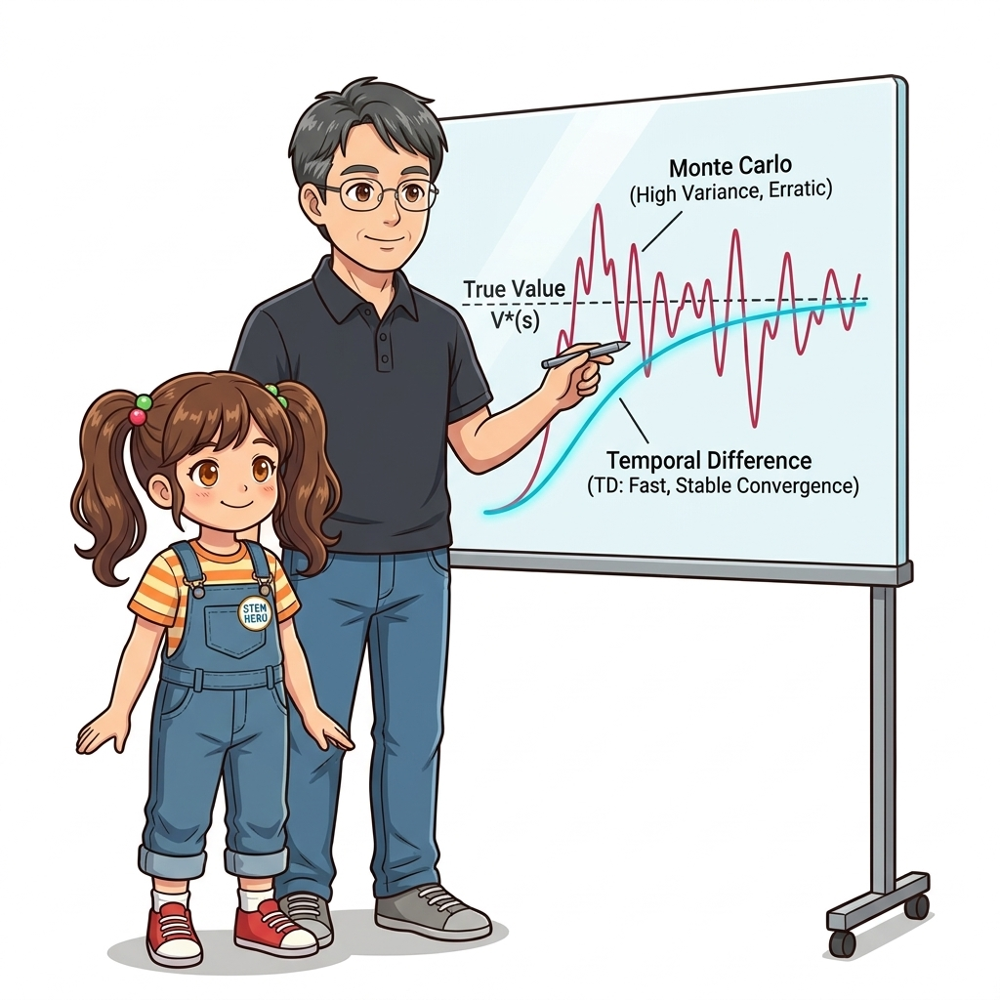
**그림 10-1-30** 학습이 반복됨에 따라 초기 편향이 0으로 사르르 소멸하며 참값에 신속하고 안정적으로 수렴하는 TD 학습 곡선

---

## 10.1.3 TD 정책 평가 에이전트 구현

이제 파이썬으로 TD 정책 평가를 수행하는 `TdAgent` 클래스를 구현해 보겠습니다. 


**그림 10-1-31** 무거운 메모리 가방(`memory = []`)을 던져버리고 매 스텝 실시간으로 가볍게 달리는 초경량 `TdAgent`의 파이썬 구현

---

상, 하, 좌, 우 4방향으로 25%씩 무작위로 이동하는 에이전트를 작성합니다.

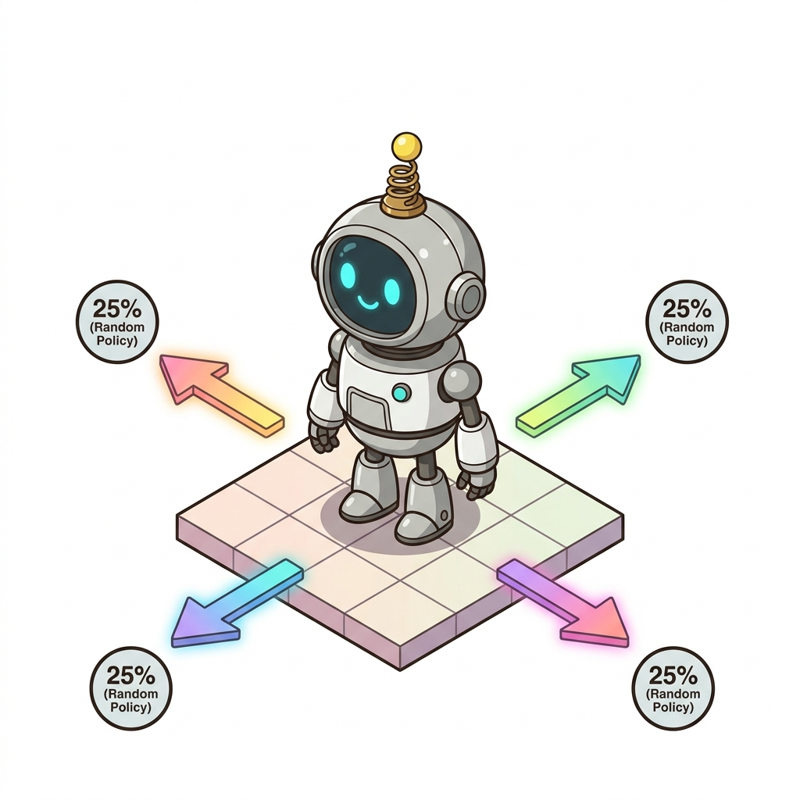
**그림 10-1-32** 3D 격자 타일 위에서 상, 하, 좌, 우 각 25%의 균등 확률로 이동하며 탐색하는 무작위 정책 에이전트 틴맨

---

#### TDAgent 클래스 구현

<div align="right"><b>ch06/td_eval.py</b></div>

```python
from collections import defaultdict
import numpy as np

class TdAgent:
    def __init__(self):
        self.gamma = 0.9      # 할인율 γ
        self.alpha = 0.01     # TD 학습률 α (0.01)
        self.action_size = 4  # 상, 하, 좌, 우 4가지 행동

        random_actions = {0: 0.25, 1: 0.25, 2: 0.25, 3: 0.25}
        self.pi = defaultdict(lambda: random_actions)
        self.V = defaultdict(lambda: 0)  # 상태 가치 함수 V(s) 테이블

    def get_action(self, state):
        action_probs = self.pi[state]
        actions = list(action_probs.keys())
        probs = list(action_probs.values())
        return np.random.choice(actions, p=probs)

    def eval(self, state, reward, next_state, done):
        # ❶ 종료 상태(Goal/Trap)의 가치 함수는 정의상 항상 0!
        next_V = 0 if done else self.V[next_state]
        
        # ❷ TD 목표 계산: R + γ * V(S_{t+1})
        target = reward + self.gamma * next_V

        # ❸ TD 오차를 이용한 즉시 가치 갱신: V(s) ← V(s) + α * (target - V(s))
        self.V[state] += (target - self.V[state]) * self.alpha
```

---

### 1) eval() 메서드 한 줄 한 줄 돋보기

코드를 한 줄 한 줄 분해하여 체계적으로 살펴봅시다.


**그림 10-1-33** `eval()` 메서드의 4대 핵심 라인이 레고 블록처럼 유기적으로 맞물려 가치를 즉각 갱신하는 코드 해부도

---

1. **`eval(self, state, reward, next_state, done)`의 매개변수**:
   - `state` (*S*<sub>*t*</sub>): 행동을 취하기 직전의 현재 상태 좌표입니다.
   - `reward` (*R*<sub>*t*</sub>): 행동 직후 환경으로부터 즉시 획득한 보상입니다.
   - `next_state` (*S*<sub>*t*+1</sub>): 에이전트가 새롭게 도달한 다음 상태 좌표입니다.
   - `done`: 에피소드가 종료되었는지 여부(`True`/`False`) 플래그입니다.

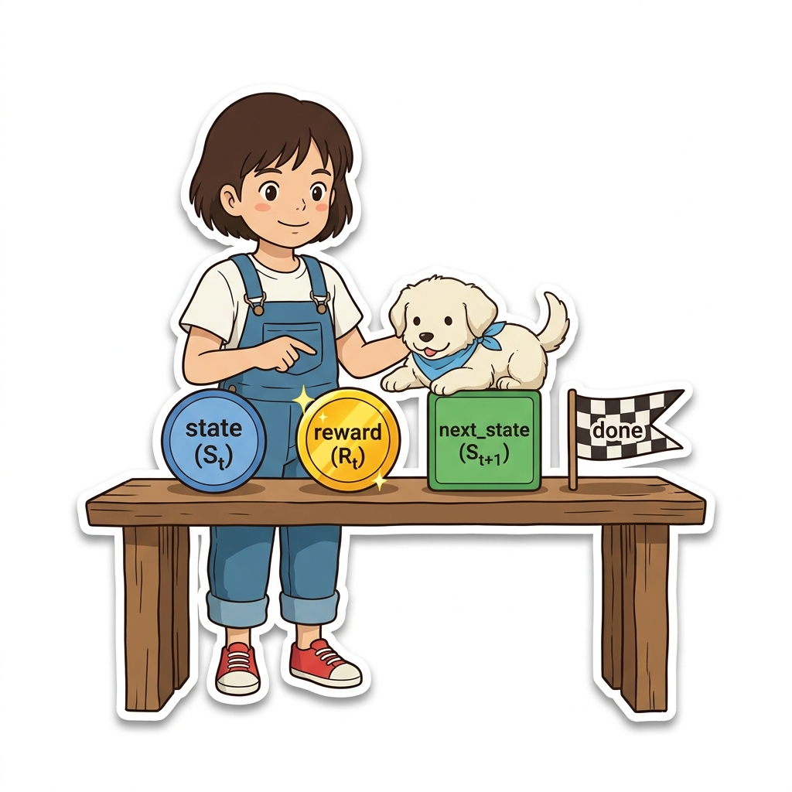
**그림 10-1-34** `eval()` 함수의 4대 핵심 전달 인자인 `state`, `reward`, `next_state`, `done` 카드를 도로시가 펼쳐 보여주는 해설

---

2. **`next_V = 0 if done else self.V[next_state]`**:
   - 만약 목표 지점(골 또는 함정)에 도달하여 게임이 끝났다면(`done == True`), 더 이상 미래에 얻을 보상이 없으므로 종료 상태의 참 가치는 항상 **0**입니다.
   - 게임이 계속 진행 중이라면 테이블에서 다음 상태의 현재 추정치 `self.V[next_state]`를 부트스트랩하여 가져옵니다.

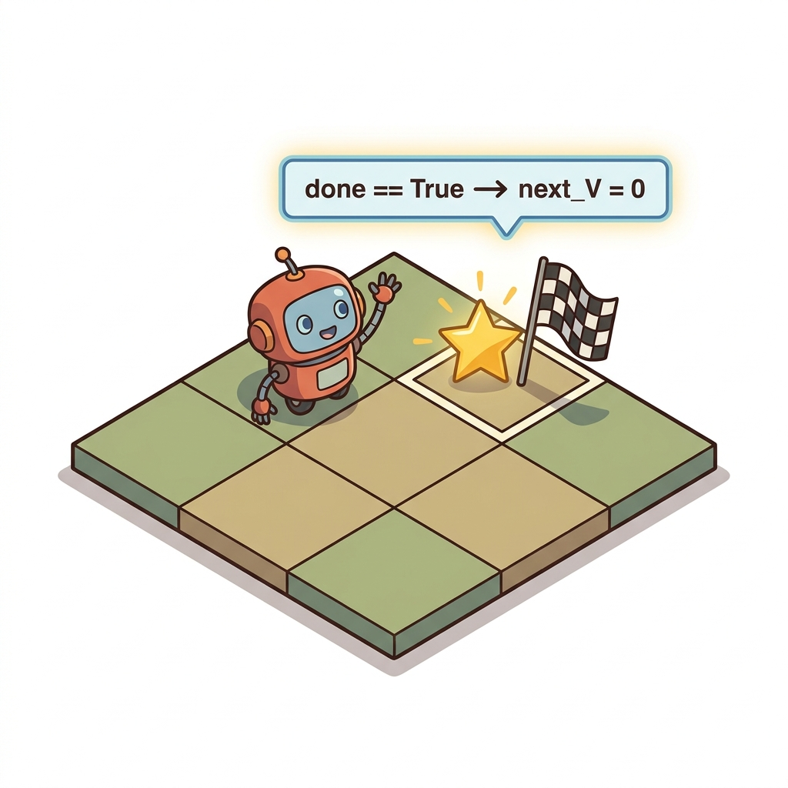
**그림 10-1-35** 게임 종료(`done == True`) 시 더 이상의 미래 보상이 존재하지 않아 남은 가치 `next_V`가 정확히 0이 되는 원리

---

3. **`target = reward + self.gamma * next_V`**:
   - [식 10.8]의 **TD 목표 (*R*<sub>*t*</sub> + *γV*(*S*<sub>*t*+1</sub>))**를 계산합니다.
   - 방금 획득한 즉시 보상과 미래의 할인된 추정 가치를 결합하여 새로운 기준점을 형성합니다.


**그림 10-1-36** 작업대에서 즉시 보상 동전 $R_t$와 할인된 다음 가치 구슬 $\gamma V(S_{t+1})$을 결합해 TD 목표 기준판을 조립하는 지니와 틴맨

---

4. **`self.V[state] += (target - self.V[state]) * self.alpha`**:
   - TD 오차 `(target - self.V[state])`에 학습률 `self.alpha`를 곱해 현재 상태의 가치를 즉각 갱신합니다.
   - 한 걸음 내딛을 때마다 오차 신호의 크기에 비례하여 가치를 실시간으로 보정합니다.


**그림 10-1-37** 학습률 $\alpha=0.01$ 다이얼을 미세 조정하여 현재 가치를 TD 목표 방향으로 부드럽게 한 걸음 당겨주는 도로시와 지니

---

> [!NOTE]
> **💡 MC법과 코드 구조의 결정적 차이!**  
> 9장에서 구현한 `McAgent`는 에피소드가 진행되는 동안 `self.memory.append(data)`로 경험을 가방 속에 계속 담아두었다가, 에피소드가 완전히 끝났을 때 비로소 `eval()`을 딱 한 번 호출했습니다.  
> 하지만 `TdAgent`는 **경험을 저장하는 `memory` 리스트가 아예 없습니다!** 한 걸음 내딛자마자 그 자리에서 즉시 `eval()`을 호출하여 가치를 갱신해 버리므로, 메모리를 전혀 차지하지 않는 초경량 실시간 학습이 가능합니다.

---

### 2) 전체 학습 스크립트 실행 (1,000 에피소드 실시간 상호작용)

이제 `GridWorld` 환경과 `TdAgent`를 연결하여 1,000번의 에피소드를 실행해 봅시다:


**그림 10-1-38** 틴맨 로봇이 그리드월드 발판을 밟을 때마다 번개(⚡)처럼 즉시 가치가 실시간으로 갱신되는 1,000 에피소드 루프

---

<div align="right"><b>ch06/td_eval.py</b></div>

```python
from common.gridworld import GridWorld

env = GridWorld()
agent = TdAgent()

episodes = 1000
for episode in range(episodes):
    state = env.reset()

    while True:
        action = agent.get_action(state)
        next_state, reward, done = env.step(action)

        # ⚡ 한 걸음 걸을 때마다 즉시 가치 함수 평가 갱신!
        agent.eval(state, reward, next_state, done)

        if done:
            break
        state = next_state

# 학습 완료 후 최종 수렴된 상태 가치 함수 시각화
env.render_v(agent.V)
```

---

### 3) TD법으로 평가한 가치 함수 히트맵 결과

스크립트를 실행하면 화면에 다음과 같은 가치 함수 히트맵 격자가 렌더링됩니다:

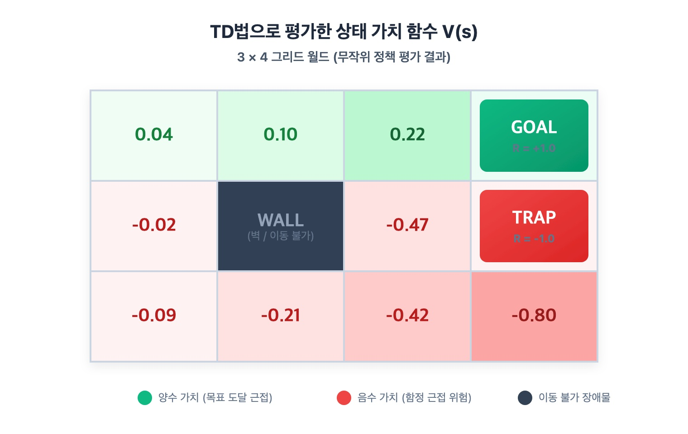
**그림 10-1-39** 3 × 4 그리드 월드에서 TD법(1,000회 에피소드)으로 평가한 무작위 정책의 상태 가치 함수 *V*(*s*)

---

결과 지도를 살펴봅시다:
- 플러스 골 지점(`(0, 3)`, 보상 +1.0)에 가까운 위쪽 칸들(`0.22`, `0.10`, `0.04`)은 밝은 초록색의 높은 양수 가치를 띱니다.
- 마이너스 함정 지점(`(1, 3)`, 보상 -1.0)에 가까운 아래쪽 칸들(`-0.80`, `-0.42`, `-0.47`)은 짙은 붉은색의 음수 가치를 띱니다.
- 환경 모델(전이 확률과 보상 함수)을 전혀 모르고, 에피소드 완주를 기다리는 지연 정산도 없이, **오직 매 순간 한 걸음씩 밟으며 TD 오차를 갱신했을 뿐인데도 환경의 공간적 참 가치 지도가 놀랍도록 정확하게 완성**되었습니다!

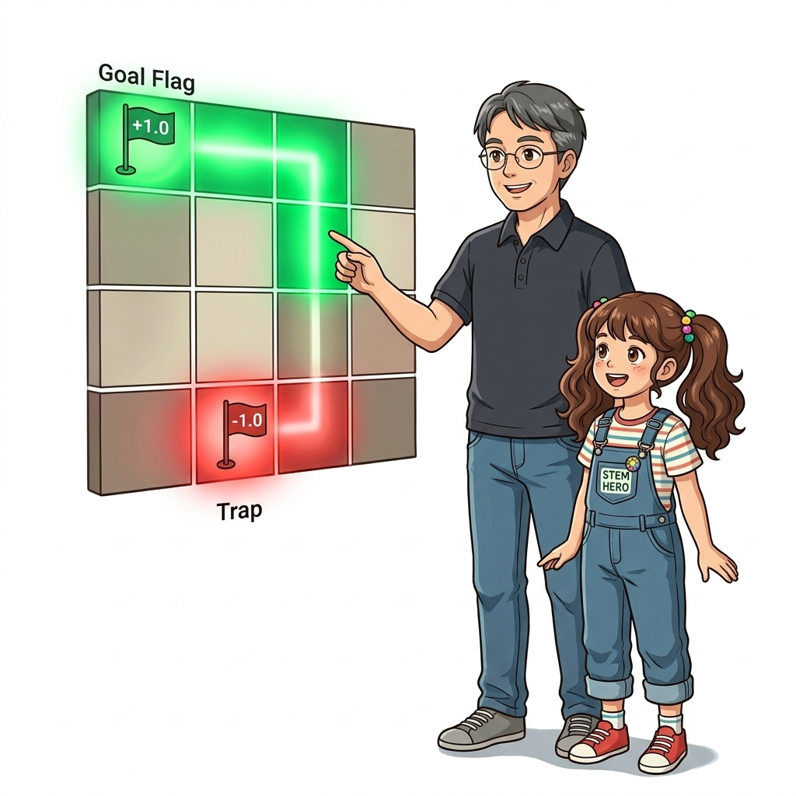
**그림 10-1-40** 3×4 그리드월드 가치 지형도에서 +1.0 골을 향한 오르막길과 -1.0 함정을 피하는 안전한 가치 등고선을 설명하시는 이호진 교수님

---

## 10.1.4 핵심 정리: TD 정책 평가 3대 핵심 기둥


**그림 10-1-41** TD 정책 평가 3대 금자탑 기념비와 10.2 SARSA 최적 정책 제어로의 출항 피날레

---

1. **DP와 MC의 하이브리드 결합**:
   - MC처럼 환경 모델 없이 1-스텝 샘플 데이터만으로 학습하며, DP처럼 다음 상태의 추정 가치를 부트스트랩하여 실시간 갱신합니다.
2. **TD 목표와 TD 오차**:
   - 현재 예측치 *V*(*S*<sub>*t*</sub>)를 1단계 미래의 더 신뢰할 수 있는 기준점인 TD 목표 ***R*<sub>*t*</sub> + *γV*(*S*<sub>*t*+1</sub>)** 방향으로 오차 신호만큼 당겨서 갱신합니다.
3. **낮은 분산과 실시간 온라인 학습**:
   - 장기 누적 수익 *G*<sub>*t*</sub> 대신 1스텝 앞의 데이터만을 참조하므로 분산이 매우 작아 수렴이 안정적이며, 에피소드가 끝나지 않는 지속적 과제에도 완벽하게 적용할 수 있습니다.

---


**그림 10-1-42** 바둑판에서 돌을 한 수 놓자마자 계가를 기다리지 않고 판세를 즉각 재평가하는 시간차 학습의 본질을 전수하시는 이호진 교수님

> 👨‍🏫 **이호진 교수님의 직강 노트**:  
> "TD법의 진정한 위력은 '기다리지 않는 성격'에 있습니다. 바둑을 둘 때 대국이 완전히 끝나 계가를 마칠 때까지 기다리는 것이 몬테카를로법이라면, 돌을 한 수 놓자마자 판세를 즉시 재평가하는 것이 바로 시간차 학습(TD)입니다. 이 놀라운 평가 방식을 행동 가치 *Q* 함수와 정책 개선에 결합하면, 마침내 스스로 최적의 수를 두는 **SARSA와 Q-러닝**이라는 전설적인 제어 알고리즘이 탄생하게 됩니다!"

---


**그림 10-1-43** 'Next: 10.2 SARSA!' 깃발을 힘차게 흔들며 다음 챕터로 신나게 함께 전진하는 지니와 도로시 탐험대

> 🐱 **조교 지니의 응원 노트**:  
> "도로시와 여러분, 한 걸음 걸을 때마다 번개처럼 가치를 업그레이드하는 TD법의 짜릿함을 느끼셨나요? 이제 배낭에 경험을 무겁게 모아둘 필요 없이, 발을 딛는 즉시 깨달음을 얻을 수 있어요! 다음 10.2절에서는 이 TD법을 행동 가치 함수 *Q*에 적용해 에이전트가 스스로 움직임을 제어하는 **SARSA**를 만나봅시다냥!"
