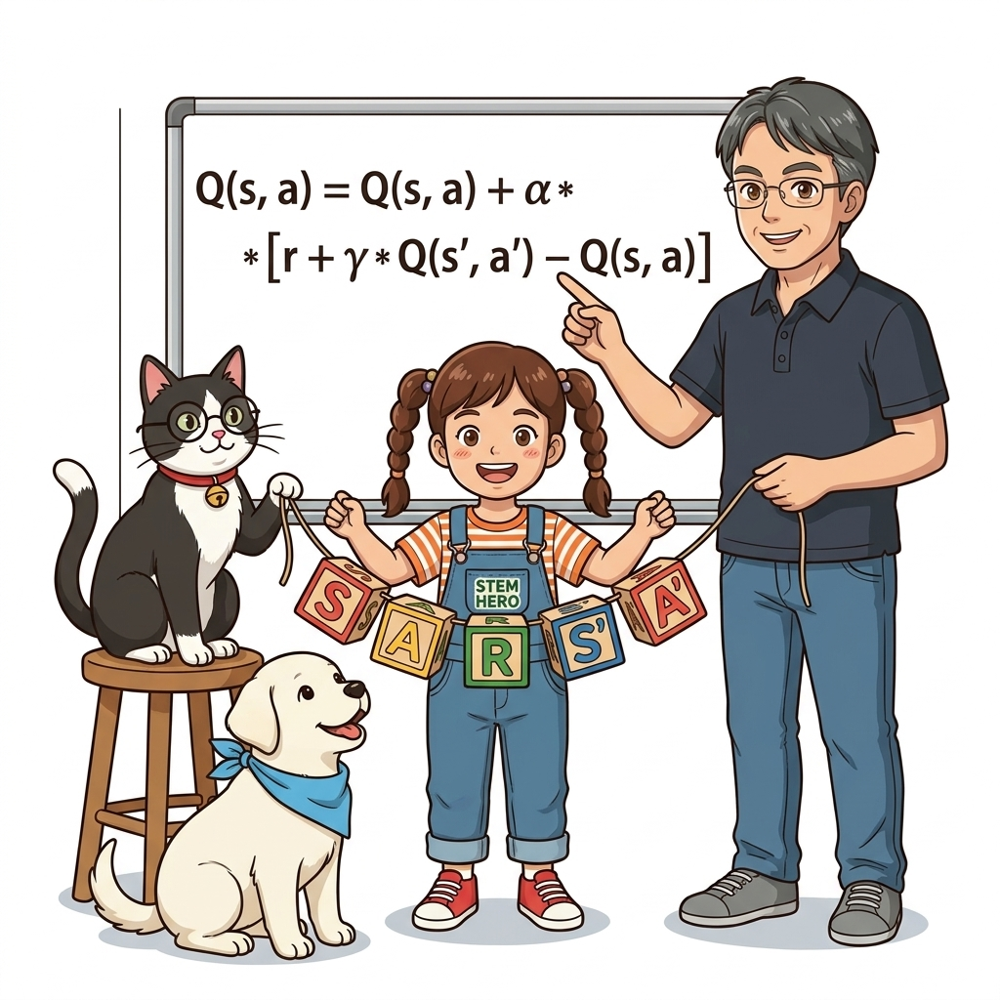
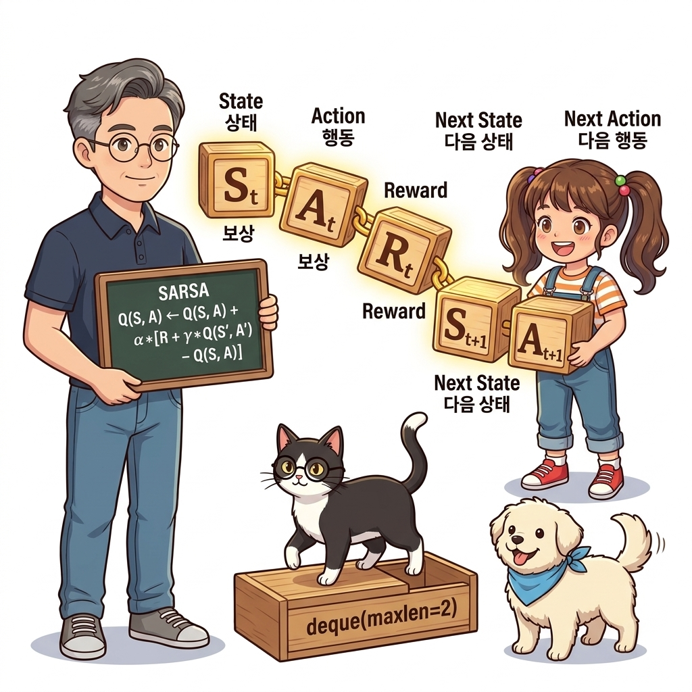
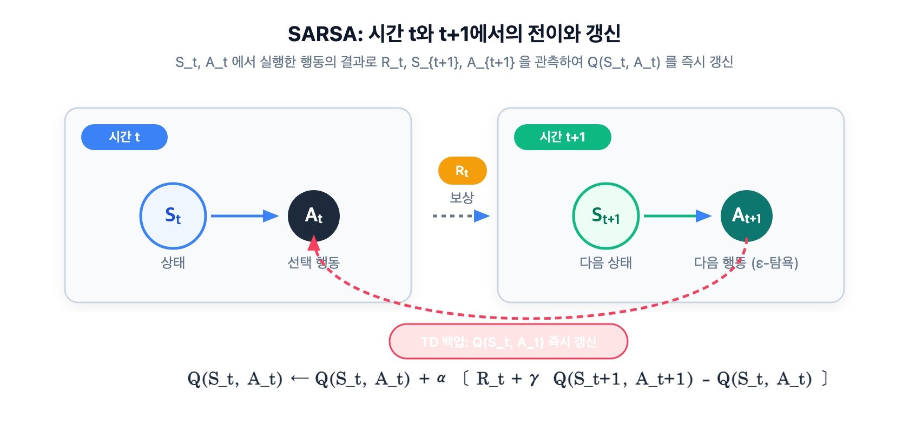
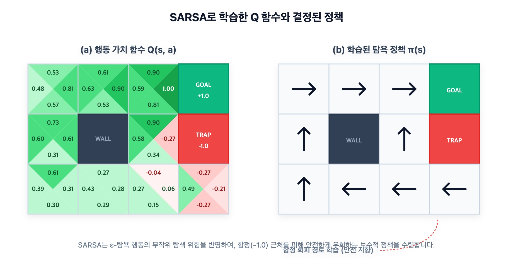

# 10.2 SARSA: 온-정책 시간차 제어



**그림 10-2-1** 온-정책 시간차 제어를 실현하기 위해 다섯 개의 알파벳 문자 블록 S, A, R, S, A를 체인으로 엮어 들고 있는 도로시와 지니


**그림 10-2-2** (상태, 행동, 보상, 다음 상태, 다음 행동)의 5단계 상호작용 체인이 완성되어야 비로소 한 걸음 전의 Q 가치를 갱신할 수 있는 SARSA의 부트스트랩 메커니즘을 설명하는 이호진 교수님과 도로시

(상태, 행동, 보상, 다음 상태, 다음 행동)의 연속적인 흐름을 뜻하는 **SARSA(살사)** 알고리즘을 공부합니다. 온-정책(On-policy) 제어 루프 하에서 가치 평가와 개선을 한 걸음 단위로 교차 실행하는 구조를 귀여운 스펠링 블록체인 비유와 직관적인 코드 분석을 통해 확실하게 정복해 봅시다!

---

## 10.2.1 온-정책 SARSA의 수학적 원리

앞 절(10.1절)에서는 TD법으로 **정책 평가(Policy Evaluation)**를 수행했습니다. 즉, 주어진 정책 *π*의 가치 함수 *V*<sub>*π*</sub>(*s*)를 에피소드 진행 중에 실시간으로 추정하는 법을 배웠습니다. 

하지만 강화학습의 궁극적인 목표는 단순히 현재 정책의 점수를 매기는 데 그치지 않고, **최적의 행동 정책을 찾아내는 정책 제어(Policy Control)**에 있습니다.

정책 제어는 항상 다음의 두 단계를 무한히 교차하며 최적 정책에 수렴해 갑니다:
1. **평가(Evaluation)**: 현재 정책의 행동 가치를 측정한다.
2. **개선(Improvement)**: 측정된 행동 가치를 바탕으로 더 나은 행동을 선택하도록 정책을 탐욕화(Greedy)한다.

---

### 1) 왜 상태 가치 *V*(*s*) 대신 행동 가치 *Q*(*s*, *a*)를 써야 할까?

앞 절에서는 상태 가치 함수 *V*<sub>*π*</sub>(*s*)를 평가했습니다. 그러나 **환경 모델(전이 확률 *p*(*s*&#39; | *s*, *a*)과 보상 함수)을 모르는 모델 프리(Model-Free) 환경에서는 상태 가치 함수만으로 정책을 개선할 수 없습니다.**

만약 *V*<sub>*π*</sub>(*s*)를 사용하여 상태 *s*에서 가장 좋은 행동을 고르려면 다음과 같이 환경 모델을 알아야만 합니다:

> ### **탐욕 행동 = argmax<sub>*a*</sub> ∑<sub>*s*&#39;</sub> *p*(*s*&#39; | *s*, *a*) [*r*(*s*, *a*, *s*&#39;) + *γV*<sub>*π*</sub>(*s*&#39;)]**

하지만 우리는 에이전트가 현실 세계나 복잡한 게임 속을 직접 부딪치며 배운다고 가정하므로, 바람이 불 확률이나 적이 움직일 확률인 *p*(*s*&#39; | *s*, *a*)를 전혀 모릅니다!

반면, 각 상태에서 특정 행동을 취했을 때의 미래 누적 수익을 담고 있는 **행동 가치 함수(Q 함수, *Q*<sub>*π*</sub>(*s*, *a*))**가 준비되어 있다면 상황은 완전히 달라집니다:

> ### ***μ*(*s*) = argmax<sub>*a*</sub> *Q*<sub>*π*</sub>(*s*, *a*)** &nbsp;&nbsp;&nbsp;&nbsp; *(식 10.9)*

[식 10.9]를 보면 복잡한 전이 확률 *p*나 기댓값 계산이 전혀 필요 없습니다! 단순히 현재 상태 *s*에서 펼쳐진 여러 행동 선택지 중 **가장 높은 *Q* 값을 가진 행동을 고르기만 하면 즉시 최선의 탐욕 정책으로 개선**됩니다. 이것이 바로 모델 프리 제어에서 Q 함수가 주인공으로 등극하는 이유입니다.

---

### 2) 상태 가치 TD식을 Q 함수 TD식으로 확장하기

10.1절에서 배운 상태 가치 *V*의 1-스텝 TD 갱신식을 다시 떠올려 봅시다:

> ### ***V*<sub>*π*</sub>(*S*<sub>*t*</sub>) ← *V*<sub>*π*</sub>(*S*<sub>*t*</sub>) + *α* · [*R*<sub>*t*</sub> + *γV*<sub>*π*</sub>(*S*<sub>*t*+1</sub>) - *V*<sub>*π*</sub>(*S*<sub>*t*</sub>)]** &nbsp;&nbsp;&nbsp;&nbsp; *(식 10.10)*

여기서 상태 가치 *V*(*S*)를 행동 가치 *Q*(*S*, *A*)로 자연스럽게 치환해 줍니다:
- 현재 상태의 가치: *V*<sub>*π*</sub>(*S*<sub>*t*</sub>) → *Q*<sub>*π*</sub>(*S*<sub>*t*</sub>, *A*<sub>*t*</sub>)
- 다음 상태의 가치: *V*<sub>*π*</sub>(*S*<sub>*t*+1</sub>) → *Q*<sub>*π*</sub>(*S*<sub>*t*+1</sub>, *A*<sub>*t*+1</sub>)

이 치환을 적용하면 Q 함수를 위한 TD 갱신식이 완성됩니다:

> ### ***Q*<sub>*π*</sub>(*S*<sub>*t*</sub>, *A*<sub>*t*</sub>) ← *Q*<sub>*π*</sub>(*S*<sub>*t*</sub>, *A*<sub>*t*</sub>) + *α* · [*R*<sub>*t*</sub> + *γQ*<sub>*π*</sub>(*S*<sub>*t*+1</sub>, *A*<sub>*t*+1</sub>) - *Q*<sub>*π*</sub>(*S*<sub>*t*</sub>, *A*<sub>*t*</sub>)]** &nbsp;&nbsp;&nbsp;&nbsp; *(식 10.11: SARSA 갱신식)*

여기서 괄호 안의 오차 항목인 **[*R*<sub>*t*</sub> + *γQ*<sub>*π*</sub>(*S*<sub>*t*+1</sub>, *A*<sub>*t*+1</sub>) - *Q*<sub>*π*</sub>(*S*<sub>*t*</sub>, *A*<sub>*t*</sub>)]**를 **TD 오차(TD Error, *δ*<sub>*t*</sub>)**라고 부릅니다.

이 갱신식을 실행하기 위해 필요한 데이터 조각들을 시간 순서대로 나열해 봅시다:
1. 시간 *t*에서의 현재 상태: ***S*<sub>*t*</sub>**
2. 시간 *t*에 에이전트가 실제로 취한 행동: ***A*<sub>*t*</sub>**
3. 환경으로부터 즉시 되돌려받은 보상: ***R*<sub>*t*</sub>**
4. 새로 도달하게 된 다음 상태: ***S*<sub>*t*+1</sub>**
5. 정책에 따라 다음 상태에서 실제로 선택한 다음 행동: ***A*<sub>*t*+1</sub>**

이 다섯 개 튜플의 앞 글자를 따서 **S - A - R - S - A**, 즉 **SARSA(살사)**라는 매력적인 이름이 붙게 된 것입니다!


**그림 10-2-3** 시간 *t*와 *t*+1에서의 상태와 행동 전이 구조. (S<sub>t</sub>, A<sub>t</sub>) 쌍에서 출발하여 보상 R<sub>t</sub>를 얻고 다음 (S<sub>t+1</sub>, A<sub>t+1</sub>) 쌍으로 이어집니다.

---

### 3) 온-정책(On-Policy)과 *ε*-탐욕 정책

SARSA는 대표적인 **온-정책(On-Policy)** 알고리즘입니다.
- **온-정책(On-Policy)**: 데이터를 수집하며 환경과 상호작용하는 정책(**행동 정책, Behavior Policy**)과, 가치를 평가하고 개선하려는 목표 정책(**대상 정책, Target Policy**)이 완전히 **동일한 정책**인 방식입니다.

온-정책 제어에서는 치명적인 딜레마가 하나 발생합니다:
- **정책 개선의 목표**: $Q$ 값을 최대화하는 100% 탐욕적 행동(*argmax*)을 취해야 최적에 도달합니다.
- **학습과 탐색의 필요성**: 하지만 행동 정책이 100% 탐욕적이면, 이전에 우연히 발견한 길만 고집하게 되어 더 좋은 보상을 숨겨둔 미지의 경로를 영원히 탐색(Exploration)할 수 없게 됩니다.

따라서 온-정책 SARSA에서는 다음과 같은 타협안인 ***ε*-탐욕 정책(*ε*-greedy Policy)**을 채택합니다:

> ### ***π*&#39;(*a* | *S*<sub>*t*</sub>) =**
> - **1 - *ε* + (*ε* / |*A*|) &nbsp;&nbsp;&nbsp;&nbsp; (탐욕 행동: *a* = argmax<sub>*a*&#39;</sub> *Q*<sub>*π*</sub>(*S*<sub>*t*</sub>, *a*&#39;))**
> - ***ε* / |*A*| &nbsp;&nbsp;&nbsp;&nbsp;&nbsp;&nbsp;&nbsp;&nbsp;&nbsp;&nbsp;&nbsp;&nbsp;&nbsp;&nbsp;&nbsp;&nbsp;&nbsp;&nbsp; (그 외 탐색 행동)**
> *(식 10.12: ε-탐욕 정책)*

즉, 대부분의 경우(1 - *ε*)에는 가장 *Q* 값이 높은 행동을 골라 실리를 챙기고, 작은 확률(*ε*)로 무작위 행동을 시도하여 새로운 경로를 끊임없이 개척합니다.

---

## 10.2.2 SARSA 에이전트 구현

이제 온-정책 SARSA 알고리즘을 파이썬 코드로 구현해 봅시다.

### 1) SARSA 에이전트 클래스: `SarsaAgent`

<div align="right"><b>ch06/sarsa.py</b></div>

```python
from collections import defaultdict, deque
import numpy as np
from common.utils import greedy_probs

class SarsaAgent:
    def __init__(self):
        self.gamma = 0.9          # 할인율 (미래 보상 감가 계수)
        self.alpha = 0.8          # 학습률 (갱신 보폭)
        self.epsilon = 0.1        # 탐색 확률 (10% 확률로 무작위 탐색)
        self.action_size = 4      # 행동 가짓수 (상, 하, 좌, 우)

        # 초기 정책: 4가지 행동에 대해 각 25%의 균등 확률
        random_actions = {0: 0.25, 1: 0.25, 2: 0.25, 3: 0.25}
        self.pi = defaultdict(lambda: random_actions)
        self.Q = defaultdict(lambda: 0)
        self.memory = deque(maxlen=2) # ❶ 최대 크기 2의 슬라이딩 윈도우 버퍼

    def get_action(self, state):
        action_probs = self.pi[state] # ❷ 현재 에이전트의 유일한 정책 self.pi에서 행동 확률 조회
        actions = list(action_probs.keys())
        probs = list(action_probs.values())
        return np.random.choice(actions, p=probs)

    def reset(self):
        self.memory.clear()

    def update(self, state, action, reward, done):
        self.memory.append((state, action, reward, done))
        if len(self.memory) < 2:
            return # 데이터가 (S, A, R, S', A') 2세트 쌓이기 전에는 대기

        # 버퍼의 0번째는 이전 시점 t, 1번째는 현재 시점 t+1
        state, action, reward, done = self.memory[0]
        next_state, next_action, _, _ = self.memory[1]

        # ❸ 종단 상태(Goal)에 도달했다면 미래 가치는 0
        next_q = 0 if done else self.Q[next_state, next_action]

        # ❹ TD 목표(Target)와 식 (10.11)에 따른 self.Q 갱신
        target = reward + self.gamma * next_q
        self.Q[state, action] += (target - self.Q[state, action]) * self.alpha

        # ❺ ε-탐욕 정책 개선
        self.pi[state] = greedy_probs(self.Q, state, self.epsilon)
```

#### 코드 핵심 분석:
- **❶ `self.memory = deque(maxlen=2)`**:
  SARSA는 (S<sub>t</sub>, A<sub>t</sub>, R<sub>t</sub>)를 겪었다고 해서 곧바로 갱신할 수 없습니다. 다음 상태 S<sub>t+1</sub>에 도착한 후, **그곳에서 실제로 취할 다음 행동 A<sub>t+1</sub>까지 결정되어야만 비로소 Q(S<sub>t+1</sub>, A<sub>t+1</sub>)을 꺼내어 TD 타깃을 계산**할 수 있습니다. 
  따라서 `maxlen=2`인 `deque`를 사용하여 최근 2개의 타임스텝 데이터를 슬라이딩 윈도우 형태로 간직합니다.
- **❷ `get_action(self, state)`**:
  온-정책이므로 탐색과 평가가 분리되지 않고 하나의 정책 `self.pi`에서 직접 확률적 샘플링(`np.random.choice`)을 수행합니다.
- **❸ `next_q = 0 if done else self.Q[next_state, next_action]`**:
  도착점(Goal)에 닿으면 에피소드가 끝나므로, 그 이후로 얻을 수 있는 추가 보상은 존재하지 않습니다. 따라서 `done=True`일 때는 부트스트랩 항을 0으로 처리합니다.
- **❹ Q 함수 갱신**:
  `target = reward + gamma * next_q`를 계산하고, 현재 추정치 `self.Q[state, action]`와의 차이(TD 오차)에 학습률 `alpha`를 곱해 값을 수정합니다.
- **❺ 정책 개선 (`greedy_probs`)**:
  새롭게 갱신된 `self.Q[state, :]` 값들을 바탕으로, 가장 큰 Q값을 갖는 행동에 `1 - epsilon`의 높은 확률을 부여하고 나머지 행동에 골고루 `epsilon / 4`를 나누어 주는 *ε*-탐욕 정책으로 즉시 개선합니다.

---

### 2) SARSA 학습 루프와 종단 상태 플러시(Flush)

이제 그리드 월드 환경에서 `SarsaAgent`를 1만 에피소드 동안 훈련시켜 봅시다.

<div align="right"><b>ch06/sarsa.py</b></div>

```python
from common.gridworld import GridWorld

env = GridWorld()
agent = SarsaAgent()

episodes = 10000
for episode in range(episodes):
    state = env.reset()
    agent.reset()

    while True:
        action = agent.get_action(state)
        next_state, reward, done = env.step(action)

        agent.update(state, action, reward, done) # ❶ 매 스텝마다 버퍼에 추가

        if done:
            # ❷ 목표(Goal)에 도달했을 때 마지막 스텝 강제 플러시!
            agent.update(next_state, None, None, None)
            break

        state = next_state

env.render_q(agent.Q) # 최종 수렴된 Q 함수 시각화
```

#### 💡 주의: 종단 처리 `agent.update(next_state, None, None, None)`가 왜 필요할까?
`agent.update()`는 버퍼에 최소 2개의 데이터가 들어있어야 `memory[0]`의 Q값을 갱신합니다. 
만약 에이전트가 목표 지점에 막 골인하여 `done=True`가 되었다면, **목표에 도착하기 직전 마지막 상태(예: 골 바로 앞 칸에서 오른쪽으로 이동한 행동)에 대한 데이터는 아직 `memory[0]`에 머물러 있어 갱신되지 못한 채 루프가 끝나버릴 위험**이 있습니다!
따라서 `if done:` 블록 안에서 더미 데이터 `(next_state, None, None, None)`를 한 번 더 버퍼에 밀어 넣어줌으로써, **가장 중요한 골 직전 행동에 1.0의 큰 보상이 반영되도록 온전히 갱신(Flush)**을 완료하는 것입니다.

---

## 10.2.3 SARSA의 학습 결과와 보수적 안전 운전 특성

1만 회 학습 후 렌더링된 Q 함수와 정책을 확인해 봅시다.


**그림 10-2-4** SARSA로 획득한 그리드 월드 정책. 절벽/폭탄(-1.0) 칸 주변에서 위험을 피하기 위해 안전하게 멀리 우회하는 보수적인 경로가 형성됩니다.

### SARSA의 독특한 성향: "안전제일주의"

[그림 10-2-4]의 결과에서 대단히 흥미로운 점을 발견할 수 있습니다:
- 에이전트는 폭탄(-1.0) 칸 바로 옆 지름길이 있음에도 불구하고, **폭탄에서 멀리 떨어진 위쪽 벽 쪽으로 크게 우회하는 정책**을 학습합니다.
- 왜 이런 보수적인(Conservative) 결과가 나올까요?
  - SARSA는 **온-정책(On-policy)** 알고리즘입니다.
  - 다음 상태에서 취할 행동 *A*<sub>*t*+1</sub> 역시 *ε*-탐욕 정책으로 선택됩니다.
  - 즉, 에이전트는 **"내가 다음 순간에 *ε*(10%)의 확률로 엉뚱한 방향으로 발을 헛디딜 수 있다"는 사실을 스스로의 Q 가치 평가에 반영**합니다!
  - 폭탄 바로 옆 길을 걷다가 10%의 실수로 폭탄 칸에 빠지면 -1.0이라는 치명적인 감점을 받게 되므로, SARSA 에이전트는 아예 폭탄 근처에는 얼씬도 하지 않는 안전한 우회로를 최고 가치로 평가하는 것입니다.

이러한 특성 덕분에 SARSA는 실제 물리 로봇이나 자율주행차처럼 **"학습 과정이나 주행 도중 실수를 저지르면 심각한 파손이 발생하는 현실 시스템"**에서 대단히 안전하고 안정적인 제어기로 널리 사랑받고 있습니다.
