# 10.2 SARSA: 온-정책 시간차 제어
## 상태-행동-보상-다음 상태-다음 행동 5단계 상호작용으로 완성하는 강화학습 제어

**10.2 SARSA: 온-정책 시간차 제어**

(상태, 행동, 보상, 다음 상태, 다음 행동)의 연속적인 5단계 상호작용 흐름을 뜻하는 **SARSA(살사, State-Action-Reward-State-Action)** 알고리즘을 공부합니다.


**그림 10-2-1** 온-정책 시간차 제어(On-Policy TD Control)의 핵심 원리와 SARSA 알고리즘 전체 조감도

> "강화학습의 궁극적인 지향점은 단순히 현재 정책을 평가하는 것을 넘어, 최적의 행동을 스스로 결정하는 정책 제어에 있습니다. 이번 시간에는 5단계 상호작용의 첫 글자를 딴 SARSA 알고리즘의 원리와 구현을 함께 살펴보겠습니다."

---

# 온-정책 시간차 제어의 핵심 메커니즘
## 가치 평가와 정책 개선을 매 1-스텝 단위로 교차 실행하는 제어 루프

온-정책(On-policy) 제어 루프 하에서 가치 평가와 정책 개선을 한 걸음 단위로 교차 실행하는 구조를 귀여운 스펠링 블록체인 비유와 직관적인 파이썬 코드 분석을 통해 확실하게 정복해 봅시다!

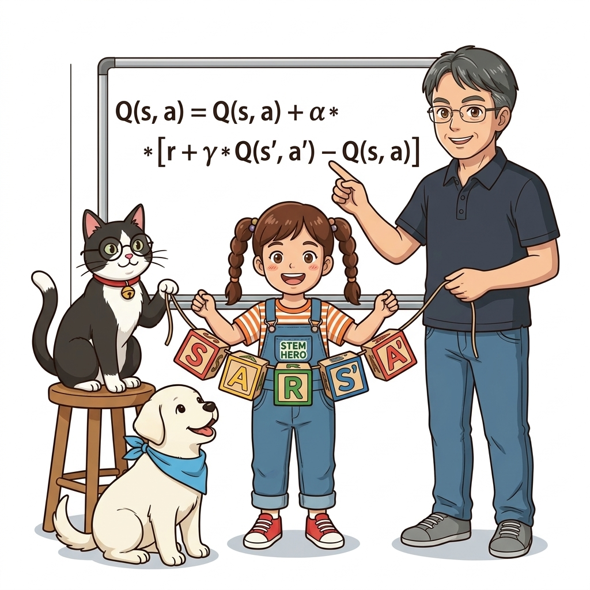
**그림 10-2-2** 온-정책 시간차 제어를 실현하기 위해 다섯 개의 알파벳 문자 블록 S, A, R, S, A를 체인으로 엮어 들고 있는 도로시와 지니

> "SARSA는 온-정책 제어 루프 하에서 가치 평가와 정책 개선을 한 걸음 내딛을 때마다 즉각적으로 교차 실행합니다. 에피소드가 끝나길 기다릴 필요 없이, 현재 정책으로 탐색하면서 동시에 그 정책 자체를 실시간으로 진화시키는 구조입니다."

---

# 10.2절 SARSA 5대 마일스톤 학습 로드맵
## 상태 가치에서 행동 가치로의 전환부터 보수적 안전 운전 특성 규명까지

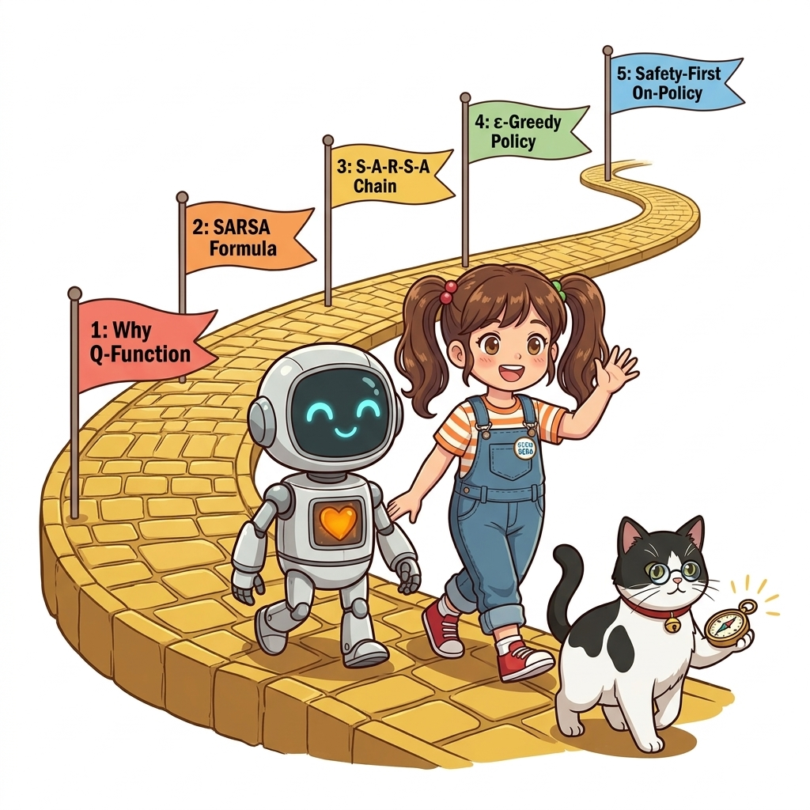
**그림 10-2-3** 10.2절 SARSA 온-정책 시간차 제어의 완성을 향해 나아가는 5대 마일스톤 학습 로드맵

> "학습 로드맵을 보시면, 상태 가치 V 대신 행동 가치 Q가 왜 필요한지 밝히는 것부터 시작하여, SARSA 갱신 공식 유도, 입실론 탐욕 정책, 파이썬 구현, 그리고 안전제일주의 특성 규명까지 체계적인 5단계 마일스톤으로 구성되어 있습니다."

---

# 10.2절 학습 목표와 핵심 연구 과제
## 모델 프리 환경에서 행동 가치 Q(s, a)의 필연성과 2-스텝 버퍼 에이전트 구현

- **학습 목표**:
  - 상태 가치 *V*(*s*)만으로는 환경 모델 없이 행동을 선택할 수 없는 이유와 행동 가치 *Q*(*s*, *a*)가 주인공으로 등극하는 필연성 이해
  - 1-스텝 TD 상태 가치 갱신식을 행동 가치 함수로 자연스럽게 확장하여 SARSA 갱신 공식 유도
  - (상태, 행동, 보상, 다음 상태, 다음 행동)으로 이어지는 5단계 튜플 S-A-R-S-A의 메커니즘과 네이밍 기원 파악
  - 온-정책 제어의 핵심 딜레마(탐색 vs 활용)를 해결하는 *ε*-탐욕(*ε*-greedy) 정책의 수학적 확률 구조 분석
  - 크기 2의 슬라이딩 윈도우(`deque(maxlen=2)`) 버퍼와 에피소드 종단 플러시(Flush)를 포함한 `SarsaAgent` 파이썬 구현
  - SARSA 특유의 "보수적 안전 운전(안전제일주의)" 학습 성향을 절벽/함정 회피 실험 결과를 통해 심층 규명

> "이번 절에서는 환경 모델이 없을 때 왜 행동 가치 Q 함수가 제어의 유일한 열쇠가 되는지 수학적으로 증명하고, 크기 2의 슬라이딩 윈도우를 활용해 메모리 효율적으로 동작하는 SarsaAgent를 직접 구현해 보도록 하겠습니다."

---

# 10.2.1 온-정책 SARSA의 수학적 원리
## 10.1절 정책 평가(가치 추정)에서 최적 정책 제어(행동 결정)로의 도약

**10.2.1 온-정책 SARSA의 수학적 원리**

앞 절(10.1절)에서는 시간차(TD) 학습법으로 **정책 평가(Policy Evaluation)**를 수행했습니다. 

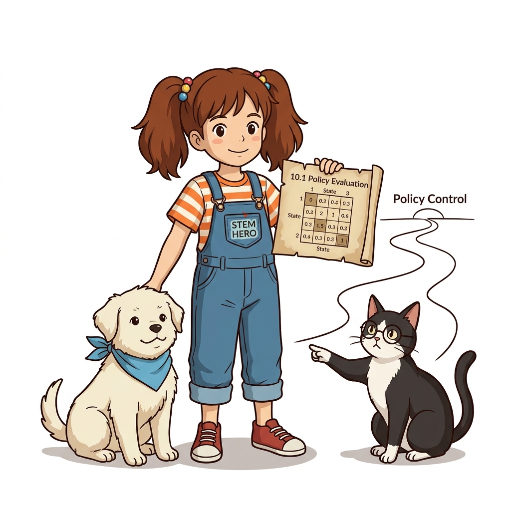
**그림 10-2-4** 10.1절에서 완성한 그리드월드 가치 지도를 살펴보며 정책 평가에서 새로운 정책 제어로의 도약을 준비하는 도로시와 친구들

> "앞선 10.1절에서는 고정된 정책의 가치를 측정하는 정책 평가를 다루었습니다. 하지만 실제 인공지능 에이전트에게 필요한 것은 가치 평가표를 바탕으로 가장 높은 보상을 주는 최선의 행동을 스스로 선택하는 정책 제어입니다."

---

# 실시간 1-스텝 가치 추정의 복습
## 에피소드 완주 대기 없이 즉각적으로 가치 함수를 갱신하던 TD(0)의 신속함

즉, 주어진 고정된 무작위 정책 *π*의 상태 가치 함수 *V*<sub>*π*</sub>(*s*)를 에피소드가 끝나길 기다리지 않고 실시간으로 추정하는 법을 배웠습니다.


**그림 10-2-5** 1-스텝 이동 즉시 가치를 갱신하여 대기 시간이 전혀 없는 실시간 TD 정책 평가의 신속함

> "10.1절에서 확인했듯이, 시간차 학습은 단 1-스텝의 다음 상태 가치를 빌려와 현재 가치를 즉시 갱신합니다. 이 놀라운 실시간 갱신 패러다임을 이제 상태 가치가 아닌 행동 가치 영역으로 확장할 차례입니다."

---

# 강화학습의 궁극적 목표: 정책 제어
## 가치 평가(점수 매기기)를 넘어 최적 행동 정책(최선의 선택)을 찾아내는 과정

하지만 강화학습의 궁극적인 목표는 단순히 현재 정책의 점수를 매기는 데 그치지 않고, **환경에서 가장 많은 누적 보상을 얻어내는 최적의 행동 정책을 찾아내는 정책 제어(Policy Control)**에 있습니다.

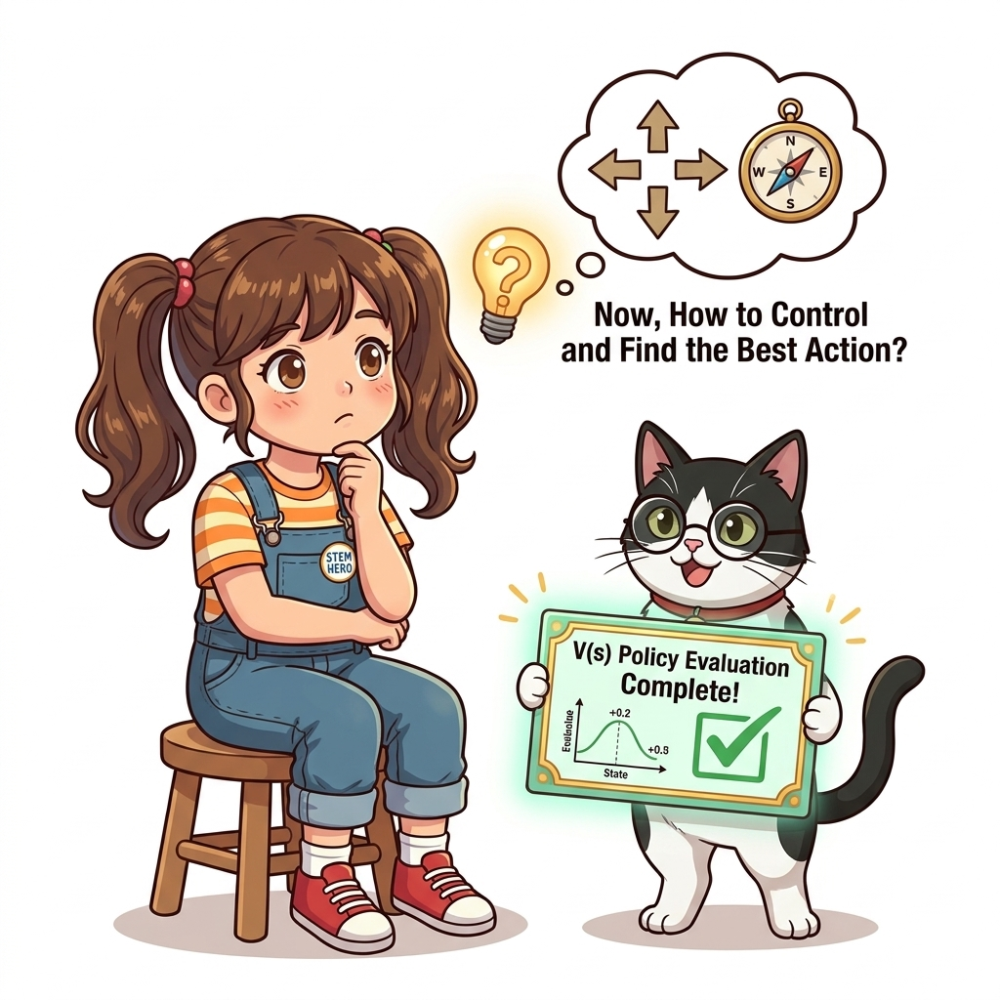
**그림 10-2-6** 10.1절에서 완성한 상태 가치 *V*(*s*) 평가 점수표를 들고, 이제 어떻게 최적의 행동을 찾아낼지 깊은 생각에 잠긴 도로시와 지니

> "단순히 특정 상태가 얼마나 좋은지 점수를 매기는 것만으로는 부족합니다. 우리가 원하는 것은 미로 속에서 어느 방향으로 발을 내딛어야 출구로 가장 빠르게 도달할 수 있는가를 결정하는 최적의 제어 정책입니다."

---

# 정책 반복(Policy Iteration)의 2단계 순환
## 현재 정책의 가치를 평가하고(Evaluation) 그 가치로 더 나은 정책을 개선(Improvement)한다

정책 제어는 항상 다음의 두 단계를 무한히 교차하며 최적 정책에 수렴해 갑니다:
1. **평가(Evaluation)**: 현재 정책을 따를 때 각 행동이 얼마나 유익한지 행동 가치(*Q*)를 측정합니다.
2. **개선(Improvement)**: 측정된 행동 가치를 바탕으로 더 나은 행동을 선택하도록 정책을 탐욕화(Greedy)합니다.

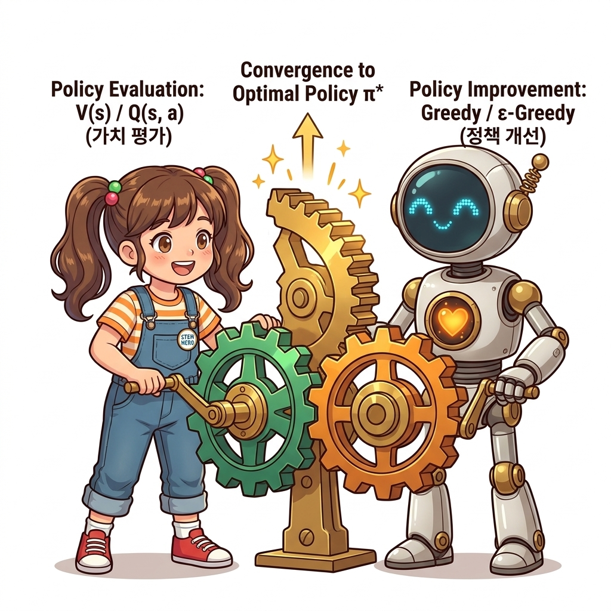
**그림 10-2-7** 평가(Evaluation)와 개선(Improvement)의 두 거대한 황금 톱니바퀴가 끊임없이 맞물려 돌며 최적 정책으로 전진하는 일반화된 정책 반복(GPI) 메커니즘

> "정책 제어는 항상 두 바퀴로 굴러갑니다. 현재 정책의 가치를 측정하는 평가 단계와, 측정된 가치를 보고 더 나은 행동을 선택하도록 정책을 바꾸는 개선 단계가 끝없이 맞물리며 최적점을 향해 수렴해 갑니다."

---

# 1) 왜 상태 가치 V(s) 대신 행동 가치 Q(s, a)인가?
## 모델 프리 제어에서 상태 가치 함수만으로는 최선의 행동을 결정할 수 없는 이유

**1) 왜 상태 가치 *V*(*s*) 대신 행동 가치 *Q*(*s*, *a*)를 써야 할까?**

앞 절에서는 상태 가치 함수 *V*<sub>*π*</sub>(*s*)를 평가했습니다. 

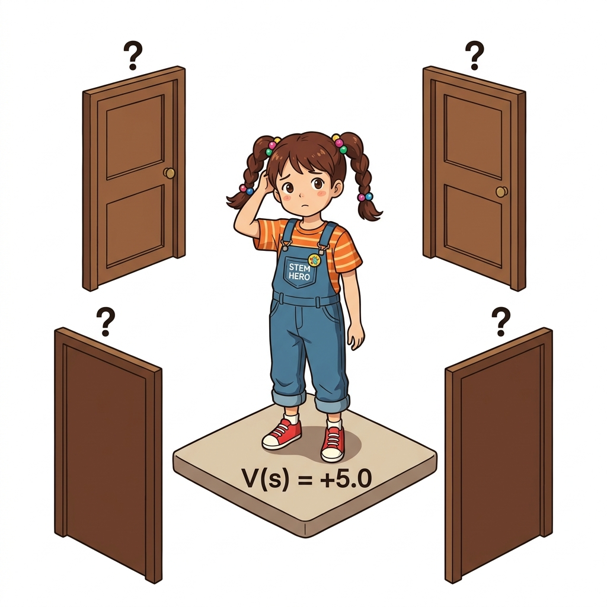
**그림 10-2-8** 발밑의 현재 상태 점수 *V*(*s*)=+5.0는 알지만 사방의 문에 전이 확률 *p*가 없어 어느 문을 열어야 할지 알 수 없는 상태 가치의 한계

> "정책 평가에서는 상태 가치 V(s) 하나만으로 충분했습니다. 하지만 모델 프리 환경에서 최선의 행동을 선택하려고 하면, 상태 가치 V만으로는 치명적인 벽에 부딪히게 됩니다. 그 이유를 수식으로 살펴보겠습니다."

---

# 환경 모델 부재 시 상태 가치 V의 한계
## 전이 확률 p(s'|s,a)를 모르면 다음 상태로 가기 위한 행동을 고를 수 없다

그러나 **환경 모델(전이 확률 *p*(*s*' | *s*, *a*)과 보상 함수)을 모르는 모델 프리(Model-Free) 환경에서는 상태 가치 함수만으로는 정책을 개선할 수 없습니다.**


**그림 10-2-9** 전이 확률 *p*와 보상 함수 *r*이라는 핵심 퍼즐 조각이 사라진 미궁 속에서, 지도가 없어도 스스로 행동을 결정할 새로운 나침반을 찾는 틴맨 로봇과 이호진 교수님

> "상태 s에서 어떤 행동 a를 취했을 때 어느 다음 상태 s'로 도달할지 알려주는 전이 확률 행렬을 모른다면, 다음 상태들의 가치가 아무리 정확하게 계산되어 있어도 지금 당장 어떤 행동을 취해야 할지 알 수 없습니다."

---

# 상태 가치 V를 이용한 행동 선택의 수학식
## argmax 연산 안에 전이 확률 p(s'|s,a)와 보상 r이 필수적으로 개입하는 구조

만약 *V*<sub>*π*</sub>(*s*)를 사용하여 상태 *s*에서 **가장 좋은 최선의 행동**을 고르려면 다음과 같이 **환경 모델**을 알아야만 합니다:

> ### **탐욕 행동 = argmax<sub>*a*</sub> ∑<sub>*s*'</sub> *p*(*s*' | *s*, *a*) · [*r*(*s*, *a*, *s*') + *γV*<sub>*π*</sub>(*s*')]** &nbsp;&nbsp;&nbsp;&nbsp; *(식 10.8b: 상태 가치 기반의 행동 선택)*

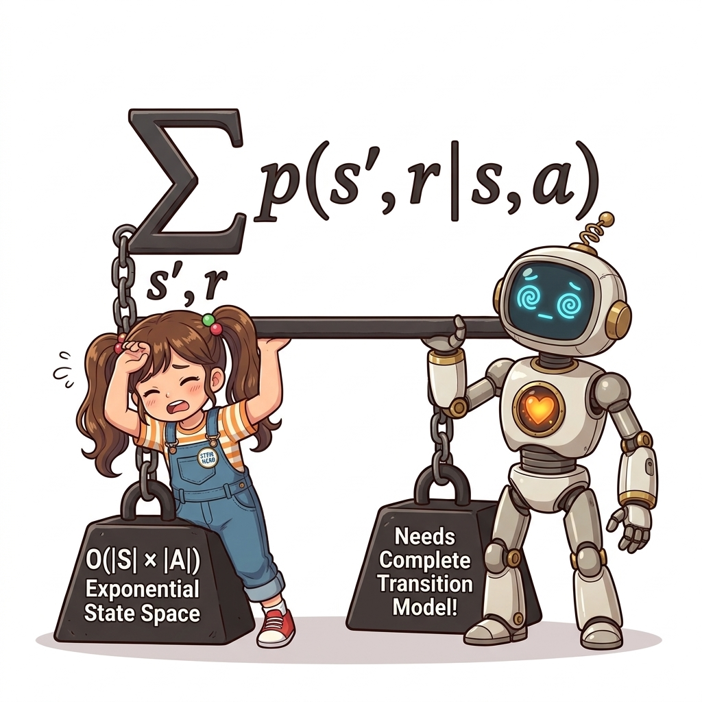
**그림 10-2-10** 모든 가능한 다음 상태 *s*'를 전수조사해야 하는 시그마(∑)의 무거운 쇠사슬 족쇄: 환경 전이 지도를 모르면 결코 계산할 수 없는 근본적 한계

> "식 10.9를 보시면, 상태 가치 V를 이용해 가장 좋은 행동을 고르려면 전이 확률 p와 상태 가치 V의 곱을 모든 가능한 다음 상태에 대해 합산해야 합니다. 즉 환경의 완벽한 물리 엔진 모델이 필수적이라는 뜻입니다."

---

# 현실 세계와 모델 프리의 제약 조건
## 바람의 세기나 적의 움직임 등 복잡한 전이 확률을 사전에 알 수 없는 현실

하지만 우리는 에이전트가 현실 세계나 복잡한 게임 속을 직접 부딪치며 배운다고 가정하므로, 바람이 불 확률이나 장애물이 움직일 **확률인 *p*(*s*' | *s*, *a*)를 전혀 모릅니다!** 

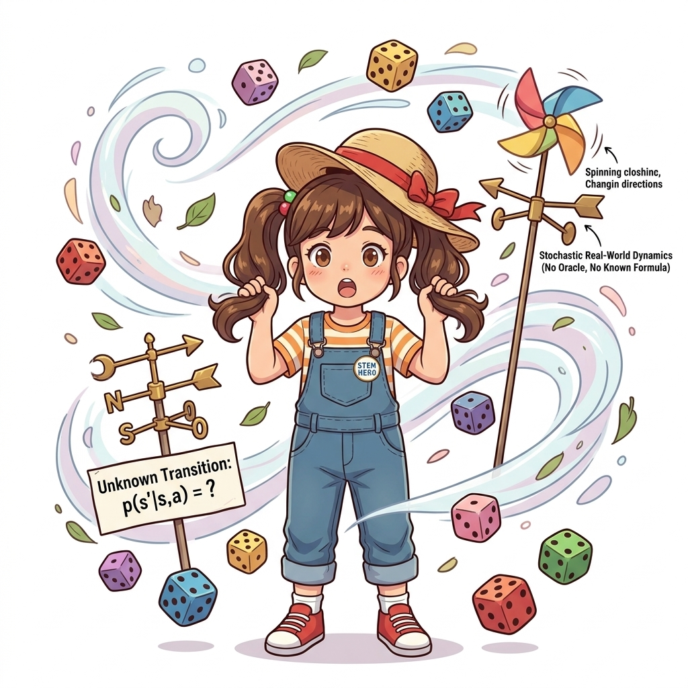
**그림 10-2-11** 제멋대로 방향을 바꾸는 거센 바람과 예측 불가능하게 구르는 주사위: 현실 세계의 자연 전이 확률은 사전에 고정된 표로 주어지지 않습니다.

> "실제 로봇이나 자율주행, 복잡한 게임 환경에서는 바람이 불 확률이나 바닥의 마찰 계수를 사전에 행렬로 정의할 수 없습니다. 따라서 환경 모델 p를 요구하는 상태 가치 기반 제어는 현실에서 작동할 수 없습니다."

---

# 안개 속의 다음 상태 가치와 길 잃은 에이전트
## 도착지의 가치를 알아도 어느 문으로 나가야 그곳에 도달하는지 모르는 역설

환경의 전이 확률 지도가 안개 속에 가려져 있다면, 다음 상태들의 가치 *V*(*s*')가 아무리 정확해도 어떤 행동을 골라야 그 상태로 갈 수 있는지 **알 길이 없습니다.**

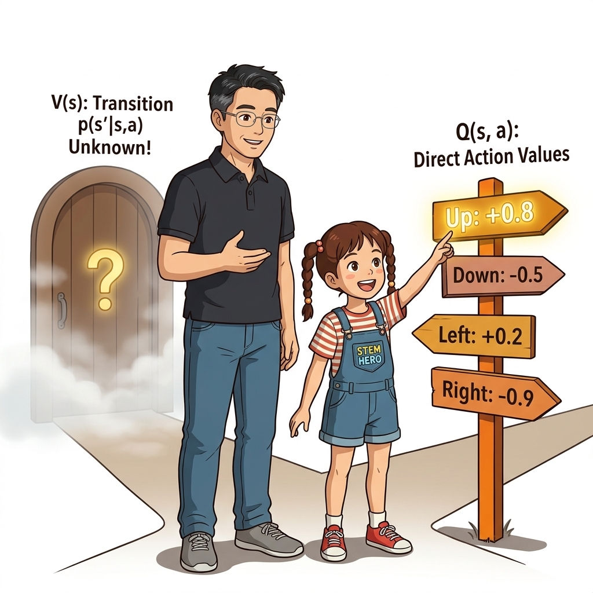
**그림 10-2-12** 미지의 안개 속에서 길을 찾는 갈림길 비유: 전이 확률 *p*를 몰라 눈이 가려진 *V*(*s*)의 문(왼쪽) vs 행동별 점수가 명확히 적힌 표지판을 보고 즉시 최선의 길을 고르는 *Q*(*s*, *a*)의 이정표(오른쪽)

> "다음 방들의 가치가 아무리 칠판에 적혀 있어도, 눈앞의 4개 문 중 몇 번 문을 열어야 그 방으로 연결되는지 모른다면 에이전트는 결정을 내릴 수 없습니다. 바로 이것이 환경 모델의 부재가 가져오는 본질적 문제입니다."

---

# 행동 가치 함수 Q(s, a)의 등장
## 상태 s에서 행동 a를 취했을 때 얻게 될 미래 누적 수익을 직접 평가하는 해결사

반면, 각 상태에서 특정 행동을 취했을 때의 미래 누적 수익을 담고 있는 **행동 가치 함수(Q 함수, *Q*<sub>*π*</sub>(*s*, *a*))**가 준비되어 있다면 상황은 완전히 달라집니다:

> ### ***μ*(*s*) = argmax<sub>*a*</sub> *Q*<sub>*π*</sub>(*s*, *a*)** &nbsp;&nbsp;&nbsp;&nbsp; *(식 10.9: Q 함수 기반의 최적 행동 선택)*

[식 10.9]를 보면 복잡한 전이 확률 *p*나 기댓값 계산이 전혀 필요 없습니다! 

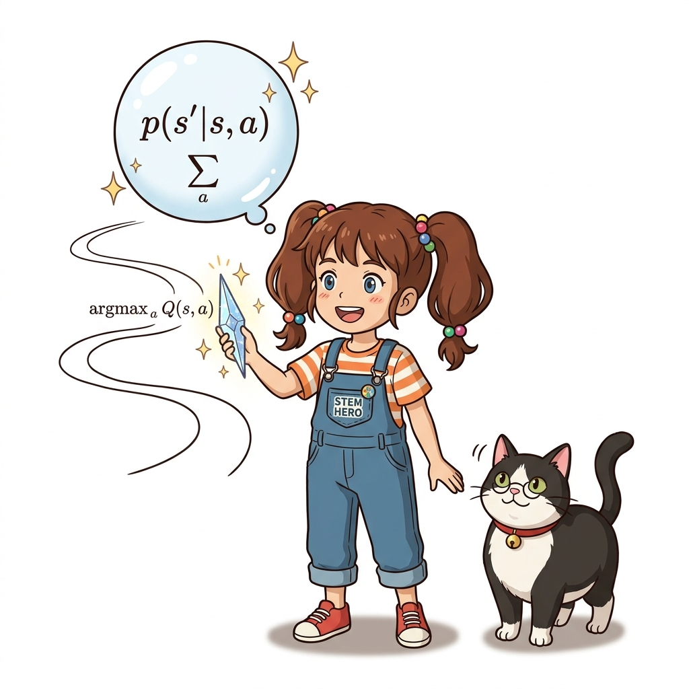
**그림 10-2-13** 전이 확률 *p*나 기댓값 전수조사 없이 `argmax Q(s, a)` 하나로 즉각 최적 행동을 결정하는 Q 함수의 우아한 간결성

> "이 딜레마를 단숨에 해결하는 구원투수가 바로 행동 가치 함수, 즉 Q 함수입니다. Q(s, a)는 상태 s에서 특정 행동 a를 선택했을 때 이후에 얻게 될 총수익을 이미 그 안에 담고 있습니다."

---

# Q 함수 기반의 직관적인 최적 행동 선택
## 환경 모델 없이 단순히 각 행동의 Q 값을 비교하여 최대값(argmax)을 선택

단순히 현재 상태 *s*에서 펼쳐진 여러 행동 선택지(상, 하, 좌, 우) 중 **가장 높은 *Q* 값을 가진 행동을 고르기만 하면 즉시 최선의 탐욕 정책으로 개선**됩니다. 

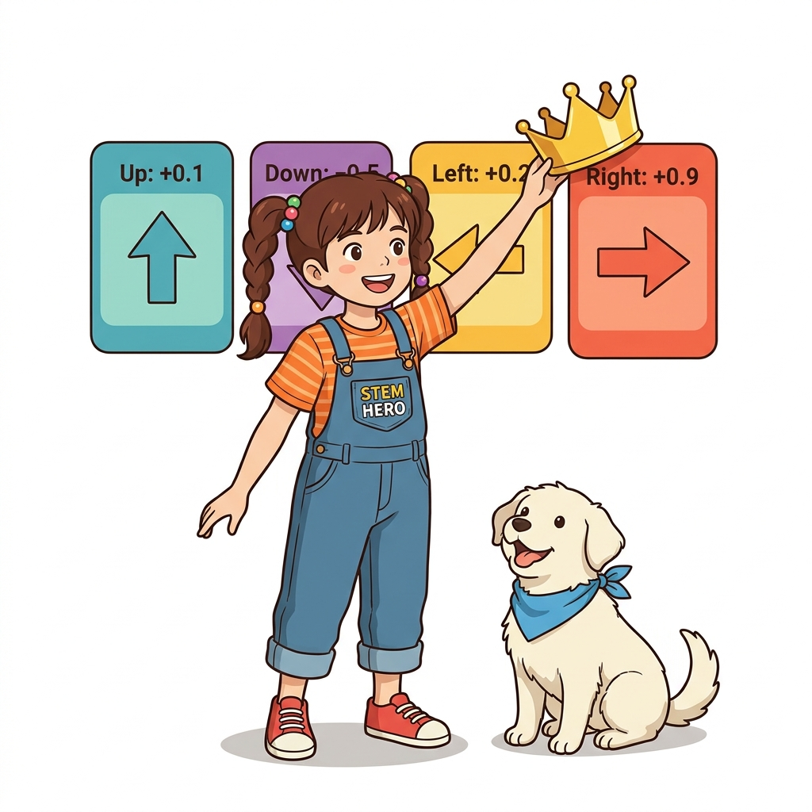
**그림 10-2-14** 4가지 행동 중 가장 높은 가치를 지닌 행동(Right: +0.9)에 황금 왕관을 씌워 즉시 탐욕 정책으로 개선하는 도로시

> "식 10.10을 보십시오. 전이 확률 p나 복잡한 시그마 기호가 완전히 사라졌습니다. 단순히 현재 상태에서 상, 하, 좌, 우 행동의 Q 값을 보고, 그중 가장 큰 숫자를 가진 행동을 고르기만 하면 즉시 최선의 선택이 됩니다."

---

# 모델 프리 제어의 독보적 주인공 Q 함수
## 환경의 지도가 없어도 오직 Q 값 비교만으로 즉각적인 정책 제어 완결

이것이 바로 모델 프리 제어에서 Q 함수가 독보적인 주인공으로 등극하는 이유입니다.

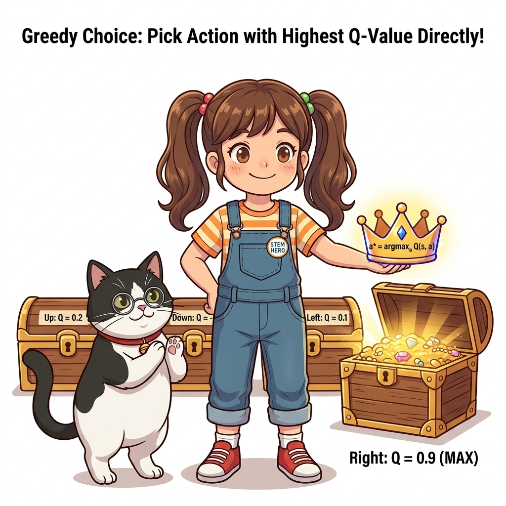
**그림 10-2-15** 복잡한 전이 확률 계산 없이, 4개의 행동 상자 중 가장 높은 점수(오른쪽: +0.9)에 황금 왕관을 씌워 즉시 최적 행동을 선택하는 도로시의 직관적 `argmax`

> "이처럼 Q 함수를 사용하면 환경의 물리적 전이 법칙을 전혀 몰라도 가장 가치가 높은 행동을 직관적으로 선택할 수 있습니다. 이것이 현대 강화학습 제어 알고리즘의 중심에 Q 함수가 서 있는 이유입니다."

---

# 2) 상태 가치 TD식을 Q 함수 TD식으로 확장
## 10.1절의 1-스텝 상태 가치 점화식 V(S_t)의 구조 복습과 대응점 탐색

**2) 상태 가치 TD식을 Q 함수 TD식으로 확장하기**

10.1절에서 배운 상태 가치 *V*의 1-스텝 TD 갱신식을 다시 떠올려 봅시다:

> ### ***V*<sub>*π*</sub>(*S*<sub>*t*</sub>) ← *V*<sub>*π*</sub>(*S*<sub>*t*</sub>) + *α* · [*R*<sub>*t*</sub> + *γV*<sub>*π*</sub>(*S*<sub>*t*+1</sub>) - *V*<sub>*π*</sub>(*S*<sub>*t*</sub>)]** &nbsp;&nbsp;&nbsp;&nbsp; *(식 10.10: 상태 가치 1-스텝 TD 갱신식)*

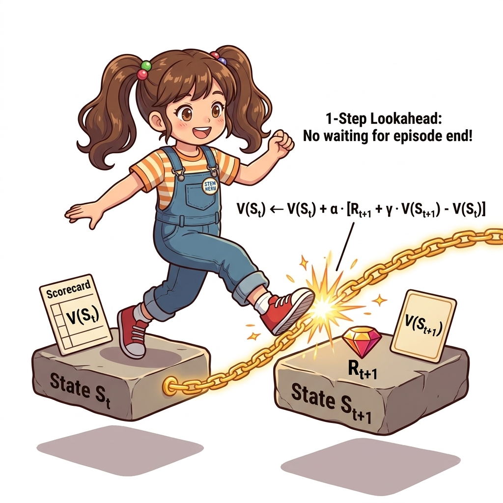
**그림 10-2-16** 징검다리에서 이전 발판 *S*<sub>*t*</sub>에서 다음 발판 *S*<sub>*t*+1</sub>로 딱 한 걸음 이동하자마자 즉시 가치를 갱신하던 10.1절 1-스텝 TD 사슬의 탄탄한 토대

> "10.1절에서 유도했던 상태 가치 TD 갱신식을 떠올려 봅시다. 현재 상태의 추정치에 학습률 알파와 시간차 오차를 곱해 더해주는 구조였습니다. 이 점화식을 이제 Q 함수로 그대로 확장해 보겠습니다."

---

# V(S)에서 Q(S, A)로의 자연스러운 치환
## 현재 상태 가치는 Q(S_t, A_t)로, 다음 상태 가치는 Q(S_{t+1}, A_{t+1})로 매핑

여기서 상태 가치 *V*(*S*)를 행동 가치 *Q*(*S*, *A*)로 자연스럽게 치환해 줍니다:

- 현재 상태의 가치: ***V*<sub>*π*</sub>(*S*<sub>*t*</sub>) → *Q*<sub>*π*</sub>(*S*<sub>*t*</sub>, *A*<sub>*t*</sub>)**
- 다음 상태의 가치: ***V*<sub>*π*</sub>(*S*<sub>*t*+1</sub>) → *Q*<sub>*π*</sub>(*S*<sub>*t*+1</sub>, *A*<sub>*t*+1</sub>)**

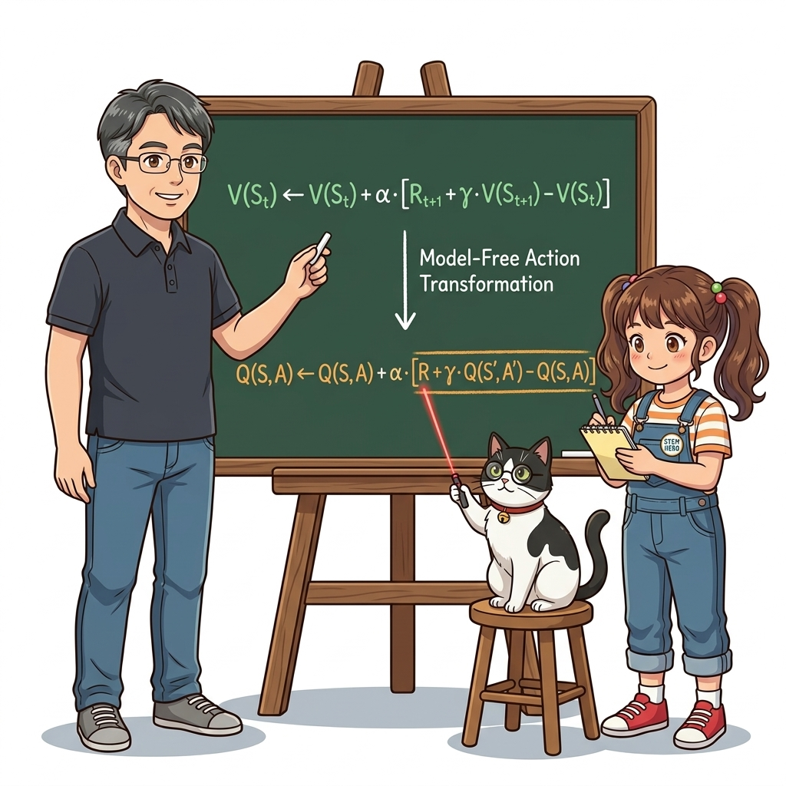
**그림 10-2-17** 이호진 교수님이 대형 녹색 칠판에서 10.1의 상태 가치 TD식(녹색 분필)을 행동 가치 *Q*(*S*, *A*) 점화식(주황색 분필)으로 명쾌하게 유도해 주시는 칠판 직강

> "상태 S_t의 가치는 그 상태에서 실제로 행한 행동까지 결합한 Q(S_t, A_t)로 치환되고, 1-스텝 뒤 다음 상태의 가치는 실제로 선택한 다음 행동까지 포함한 Q(S_{t+1}, A_{t+1})로 완벽하게 대응됩니다."

---

# SARSA 가치 갱신 공식의 최종 완성
## Q(S_t, A_t) ← Q(S_t, A_t) + α · [R_t + γ Q(S_{t+1}, A_{t+1}) - Q(S_t, A_t)]

이 치환을 적용하면 Q 함수를 위한 TD 갱신식이 마침내 완성됩니다:

> ### ***Q*<sub>*π*</sub>(*S*<sub>*t*</sub>, *A*<sub>*t*</sub>) ← *Q*<sub>*π*</sub>(*S*<sub>*t*</sub>, *A*<sub>*t*</sub>) + *α* · [*R*<sub>*t*</sub> + *γQ*<sub>*π*</sub>(*S*<sub>*t*+1</sub>, *A*<sub>*t*+1</sub>) - *Q*<sub>*π*</sub>(*S*<sub>*t*</sub>, *A*<sub>*t*</sub>)]** &nbsp;&nbsp;&nbsp;&nbsp; *(식 10.11: SARSA 갱신 점화식)*

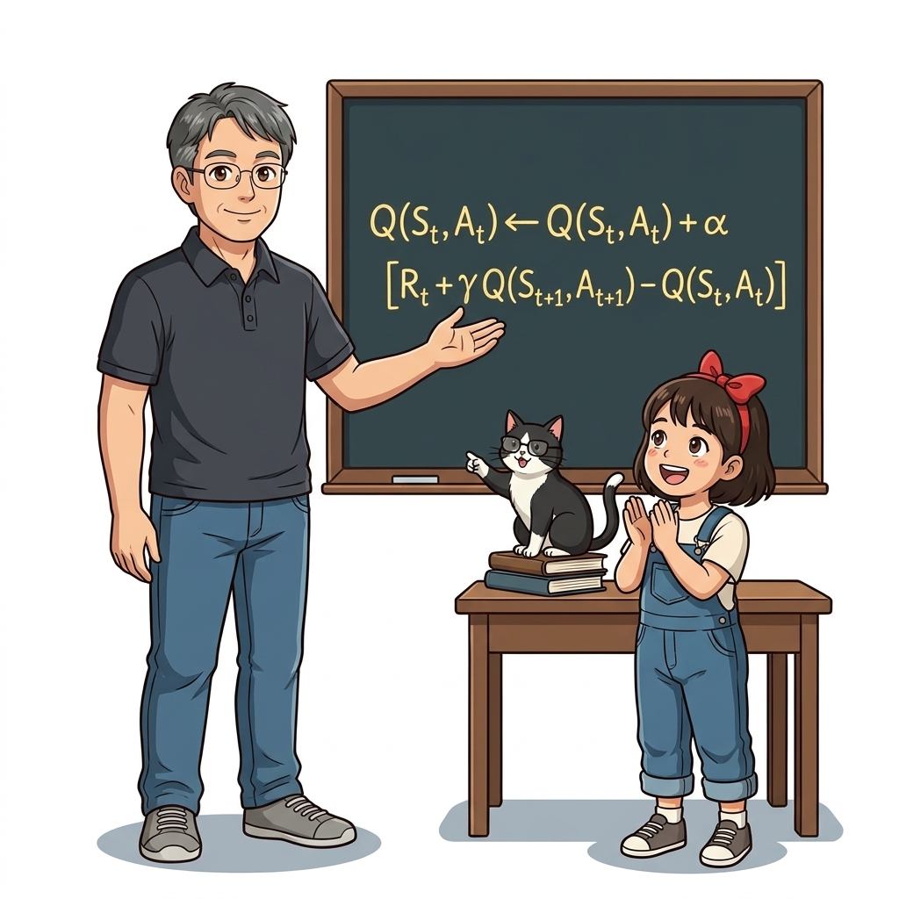
**그림 10-2-18** 칠판에 황금빛 분필로 적힌 SARSA 가치 갱신 점화식 [식 10.11]을 가리키며 열강하시는 이호진 교수님과 도로시

> "식 10.11이 바로 강화학습 역사의 한 획을 그은 SARSA 공식입니다. 당장 얻은 보상 R_t에 할인된 다음 행동 가치 Q를 더한 것을 타깃으로 삼아, 현재 Q 값을 그 방향으로 한 걸음 당겨주는 구조입니다."

---

# SARSA의 TD 목표와 시간차 오차 분석
## 새로운 목표 기준점 [R_t + γ Q(S_{t+1}, A_{t+1})]과 현재 예측의 간극 보정

여기서 괄호 안의 오차 항목인 **[*R*<sub>*t*</sub> + *γQ*<sub>*π*</sub>(*S*<sub>*t*+1</sub>, *A*<sub>*t*+1</sub>) - *Q*<sub>*π*</sub>(*S*<sub>*t*</sub>, *A*<sub>*t*</sub>)]**를 **TD 오차(TD Error, *δ*<sub>*t*</sub>)**라고 부릅니다.

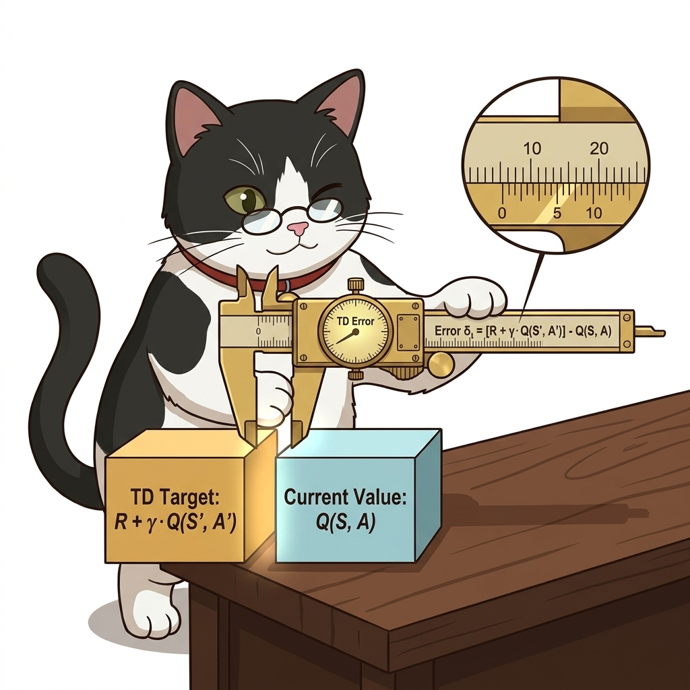
**그림 10-2-19** 지니 조교가 정밀 황금 버니어 캘리퍼스로 1단계 미래의 목표 기준점(*R* + *γQ*)과 현재 예측치(*Q*) 사이의 미세한 간격 오차(*δ*<sub>*t*</sub>)를 정밀 측정하는 비유

> "괄호 안의 오차 항목을 시간차 오차 델타라고 부릅니다. 실제로 경험한 즉각 보상과 다음 상태에서 취할 행동의 가치를 합친 새로운 목표치와, 기존에 내가 예상하던 가치 사이의 차이를 학습률 알파만큼 완만하게 수정해 나갑니다."

---

# 3) 5단계 상호작용 체인: S-A-R-S-A의 비밀
## Q 갱신을 위해 시간 순서대로 관측되어야 하는 5가지 핵심 데이터 조각

**3) 5단계 상호작용 체인: S-A-R-S-A의 비밀**

이 갱신식을 실행하기 위해 필요한 데이터 조각들을 시간 순서대로 나열해 봅시다:

1. 시간 *t*에서의 현재 상태: ***S*<sub>*t*</sub>**
2. 시간 *t*에 에이전트가 실제로 취한 행동: ***A*<sub>*t*</sub>**
3. 환경으로부터 즉시 되돌려받은 보상: ***R*<sub>*t*</sub>**
4. 새로 도달하게 된 다음 상태: ***S*<sub>*t*+1</sub>**
5. 정책에 따라 다음 상태에서 실제로 선택한 다음 행동: ***A*<sub>*t*+1</sub>**

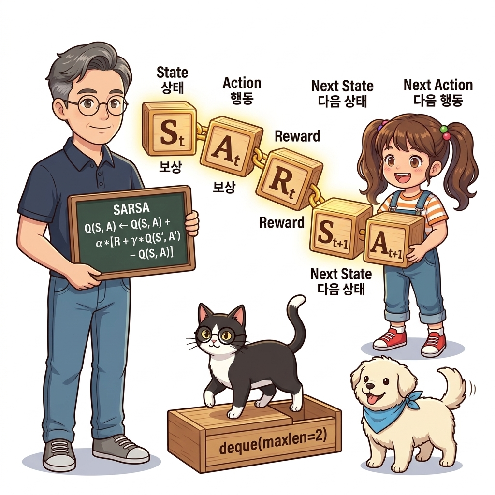
**그림 10-2-20** (상태, 행동, 보상, 다음 상태, 다음 행동)의 5단계 상호작용 체인이 완성되어야 비로소 한 걸음 전의 Q 가치를 갱신할 수 있는 SARSA의 부트스트랩 메커니즘

> "이 갱신식을 실행하려면 시간 순서대로 다섯 개의 데이터가 필요합니다. 상태 S_t에서 행동 A_t를 취하고, 보상 R_t를 받으며 다음 상태 S_{t+1}로 이동한 뒤, 그 상태에서 실제로 다음 행동 A_{t+1}까지 결정해야 비로소 갱신이 완료됩니다."

---

# SARSA라는 독특한 알고리즘 이름의 유래
## State - Action - Reward - State - Action 다섯 단어의 머리글자를 딴 조어

**SARSA의 이름 유래**

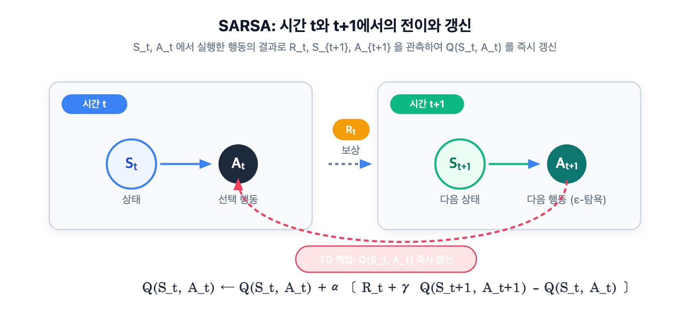
**그림 10-2-21** 시간 *t*와 *t*+1에서의 상태와 행동 전이 구조. (*S*<sub>*t*</sub>, *A*<sub>*t*</sub>) 쌍에서 출발하여 보상 *R*<sub>*t*</sub>를 얻고 다음 (*S*<sub>*t*+1</sub>, *A*<sub>*t*+1</sub>) 쌍으로 이어지는 백업 트리

이 다섯 개 튜플의 앞 글자를 따서 **S - A - R - S - A**, 즉 **SARSA(살사)**라는 매력적인 이름이 붙게 된 것입니다!

> "리차드 서튼 교수님과 연구진은 이 5단계 데이터 체인의 첫 글자를 따서 S-A-R-S-A, 즉 SARSA라는 경쾌하고 기억하기 쉬운 이름을 붙였습니다. 수식의 데이터 흐름 자체가 곧 알고리즘의 이름인 셈입니다."

---

# 4) 온-정책(On-Policy)의 숙명: 탐색과 탐욕의 딜레마
## 행동을 결정하는 정책과 가치를 평가하는 정책이 완전히 동일한 온-정책의 특성

**4) 온-정책(On-Policy)의 숙명: 탐색과 탐욕의 딜레마**

SARSA는 대표적인 **온-정책(On-Policy)** 알고리즘입니다.

- **온-정책(On-Policy)**: 데이터를 수집하며 환경과 직접 부딪치는 정책(**행동 정책, Behavior Policy**)과, 가치를 평가하고 최적화하려는 목표 정책(**대상 정책, Target Policy**)이 완전히 **동일한 하나의 정책**인 방식입니다.

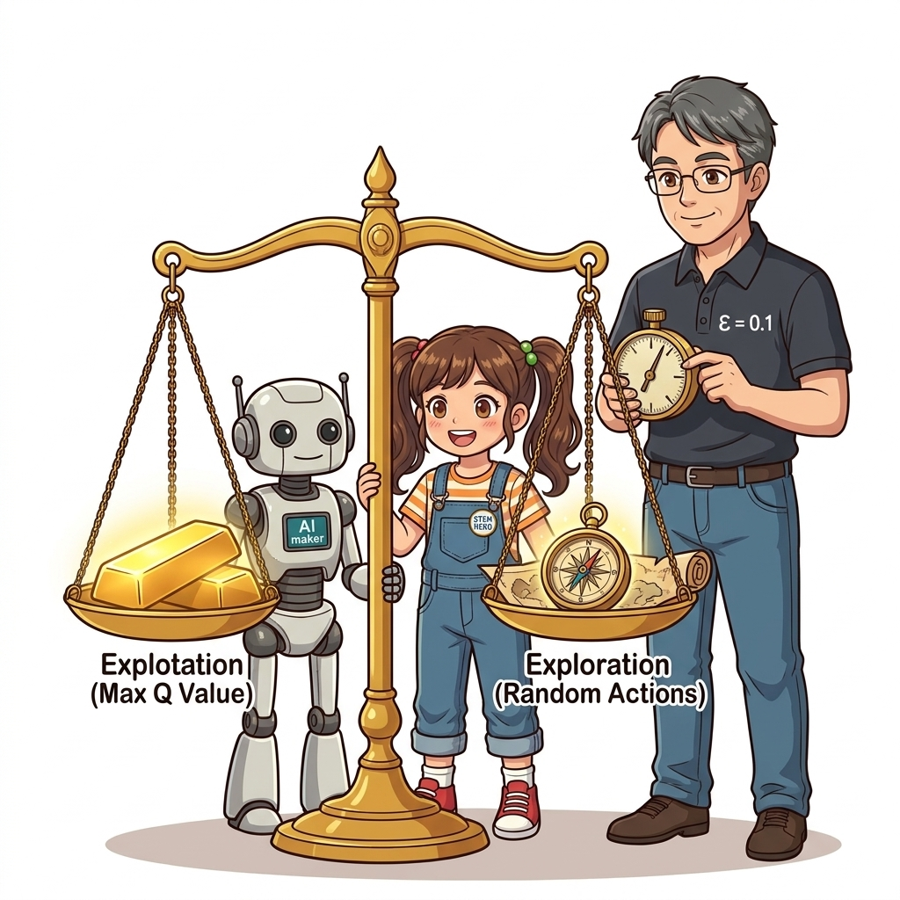
**그림 10-2-22** 온-정책 제어의 핵심 딜레마: 최고 Q 행동만을 챙기는 '탐욕적 활용(Exploitation)'과 새로운 보물 경로를 개척하는 '무작위 탐험(Exploration)' 사이의 황금 균형을 맞추는 도로시와 틴맨 로봇

> "SARSA는 온-정책 알고리즘입니다. 이는 에이전트가 환경을 돌아다니며 실제로 경험을 수집하는 행동 정책과, 그 경험을 바탕으로 학습하고 개선해 나가는 평가 대상 정책이 100% 동일하다는 뜻입니다."

---

# 온-정책 제어의 치명적인 딜레마
## 현재 알고 있는 최선의 길만 갈 것인가(활용), 새로운 대박 보상을 찾아볼 것인가(탐험)

온-정책 제어에서는 **치명적인 딜레마**가 하나 발생합니다:


**그림 10-2-23** 익숙한 황금 길(활용)과 미지의 신비로운 숲길(탐험) 사이 갈림길에서 나침반을 들고 깊은 고민에 빠진 도로시와 토토

> "온-정책 제어에서는 피할 수 없는 고민이 생깁니다. 현재까지의 지식으로 가장 좋은 길만 가면 안전하지만 새로운 보물을 찾을 수 없고, 무작정 탐험만 하면 형편없는 보상을 받아 성능이 떨어집니다."

---

# 100% 탐욕적 선택의 치명적 함정
## 국소 최적해(Local Optimum)에 갇혀 더 우수한 최적 경로를 영원히 발견하지 못함

- **정책 개선의 목표**: *Q* 값을 최대화하는 100% 탐욕적 행동(*argmax*)을 취해야 최적에 도달합니다.

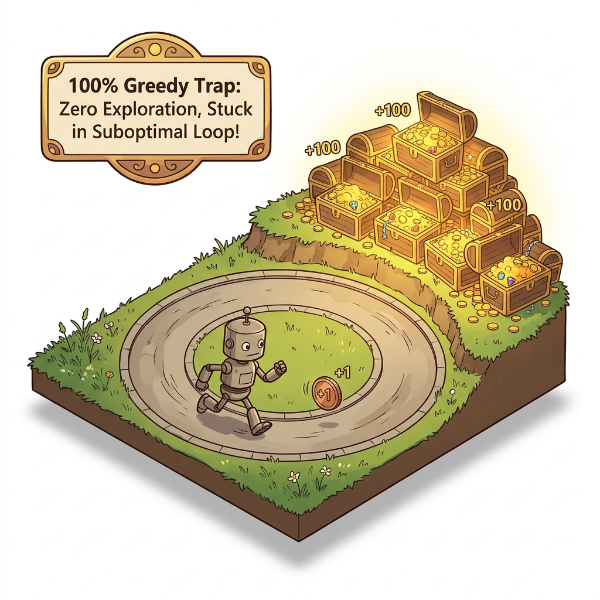
**그림 10-2-24** 100% 탐욕에 갇혀 눈앞의 작은 +1 동전 원형 트랙만 맴돌며 거대한 +100 보물산을 놓치는 국소 최적해 함정

> "에이전트가 100% 탐욕적으로만 행동하면, 초기에 우연히 발견한 작은 보상 경로에 안주하게 됩니다. 저 멀리 거대한 보물 상자가 숨겨져 있어도 그 방향으로 단 한 번도 발을 내딛지 않아 영원히 발견하지 못합니다."

---

# 지속적 탐색의 필수성과 무작위 행동의 필요성
## 새로운 상태와 행동 공간을 개척하기 위해 의도적으로 확률적 시도를 허용해야 한다

- **학습과 탐색의 필요성**: 하지만 행동 정책이 100% 탐욕적이면, 이전에 우연히 발견한 길만 고집하게 되어 더 좋은 보상을 숨겨둔 미지의 경로를 영원히 탐색(Exploration)할 수 없게 됩니다.

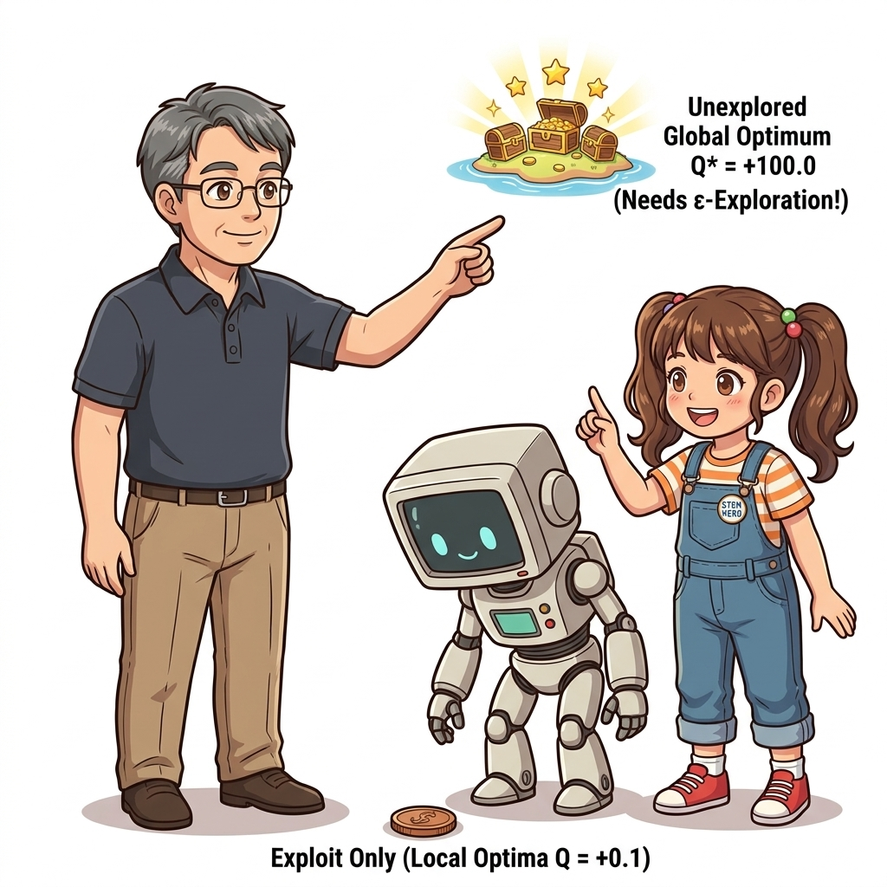
**그림 10-2-25** 발밑의 작은 동전(+0.1 보상)에 시야가 갇힌 틴맨 로봇에게, 수평선 너머 거대한 황금 보물섬(+100 보상)을 가리키며 탐색의 중요성을 일깨워주는 교수님과 도로시

> "따라서 인공지능 에이전트에게는 일정 확률로 지금까지 가보지 않은 낯선 경로를 대담하게 찔러보는 탐색의 자유가 반드시 보장되어야만 전역 최적 정책을 찾아낼 수 있습니다."

---

# 5) ε-탐욕 정책(ε-greedy Policy)의 수학적 분할
## 대부분은 최고 Q 값을 고르고(1-ε), 작은 확률(ε)로 무작위 행동을 시도하는 황금 타협

**5) *ε*-탐욕 정책(*ε*-greedy Policy)의 수학적 분할**

따라서 온-정책 SARSA에서는 다음과 같은 절묘한 타협안인 ***ε*-탐욕 정책(*ε*-greedy Policy)**을 채택합니다:

> ### ***π*(*a* | *S*<sub>*t*</sub>) =**
> - **1 - *ε* + (*ε* / |*A*|) &nbsp;&nbsp;&nbsp;&nbsp; *(탐욕 행동: a = argmax<sub>a'</sub> Q<sub>π</sub>(S<sub>t</sub>, a'))***
> - ***ε* / |*A*| &nbsp;&nbsp;&nbsp;&nbsp;&nbsp;&nbsp;&nbsp;&nbsp;&nbsp;&nbsp;&nbsp;&nbsp;&nbsp;&nbsp;&nbsp;&nbsp;&nbsp;&nbsp; *(그 외 탐색 행동)***
> *(식 10.12: ε-탐욕 정책의 확률 분포)*

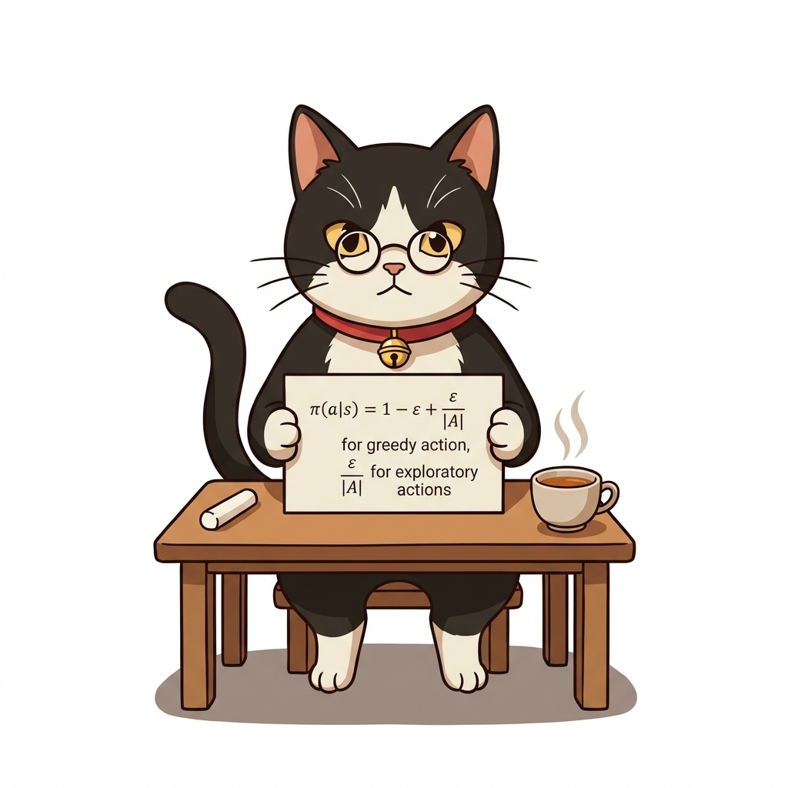
**그림 10-2-26** 지니 조교가 *ε*-탐욕 정책의 수식 카드를 들고 90% 활용과 10% 탐험의 절묘한 수학적 분할을 명쾌하게 해설하는 씬

> "이 난제를 해결하는 가장 우아한 해법이 바로 입실론 탐욕 정책입니다. 대부분의 확률(1 - 입실론)로는 가장 높은 Q 값을 골라 실리를 챙기고, 작은 확률 입실론으로는 주사위를 던져 무작위 탐험을 감행합니다."

---

# ε-탐욕 정책의 확률 질량 함수 수식 분석
## 최적 행동에는 (1 - ε + ε/|A|)의 높은 확률을, 나머지 행동에는 ε/|A|를 공평하게 배분

즉, 대부분의 경우(1 - *ε*)에는 가장 *Q* 값이 높은 최적 행동을 골라 실리를 챙기고, 작은 확률(*ε*, 예: 10%)로 무작위 행동을 시도하여 새로운 경로를 끊임없이 개척합니다.

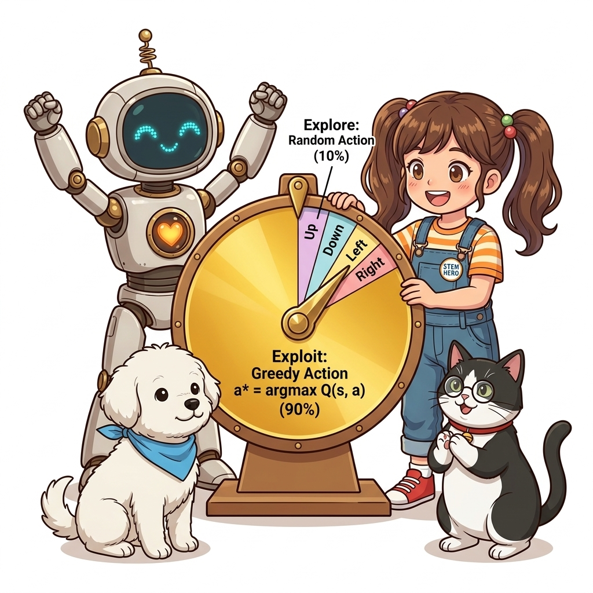
**그림 10-2-27** *ε*-탐욕 정책의 룰렛 원판: 90% 이상(1 - *ε*)의 압도적 확률로 최고의 *Q* 행동을 선택하며 실리를 챙기고, 10%(*ε*)의 확률을 4개 행동(상·하·좌·우 각 2.5%)에 공평하게 나누어 미지의 길을 끊임없이 개척하는 탐험 메커니즘

> "식 10.12의 확률 분포를 보시면, 가능한 행동의 수가 4개이고 입실론이 0.1이라면, 최적 행동은 92.5%라는 압도적인 확률로 선택되고 나머지 3개 행동에도 각각 2.5%씩 탐험의 기회가 골고루 주어집니다."

---

# 10.2.2 SARSA 에이전트 파이썬 구현
## deque(maxlen=2) 슬라이딩 버퍼를 활용한 실시간 온라인 SARSA 구조 설계

**10.2.2 SARSA 에이전트 파이썬 구현**

이제 온-정책 SARSA 알고리즘을 파이썬 코드로 구현해 봅시다.

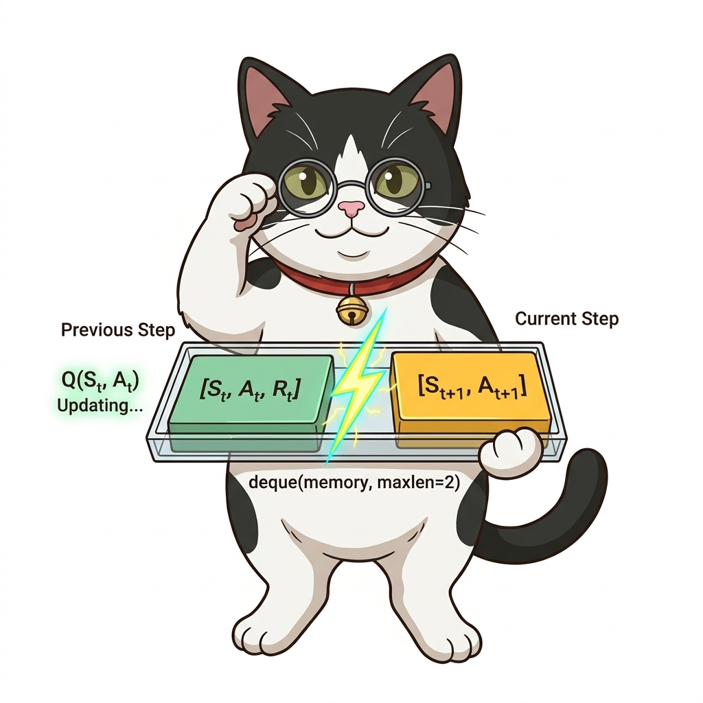
**그림 10-2-28** `deque(maxlen=2)` 2칸 슬라이딩 윈도우 버퍼 비유: 0번 칸의 (*S*<sub>*t*</sub>, *A*<sub>*t*</sub>, *R*<sub>*t*</sub>)와 1번 칸의 (*S*<sub>*t*+1</sub>, *A*<sub>*t*+1</sub>)가 만나는 순간 번개처럼 *Q* 값이 즉시 갱신되는 2-스텝 버퍼 메커니즘

> "이제 수학적 원리를 실제 파이썬 코드로 구현해 보겠습니다. SARSA는 연속된 두 시점의 데이터가 필요하므로, 파이썬 collections 모듈의 deque를 크기 2로 설정하여 메모리를 극도로 절약하는 슬라이딩 윈도우를 구성합니다."

---
# SarsaAgent 클래스 전체 구조
## SarsaAgent 클래스 구조 (1/2): 초기화, 행동 선택, 리셋 메서드

<div align="right"><b>ch06/sarsa.py</b></div>

```python
from collections import defaultdict, deque
import numpy as np
from common.utils import greedy_probs

class SarsaAgent:
    def __init__(self):
        self.gamma = 0.9          # 할인율 γ (미래 보상 감가 계수)
        self.alpha = 0.8          # 학습률 α (갱신 보폭)
        self.epsilon = 0.1        # 탐색 확률 ε (10% 확률로 무작위 탐색)
        self.action_size = 4      # 행동 가짓수 (상, 하, 좌, 우)

        # 초기 정책: 4가지 행동에 대해 각 25%의 균등 확률
        random_actions = {0: 0.25, 1: 0.25, 2: 0.25, 3: 0.25}
        self.pi = defaultdict(lambda: random_actions)
        self.Q = defaultdict(lambda: 0)
        self.memory = deque(maxlen=2) # ❶ 최대 크기 2의 슬라이딩 윈도우 버퍼

    def get_action(self, state):
        action_probs = self.pi[state] # ❷ self.pi에서 행동 확률 조회
        actions = list(action_probs.keys())
        probs = list(action_probs.values())
        return np.random.choice(actions, p=probs)

    def reset(self):
        self.memory.clear()
```

> "살사 에이전트 클래스의 초기화 및 행동 선택 구조를 살펴보겠습니다. 생성자에서는 감마 0.9, 알파 0.8, 입실론 0.1을 설정합니다. 행동 가치 함수 큐 테이블은 디폴트딕트를 사용하여 0으로 자동 초기화하고, 정책 파이 역시 4개 행동에 균등 확률 0.25를 할당합니다. 가장 중요한 부분은 최대 길이가 2인 디큐 메모리 버퍼입니다. 시간차 제어에 필요한 2스텝 연속 경험을 저장합니다. 겟 액션 메서드는 현재 정책 파이의 확률에 따라 넘파이 랜덤 초이스로 주사위를 굴려 행동을 결정합니다."

---
# SarsaAgent 클래스 전체 구조
## SarsaAgent 클래스 구조 (2/2): update 메서드와 2-스텝 버퍼 갱신

<div align="right"><b>ch06/sarsa.py</b></div>

```python
class SarsaAgent:
    # (앞선 초기화에 이어 계속)

    def update(self, state, action, reward, done):
        self.memory.append((state, action, reward, done))
        if len(self.memory) < 2:
            return  # 데이터가 2세트 쌓이기 전에는 조기 반환

        # 버퍼의 0번째는 이전 시점 t, 1번째는 현재 시점 t+1
        state, action, reward, done = self.memory[0]
        next_state, next_action, _, _ = self.memory[1]

        # ❸ 종단 상태(Goal)에 도달했다면 미래 가치는 0
        next_q = 0 if done else self.Q[next_state, next_action]

        # ❹ TD 목표와 식 (10.11)에 따른 self.Q 갱신
        target = reward + self.gamma * next_q
        self.Q[state, action] += (target - self.Q[state, action]) * self.alpha

        # ❺ ε-탐욕 정책 개선
        self.pi[state] = greedy_probs(self.Q, state, self.epsilon)
```

> "이어서 살사의 핵심인 업데이트 메서드입니다. 새로운 경험을 2칸 메모리 버퍼에 담고, 아직 2개가 모이지 않았다면 조기 반환합니다. 2개가 모이면 직전 경험과 다음 경험을 동시에 꺼냅니다. 종단 상태라면 미래 가치 넥스트 큐를 0으로 두고, 일반 상태라면 다음 상태에서 선택된 실제 행동의 큐값을 가져옵니다. 즉각 보상과 감마 곱하기 넥스트 큐를 더해 타겟을 만들고, 학습률 알파를 곱해 큐 테이블을 갱신합니다. 마지막으로 개선된 큐값을 바탕으로 정책 파이를 입실론 탐욕 정책으로 개선합니다."

---

# 1) update() 메서드 코드 정밀 해부
## deque 2칸 버퍼링부터 종단 상태 0 처리, TD 오차 계산과 정책 개선까지 5단계 분석

**1) update() 메서드 코드 해부도**

코드를 좀 더 상세히 분해하여 알아봅시다.

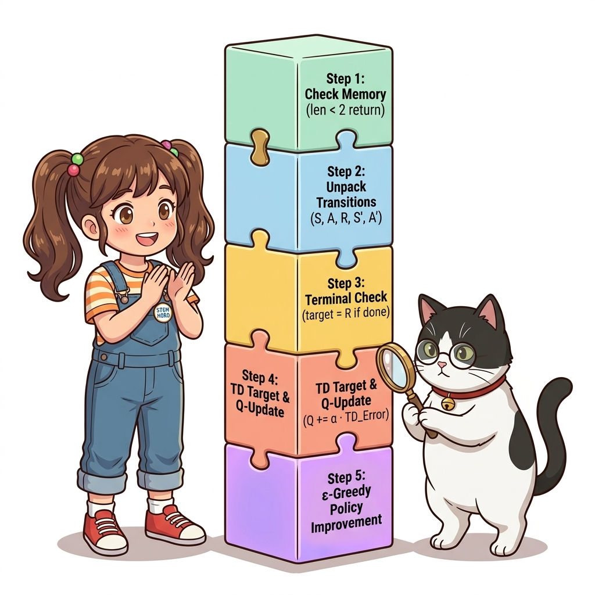
**그림 10-2-29** `update()` 메서드의 5대 핵심 라인이 레고 블록처럼 정교하게 맞물려 작동하는 코드 아키텍처 해부도

> "update 메서드는 SARSA의 심장부입니다. 데이터가 2개 쌓일 때까지 기다리는 버퍼링 조건문부터 시작하여, 1스텝 시간차 목표 계산과 입실론 탐욕 정책 갱신까지 정밀한 5단계 파이프라인으로 구성되어 있습니다."

---

# ❶ self.memory = deque(maxlen=2)의 필연성
## 현재 스텝(S, A, R)과 다음 스텝(S', A')이 모두 모여야 Q 갱신식이 완성된다

- **❶ `self.memory = deque(maxlen=2)`: 2-스텝 슬라이딩 윈도우의 필연성**
  - SARSA는 (*S*<sub>*t*</sub>, *A*<sub>*t*</sub>, *R*<sub>*t*</sub>)를 겪었다고 해서 곧바로 갱신할 수 없습니다.
  - 10.1절의 상태 가치 TD법은 다음 상태 *S*<sub>*t*+1</sub>에 '도착'만 하면 즉시 *V*(*S*<sub>*t*+1</sub>)을 꺼내어 이전 발판을 갱신할 수 있었습니다.
  - 하지만 SARSA는 행동 가치 *Q*를 다루기 때문에, 다음 상태에서 **"실제로 무슨 다음 행동 *A*<sub>*t*+1</sub>을 취할 것인가"까지 결정되어야만** 비로소 부트스트랩 목표치인 *Q*(*S*<sub>*t*+1</sub>, *A*<sub>*t*+1</sub>)을 꺼낼 수 있습니다!
  - 따라서 `maxlen=2`인 `deque`를 사용하여 최근 2개의 타임스텝 데이터를 슬라이딩 윈도우 형태로 간직하며, 데이터가 2세트 채워지기 전에는 갱신을 잠시 대기(`if len(self.memory) < 2: return`)합니다.

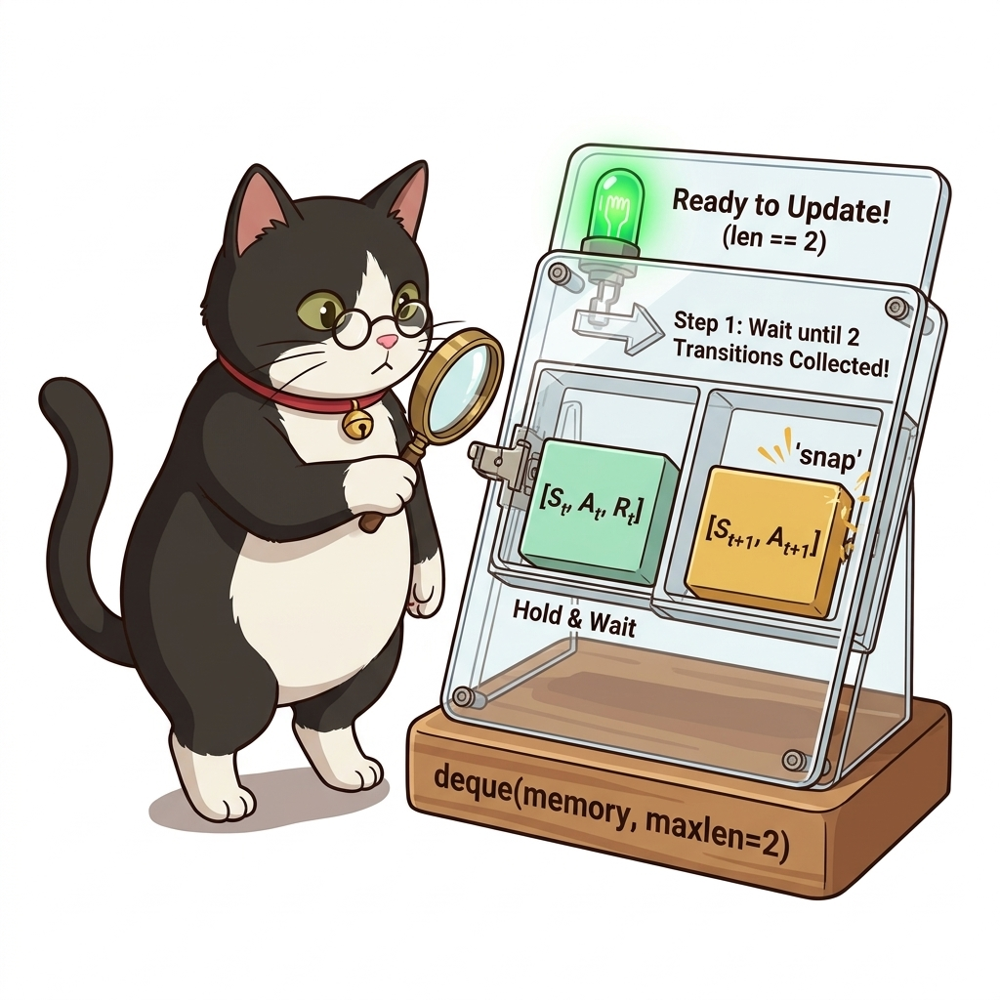
**그림 10-2-30** `deque(maxlen=2)` 슬라이딩 윈도우 내부 메커니즘: 0번 칸의 (*S*<sub>*t*</sub>, *A*<sub>*t*</sub>)가 1번 칸의 (*S*<sub>*t*+1</sub>, *A*<sub>*t*+1</sub>)를 만나 'Ready to Update!' 등이 켜지며 가치를 갱신하는 정밀 기계 트레이

> "SARSA 공식을 다시 보시면 다음 행동 A_t+1이 반드시 필요합니다. 따라서 첫 스텝에서는 메모리에 데이터를 보관만 하고 리턴하며, 두 번째 스텝의 행동이 들어와 길이가 2가 되는 순간 비로소 Q 갱신을 점화합니다."

---

# ❷ get_action() 메서드의 온-정책 샘플링
## 행동 선택과 가치 평가에 동일한 ε-탐욕 확률 분포(self.pi)를 그대로 적용

- **❷ `get_action(self, state)`: 온-정책 단일 정책 확률 샘플링**
  - 온-정책(On-policy)의 가장 큰 장점은 **"행동을 취하는 뇌(Behavior Policy)"와 "가치를 평가받는 뇌(Target Policy)"가 완벽하게 하나로 통합**되어 있다는 점입니다.
  - 별도의 복잡한 가중치 보정(중요도 샘플링 등)을 할 필요 없이, 오직 하나의 유일한 정책 `self.pi[state]`에서 확률 비율대로 주사위를 굴려(`np.random.choice(actions, p=probs)`) 다음 행동을 직접 결정합니다.
  - 에이전트는 이 확률적 선택에 따라 환경에서 직접 부딪치고, 그 생생한 경험의 결과를 자신의 Q테이블에 정직하게 피드백합니다.


**그림 10-2-31** `get_action()` 온-정책 단일 정책 샘플링: 탐험과 평가가 분리되지 않고 하나의 통합 정책 상자 `self.pi`에서 직접 행동 구슬을 뽑아 실천하는 정직한 상호작용

> "온-정책 알고리즘의 본질은 행동을 결정할 때 쓰는 정책 분포와 가치를 평가할 때 쓰는 정책 분포가 완전히 같다는 점입니다. np.random.choice를 통해 실시간으로 계산된 확률 분포에서 다음 행동을 자연스럽게 샘플링합니다."

---

# ❸ next_q = 0 if done else ... 종단 처리의 엄밀성
## 골인 지점이나 사망 지점 같은 종료 상태에서는 미래 가치가 0이어야만 수렴

- **❸ `next_q = 0 if done else self.Q[next_state, next_action]`: 종단 상태 0 처리의 엄밀성**
  - 에이전트가 목표 지점(Goal +1.0 또는 Trap -1.0)에 도달하여 게임이 완전히 끝났다면(`done == True`), 그 이후로 얻을 수 있는 추가 미래 보상은 정의상 존재하지 않습니다!
  - 가치 함수란 '앞으로 얻게 될 미래 보상들의 할인 누적 합'이므로, 종료된 이후의 가치는 수학적으로 **정확히 0**이어야만 합니다.
  - 만약 여기서 0 대신 기존 Q값을 부트스트랩해 버리면, 이미 끝난 게임에서 허깨비 미래 보상을 뻥튀기하는 치명적인 왜곡이 발생하므로 단호하게 0으로 자물쇠를 잠급니다.

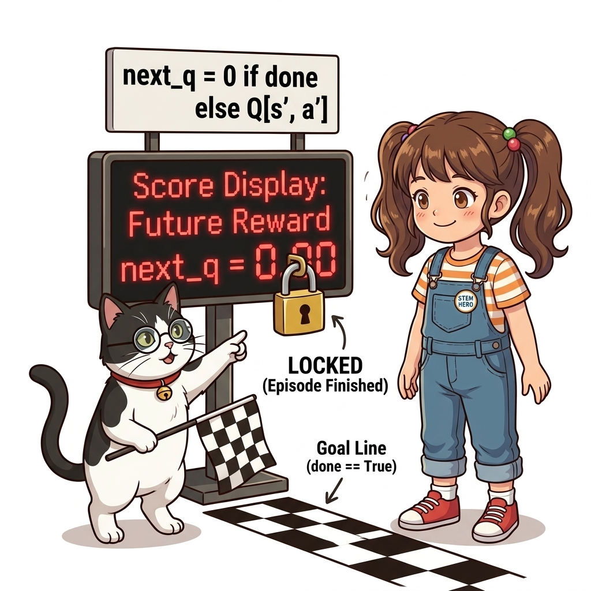
**그림 10-2-32** `next_q = 0 if done else ...` 종단 처리의 엄밀성: 결승선(Goal)에 도달하는 순간 미래 보상 카운터가 "0.00"으로 자물쇠 잠금되어 유령 부트스트랩을 완벽히 차단하는 안전장치

> "에피소드가 끝나는 종단 상태에 도달했을 때는 그 뒤에 이어질 미래가 전혀 없습니다. 따라서 done 플래그가 참일 때는 다음 상태의 Q 값을 엄밀하게 0으로 처리해주어야 가치 함수가 발산하지 않고 참값으로 수렴합니다."

---

# ❹ Q 함수 갱신: TD 오차와 실시간 학습률 보폭
## target = reward + γ * next_q와 TD 오차를 이용한 점진적 가치 보정

- **❹ Q 함수 갱신: TD 오차와 실시간 학습률 보폭**
  - 새로운 기준점인 **TD 목표 (`target = reward + self.gamma * next_q`)**를 계산합니다.
  - 기존 예측치 `self.Q[state, action]`와의 차이인 **TD 오차 (`target - self.Q[state, action]`)**를 측정한 뒤, 학습률 `self.alpha`(0.8)를 곱해 그 방향으로 Q값을 즉각 업데이트합니다.
  - 10.1절의 상태 가치 TD식과 원리는 같지만, 칸(State)의 가치가 아니라 특정 칸에서 특정 방향으로 발을 뻗은 **'행동(Action)'의 가치 타일이 실시간으로 업그레이드**되는 것이 결정적인 차이입니다.

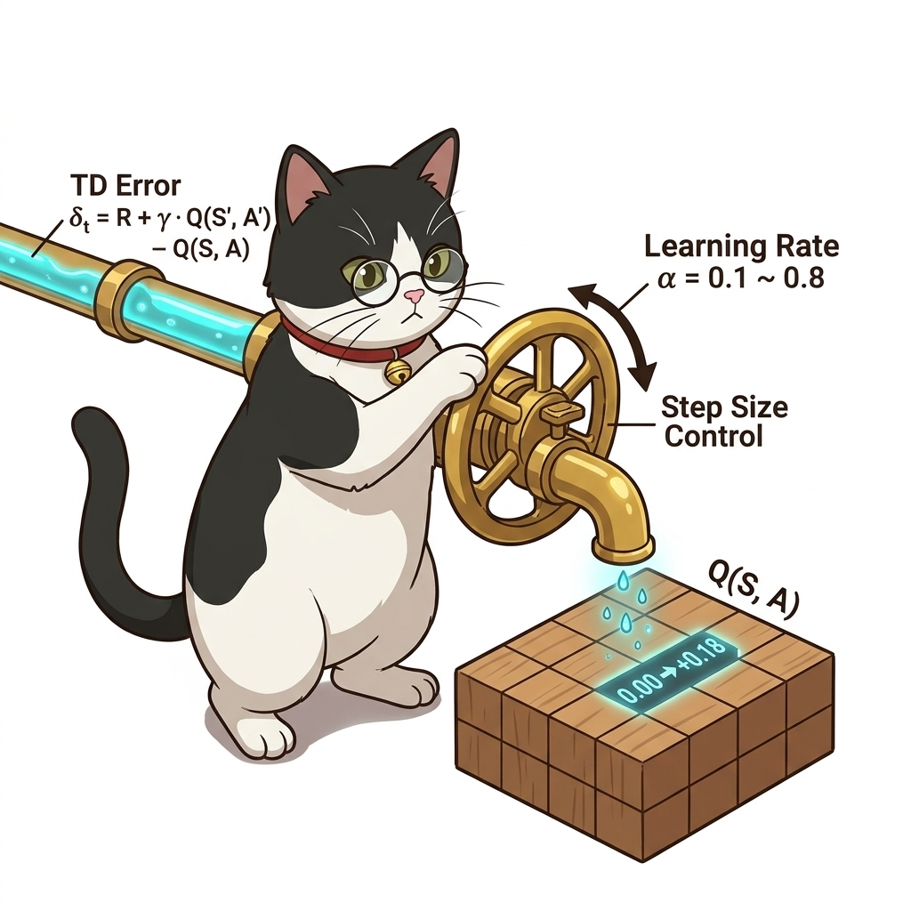
**그림 10-2-33** 지니 조교가 황금 학습률 밸브(*α* = 0.8)를 열어 TD 오차 신호를 Q테이블 저수조 칸칸마다 신선하게 채워 넣는 정교한 배관 비유

> "계산된 TD 목표치와 현재 Q 값의 차이를 구한 뒤, 학습률 알파를 곱해 현재 테이블 값을 업데이트합니다. 이것이 바로 벨만 기대 방정식을 한 걸음의 실제 관측 표본으로 근사해 나가는 핵심 구현부입니다."

---

# ❺ 정책 개선(Policy Improvement)의 즉시 반영
## Q 값이 갱신되자마자 greedy_probs를 재계산하여 더 똑똑해진 행동 정책 도출

- **❺ 정책 개선 (`greedy_probs`): 1스텝 만에 진화하는 정책**
  - 행동 가치 *Q*가 조금이라도 더 똑똑해졌다면, 에이전트의 행동 지침인 `self.pi`도 그 즉시 더 영리하게 업그레이드되어야 합니다!
  - `greedy_probs` 함수는 방금 수정된 Q값들을 스캔하여 가장 숫자가 큰 최선의 행동에 `1 - epsilon`의 높은 확률(92.5%)을 부여하고, 나머지 3개 행동에 `epsilon / 4`의 탐험 확률(각 2.5%)을 골고루 나누어 새로운 *ε*-탐욕 정책을 즉각 찍어냅니다.
  - 이로써 한 걸음 디딜 때마다 **[가치 평가 갱신 → 정책 즉각 개선]**이 1-스텝 만에 완료되는 완벽한 온라인 실시간 제어 루프가 완성됩니다!

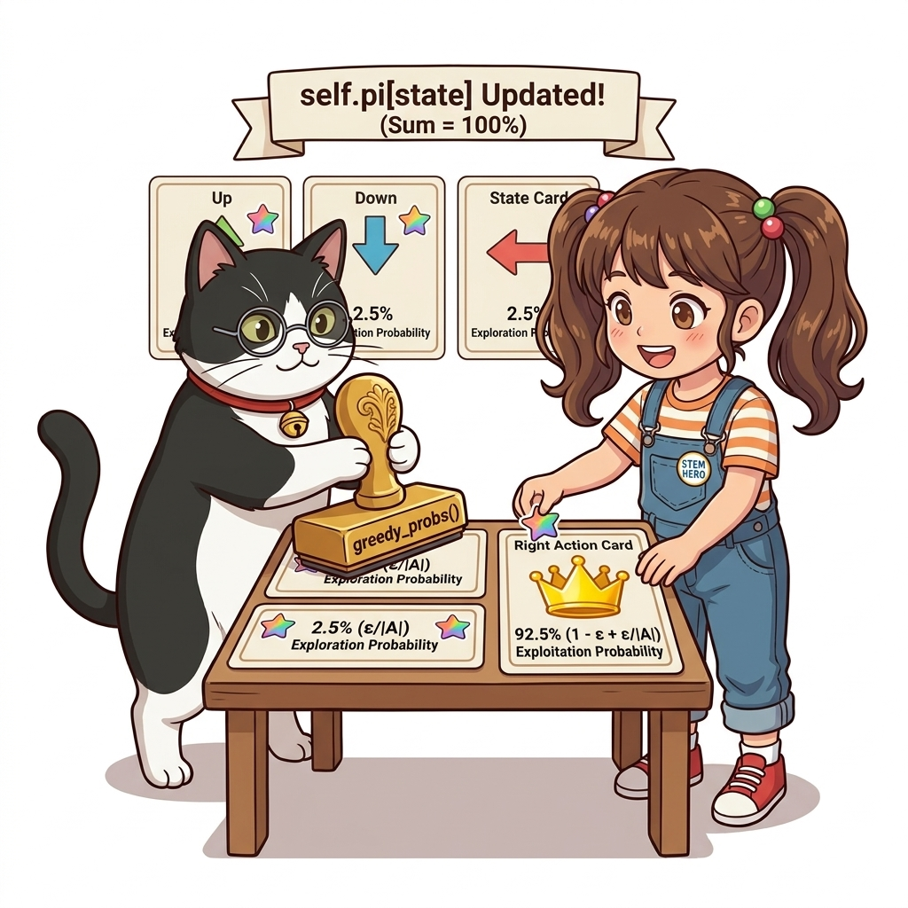
**그림 10-2-34** `greedy_probs` 정책 개선 스탬프 공방: 가장 똑똑해진 최선의 Q 행동에 황금 왕관(92.5%)을 찍고 알록달록 탐색 스티커(2.5%)를 붙여 실시간 최적 정책을 발행하는 활기찬 공방

> "Q 테이블의 숫자가 하나라도 바뀌면, 에이전트는 즉시 greedy_probs 함수를 호출하여 최선의 행동 방향을 재조정합니다. 에피소드가 끝나기를 기다리지 않고 매 걸음마다 정책이 즉각적으로 진화합니다."

---

# 2) SARSA 학습 루프와 종단 상태 플러시(Flush)
## 그리드 월드 1만 에피소드 반복 수행 루프와 메모리 잔여 데이터 정산

**2) SARSA 학습 루프와 종단 상태 플러시(Flush)**

이제 그리드 월드 환경에서 `SarsaAgent`를 1만(10,000) 에피소드 동안 훈련시켜 봅시다.

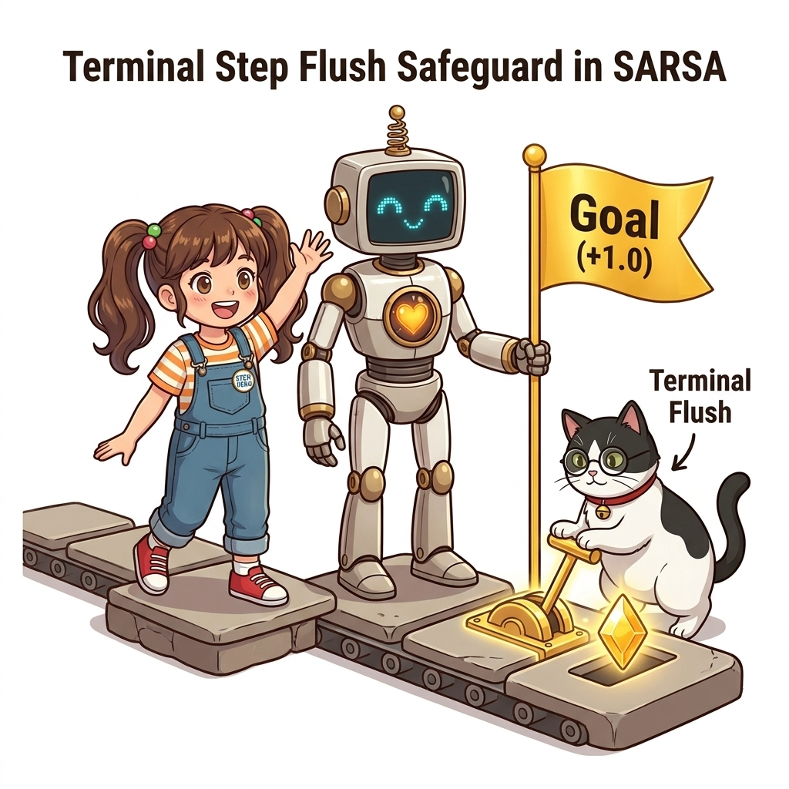
**그림 10-2-35** 골인 직전 마지막 스텝의 소중한 +1.0 보상이 버퍼에 방치되지 않도록 지니 조교가 황금 플러시 레버를 당겨 안전하게 갱신을 완료하는 비유

> "이제 구현된 SarsaAgent를 3x4 그리드 월드 환경에 투입하여 1만 번의 에피소드를 학습시킵니다. 여기서 가장 주의 깊게 살펴보아야 할 핵심 엔지니어링 테크닉이 바로 루프 종료 직후의 플러시 호출입니다."

---

# SARSA 메인 학습 실행 스크립트 코드
## 에피소드 초기화부터 스텝 전진, 그리고 루프 종료 후 agent.update 플러시 호출

<div align="right"><b>ch06/sarsa.py</b></div>

```python
from common.gridworld import GridWorld

env = GridWorld()
agent = SarsaAgent()

episodes = 10000
for episode in range(episodes):
    state = env.reset()
    agent.reset()

    while True:
        action = agent.get_action(state)
        next_state, reward, done = env.step(action)

        agent.update(state, action, reward, done) # ❶ 매 스텝마다 버퍼에 추가

        if done:
            # ❷ 목표(Goal)에 도달했을 때 마지막 스텝 강제 플러시!
            agent.update(next_state, None, None, None)
            break

        state = next_state

**학습 완료 후 최종 수렴된 Q 함수 시각화**
env.render_q(agent.Q)
```

> "코드의 21번째 줄을 주목해 주십시오. 에피소드가 끝났을 때 agent.update(next_state, None, None, None)이라는 특수한 호출을 수행하고 있습니다. 이 코드가 왜 필수적인지 다음 슬라이드에서 상세히 짚어보겠습니다."

---

# 종단 플러시 agent.update(next_state, None, None, None)의 이유
## 크기 2 버퍼에 마지막으로 홀로 남겨진 (S_{T-1}, A_{T-1}, R_{T-1})을 정산하는 필수 절차

> [!IMPORTANT]
> **🚨 종단 처리 `agent.update(next_state, None, None, None)`가 왜 필수적일까요?**  
> `agent.update()`는 버퍼에 최소 2개의 데이터가 들어있어야 `memory[0]`의 Q값을 갱신합니다.  
> 만약 에이전트가 목표 지점에 막 골인하여 `done=True`가 되었다면, **목표에 도착하기 직전 마지막 상태(예: 골 바로 앞 칸에서 오른쪽으로 이동한 결정적 행동)에 대한 데이터는 아직 `memory[0]`에 머물러 있어 갱신되지 못한 채 루프가 끝나버릴 치명적인 위험**이 있습니다!  
> 따라서 `if done:` 블록 안에서 더미 데이터 `(next_state, None, None, None)`를 한 번 더 버퍼에 밀어 넣어줌으로써, **가장 중요한 골 직전 행동에 +1.0의 큰 보상이 완벽하게 반영되도록 온전히 플러시(Flush)**를 완료하는 것입니다.

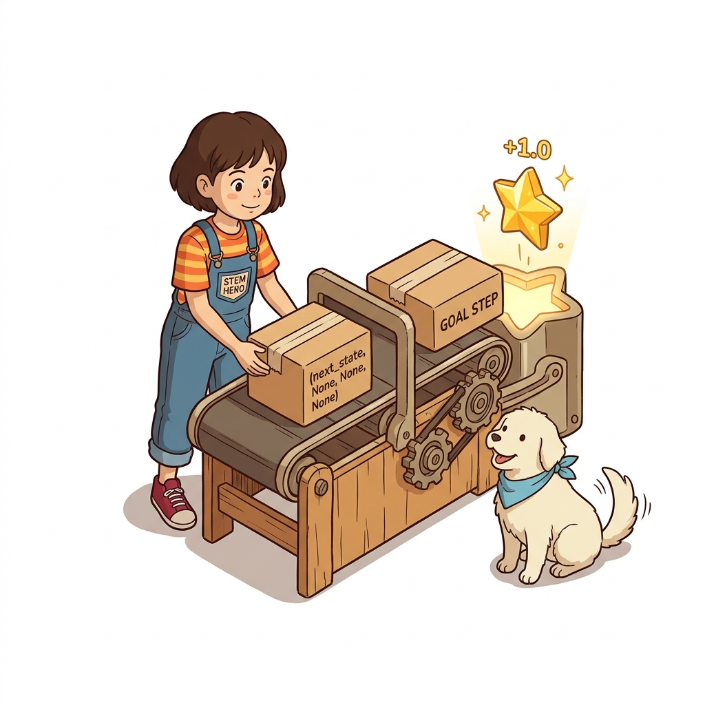
**그림 10-2-36** 2칸 컨베이어 벨트에 더미 데이터 패키지를 밀어 넣어 골인 직전 마지막 황금 보상(+1.0)을 안전하게 배출(플러시)시키는 도로시

> "에피소드가 골인 지점에 도달해 종료되면 다음 행동 A_T는 존재하지 않습니다. 이때 플러시를 호출해주지 않으면, 마지막 직전 상태에서 취한 가장 결정적인 행동의 데이터가 갱신되지 못하고 버퍼에 버려지는 치명적 버그가 발생합니다."

---

# 10.2.3 SARSA의 학습 결과와 보수적 안전 운전 특성
## 1만 회 학습 완료 후 시각화된 Q 함수 테이블과 화살표 최적 정책 분석

**10.2.3 SARSA의 학습 결과와 보수적 안전 운전 특성**

1만 회 학습 후 렌더링된 Q 함수와 정책을 확인해 봅시다.

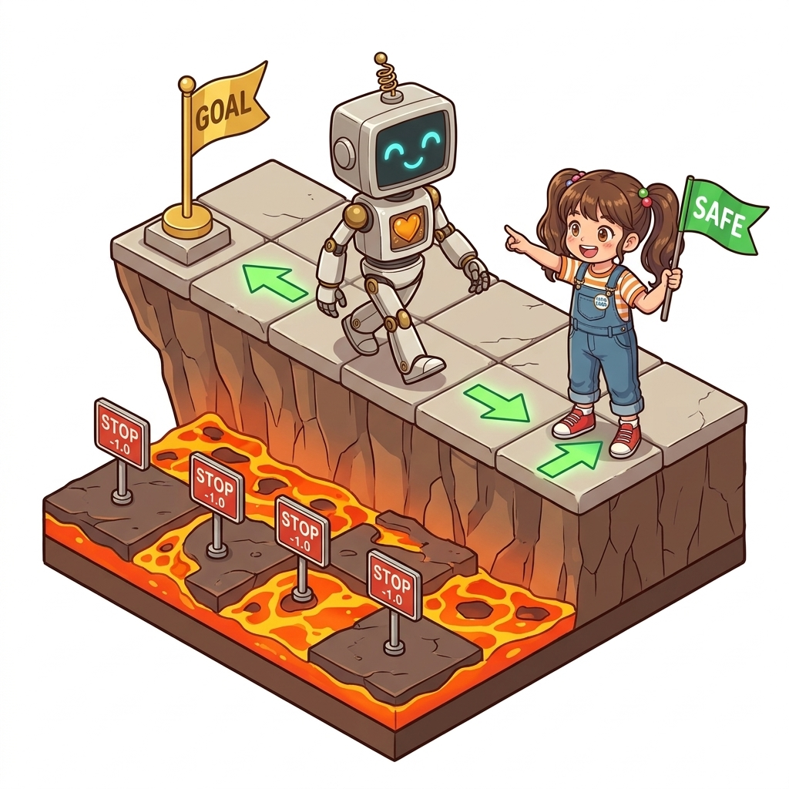
**그림 10-2-37** 3×4 그리드월드 디오라마 모형: 아래쪽 함정(-1.0 폭탄) 근처에 위험 경고 표지판이 세워져 있고, 틴맨 로봇이 위험한 지름길 대신 위쪽 벽면의 안전 우회로를 따라 평화롭게 걸어가는 모습

> "1만 번의 에피소드를 마친 후 학습된 그리드 월드의 Q 값과 최적 정책 화살표를 시각화한 결과입니다. 골(Goal) 지점인 +1.0을 향해 모든 칸의 화살표가 질서정연하게 정렬되어 성공적으로 학습되었음을 확인할 수 있습니다."

---

# SARSA로 획득한 그리드 월드 정책 지도
## 폭탄(-1.0) 칸 바로 옆 지점에서 위쪽 안전한 벽 쪽으로 크게 우회하는 경로 발견

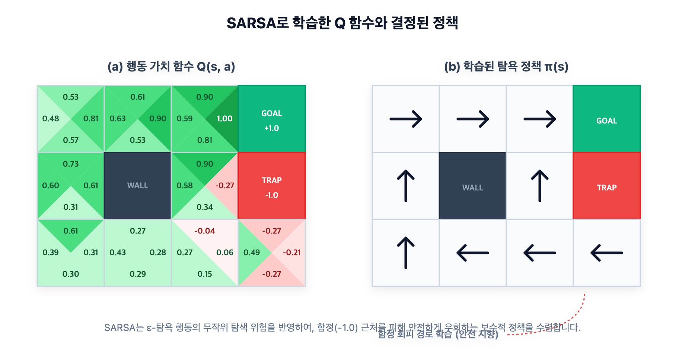
**그림 10-2-38** SARSA로 획득한 그리드 월드 정책. 절벽/폭탄(-1.0) 칸 주변에서 위험을 피하기 위해 안전하게 멀리 우회하는 보수적인 경로가 형성됩니다.

> "그림을 자세히 보시면, 출발점에서 목표점으로 갈 때 폭탄 바로 윗길로 질러가지 않고, 맨 위쪽 벽면을 타고 멀리 돌아서 빙 둘러가는 기이한 우회로를 선택하고 있습니다. 이것이 바로 SARSA의 핵심 성향입니다."

---

# 1) SARSA의 독특한 성향: '안전제일주의'
## 최단 경로 대신 한참 멀리 돌아서 가더라도 위험 요소와 거리를 두는 보수적 행동

**1) SARSA의 독특한 성향: "안전제일주의"**

[그림 10-2-38]의 결과에서 대단히 흥미로운 점을 발견할 수 있습니다:
- 에이전트는 폭탄(-1.0) 칸 바로 옆 지름길이 있음에도 불구하고, **폭탄에서 멀리 떨어진 위쪽 벽 쪽으로 크게 우회하는 정책**을 학습합니다.


**그림 10-2-39** 폭탄 칸(-1.0) 바로 옆 아슬아슬한 지름길 대신, 위쪽 튼튼한 난간이 있는 안전 우회로를 선택해 미소 짓는 틴맨 로봇

> "수학적으로 가장 빠른 최단 경로는 폭탄 바로 위 칸을 지나가는 길입니다. 하지만 SARSA 에이전트는 걸음 수가 훨씬 많이 걸리더라도 굳이 천장 벽 쪽으로 빙 돌아가는 지극히 보수적인 안전 경로를 최종 선택했습니다."

---

# 왜 SARSA는 보수적인 안전 우회로를 택했을까?
## 자신의 미래 행동에 포함된 ε(10%)의 무작위 탐험 실수를 가치 평가에 선반영

왜 이런 보수적인(Conservative) 결과가 나올까요?


**그림 10-2-40** "왜 SARSA는 거리가 더 먼 우회로를 골랐을까?" 호기심 가득한 황금 물음표와 함께 고개를 갸우뚱하는 도로시와 토토

> "왜 이런 결과가 나왔을까요? 이는 SARSA가 온-정책 알고리즘이기 때문입니다. 에이전트는 자신이 다음 순간에 10%의 확률로 주사위를 잘못 던져 발을 헛디딜 수 있다는 사실을 스스로의 가치 계산에 철저히 반영합니다."

---

# 이유 1: 온-정책(On-policy)의 거울 속 일치성
## 내가 실제로 탐험하며 겪는 위험과 실수가 가치 함수 Q 평가에 고스란히 투영된다

1. SARSA는 **온-정책(On-policy)** 알고리즘입니다.


**그림 10-2-41** 전신 거울 속에서 실제 걸어가는 행동 정책(현실의 도로시)과 평가받는 대상 정책(거울 속 도로시)이 완벽히 일치하여 함께 움직이는 온-정책 동일성 비유

> "SARSA는 자신이 실제로 움직이는 행동 정책과 가치를 평가하는 정책이 같습니다. 즉, 완벽하게 이상적인 로봇이 운전하는 것이 아니라, 가끔 실수를 저지르는 덜렁거리는 자신의 현재 상태를 인정하고 학습합니다."

---

# 이유 2: 다음 행동 A_{t+1} 역시 ε-탐욕으로 선택
## 시간차 목표 계산 시 Q_{max}가 아니라 실제 10% 실수 확률이 포함된 행동 가치를 사용

2. 다음 상태에서 취할 행동 *A*<sub>*t*+1</sub> 역시 *ε*-탐욕 정책으로 선택됩니다.

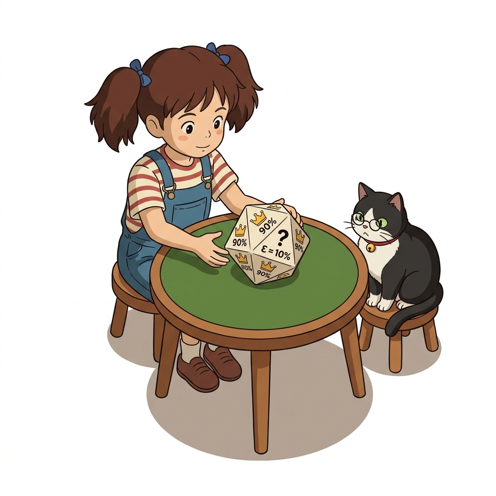
**그림 10-2-42** 90% 최선 행동과 10% 무작위 탐색이 새겨진 주사위를 굴려 다음 행동 $A_{t+1}$을 결정하는 도로시와 지니

> "SARSA 공식의 타깃을 보면 다음 행동 A_{t+1}의 Q 값을 씁니다. 이때 A_{t+1} 역시 10%의 무작위 탐험 확률을 안고 있으므로, 위험한 절벽 근처에서는 언제든 낭떠러지로 떨어지는 행동이 선택될 수 있습니다."

---

# 이유 3: 10%의 실수 가능성이 가져오는 파멸적 감점
## 폭탄 옆길을 걷다가 10% 확률로 아래로 미끄러지면 -1.0이라는 치명타를 입는다

3. 즉, 에이전트는 **"내가 다음 순간에 *ε*(10%)의 확률로 엉뚱한 방향으로 발을 헛디딜 수 있다"는 사실을 스스로의 Q 가치 평가에 솔직하게 반영**합니다!

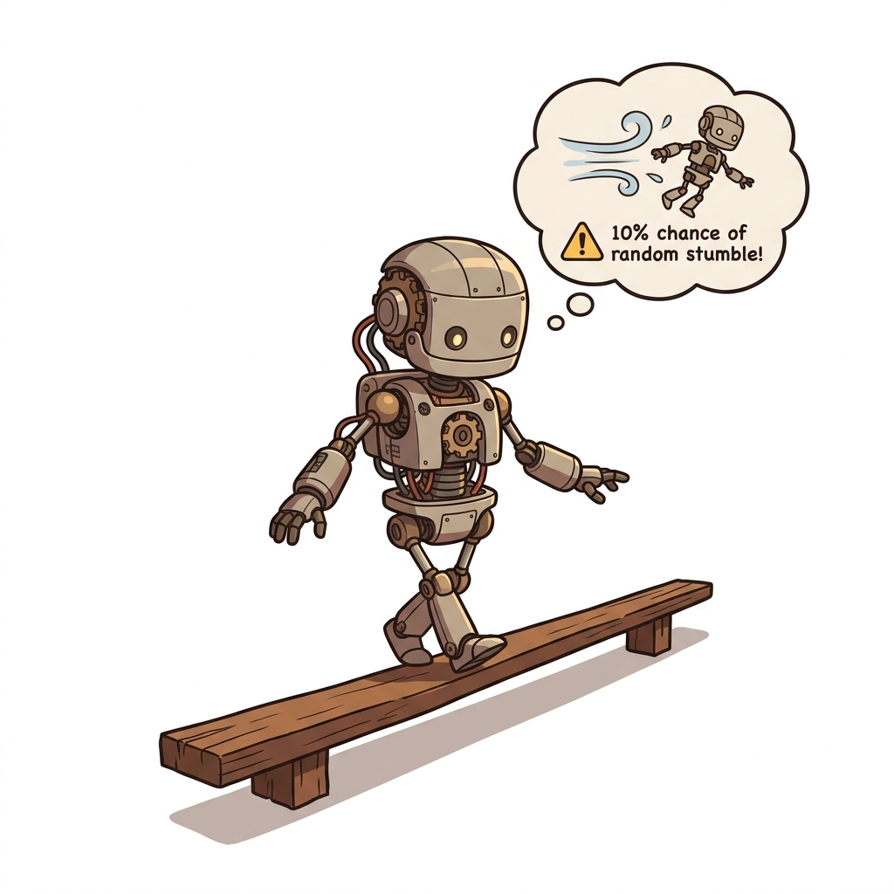
**그림 10-2-43** 좁은 평균대 위에서 "10% 확률로 발을 헛디딜 수 있다"는 사실을 인정하고 스스로 조심스럽게 균형을 잡는 틴맨 로봇

> "폭탄 바로 윗길은 목표와 가깝지만, 10번 중 1번이라도 아래쪽 키를 잘못 누르면 즉시 폭탄을 밟고 게임 오버가 됩니다. 이 -1.0의 엄청난 페널티가 Q 값에 누적되면서 그 길의 평가 점수가 폭락하게 됩니다."

---

# 이유 4: 위험 지역으로부터의 자발적 격리
## 치명적 감점을 피하기 위해 아예 실수해도 안전한 천장 벽면 경로를 선택

4. 폭탄 바로 옆 길을 걷다가 10%의 실수로 폭탄 칸에 빠지면 -1.0이라는 치명적인 감점을 받게 되므로, SARSA 에이전트는 아예 폭탄 근처에는 얼씬도 하지 않는 안전한 우회로를 최고 가치로 평가하는 것입니다.

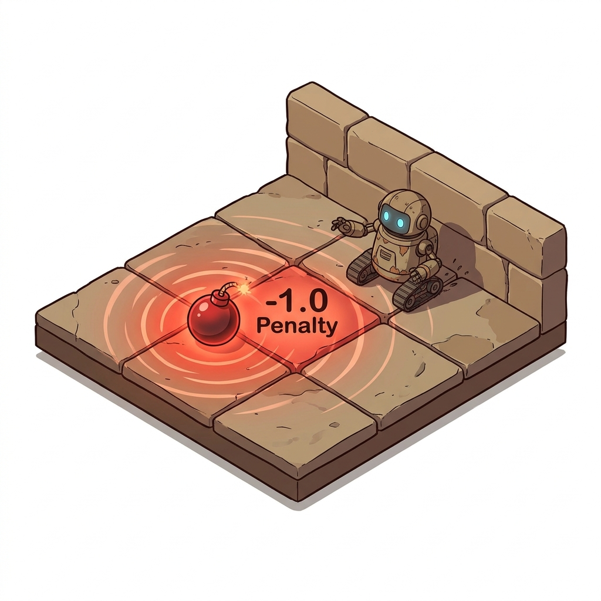
**그림 10-2-44** 폭탄(-1.0) 칸에서 뿜어져 나오는 강한 위험 척력 파동이 에이전트를 벽 쪽으로 밀어내어 안전 완충지대를 형성하는 원리

> "따라서 에이전트는 결론을 내립니다. '폭탄 근처는 너무 위험하다. 비록 몇 걸음 더 걷더라도, 실수로 미끄러져도 벽에 부딪히기만 할 뿐 죽지 않는 안전한 천장 길로 돌아가자!' 이것이 바로 안전제일주의의 본질입니다."

---

# 물리 로봇과 자율주행에서의 SARSA의 실전 가치
## 사소한 실수로도 수억 원의 기계 파손이나 인명 사고가 나는 현실 산업계의 필수 철학

이러한 특성 덕분에 SARSA는 실제 물리 로봇이나 자율주행차처럼 **"학습 과정이나 주행 도중 실수를 저지르면 심각한 파손이 발생하는 현실 시스템"**에서 대단히 안전하고 안정적인 제어기로 널리 사랑받고 있습니다.

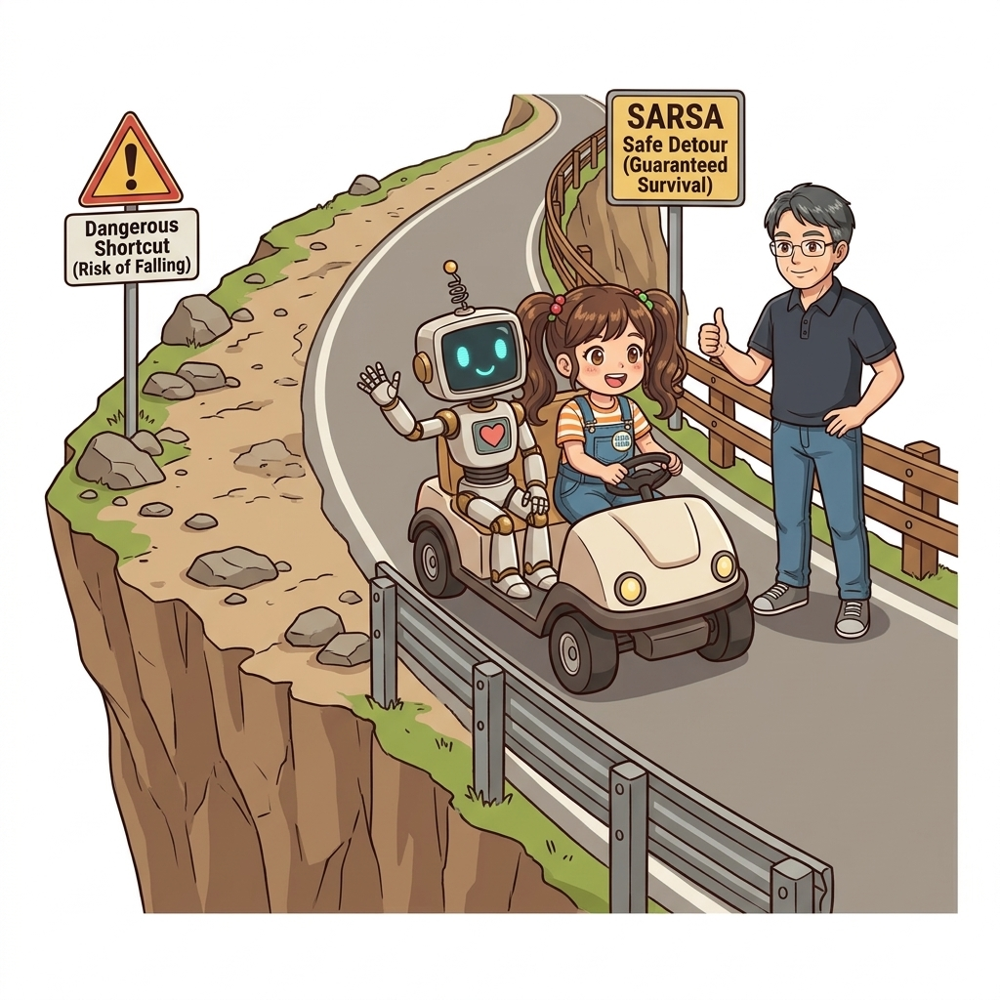
**그림 10-2-45** 절벽 도로 운전 비유: 바람이 불어 10% 확률로 미끄러질 수 있는 아찔한 지름길 절벽 대신, 튼튼한 가드레일이 쳐진 안전 우회로를 선택해 여유롭게 드라이브를 즐기는 SARSA의 지혜

> "이 안전제일주의 특성은 실제 산업 현장에서 대단히 강력한 무기가 됩니다. 자율주행차가 1cm 빠른 지름길을 가려다 가드레일을 긁는 것보다, 조금 돌아가더라도 100% 사고 없이 완주하는 것이 훨씬 중요하기 때문입니다."

---

# 10.2.4 핵심 정리: SARSA 3대 핵심 기둥
## 모델 프리 제어의 열쇠 Q 함수, 5단계 S-A-R-S-A 상호작용, 온-정책 안전제일주의

**10.2.4 핵심 정리: SARSA 3대 핵심 기둥**

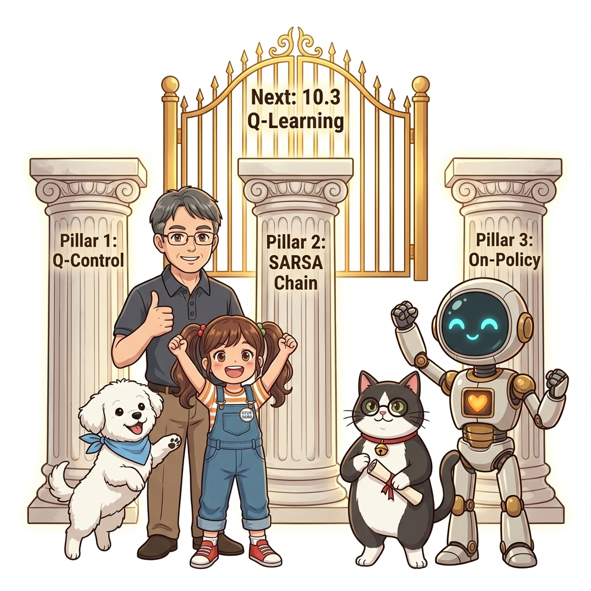
**그림 10-2-46** SARSA 3대 핵심 기둥 기념비와 다음 10.3 오프-정책 Q-러닝으로의 힘찬 출항 피날레

> "10.2절에서 배운 내용을 3대 핵심 기둥으로 요약해 봅시다. 환경 모델 없이 행동을 결정하는 Q 함수의 필요성, 5단계 튜플 데이터 체인의 물리적 흐름, 그리고 온-정책 특성이 빚어내는 보수적 안전 운전 철학입니다."

---

# SARSA 3대 핵심 기둥 상세 종합 비교표
## 수학적 정의, 물리적 메커니즘, 그리고 현실 세계 적용 가치의 일목요연한 대조

| SARSA 핵심 기둥 | 핵심 내용 요약 | 비유 및 물리적 의미 |
| :--- | :--- | :--- |
| **1. 모델 프리 제어의 열쇠: Q 함수** | 환경 모델(*p*, *r*) 없이도 `argmax Q(s, a)`만으로 즉시 최적 행동을 선택 | 갈림길마다 세워진 명확한 점수 표지판 |
| **2. 5단계 체인 갱신 (S-A-R-S-A)** | 한 걸음 전 가치 갱신을 위해 다음 행동 *A*<sub>*t*+1</sub>까지 결정하는 2-스텝 슬라이딩 윈도우 | 2칸 컨베이어 벨트와 종단 플러시 레버 |
| **3. 온-정책 안전제일주의 (Conservative)** | 자신의 10% 탐색 실수를 가치에 솔직히 반영하여 위험 구역을 스스로 멀리 우회 | 절벽 옆 지름길 대신 가드레일 우회로 선택 |

> "정리된 표를 보시면, Q 함수는 전이 확률의 안개를 걷어내고, S-A-R-S-A 체인은 2칸 버퍼로 실시간 가치를 갱신하며, 입실론 탐욕 온-정책은 안전한 실세계 제어의 견고한 디딤돌이 됨을 알 수 있습니다."

---

# 이호진 교수님의 SARSA 마무리 직강 피날레
## 자신의 불완전함을 인정하고 안전한 최적을 찾아가는 온-정책의 겸손한 지혜

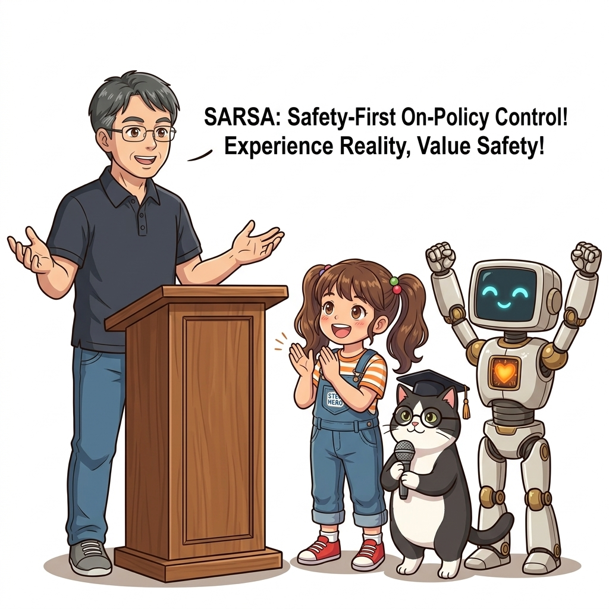
**그림 10-2-47** 대강당 강단에서 SARSA의 안전제일 철학을 열정적으로 전수하시는 이호진 교수님과 기립박수로 화답하는 도로시 연구팀

> "강단에서 정리해 드리는 마지막 교훈입니다. SARSA는 완벽한 신의 시선이 아니라, 실수를 저지를 수 있는 자신의 현재 한계를 겸허히 받아들이고 그 안에서 가장 안전한 길을 개척하는 아름다운 지혜를 담고 있습니다."

---

# 이호진 교수님의 직강 노트
## 제어(Control)의 시대를 연 역사적 알고리즘 SARSA와 실전 엔지니어링 통찰

> 👨‍🏫 **이호진 교수님의 직강 노트**:  
> "강화학습에서 제어(Control)의 문을 연 역사적 알고리즘이 바로 SARSA입니다. 자신의 실수 가능성(*ε*)까지 가치 함수에 솔직하게 녹여내는 SARSA의 '겸손하고 안전한 태도'는 현실 세계의 피지컬 AI를 설계할 때 무엇보다 중요한 덕목입니다. 실패했을 때 기계가 망가지거나 사고가 나면 안 되니까요!"

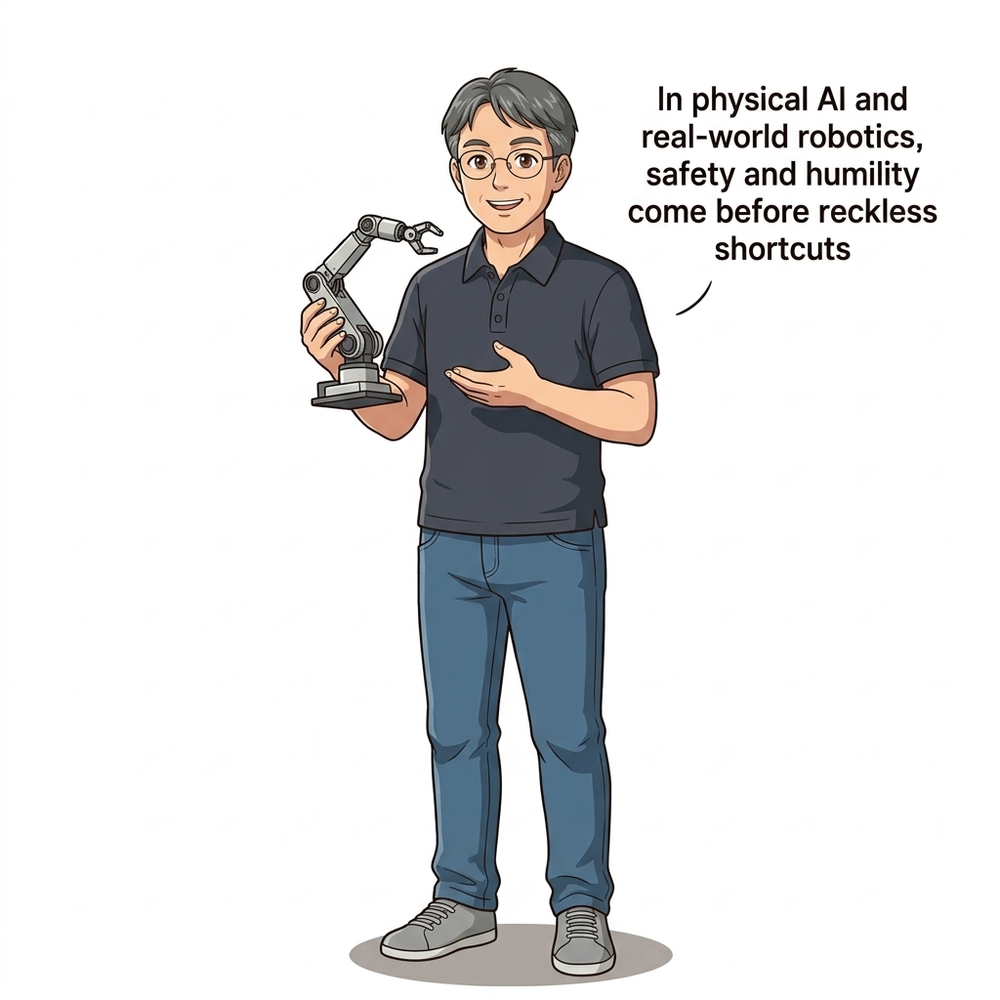
**그림 10-2-48** 소형 로봇 팔을 들고 피지컬 AI 로봇 제어에서 안전과 겸손이 갖는 결정적 가치를 강의하시는 이호진 교수님

> "교수 직강 노트를 마음에 새겨 주시기 바랍니다. 강화학습이 단순한 수학적 계산을 넘어 실제 로봇을 움직이고 자율주행을 가능케 한 출발점이 바로 SARSA입니다. 여러분도 이 제어의 원리를 확실히 체화하시길 바랍니다."

---

# 조교 지니의 응원 노트와 다음 장 예고
## S-A-R-S-A 5글자의 리듬을 타고 다음 시간 오프-정책 Q-러닝(Q-Learning)으로 도약!

> 🐱 **조교 지니의 응원 노트**:  
> "도로시와 여러분, 다섯 글자 S-A-R-S-A의 리듬을 타셨나요? 버퍼에 2개의 데이터가 들어올 때까지 기다렸다가 즉시 갱신하는 2칸 슬라이딩 윈도우의 묘미를 꼭 기억해 주세요!  
> 그렇다면 질문! 만약 위험 따위 두려워하지 않고, '실수할 확률'을 과감히 무시한 채 오직 이론상 최고의 지름길만을 돌파하는 상남자 알고리즘이 있다면 어떨까요? 다음 10.3절에서 오프-정책의 절대강자 **Q-러닝(Q-Learning)**이 바로 그 해답을 들고 찾아옵니다냥!"


**그림 10-2-49** 'Next Chapter: 10.3 Q-Learning!' 황금 깃발을 펼쳐 들며 오프-정책 최강자로의 출격을 예고하는 지니와 환호하는 도로시 탐험대

> "조교 지니의 응원처럼, 5단계 데이터의 리듬과 2칸 슬라이딩 윈도우의 테크닉을 완벽히 이해하셨다면 온-정책 제어의 정상을 정복하신 것입니다. 다음 10.3절에서는 드디어 전설적인 Q-러닝을 만나보겠습니다."
