# 10.3 오프-정책 SARSA: 중요도 샘플링 기반 제어

탐험 전용 정책(행동 정책)과 최적화 대상 정책(대상 정책)을 분리하여 학습하는 **오프-정책(Off-policy) SARSA** 알고리즘을 공부합니다.


**그림 10-3-1** 오프-정책 시간차 제어(Off-Policy TD Control)의 핵심 구조와 중요도 샘플링 기반 SARSA 알고리즘 전체 조감도

---

온-정책의 안전제일주의 한계를 극복하기 위해, 실제로 탐험을 수행하는 '행동 정책'과 최적의 길을 추구하는 '대상 정책'을 **분리하여 학습하는 오프-정책**의 설계 철학을 명쾌하게 파헤쳐 봅시다!

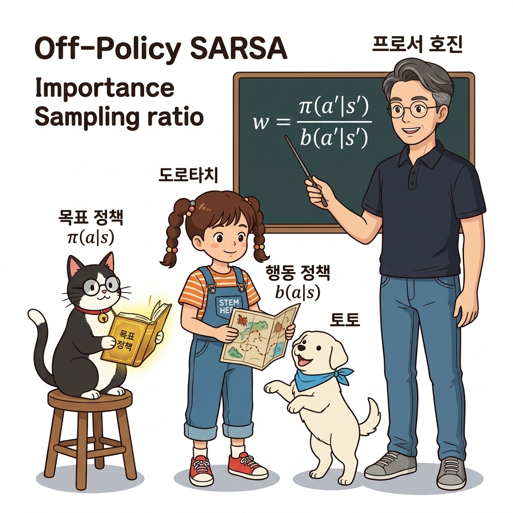
**그림 10-3-2** 탐험 지도(행동 정책 *b*)와 학습 목표 책(대상 정책 *π*)의 확률 비율 *ρ*를 대수적으로 유도해 칠판에 정리해 주는 지니와 도로시

---

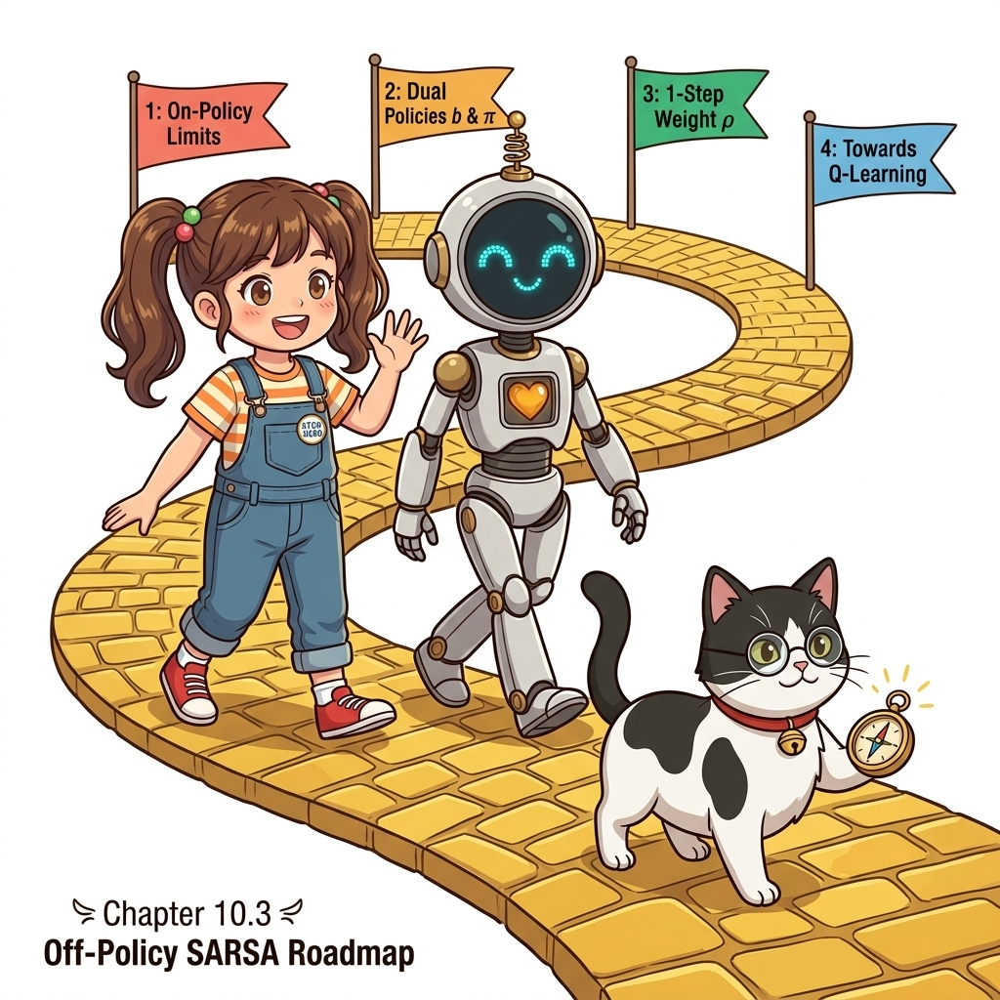
**그림 10-3-3** 10.3절 오프-정책 SARSA의 핵심 이론과 한계를 정복해 나가는 4대 마일스톤 학습 로드맵

- **학습 목표**:
  - 온-정책 SARSA의 소극적 안전제일주의 한계를 극복하기 위해 행동 정책(*b*)과 대상 정책(*π*)을 분리해야 하는 필연성 이해
  - 행동 정책과 대상 정책의 확률 분포 불일치(Distribution Mismatch)를 보정하는 1-스텝 중요도 샘플링 가중치 *ρ*(로) 유도
  - MC법의 누적 곱(분산 폭발) 대비 TD법의 단 1-스텝 가중치 곱이 갖는 압도적 분산 안정화 효과 분석
  - 100% 완전 탐욕 대상 정책(`self.pi`)과 *ε*-탐욕 행동 정책(`self.b`)을 동시에 운용하는 `SarsaOffPolicyAgent` 파이썬 구현
  - 비탐욕적 탐색 시 *ρ* = 0 이 되어 소중한 즉각 보상마저 증발해 버리는 오프-정책 SARSA의 치명적 결함 규명
  - 중요도 비율 *ρ* 없이도 완벽한 오프-정책 제어를 달성하는 차세대 알고리즘인 **10.4 Q-러닝(Q-Learning)**으로의 필연적 도약 과정 파악

---

## 10.3.1 오프-정책 시간차 제어의 수학적 원리

10.2절에서 배운 온-정책(On-policy) SARSA에서는 **하나의 정책으로 행동 선택과 가치 학습을 동시에 처리**했습니다.


**그림 10-3-4** 하나의 나침반 바늘에 '탐험(Exploration)'과 '최적화(Optimal)'라는 상반된 두 목표가 동시에 걸려 있어 진퇴양난에 빠진 틴맨 로봇과 지니

---

이로 인해 최적의 길을 찾아가는 과정에서도 강제로 $\varepsilon$(10%)의 무작위 탐색을 감수해야 했고, 그 결과 에이전트는 폭탄을 지나치게 두려워하며 벽 쪽으로 멀리 돌아가는 소극적인 안전 정책을 학습했습니다.

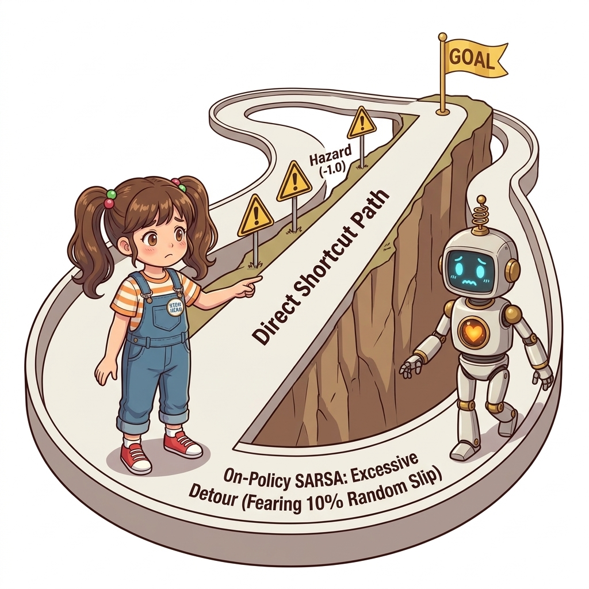
**그림 10-3-5** 온-정책 SARSA의 한계: 자신의 10% 실수를 두려워해 위험 구역 밖으로 하염없이 우회하는 틴맨 로봇과, 똑바로만 걷는다면 훨씬 안전하고 빠른 최단 지름길을 가리키는 도로시

---

이 타협을 깨고 **"환경을 자유롭고 대담하게 탐험하면서도, 궁극적으로 완성할 대상 정책은 어떠한 헛발질도 없는 완벽한 100% 최적 탐욕 정책으로 학습할 수 없을까?"**라는 질문에서 출발하는 것이 바로 **오프-정책(Off-policy)**입니다.


**그림 10-3-6** "자유롭게 미지의 숲을 탐험하면서도 완벽한 100% 최적 황금 지도를 완성할 수 있을까?" 새로운 오프-정책 탐험 지도를 펼쳐 든 도로시와 틴맨

---

오프-정책에서는 하나의 에이전트 안에 완벽히 분리된 **두 개의 나침반(정책)**을 운용합니다:

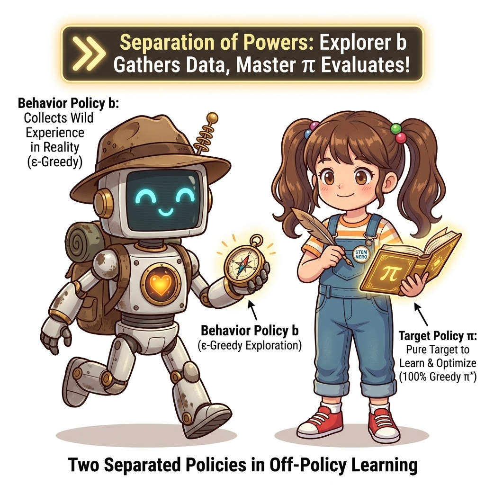
**그림 10-3-7** 오프-정책의 두 나침반 역할 분담: 진흙탕 속을 거침없이 누비며 경험을 모으는 거친 탐험가 틴맨(행동 정책 *b*)과, 수집된 데이터를 바탕으로 완벽한 황금 최적 지도를 그려나가는 학자 도로시(대상 정책 *π*)

---

### 두 정책의 명확한 역할 분담

1. **행동 정책(Behavior Policy, $b$)**: 
   - 실제로 환경과 몸으로 부딪치며 다양한 경험 데이터를 수집하는 탐험 전용 정책입니다.
   - 새로운 경로를 적극적으로 개척하기 위해 $\varepsilon$-탐욕 정책($\varepsilon = 0.1$)을 사용하여 미지의 영역을 대담하게 탐색합니다.


**그림 10-3-8** 거친 필드에서 $\varepsilon$-탐욕 정책 나침반을 들고 온갖 경험 데이터 $(S, A, R)$을 활발히 수집하는 필드 스카우트 틴맨

---

2. **대상 정책(Target Policy, $\pi$)**: 
   - 우리가 궁극적으로 완성하고자 하는 이상적인 최종 최적 정책입니다.
   - 어떠한 실수나 헛발질도 용납하지 않는 100% 순수 탐욕적(Greedy, $\varepsilon = 0$) 최적 가치만을 추구합니다.


**그림 10-3-9** 돋보기와 정밀 자를 들고 오직 100% 순수 탐욕 최적 경로만을 정교하게 설계하는 지혜로운 학자 도로시

---

### 1) 백업 다이어그램과 샘플링 정책의 차이

기존 온-정책 SARSA의 갱신식을 다시 상기해 봅시다:

> ### **$Q_{\pi}(S_t, A_t) \leftarrow Q_{\pi}(S_t, A_t) + \alpha \cdot [R_t + \gamma Q_{\pi}(S_{t+1}, A_{t+1}) - Q_{\pi}(S_t, A_t)]$** &nbsp;&nbsp;&nbsp;&nbsp; *(식 10.13: 온-정책 SARSA 갱신식)*

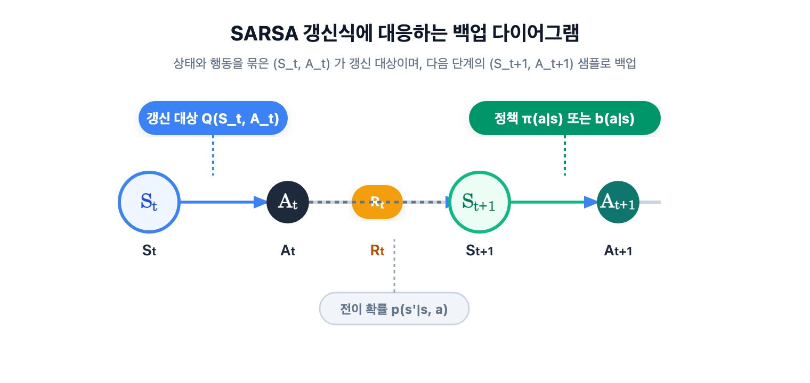
**그림 10-3-10** SARSA의 백업 다이어그램. 현재 상태-행동 쌍 $(S_t, A_t)$에서 보상 $R_t$와 다음 상태 $S_{t+1}$을 얻은 뒤, 다음 행동 $A_{t+1}$을 정책으로부터 샘플링하는 구조

---

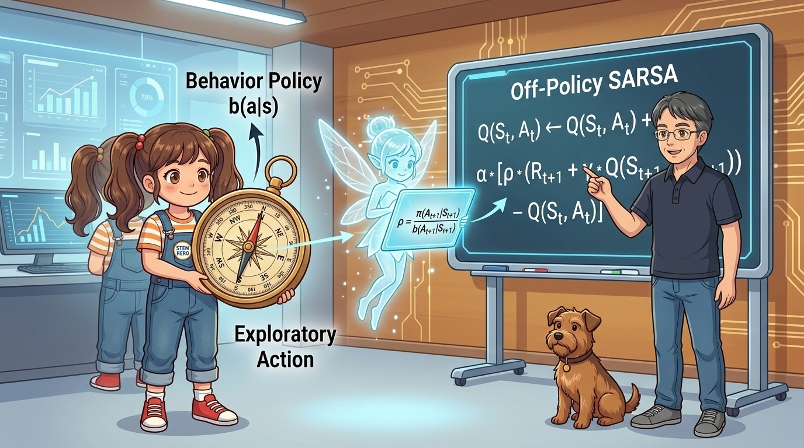
**그림 10-3-11** 도로시가 행동 정책 $b(a|s)$의 나침반을 들고 모험을 떠나는 동안, 지니가 1-스텝 중요도 가중치 $\rho$를 계산하여 이호진 교수님의 목표 정책 $\pi$ 갱신식에 보정해 주는 오프-정책 SARSA 협업 메커니즘

---

[그림 10-3-10]과 [그림 10-3-11]에서 주목할 핵심 지점은 다음 상태 $S_{t+1}$에서 선택되는 다음 행동 **$A_{t+1}$**입니다:

- **대상 정책 관점 ($A_{t+1} \sim \pi$)**: 만약 $A_{t+1}$이 대상 정책 $\pi$로부터 선택된다면, TD 목표치 $[R_t + \gamma Q_{\pi}(S_{t+1}, A_{t+1})]$은 정책 $\pi$를 따를 때의 참된 기댓값을 편향 없이 대변합니다.

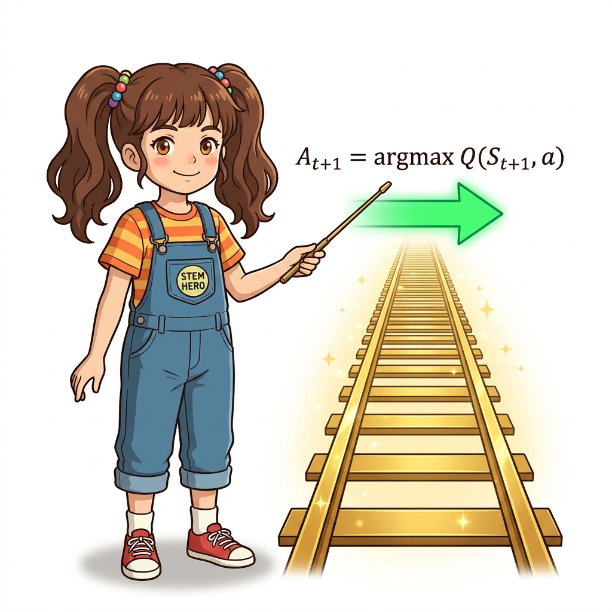
**그림 10-3-12** 대상 정책 $\pi$ 관점에서의 이상적인 선택: 한 치의 오차도 없는 황금 레일 위를 달리는 최적 행동 $A_{t+1}$

---

- **행동 정책 관점 ($A_{t+1} \sim b$)**: 하지만 오프-정책에서는 에이전트가 현실 환경에서 실제로 움직이는 정책이 **행동 정책 $b$**이므로, 실제로 관측되는 다음 행동은 반드시 **$A_{t+1} \sim b$**로부터 샘플링됩니다!

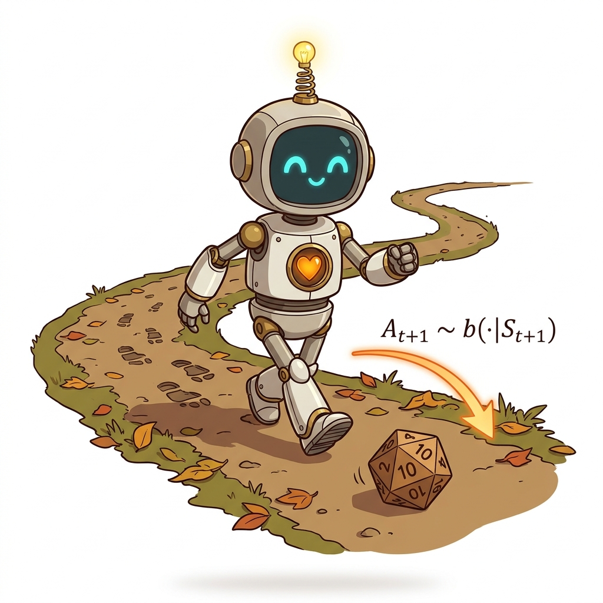
**그림 10-3-13** 현실 필드에서 바람과 10% 탐색 주사위에 의해 실제로 발을 디딘 행동 정책 $b$의 발자국

---

서로 다른 확률 분포($b$)에서 뽑아낸 행동을 가지고 우리가 원하는 목표 분포($\pi$)의 가치를 그대로 갱신해 버리면 심각한 수학적 왜곡(편향)이 발생합니다.

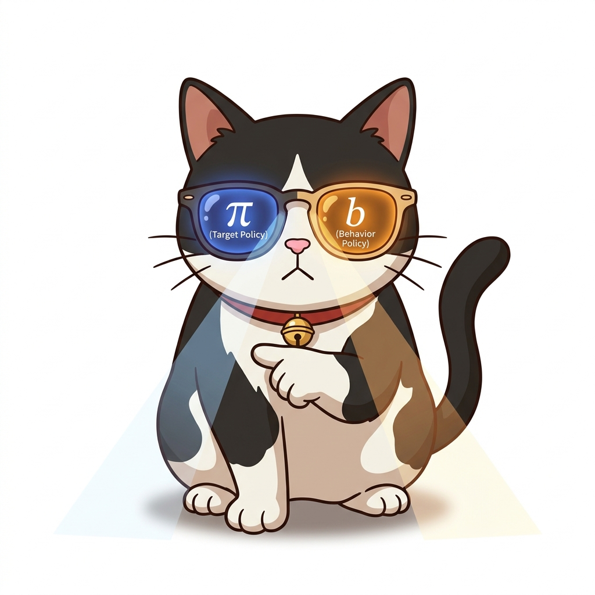
**그림 10-3-14** 서로 다른 두 렌즈: 대상 정책(파란 렌즈)과 행동 정책(주황 렌즈)의 굴절률 차이로 인해 발생하는 가치 추정의 수학적 왜곡을 경고하는 지니 조교

---

이 확률 분포의 차이(Distribution Mismatch)를 수학적으로 완벽히 보정해 주는 다리가 바로 **중요도 샘플링(Importance Sampling)**입니다.

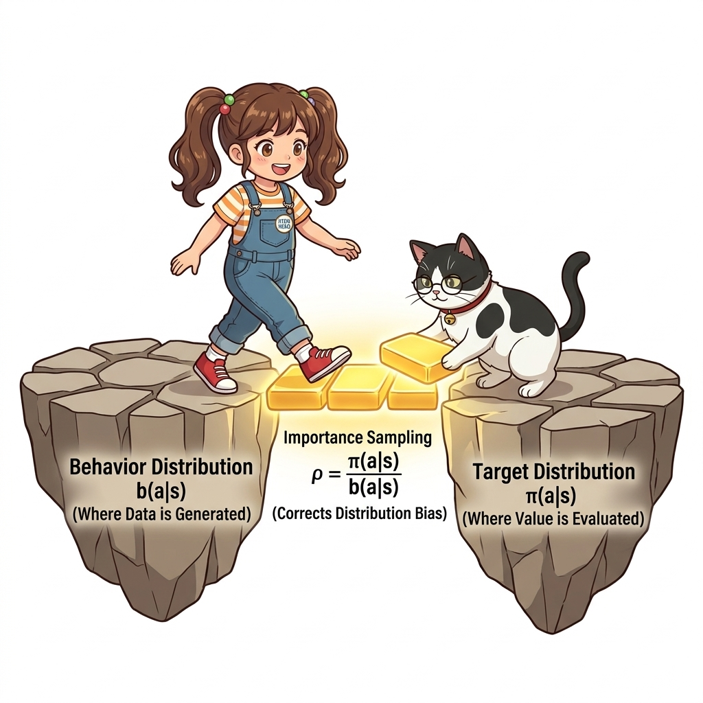
**그림 10-3-15** 행동 분포 *b*의 섬에서 목표 분포 *π*의 섬으로 건너가기 위해, 지니 조교가 두 세계의 확률 비율을 계산한 중요도 비율 징검다리 돌판(*ρ* = *π*/*b*)을 놓아주는 비유

---

### 2) 1-스텝 중요도 샘플링 가중치 $\rho$

9.5절에서 배운 중요도 샘플링의 원리를 1-스텝 시간차 학습에 적용하여 가중치 $\rho$(로)를 정의합니다:

> ### **$\rho = \frac{\pi(A_{t+1} \mid S_{t+1})}{b(A_{t+1} \mid S_{t+1})}$** &nbsp;&nbsp;&nbsp;&nbsp; *(식 10.14: 1-스텝 중요도 가중치)*

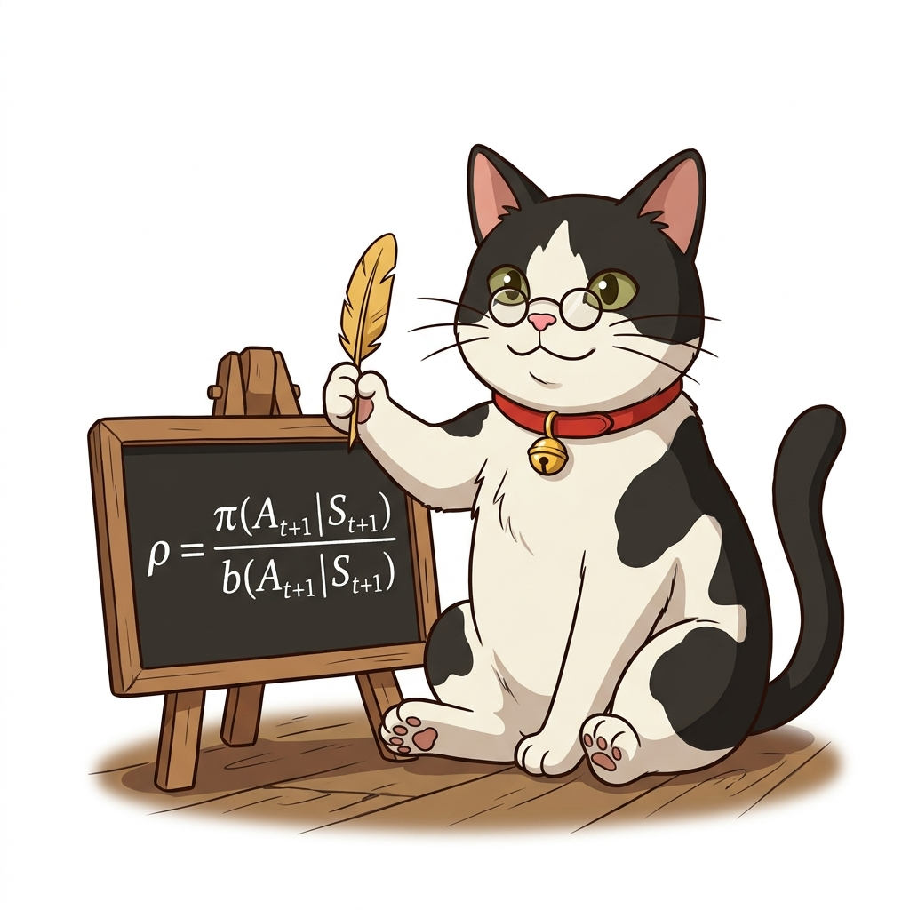
**그림 10-3-16** 두 정책의 확률 비율 $\rho = \pi / b$ 수식 펜던트를 걸고 중요도 가중치의 수학적 정의를 해설하는 조교 지니

---

이 가중치 $\rho$는 **"행동 정책 $b$가 다음 행동 $A_{t+1}$을 선택할 확률 대비, 우리가 목표로 하는 대상 정책 $\pi$가 그 행동을 선택했을 확률의 비율"**을 의미합니다.

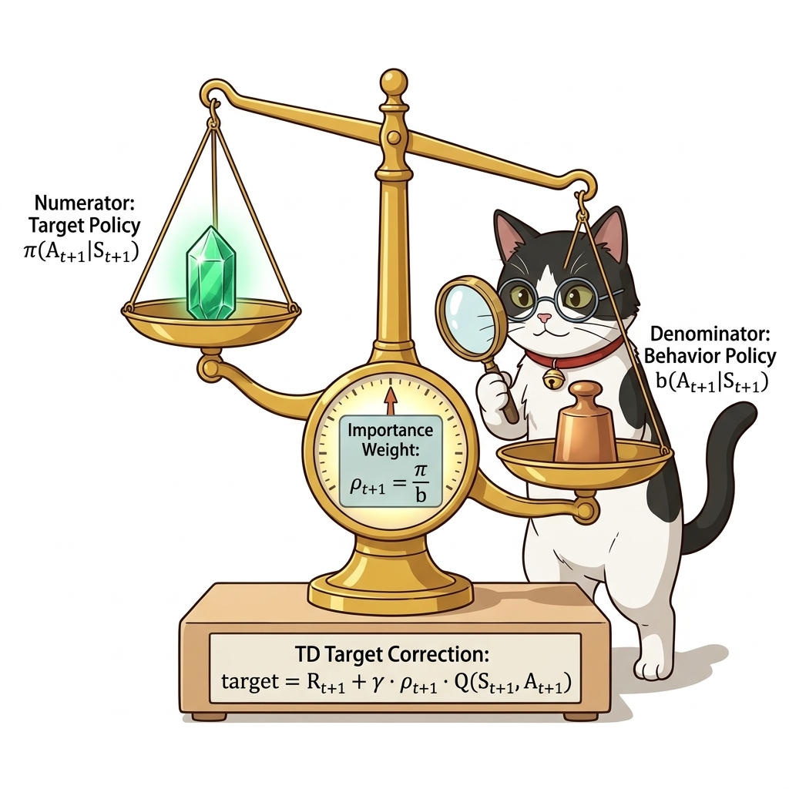
**그림 10-3-17** 대상 정책의 확률 *π*와 행동 정책의 확률 *b*의 비율을 정밀하게 측정하여 TD 목표의 왜곡을 1-스텝 만에 바로잡는 황금 저울 비유

---

이 가중치 $\rho$를 TD 목표에 곱해주면 다음과 같은 **오프-정책 SARSA 갱신 점화식**이 마침내 도출됩니다:

> ### **$Q_{\pi}(S_t, A_t) \leftarrow Q_{\pi}(S_t, A_t) + \alpha \cdot \left[ \rho \cdot (R_t + \gamma Q_{\pi}(S_{t+1}, A_{t+1})) - Q_{\pi}(S_t, A_t) \right]$** &nbsp;&nbsp;&nbsp;&nbsp; *(식 10.15: 오프-정책 SARSA 갱신식)*


**그림 10-3-18** 이호진 교수님이 대형 녹색 칠판에서 황금빛 분필로 식 (10.15) 오프-정책 SARSA 점화식을 명쾌하게 증명·풀이하시는 열정적인 직강 모습

---

행동 정책 $b$가 수집한 한 걸음의 결과($R_t, S_{t+1}, A_{t+1}$)에 비율 $\rho$를 곱해줌으로써, 대상 정책 $\pi$가 실제로 겪었을 때의 참된 기댓값으로 정확하게 환산하여 가치를 갱신합니다.

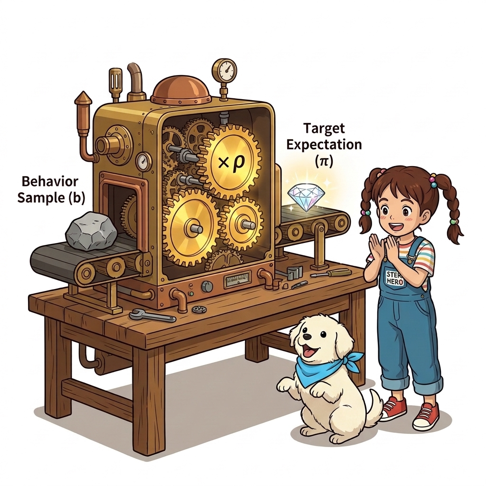
**그림 10-3-19** 행동 정책이 모아온 거친 샘플 원석을 $\rho$ 배율 기어로 연마하여 대상 정책의 참된 기댓값 보석으로 변환하는 정밀 기계 장치

---

### 3) MC 중요도 샘플링 vs TD 중요도 샘플링의 결정적 차이

여기서 시간차(TD) 학습의 위대한 강점이 다시 한번 극명하게 드러납니다:

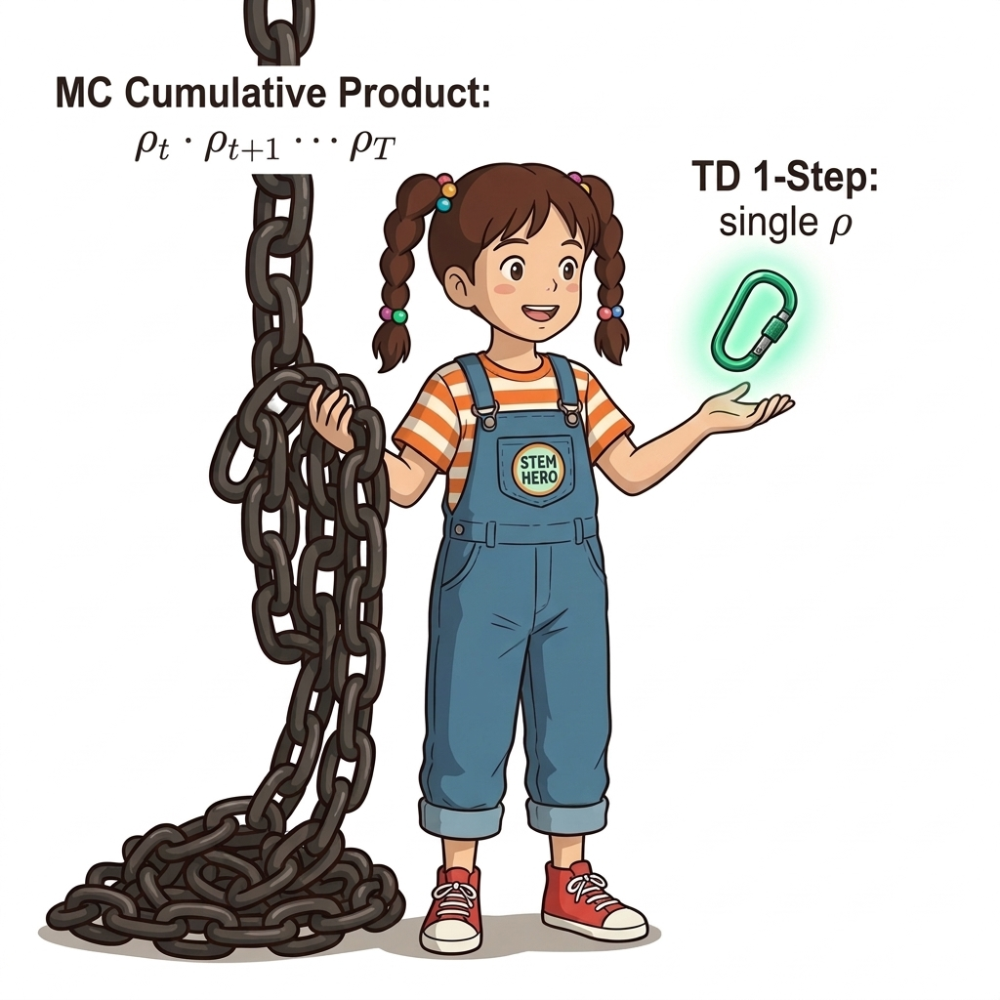
**그림 10-3-20** 수백 개가 얽힌 무거운 쇠사슬(MC의 누적 곱)과 가볍고 단단한 단 1개의 카라비너 링(TD의 1-스텝 $\rho$)을 비교하며 분산 안정성의 차이를 짚는 도로시와 지니

---

- **몬테카를로(MC)법의 중요도 가중치**:
  에피소드가 끝날 때까지 발생한 수십~수백 번의 모든 행동에 대한 비율을 **모조리 곱한 누적 곱**이었습니다:
  > **$\rho_{t:T} = \rho_t \cdot \rho_{t+1} \cdot \rho_{t+2} \cdots \rho_{T-1}$**
  
  작은 오차와 확률 비율들이 수백 번 곱해지면서 가중치가 0으로 소멸하거나 수천만으로 치솟는 **극심한 분산 폭발(Variance Explosion)**이 발생하여 실전 사용이 불가능에 가까웠습니다.


**그림 10-3-21** 곱해질수록 걷잡을 수 없이 부풀어 오르다 마침내 펑 터져버리는 MC 누적 곱의 분산 폭발과 당황한 틴맨 로봇

---

- **시간차(TD)법의 중요도 가중치**:
  단 1걸음 이동한 뒤 곧바로 다음 가치를 빌려와 부트스트랩하므로, **오직 1단계의 확률 비율 $\rho = \pi(A_{t+1} \mid S_{t+1}) / b(A_{t+1} \mid S_{t+1})$ 단 하나만 곱해집니다!**
  따라서 MC법에 비해 분산이 상상할 수 없을 만큼 극적으로 안정화됩니다.


**그림 10-3-22** 단 1개의 에메랄드 고리만을 곱해 잔잔한 호수처럼 안정적으로 유지되는 TD 1-스텝 가치 저수조와 평온한 도로시와 토토

---

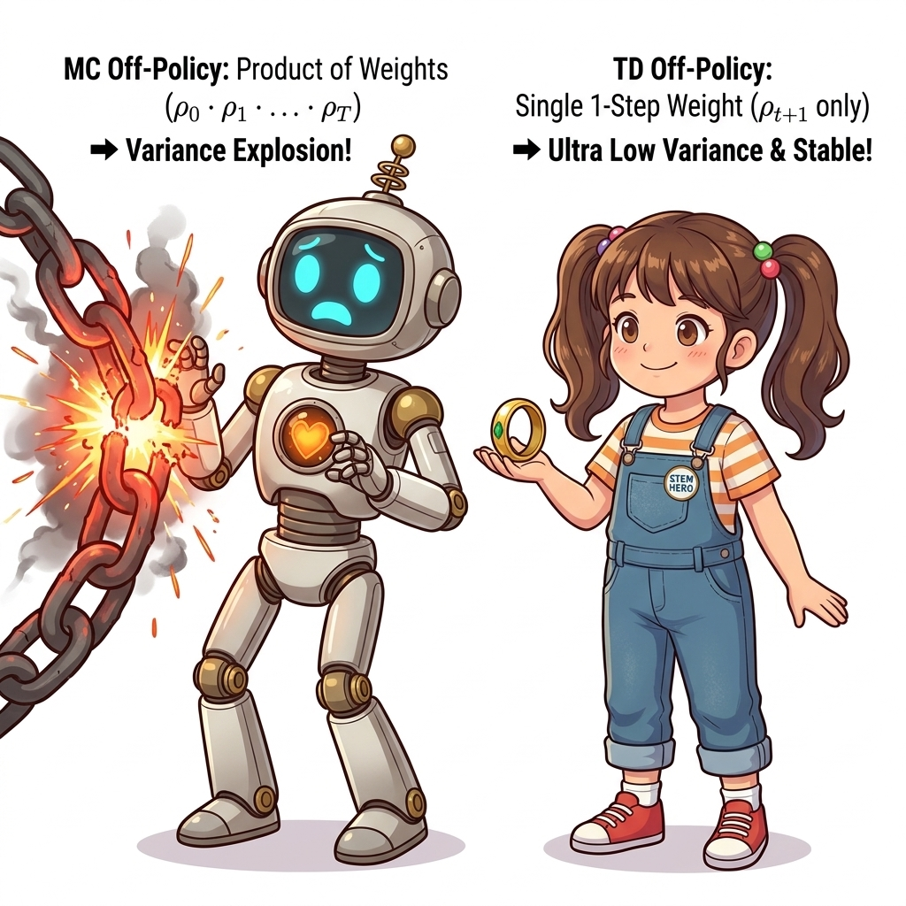
**그림 10-3-23** 수백 개의 쇠사슬 고리가 얽혀 시뻘겋게 과열 폭발하는 MC의 누적 곱(왼쪽) vs 가볍고 단단한 단 1개의 에메랄드 고리로 분산을 차분히 안정화시키는 TD의 1-스텝 가중치(오른쪽)의 시각적 대조

---

## 10.3.2 오프-정책 SARSA 에이전트 구현

이제 파이썬으로 오프-정책 SARSA 에이전트 클래스를 구현해 봅시다.

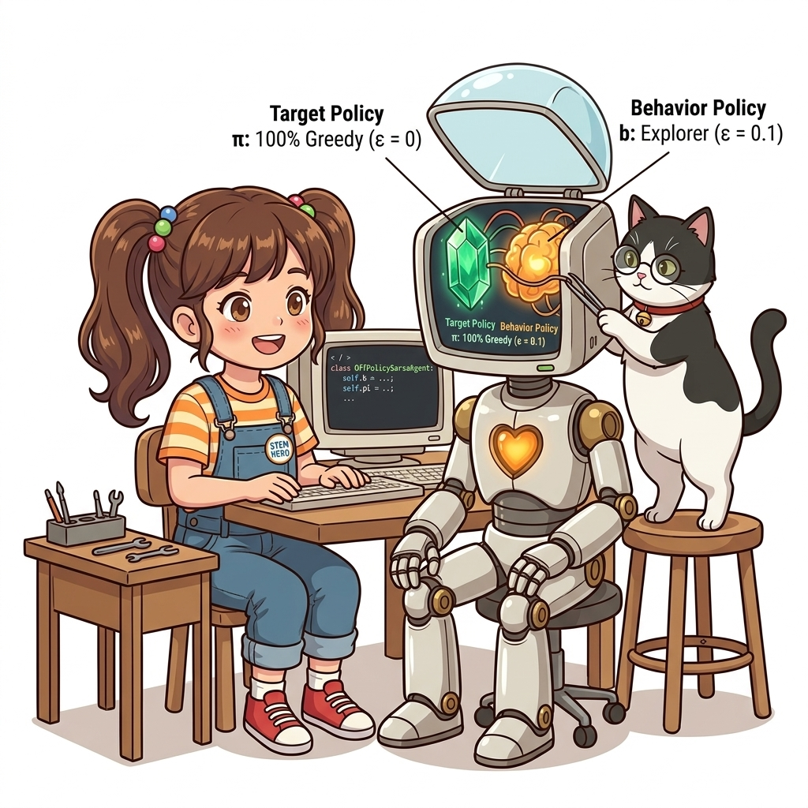
**그림 10-3-24** 틴맨 로봇의 머릿속에 공존하는 두 개의 코어: 최적 가치를 보존하는 `self.pi`(사파이어 블루, 100% 탐욕)와 필드를 자유롭게 뛰어다니는 `self.b`(앰버 골드, 탐험)의 듀얼 코어 구조

---

#### SarsaOffPolicyAgent 클래스 구조


**그림 10-3-25** `self.pi`, `self.b`, `self.Q`, `deque(maxlen=2)` 4대 핵심 모듈이 레고 블록처럼 결합된 `SarsaOffPolicyAgent` 시스템 설계도

---

<div align="right"><b>ch06/sarsa_off_policy.py</b></div>

```python
from collections import defaultdict, deque
import numpy as np
from common.utils import greedy_probs

class SarsaOffPolicyAgent:
    def __init__(self):
        self.gamma = 0.9          # 할인율 γ
        self.alpha = 0.8          # 학습률 α
        self.epsilon = 0.1        # 행동 정책의 탐색 확률 ε
        self.action_size = 4      # 상, 하, 좌, 우 4가지 행동

        random_actions = {0: 0.25, 1: 0.25, 2: 0.25, 3: 0.25}
        self.pi = defaultdict(lambda: random_actions) # ❶ 목표 정책 π: 최적 탐욕 정책 (epsilon=0)
        self.b = defaultdict(lambda: random_actions)  # ❷ 행동 정책 b: 활발한 탐험 정책 (epsilon=0.1)
        self.Q = defaultdict(lambda: 0)
        self.memory = deque(maxlen=2)

    def get_action(self, state):
        # ❸ 실제 필드에서의 행동은 반드시 행동 정책 b로부터 샘플링!
        action_probs = self.b[state]
        actions = list(action_probs.keys())
        probs = list(action_probs.values())
        return np.random.choice(actions, p=probs)

    def reset(self):
        self.memory.clear()
```

---

이어서 에이전트의 `update()` 메서드를 구현합니다:

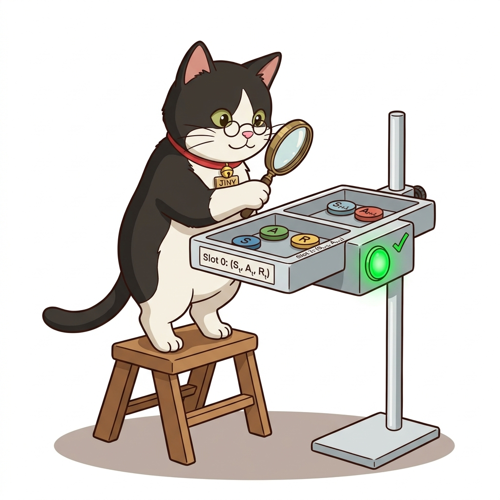
**그림 10-3-26** 2칸 슬라이딩 윈도우 버퍼에서 $(S_t, A_t, R_t)$와 $(S_{t+1}, A_{t+1})$가 온전히 갖추어졌는지 돋보기로 정밀 검사하는 지니 조교

---

```python
    def update(self, state, action, reward, done):
        self.memory.append((state, action, reward, done))
        if len(self.memory) < 2:
            return

        state, action, reward, done = self.memory[0]
        next_state, next_action, _, _ = self.memory[1]

        if done:
            next_q = 0
            rho = 1.0 # ❹ 종단 상태에서는 추가 행동이 없으므로 가중치 보정 불필요
        else:
            next_q = self.Q[next_state, next_action]
            # ❺ 1-스텝 중요도 가중치 rho 계산: pi(A_{t+1}|S_{t+1}) / b(A_{t+1}|S_{t+1})
            rho = self.pi[next_state][next_action] / self.b[next_state][next_action]

        # ❻ 식 (10.15)에 따라 rho를 가중한 TD 목표로 Q 갱신
        target = rho * (reward + self.gamma * next_q)
        self.Q[state, action] += (target - self.Q[state, action]) * self.alpha

        # ❼ 두 정책을 각각 서로 다른 기준으로 비대칭 개선!
        self.pi[state] = greedy_probs(self.Q, state, epsilon=0)      # π는 100% 완전 탐욕 정책
        self.b[state] = greedy_probs(self.Q, state, self.epsilon)   # b는 ε-탐욕 탐험 정책
```

---

### 코드 핵심 포인트: 비대칭 정책 개선 (Asymmetric Policy Improvement)

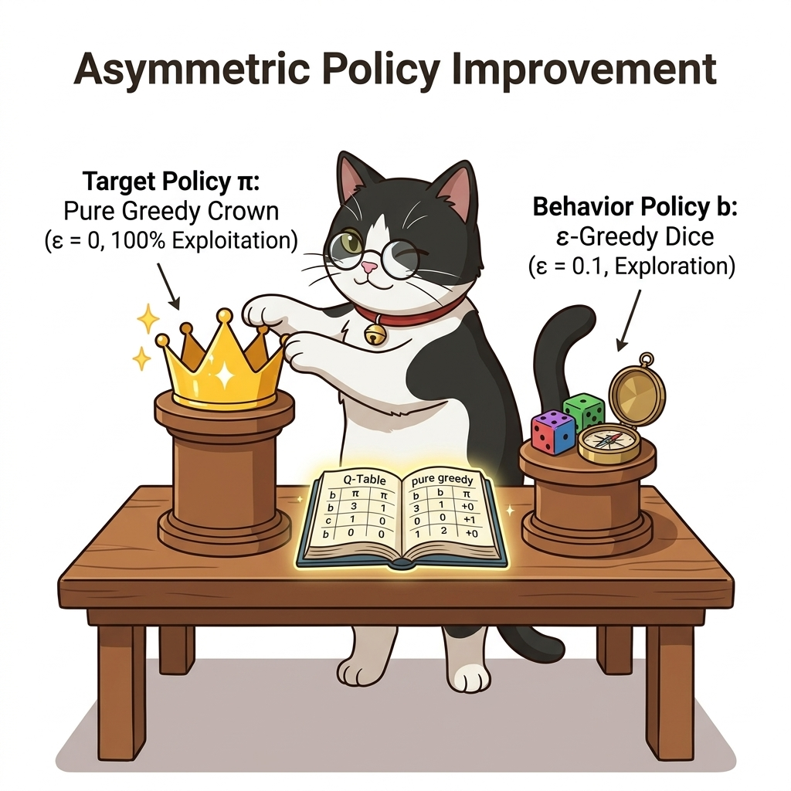
**그림 10-3-27** 하나의 Q테이블 저수조를 바탕으로, 대상 정책 *π*에는 100% 탐욕 황금 왕관(`epsilon=0`)을, 행동 정책 *b*에는 10% 탐색 주사위(`epsilon=0.1`)를 찍어 발행하는 비대칭 듀얼 정책 개선 메커니즘

---

- **❶, ❷ `self.pi`와 `self.b` 분리**:
  `self.pi`는 오직 최적의 행동만을 선택하는 순수 탐욕 정책(`epsilon=0`)으로 진화하며, `self.b`는 미지의 길을 탐색할 수 있도록 10%의 무작위성(`self.epsilon=0.1`)을 계속 유지합니다.

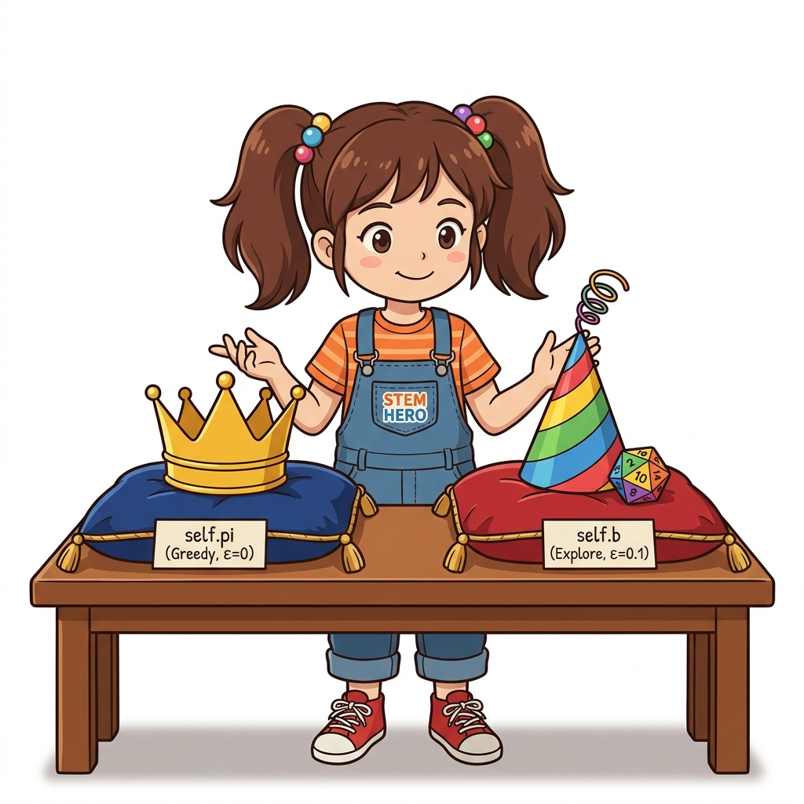
**그림 10-3-28** 100% 순금 탐욕 왕관(`self.pi`, $\varepsilon=0$)과 10% 탐색 안테나가 달린 모험 모자(`self.b`, $\varepsilon=0.1$)의 선명한 대비

---

- **❸ `get_action`**:
  에이전트가 현실 그리드 월드에서 발을 디딜 때는 오직 탐험 정책인 `self.b`에 따라 행동합니다.


**그림 10-3-29** 현실 무대에서는 오직 탐험용 주황 외투(`self.b`)를 입고 당당하게 주사위를 굴려 걸어 나가는 틴맨 로봇

---

- **❹ 종단 처리 `rho = 1.0`**:
  목표에 도달하여 에피소드가 끝났다면 다음 행동이 존재하지 않으므로 부트스트랩 보정이 필요 없어 가중치를 1.0으로 고정합니다.


**그림 10-3-30** 골인 깃발에 닿는 순간 '부트스트랩 중단, 가중치 $\rho = 1.0$ 고정' 황금 자물쇠가 딸깍 잠기며 유령 보정 계산을 방지하는 안전장치

---

- **❺ 1-스텝 가중치 `rho`**:
  다음 상태에서 에이전트가 실제로 취한 행동 $A_{t+1}$에 대해 두 정책의 확률 비율을 계산합니다: `rho = self.pi[next_state][next_action] / self.b[next_state][next_action]`.

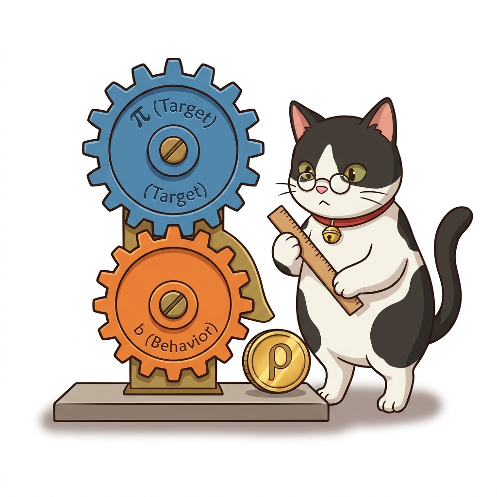
**그림 10-3-31** 대상 정책 $\pi$와 행동 정책 $b$의 톱니가 맞물려 정밀하게 비율 $\rho$ 코인을 찍어내는 나눗셈 기어 메커니즘

---

- **❻ `target = rho * (reward + self.gamma * next_q)`**:
  중요도 비율 $\rho$를 TD 목표에 곱하여 대상 정책 $\pi$ 관점에서의 올바른 기댓값으로 즉시 환산합니다.

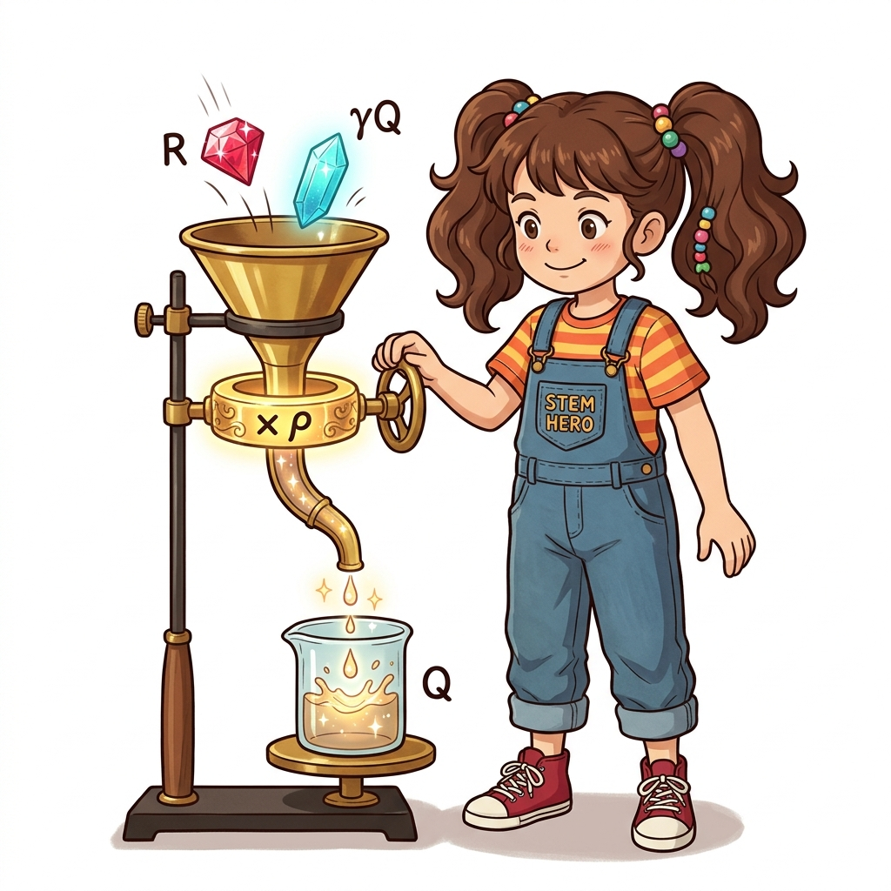
**그림 10-3-32** 즉각 보상 $R$과 할인된 미래 가치 $\gamma Q$가 $\rho$ 배율 링을 거쳐 메인 Q테이블 저수조로 신선하게 유입되는 모습

---

## 10.3.3 오프-정책 SARSA의 치명적 약점과 Q-러닝으로의 도약

오프-정책 SARSA 에이전트를 3×4 그리드 월드에서 1만 번 훈련시킨 후 얻은 결과를 확인해 봅시다.

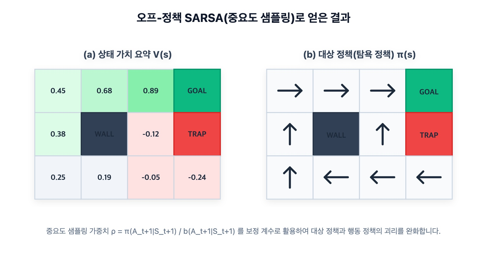
**그림 10-3-33** 오프-정책 SARSA로 얻은 그리드 월드 제어 결과. 온-정책 SARSA에 비해 화살표 방향이 다소 불안정하고 수렴 속도가 느린 양상을 보입니다.

---

### 왜 오프-정책 SARSA는 이론처럼 깔끔하게 수렴하지 못할까요?

[그림 10-3-33]을 보면 온-정책 SARSA에 비해 학습 결과가 다소 불안정하게 흔들립니다. 그 원인은 바로 **식 (10.15)의 중요도 가중치 $\rho$**가 가진 치명적인 두 가지 수학적 한계 때문입니다:

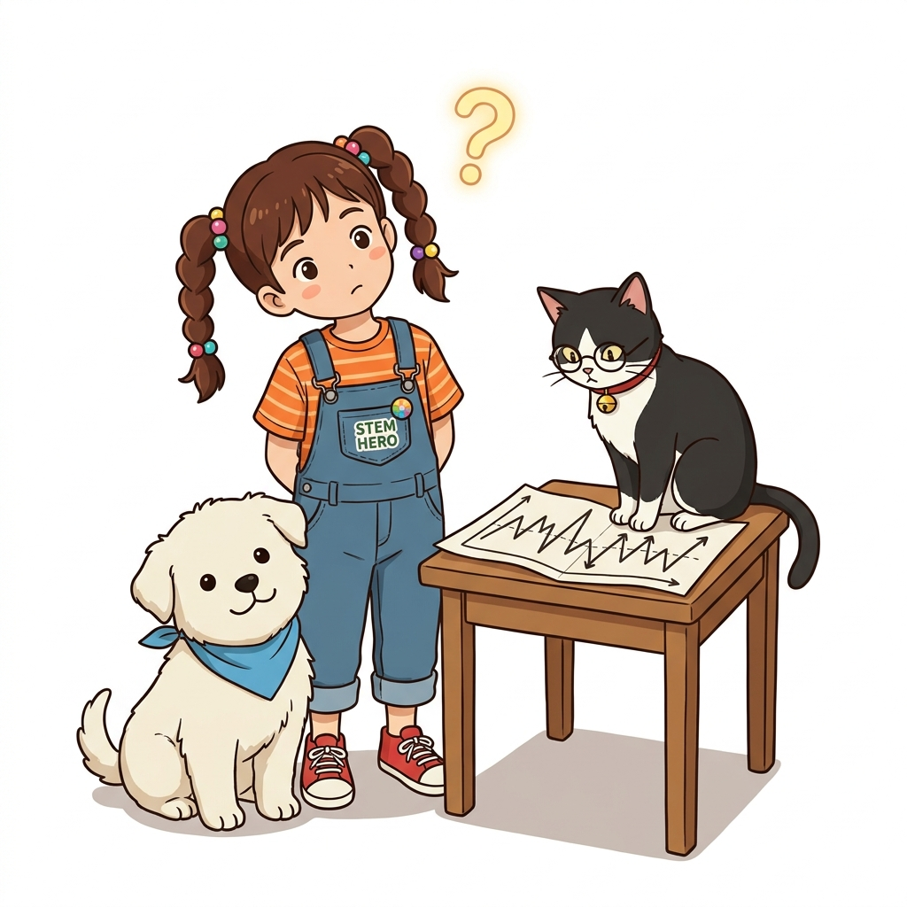
**그림 10-3-34** "이론적으로는 완벽해 보이는데, 왜 오프-정책 SARSA는 흔들릴까?" 의문에 찬 표정으로 실험 일지를 검토하는 도로시와 지니

---

#### 1. $\rho = 0$ 이 되는 비극: 소중한 보상 데이터의 허무한 증발

- **대상 정책 $\pi$의 엄격한 100% 탐욕성**:
  대상 정책 $\pi$는 100% 완전 탐욕 정책(`epsilon=0`)입니다. 따라서 가장 높은 Q값을 가진 단 하나의 최선 행동에만 확률 **1.0**을 부여하고, 나머지 3개 행동에는 확률 **0.0**을 줍니다.

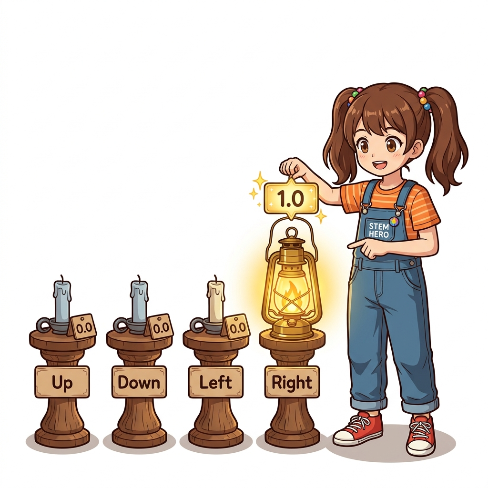
**그림 10-3-35** 오직 1등 행동에만 1.0의 불이 밝혀지고, 나머지 3개 행동에는 가차 없이 0.0의 불이 꺼져 있는 대상 정책 $\pi$의 극단적 원-핫(One-hot) 특성

---

- **행동 정책 $b$의 호기심(탐색 시도)**:
  반면 행동 정책 $b$는 탐험을 장려하기 위해 10%의 확률로 비탐욕적 행동(상, 하, 좌, 우 중 최선이 아닌 행동)을 시도합니다.

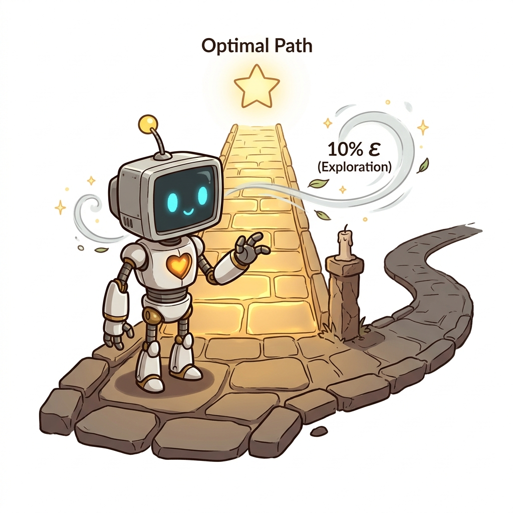
**그림 10-3-36** 10%의 호기심에 이끌려 촛불이 꺼진 미지의 옆길로 발을 뻗는 틴맨 로봇

---

- **분자가 0이 되는 순간**:
  이때 $b$가 탐험을 위해 비탐욕적 행동을 선택하는 순간, 대상 정책의 확률은 분자에서 **0**이 되어버립니다:
  > **$\pi(A_{t+1} \mid S_{t+1}) = 0 \implies \rho = \frac{0}{b} = 0$**

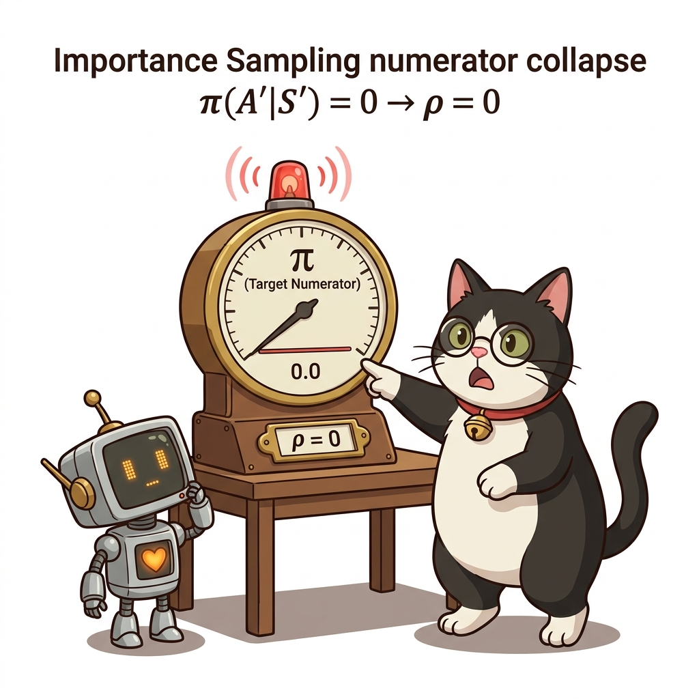
**그림 10-3-37** 탐험 행동이 선택되는 순간 대상 정책의 분자 계측기가 즉시 0.0으로 뚝 떨어지며 붉은 경고등이 깜빡이는 모습

---

- **TD 목표의 총체적 붕괴**:
  가중치 $\rho$가 0이 되면 어떤 일이 일어날까요? [식 10.15]의 TD 목표를 다시 봅시다:
  > **TD 목표 = $\rho \cdot [R_t + \gamma Q_{\pi}(S_{t+1}, A_{t+1})] = 0 \cdot [\cdots] = 0$**

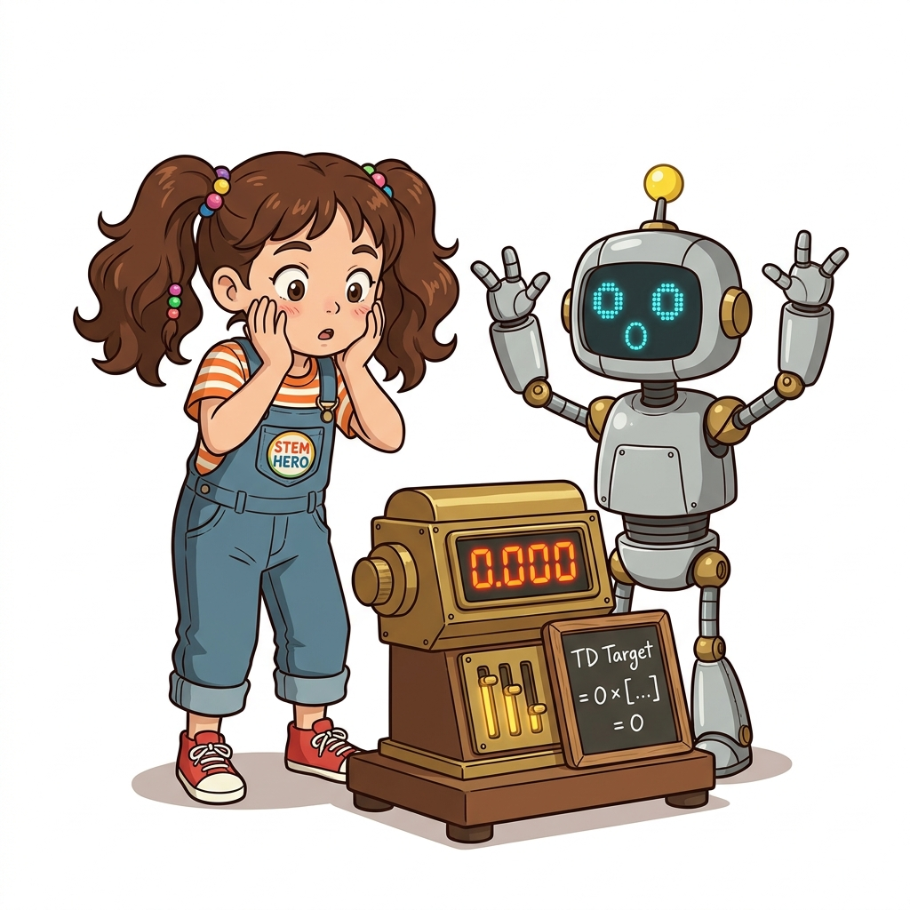
**그림 10-3-38** $\rho = 0$이 곱해지는 순간 계산대 위의 모든 목표 점수가 0.000으로 흔적도 없이 소멸해 버리는 비극

---

- **진짜 즉각 보상의 허무한 증발**:
  에이전트가 방금 온갖 고생 끝에 얻은 **진짜 즉각 보상 $R_t$마저 0으로 곱해져 허무하게 지워져 버립니다!** 그 결과 $Q$ 값은 엉뚱하게 0을 향해 곤두박질치는 치명적인 정보 유실이 발생합니다.


**그림 10-3-39** 피땀 흘려 획득한 황금 보상 별 $R_t$가 $0$의 마법에 걸려 한 줌의 연기처럼 허공으로 흩어져 버리는 슬픈 순간

---


**그림 10-3-40** *ρ* = 0의 비극: 틴맨이 탐색 행동을 취하자마자 *π* 확률이 0이 되어, 기껏 획득한 황금 보상 *R*<sub>*t*</sub>마저 0의 블랙홀 속으로 연기처럼 증발해 버리는 안타까운 순간

---

#### 2. 극단적인 가중치 진폭 (0 아니면 1 초과)

- 행동 정책 $b$가 탐욕 행동을 고르면 $\rho$는 1보다 큰 값이 되고, 탐색 행동을 고르면 $\rho$는 0으로 뚝 떨어집니다.
- 매 걸음마다 TD 목표치가 0과 큰 양수를 널뛰기하듯 요동치기 때문에, 학습 곡선의 분산이 커져 수렴이 대단히 더뎌집니다.

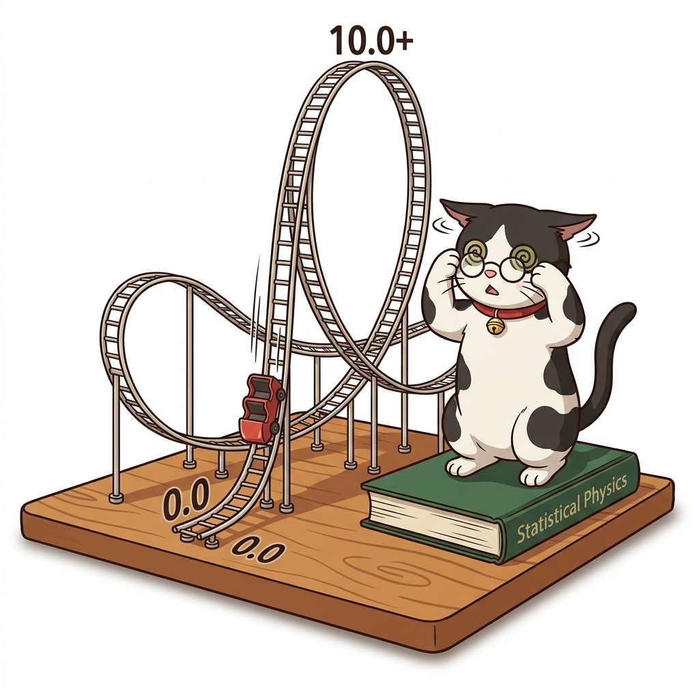
**그림 10-3-41** 0과 커다란 양수를 정신없이 오르내리는 가중치 롤러코스터 때문에 멀미를 느끼는 지니 조교와 요동치는 가치 그래프

---

### "중요도 비율 $\rho$를 곱하지 않고도 완벽한 오프-정책을 달성할 수는 없을까?"

이 질문은 강화학습 역사에서 가장 위대한 돌파구의 출발점이 되었습니다!

> **"행동 정책 $b$가 아무리 제멋대로 탐험을 하더라도, 다음 가치를 계산할 때 '실제로 취한 행동'을 보지 말고, 다음 상태에서 취할 수 있는 '이론상 최고의 행동 $\max_a Q(S_{t+1}, a)$'를 직접 꺼내 쓰면 어떨까?"**

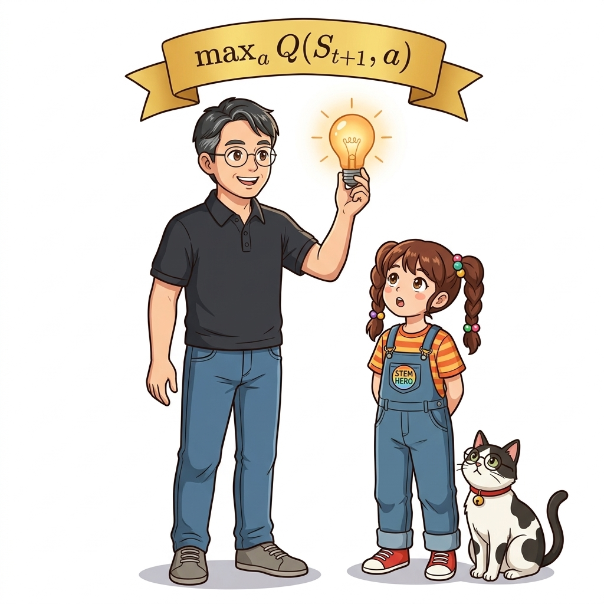
**그림 10-3-42** "실제 행동 대신 다음 상태의 이론상 최고 가치 $\max_a Q$를 직접 꺼내자!" 번뜩이는 황금 영감 전구를 들어 올리시는 이호진 교수님과 환호하는 도로시

---

이 놀라운 발상의 전환이 바로 다음 10.4절에서 다룰 전설적인 알고리즘, **Q-러닝(Q-Learning)**의 핵심 비밀입니다! 

Q-러닝은 중요도 가중치 $\rho$의 나눗셈을 공식에서 완전히 지워버림으로써 오프-정책 학습의 모든 골칫거리를 단번에 해결합니다.

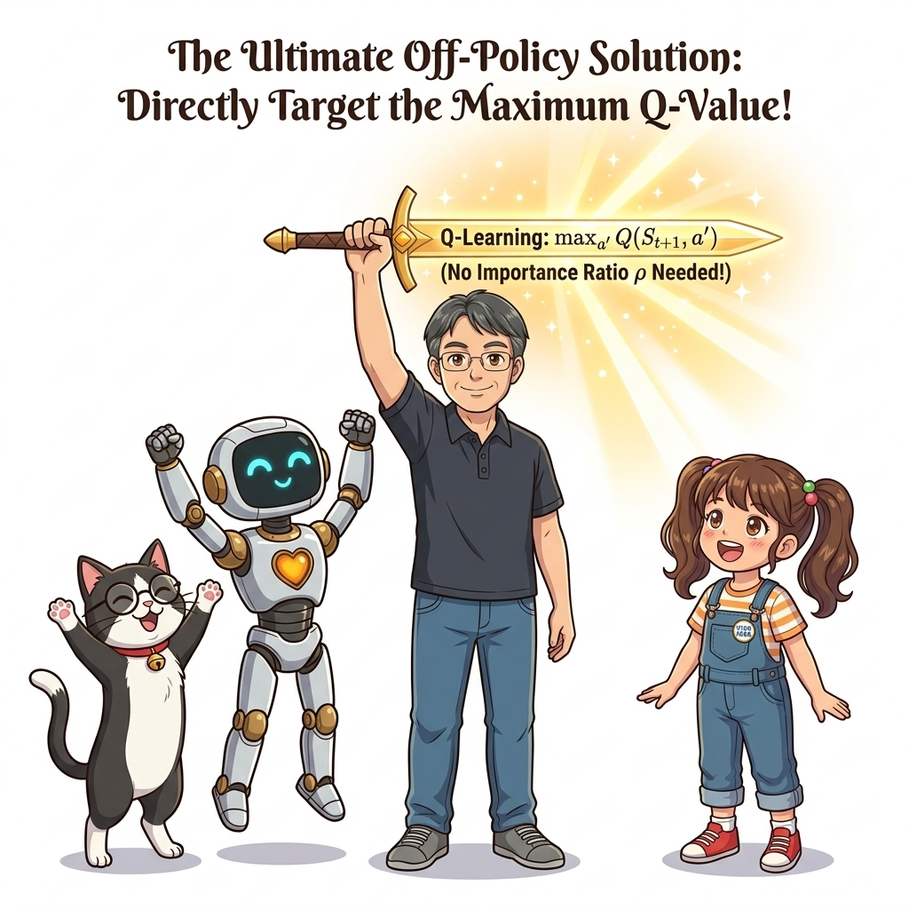
**그림 10-3-43** 중요도 비율 *ρ* 없이도 완벽한 오프-정책 제어를 실현하는 전설의 공식 `max_a Q`의 황금 검을 꺼내 들며 다음 단원의 위대한 도약을 예고하시는 이호진 교수님

---

## 10.3.4 핵심 정리: 오프-정책 SARSA 3대 핵심 기둥

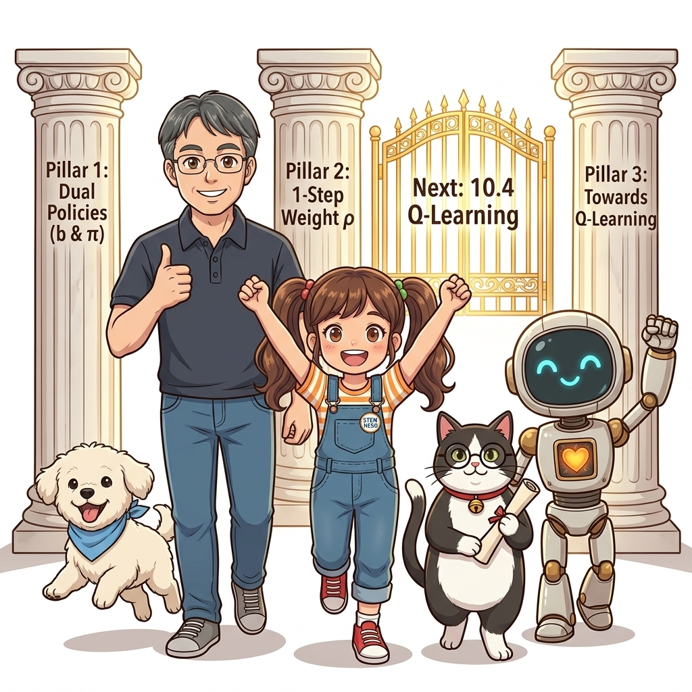
**그림 10-3-44** 오프-정책 SARSA 3대 핵심 기둥 기념비와 다음 10.4 Q-러닝으로의 힘찬 출항 피날레

---

| 오프-정책 SARSA 핵심 기둥 | 핵심 내용 요약 | 비유 및 물리적 의미 |
| :--- | :--- | :--- |
| **1. 듀얼 정책 분리 운용** | 필드 탐험용 $b$($\varepsilon=0.1$)와 이상적 최적화용 $\pi$($\varepsilon=0$)의 완벽한 역할 분담 | 거친 탐험가 틴맨과 지혜로운 학자 도로시 |
| **2. 1-스텝 중요도 가중치 $\rho$** | $\rho = \pi(A_{t+1})/ b(A_{t+1})$로 확률 분포 차이를 단 1-스텝 만에 보정 | 두 세계를 잇는 정밀 황금 징검다리 |
| **3. $\rho = 0$ 한계와 Q-러닝의 예고** | 탐색 행동 시 $\pi=0$이 되어 즉각 보상까지 지워지는 한계를 극복하기 위해 Q-러닝으로 진화 | $\rho$ 없는 완벽한 알고리즘을 향한 위대한 도약 |

---

> 👨‍🏫 **이호진 교수님의 직강 노트**:  
> "오프-정책 SARSA는 비록 $\rho = 0$이라는 한계 때문에 실무에서 널리 쓰이지는 않지만, 강화학습 역사에서 '행동 정책과 대상 정책을 완벽히 분리한다'는 위대한 패러다임을 확립한 기념비적인 디딤돌입니다. 이 디딤돌이 있었기에 인류는 중요도 가중치의 족쇄를 끊어낸 절대강자 **Q-러닝**을 만날 수 있었습니다!"

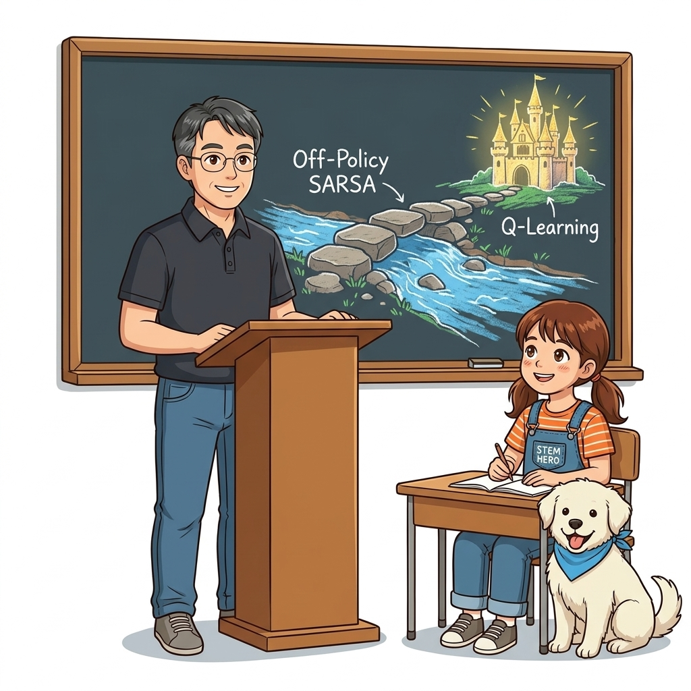
**그림 10-3-45** 칠판 앞에서 오프-정책 SARSA가 Q-러닝으로 이어지는 튼튼한 디딤돌임을 열정적으로 역설하시는 이호진 교수님과 경청하는 도로시 탐험대

---

> 🐱 **조교 지니의 응원 노트**:  
> "도로시와 여러분, 두 개의 나침반을 들고 떠난 오프-정책의 모험이 흥미진진하셨나요? $\rho$의 나눗셈 때문에 소중한 보상이 지워지는 아픔을 겪었지만, 이제 우리는 해답을 알고 있어요! 다음 10.4절에서는 마침내 강화학습의 영원한 베스트셀러이자 현대 딥러닝(DQN)의 뿌리가 된 **Q-러닝**의 눈부신 세계로 다 함께 뛰어들어 봅시다냥!"

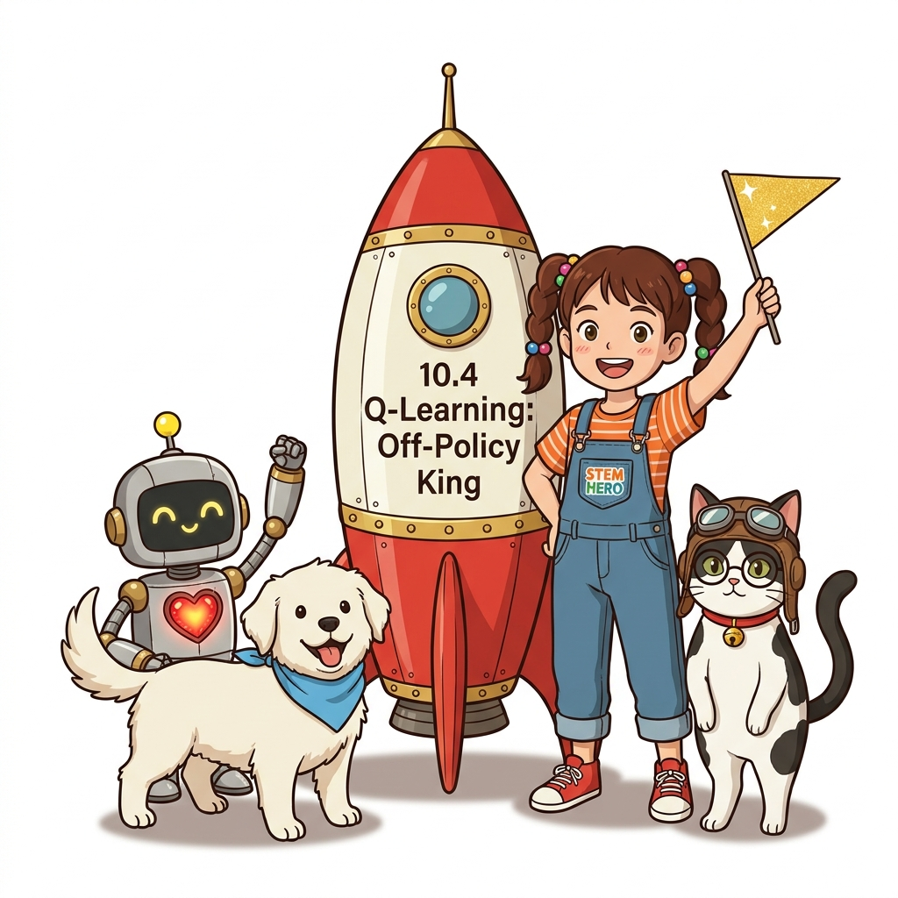
**그림 10-3-46** '10.4 Q-러닝: 오프-정책의 제왕' 로켓 발사대 앞에서 황금 깃발을 흔들며 다음 단원으로의 출격을 선포하는 조교 지니와 도로시 탐험대
