# 10.4 Q-러닝: 모델 프리 오프-정책 제어의 제왕

강화학습 역사상 가장 널리 쓰이고, 훗날 딥러닝과 결합하여 세상을 뒤흔든 DQN(Deep Q-Network)으로 진화하게 되는 불멸의 알고리즘, **Q-러닝(Q-Learning)**을 공부합니다.


**그림 10-4-1** 오프-정책 시간차 제어의 절대 강자 Q-러닝의 핵심 메커니즘과 벨만 최적 방정식의 아름다운 샘플링 조감도

---

중요도 샘플링 비율 $\rho$ 를 전혀 곱하지 않고도 완벽한 오프-정책 학습이 가능한 수학적 비밀을, 벨만 최적 방정식의 샘플링 원리를 통해 명쾌하게 정복해 봅시다!

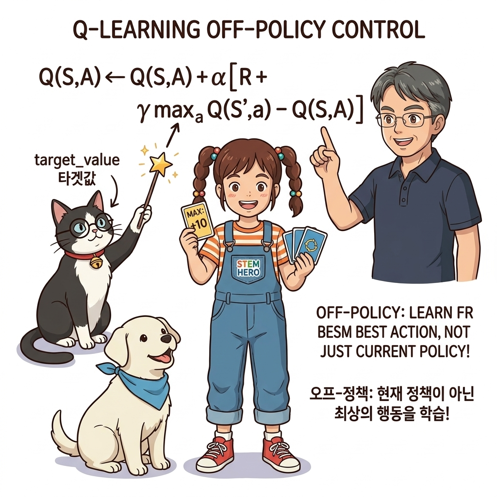
**그림 10-4-2** 다음 상태의 행동 후보들 중 최고 가치인 $\max Q(S', a')$ 목표판을 지팡이로 직접 가리키는 지니와 집중하는 도로시

---

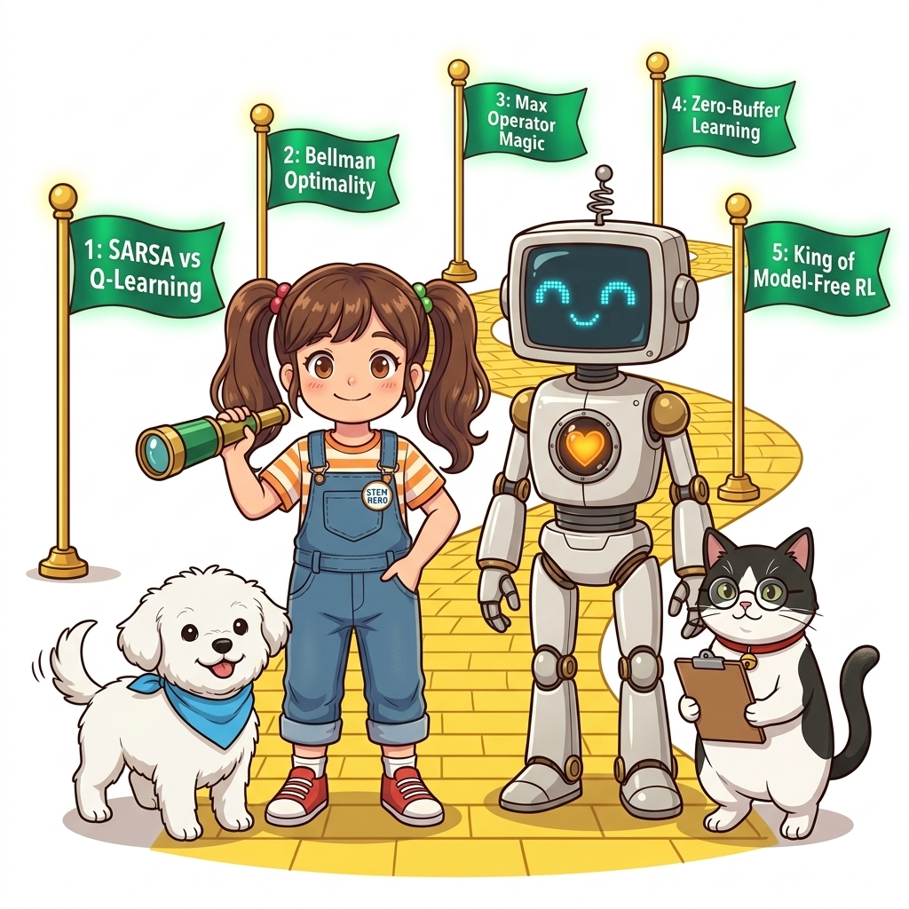
**그림 10-4-3** 10.4절 Q-러닝의 탄생 배경부터 벨만 최적 방정식 도출, 초경량 실시간 구현, 그리고 미래 DQN 진화까지 이어지는 5대 마일스톤 로드맵

- **학습 목표**:
  - 오프-정책 SARSA의 치명적 결함($\rho = 0$ 으로 인한 보상 증발)을 극복하고 Q-러닝이 탄생한 필연적 배경 이해
  - 벨만 기대 방정식(SARSA)과 벨만 최적 방정식(Q-러닝)의 수학적 대칭 구조 분석
  - 다음 상태의 최대 행동 가치($\max_a Q$)를 목표로 삼음으로써 중요도 비율 $\rho$ 를 공식에서 완전히 소거하는 수학적 원리 파악
  - 대기 버퍼(`deque`)나 종단 플러시(Flush) 없이 1스텝 실시간으로 동작하는 `QLearningAgent`의 우아한 파이썬 구현
  - 그리드 월드 실험을 통해 절벽 바로 옆 최단 지름길을 거침없이 돌파하는 Q-러닝의 대담한 최적화 성향 확인
  - Q-러닝이 훗날 딥마인드의 아타리 정복을 이끈 **DQN(Deep Q-Network)**으로 진화하는 현대 강화학습의 계보 파악

---

## 10.4.1 왜 Q-러닝이 탄생했을까?

10.3절에서 우리는 탐험용 '행동 정책 $b$'와 최적화용 '대상 정책 $\pi$'를 분리한 오프-정책 SARSA를 배웠습니다.

하지만 오프-정책 SARSA는 실전에서 쓰기 어려운 치명적인 골칫거리를 안고 있었습니다:

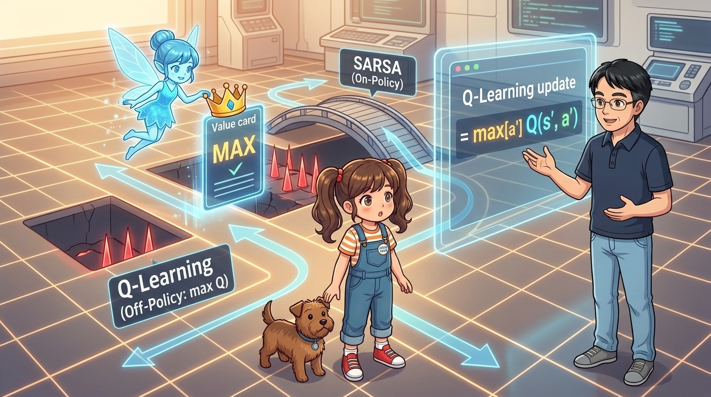
**그림 10-4-4** 탐험 시의 실수(낙하)를 두려워하여 안전한 우회 다리를 건너는 온-정책 SARSA와, 다음 상태의 최댓값($\max$)에 황금 왕관을 씌워 최단 최적 경로를 과감하게 관통하는 오프-정책 Q-러닝의 메커니즘을 설명하는 이호진 교수님과 도로시

---

### 오프-정책 SARSA의 치명적 결함 복습

1. **소중한 보상 데이터의 허무한 증발 ($\rho = 0$)**:
   - 행동 정책 $b$ 가 조금이라도 비탐욕적인 탐색 행동을 시도하는 순간, 대상 정책의 선택 확률은 0이 되어 **중요도 가중치 $\rho = 0$**으로 곤두박질쳤습니다.
   - 그 결과 에이전트가 방금 온갖 고생 끝에 얻어낸 **진짜 즉각 보상 $R_t$ 마저 0으로 곱해져 완전히 지워져 버리는** 어처구니없는 데이터 유실이 발생했습니다.

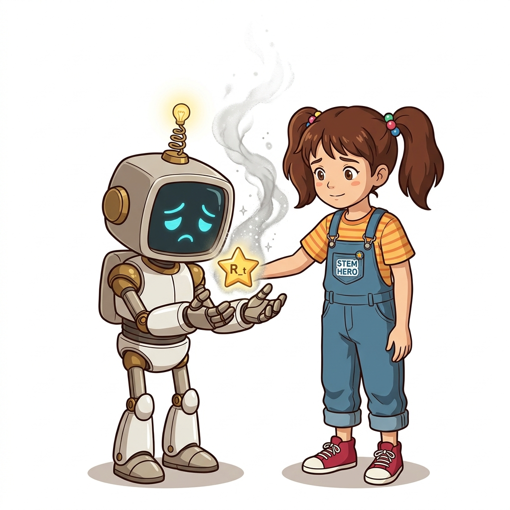
**그림 10-4-5** $\rho = 0$ 이 되는 순간, 틴맨이 땀 흘려 얻은 황금 보상 별 $R_t$ 마저 0의 곱셈 때문에 회색 연기처럼 허무하게 흩어져 사라지는 안타까운 데이터 유실

---

2. **극단적인 가중치 요동 (극심한 분산)**:
   - $\rho$ 가 0과 큰 양수를 널뛰기하듯 요동쳐 가치 함수가 심하게 출렁이고 학습이 대단히 불안정했습니다.

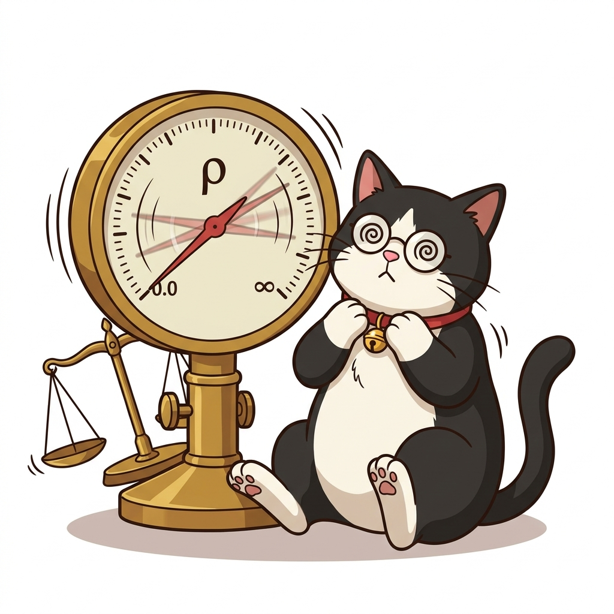
**그림 10-4-6** 0.0과 극단적인 큰 수 사이를 미친 듯이 오가는 가중치 계측기 바늘과 어지러움을 느끼는 조교 지니

---

> [!NOTE]
> **🌟 Q-러닝의 3대 혁명적 성격**:
> 1. **TD법 (시간차 학습)**: 에피소드가 끝나길 하염없이 기다리지 않고, 발을 내딛는 매 걸음마다 즉시 가치를 갱신한다.
> 2. **완벽한 오프-정책 (Off-Policy)**: 필드 탐험은 $\varepsilon$-탐욕 행동 정책 $b$ 로 거침없이 진행하면서도, 가치 학습은 100% 최적 가치 $Q^*$ 를 향해 한 치의 흔들림 없이 직진한다.
> 3. **중요도 샘플링 $\rho$ 완전 소거**: 번거롭고 불안정하며 위험한 가중치 $\rho$ 의 나눗셈을 공식에서 수학적으로 완전히 지워버렸다!

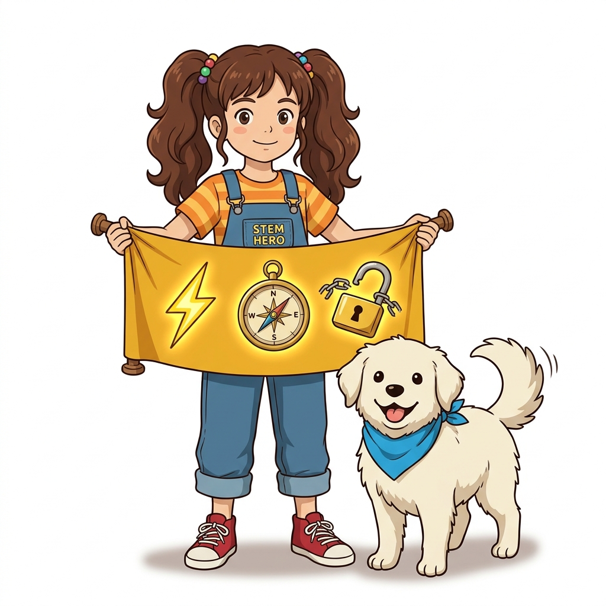
**그림 10-4-7** 번개(1-스텝 실시간 TD), 듀얼 나침반(완벽한 오프-정책), 풀린 자물쇠(중요도 가중치 $\rho$ 완전 소거)의 3대 혁명 깃발을 높이 든 도로시와 토토

---

이 놀라운 마법이 어떻게 가능한지, **벨만 기대 방정식**과 **벨만 최적 방정식**의 대조를 통해 수학적으로 증명해 보겠습니다.


**그림 10-4-8** 강화학습 이론을 떠받치는 두 개의 웅장한 신전 기둥: 온-정책의 은빛 저울 '벨만 기대 방정식(SARSA)'과 오프-정책의 황금 왕좌 '벨만 최적 방정식(Q-러닝)'의 대칭 구조

---

## 10.4.2 벨만 기대 방정식에서 SARSA로, 벨만 최적 방정식에서 Q-러닝으로

강화학습의 제어 알고리즘 역사는 두 개의 거대한 수학적 기둥이 완벽한 대칭을 이루며 발전해 왔습니다:

| 비교 기준 | 🎲 온-정책 시간차 제어 (SARSA) | 👑 오프-정책 시간차 제어 (Q-러닝) |
| :--- | :--- | :--- |
| **이론적 토대** | **벨만 기대 방정식 (Bellman Expectation)** | **벨만 최적 방정식 (Bellman Optimality)** |
| **타깃 선택 방식** | 정책 $\pi$ 에 따른 확률 가중 평균 (Expected / Sampled) | 오직 가장 큰 행동 가치 **$\max_a Q$** (Crowned Max) |
| **갱신 목표 (TD Target)** | **$R_t + \gamma Q(S_{t+1}, A_{t+1})$** | **$R_t + \gamma \max_a Q(S_{t+1}, a)$** |
| **중요도 샘플링 ($\rho$)** | 필요함 (오프-정책 SARSA의 경우) | **완전히 불필요 (수학적 소거)** |
| **학습 경로 성향** | 위험을 멀리 피하는 **보수적 안전 우회로** | 최단 거리로 직행하는 **대담한 최적 지름길** |

---

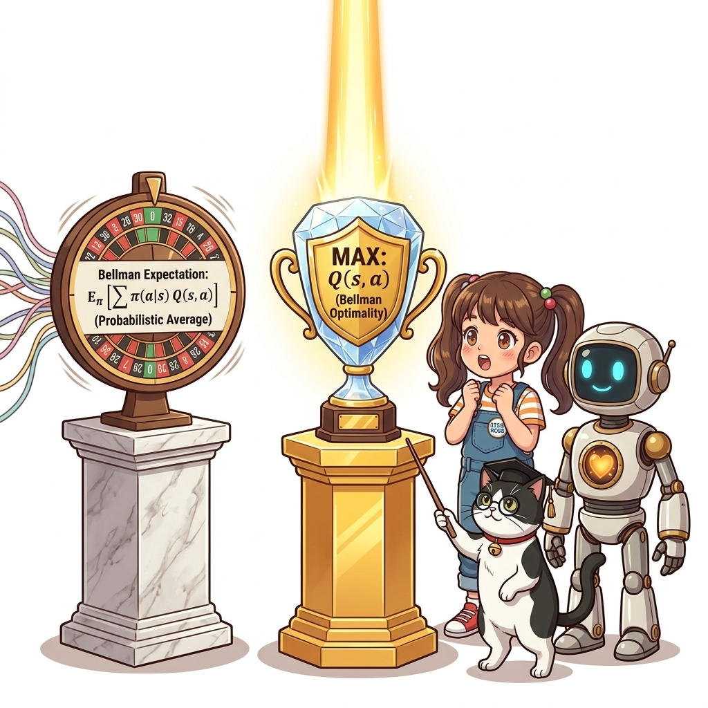
**그림 10-4-9** 모든 행동의 확률 가중 평균을 구하는 벨만 기대 방정식(왼쪽 저울) vs 최선의 행동 하나에 황금 왕관을 씌워 직접 추출하는 벨만 최적 방정식(오른쪽 왕좌)의 근본적 패러다임 대조

---

### 1) 벨만 기대 방정식과 SARSA의 관계

정책 $\pi$ 의 행동 가치 함수에 대한 벨만 기대 방정식은 다음과 같았습니다:

> **$q_{\pi}(s, a) = \sum_{s'} p(s' \mid s, a) \cdot \left[ r(s, a, s') + \gamma \sum_{a'} \pi(a' \mid s') \cdot q_{\pi}(s', a') \right]$** &nbsp;&nbsp;&nbsp;&nbsp; *(식 10.16: 벨만 기대 방정식)*

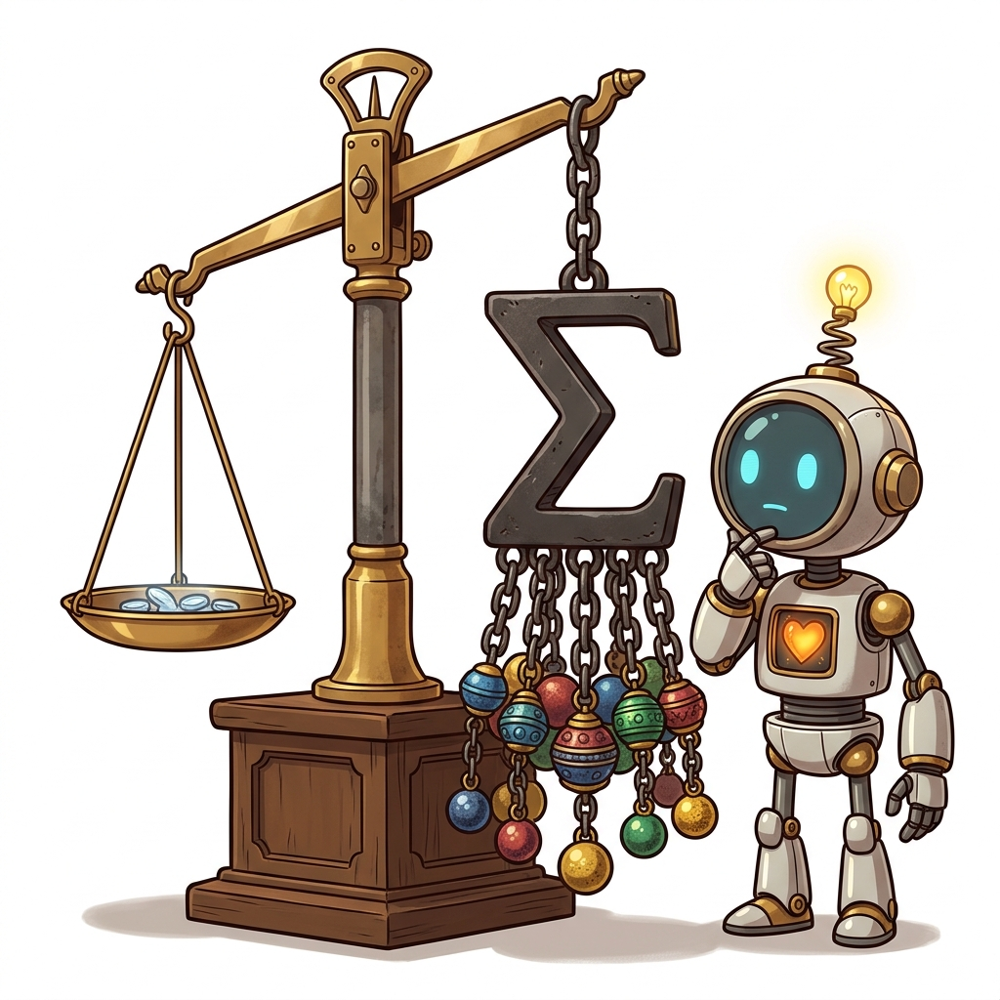
**그림 10-4-10** 모든 다음 상태와 가능한 행동들의 확률 가중 평균을 구하기 위해 무거운 시그마($\sum$) 사슬 저울을 힘겹게 들어 올려야 하는 벨만 기대 방정식의 구조

---

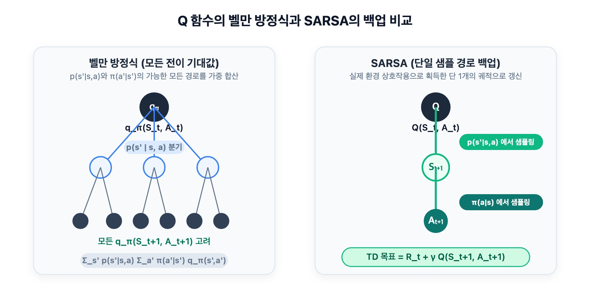
**그림 10-4-11** Q 함수에서의 벨만 기대 방정식 백업 다이어그램. 다음 상태와 정책에 따른 모든 다음 행동의 확률 가중 평균($\sum$)을 구합니다.

---

SARSA는 [식 10.16]의 복잡한 전수조사 기댓값 계산 대신, 현실 환경에서 실제로 튀어나온 단 1회의 샘플 데이터 **$(S_t, A_t, R_t, S_{t+1}, A_{t+1})$** 를 그대로 대입하여 갱신하는 **벨만 기대 방정식의 샘플링 버전**입니다.

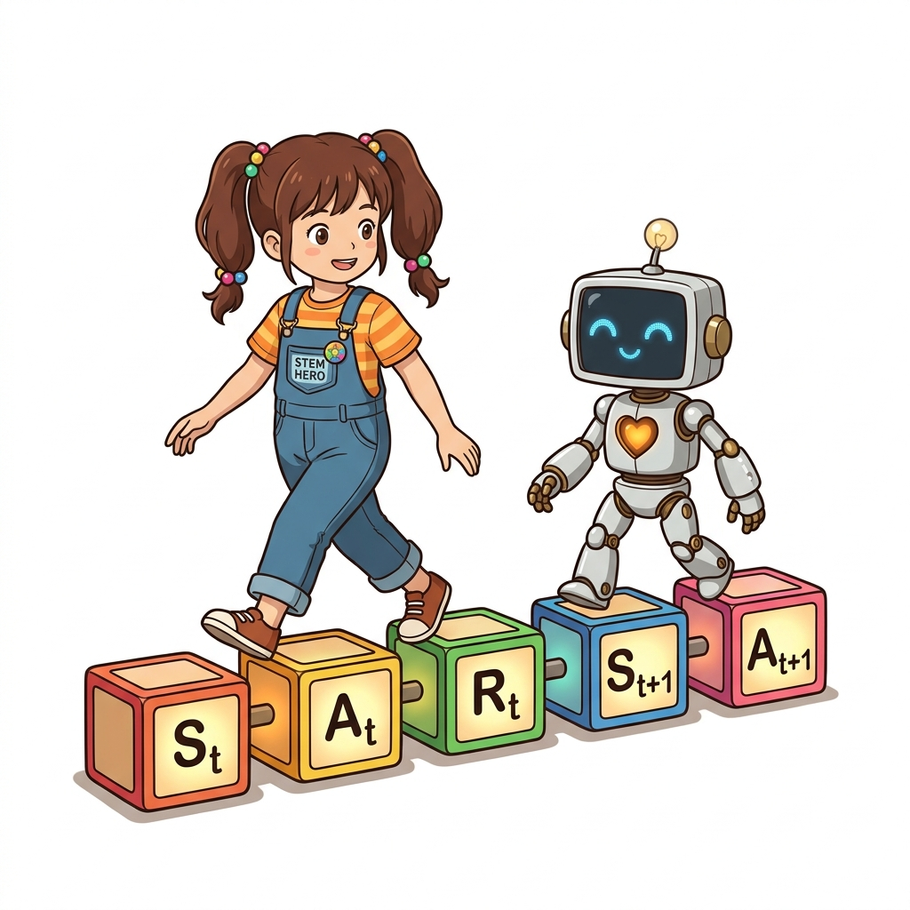
**그림 10-4-12** $(S_t, A_t, R_t, S_{t+1}, A_{t+1})$ 5개의 상호작용 블록을 정직하게 하나씩 밟아나가며 벨만 기대 방정식을 실천하는 도로시와 틴맨

---

### 2) 벨만 최적 방정식과 Q-러닝의 도출

이번에는 4장에서 다루었던 **벨만 최적 방정식(Bellman Optimality Equation)**을 소환해 봅시다:

> **$q_*(s, a) = \sum_{s'} p(s' \mid s, a) \cdot \left[ r(s, a, s') + \gamma \cdot \max_{a'} q_*(s', a') \right]$** &nbsp;&nbsp;&nbsp;&nbsp; *(식 10.17: 벨만 최적 방정식)*

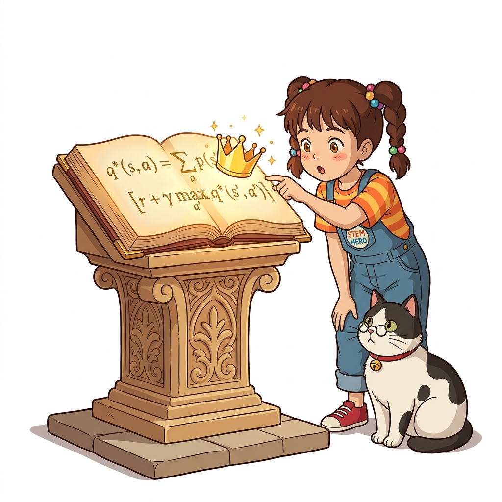
**그림 10-4-13** 꼭대기에 황금 왕관이 놓인 고대 석판에서 벨만 최적 방정식 [식 10.17]의 찬란한 해법을 발견하고 감탄하는 도로시와 지니

---

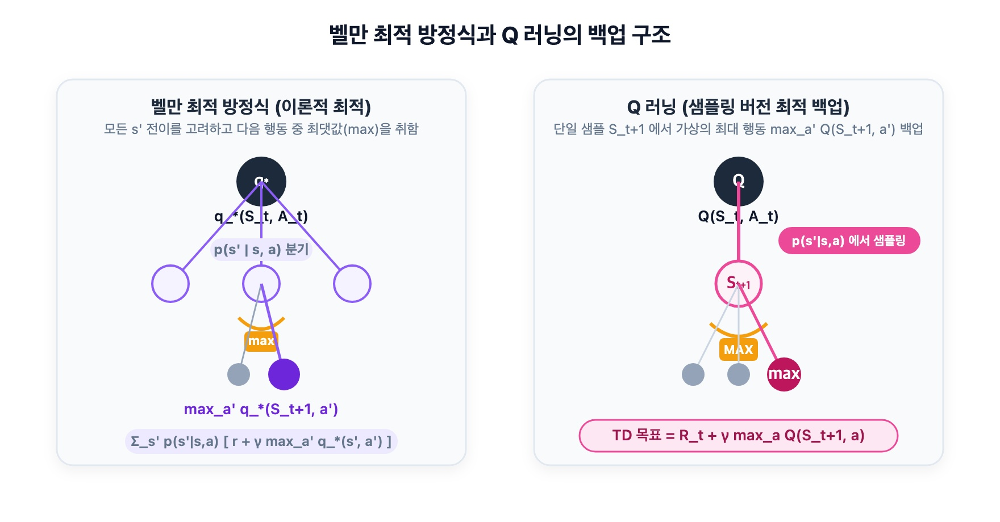
**그림 10-4-14** Q 함수에서의 벨만 최적 방정식 백업 다이어그램. 다음 상태에서 여러 갈래로 분기되는 행동들 중 오직 가치가 가장 큰 최대 행동($\max$) 하나만을 쏙 뽑아 올립니다.

---

[식 10.17]을 돋보기로 들여다보면 실로 엄청난 비밀이 숨겨져 있습니다:

> **"특정 정책의 확률 분포인 $\sum_{a'} \pi(a' \mid s')$ 기호가 공식 안에서 흔적도 없이 사라졌습니다!"**

그 자리를 **$\max_{a'} q_*(s', a')$** 라는 단순 명쾌한 최댓값 연산자가 완벽하게 대체하고 있습니다.

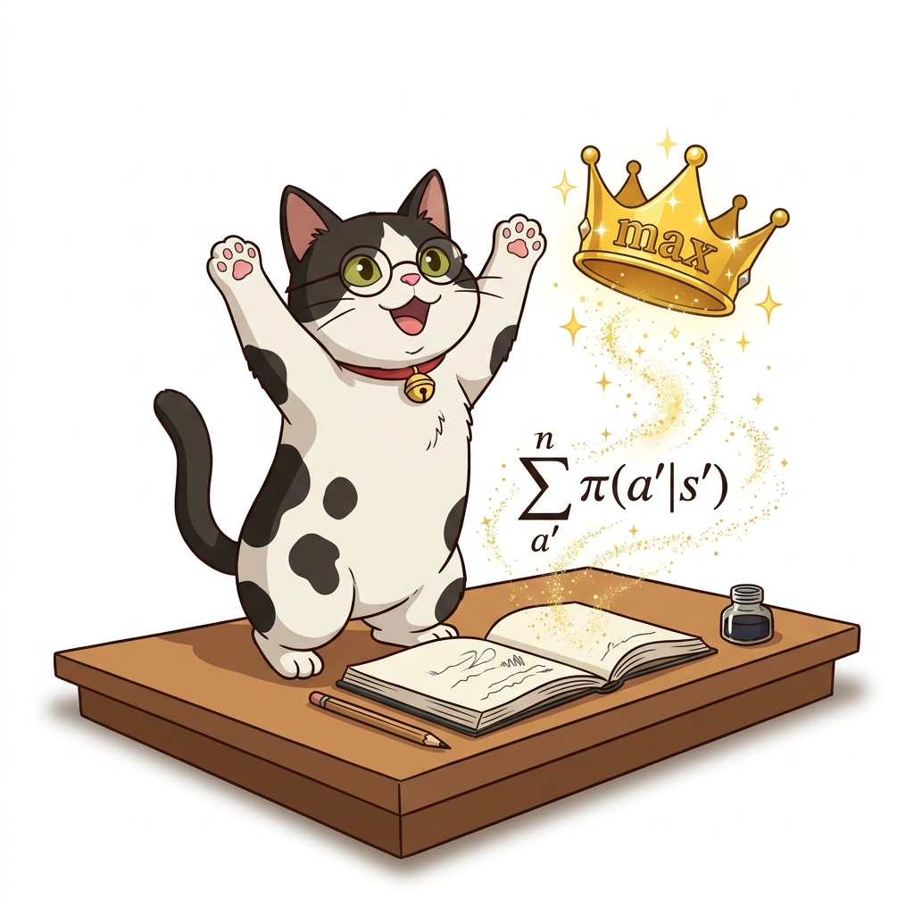
**그림 10-4-15** 복잡한 $\sum \pi$ 기호가 반짝이는 금가루로 흩어지며 그 자리에 찬란한 $\max$ 황금 왕관이 나타나는 경이로운 수학적 소거의 순간

---

이것이 무엇을 뜻할까요?  
우리가 구하고자 하는 최적 가치 $q_*$ 는 **누군가의 정책을 평균 낼 필요 없이, 다음 상태에서 취할 수 있는 가장 훌륭한 행동의 가치만을 직시하면 된다**는 뜻입니다!


**그림 10-4-16** 어지러운 골짜기들을 모두 제쳐두고 오직 가장 높은 황금 별 봉우리($\max$)를 망원경으로 확고하게 겨냥하는 학자 도로시

---

이제 이 벨만 최적 방정식을 환경 모델 없이 에이전트의 1-스텝 경험 데이터로 실시간 샘플링해 봅시다:

1. 상태 전이 기댓값 $\sum_{s'} p(s' \mid s, a) \cdot [r + \cdots]$ 대신, 실제로 환경에서 관측된 **즉각 보상 $R_t$**와 **다음 상태 $S_{t+1}$**을 대입합니다.

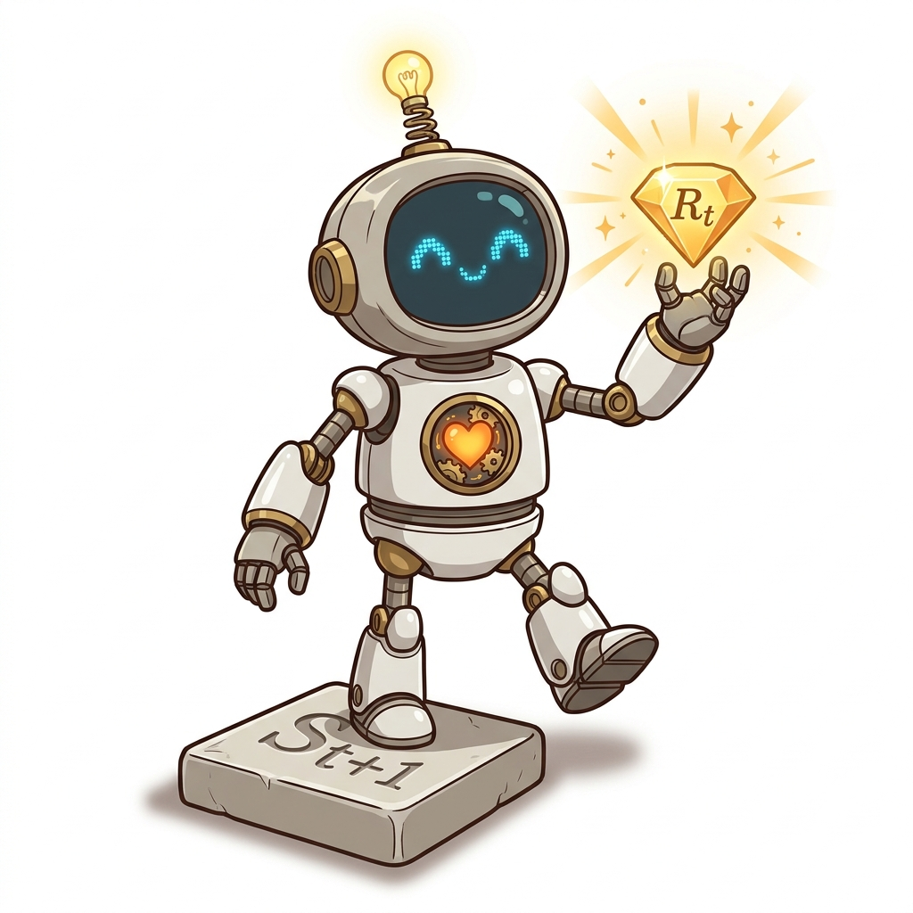
**그림 10-4-17** 환경에서 갓 튀어나온 따끈따끈한 즉각 보상 보석 $R_t$ 와 다음 상태 발판 $S_{t+1}$ 을 두 손에 받아 든 틴맨 로봇

---

2. 다음 상태의 미래 가치로는, 현재 테이블에 적힌 가치들 중 **가장 큰 최댓값 $\max_a Q(S_{t+1}, a)$**를 꺼내옵니다.

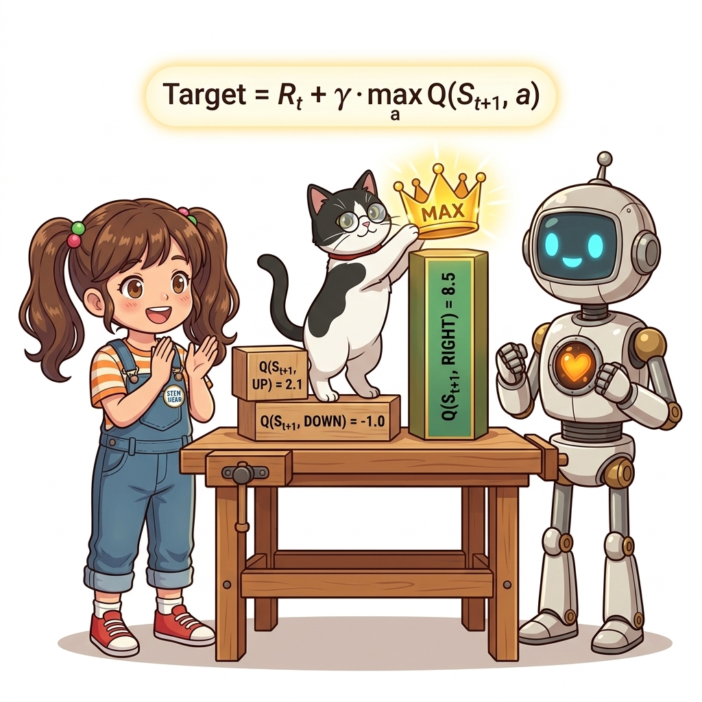
**그림 10-4-18** 다음 상태 *S*<sub>*t*+1</sub>에서 에이전트가 우연히 무슨 엉뚱한 행동을 하든 상관없이, 가치 학습 타깃은 오직 가장 높은 *Q* 값(*max<sub>a'</sub>*)에 황금 왕관을 씌워 가져오는 Q-러닝의 핵심 원리

---

이로써 인공지능 역사상 가장 위대한 공식 중 하나인 **Q-러닝의 갱신 점화식**이 탄생합니다:

> **$Q(S_t, A_t) \leftarrow Q(S_t, A_t) + \alpha \cdot \left[ R_t + \gamma \cdot \max_a Q(S_{t+1}, a) - Q(S_t, A_t) \right]$** &nbsp;&nbsp;&nbsp;&nbsp; *(식 10.18: Q-러닝 갱신 점화식)*

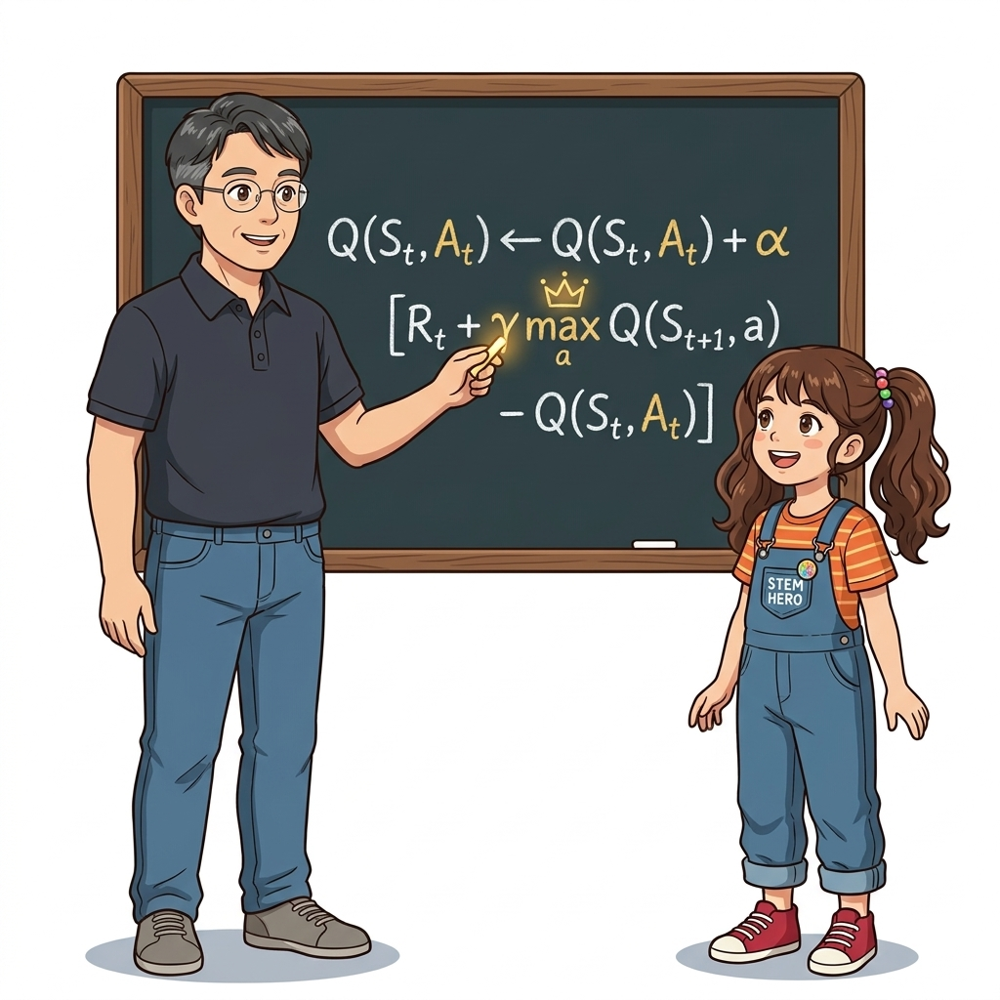
**그림 10-4-19** 이호진 교수님이 대형 칠판에서 황금빛 분필로 인공지능 역사상 가장 불멸의 공식인 Q-러닝 점화식 [식 10.18]을 명쾌하게 증명·강의하시는 모습

---

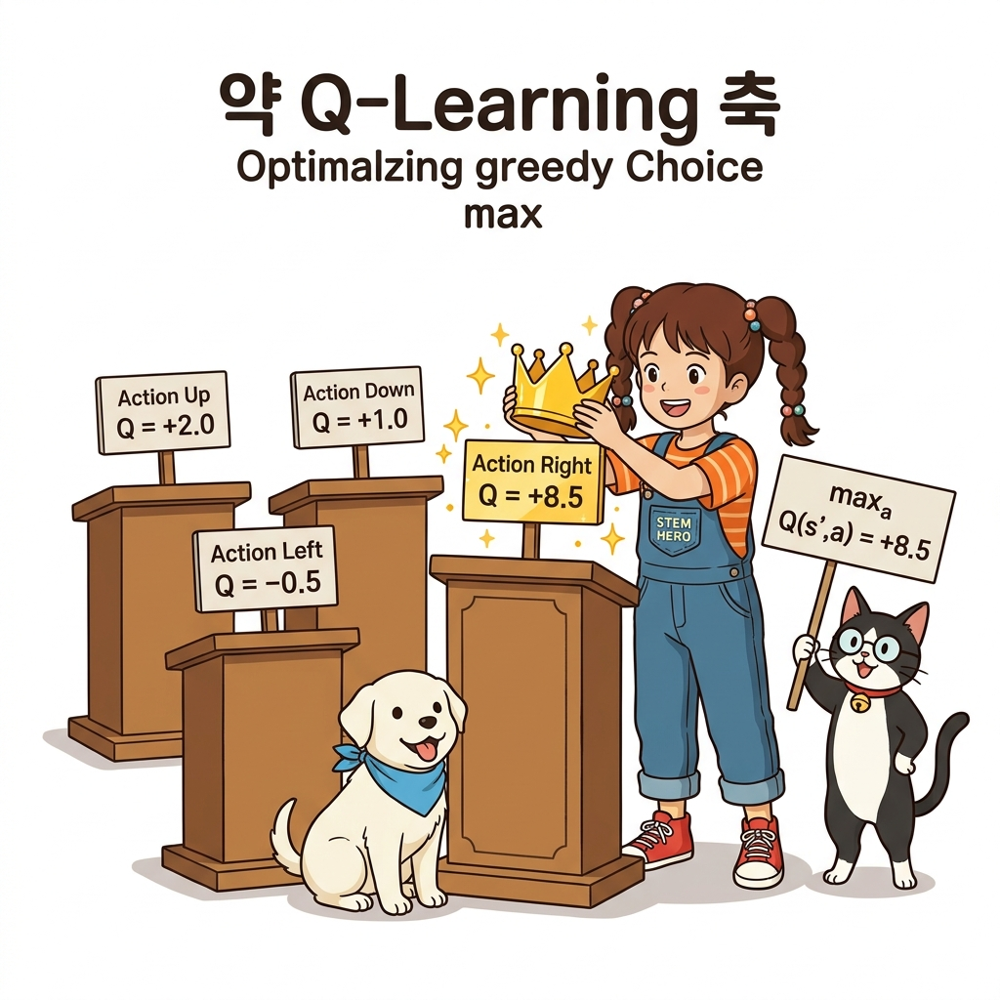
**그림 10-4-20** 상태 *S*<sub>*t*</sub>에서 행동 *A*<sub>*t*</sub>를 취해 다음 상태 *S*<sub>*t*+1</sub>에 도달했을 때, 다음 행동 후보들의 점수 중 최댓값을 핀셋으로 뽑아 타깃을 형성하는 백업 트리

---

### 💡 왜 중요도 샘플링 $\rho$ 가 완벽하게 사라졌을까요?

- **SARSA의 방식**:
  SARSA는 다음 상태에서 **"실제로 취할 다음 행동 $A_{t+1}$"**의 가치 $Q(S_{t+1}, A_{t+1})$ 를 타깃으로 삼습니다. 따라서 그 행동을 어떤 확률 정책으로 뽑았는지에 따라 확률 비율 $\rho$ 를 곱해 보정해야만 했습니다.


**그림 10-4-21** SARSA의 온-정책 방식: 다음 상태에 서서 "내가 실제로 디딜 발걸음 $A_{t+1}$ 이 무엇인가?"를 고개 숙여 신중하게 확인하는 틴맨 로봇

---

- **Q-러닝의 방식**:
  Q-러닝은 다음 행동으로 무엇을 뽑았는지 전혀 쳐다보지도 않습니다!  
  > **"내가 다음 순간에 실수로 넘어지든 딴짓을 하든 간에, 내가 배울 목표는 오직 다음 상태에서 존재할 수 있는 이론상 최고의 가치($\max$)다!"**


**그림 10-4-22** Q-러닝의 호방한 태도: 발밑의 바람이나 사소한 실수에 흔들리지 않고 저 멀리 산꼭대기에서 빛나는 'MAX' 황금 왕관만을 당당하게 바라보는 틴맨 로봇

---

- 타깃 계산식에 행동 정책 $b$ 의 선택 확률이 일체 관여하지 않으므로, **중요도 가중치 $\rho$ 의 나눗셈이 수학적으로 완전히 소거**되는 것입니다!


**그림 10-4-23** 복잡하고 위험했던 중요도 가중치(*ρ* = *π*/*b*)의 족쇄를 시원하게 끊어내고 완벽한 자유를 얻은 Q-러닝의 수학적 해방

---

## 10.4.3 Q-러닝 에이전트 구현

Q-러닝의 구현은 SARSA보다 훨씬 단순하고 우아합니다.

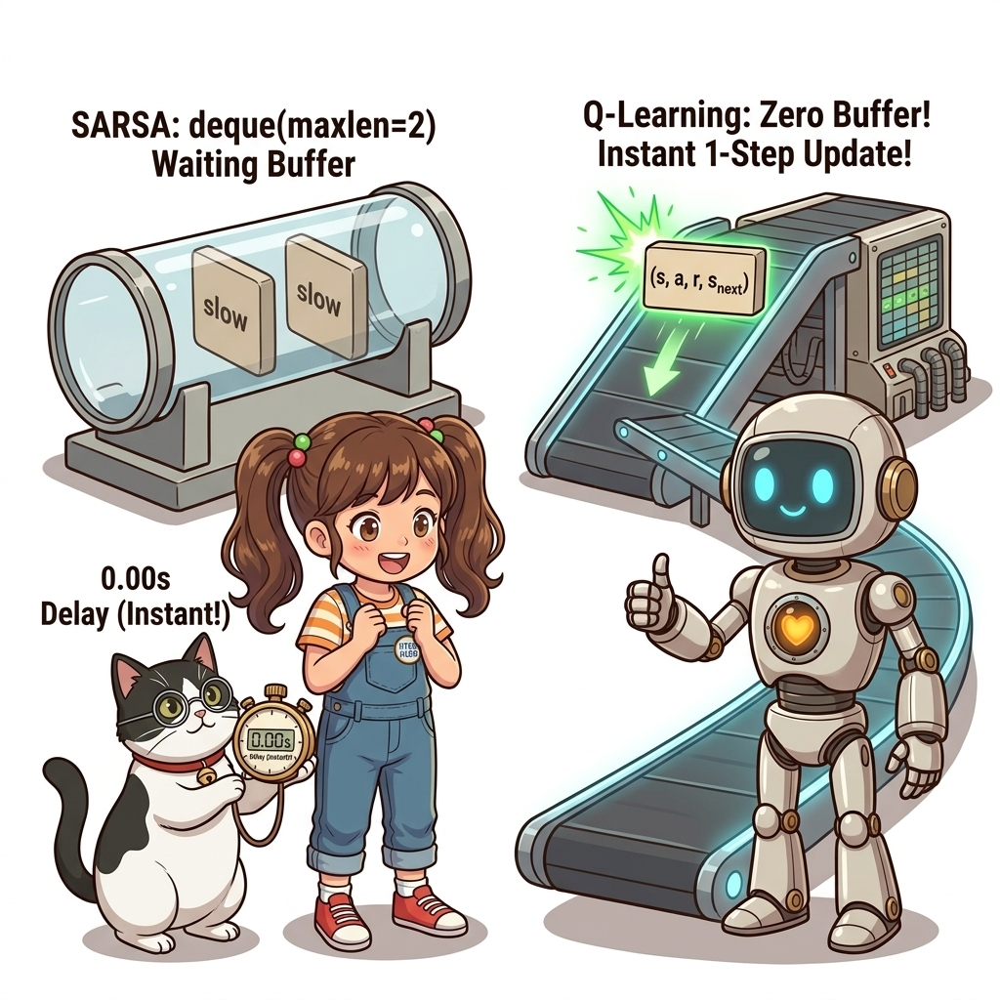
**그림 10-4-24** 무거운 `deque(maxlen=2)` 대기 버퍼 배낭을 던져버리고, 1걸음 내딛자마자 즉시 가치를 갱신하는 초경량 실시간 Q-러닝 틴맨 로봇

---

#### QLearningAgent 클래스 구조

<div align="right"><b>ch06/q_learning.py</b></div>

```python
from collections import defaultdict
import numpy as np
from common.utils import greedy_probs

class QLearningAgent:
    def __init__(self):
        self.gamma = 0.9          # 미래 보상 할인율 γ
        self.alpha = 0.8          # 학습률 α
        self.epsilon = 0.1        # 행동 정책의 무작위 탐험 확률 ε
        self.action_size = 4      # 상, 하, 좌, 우 4가지 행동

        random_actions = {0: 0.25, 1: 0.25, 2: 0.25, 3: 0.25}
        self.pi = defaultdict(lambda: random_actions) # 100% 최적 탐욕 대상 정책 π (epsilon=0)
        self.b = defaultdict(lambda: random_actions)  # ε-탐욕 행동 정책 b (epsilon=0.1)
        self.Q = defaultdict(lambda: 0)

    def get_action(self, state):
        # ❶ 실제 환경에서의 행동은 오직 탐험을 동반한 행동 정책 self.b로부터 샘플링!
        action_probs = self.b[state]
        actions = list(action_probs.keys())
        probs = list(action_probs.values())
        return np.random.choice(actions, p=probs)
```

---

이어서 에이전트의 가치 갱신 메서드 `update()`를 살펴봅시다:

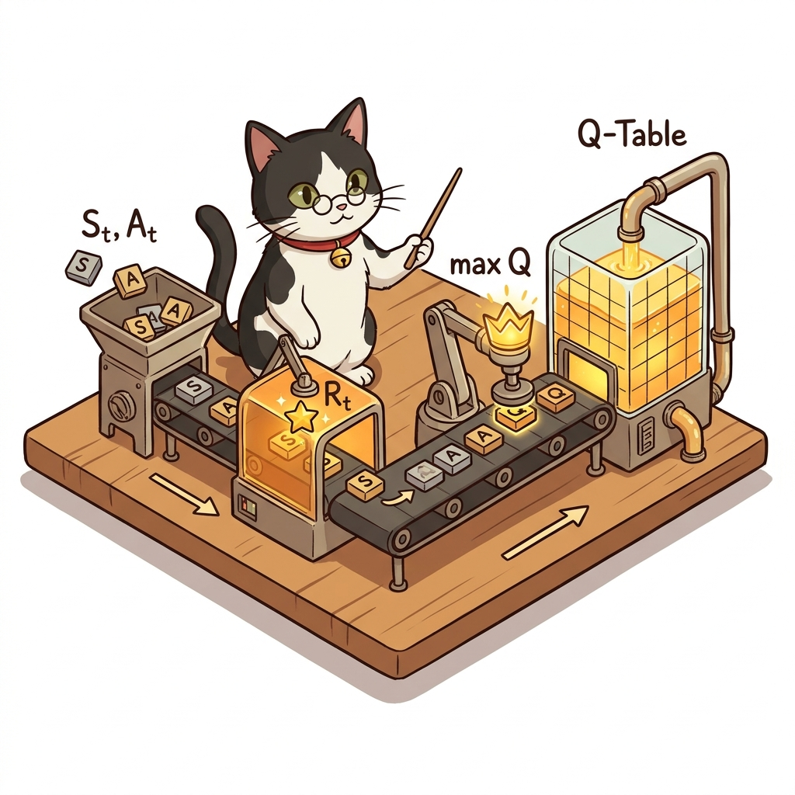
**그림 10-4-25** `update()` 메서드의 4단계 파이프라인: 상태-행동 입력 $\rightarrow$ 즉각 보상 수령 $\rightarrow$ $\max Q$ 왕관 추출 $\rightarrow$ 저수조 즉시 충전

---

```python
    def update(self, state, action, reward, next_state, done):
        # ❷ 다음 상태에서 취할 수 있는 모든 행동의 Q 값 중 최댓값(max) 추출!
        if done:
            next_q_max = 0 # 종단 상태(Goal/Trap)에서는 미래 가치가 항상 0
        else:
            next_qs = [self.Q[next_state, a] for a in range(self.action_size)]
            next_q_max = max(next_qs) # 👑 황금 왕관: MAX!

        # ❸ 식 (10.18)에 따른 Q 함수 즉시 갱신 (중요도 가중치 rho 전혀 불필요!)
        target = reward + self.gamma * next_q_max
        self.Q[state, action] += (target - self.Q[state, action]) * self.alpha

        # ❹ 두 정책을 동시에 최신 Q값으로 갱신
        self.pi[state] = greedy_probs(self.Q, state, epsilon=0)      # π: 100% 완전 탐욕
        self.b[state] = greedy_probs(self.Q, state, self.epsilon)   # b: ε-탐욕 탐색
```

---

### SARSA 코드와 비교한 Q-러닝의 2대 구조적 혁신

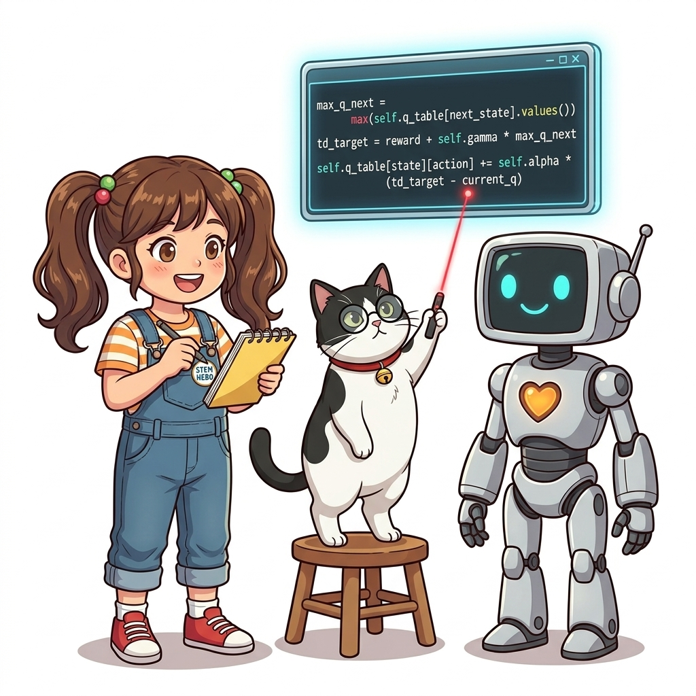
**그림 10-4-26** `update()` 메서드의 4대 핵심 라인이 군더더기 없이 조립되어 즉각적인 최댓값 부트스트랩을 실현하는 코드 해부도

---

1. **대기 버퍼(`deque`)가 완전히 사라졌다!**:
   - SARSA는 다음 상태에서 취할 다음 행동 $A_{t+1}$ 이 결정될 때까지 기다려야 했기 때문에 `maxlen=2` 버퍼가 필수적이었습니다.
   - 하지만 Q-러닝은 다음 행동이 무엇이든 상관없이 `next_state` 좌표만 알면 즉시 `max(self.Q[next_state, :])`를 뽑아낼 수 있습니다.
   - 따라서 **경험을 겪자마자 그 자리에서 즉시 1스텝 만에 Q값을 실시간 업데이트**합니다!

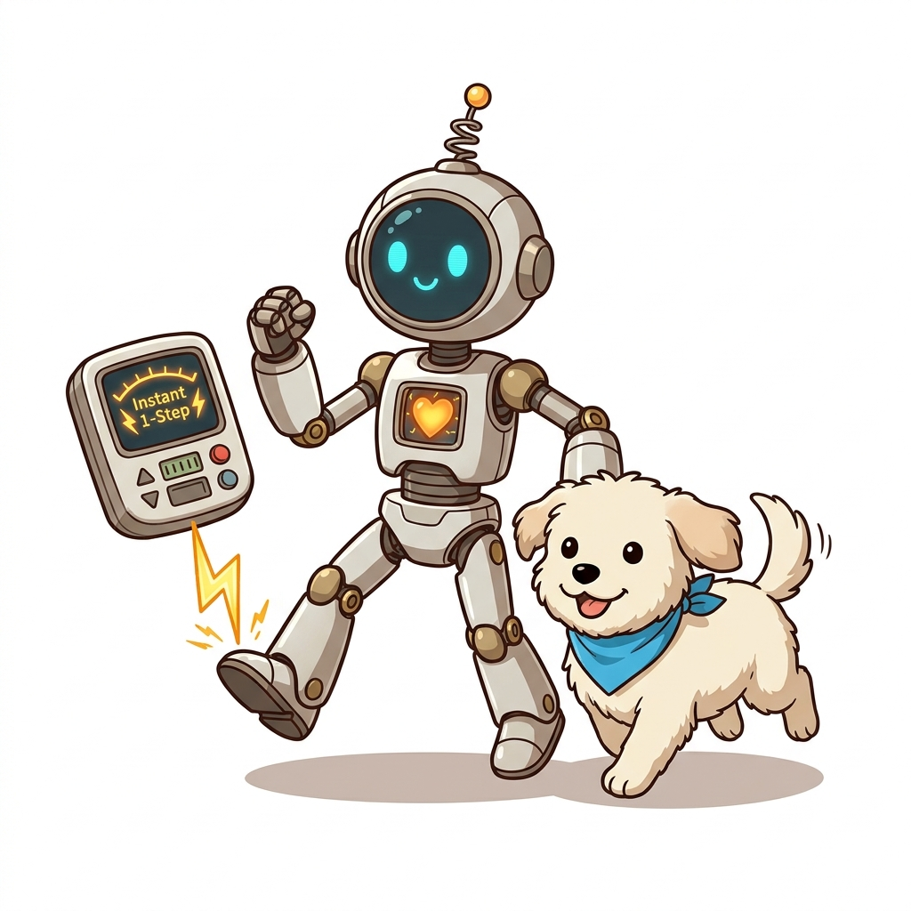
**그림 10-4-27** 버퍼 대기 없이 한 발을 내딛자마자 번개처럼 그 자리에서 즉시 계측기의 Q값을 업데이트하는 초경량 실시간 Q-러닝

---

2. **종단 처리 더미 플러시(`Flush`)가 필요 없다!**:
   - 골인 시점에 버퍼에 갇혀 썩는 데이터가 아예 없으므로, `agent.update(state, action, reward, next_state, done)` 한 줄 호출로 종단 갱신까지 완벽하고 깔끔하게 종결됩니다.

---

## 10.4.4 Q-러닝 실행과 SARSA와의 결과 비교

이제 그리드 월드 환경에서 1만(10,000) 에피소드 동안 Q-러닝을 실행해 봅시다.

<div align="right"><b>ch06/q_learning.py</b></div>

```python
from common.gridworld import GridWorld

env = GridWorld()
agent = QLearningAgent()

episodes = 10000
for episode in range(episodes):
    state = env.reset()

    while True:
        action = agent.get_action(state)
        next_state, reward, done = env.step(action)

        # ⚡ 버퍼 대기 없이 즉각 1-스텝 갱신!
        agent.update(state, action, reward, next_state, done)

        if done:
            break
        state = next_state

# 학습 완료 후 최종 수렴된 Q 함수 및 최적 정책 렌더링
env.render_q(agent.Q)
```

---

학습 완료 후 화면에 렌더링된 Q 함수와 정책을 확인해 봅시다:

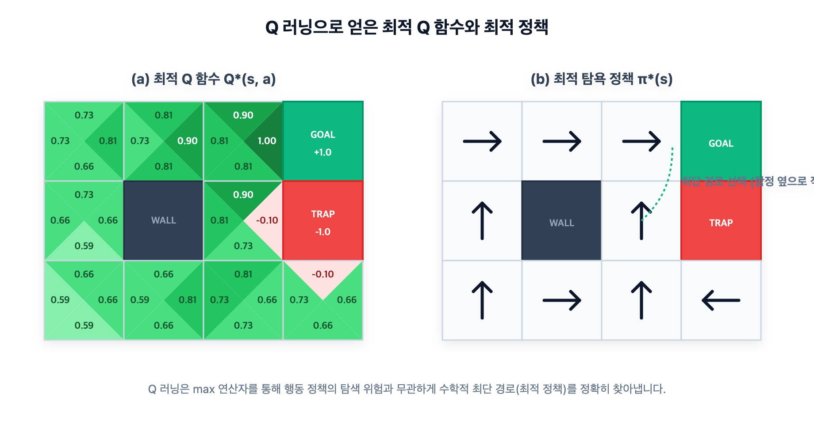
**그림 10-4-28** Q-러닝으로 학습된 그리드 월드의 최종 Q 함수와 최적 정책. 폭탄(-1.0) 바로 옆을 과감하게 통과하는 최단 최적 경로가 완벽하게 형성됩니다.

---

### SARSA vs Q-러닝의 정책 차이 심층 대조

[그림 10-4-28]의 Q-러닝 결과를 앞서 10.2절에서 본 온-정책 SARSA의 결과와 나란히 비교해 보면, 강화학습 역사상 가장 흥미진진한 철학적 차이가 드러납니다:

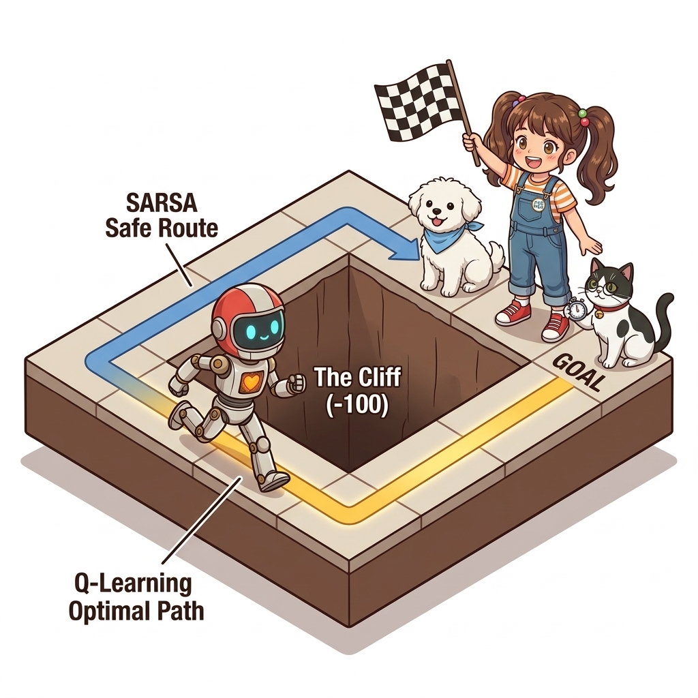
**그림 10-4-29** 절벽 트랙 레이싱 비유: 10% 실수를 두려워해 외곽 벽면으로 빙 돌아가는 SARSA 안전 카트(배경) vs 이상적인 최적 경로를 믿고 폭탄 옆 최단 지름길을 질주하는 Q-러닝 레이싱카(전경)

---

| 비교 항목 | 🛡️ SARSA (온-정책) | 🏎️ Q-러닝 (오프-정책) |
| :--- | :--- | :--- |
| **갱신 기준** | 실제 다음 행동: $Q(S_{t+1}, A_{t+1})$ | 최대 다음 행동: **$\max_a Q(S_{t+1}, a)$** |
| **탐색의 영향** | 자신의 10% 실수 가능성을 **Q 가치에 직접 반영** | 탐험 중 실수와 무관하게 **이론상 최적 경로**를 학습 |
| **그리드 월드 경로** | 폭탄을 피해 멀리 위쪽 벽으로 돌아가는 **안전한 우회로** | 폭탄 바로 옆을 스쳐 지나가는 **가장 빠른 최단 지름길** |
| **학습 안정성** | 분산이 작고 매우 안정적 | 매우 빠르고 최적으로 수렴 |
| **적합한 응용처** | 실패 시 장비 파손이 치명적인 **물리 로봇 / 자율주행** | 최단 시간 최고 득점이 중요한 **게임 / 시뮬레이션 / 금융 최적화** |

---

## 10.4.5 미래로의 도약: DQN(Deep Q-Network)의 심장이 된 Q-러닝

Q-러닝의 위대함은 단순히 테이블 기반 그리드월드에 머물지 않습니다.

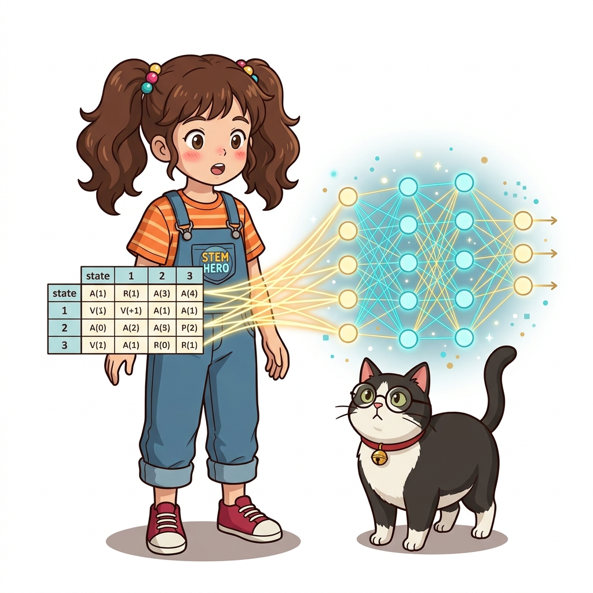
**그림 10-4-30** 바둑판 같은 소형 Q테이블을 넘어 무한한 픽셀 공간을 처리하는 거대한 심층 신경망으로 뻗어 나가는 현대 강화학습의 위대한 다리

---

2015년, 딥마인드(DeepMind) 연구팀은 이 Q-러닝의 테이블 자리에 심층 인공신경망(CNN)을 결합하여, 인간의 개입 없이 오직 화면 픽셀만을 보고 아타리(Atari) 비디오 게임 50여 종을 인간 프로게이머보다 뛰어난 실력으로 정복한 전설의 **DQN(Deep Q-Network)**을 세상에 발표했습니다.

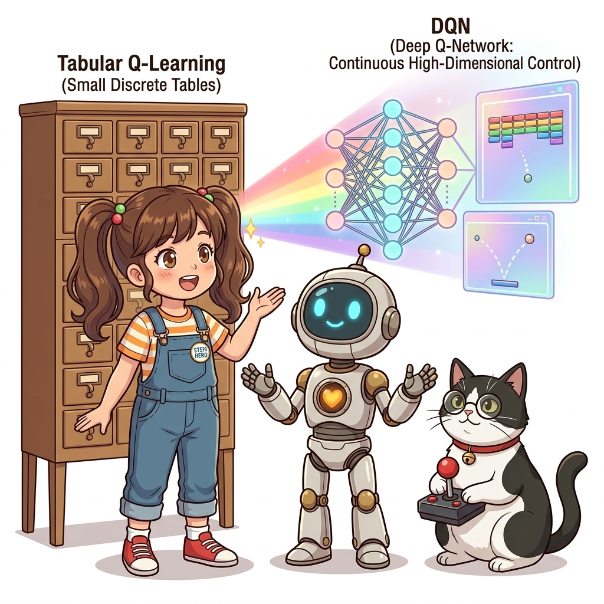
**그림 10-4-31** 테이블 기반 Q-러닝이 심층 신경망과 결합하여 아타리 게임기와 세상을 제패한 딥마인드 DQN으로의 찬란한 진화

---

우리가 방금 손으로 유도하고 구현한 [식 10.18]의 **`R + γ max Q`**라는 단 한 줄의 타깃 공식이, 현대 인공지능과 알파고, 피지컬 로보틱스를 뒤흔든 모든 딥 강화학습 혁명의 절대적인 심장이었던 것입니다!


**그림 10-4-32** 틴맨의 가슴속에서 찬란한 황금빛으로 박동하는 'R + γ max Q' 심장 코어: 모든 현대 심층 강화학습과 피지컬 로봇 제어를 구동하는 영원한 동력원

---

## 10.4.6 핵심 정리: Q-러닝 3대 핵심 기둥

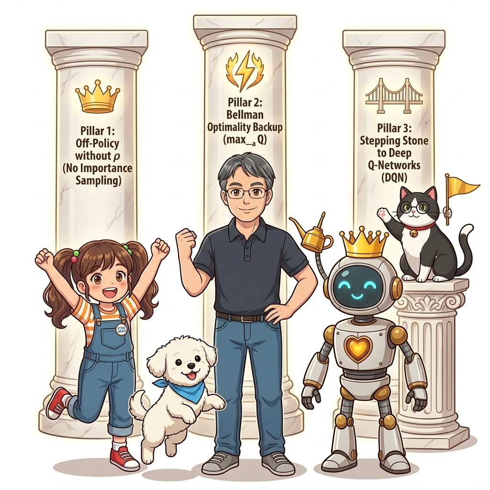
**그림 10-4-33** Q-러닝 3대 핵심 기둥 기념비와 모델 프리 TD 제어 대단원의 감동적인 완성 피날레

---

| Q-러닝 핵심 기둥 | 핵심 내용 요약 | 비유 및 물리적 의미 |
| :--- | :--- | :--- |
| **1. 벨만 최적 방정식의 샘플링** | 기댓값 전개 대신 1-스텝 경험 데이터와 `max_a Q`를 결합 | 최선의 행동에 직접 씌우는 황금 왕관 |
| **2. 중요도 가중치 $\rho$ 완전 소거** | 타깃 계산에 탐험 정책 $b$ 가 개입하지 않아 $\rho$ 의 나눗셈을 소거 | 분산 폭발과 보상 증발로부터의 완벽한 해방 |
| **3. 무버퍼 즉시 실시간 갱신** | 다음 행동 $A_{t+1}$ 대기 없이 매 스텝 초경량 즉각 갱신 | 무거운 버퍼 배낭을 벗어던진 번개 갱신 |

---

> 👨‍🏫 **이호진 교수님의 직강 노트**:  
> "Q-러닝은 강화학습 역사에서 가장 우아하고 실용적인 걸작입니다. 자신의 실수에 얽매이지 않고 오직 이상적인 최적해(max)를 확고하게 바라보는 Q-러닝의 결단력은, 복잡한 세상에서 컴퓨터가 최선의 지혜를 깨닫게 하는 가장 완벽한 수학적 나침반이 되어 주었습니다."

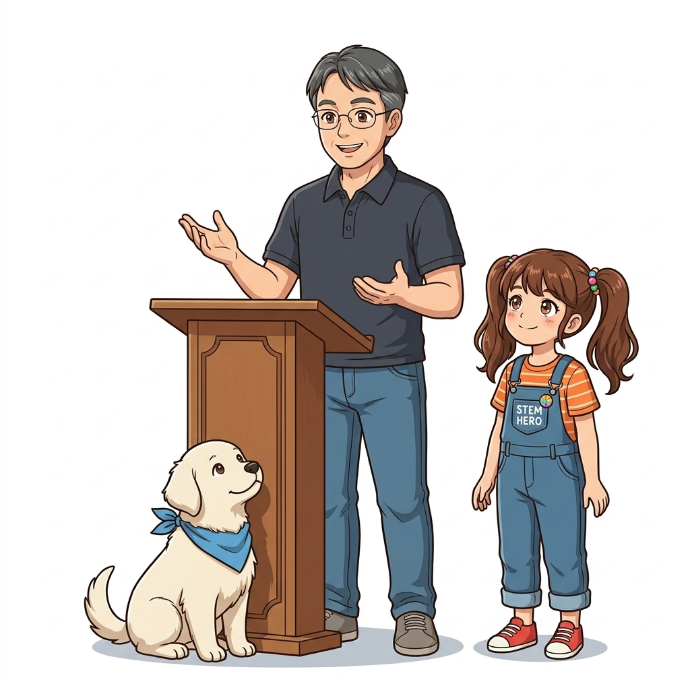
**그림 10-4-34** 강단에서 Q-러닝이 지닌 불굴의 최적화 철학과 이상의 힘을 열정적으로 강의하시는 이호진 교수님과 감동받은 도로시 탐험대

---

> 🐱 **조교 지니의 응원 노트**:  
> "도로시와 여러분, 10.1절의 TD 정책 평가부터 10.2절 SARSA, 10.3절 오프-정책 SARSA를 거쳐 마침내 10.4절의 제왕 **Q-러닝**까지 완벽하게 정복하셨습니다냥! 발을 딛자마자 즉시 가치를 갱신하고, 최고의 행동 max에 왕관을 씌우는 이 짜릿한 쾌감을 잊지 마세요! 여러분은 이제 진정한 강화학습 마스터입니다냥!"

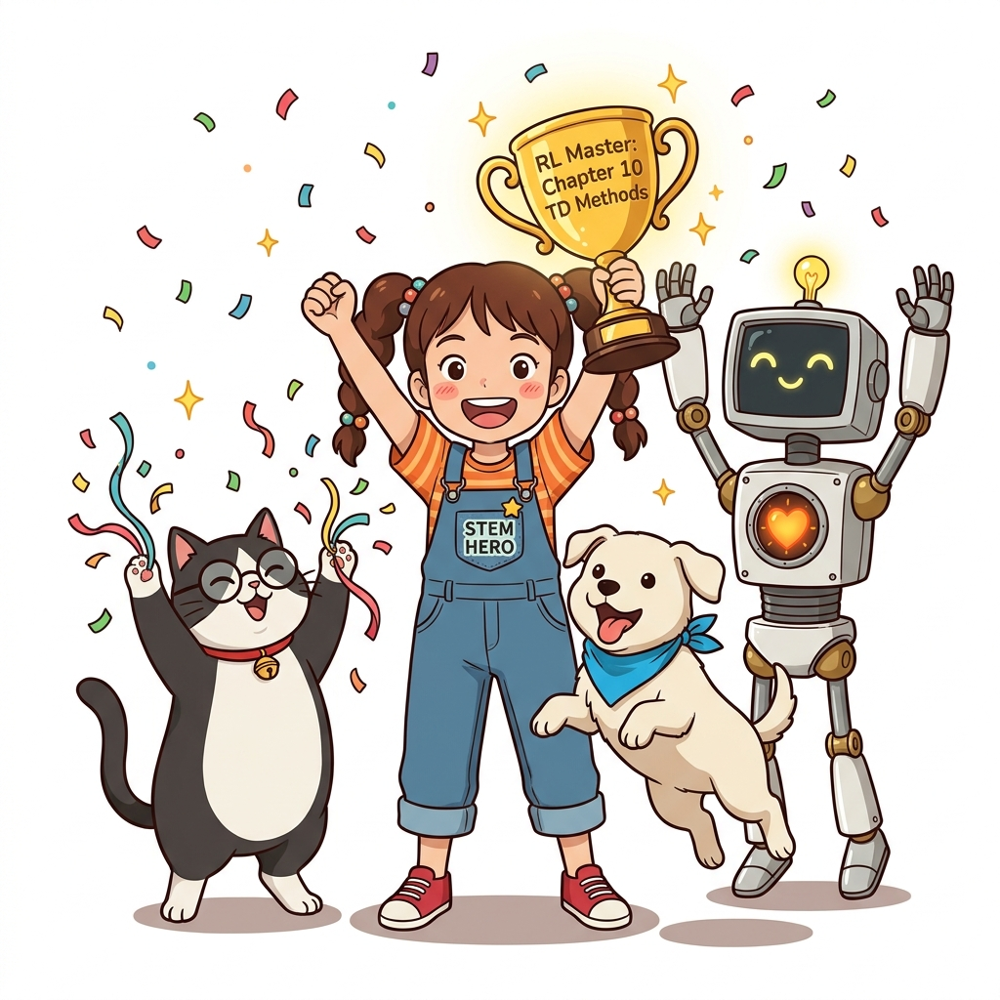
**그림 10-4-35** 'Chapter 10 TD법 완전 정복' 황금 트로피를 번쩍 들어 올리며 꽃가루 속에서 환호하는 도로시, 토토, 지니, 틴맨의 감동적인 완강 대축제 피날레
