# 10.5 분포 모델과 샘플 모델: 에이전트의 초경량화

강화학습에서 '모델(Model)'이라는 단어는 환경의 특성뿐만 아니라, 에이전트가 자신의 정책을 컴퓨터 메모리에 표현하는 내부 구조를 설명할 때도 매우 중요하게 쓰입니다.

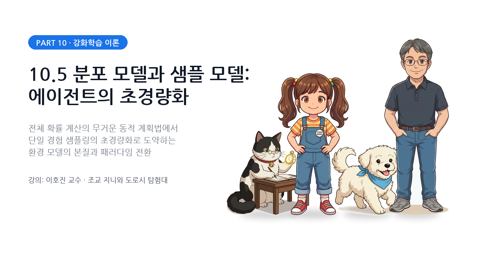
**그림 10-5-1** 환경과 에이전트의 두 가지 모델 체계와, 무거운 정책 딕셔너리를 벗어던지고 초경량 실시간 코드로 다이어트하는 Q-러닝의 진화 조감도

---

에이전트가 상태별 확률 분포를 일일이 기억하고 관리하는 **분포 모델(Distribution Model)**에서 벗어나, 행동을 직접 즉석에서 추출하는 **샘플 모델(Sample Model)**로 전환함으로써 코드를 극적으로 단순화하고 딥러닝(DQN)으로 나아가는 징검다리를 놓아봅시다!

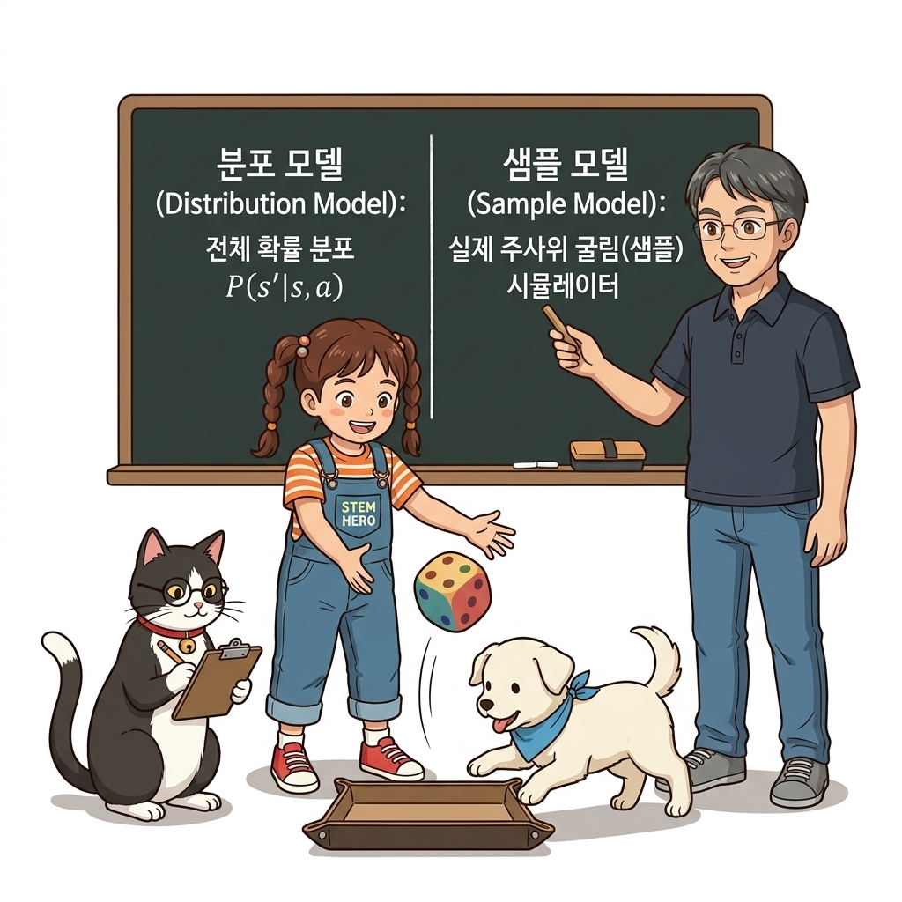
**그림 10-5-2** 칠판에 그려진 이론적 확률 분포(분포 모델)와 토토가 통에 넣고 굴린 주사위 실증 표본들(샘플 모델)의 관계를 분석해 주는 지니와 도로시

---

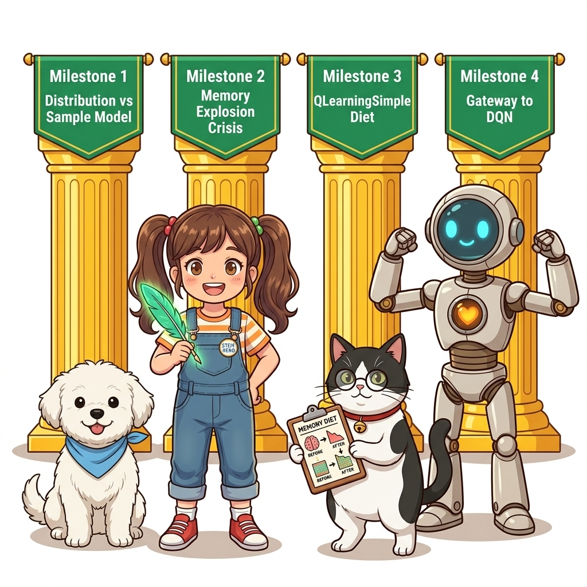
**그림 10-5-3** 10.5절 환경과 에이전트의 모델 개념 구분부터 Q-러닝의 초경량화 다이어트, 그리고 무한한 연속 공간과 딥러닝으로의 연결까지 이어지는 4대 마일스톤 로드맵

- **학습 목표**:
  - '환경의 모델'과 '에이전트의 모델'이 갖는 서로 다른 두 가지 층위의 개념 명확히 구분
  - 모든 상태의 확률 분포를 메모리에 적어두는 분포 모델과, 요청 시 즉석에서 추출하는 샘플 모델의 차이 분석
  - `RandomAgent` 비교를 통해 체감하는 메모리 복잡도와 계산 속도의 압도적 차이 확인
  - 10.4절의 `QLearningAgent`에서 불필요한 `self.pi`와 `self.b` 딕셔너리를 완전히 깎아내는 2단계 소프트웨어 다이어트 과정 마스터
  - 오직 `self.Q` 테이블 하나와 동전 튕기기(`rand() < ε`), 그리고 `np.argmax()`만으로 완성되는 초경량 `q_learning_simple.py` 구현
  - 연속 상태 공간(Continuous State Space)의 무한한 차원에서 테이블이 폭발하는 한계를 극복하고, 11장 심층 신경망(DQN)으로 직결되는 아키텍처 호환성 파악

---

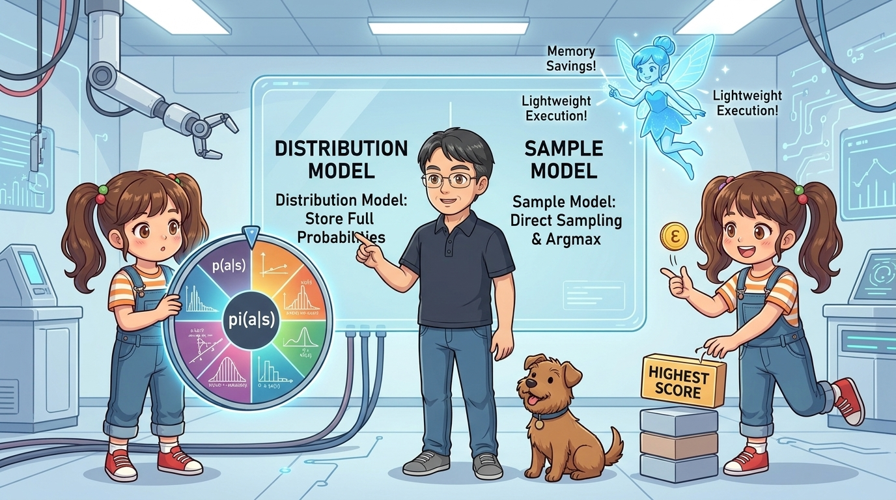
**그림 10-5-4** 모든 상태마다 거대한 행동 확률 원판 $\pi(a \mid s)$을 유지해야 하는 분포 모델(왼쪽)과, 동전 튕기기($\varepsilon$)와 최고 점수 블록 직접 선택($\operatorname{argmax}$)만으로 초경량 실행과 메모리 절약을 달성하는 샘플 모델(오른쪽)의 차이를 설명하는 이호진 교수님과 도로시

---

## 10.5.1 강화학습에서의 두 가지 '모델' 개념

'모델(Model)'이라는 용어는 문맥에 따라 두 가지 서로 다른 층위에서 사용됩니다:

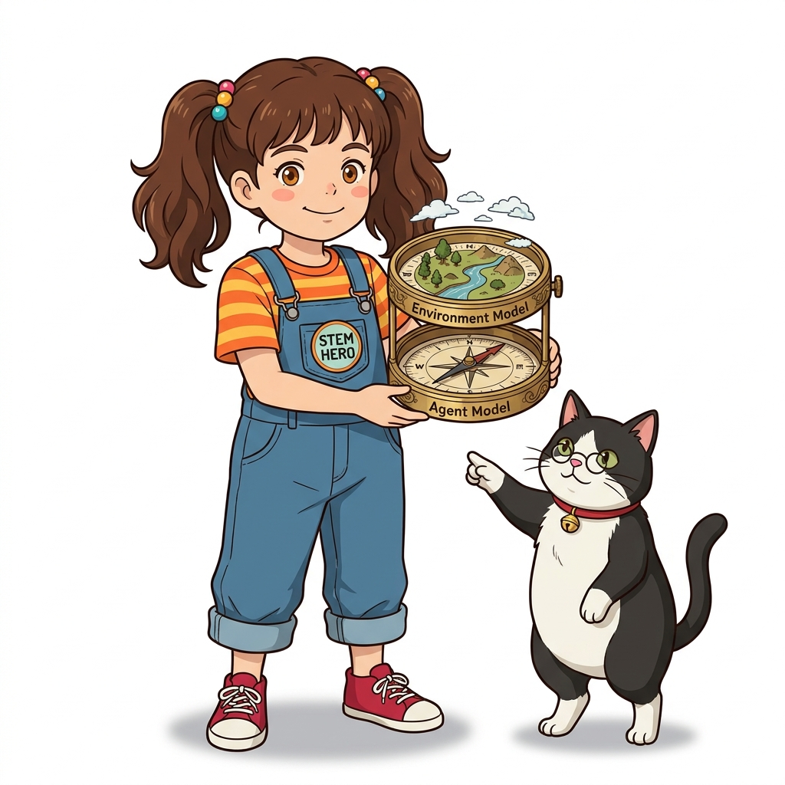
**그림 10-5-5** 강화학습에서의 두 층위: 위쪽의 '환경의 모델(자연의 물리 법칙)'과 아래쪽의 '에이전트의 모델(마음속 정책 표현)'을 가리키는 2단 황금 나침반과 도로시

---

### 1) 환경(Environment)의 관점: 확률 지도 vs 시뮬레이터

1. **환경의 분포 모델 (Distribution Model)**:
   - 동적 계획법(DP)처럼 상태 전이 확률 행렬 $p(s' \mid s, a)$과 보상 함수 $r(s, a, s')$의 **완전한 확률 분포 표**를 에이전트가 손에 쥐고 있는 경우입니다.
   - 다음 상태로 넘어갈 모든 경우의 수와 확률 가중치를 완벽하게 알고 있습니다.

2. **환경의 샘플 모델 (Sample Model)**:
   - 몬테카를로법(MC)이나 시간차 학습(TD)처럼 내부 확률 수식은 전혀 모르지만, 행동을 집어넣으면 다음 상태와 보상을 툭 뱉어내는 **시뮬레이터(`env.step(action)`)**를 가진 경우입니다.
   - 전이 확률 표는 없지만, 실제로 부딪쳐서 나오는 단 하나의 샘플 데이터를 즉시 관측할 수 있습니다.

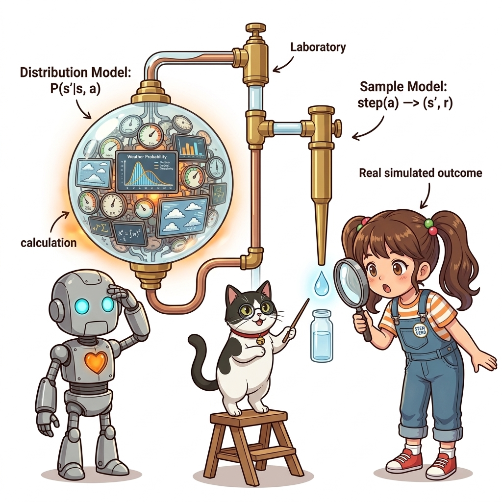
**그림 10-5-6** 모든 전이 확률이 빽빽하게 적힌 거대한 백과사전 지도(환경의 분포 모델, 왼쪽) vs 레버를 당기면 다음 상태 구슬이 툭 떨어지는 직관적인 자판기 시뮬레이터(환경의 샘플 모델, 오른쪽)

---

### 2) 에이전트(Agent)의 관점: 정책 딕셔너리 vs 즉석 난수 생성

에이전트가 자신의 정책(어떤 상태에서 무슨 행동을 취할 것인가)을 컴퓨터 메모리에 표현하는 방식에도 똑같이 두 가지가 존재합니다:

1. **에이전트의 분포 모델**:
   - 모든 상태 $s$마다 "위로 갈 확률 70%, 아래로 갈 확률 10%, 좌 10%, 우 10%"와 같은 **명시적인 확률 분포 딕셔너리(`self.pi[state]`, `self.b[state]`)를 메모리에 할당하여 보관**하는 방식입니다.
   - 지금까지 우리가 구현했던 에이전트들이 채택해 온 전통적인 구조입니다.

2. **에이전트의 샘플 모델**:
   - 확률 분포 딕셔너리 자체를 아예 만들지 않습니다!
   - 오직 **"행동을 하나 뽑아달라(`get_action`)"는 요청이 들어오는 바로 그 순간, 즉석에서 난수를 발생시켜 행동 하나를 샘플링하거나 최댓값($\operatorname{argmax}$)을 계산해 반환**하는 초경량 방식입니다.

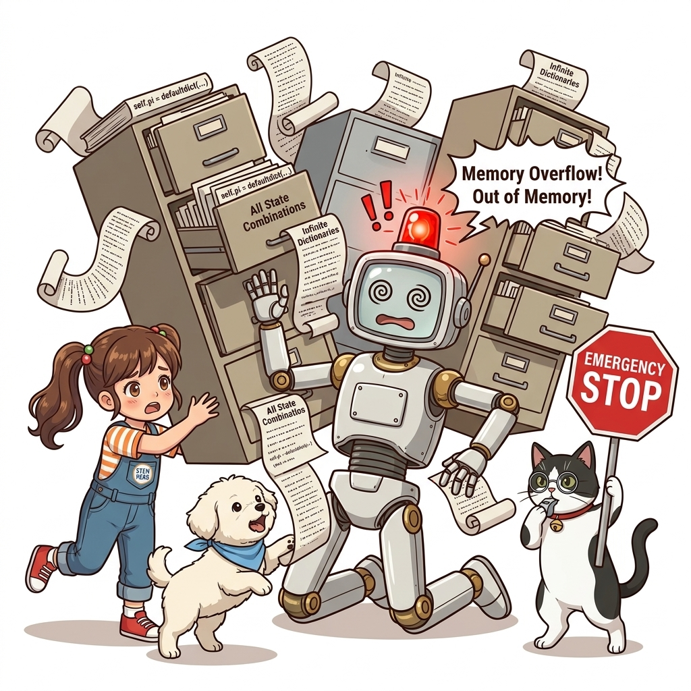
**그림 10-5-7** 수백만 개의 상태마다 두꺼운 정책 바인더(`self.pi[state]`)를 등 뒤에 짊어지고 메모리 오버플로우로 헉헉대는 틴맨 로봇과, 불필요한 바인더를 과감히 버릴 것을 제안하는 지니 조교

---

## 10.5.2 무작위 에이전트로 비교하는 구현 차이

가장 단순한 무작위 에이전트(Random Agent)를 두 가지 방식으로 비교해 보면 차이가 확연히 드러납니다.

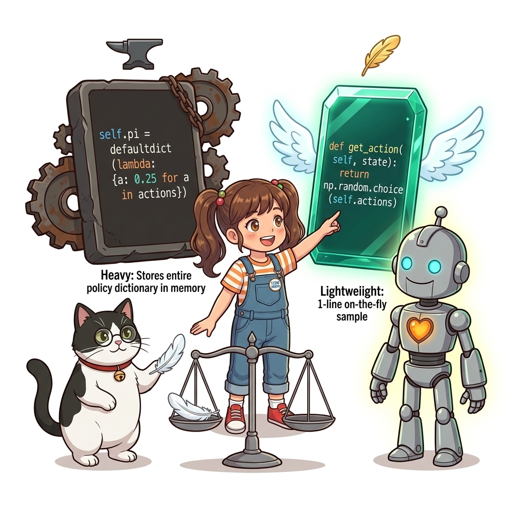
**그림 10-5-8** 무거운 딕셔너리와 확률 리스트를 관리하는 분포 모델(위쪽 두루마리, 100MB 쇳덩이) vs 단 한 줄의 `return np.random.choice(4)`로 깃털처럼 가벼운 샘플 모델(아래쪽 두루마리, 0-Byte)의 극명한 대조

---

### 1) 분포 모델 방식: 무거운 상태별 확률 딕셔너리 유지

```python
from collections import defaultdict
import numpy as np

class RandomAgentDistribution:
    def __init__(self):
        # 모든 상태마다 4개 행동의 확률 분포를 명시적으로 저장
        random_actions = {0: 0.25, 1: 0.25, 2: 0.25, 3: 0.25}
        self.pi = defaultdict(lambda: random_actions)

    def get_action(self, state):
        # 1. 상태에 해당하는 확률 분포 딕셔너리를 메모리에서 꺼냄
        action_probs = self.pi[state]
        actions = list(action_probs.keys())
        probs = list(action_probs.values())
        # 2. 확률 분포 p에 따라 가중 무작위 샘플링
        return np.random.choice(actions, p=probs)
```

- 모든 상태가 방문될 때마다 딕셔너리에 4개의 float 키-값 쌍이 누적됩니다.
- 상태 공간이 수만 개, 수억 개로 커지면 메모리 낭비가 걷잡을 수 없이 극심해집니다.

---

### 2) 샘플 모델 방식: 0-Byte의 가벼움

```python
import numpy as np

class RandomAgentSample:
    def get_action(self, state):
        # 확률 분포 딕셔너리 없이 4개 행동 중 하나를 즉석 난수 추출!
        return np.random.choice(4)
```

- 클래스 초기화(`__init__`)조차 필요 없습니다!
- 메모리 사용량이 완벽한 0에 수렴하며 속도도 압도적으로 빠릅니다.

---

## 10.5.3 Q-러닝의 단계적 다이어트: 분포 모델에서 샘플 모델로

10.4절에서 우리가 구현했던 `QLearningAgent`는 전형적인 분포 모델이었습니다:
- 대상 정책 딕셔너리 `self.pi` 유지
- 행동 정책 딕셔너리 `self.b` 유지
- 매 스텝마다 `greedy_probs()`를 호출하여 두 딕셔너리를 일일이 갱신

이 무거운 코드를 두 단계에 걸쳐 가볍게 깎아내 봅시다.

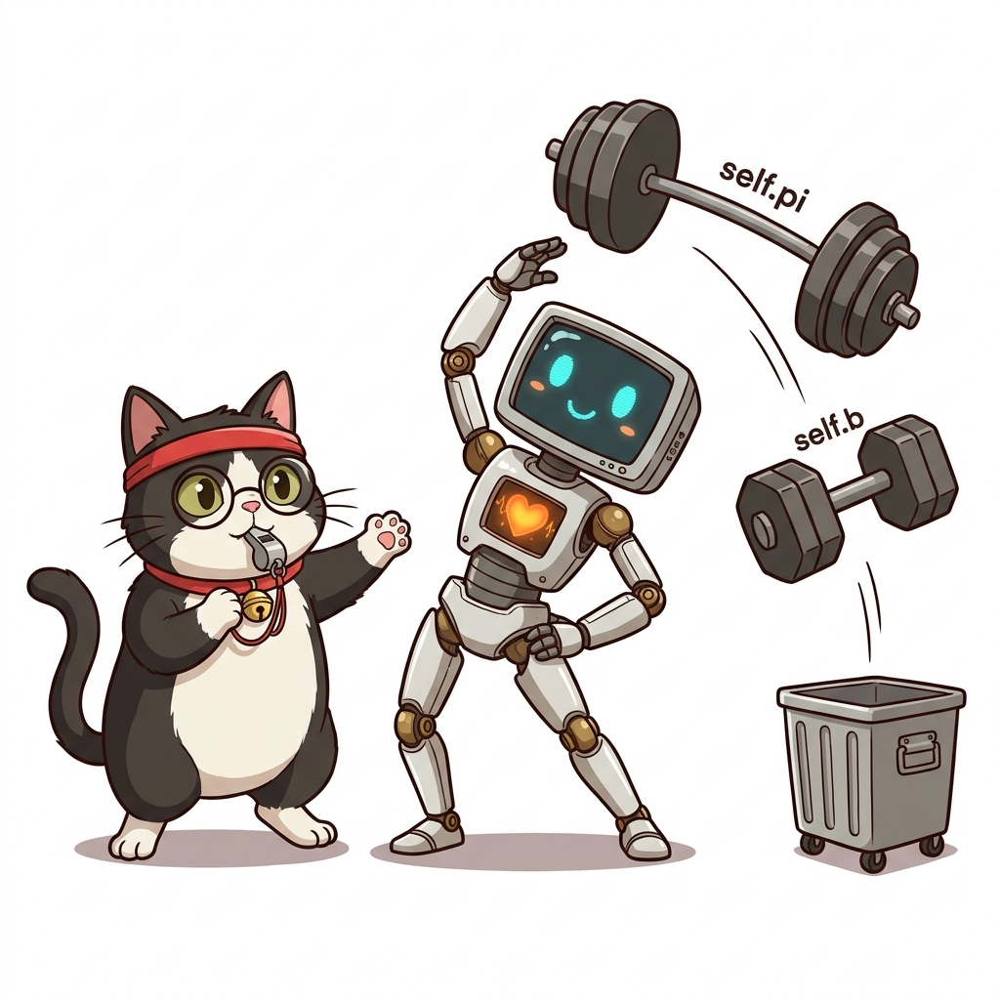
**그림 10-5-9** 지니 코치의 호각 소리에 맞춰 무거운 `self.pi`와 `self.b` 덤벨을 과감히 분리수거통에 던져버리고 슬림한 몸매를 가꾸는 틴맨 로봇

---

### Step 1: 불필요한 `self.pi` 삭제와 `self.b`의 지연 평가

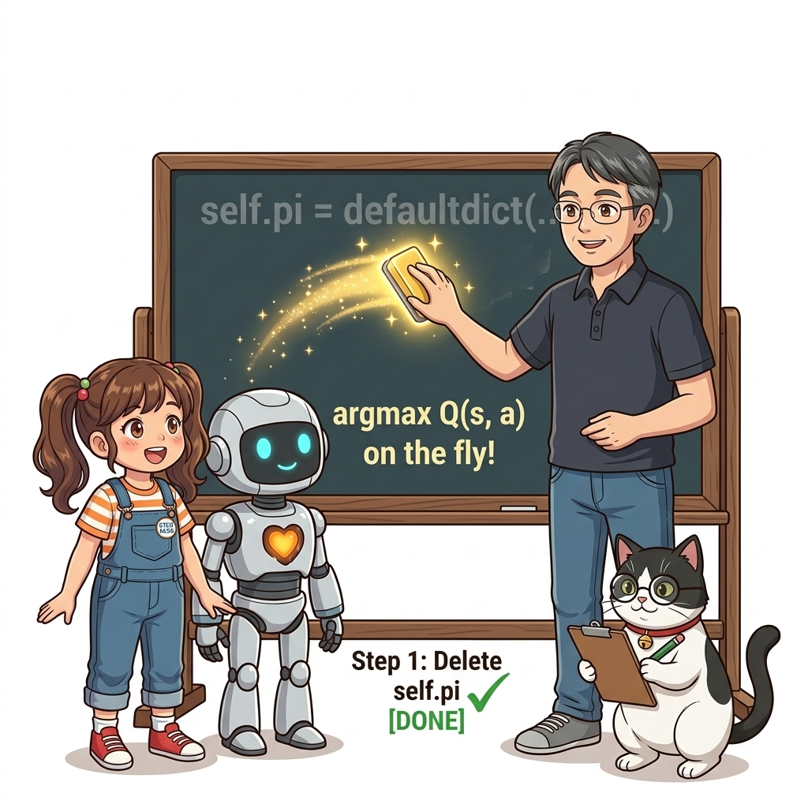
**그림 10-5-10** Q 테이블만 있으면 언제든 `argmax`로 최적 행동을 찾을 수 있으므로, 중복 메모리였던 `self.pi`를 쓰레기통에 슛해서 날려버리는 통쾌한 지니 조교

---

```python
class QLearningAgentStep1:
    def __init__(self):
        self.gamma = 0.9
        self.alpha = 0.8
        self.epsilon = 0.1
        self.action_size = 4
        # self.pi 완전 삭제! (Q 테이블이 이미 모든 답을 쥐고 있으므로 불필요)
        self.b = defaultdict(lambda: {0: 0.25, 1: 0.25, 2: 0.25, 3: 0.25})
        self.Q = defaultdict(lambda: 0)

    def get_action(self, state):
        # 행동을 결정해야 하는 순간에만 Q를 바탕으로 ε-탐욕 확률을 즉석 생성
        self.b[state] = greedy_probs(self.Q, state, self.epsilon)
        action_probs = self.b[state]
        actions = list(action_probs.keys())
        probs = list(action_probs.values())
        return np.random.choice(actions, p=probs)

    def update(self, state, action, reward, next_state, done):
        if done:
            next_q_max = 0
        else:
            next_qs = [self.Q[next_state, a] for a in range(self.action_size)]
            next_q_max = max(next_qs)

        target = reward + self.gamma * next_q_max
        self.Q[state, action] += (target - self.Q[state, action]) * self.alpha
        # update() 안에서 정책 딕셔너리를 매번 갱신하던 무거운 연산 부하 완전 소거!
```

---

### Step 2: 완벽한 샘플 모델 Q-러닝 (`q_learning_simple.py`)

이제 마지막으로 남아있던 행동 정책 딕셔너리 `self.b`마저 완전히 없애버립시다!

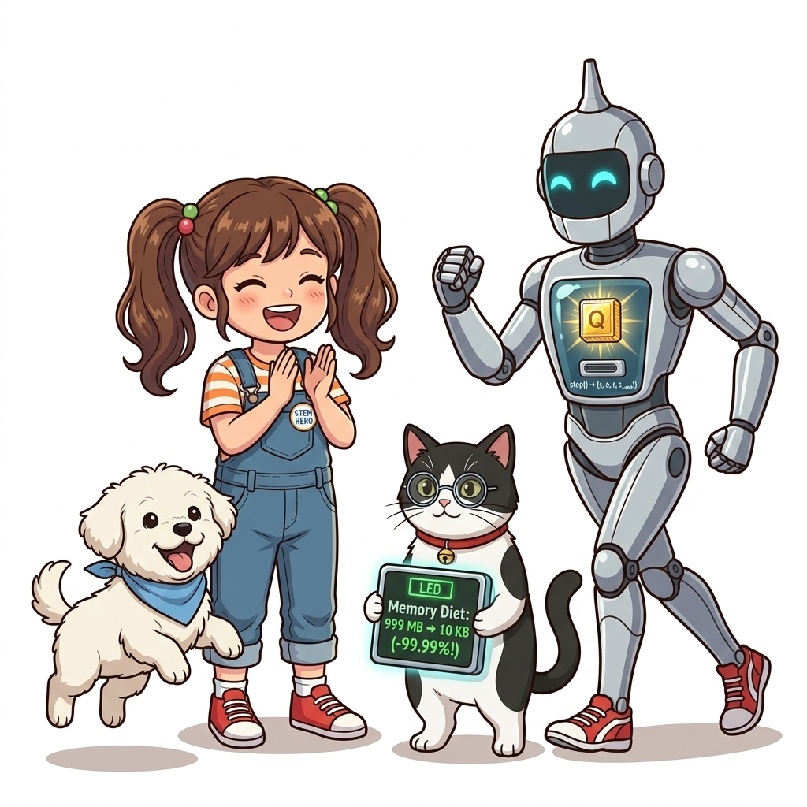
**그림 10-5-11** `self.b`마저 날려버리고 오직 동전 튕기기(`rand() < ε`)와 최고 점수(`np.argmax`)만으로 날렵하고 민첩하게 달리는 궁극의 초경량 샘플 모델 틴맨 로봇

---

<div align="right"><b>ch06/q_learning_simple.py</b></div>

```python
import numpy as np
from collections import defaultdict

class QLearningAgentSimple:
    def __init__(self):
        self.gamma = 0.9
        self.alpha = 0.8
        self.epsilon = 0.1
        self.action_size = 4
        self.Q = defaultdict(lambda: 0) # 👑 오직 Q 테이블 하나만 유지!

    def get_action(self, state):
        # ❶ ε의 확률로 무작위 탐험 (동전 튕기기!)
        if np.random.rand() < self.epsilon:
            return np.random.choice(self.action_size)
        # ❷ 1 - ε의 확률로 최적 탐욕 행동 선택 (최고 점수 argmax!)
        else:
            qs = [self.Q[state, a] for a in range(self.action_size)]
            return np.argmax(qs)

    def update(self, state, action, reward, next_state, done):
        if done:
            next_q_max = 0
        else:
            next_qs = [self.Q[next_state, a] for a in range(self.action_size)]
            next_q_max = max(next_qs)

        target = reward + self.gamma * next_q_max
        self.Q[state, action] += (target - self.Q[state, action]) * self.alpha
```

---

### 코드 핵심 분석: 왜 이 구조가 인공지능 엔지니어링의 정점일까요?

1. **딕셔너리 정책의 완전한 소멸**:
   - 에이전트가 들고 있는 내부 상태는 오직 `self.Q` 테이블 하나뿐입니다. `self.pi`도 없고 `self.b`도 없습니다.
2. **`get_action(self, state)`의 눈부신 단순함**:
   - `if np.random.rand() < self.epsilon:` 
     0부터 1 사이의 난수를 뽑아 $\varepsilon$(0.1)보다 작으면 동전을 튕기듯 4가지 행동 중 하나를 무작위로 선택합니다.
   - `else: return np.argmax(qs)`
     그렇지 않으면 현재 상태의 Q값들 중 가장 큰 값을 가진 최선의 행동 번호를 즉시 반환합니다.
3. **연산 부하 소거와 속도 비약적 향상**:
   - 복잡한 딕셔너리 조회, 확률 리스트 추출, `greedy_probs()` 유틸리티 함수 호출이 전부 사라져 **코드 가독성과 실행 속도가 비약적으로 향상**되었습니다!

---

## 10.5.4 딥러닝과 DQN으로 이어지는 결정적 연결고리

이 샘플 모델 구현은 단순한 코드 줄이기 테크닉이 아닙니다. **다음 장(11장 신경망과 Q-러닝)과 12장(DQN)**으로 넘어가기 위한 절대적인 필수 관문입니다!

### 1) 연속 상태 공간(Continuous State Space)의 무한한 차원

- 그리드 월드에서는 칸 수가 12개뿐이라 상태마다 딕셔너리를 만들 수 있었습니다.
- 하지만 자율주행차(위치, 속도, 각도, 가속도)나 아타리 비디오게임(수십만 개의 화면 픽셀)처럼 상태가 연속적인 실수 벡터일 경우, **상태의 가짓수는 무한대(Infinity)**가 됩니다!
- 상태마다 확률 분포를 저장하는 '분포 모델' 방식은 컴퓨터 메모리가 폭발하여 단 1초도 버틸 수 없습니다.

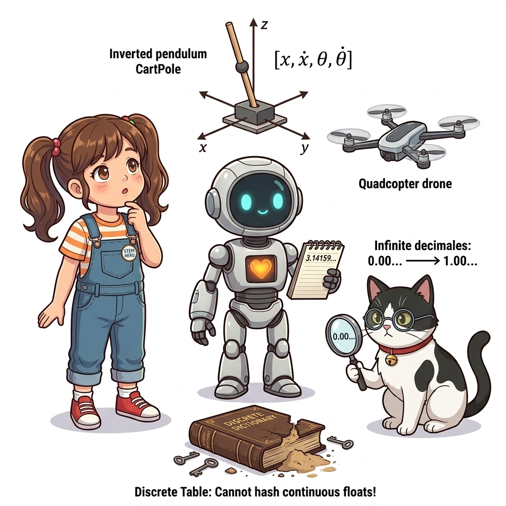
**그림 10-5-12** 무한한 별들로 가득한 연속 상태 공간의 우주: 상태마다 표를 만들 수 없는 광활한 세계에서도, 필요한 순간 즉석에서 계산하는 샘플 모델은 막힘없이 자유롭게 항해합니다.

---

### 2) 심층 신경망(Deep Neural Network)과의 완벽한 융합

- 11장부터는 테이블 형태의 `self.Q` 대신, 상태 벡터를 입력받아 각 행동의 Q값을 출력하는 **신경망 모델 `Q_network(state)`**를 사용할 것입니다.
- 신경망을 통과시켜 나온 출력 벡터에서 `np.argmax()`를 취하는 구조는 방금 우리가 완성한 **샘플 모델의 `get_action()` 구조와 100% 완벽하게 일치**합니다!

이로써 우리는 기초적인 테이블형 강화학습의 모든 거추장스러운 껍질을 벗겨내고, 딥 강화학습(Deep RL)의 바다로 뛰어들 준비를 완벽하게 마쳤습니다!

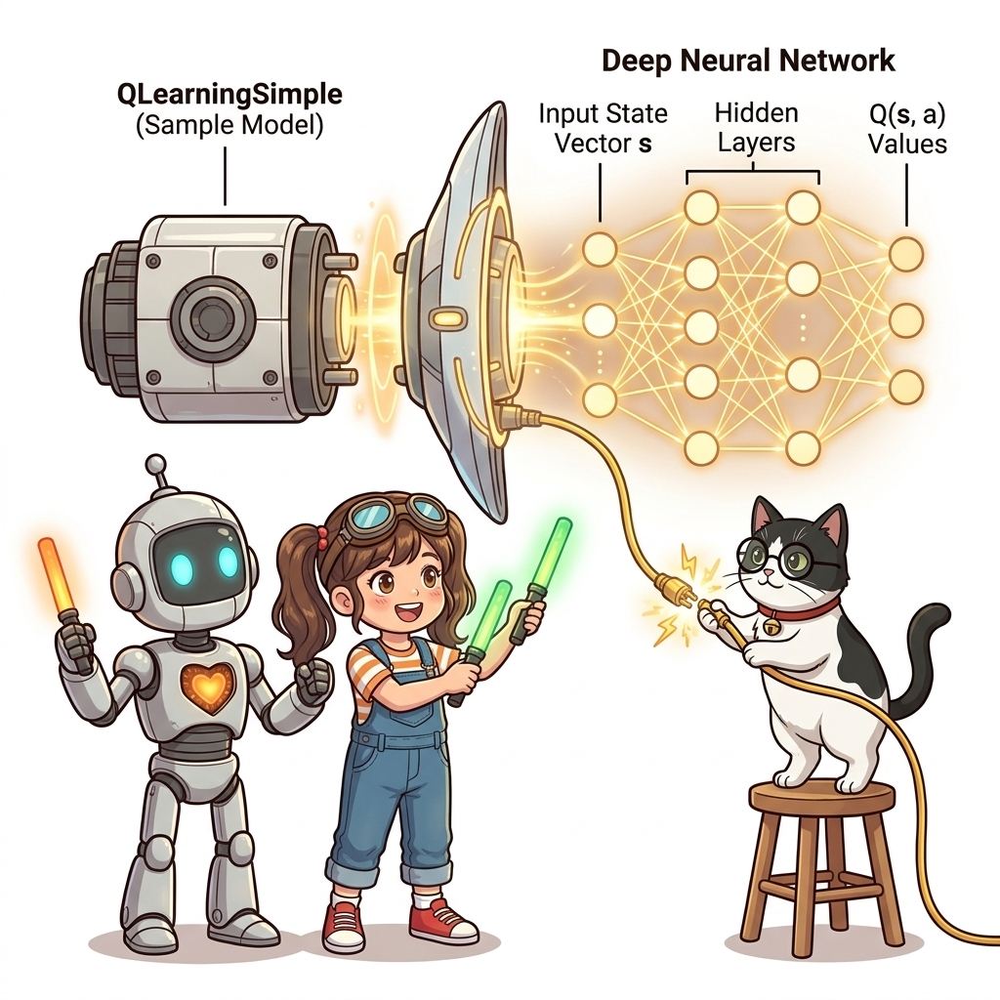
**그림 10-5-13** 테이블 `self.Q` 자리에 심층 신경망 모듈이 마치 맞춤 장갑처럼 완벽하게 도킹되는 순간: 샘플 모델의 `get_action()` 소켓이 딥러닝과 만나는 역사적 현장

---

## 10.5.5 핵심 정리: 초경량화 3대 핵심 기둥 및 10장 TD법 대단원 완성

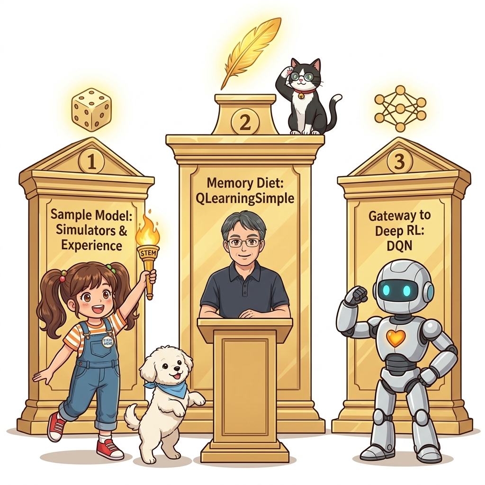
**그림 10-5-14** 초경량화 3대 기둥 기념비와 제10장 시간차 학습(TD) 대단원을 감동적으로 완주한 도로시 탐험대의 피날레

---

| 초경량화 핵심 기둥 | 핵심 내용 요약 | 비유 및 물리적 의미 |
| :--- | :--- | :--- |
| **1. 환경 모델 체계의 구분** | 완전한 확률 지도(분포 모델) vs 시뮬레이터(샘플 모델) | 백과사전 지도책과 자판기 시뮬레이터 |
| **2. 정책 딕셔너리의 완전 제거** | `self.pi`, `self.b` 없이 오직 `self.Q` 하나로 모든 것을 해결 | 무거운 바인더를 벗어던진 0-Byte 초경량화 |
| **3. DQN 딥러닝 호환 구조 완성** | `np.random.rand() < ε`와 `np.argmax()`로 연속 공간 및 신경망 직결 | 딥 강화학습(Deep RL) 시대로의 완벽한 출항 |

---

> 👨‍🏫 **이호진 교수님의 직강 노트**:  
> "단순함이 궁극의 정교함(Simplicity is the ultimate sophistication)이라는 레오나르도 다빈치의 명언처럼, 우리가 10.5절에서 완성한 `q_learning_simple.py`는 강화학습이 가장 아름답고 날렵한 형태로 정제된 걸작입니다. 이제 무거운 딕셔너리의 족쇄를 완전히 벗어던졌으니, 인공신경망이라는 강력한 엔진을 달고 무한한 연속 세계로 힘차게 날아오를 준비가 끝난 것입니다!"

---

> 🐱 **조교 지니의 응원 노트**:  
> "도로시와 여러분, 제10장 시간차 학습(TD)의 대장정을 드디어 모두 완주하셨습니다냥! 10.1절 TD 정책 평가부터 10.2절 SARSA, 10.3절 오프-정책 SARSA, 10.4절 Q-러닝, 그리고 오늘 10.5절 초경량 샘플 모델 다이어트까지! 이로써 여러분은 전통적 강화학습의 모든 원리를 마스터하셨어요. 다음 11장에서는 마침내 **딥러닝 인공신경망**을 장착하여 진정한 AI 에이전트로 각성해 봅시다냥!"
