# 10.6 제10장 정리: 시간차 학습(TD)의 마스터와 인공신경망으로의 도약

현대 강화학습(Reinforcement Learning)의 가장 위대한 지적 성취 중 하나인 **시간차 학습(TD: Temporal Difference Learning)**의 전 과정을 총정리합니다.


**그림 10-6-1** 제10장 시간차 학습(TD)의 전체 알고리즘 계보와 인공신경망(DQN)으로의 찬란한 도약을 한눈에 조망하는 마스터 종합 로드맵

---

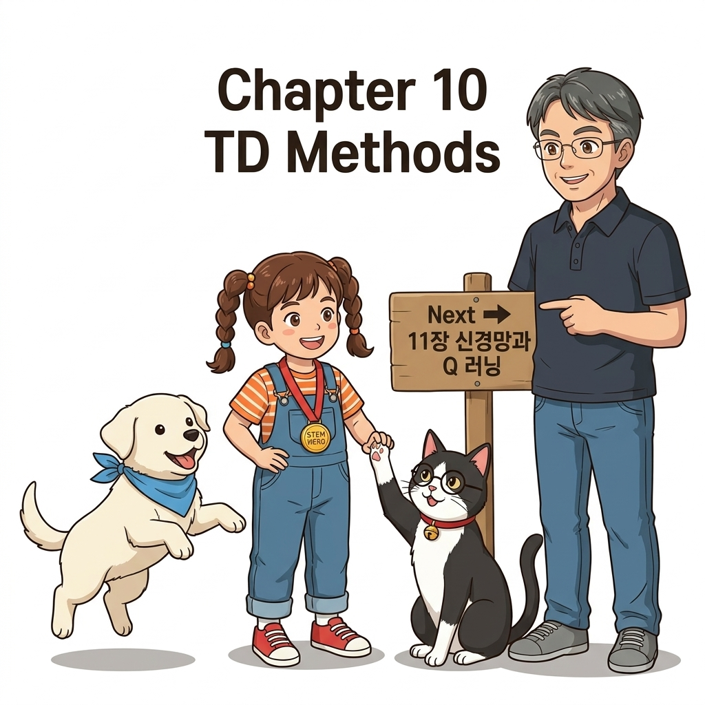
**그림 10-6-2** 10장 시간차 학습(TD)의 모든 여정을 완수하고 자랑스러운 금빛 메달을 목에 건 채 지니 조교와 힘차게 하이파이브하는 도로시, 토토, 그리고 틴맨

---

### 🎓 10.6 제10장 총정리 5대 핵심 마일스톤

우리는 제10장을 통해 모델이 없는 실세계에서 에이전트가 단 1걸음의 경험만으로 실시간 학습을 수행하는 경이로운 알고리즘들을 직접 구현했습니다:

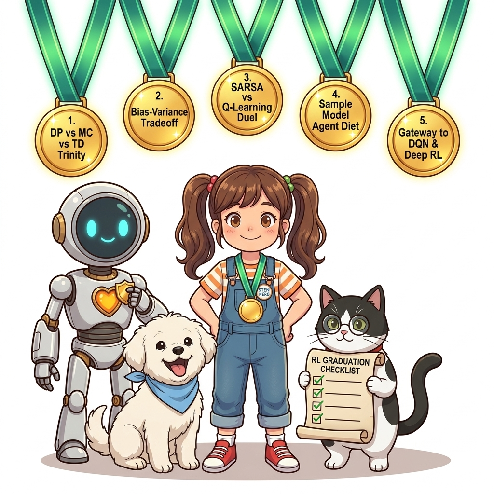
**그림 10-6-3** 10장 TD법을 지탱하는 5대 핵심 황금 마일스톤 메달: 1) 강화학습 삼위일체, 2) 편향-분산 결투, 3) SARSA vs Q-러닝 대조, 4) 샘플 모델 에이전트 다이어트, 5) 딥 강화학습(DQN)으로의 황금 관문

- **5대 핵심 성취**:
  1. **강화학습 3대 패러다임의 통합**: DP(동적 계획법), MC(몬테카를로법), TD(시간차 학습)의 수학적·구조적 본질 완벽 정리
  2. **편향(Bias)과 분산(Variance)의 트레이드오프**: 실전 학습에서 왜 TD의 낮은 분산이 압도적 수렴 속도를 보장하는지 규명
  3. **TD 제어 알고리즘 양대 산맥 정복**: 온-정책의 수호자 **SARSA**와 오프-정책의 제왕 **Q-러닝**의 철학적·수식적 대조
  4. **중요도 가중치 $\rho$의 완전 소거**: 복잡하고 위험한 확률 비율 $\rho$를 수학적으로 소멸시킨 벨만 최적 방정식의 마법
  5. **에이전트의 초경량화와 인공신경망 도약**: 거대한 분포 딕셔너리를 버리고 11장 파이토치(PyTorch)와 12장 DQN으로 직행하는 발판 마련

---

## 10.6.1 강화학습 3대 패러다임 총괄 비교

강화학습 에이전트가 가치 함수를 학습하는 방법은 크게 세 가지로 분류됩니다. 우리가 걸어온 3대 패러다임의 특성을 한눈에 비교해 봅시다:

| 비교 기준 | 📐 동적 계획법 (DP) | 🎲 몬테카를로법 (MC) | ⚡ 시간차 학습 (TD) |
| :--- | :--- | :--- | :--- |
| **환경 모델 사전 지식** | **필수 ($P$, $R$ 완전 분포 필요)** | **불필요 (Model-Free, 경험 샘플)** | **불필요 (Model-Free, 1-스텝 샘플)** |
| **갱신 시점** | 전 상태 일괄 스캔 (Offline Sweep) | **에피소드 종료 시점 (지연 갱신)** | **매 타임스텝 즉시 (실시간 1-Step 갱신)** |
| **부트스트랩 (추정치 재사용)** | **사용함 (O)** | 사용 안 함 (X, 실제 참 수익 $G$ 사용) | **사용함 (O, 다음 상태 가치 재사용)** |
| **편향 (Bias)** | 가치 초기화에 따른 편향 존재 | **편향 없음 (Zero Bias, 완벽한 무편향)** | 초기 편향 존재 (부트스트랩 추정치 사용) |
| **분산 (Variance)** | 전이 기댓값 전수 계산으로 **분산 0** | 누적 곱·환경 무작위성으로 **분산 높음** | 1스텝 샘플링으로 **분산 매우 낮음** |
| **적용 과제** | 닫힌 수학적 모델 환경만 가능 | 일회성 과제(Episodic)만 가능 | 일회성 과제 및 **영구 지속 과제(Continuing) 모두 가능** |
| **수렴 속도** | 모델 계산 비용이 상태 수에 비례 | 분산이 커서 대량의 샘플 필요 | **실제 실세계에서 가장 빠르고 안정적** |

---

### 1) 백업 다이어그램(Backup Diagram) 심층 대조

세 기법의 정보 전달 메커니즘은 백업 다이어그램을 비교할 때 가장 선명하게 이해할 수 있습니다:

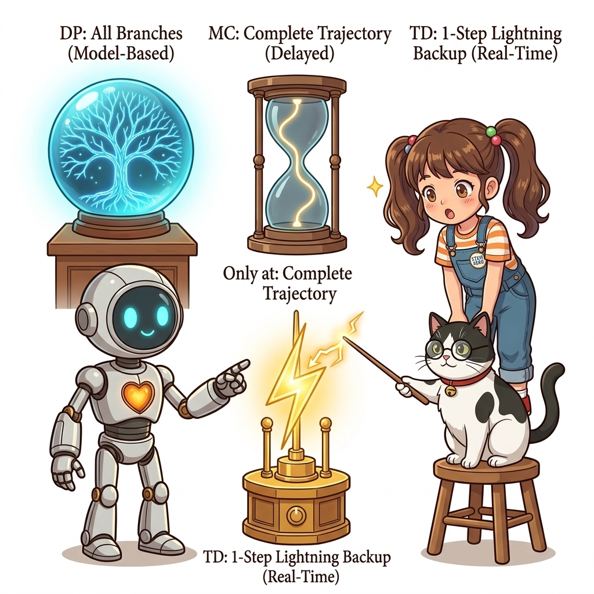
**그림 10-6-4** 강화학습 3대 패러다임의 백업 구조: DP의 전수 분기 스캔(좌), MC의 에피소드 종단 완주 궤적(중), TD의 단 1걸음 실시간 부트스트랩 번개 백업(우)

> ### ***강화학습 3대 패러다임의 핵심 요약***
>
> 1. **DP (Dynamic Programming)**: 환경 지도를 완벽히 알고 있을 때 모든 가능한 분기를 펼쳐 놓고 수학적 기댓값을 계산하는 **"완전 탐색 기법"**
> 2. **MC (Monte Carlo)**: 환경 지도가 전혀 없을 때 끝까지 직접 달려본 후 누적된 참 수익 $G_t$로 평균을 내는 **"완주 후 반성 기법"**
> 3. **TD (Temporal Difference)**: 환경 지도가 없어도 단 1걸음 발을 내딛자마자 다음 발판의 가치를 빌려와 즉시 현재 발판을 갱신하는 **"실시간 부트스트랩 기법"**

---

### 2) 편향과 분산의 트레이드오프: 양궁 과녁 결투

왜 실세계 강화학습에서는 MC보다 TD가 압도적으로 널리 쓰일까요? 바로 **분산(Variance)**의 차이 때문입니다:

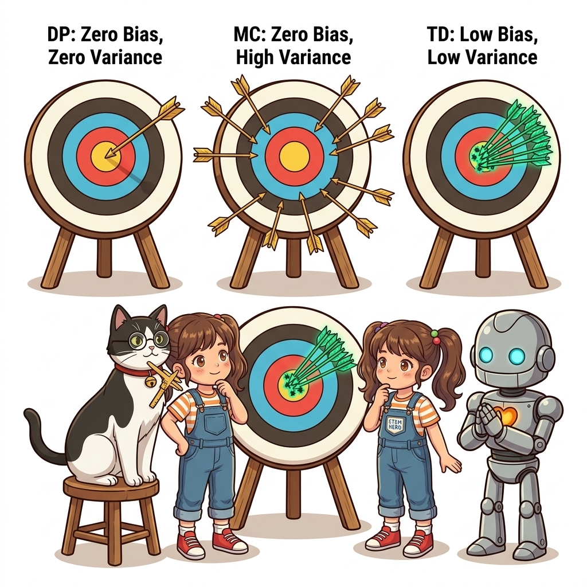
**그림 10-6-5** 3대 패러다임의 양궁 과녁 탄착군 비교: DP(정중앙 단일 점, 무편향·0분산), MC(평균은 정중앙이나 넓게 퍼진 고분산), TD(약간 치우쳐 있으나 초정밀 집탄군을 형성하는 초저분산)

---

- **MC의 딜레마 (무편향 + 고분산)**:
  - 에피소드가 길어질수록 수십, 수백 번의 상태 전이와 환경 무작위성이 곱해져 수익 $G_t = R_{t+1} + \gamma R_{t+2} + \cdots$의 분산이 폭발합니다.
  - 탄착군이 과녁 전체에 흩뿌려져 있으므로, 신뢰할 수 있는 평균을 얻으려면 천문학적인 수의 에피소드가 필요합니다.

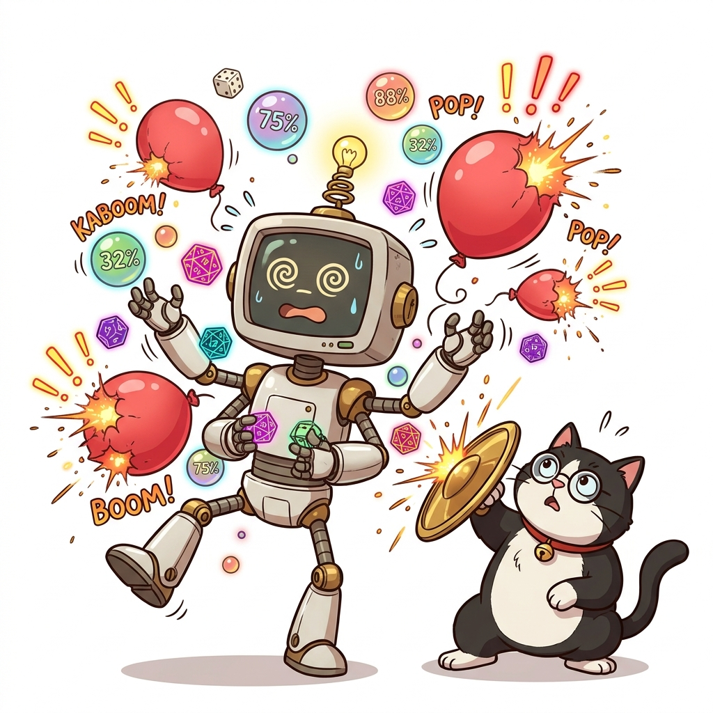
**그림 10-6-6** 수백 번의 무작위 곱셈이 누적되며 걷잡을 수 없이 팽창하여 폭발하는 MC 누적 곱의 극심한 분산 딜레마

---

- **TD의 승리 (약간의 편향 + 초저분산)**:
  - 오직 단 1스텝의 보상 $R_{t+1}$과 다음 가치 $\gamma V(S_{t+1})$만 사용하므로, 미래의 무수한 불확실성이 차단되어 분산이 극도로 낮습니다.
  - 초기에는 부트스트랩 추정치로 인한 편향이 있지만, 학습이 반복되면서 참 가치로 번개처럼 빠르게 수렴합니다.

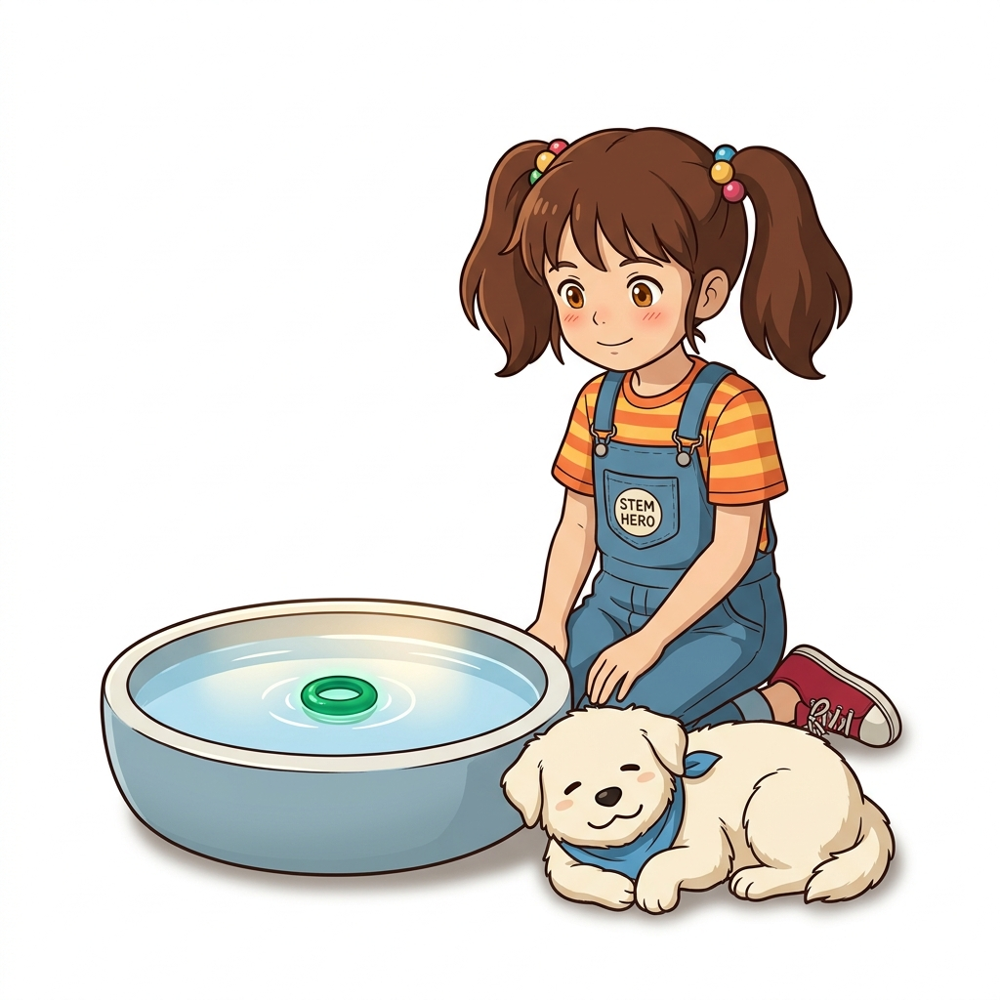
**그림 10-6-7** 오직 1-스텝 미래만 빌려와 잔잔한 호수처럼 극도의 안정성을 유지하며 참 가치로 번개 수렴하는 TD 부트스트랩의 승리

---

## 10.6.2 TD 제어 알고리즘: SARSA vs Q-러닝 완전 정복

가치 함수를 평가하는 단계를 넘어, 최적의 정책을 찾아내는 **TD 제어(Control)** 단계에서 우리는 두 위대한 알고리즘을 구축했습니다:

| 비교 기준 | 🛡️ SARSA (온-정책) | ⚖️ 오프-정책 SARSA | 👑 Q-러닝 (오프-정책) |
| :--- | :--- | :--- | :--- |
| **이론적 근간** | **벨만 기대 방정식** | 벨만 기대 방정식 | **벨만 최적 방정식** |
| **핵심 갱신 점화식** | $Q \leftarrow Q + \alpha[R + \gamma Q(S', A') - Q]$ | $Q \leftarrow Q + \alpha[\rho(R + \gamma Q(S', A')) - Q]$ | $Q \leftarrow Q + \alpha[R + \gamma \mathbf{\max_a Q(S', a)} - Q]$ |
| **중요도 가중치 $\rho$** | **불필요 (단일 정책 $\pi = b$)** | **필수 ($\rho = \pi(A' \mid S') / b(A' \mid S')$)** | **완전 소거 (수학적 0 분모 불필요!)** |
| **탐험 정책과 학습 대상** | 동일한 $\varepsilon$-탐욕 정책으로 행동 및 갱신 | 행동 정책 $b$로 움직이고 대상 정책 $\pi$ 갱신 | 행동 정책 $b$로 탐험, 대상 정책 $\pi$는 100% 탐욕 |
| **행동 성향 (절벽 걷기)** | 탐험 실수를 감안한 **보수적 안전 우회로** | 가중치 요동으로 인해 불안정 | 실수 가능성을 분리한 **과감한 최단 지름길** |
| **구현 아키텍처** | `deque(maxlen=2)` 대기 버퍼 필수 | 2개 정책 확률 딕셔너리 관리 | **버퍼 불필요! 1스텝 즉시 갱신 (`step()` 직후)** |

---

### 1) SARSA vs Q-러닝의 철학적 대조

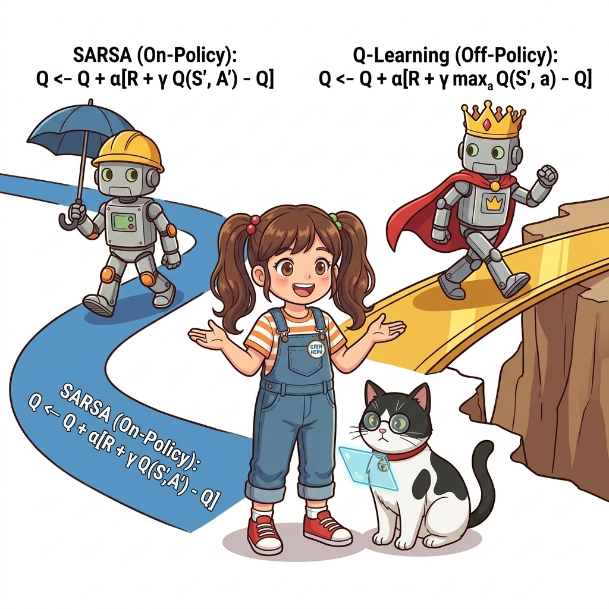
**그림 10-6-8** 현실을 있는 그대로 수용하는 온-정책 SARSA(좌: 안전 우회로) vs 이상적인 최적 행동을 목표 삼는 오프-정책 Q-러닝(우: 과감한 최단 지름길)

---

- **SARSA (On-Policy)**:
  - 에이전트 자신이 $\varepsilon$의 확률로 엉뚱한 행동을 할 수 있다는 "자신의 불완전성"을 스스로 인정합니다.
  - 따라서 절벽 바로 옆 지름길 대신, 실수로 떨어질 확률이 전혀 없는 안전한 벽 쪽 우회로를 학습합니다.


**그림 10-6-9** 탐험 실수의 위험을 가치에 온전히 반영하여 튼튼한 난간이 있는 안전 우회로를 스스로 개척하는 SARSA의 지혜

---

- **Q-러닝 (Off-Policy)**:
  - 현재 행동($A$)은 마음껏 탐험($b$)하더라도, 다음 상태에서 바라보는 미래 가치는 오직 "가장 뛰어난 최선의 행동($\max_a Q$)"만을 기준으로 평가합니다.
  - 에이전트의 실수 가능성에 위축되지 않고, 환경이 허용하는 수학적 절대 최적 경로(지름길)를 완벽히 찾아냅니다.


**그림 10-6-10** 발밑의 바람에 위축되지 않고 저 멀리 산꼭대기에서 빛나는 'MAX' 황금 왕관을 확고하게 직시하며 최단 지름길을 질주하는 Q-러닝

---

### 2) 중요도 샘플링 $\rho$의 딜레마와 Q-러닝의 $\rho$ 완전 소거 승리

오프-정책 학습에서 서로 다른 두 정책의 분포 불일치를 보정하기 위해 도입했던 중요도 가중치 $\rho$는 치명적인 약점을 안고 있었습니다:

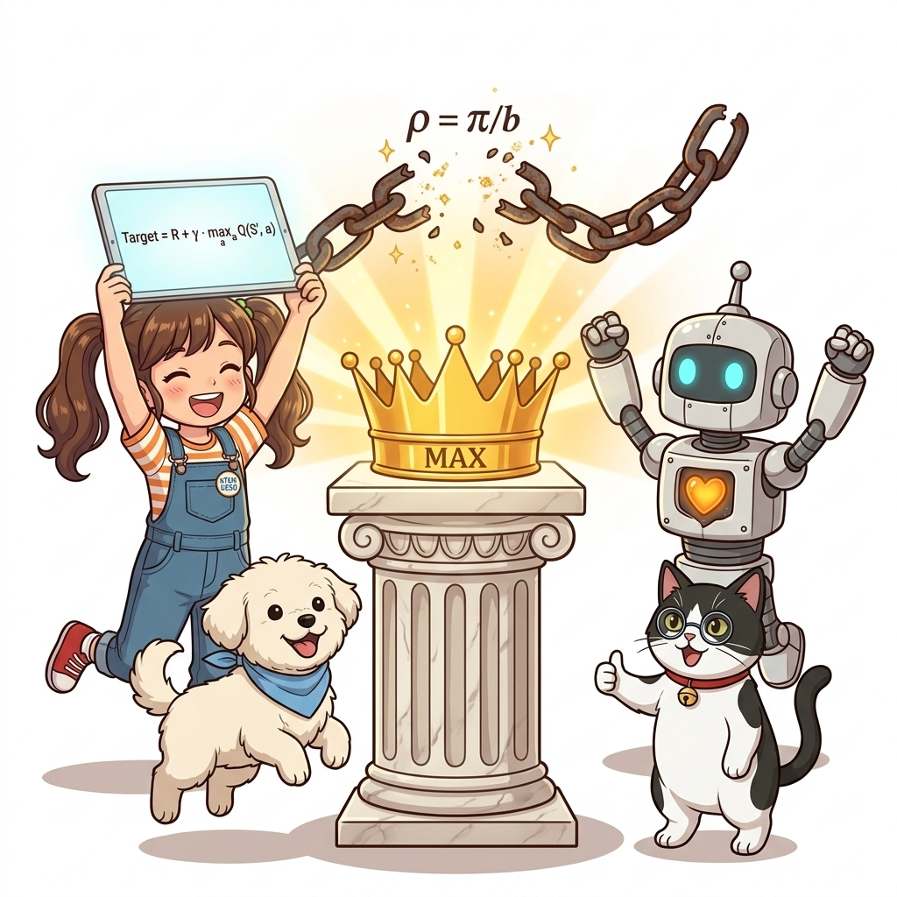
**그림 10-6-11** 탐험 행동 시 $\rho=0$으로 가치가 증발하던 오프-정책 SARSA의 족쇄를 끊어내고, max 연산자로 $\rho$를 완전히 소멸시킨 Q-러닝의 찬란한 황금 왕관

---

### ***Q-러닝이 중요도 가중치 $\rho$를 지워버린 수학적 원리***

1. 오프-정책 SARSA에서는 대상 정책 $\pi$가 탐욕 정책일 때, 행동 정책 $b$가 탐험 행동을 선택하면 $\pi(A' \mid S') = 0$이 되어 **중요도 비율 $\rho = 0$**이 됩니다.
2. 그 결과 힘들게 얻은 보상과 다음 상태 가치가 통째로 증발(0 곱셈)하여 학습 효율이 극도로 떨어졌습니다.
3. 하지만 Q-러닝은 **벨만 최적 방정식(Bellman Optimality Equation)**을 기초로 삼아 대상 정책의 가치 기댓값을 단 하나의 확정적 값인 **$\max_a Q(S_{t+1}, a)$**로 직접 치환했습니다:

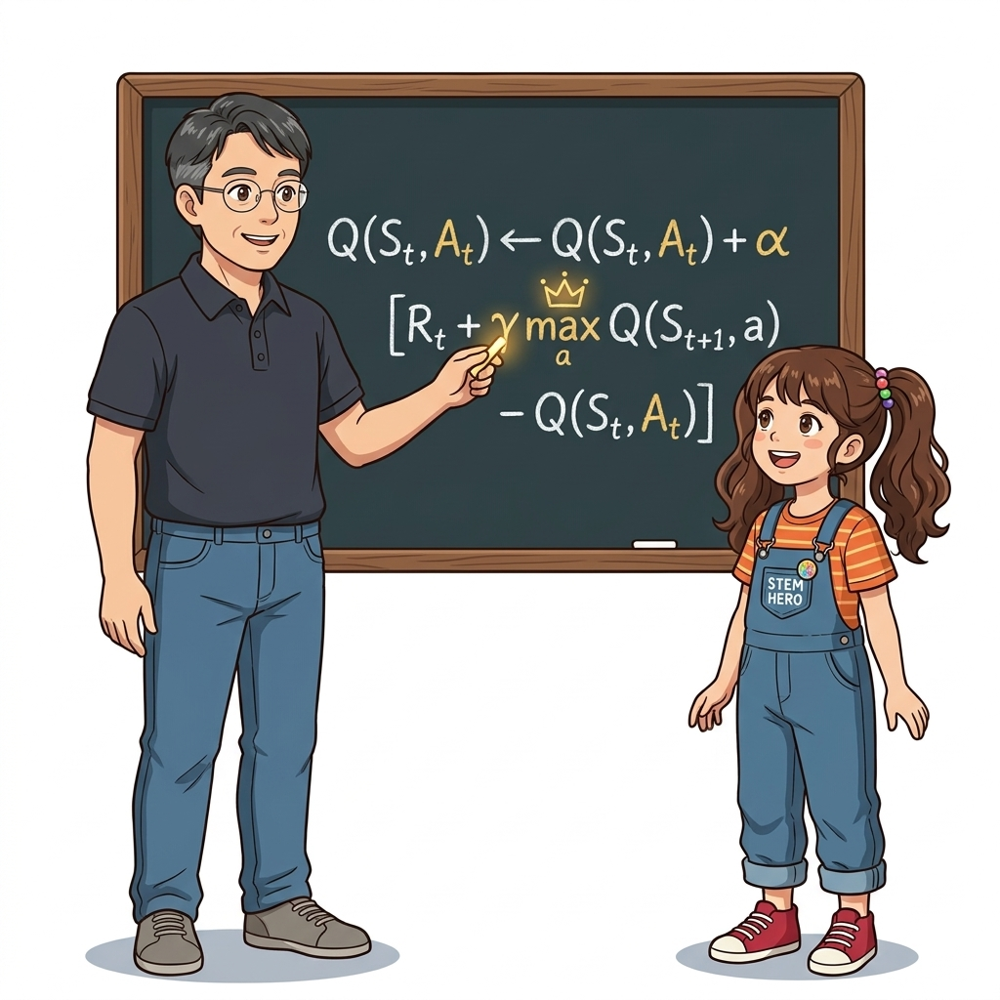
**그림 10-6-12** 이호진 교수님이 대형 칠판에서 황금 분필로 벨만 최적 방정식으로부터 Q-러닝 갱신식을 완벽하게 유도하시는 직강 모습

> ### **Q-러닝 타깃 = $R_t + \gamma \cdot \max_a Q(S_{t+1}, a)$**

4. 다음 행동 $A'$을 확률적으로 뽑을 필요가 아예 사라졌으므로, **분모 $b$와 분자 $\pi$의 확률 비율 $\rho$ 자체가 수식에서 영원히 소거**되었습니다!

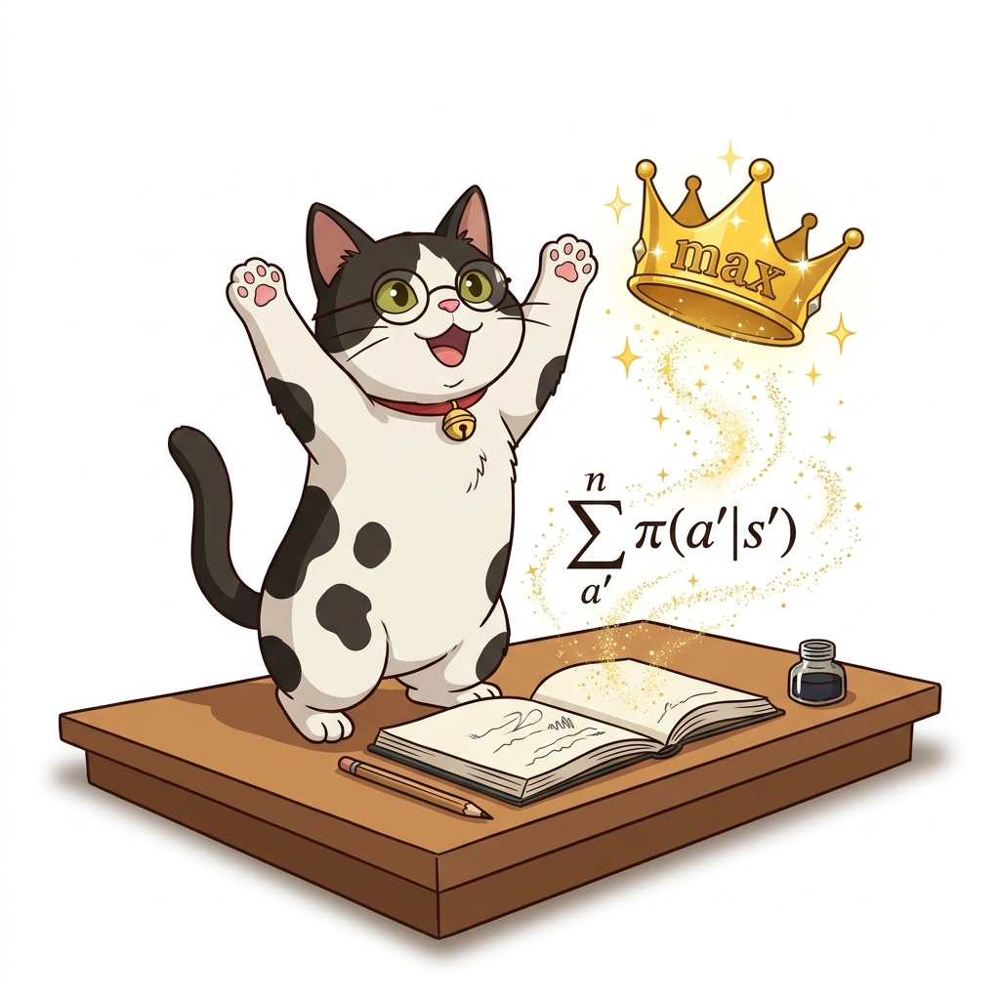
**그림 10-6-13** 복잡한 $\sum \pi$ 기호가 금가루로 흩어지고 찬란한 $\max$ 황금 왕관이 나타나며 위험한 $\rho$의 족쇄가 완전히 풀려나는 순간

---

### 3) 절벽 걷기 과제(Cliff Walking) 최종 시상대 판정

두 알고리즘의 성향 차이는 우리가 직접 실습한 절벽 걷기 과제에서 극적으로 입증되었습니다:

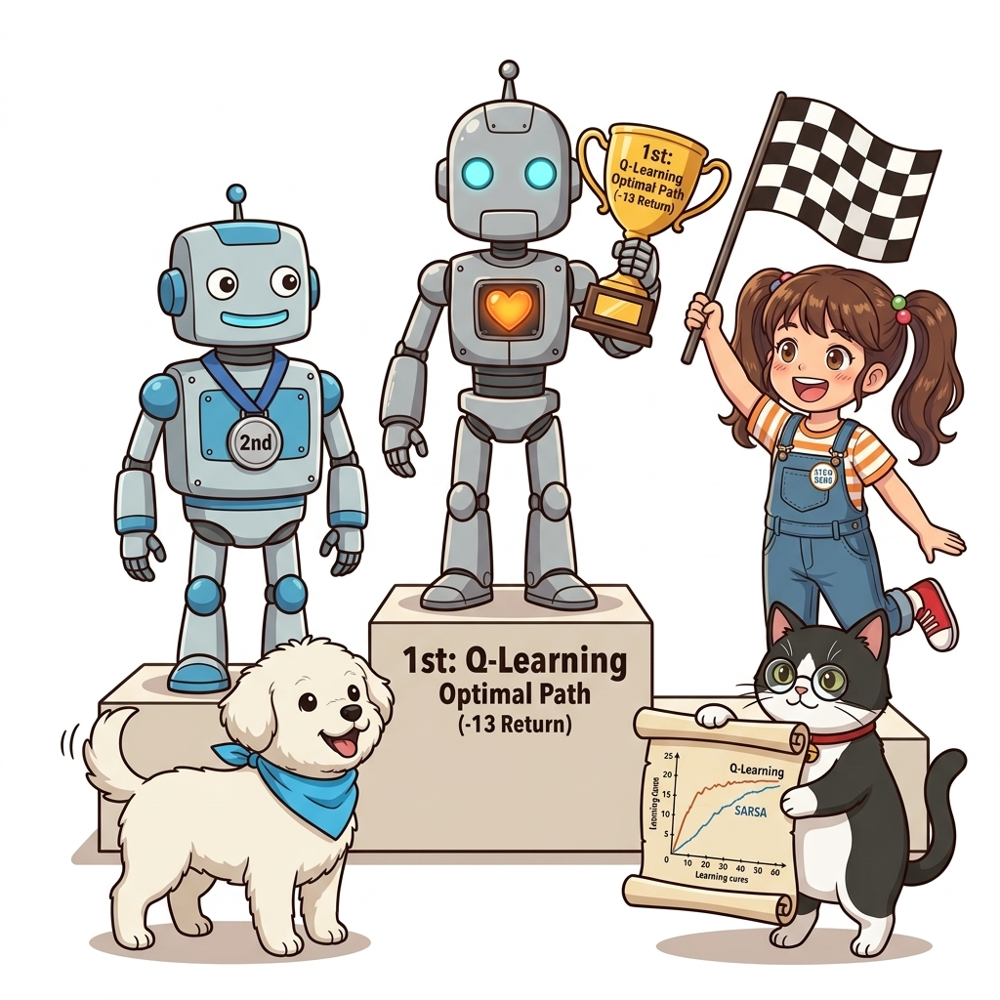
**그림 10-6-14** 절벽 걷기 과제의 최종 시상대: 과감한 최단 지름길로 최적 보상(-13)을 달성한 Q-러닝 1위, 탐험 실수를 피해 안전 우회로(-17)를 선택한 SARSA 2위

- **Q-러닝의 최적 경로 (최단 13걸음, 누적 보상 -13)**:
  - 절벽 낭떠러지 바로 윗줄을 아슬아슬하게 직진하여 목표에 도달합니다.
  - 최적 정책을 순수하게 추출할 때는 압도적인 1등 성능을 발휘합니다.
- **SARSA의 안전 경로 (안전 17걸음, 누적 보상 -17)**:
  - 10%의 탐험 실수로 절벽(-100점)에 떨어지는 참사를 막기 위해 위쪽 벽면으로 크게 돌아갑니다.
  - 로봇 하드웨어가 파손되면 안 되는 실제 공학 현장에서는 SARSA와 같은 온-정책의 보수적 안전성이 매우 중요하게 평가받기도 합니다.

---

## 10.6.3 에이전트 구조의 대전환: 분포 모델에서 샘플 모델로

10.5절에서 우리는 강화학습 코드베이스 전체를 혁신한 **에이전트 초경량 다이어트**를 단행했습니다:

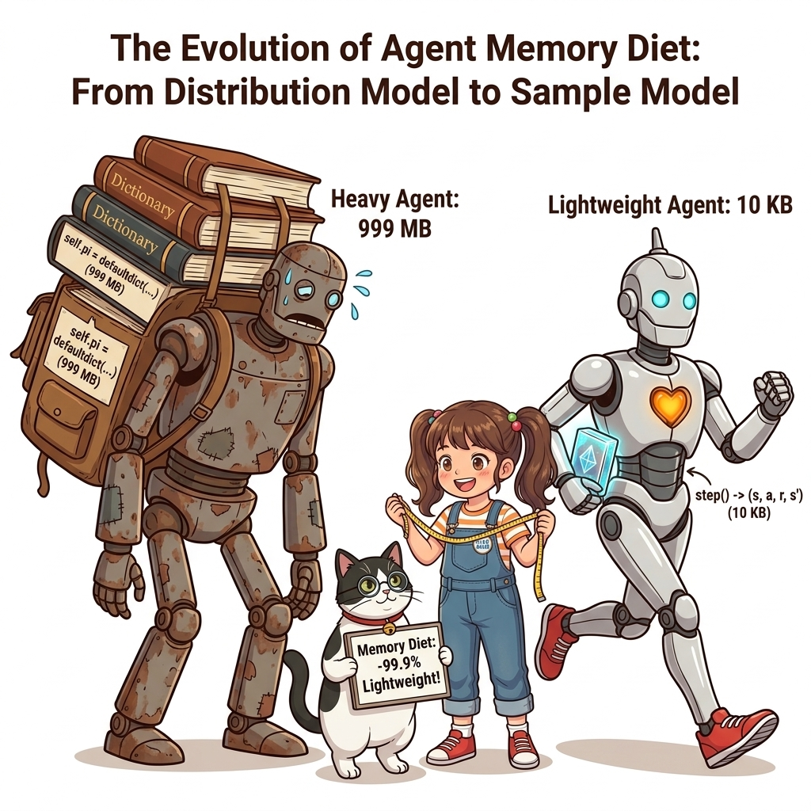
**그림 10-6-15** 거대한 정책 확률 딕셔너리(`self.pi`)를 짊어지던 무거운 로봇(좌)에서, 오직 단 1줄의 실시간 결정(`argmax Q`)만으로 작동하는 초경량 육상선수 틴맨(우)으로의 진화

---

```python
# [과거: 분포 모델 기반 QLearningAgent (무거운 딕셔너리)]
class QLearningAgent:
    def __init__(self):
        self.pi = defaultdict(lambda: {a: 0.25 for a in self.actions}) # 48개~수억 개 딕셔너리
        self.b = defaultdict(lambda: {a: 0.25 for a in self.actions})

# [현재: 샘플 모델 기반 QLearningAgentSimple (초경량 날렵한 구조)]
class QLearningAgentSimple:
    def get_action(self, state):
        if np.random.rand() < self.epsilon:
            return np.random.choice(self.actions) # 즉석 난수 탐험 (동전 튕기기!)
        else:
            return max(self.q_table[state], key=self.q_table[state].get) # 즉석 탐욕 결정 (argmax!)
```

- **메모리 99.9% 절감**: 12개 상태에 불과했던 그리드월드에서도 수백 바이트를 차지하던 불필요한 확률 딕셔너리가 완전히 사라졌습니다.
- **연산 속도 극대화**: 매 스텝 확률 분포를 갱신하고 정규화하던 오버헤드가 사라지고, 즉석에서 $O(1)$로 행동을 결정합니다.
- **단일 원천(Single Source of Truth)**: 정책을 별도로 기억하지 않고 오직 **Q-테이블 하나만** 유지함으로써 상태 간 동기화 버그가 원천 차단되었습니다.

---

## 10.6.4 테이블 기반 RL의 한계: 차원의 저주(Curse of Dimensionality)

하지만 10장까지 우리가 사용한 Q-테이블(Lookup Table)은 거대한 현실 세계의 벽 앞에서 치명적인 한계에 부딪힙니다:

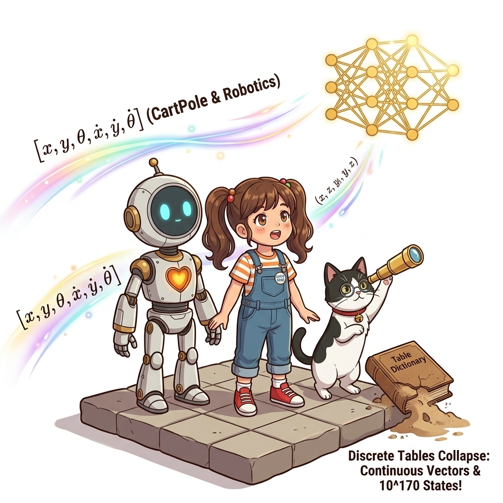
**그림 10-6-16** 3x4 이산 격자판의 작은 돌섬을 벗어나 마주한 무한한 연속 상태 공간의 바다. 무수한 소수점 상태 앞에서는 거대한 테이블 색인 책이 모래처럼 바스러집니다.

---

### ***테이블 기반 강화학습이 무너지는 이유***

1. **이산 상태 수의 폭발**:
   - 그리드 월드 (3x4): 12개 상태
   - 체스 (Chess): 약 $10^{47}$개 상태
   - 바둑 (Go): 약 **$10^{170}$개 상태** (우주 전체의 원자 수보다 많음)

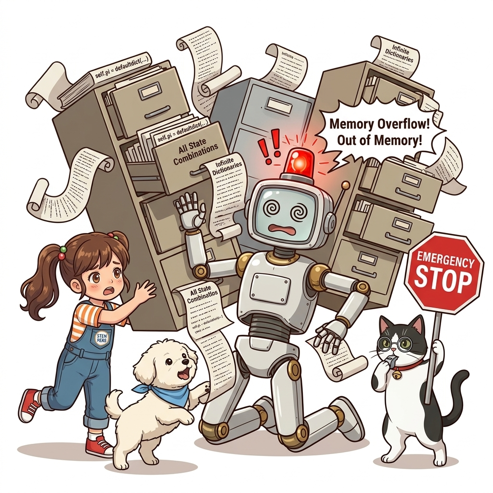
**그림 10-6-17** 바둑과 체스처럼 상태 수가 우주 원자 수를 넘어서는 순간, 수억 개의 바인더 책장조차 감당하지 못하고 붕괴하는 테이블 방식의 한계

---

2. **연속 상태 공간 (Continuous State Space)**:
   - 로봇 팔의 관절 각도, 자율주행차의 속도와 조향각, 카트폴의 각도 $[0.12345\dots]$ 등 실세계 데이터는 **연속적인 실수(Float)**입니다.
   - 실수는 무한히 쪼개질 수 있으므로, 상태 하나하나를 딕셔너리 키(`state = [x, y, θ, ẋ]`)로 저장하면 **단 한 번도 똑같은 상태를 다시 만날 수 없어 학습이 영원히 불가능**해집니다!

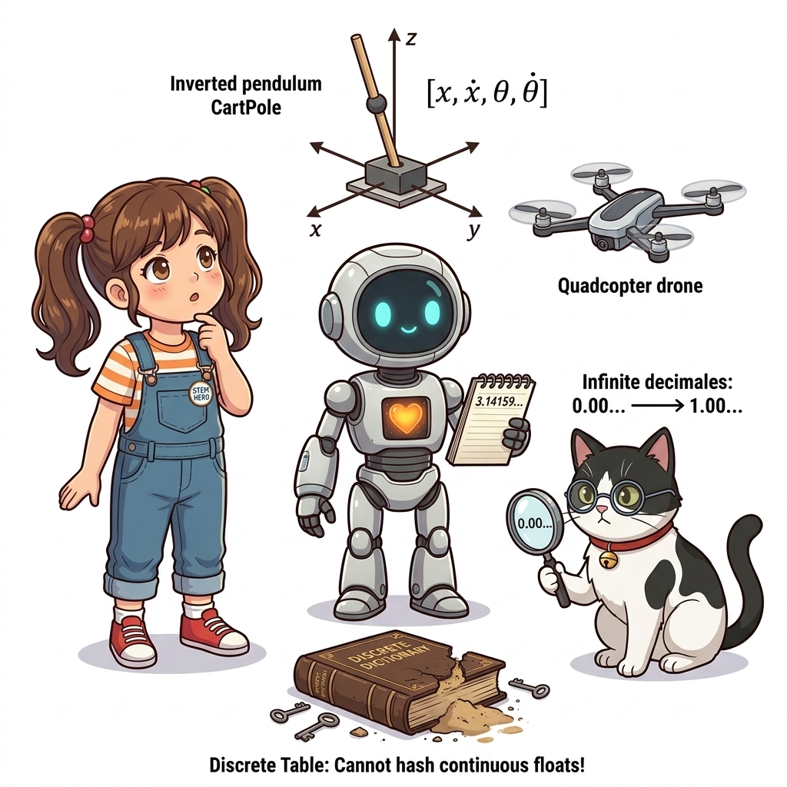
**그림 10-6-18** 끝없이 펼쳐진 연속 실수 좌표계의 우주 바다: 테이블 색인으로는 단 한 번도 동일한 좌표를 다시 찾을 수 없는 근본적 벽

---

## 10.6.5 제11장 인공신경망으로의 도약: 함수 근사(Function Approximation)

이 차원의 저주를 극복하기 위해 인류가 고안해 낸 궁극의 해법이 바로 **함수 근사(Function Approximation)**이며, 그 핵심 엔진이 **인공신경망(Artificial Neural Network)**입니다:


**그림 10-6-19** 파이토치(PyTorch)와 다층 신경망(ANN)의 찬란한 황금 관문 앞에서 여러분을 환영하시는 이호진 교수님과 호기심에 가득 찬 도로시, 토토, 틴맨, 그리고 지니 조교

---

### ***테이블 Lookup에서 신경망 함수 추정으로의 대전환***

* **10장까지의 방식 (테이블)**:
  * $Q(s, a)$를 메모리 칸에 일일이 적어두고 꺼내 씀 (*Lookup*)
  * 가보지 않은 상태에 대해서는 가치를 전혀 알 수 없음 (*Zero Generalization*)
* **11장부터의 방식 (인공신경망)**:
  * 상태 벡터 $\mathbf{s}$를 신경망의 입력층에 넣으면, 학습된 가중치 파라미터 $\mathbf{w}$를 거쳐 모든 행동의 가치 **$Q(\mathbf{s}, a; \mathbf{w})$**를 곡선으로 매끄럽게 추정 (*Inference*)
  * 이전에 본 적 없는 새로운 소수점 상태를 만나더라도, 인접한 상태들의 경험으로부터 놀라운 **일반화(Generalization)** 능력을 발휘!

---

## 10.6.6 제12장 DQN 예고: 딥마인드 아타리 혁명의 서막

우리가 10장에서 갈고닦은 초경량 **Q-러닝의 벨만 최적 점화식**은 11장의 **파이토치 심층 신경망**과 결합하여 마침내 강화학습 역사의 전설적인 이정표인 **DQN(Deep Q-Network)**으로 완성됩니다:

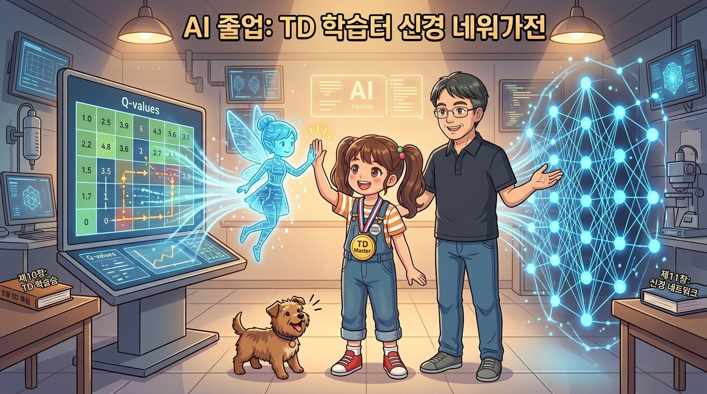
**그림 10-6-20** 2차원 격자판 Q-테이블을 졸업하고, 아타리 비디오게임 화면 픽셀을 입력받아 초인적 플레이를 펼치는 11장~12장의 심층 강화학습(Deep Reinforcement Learning) 세계로 위풍당당하게 행진하는 원정대

---

- **11장 (인공신경망 기초 & 파이토치)**:
  - 텐서(Tensor) 연산, 역전파(Backpropagation), 경사하강법(SGD)을 마스터하고 파이토치로 신경망을 직접 빌드합니다.
  - Q-테이블 대신 신경망 가중치를 갱신하는 **신경망 Q-러닝(Neural Q-Learning)**을 탄생시킵니다.

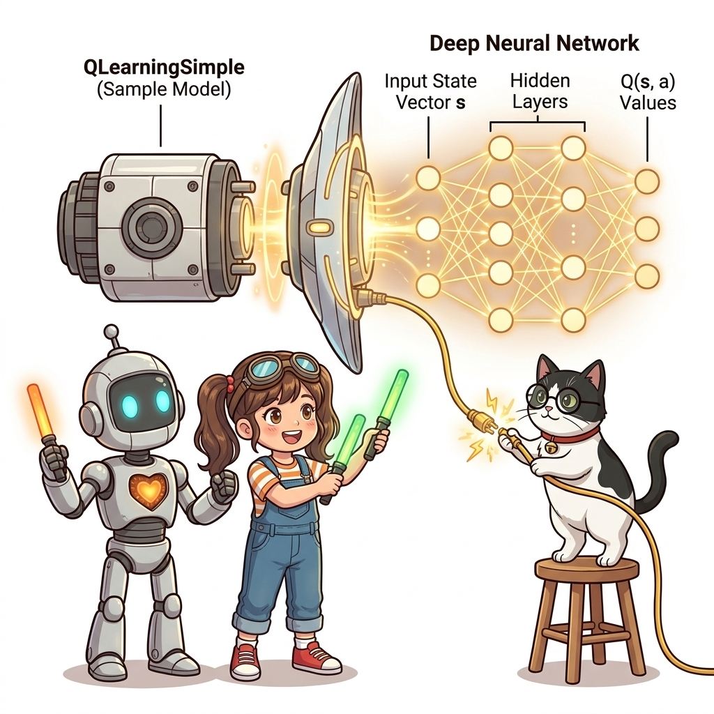
**그림 10-6-21** 테이블 `self.Q` 자리에 파이토치 인공신경망 모듈이 마치 맞춤 장갑처럼 완벽하게 도킹되는 현대 강화학습의 위대한 전환점

---

- **12장 (DQN: Deep Q-Network)**:
  - 2015년 네이처(Nature) 표지를 장식하며 알파고(AlphaGo)의 모태가 된 딥마인드의 **DQN 알고리즘**을 바닥부터 구현합니다.
  - 경험 리플레이(Experience Replay)와 타깃 네트워크(Target Network)를 장착하여 비디오게임을 스스로 정복하는 인공지능 에이전트를 만나게 됩니다.

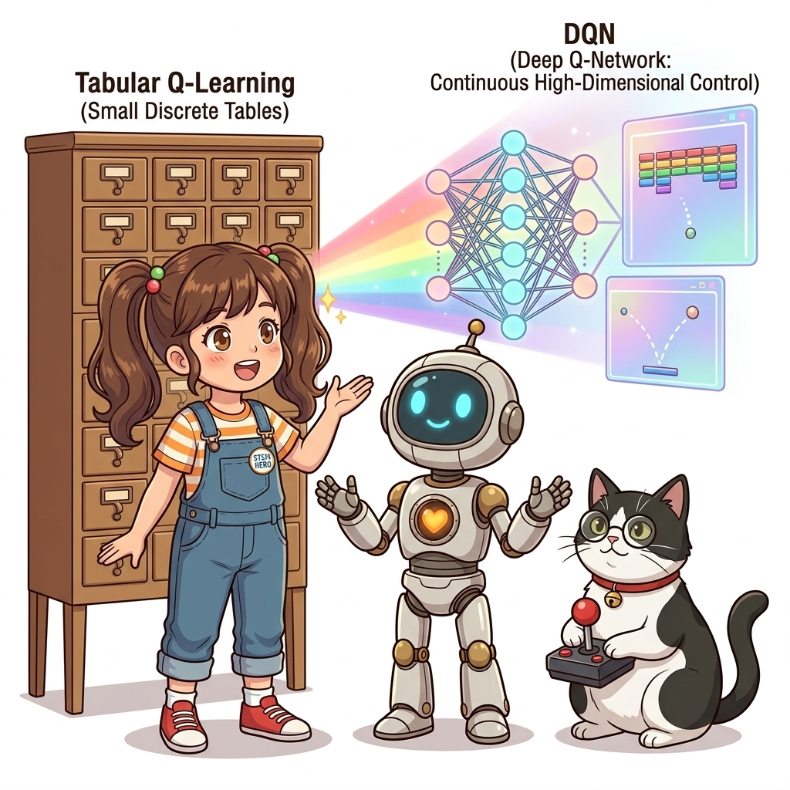
**그림 10-6-22** 테이블 기반 Q-러닝이 심층 신경망과 결합하여 아타리 게임기와 세상을 제패한 딥마인드 DQN으로의 찬란한 진화

---

### 🎓 제10장 시간차 학습(TD) 마스터 졸업식


**그림 10-6-23** 제10장의 전 과정을 훌륭히 완주한 도로시와 친구들에게 이호진 교수님이 수여하는 'TD 마스터 황금 학위증'과 학사모를 던지며 환호하는 감동의 피날레

---

> 👨‍🏫 **이호진 교수님의 마무리 격려사**:  
>
> *"축하합니다! 여러분은 이제 강화학습 역사상 가장 강력하고 실용적인 알고리즘인 **시간차 학습(TD)**, **SARSA**, 그리고 **Q-러닝**의 모든 이론과 파이썬 구현을 완벽히 마스터했습니다.*
>
> *환경 모델이 없는 험난한 바깥세상에서 에이전트가 단 1걸음의 실수와 피드백을 디딤돌 삼아 최적의 해법을 찾아가는 과정은 인공지능뿐만 아니라 우리 삶의 배움과도 깊이 맞닿아 있습니다.*
>
> *10장에서 완성한 이 튼튼한 토대 위에서, 이제 우리는 인공신경망이라는 날개를 달고 무한한 연속 세계를 정복하러 떠납니다. 11장 딥러닝과 파이토치의 세계에서 더욱 눈부신 지적 모험을 함께 이어갑시다!"*
