# CHAPTER 10 TD법: 시간차 학습

**그림 10-Intro-1** 동적 계획법(DP)의 부트스트랩과 몬테카를로(MC)의 경험 모델 프리 샘플링을 융합하여 실시간 온라인 학습을 완성하는 제10장 시간차 학습(TD)의 전체 조감도

---

## 10.0.1 몬테카를로법(MC)의 한계와 실시간 학습의 갈망

9장에서 우리는 환경 모델(전이 확률과 보상 함수)을 전혀 모르는 상태에서도, 에이전트가 직접 부딪치며 겪은 경험 데이터의 표본 평균만으로 가치를 평가하고 최적 정책을 찾아내는 **몬테카를로법(Monte Carlo Method)**을 배웠습니다.

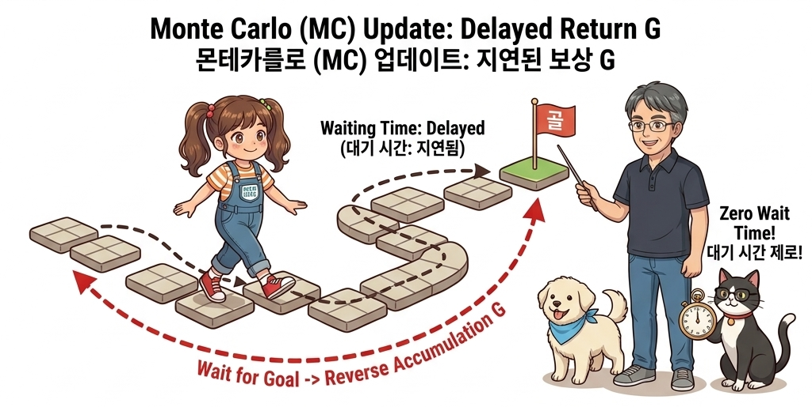
**그림 10-Intro-2** 에피소드 완주 후 최종 결말(반환값 $G_t$)을 확인할 때까지 기다렸다가 비로소 모든 상태의 가치를 역방향으로 갱신하는 몬테카를로법(MC)의 지연 정산 구조

---

하지만 몬테카를로법은 실전 응용에서 결코 무시할 수 없는 치명적인 구조적 한계를 안고 있었습니다:

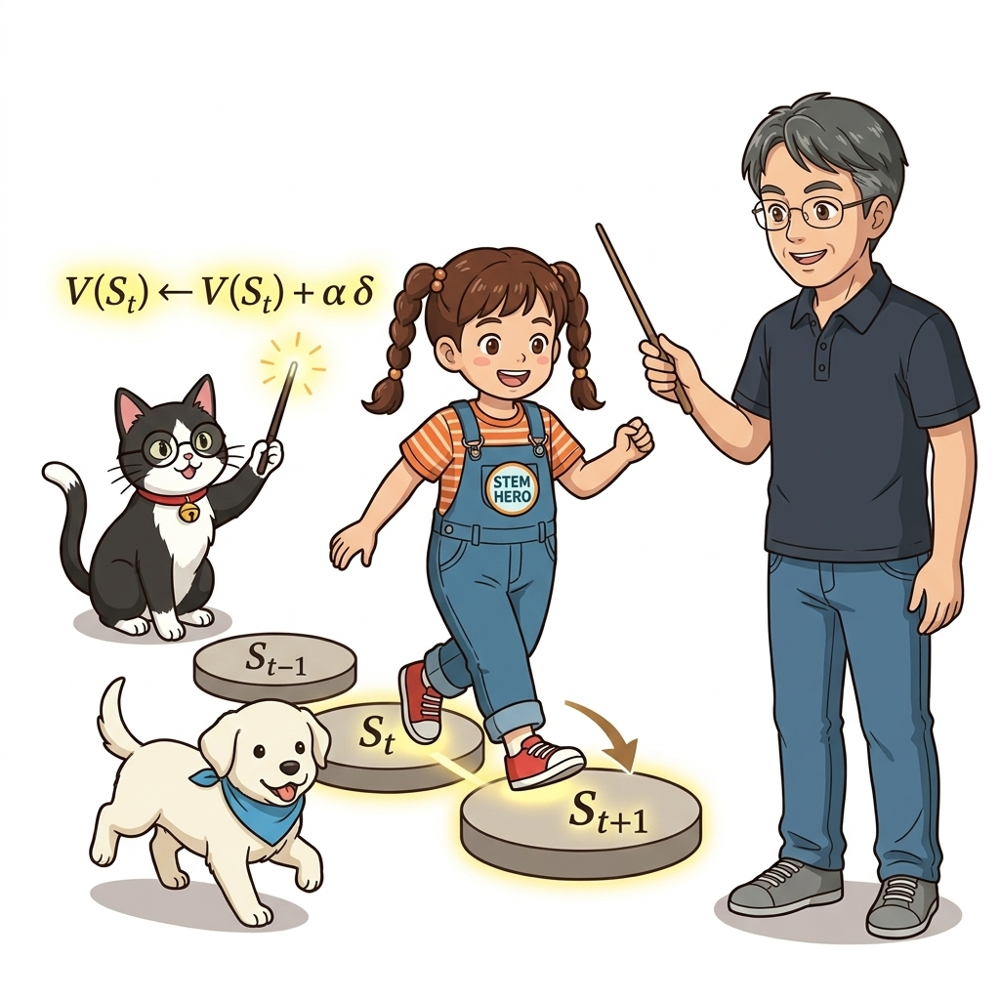
**그림 10-Intro-3** 단 한 걸음(1-Step)을 앞으로 내딛자마자 마법 지팡이로 이전 발판의 가치를 실시간으로 번개처럼 업데이트해 주는 지니와 도로시

---

### 몬테카를로법의 3대 결정적 한계

1. **지연 정산의 고통 (에피소드 완주 대기)**:
   - 몬테카를로법은 에피소드가 완전히 끝날 때까지 기다려야만 누적 참 수익 $G_t$ 가 확정됩니다.
   - 바둑을 둘 때 수백 수를 다 두고 계가를 마칠 때까지 기다려야만 첫 수의 가치를 갱신할 수 있는 것과 같습니다.

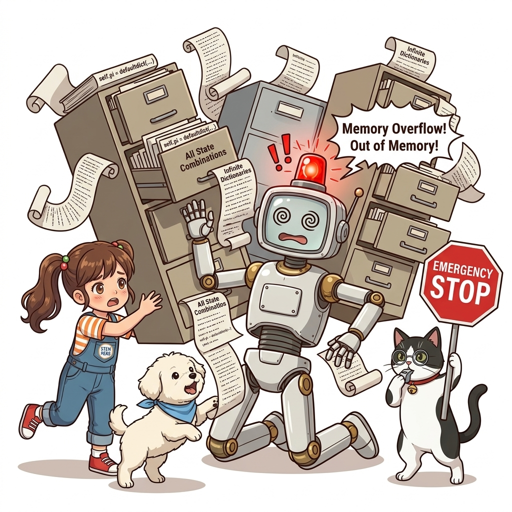
**그림 10-Intro-4** 바둑이나 체스처럼 수백 수에 달하는 긴 수순을 모두 끝마칠 때까지 기다려야만 첫 수의 가치를 평가할 수 있어 에이전트의 메모리와 학습 효율이 정체되는 딜레마

---

2. **영구 지속 과제(Continuing Tasks) 적용 불가능**:
   - 공장 제어, 서버 트래픽 관리, 자율주행 순찰처럼 종료 지점(Terminal State)이 없이 영구히 돌아가는 시스템에는 몬테카를로법을 원천적으로 적용할 수 없습니다.

**그림 10-Intro-5** 서버 트래픽 제어 및 자율 순찰처럼 종료 상태가 존재하지 않는 영구 지속 과제(Continuing Tasks)에서 에피소드 완주 대기 없이 1-스텝마다 즉각적으로 가치를 적응시키는 실시간 업데이트 흐름

---

3. **극심한 분산(High Variance)과 느린 학습**:
   - 경로가 길어질수록 우연한 돌발 상황들이 꼬리에 꼬리를 물고 누적되어, 수익 값의 출렁임(분산)이 극도로 커집니다. 따라서 참 가치에 수렴하기 위해선 수십만 개의 방대한 표본이 필요합니다.

**그림 10-Intro-6** 에피소드가 길어질수록 환경의 확률적 요동이 꼬리에 꼬리를 물고 누적되어 반환값의 분산이 눈덩이처럼 폭발하는 몬테카를로법의 통계적 부담

---

## 10.0.2 위대한 하이브리드: DP의 부트스트랩 + MC의 모델 프리

이 타협할 수 없는 난제를 해결하기 위해 인류가 고안해 낸 가장 우아한 해법이 바로 **시간차 학습(TD법, Temporal Difference Learning)**입니다.

**그림 10-Intro-7** 환경 모델 없이 거친 필드를 직접 탐험하는 MC의 경험주의와, 한 스텝 앞의 추정치로 현재를 갱신하는 DP의 부트스트랩을 우아하게 결합한 시간차 학습(TD)의 탄생

---

TD법은 강화학습의 양대 산맥인 **동적 프로그래밍(DP)**과 **몬테카를로법(MC)**의 장점만을 뽑아내어 하나로 결합한 위대한 하이브리드 알고리즘입니다:

- **MC의 장점 계승**: 환경의 전이 확률 행렬 $p(s' \mid s, a)$ 을 몰라도, 실제 경험한 1-스텝 샘플 데이터만으로 학습하는 **모델 프리(Model-Free)** 속성을 유지합니다.
- **DP의 장점 계승**: 에피소드 완주를 기다리지 않고, **'다음 상태의 추정 가치'를 즉시 빌려와서 현재 상태를 실시간 갱신하는 부트스트랩(Bootstrapping)** 원리를 차용합니다.

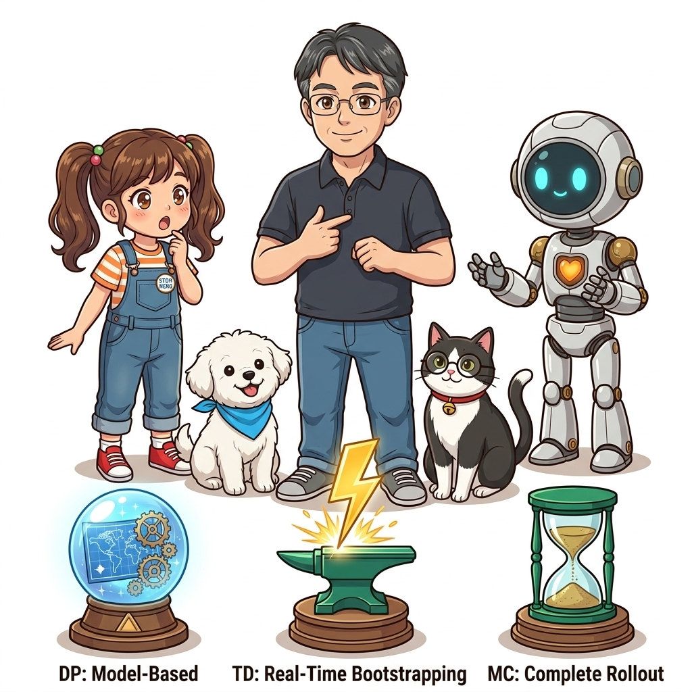
**그림 10-Intro-8** 모델 기반 온실 속 계획(DP)의 황금 열쇠와 실제 경험 기반(MC)의 나침반이 하나로 융합하여 탄생한 시간차 학습(TD)의 삼위일체 아키텍처

---

## 10.0.3 '시간차(Temporal Difference)'라는 이름의 물리적 의미

왜 이 알고리즘의 이름은 '시간차(Temporal Difference)'일까요?

운전자가 안개 낀 도로를 달리고 있다고 상상해 봅시다.  
- 10분 뒤에 목적지에 도착할 것이라 예상하고 있었는데($V(S_t)$),
- 단 1초(1스텝)를 더 달려보니 길이 뻥 뚫려 있어서 이제는 8분 뒤면 도착할 것 같습니다($R_t + \gamma V(S_{t+1})$).
- 그렇다면 방금 지나간 **단 1초의 시간 차이(Temporal Difference)** 동안 나의 예측이 2분이나 어긋났음을 깨닫게 됩니다!

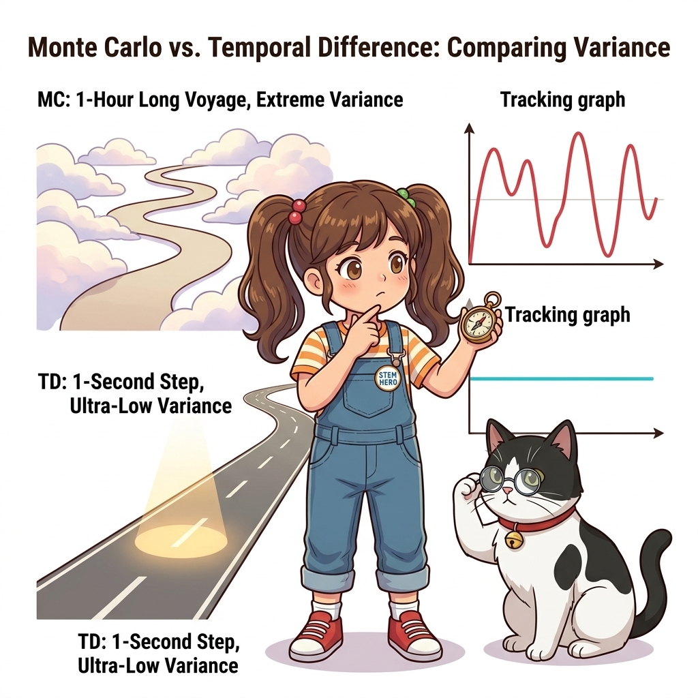
**그림 10-Intro-9** 안개 낀 도로를 달리다 단 1초(1스텝) 만에 시야가 트였을 때 도착 예상 시간의 차이를 실시간으로 체감하고 운전 계획을 보정하는 시간차(TD) 예측 오차의 일상적 직관

---

이처럼 **"연속된 두 시간 스텝 사이의 예측 차이(TD 오차, $\delta_t$)"**를 측정하고, 그 오차만큼만 현재 가치를 실시간으로 살짝 보정해 나가는 것이 바로 시간차 학습의 본질입니다.

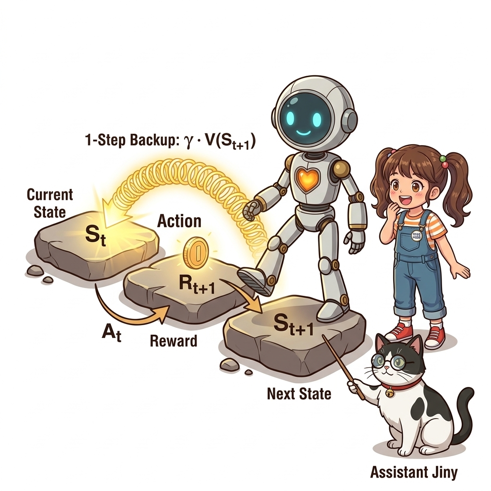
**그림 10-Intro-10** 에피소드 끝까지 갈 필요 없이, 단 1걸음 이동 즉시 관측된 보상 $R_t$ 와 다음 가치 $\gamma V(S_{t+1})$ 의 사슬을 이용해 현재 가치 $V(S_t)$ 를 실시간 갱신하는 1-스텝 백업 메커니즘

---

## 10.0.4 편향과 분산의 트레이드오프: 왜 TD가 현실에서 압도적으로 빠른가?

수학적으로 완벽한 참 수익을 사용하는 몬테카를로법(MC) 대신, 아직 정확하지도 않은 다음 상태의 추정 가치를 빌려 쓰는 TD법이 과연 안전할까요?

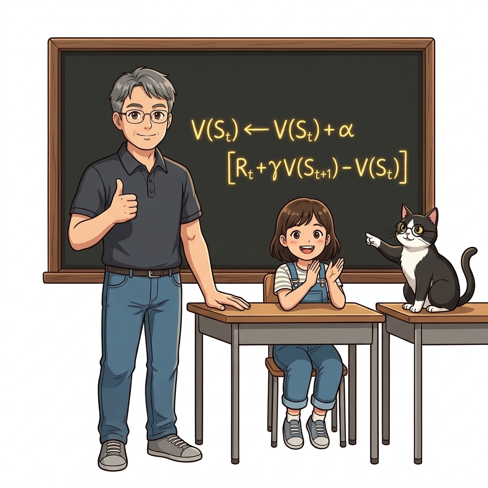
**그림 10-Intro-11** 다음 상태의 추정 가치 $V(S_{t+1})$ 를 당겨와 현재 예측치 $V(S_t)$ 와의 오차인 $\delta_t$ 를 계산하고 학습률 $\alpha$ 만큼 살짝 보정하는 TD(0)의 간결한 수학적 심장

---

놀랍게도 대부분의 실세계 강화학습 문제에서 **TD법은 몬테카를로법보다 압도적으로 빠르게 참 가치에 수렴**합니다:

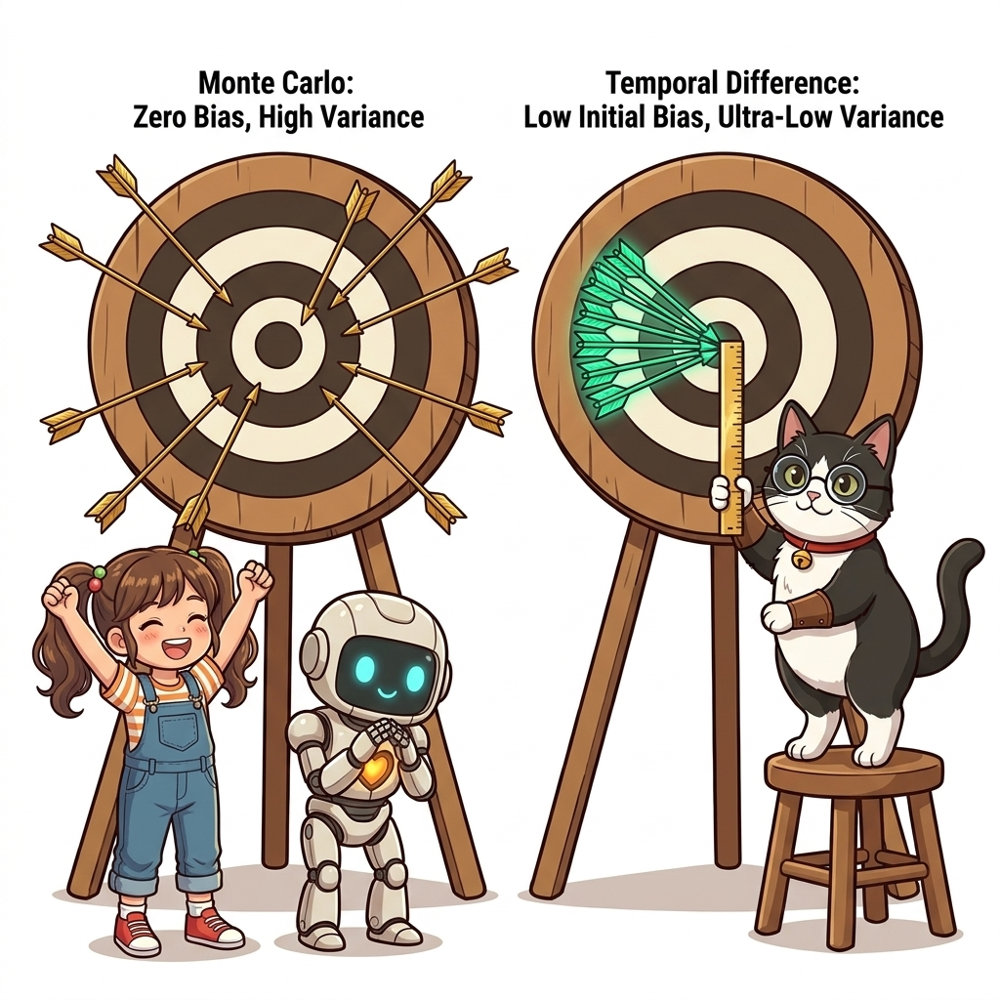
**그림 10-Intro-12** 편향과 분산의 양궁 과녁 대조: 참값을 중심으로 넓게 흩뿌려지는 MC(고분산 무편향) vs 조준점이 살짝 빗나가 있어도 화살들이 좁쌀처럼 한곳에 조밀하게 꽂히는 TD(초저분산 약간의 초기편향)

---

- **몬테카를로법 (MC)**: 100% 진짜 보상들의 합이므로 편향은 0(Unbiased)이지만, 수백 번의 우연이 누적되어 **분산이 너무 커서 수렴에 엄청난 시간이 걸립니다.**

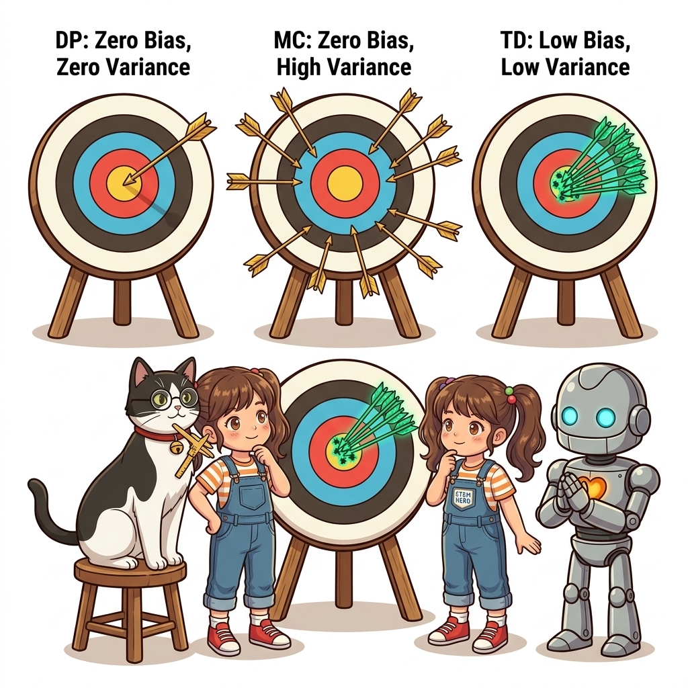
**그림 10-Intro-13** 참값을 중심으로 넓게 흩뿌려져 엄청난 수의 에피소드가 쌓여야만 평균이 수렴하는 몬테카를로법(MC)의 고분산 무편향 양궁 과녁

---

- **시간차 학습 (TD)**: 학습 초기에는 추정치를 빌려 쓰므로 약간의 편향(Bias)이 존재하지만, 단 1스텝 앞만 바라보므로 **분산이 극단적으로 작아 안정적이고 빠르게 수렴**합니다. 학습이 진행될수록 추정치 자체가 참값에 가까워지므로 편향 역시 0으로 사르르 소멸합니다!

**그림 10-Intro-14** 1-스텝 전개만으로 분산을 극단적으로 통제하여 조밀한 탄착군을 형성하고, 학습이 진행될수록 편향마저 0으로 소멸시키는 시간차 학습(TD)의 수렴 안정성

---

## 10.0.5 제어로의 도약: SARSA vs Q-러닝의 흥미진진한 철학 대결

10장에서는 단순히 정책의 점수를 매기는 가치 평가(Evaluation)를 넘어, 컴퓨터가 스스로 최적의 길을 찾아내는 **정책 제어(Control)**를 완성합니다.

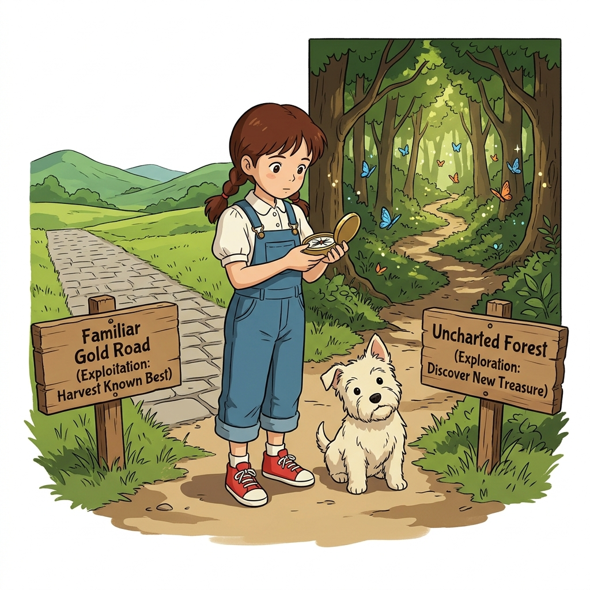
**그림 10-Intro-15** 상태 가치 $V(s)$ 에 갇힌 수동적 관찰자에서, 행동 가치 $Q(s, a)$ 를 무기 삼아 미지의 갈림길에서 최적의 결단을 내리는 능동적 제어 에이전트로의 극적인 도약

---

환경 모델이 없는 상태에서 제어를 수행하기 위해 주인공으로 등극하는 것이 바로 **행동 가치 함수 $Q(s, a)$**이며, 이를 바탕으로 두 가지 전설적인 알고리즘이 탄생합니다:

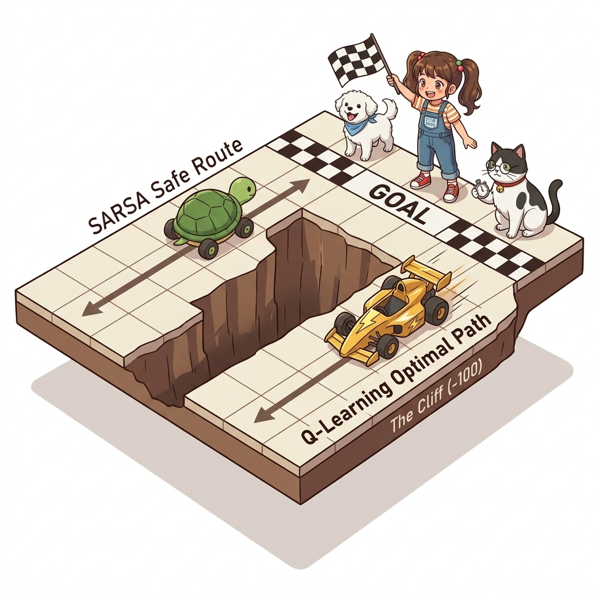
**그림 10-Intro-16** 절벽 트랙에서의 철학적 대결: 자신의 10% 탐색 실수를 두려워해 안전하게 멀리 우회하는 온-정책 SARSA(배경) vs 이상적인 최적 경로를 믿고 위험 바로 옆 최단 지름길을 거침없이 질주하는 오프-정책 Q-러닝(전경)

---

1. **온-정책 시간차 제어: SARSA (10.2절)**
   - 행동하는 정책과 학습하는 정책이 완전히 동일한 하나의 정책입니다.
   - 자신이 탐색 중에 10%의 확률로 발을 헛디딜 수 있다는 사실을 가치에 솔직히 반영하여, **절벽을 멀리 우회하는 보수적인 안전제일주의 경로**를 학습합니다.
   

**그림 10-Intro-17** 자신의 탐색 실수 가능성을 겸허히 인정하고, 벼랑 끝의 위험을 피해 안전한 우회로를 따라 신중하게 발걸음을 옮기는 온-정책 SARSA의 지혜

---

2. **오프-정책 시간차 제어: Q-러닝 (10.4절)**
   - 필드 탐험은 무작위 탐험 정책으로 진행하면서도, 가치 학습은 오직 **이론상 최고의 행동($\max_a Q$)**만을 목표로 삼습니다.
   - 중요도 샘플링 비율 $\rho$ 를 완전히 소거해 버리고, **절벽 바로 옆을 스쳐 지나가는 가장 빠른 최단 지름길**을 당당하게 개척합니다.

**그림 10-Intro-18** 다음 상태에서 가능한 가장 완벽한 최댓값 $\max_a Q$ 만을 바라보며 절벽 바로 옆 최단 지름길을 두려움 없이 질주하는 오프-정책 Q-러닝의 패기

---

## 10.0.6 에이전트의 초경량화와 딥러닝(DQN)으로의 관문

10장의 종착지인 10.5절에서는 메모리를 낭비하는 무거운 정책 딕셔너리(`self.pi`, `self.b`)를 완전히 깎아내는 소프트웨어 다이어트를 단행합니다.

**그림 10-Intro-19** 메모리를 무겁게 짓누르던 정책 확률 딕셔너리 장부들을 모조리 깎아내고, 단 하나의 Q-테이블과 $\epsilon$-주사위만으로 날렵해진 에이전트의 헬스장 다이어트

---

오직 `self.Q` 테이블 하나와 동전 튕기기(`rand() < ε`), 그리고 `np.argmax()`만으로 동작하는 초경량 **샘플 모델(Sample Model)**을 완성합니다.

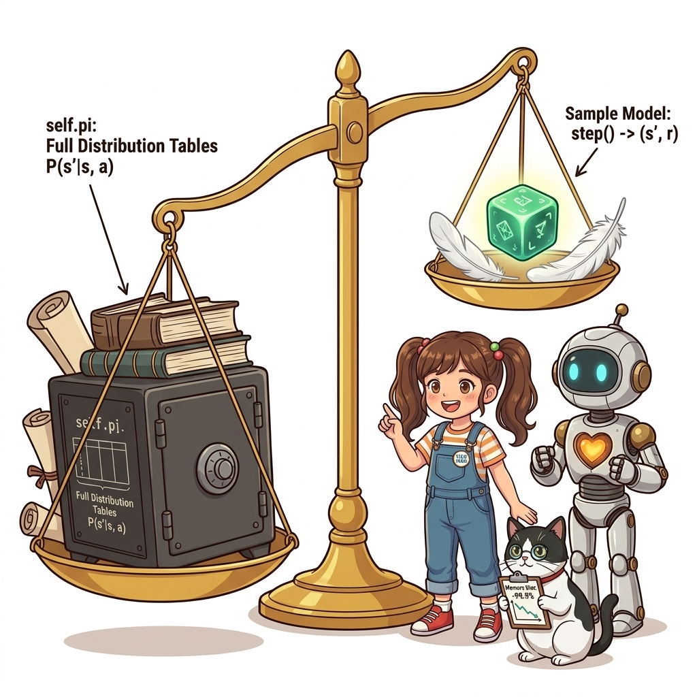
**그림 10-Intro-20** 수많은 상태별 딕셔너리 장부를 벗어던지고, 동전 튕기기와 최댓값 연산만으로 깃털처럼 가볍게 동작하는 초경량 샘플 모델의 완성

---

이 초경량 샘플 모델 구조는 단순한 코드 정리가 아닙니다.  
테이블의 크기가 무한대로 폭발하는 자율주행과 비디오게임의 연속 세계를 해결하기 위해, 훗날 딥마인드가 아타리 게임을 정복할 때 사용한 **DQN(Deep Q-Network)**과 인공신경망 모듈이 완벽하게 도킹되는 절대적인 토대가 됩니다!

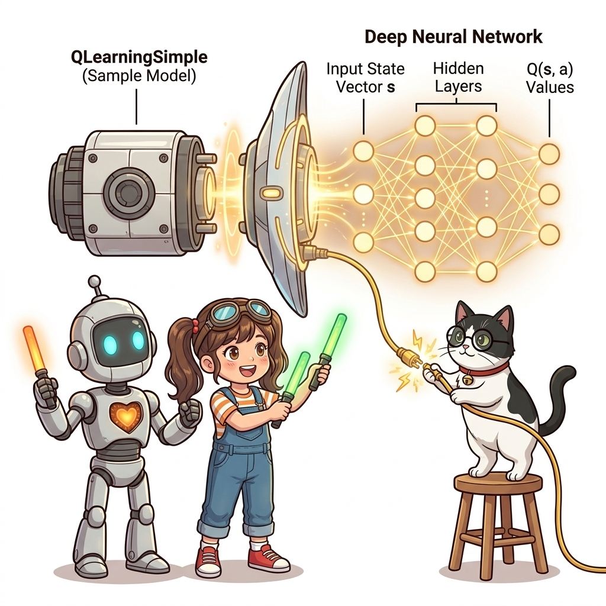
**그림 10-Intro-21** 딕셔너리를 비워낸 자리에 인공신경망의 거대한 모듈을 매끄럽게 결합하여 아타리 게임과 비디오 게임의 연속 세계를 정복하는 딥 Q-네트워크(DQN) 도킹 스테이션

---

## 10.0.7 제10장 6대 소단원 종합 파이프라인

제10장은 기초적인 1-스텝 가치 평가부터 현대 딥 강화학습의 뿌리가 되는 Q-러닝과 초경량화까지, 다음과 같은 아름다운 6단계 계단식 파이프라인으로 구성되어 있습니다:

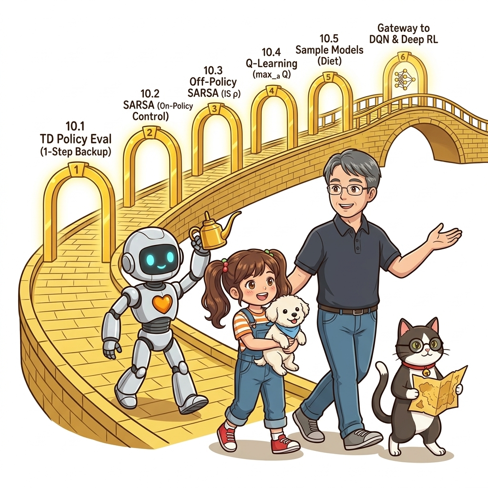
**그림 10-Intro-22** 제10장 시간차 학습(TD)의 이론적 진화와 소단원별 유기적 연결을 보여주는 종합 로드맵

---

| 소단원 | 핵심 주제 | 주요 학습 내용 및 패러다임 |
| :---: | :--- | :--- |
| **10.1** | **TD법으로 정책 평가하기** | DP 부트스트랩 + MC 샘플링 융합, TD(0) 점화식 유도, 편향과 분산 분석 |
| **10.2** | **SARSA: 온-정책 시간차 제어** | 행동 가치 $Q(s, a)$ 도입, 5단계 체인 S-A-R-S-A, $\epsilon$-탐욕 정책, 보수적 안전 운전 |
| **10.3** | **오프-정책 SARSA** | 행동 정책 $b$ 와 목표 정책 $\pi$ 의 분리, 1-스텝 중요도 가중치 $\rho$, $\rho=0$ 한계 규명 |
| **10.4** | **Q-러닝: 오프-정책 제어의 제왕** | 벨만 최적 방정식 샘플링, $\max$ 타깃을 통한 $\rho$ 완전 소거, 최단 지름길 돌파 |
| **10.5** | **분포 모델과 샘플 모델** | 환경/에이전트 모델 구분, 딕셔너리 완전 제거 다이어트, 연속 공간 및 DQN 관문 |
| **10.6** | **제10장 종합 정리** | DP vs MC vs TD 총결산 비교표, 11장 심층 신경망 시대로의 역사적 출항 |

---

## 10.0.8 👨‍🏫 이호진 교수님의 직강 총론

> 👨‍🏫 **이호진 교수님의 직강 노트**:  
> "강화학습을 공부할 때 가장 가슴 뛰는 순간을 꼽으라면, 단연코 제10장 시간차 학습(TD)을 마주하는 순간입니다.  
> 지도가 없는 막막한 세상에서 하염없이 결말을 기다리던 몬테카를로법의 방황을 끝내고, 발을 내딛는 그 찰나의 순간(1-Step)에 번개처럼 깨달음을 얻는 TD의 직관은 컴퓨터 과학 역사상 가장 매혹적인 지적 도약입니다.  
> 이 1-스텝의 깨달음이 행동 가치 $Q$ 와 만나 SARSA가 되고, 벨만 최적 방정식의 황금 왕관($\max$)을 쓰며 Q-러닝이라는 불멸의 제왕으로 탄생하는 웅장한 드라마를 저와 함께 즐겨보시길 바랍니다!"

**그림 10-Intro-23** 시간차 학습이 컴퓨터 과학과 강화학습 역사에 던진 지적 혁명과, SARSA 및 Q-러닝으로 이어지는 웅장한 여정을 열정적으로 설파하시는 이호진 교수님

---

> 🐱 **조교 지니의 응원 노트**:  
> "도로시와 여러분, 신발 끈 단단히 묶으셨나요? 한 걸음 걸을 때마다 발밑의 가치가 번쩍번쩍 업그레이드되는 10장의 롤러코스터에 탑승하신 것을 환영합니다냥!  
> 이제 더 이상 무거운 배낭을 질 필요도, 끝까지 기다릴 필요도 없어요. 매 순간 깨어있는 지능으로 최적의 길을 찾아 나서는 시간차 학습의 마법 속으로 지금 바로 출발해 봅시다냥!"

**그림 10-Intro-24** 1-스텝 실시간 업데이트라는 마법을 장착하고 도로시와 토토, 티니와 함께 제10장의 짜릿한 롤러코스터에 신나게 올라타며 축하하는 마법 요정 지니
