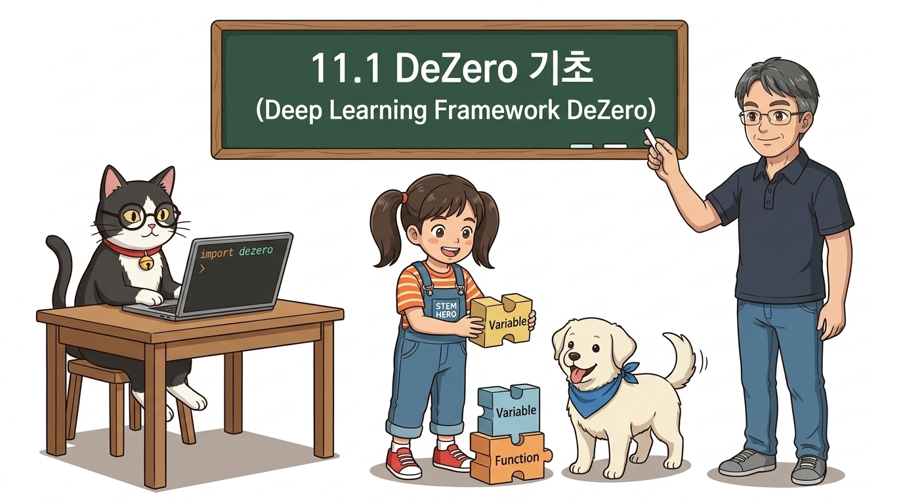
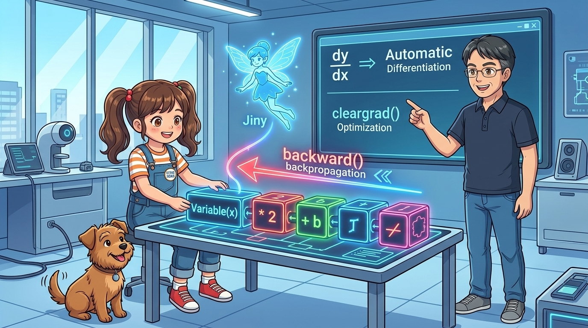
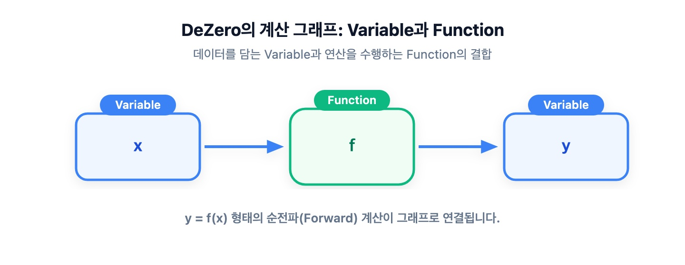
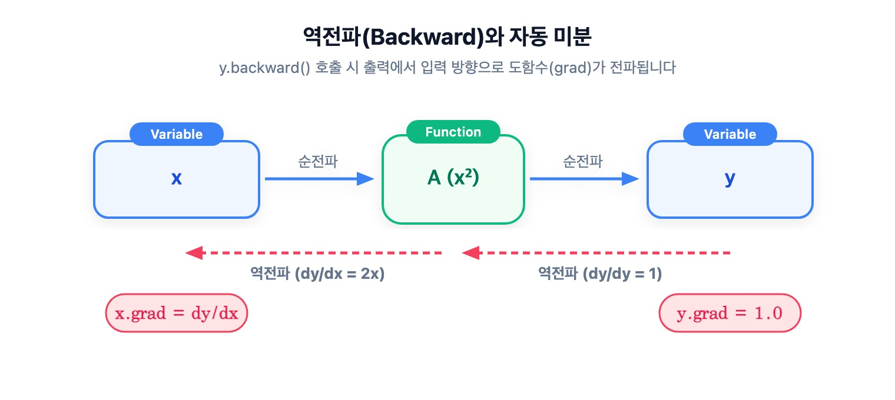

# 11.1 DeZero 기초: 딥러닝과 자동 미분의 세계




**그림 11-1-1** 지니가 들려주는 DeZero 상자 속의 장난감 블록(Variable, Function) 조각들을 끼워 맞춰 보며 딥러닝 연산을 배우는 도로시와 토토


**그림 11-1-2** 순전파 연산 블록들을 차례로 연결하는 도로시와, 계산 그래프의 끝에서부터 반대 방향으로 역전파(*backward()*) 광선을 쏘아 기울기를 채워 넣는 지니, 그리고 자동 미분과 *cleargrad()* 최적화의 원리를 설명하는 이호진 교수님

인공신경망 코딩 실습을 위해 이 책에서 사용할 초경량 딥러닝 프레임워크인 **DeZero(디제로)**의 핵심 원리와 사용법을 공부합니다. 파이토치(PyTorch)와 쌍둥이처럼 닮아 매우 직관적인 DeZero의 기본 다차원 배열 변수(`Variable`) 선언법과 순전파/역전파 계산 메커니즘을 요정 지니의 블록 놀이 비유와 깊이 있는 코드 분석으로 완전 정복해 봅시다!

---

## 11.1.1 DeZero란 무엇인가?

강화학습에서 상태 공간이 무한히 넓어지면, 테이블로 가치 함수를 저장하는 대신 **인공신경망을 함수 근사기(Function Approximator)**로 사용해야 합니다.

신경망을 학습시키려면 수많은 가중치 파라미터에 대한 오차의 미분(기울기, Gradient)을 오차역전파법(Backpropagation)으로 빠르게 계산해야 합니다. 이 복잡한 계산을 자동으로 수행해 주는 도구가 바로 **딥러닝 프레임워크**입니다.

이 책에서는 『밑바닥부터 시작하는 딥러닝 3』에서 직접 구현된 교육용 딥러닝 프레임워크인 **DeZero**를 사용합니다.


**그림 11-1-3** 『밑바닥부터 시작하는 딥러닝 3』과 초경량 파이토치 스타일 프레임워크 DeZero

> [!NOTE]
> **파이토치(PyTorch)와의 관계**:
> DeZero는 파이토치와 API 설계 철학이 99% 동일합니다:
> - 파이토치의 `torch.Tensor` ↔ DeZero의 `dezero.Variable`
> - 파이토치의 `loss.backward()` ↔ DeZero의 `y.backward()`
> - 파이토치의 `optimizer.zero_grad()` ↔ DeZero의 `x.cleargrad()`
> 
> 따라서 DeZero의 원리를 명확히 이해하면 파이토치나 텐서플로 코드를 자유자재로 다룰 수 있는 탄탄한 딥러닝 내공이 갖추어집니다.

---

## 11.1.2 DeZero의 기본 사용법과 자동 미분

먼저 터미널에서 DeZero를 설치합니다:

```bash
pip install dezero
```

### 1) 넘파이를 감싸는 마법의 상자: `Variable`

DeZero의 핵심 클래스는 `Variable`입니다. `Variable`은 넘파이의 다차원 배열(`np.ndarray`)을 내부에 품고 있으면서, **어떤 연산을 거쳐 만들어졌는지 계산 이력(계산 그래프)을 추적**합니다:

```python
import numpy as np
from dezero import Variable

x_np = np.array(5.0)
x = Variable(x_np)      # ❶ 넘파이 스칼라를 Variable 인스턴스로 감싸기

y = 3 * x ** 2          # ❷ 넘파이 배열처럼 직관적인 사칙연산 수행
print(y)
```

**출력 결과**:
```text
variable(75.0)
```

---

### 2) 기적의 한 줄: `y.backward()`와 역전파

위의 연산은 수학적으로 *y* = 3*x*<sup>2</sup>입니다. 이 함수를 *x*로 미분하면 도함수는 다음과 같습니다:

> ### **d*y* / d*x* = 6*x***

여기에 *x* = 5.0을 대입하면 이론적인 접선의 기울기는 **30.0**이 나와야 합니다. DeZero가 이를 스스로 계산해 내는지 확인해 봅시다:

```python
y.backward()            # ❸ 계산 그래프를 거슬러 올라가는 역전파 실행!
print(x.grad)           # ❹ x 변수에 누적된 기울기(Gradient) 출력
```

**출력 결과**:
```text
variable(30.0)
```

손으로 미분 공식을 유도하지 않아도, `y.backward()` 단 한 줄을 호출하자마자 컴퓨터가 계산 그래프를 역방향으로 순회하며 연쇄 법칙(Chain Rule)을 적용해 **정확히 30.0**을 뽑아냅니다!

---

## 11.1.3 다차원 배열(텐서)과 행렬 곱연산

머신러닝에서는 수많은 데이터와 가중치를 묶어 처리하므로 다차원 배열(텐서, Tensor)을 다룹니다:
- **0차원 (스칼라, Scalar)**: 단순한 단일 숫자. 예: `5.0`
- **1차원 (벡터, Vector)**: 1개의 축을 따라 나열된 1D 배열. 예: `[1, 2, 3]`
- **2차원 (행렬, Matrix)**: 행과 열의 2개 축으로 구성된 2D 배열. 예: `[[1, 2], [3, 4]]`

---

### 1) 벡터의 내적 (Dot Product)

길이가 같은 두 벡터 **a** = (*a*<sub>1</sub>, &hellip;, *a*<sub>*n*</sub>)과 **b** = (*b*<sub>1</sub>, &hellip;, *b*<sub>*n*</sub>)의 내적은 대응하는 원소끼리의 곱의 총합입니다:

> ### ***a* · *b* = *a*<sub>1</sub>*b*<sub>1</sub> + *a*<sub>2</sub>*b*<sub>2</sub> + &hellip; + *a*<sub>*n*</sub>*b*<sub>*n*</sub>** &nbsp;&nbsp;&nbsp;&nbsp; *(식 11.1: 벡터의 내적)*

---

### 2) 행렬 곱과 차원 형상(Shape) 일치 규칙


**그림 11-1-4** 행렬 곱 계산 방법. 왼쪽 행렬의 가로 행 벡터와 오른쪽 행렬의 세로 열 벡터 사이의 내적이 결과 행렬의 각 원소를 결정합니다.

행렬 곱이 유효하게 성립하려면 **왼쪽 행렬의 열 수와 오른쪽 행렬의 행 수가 반드시 일치**해야 합니다:

> ### **행렬 A (*N* × *K*) × 행렬 B (*K* × *M*) = 행렬 C (*N* × *M*)**

DeZero에서는 `dezero.functions`의 `matmul()` 함수를 사용하여 벡터의 내적과 행렬 곱을 모두 처리합니다:

<div align="right"><b>ch07/dezero1.py</b></div>

```python
import numpy as np
from dezero import Variable
import dezero.functions as F

# 1. 벡터의 내적: [1*4 + 2*5 + 3*6] = 32
a = np.array([1, 2, 3])
b = np.array([4, 5, 6])
c = F.matmul(a, b)
print(c) # variable(32)

# 2. 행렬 곱: (2x2) x (2x2) = (2x2)
A = np.array([[1, 2], [3, 4]])
B = np.array([[5, 6], [7, 8]])
C = F.matmul(A, B)
print(C)
# variable([[19 22]
#           [43 50]])
```

---

## 11.1.4 경사 하강법과 최적화 실습: 로젠브록 함수

이제 DeZero의 자동 미분을 이용해 유명한 최적화 벤치마크 문제인 **로젠브록(Rosenbrock) 바나나 함수**의 최솟값을 찾아봅시다:

> ### ***y* = 100 · (*x*<sub>1</sub> - *x*<sub>0</sub><sup>2</sup>)<sup>2</sup> + (*x*<sub>0</sub> - 1)<sup>2</sup>** &nbsp;&nbsp;&nbsp;&nbsp; *(식 11.2: 로젠브록 함수)*

이 함수는 완만한 곡면 골짜기를 이루고 있어 최솟값을 찾기가 까다롭기로 유명합니다. 이론적인 정답 최솟값은 (*x*<sub>0</sub>, *x*<sub>1</sub>) = **(1.0, 1.0)**일 때 *y* = 0입니다.

### 1) 특정 지점에서의 기울기(Gradient) 계산

```python
import numpy as np
from dezero import Variable

def rosenbrock(x0, x1):
    return 100 * (x1 - x0 ** 2) ** 2 + (x0 - 1) ** 2

x0 = Variable(np.array(0.0))
x1 = Variable(np.array(2.0))

y = rosenbrock(x0, x1)
y.backward()
print("x0의 편미분:", x0.grad, "x1의 편미분:", x1.grad)
```

**출력 결과**:
```text
x0의 편미분: variable(-2.0) x1의 편미분: variable(400.0)
```
이때 두 편미분을 묶은 벡터 **(-2.0, 400.0)**를 **기울기 벡터(Gradient)**라고 부르며, 함숫값을 가장 가파르게 증가시키는 방향을 나타냅니다.

---

### 2) 경사 하강법(Gradient Descent) 반복 루프

함숫값을 최소화하려면 **기울기의 정반대 방향(-grad)**으로 변수들을 조금씩 이동시키면 됩니다:

> ### ***x* ← *x* - *lr* · (∂*y* / ∂*x*)**

<div align="right"><b>ch07/dezero2.py</b></div>

```python
x0 = Variable(np.array(0.0))
x1 = Variable(np.array(2.0))

iters = 10000     # 경사 하강 반복 횟수
lr = 0.001        # 학습률 (보폭)

for i in range(iters):
    y = rosenbrock(x0, x1)

    # ❶ 중요: 이전 스텝에서 누적된 미분값을 깨끗이 초기화!
    x0.cleargrad()
    x1.cleargrad()

    # ❷ 역전파로 현재 지점의 기울기 계산
    y.backward()

    # ❸ 가중치 파라미터 갱신 (계산 그래프를 만들지 않기 위해 .data로 연산)
    x0.data -= lr * x0.grad.data
    x1.data -= lr * x1.grad.data

print("최종 최적화 결과:", x0, x1)
```

**출력 결과**:
```text
최종 최적화 결과: variable(0.9944984367782456) variable(0.9890050527419593)
```

초기값 (0.0, 2.0)에서 출발한 변수들이 1만 번의 스텝을 거쳐 정답인 **(1.0, 1.0)**에 극도로 근접했음을 확인할 수 있습니다!

> [!WARNING]
> **왜 `cleargrad()`가 반드시 필요할까요?**
> DeZero와 PyTorch는 여러 연산의 기울기를 누적할 수 있도록 `backward()`를 부를 때마다 기존 `.grad` 값에 새 미분값을 **더하는 방식(`+=`)**으로 설계되어 있습니다.
> 따라서 매 루프마다 `cleargrad()`(파이토치는 `zero_grad()`)를 호출하여 이전 스텝의 기울기를 비워주지 않으면 기울기가 걷잡을 수 없이 누적되어 학습이 엉망으로 폭발합니다!

이로써 우리는 인공신경망 학습의 핵심 무기인 **계산 그래프, 역전파(`backward`), 기울기 초기화(`cleargrad`), 경사 하강 갱신**의 전 과정을 손에 쥐었습니다. 다음 절에서는 이를 활용하여 머신러닝의 기초인 **선형 회귀(Linear Regression)**를 정복해 봅시다!
