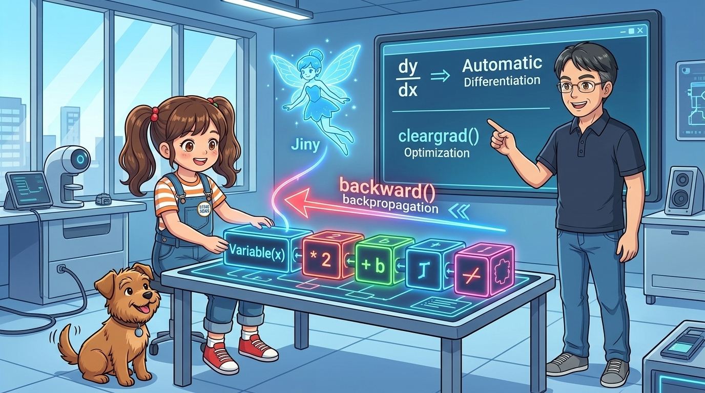
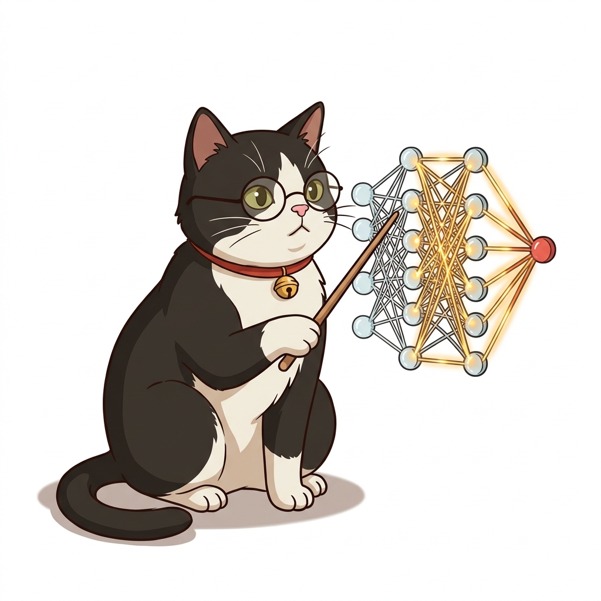
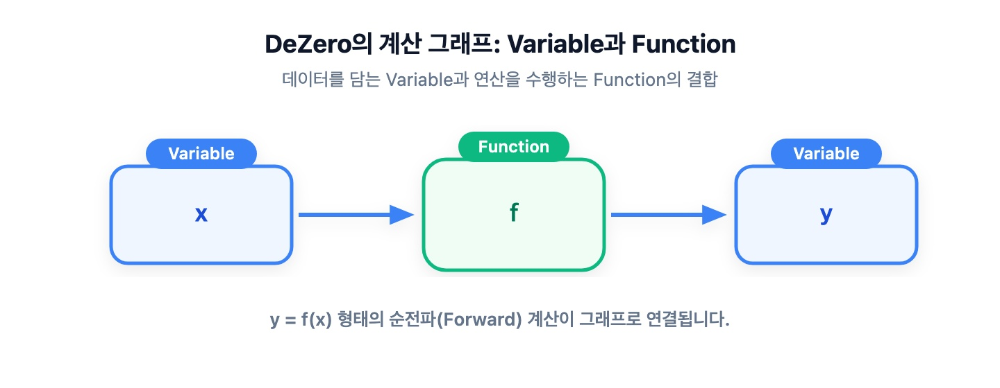
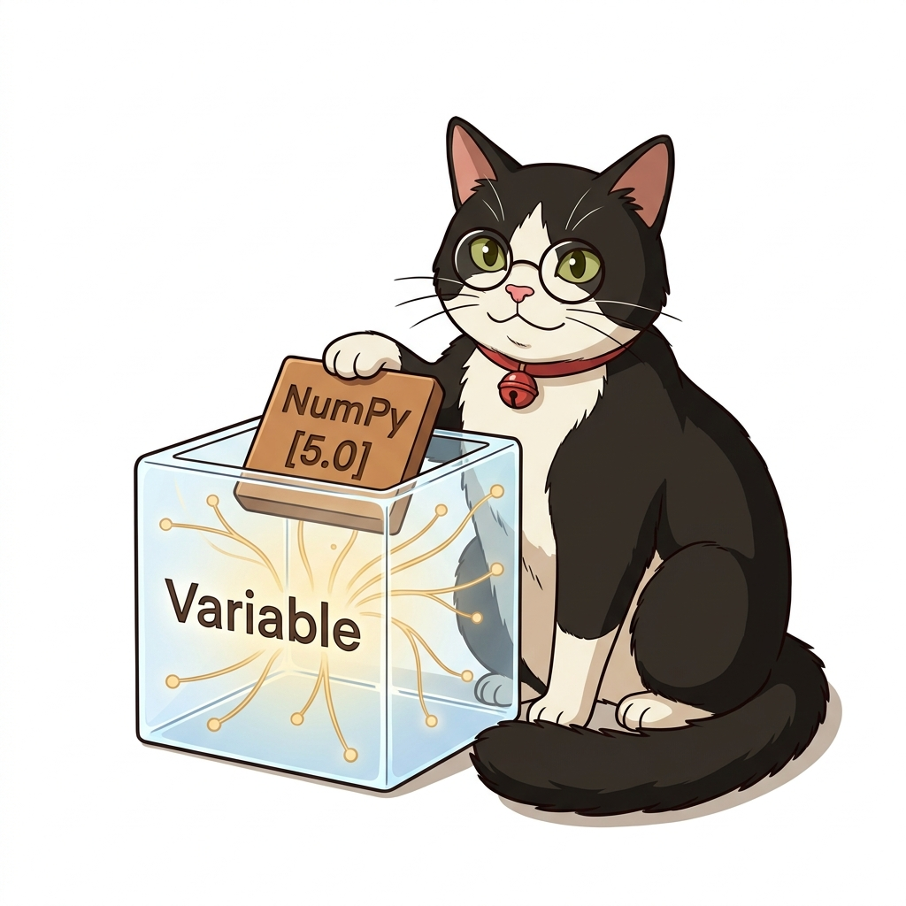
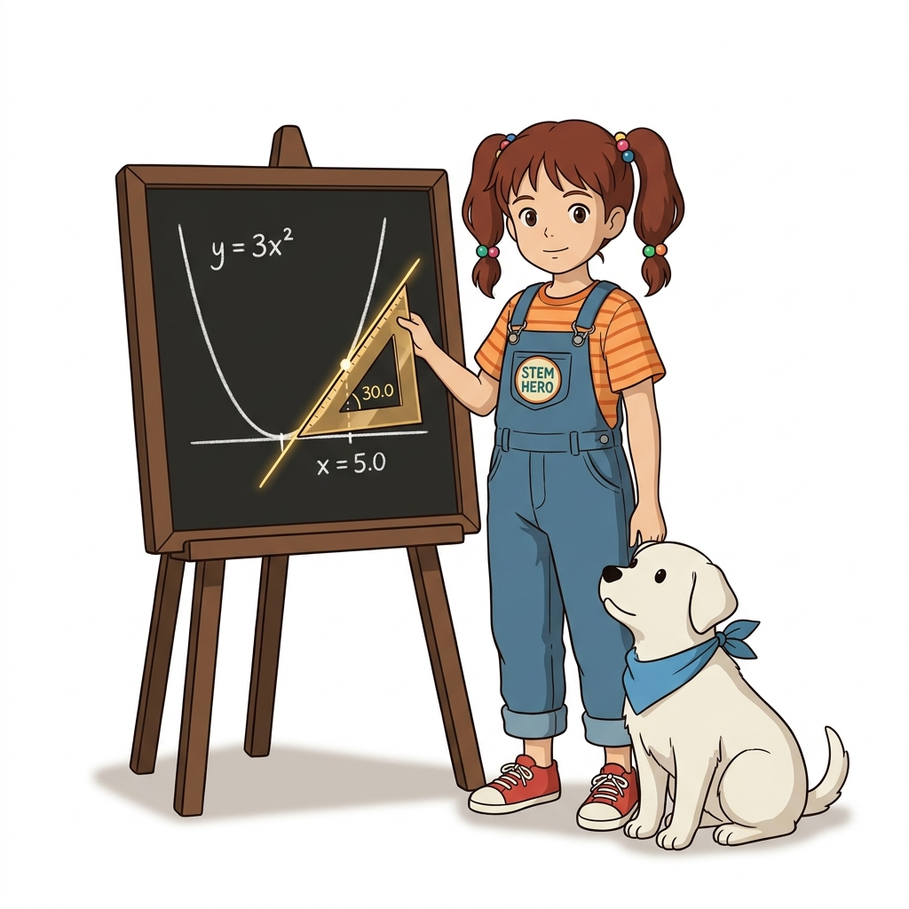
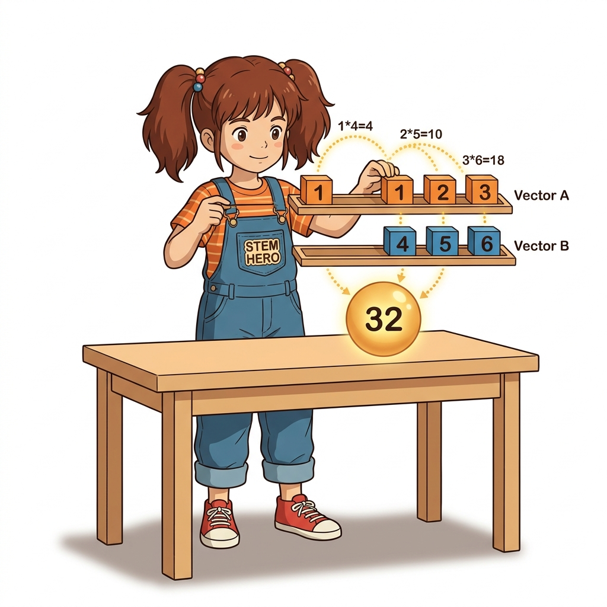
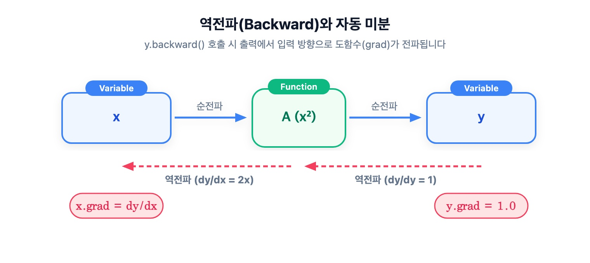
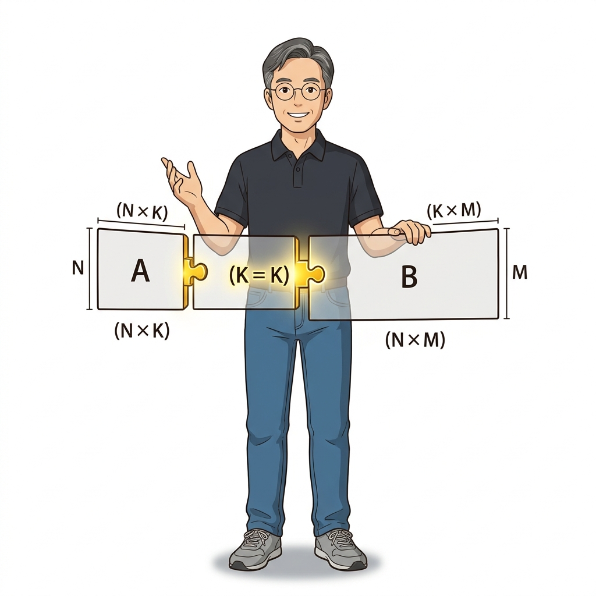
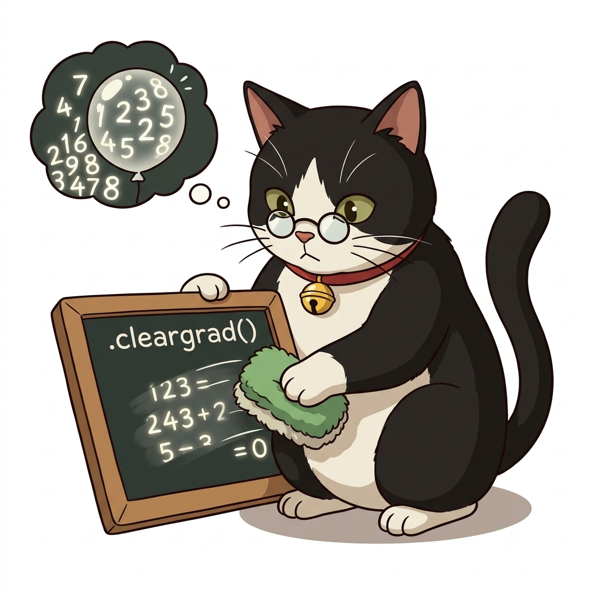

# 11.1 DeZero 기초: 딥러닝과 자동 미분의 세계

인공신경망 코딩 실습을 위해 이 책에서 사용할 초경량 딥러닝 프레임워크인 **DeZero(디제로)**의 핵심 원리와 사용법을 공부합니다. 


**그림 11-1-1** 지니가 들려주는 DeZero 상자 속의 장난감 블록(Variable, Function) 조각들을 끼워 맞춰 보며 딥러닝 연산을 배우는 도로시와 토토

> **[강의 스크립트]**
> 십일점일 장에서는 딥러닝의 자동 미분 메커니즘을 가장 투명하게 이해할 수 있는 교육용 초경량 프레임워크인 디제로의 기초를 배웁니다. 화면의 그림에서 보듯, 상자 안의 변수와 함수 블록들을 연결하여 거대한 계산 그래프를 구성하고, 역방향으로 미분을 전파해 나가는 기본 작동 원리를 명쾌하게 정리해 보겠습니다.

---

파이토치(PyTorch)와 쌍둥이처럼 닮아 매우 직관적인 DeZero의 기본 다차원 배열 변수(`Variable`) 선언법과 순전파/역전파 계산 메커니즘을 요정 지니의 블록 놀이 비유와 깊이 있는 코드 분석으로 완전 정복해 봅시다!


**그림 11-1-2** 순전파 연산 블록들을 차례로 연결하는 도로시와, 계산 그래프의 끝에서부터 반대 방향으로 역전파(*backward()*) 광선을 쏘아 기울기를 채워 넣는 지니, 그리고 자동 미분과 *cleargrad()* 최적화의 원리를 설명하는 이호진 교수님

> **[강의 스크립트]**
> 디제로는 현대 딥러닝의 표준인 파이토치와 설계 철학이 완벽히 일치합니다. 그림에서 보듯 순방향으로 블록을 쌓아 계산을 수행하고 나면, 최종 출력에서부터 백워드 호출 한 번으로 계산 그래프의 사슬을 거슬러 올라가며 모든 매개변수의 기울기를 자동으로 구해냅니다. 이 순전파와 역전파의 메커니즘을 코드로 직접 체험해 봅시다.

---

## 11.1.1 DeZero란 무엇인가?

강화학습에서 상태 공간이 무한히 넓어지면, 테이블로 가치 함수를 저장하는 대신 **인공신경망을 함수 근사기(Function Approximator)**로 사용해야 합니다.


> **[강의 스크립트]**
> 십일점일점일 절에서는 디제로의 탄생 배경을 살펴봅니다. 강화학습의 상태 공간이 연속적인 실수이거나 무한히 넓어지면 표 형태로는 가치를 저장할 수 없습니다. 이때 필요한 것이 바로 복잡한 상태를 입력받아 가치를 매끄럽게 추정해 주는 인공신경망 함수 근사기입니다.

---

신경망을 학습시키려면 수많은 가중치 파라미터에 대한 오차의 미분(기울기, Gradient)을 오차역전파법(Backpropagation)으로 빠르게 계산해야 합니다. 



> **[강의 스크립트]**
> 인공신경망이 올바른 가치를 추정하도록 학습시키려면 수많은 가중치 매개변수를 오차를 줄이는 방향으로 조금씩 수정해야 합니다. 이때 출력 오차에 대한 각 매개변수의 기울기를 연쇄 법칙에 따라 고속으로 역전파하여 계산하는 오차역전파법이 필수적으로 요구됩니다.

---

이 복잡한 계산을 자동으로 수행해 주는 도구가 바로 **딥러닝 프레임워크**입니다.


> **[강의 스크립트]**
> 인간이 수백만 개의 수식에 대해 손으로 편미분을 직접 계산하는 것은 불가능합니다. 컴퓨터가 계산 과정을 내부적으로 기억해 두었다가 역방향으로 미분을 단숨에 유도해 주는 소프트웨어 도구가 바로 딥러닝 프레임워크입니다.

---

이 강의에서는 『밑바닥부터 시작하는 딥러닝 3』에서 직접 구현된 교육용 딥러닝 프레임워크인 **DeZero**를 사용합니다.


**그림 11-1-3** 『밑바닥부터 시작하는 딥러닝 3』과 초경량 파이토치 스타일 프레임워크 DeZero

> **[강의 스크립트]**
> 우리는 교육용 프레임워크인 디제로를 채택합니다. 디제로는 복잡하고 무거운 엔지니어링 코드 뒤에 숨지 않고, 순수한 파이썬과 넘파이만으로 자동 미분의 뼈대를 투명하게 보여주기 때문에 딥러닝의 심장부를 직관적으로 이해하기에 최적입니다.

---

> [!TIP]
> ### 🧠 DeZero 심화 학습 안내: `dezero.ai.jiny.dev`
> DeZero 프레임워크의 내부 동작 원리(자동 미분 엔진, 계산 그래프 DAG, 고차 미분, 신경망 계층 구현)를 1단계부터 60단계까지 한 줄 한 줄 직접 파이썬으로 구현하며 학습할 수 있는 **전용 강의 사이트**가 개설되어 있습니다!
> 
> - 🌐 **공식 학습 사이트**: [https://dezero.ai.jiny.dev](https://dezero.ai.jiny.dev)
> - 📚 **주요 학습 내용**: 수치 미분부터 역전파 자동화, 고차 미분, CNN, RNN, LSTM까지 DeZero 60단계 완전 구현
> 
> DeZero의 밑바닥 구조를 깊이 있게 파악해 두면, 강화학습의 신경망 모델을 훨씬 더 직관적이고 탄탄하게 다룰 수 있습니다.

> **[강의 스크립트]**
> 디제로 프레임워크의 내부 메커니즘을 기초 수치 미분부터 60단계 신경망 계층까지 한 줄 한 줄 직접 구현해 보고 싶으신 분들을 위해 디제로 에이아이 지니 닷 데브 전용 학습 사이트가 함께 마련되어 있으니 적극 참고하시기 바랍니다.

---

> [!NOTE]
> **파이토치(PyTorch)와의 관계**:
> DeZero는 파이토치와 API 설계 철학이 99% 동일합니다:
> - 파이토치의 `torch.Tensor` ↔ DeZero의 `dezero.Variable`
> - 파이토치의 `loss.backward()` ↔ DeZero의 `y.backward()`
> - 파이토치의 `optimizer.zero_grad()` ↔ DeZero의 `x.cleargrad()`
> 
> 따라서 DeZero의 원리를 명확히 이해하면 파이토치나 텐서플로 코드를 자유자재로 다룰 수 있는 탄탄한 딥러닝 내공이 갖추어집니다.


> **[강의 스크립트]**
> 파이토치와의 관계를 주목해야 합니다. 디제로의 베리어블은 파이토치의 텐서와 대응되고, 백워드와 클리어그레드 역시 완벽히 동일한 동작 구조를 갖습니다. 즉, 디제로를 익히는 것은 곧 파이토치를 다루는 뼈대를 그대로 마스터하는 것과 같습니다.

---

## 11.1.2 DeZero의 기본 사용법과 자동 미분

먼저 터미널에서 DeZero를 설치합니다:

```bash
pip install dezero
```


> **[강의 스크립트]**
> 십일점일점이 절에서는 디제로의 설치와 기본 사용법을 다룹니다. 화면의 명령어처럼 핍 인스톨 디제로를 실행하면 단 몇 초 만에 파이썬 가상환경에 프레임워크가 준비됩니다.

---

### 1) 넘파이를 감싸는 마법의 상자: `Variable`

DeZero의 핵심 클래스는 `Variable`입니다. `Variable`은 넘파이의 다차원 배열(`np.ndarray`)을 내부에 품고 있으면서, **어떤 연산을 거쳐 만들어졌는지 계산 이력(계산 그래프)을 추적**합니다:



> **[강의 스크립트]**
> 디제로의 가장 중요한 데이터 상자는 베리어블 클래스입니다. 베리어블은 순수한 넘파이 다차원 배열 데이터를 속성으로 품고 있으면서, 이 데이터가 어떤 함수를 거쳐 탄생했는지에 대한 연산 이력을 계산 그래프 형태로 꼼꼼히 기록해 둡니다.

---

```python
import numpy as np
from dezero import Variable

x_np = np.array(5.0)
x = Variable(x_np)      # ❶ 넘파이 스칼라를 Variable 인스턴스로 감싸기

y = 3 * x ** 2          # ❷ 넘파이 배열처럼 직관적인 사칙연산 수행
print(y)
```

**출력 결과**:

```text
variable(75.0)
```

> **[강의 스크립트]**
> 코드를 보면 넘파이 스칼라 오점영을 베리어블 인스턴스로 감싸서 엑스를 선언합니다. 그리고 삼 곱하기 엑스의 제곱을 수행하면 보통의 숫자처럼 직관적으로 연산되어 칠십오점영이라는 결과가 도출됩니다. 내부적으로는 계산 그래프가 형성된 상태입니다.

---

### 2) 기적의 한 줄: `y.backward()`와 역전파

위의 연산은 수학적으로 *y* = 3*x*<sup>2</sup>입니다. 

이 함수를 *x*로 미분하면 도함수는 다음과 같습니다:

> **d*y* / d*x* = 6*x***



> **[강의 스크립트]**
> 이 연산의 수학적 의미를 들여다봅시다. 와이는 삼 엑스 제곱이므로, 엑스에 대해 미분한 도함수는 육 엑스가 됩니다. 접선의 기울기를 나타내는 이 미분 공식에 엑스는 오점영을 대입하면 정답은 삼십점영이어야 합니다.

---

여기에 *x* = 5.0을 대입하면 이론적인 접선의 기울기는 **30.0**이 나와야 합니다. 

DeZero가 이를 스스로 계산해 내는지 확인해 봅시다:

```python
y.backward()            # ❸ 계산 그래프를 거슬러 올라가는 역전파 실행!
print(x.grad)           # ❹ x 변수에 누적된 기울기(Gradient) 출력
```

**출력 결과**:

```text
variable(30.0)
```

손으로 미분 공식을 유도하지 않아도, `y.backward()` 단 한 줄을 호출하자마자 컴퓨터가 계산 그래프를 역방향으로 순회하며 연쇄 법칙(Chain Rule)을 적용해 **정확히 30.0**을 뽑아냅니다!

> **[강의 스크립트]**
> 이제 기적의 한 줄인 와이 점 백워드를 실행합니다. 사람이 미분 공식을 풀지 않아도, 컴퓨터가 연쇄 법칙을 따라 계산 그래프를 역방향으로 탐색하여 엑스 점 그레드에 정확히 삼십점영을 채워 넣습니다. 이것이 바로 자동 미분의 위력입니다.

---

## 11.1.3 다차원 배열(텐서)과 행렬 곱연산

머신러닝에서는 수많은 데이터와 가중치를 묶어 처리하므로 다차원 배열(텐서, Tensor)을 다룹니다:

- **0차원 (스칼라, Scalar)**: 단순한 단일 숫자. 예: `5.0`
- **1차원 (벡터, Vector)**: 1개의 축을 따라 나열된 1D 배열. 예: `[1, 2, 3]`
- **2차원 (행렬, Matrix)**: 행과 열의 2개 축으로 구성된 2D 배열. 예: `[[1, 2], [3, 4]]`


> **[강의 스크립트]**
> 십일점일점삼 절에서는 다차원 배열의 연산을 다룹니다. 단일 숫자인 영차원 스칼라, 숫자들의 나열인 일차원 벡터, 그리고 행과 열로 이루어진 이차원 행렬까지, 머신러닝에서는 이 모든 다차원 배열을 텐서라는 개념으로 일괄 처리합니다.

---

### 1) 벡터의 내적 (Dot Product)

길이가 같은 두 벡터 **a** = (*a*<sub>1</sub>, &hellip;, *a*<sub>*n*</sub>)과 **b** = (*b*<sub>1</sub>, &hellip;, *b*<sub>*n*</sub>)의 내적은 대응하는 원소끼리의 곱의 총합입니다:

> ***a* · *b* = *a*<sub>1</sub>*b*<sub>1</sub> + *a*<sub>2</sub>*b*<sub>2</sub> + &hellip; + *a*<sub>*n*</sub>*b*<sub>*n*</sub>** &nbsp;&nbsp;&nbsp;&nbsp; *(식 11.1: 벡터의 내적)*



> **[강의 스크립트]**
> 벡터의 내적은 두 벡터의 대응하는 원소끼리 곱한 뒤 모두 합산하는 연산입니다. 식 십일점일에서 보듯, 입력 신호와 가중치들의 곱을 하나로 합쳐 뉴런의 활성도를 결정하는 가장 기초적인 수학 블록입니다.

---

### 2) 행렬 곱과 차원 형상(Shape) 일치 규칙


**그림 11-1-4** 행렬 곱 계산 방법. 왼쪽 행렬의 가로 행 벡터와 오른쪽 행렬의 세로 열 벡터 사이의 내적이 결과 행렬의 각 원소를 결정합니다.

> **[강의 스크립트]**
> 행렬의 곱셈은 왼쪽 행렬의 행 벡터와 오른쪽 행렬의 열 벡터 사이의 내적으로 각 원소가 결정됩니다. 그림 십일점일점사를 보시면 가로와 세로의 원소들이 짝을 맞추어 곱해지며 결과 행렬을 구성함을 알 수 있습니다.

---

행렬 곱이 유효하게 성립하려면 **왼쪽 행렬의 열 수와 오른쪽 행렬의 행 수가 반드시 일치**해야 합니다:

$$
\text{행렬 A } (N \times K) \times \text{행렬 B } (K \times M) = \text{행렬 C } (N \times M)
$$



> **[강의 스크립트]**
> 행렬 곱에서 가장 중요한 불변의 규칙은 차원 형상의 일치입니다. 왼쪽 행렬 에이의 열 수인 케이와 오른쪽 행렬 비의 행 수인 케이가 반드시 같아야만 곱셈이 성립하며, 결과 행렬은 엔 곱하기 엠 형상이 됩니다. 이 차원 규칙을 틀리면 딥러닝 코드에서 즉시 오류가 발생합니다.

---

DeZero에서는 `dezero.functions`의 `matmul()` 함수를 사용하여 벡터의 내적과 행렬 곱을 모두 처리합니다:

<div align="right"><b>ch07/dezero1.py</b></div>

```python
import numpy as np
from dezero import Variable
import dezero.functions as F

# 1. 벡터의 내적: [1*4 + 2*5 + 3*6] = 32
a = np.array([1, 2, 3])
b = np.array([4, 5, 6])
c = F.matmul(a, b)
print(c) # variable(32)

# 2. 행렬 곱: (2x2) x (2x2) = (2x2)
A = np.array([[1, 2], [3, 4]])
B = np.array([[5, 6], [7, 8]])
C = F.matmul(A, B)
print(C)
# variable([[19 22]
#           [43 50]])
```

> **[강의 스크립트]**
> 디제로에서는 펑션스 모듈의 맷멀 함수로 내적과 행렬 곱을 모두 처리합니다. 코드에서 보듯 일차원 벡터 에이와 비를 넣으면 스칼라 삼십이가 계산되고, 이 곱하기 이 정방 행렬들을 넣으면 해당 행렬 곱 결과가 베리어블 형태로 정확히 출력됩니다.

---

## 11.1.4 경사 하강법과 최적화 실습: 로젠브록 함수

이제 DeZero의 자동 미분을 이용해 유명한 최적화 벤치마크 문제인 **로젠브록(Rosenbrock) 바나나 함수**의 최솟값을 찾아봅시다:

> ***y* = 100 · (*x*<sub>1</sub> - *x*<sub>0</sub><sup>2</sup>)<sup>2</sup> + (*x*<sub>0</sub> - 1)<sup>2</sup>** &nbsp;&nbsp;&nbsp;&nbsp; *(식 11.2: 로젠브록 함수)*

이 함수는 완만한 곡면 골짜기를 이루고 있어 최솟값을 찾기가 까다롭기로 유명합니다. 이론적인 정답 최솟값은 (*x*<sub>0</sub>, *x*<sub>1</sub>) = **(1.0, 1.0)**일 때 *y* = 0입니다.


> **[강의 스크립트]**
> 십일점일점사 절에서는 최적화 실습으로 로젠브록 바나나 함수를 다룹니다. 식 십일점이에 정의된 이 함수는 좁고 완만하게 굽은 골짜기를 형성하고 있어 경사 하강법 알고리즘의 수렴 성능을 시험하는 대표적인 벤치마크 함수입니다. 이론적 최솟값은 엑스영과 엑스일이 모두 일점영일 때 와이는 영입니다.

---

### 1) 특정 지점에서의 기울기(Gradient) 계산

```python
import numpy as np
from dezero import Variable

def rosenbrock(x0, x1):
    return 100 * (x1 - x0 ** 2) ** 2 + (x0 - 1) ** 2

x0 = Variable(np.array(0.0))
x1 = Variable(np.array(2.0))

y = rosenbrock(x0, x1)
y.backward()
print("x0의 편미분:", x0.grad, "x1의 편미분:", x1.grad)
```

**출력 결과**:

```text
x0의 편미분: variable(-2.0) x1의 편미분: variable(400.0)
```
이때 두 편미분을 묶은 벡터 **(-2.0, 400.0)**를 **기울기 벡터(Gradient)**라고 부르며, 함숫값을 가장 가파르게 증가시키는 방향을 나타냅니다.

> **[강의 스크립트]**
> 초깃값 영점영과 이점영에서 와이 점 백워드를 호출하면 편미분 값이 마이너스 이점영과 사백점영으로 계산됩니다. 이 기울기 벡터는 함숫값이 가장 가파르게 치솟는 방향을 의미합니다.

---

### 2) 경사 하강법(Gradient Descent) 반복 루프

함숫값을 최소화하려면 **기울기의 정반대 방향(-grad)**으로 변수들을 조금씩 이동시키면 됩니다:

$$
x \leftarrow x - \text{lr} \cdot \frac{\partial y}{\partial x}
$$


> **[강의 스크립트]**
> 우리의 목표는 함숫값을 최소화하는 것이므로, 기울기의 정반대 부호 방향으로 학습률만큼 곱해 변수를 갱신합니다. 수식에서 보듯 매 걸음마다 오차면의 가장 가파른 내리막길을 따라 점진적으로 하강하는 원리입니다.

---

<div align="right"><b>ch07/dezero2.py</b></div>

```python
x0 = Variable(np.array(0.0))
x1 = Variable(np.array(2.0))

iters = 10000     # 경사 하강 반복 횟수
lr = 0.001        # 학습률 (보폭)

for i in range(iters):
    y = rosenbrock(x0, x1)

    # ❶ 중요: 이전 스텝에서 누적된 미분값을 깨끗이 초기화!
    x0.cleargrad()
    x1.cleargrad()

    # ❷ 역전파로 현재 지점의 기울기 계산
    y.backward()

    # ❸ 가중치 파라미터 갱신 (계산 그래프를 만들지 않기 위해 .data로 연산)
    x0.data -= lr * x0.grad.data
    x1.data -= lr * x1.grad.data

print("최종 최적화 결과:", x0, x1)
```

**출력 결과**:

```text
최종 최적화 결과: variable(0.9944984367782456) variable(0.9890050527419593)
```

초기값 (0.0, 2.0)에서 출발한 변수들이 1만 번의 스텝을 거쳐 정답인 **(1.0, 1.0)**에 극도로 근접했음을 확인할 수 있습니다!

> **[강의 스크립트]**
> 전체 최적화 루프를 살펴봅시다. 반복문 안에서 반드시 클리어그레드로 기존 기울기를 비워주고, 백워드로 새 기울기를 구한 뒤 변수 데이터에서 학습률 보폭만큼 빼줍니다. 만 번의 반복 후 결과가 정답인 일점영에 매우 정밀하게 수렴했음을 확인할 수 있습니다.

---

> [!WARNING]
> **왜 `cleargrad()`가 반드시 필요할까요?**
> DeZero와 PyTorch는 여러 연산의 기울기를 누적할 수 있도록 `backward()`를 부를 때마다 기존 `.grad` 값에 새 미분값을 **더하는 방식(`+=`)**으로 설계되어 있습니다.
> 따라서 매 루프마다 `cleargrad()`(파이토치는 `zero_grad()`)를 호출하여 이전 스텝의 기울기를 비워주지 않으면 기울기가 걷잡을 수 없이 누적되어 학습이 엉망으로 폭발합니다!



> **[강의 스크립트]**
> 여기서 가장 중요한 주의사항이 있습니다. 왜 클리어그레드가 필수일까요? 디제로와 파이토치는 미분값을 기존 메모리에 누적하여 더하도록 설계되어 있습니다. 따라서 루프 시작 전 지우개로 칠판을 지우듯 클리어그레드를 부르지 않으면 기울기가 눈덩이처럼 불어나 학습이 완전히 발산해 버립니다.

---

이로써 우리는 인공신경망 학습의 핵심 무기인 **계산 그래프, 역전파(`backward`), 기울기 초기화(`cleargrad`), 경사 하강 갱신**의 전 과정을 손에 쥐었습니다. 다음 절에서는 이를 활용하여 머신러닝의 기초인 **선형 회귀(Linear Regression)**를 정복해 봅시다!


> **[강의 스크립트]**
> 이로써 계산 그래프, 자동 미분 백워드, 기울기 초기화 클리어그레드, 경사 하강 갱신이라는 딥러닝의 사대 핵심 무기를 모두 갖추었습니다. 다음 절에서는 이 원리를 활용하여 데이터로부터 스스로 관계를 학습하는 선형 회귀의 세계로 나아가겠습니다.
