# 11.2 선형 회귀: 데이터로부터 패턴을 배우는 첫걸음

머신러닝의 주춧돌이자 수많은 인공지능 예측의 뿌리가 되는 **선형 회귀(Linear Regression)** 이론을 공부합니다. 


**그림 11-2-1** 칠판 위에 흩뿌려진 빨간색 경험 데이터 점들을 관통하는 완벽한 예측 직선을 요술 지팡이로 그려보이는 지니와 도로시

> **[강의 스크립트]**
> 십일점이 장에서는 머신러닝의 가장 기본이 되는 선형 회귀의 이론과 실습을 다룹니다. 화면의 그림에서 보듯, 평면 위에 불규칙하게 흩뿌려진 데이터 점들의 분포를 관통하는 최적의 예측 직선을 수학적으로 도출하는 과정을 차근차근 살펴보겠습니다.

---

연속적인 데이터 점들의 분포를 가장 정확하게 설명해 주는 1차 함수 직선 수식(*y* = *Wx* + *b*)의 **평균 제곱 오차(MSE)** 손실을 정의하고, 경사 하강법(Gradient Descent)을 통해 최적의 파라미터를 찾아가는 과정을 깊이 있게 배워봅시다!

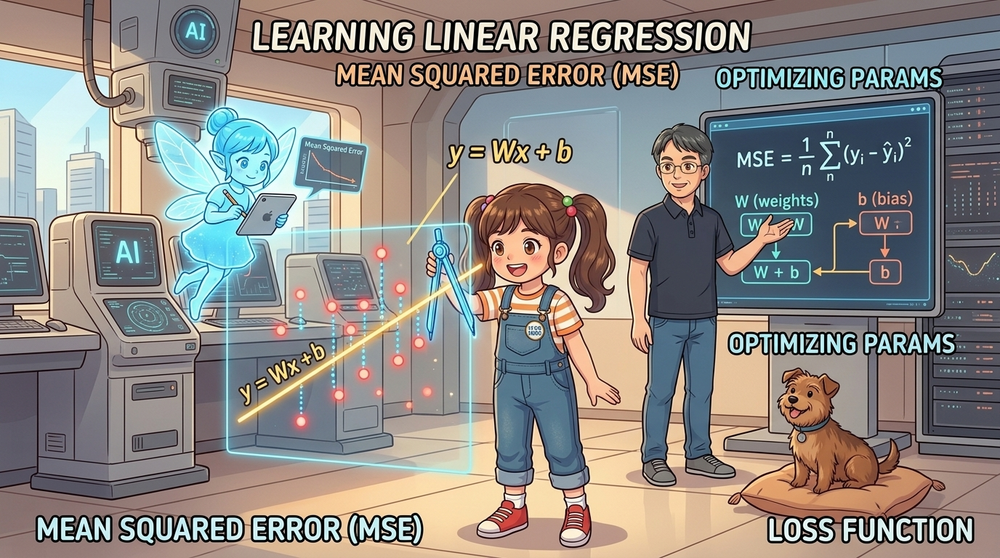
**그림 11-2-2** 흩어진 100개의 관측 데이터 점들의 중심을 관통하는 최적의 직선 *y* = *Wx* + *b*를 정렬하는 도로시와, 평균 제곱 오차(MSE) 손실이 0에 가깝게 감소하는 과정을 기록하는 지니, 그리고 경사 하강법에 의한 가중치/편향 갱신 원리를 설명

> **[강의 스크립트]**
> 일차 함수 직선 와이는 더블유 엑스 더하기 비를 가설로 설정하고, 실제 데이터와의 거리 차이를 평균 제곱 오차로 정의합니다. 그리고 디제로의 자동 미분과 경사 하강법을 결합하여 오차를 최소화하는 가중치와 편향을 찾아가는 최적화 과정을 직접 구현해 봅시다.

---

## 11.2.1 머신러닝의 본질과 토이 데이터셋

전통적인 프로그래밍에서는 사람이 직접 규칙(알고리즘)을 작성하여 컴퓨터에 입력했습니다. 

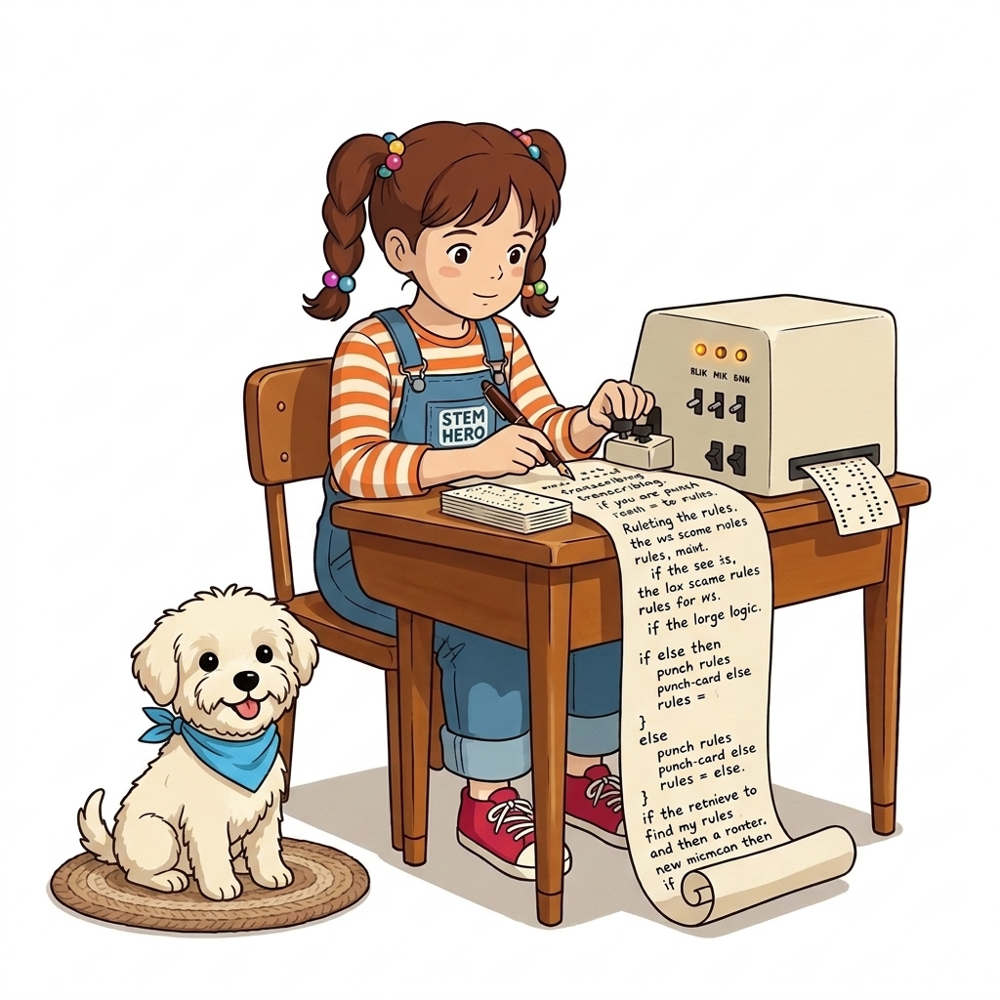

> **[강의 스크립트]**
> 십일점이점일 절에서는 머신러닝의 본질을 짚고 넘어갑니다. 전통적인 프로그래밍에서는 사람이 조건문과 반복문으로 규칙을 직접 코딩하여 컴퓨터에 주입했습니다. 하지만 현실의 복잡한 규칙은 사람이 일일이 공식화할 수 없습니다.

---

하지만 **머신러닝(Machine Learning)**은 접근 방식이 정반대입니다:
- 사람은 모델의 기본 뼈대(함수)만 세워두고,
- 컴퓨터가 수집된 **데이터(Data)**를 스스로 관찰하며 가중치를 조절해 최적의 규칙을 찾아냅니다.


> **[강의 스크립트]**
> 머신러닝은 접근 방식이 완전히 정반대입니다. 사람은 단지 유연한 수학적 모델의 뼈대만 제공하고, 컴퓨터가 수많은 데이터를 직접 관찰하면서 데이터에 내재된 숨겨진 패턴과 규칙을 스스로 학습하여 매개변수를 조정해 나갑니다.

---

### 실험용 토이 데이터셋(Toy Dataset) 생성

간단한 1차원 선형 관계에 노이즈가 섞인 100개의 데이터셋을 넘파이로 만들어 봅시다:

```python
import numpy as np

np.random.seed(0) # 결과 재현을 위한 난수 시드 고정
x = np.random.rand(100, 1)                      # 0~1 사이의 100개 입력 데이터
y = 5 + 2 * x + np.random.rand(100, 1)          # 기울기 2, 절편 5에 노이즈를 더한 참값
```

> **[강의 스크립트]**
> 우리의 가설을 검증하기 위해 백 개의 훈련용 토이 데이터셋을 만듭니다. 영과 일 사이의 무작위 수 엑스에 대해 기울기 이와 절편 오를 적용하고, 현실의 잡음을 흉내 내기 위해 무작위 노이즈를 살짝 얹어 와이 값을 생성합니다.

---

참된 수식은 대략 *y* = 2*x* + 5.5 부근입니다. 

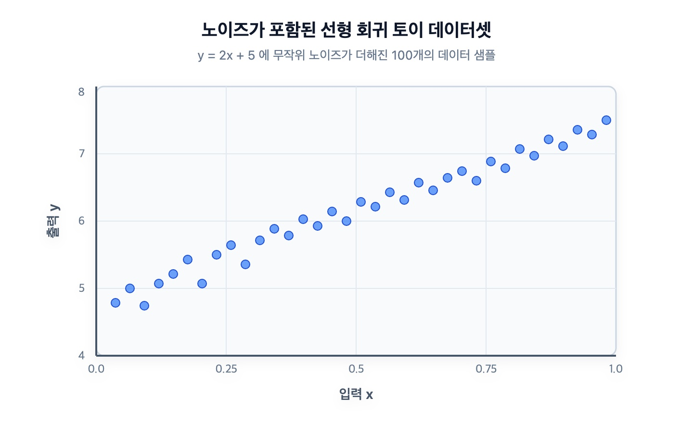
**그림 11-2-3** 노이즈가 포함된 100개의 2차원 토이 데이터셋 산점도

> **[강의 스크립트]**
> 노이즈의 평균이 영점오이므로 참된 수식은 대략 와이는 이 엑스 더하기 오점오 부근에 위치합니다. 그림 십일점이점삼의 산점도를 보면 점들이 직선 주위에 안개처럼 퍼져 있음을 볼 수 있습니다.

---

우리는 이 **정답 수식을 모른다고 가정**하고, 오직 점들의 좌표 (*x*, *y*)만을 컴퓨터에 건네주어 최적의 직선을 **스스로 찾아내도록** 만들어야 합니다.

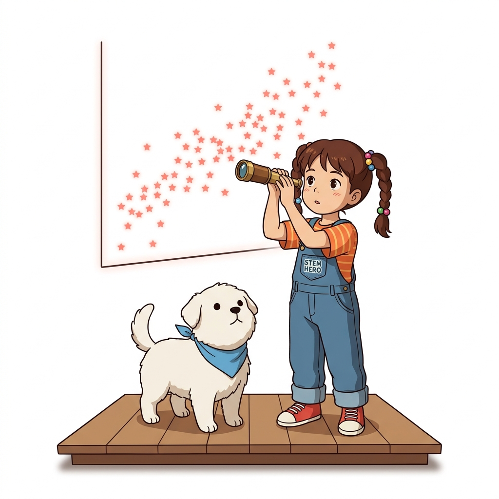

> **[강의 스크립트]**
> 우리는 컴퓨터에게 정답 수식을 알려주지 않습니다. 컴퓨터는 오직 흩뿌려진 백 개의 좌표 데이터만을 바라보면서, 점들의 중심을 가로지르는 최적의 직선 매개변수를 스스로 찾아내야만 합니다.

---

## 11.2.2 선형 회귀와 손실 함수(MSE)의 수학적 원리

입력 *x*로부터 실수 출력 *y*를 예측하는 문제를 **회귀(Regression)**라고 부릅니다. 

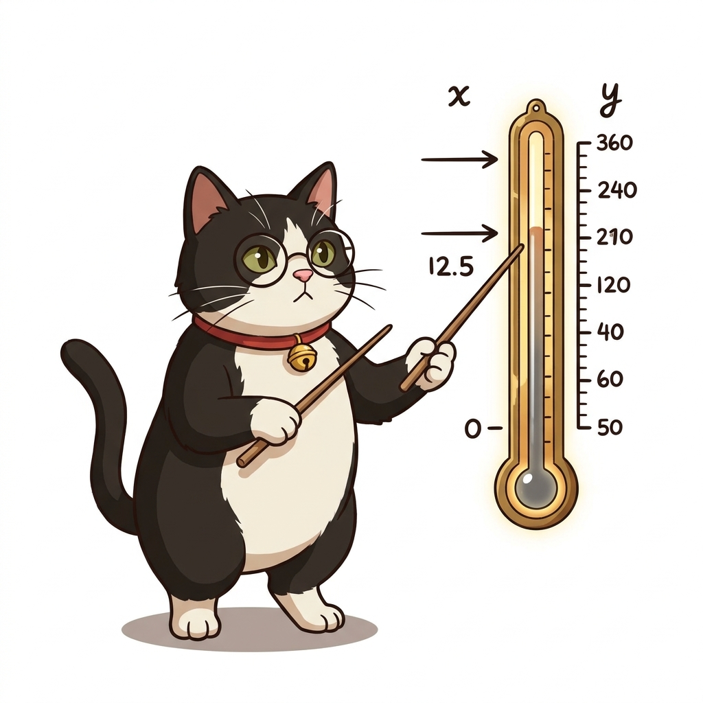

> **[강의 스크립트]**
> 십일점이점이 절에서는 선형 회귀의 수학적 기초를 살펴봅니다. 입력 엑스로부터 연속적인 실수 값 와이를 예측해 내는 문제를 회귀라고 정의합니다.

---

이때 가장 단순한 가설로 **직선 모델**을 세우는 것이 **선형 회귀(Linear Regression)**입니다:

> ***y* = *W* · *x* + *b***

- ***W* (가중치, Weight)**: 직선의 기울기를 결정합니다.
- ***b* (편향, Bias)**: 직선의 *y*절편(위아래 높낮이)을 결정합니다.

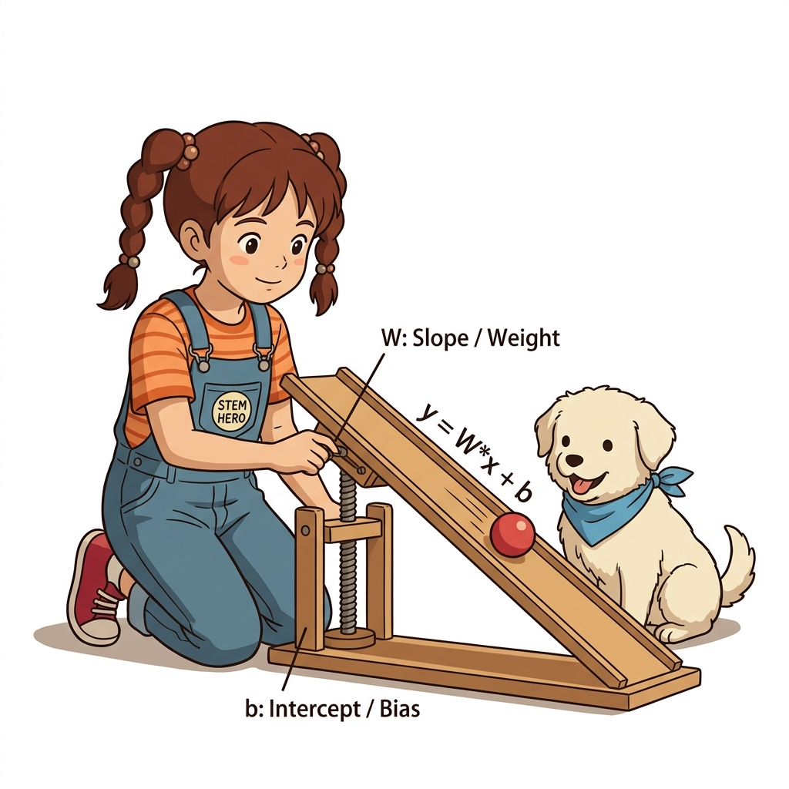

> **[강의 스크립트]**
> 가장 단순한 가설로 일차 함수 직선 모델을 채택하는 것이 바로 선형 회귀입니다. 와이는 더블유 엑스 더하기 비에서, 더블유는 직선의 기울기를 조절하는 가중치이며, 비는 직선의 높낮이를 결정하는 편향 매개변수입니다.

---

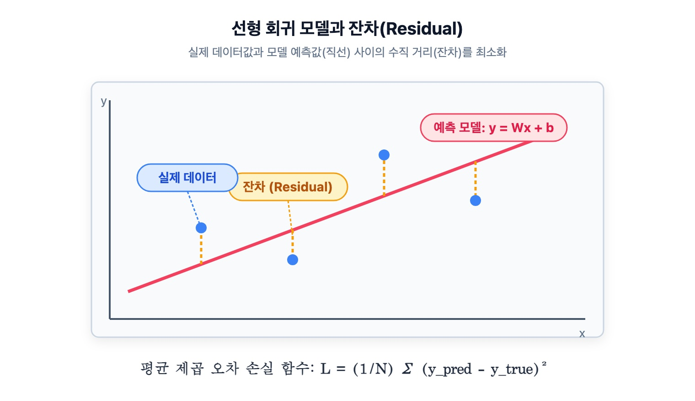
**그림 11-2-4** 실제 데이터 점들과 예측 직선 사이의 수직 거리 차이인 잔차(Residual)

> **[강의 스크립트]**
> 그림 십일점이점사를 보면 실제 데이터 점들과 모델이 그은 직선 사이에 수직으로 틈이 벌어져 있습니다. 이 차이를 우리는 잔차라고 부릅니다. 잔차가 작을수록 좋은 모델입니다.

---

### 모델의 성적표: 평균 제곱 오차 (MSE: Mean Squared Error)

어떤 직선이 데이터에 "가장 잘 들어맞는가"를 수치로 평가하려면 **오차를 측정**해야 합니다.


> **[강의 스크립트]**
> 수많은 직선 후보 중에서 어떤 직선이 가장 훌륭한지를 객관적으로 평가하기 위한 성적표가 필요합니다. 이것이 바로 손실 함수입니다.

---

 실제 정답 *y*<sub>*i*</sub>와 모델의 예측값 (*Wx*<sub>*i*</sub> + *b*) 사이의 거리를 **잔차(Residual)**라고 합니다.

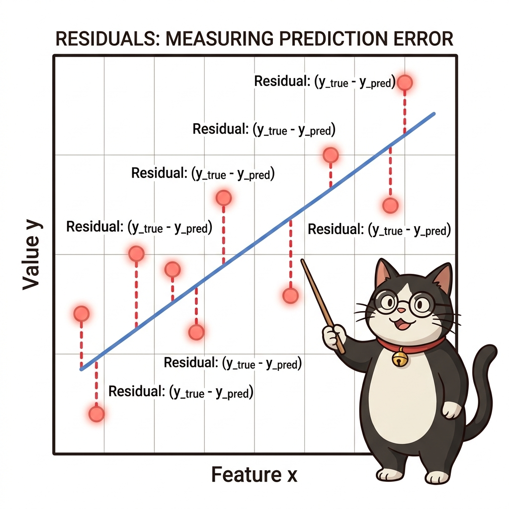

> **[강의 스크립트]**
> 각각의 데이터 포인트 아이에 대해 실제 정답 와이 아이에서 예측값 더블유 엑스 아이 더하기 비를 뺀 수직 거리가 바로 잔차입니다.

---

이 잔차들을 제곱하여 평균을 낸 것이 **평균 제곱 오차(MSE)** 손실 함수입니다:

***L* = (1 / *N*) · ∑<sub>*i*=1</sub><sup>*N*</sup> (*W* · *x*<sub>*i*</sub> + *b* - *y*<sub>*i*</sub>)<sup>2</sup>** &nbsp;&nbsp;&nbsp;&nbsp; *(식 11.3: 평균 제곱 오차, MSE)*

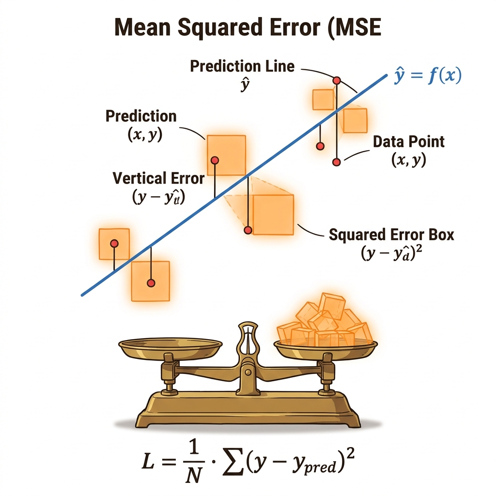

> **[강의 스크립트]**
> 모든 데이터에 대한 잔차들을 제곱하여 다 더한 뒤 데이터 수 엔으로 나눈 평균값이 식 십일점삼의 평균 제곱 오차 손실 함수 엘입니다. 기하학적으로는 오차 정사각형들의 면적 평균과 같습니다.

---

#### 💡 왜 잔차를 제곱(Square)해서 더할까요?
1. **부호 상쇄 방지**: 오차가 +3인 점과 -3인 점을 단순 합산하면 오차가 0이 되어 완벽한 모델로 착각하는 치명적인 오류를 막습니다.
2. **큰 오차에 대한 강력한 페널티**: 오차가 2배 커지면 손실은 4배로 폭발하므로, 극단적으로 빗나간 이상치를 강력하게 교정합니다.
3. **부드러운 미분 가능성**: 절댓값 함수와 달리 2차 포물선 형태이므로 모든 지점에서 매끄러운 미분(기울기)이 보장되어 경사 하강법에 가장 이상적입니다.

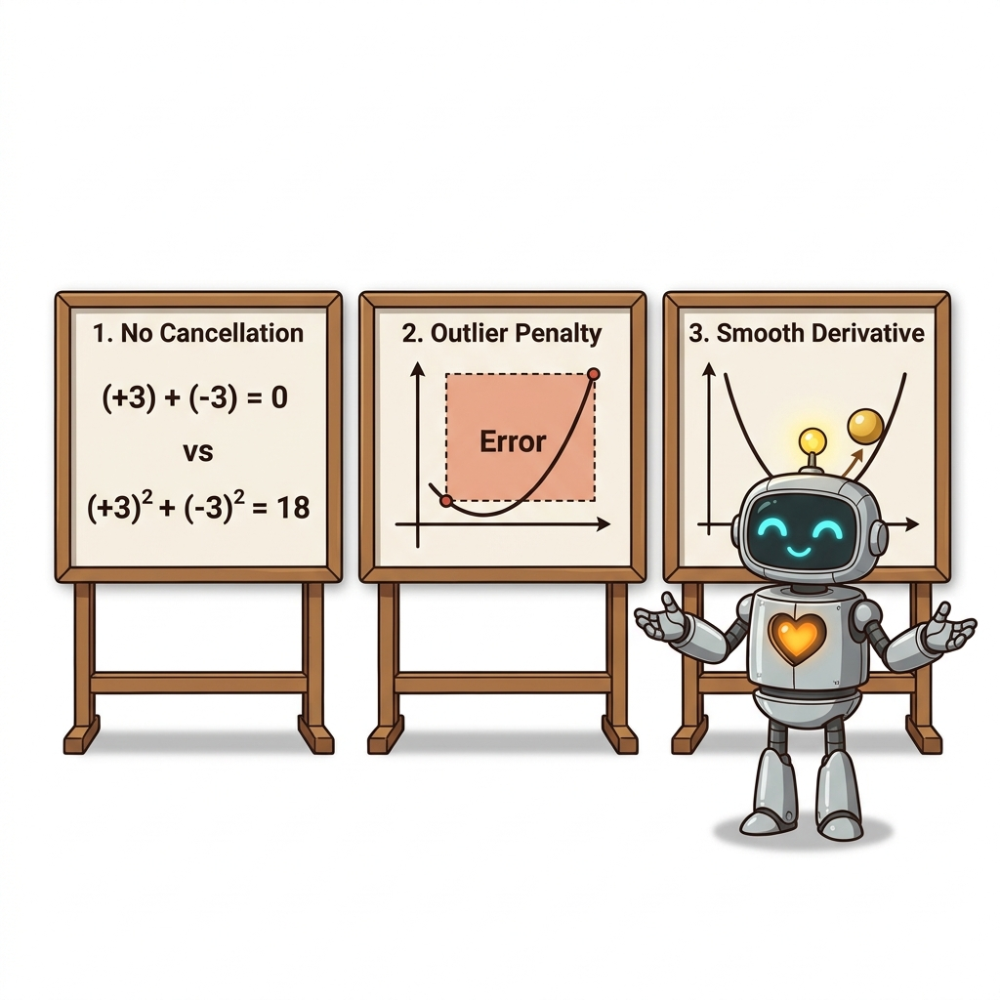

> **[강의 스크립트]**
> 왜 오차를 제곱해서 더할까요? 첫째, 양수와 음수 오차가 서로 상쇄되는 것을 막아줍니다. 둘째, 큰 오차에 제곱의 페널티를 주어 빗나간 예측을 강하게 교정합니다. 셋째, 모든 구간에서 매끄러운 이차 포물선 형태를 띠어 미분이 깔끔하게 계산되기 때문입니다.

---

우리의 목표는 이 손실 함수 $L$ 을 최소화하는 최적의 가중치 $W^*$ 와 편향 $b^*$ 를 경사 하강법으로 찾아내는 것입니다.


> **[강의 스크립트]**
> 우리의 명확한 목표는 손실 함수 엘을 최소화하는 최적의 파라미터 더블유 스타와 비 스타를 경사 하강법으로 찾아내는 것입니다.

---

## 11.2.3 배치 행렬 연산과 차원 형상(Shape)

100개의 데이터를 `for`문으로 하나씩 계산하면 속도가 매우 느립니다. 

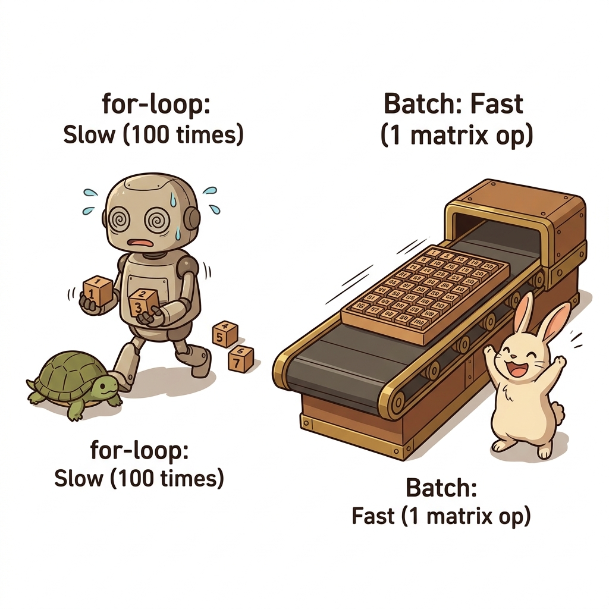

> **[강의 스크립트]**
> 십일점이점삼 절에서는 대용량 데이터의 연산 방식을 다룹니다. 파이썬의 포 루프로 데이터 백 개를 하나씩 연산하면 실행 속도가 현저히 떨어집니다.

---

딥러닝에서는 **행렬 곱(Matrix Multiplication)**을 이용해 100개의 데이터를 한 방에 일괄 처리(Batch Processing)합니다.

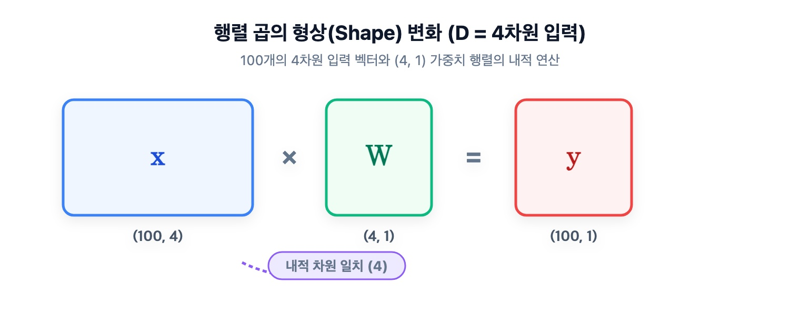
**그림 11-2-5** 행렬 곱 연산에서의 차원 형상 변환 (*N* × *D*) × (*D* × 1) = (*N* × 1)

> **[강의 스크립트]**
> 딥러닝에서는 행렬 곱을 이용하여 백 개의 데이터를 단 한 번의 연산으로 일괄 처리합니다. 그림 십일점이점오에서 보듯 엔 곱하기 디 행렬과 디 곱하기 일 가중치 행렬이 곱해져 엔 곱하기 일 형상의 예측 벡터가 즉시 만들어집니다.

---

- 데이터 행렬 **x**: (100, 1) 형상 (100개의 행, 1개의 특성)
- 가중치 행렬 **W**: (1, 1) 형상
- 편향 벡터 **b**: (1,) 형상 (브로드캐스팅에 의해 100개의 행에 자동으로 더해짐)

이 행렬 곱 `F.matmul(x, W) + b` 한 줄로 100개 데이터의 예측값 벡터 `y_pred` (100, 1)이 즉시 계산됩니다.

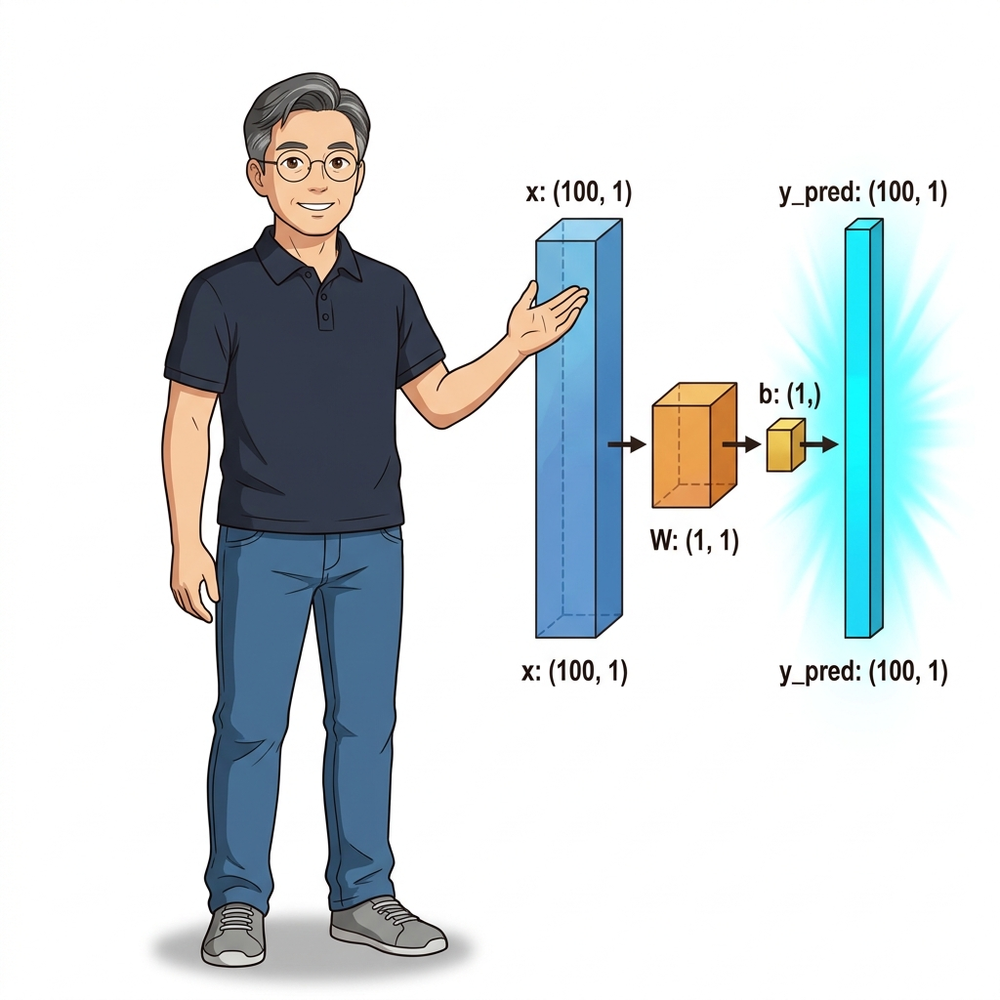

> **[강의 스크립트]**
> 데이터 행렬 엑스는 백 바이 일, 가중치 더블유는 일 바이 일 형상입니다. 편향 비는 브로드캐스팅을 통해 백 개의 행에 일괄적으로 더해집니다. 이 한 줄의 연산으로 백 개 데이터의 예측이 병렬로 끝납니다.

---

## 11.2.4 DeZero로 구현하는 선형 회귀

이제 DeZero 프레임워크를 사용하여 데이터 생성부터 경사 하강 학습까지 전체 파이프라인을 완성해 봅시다.

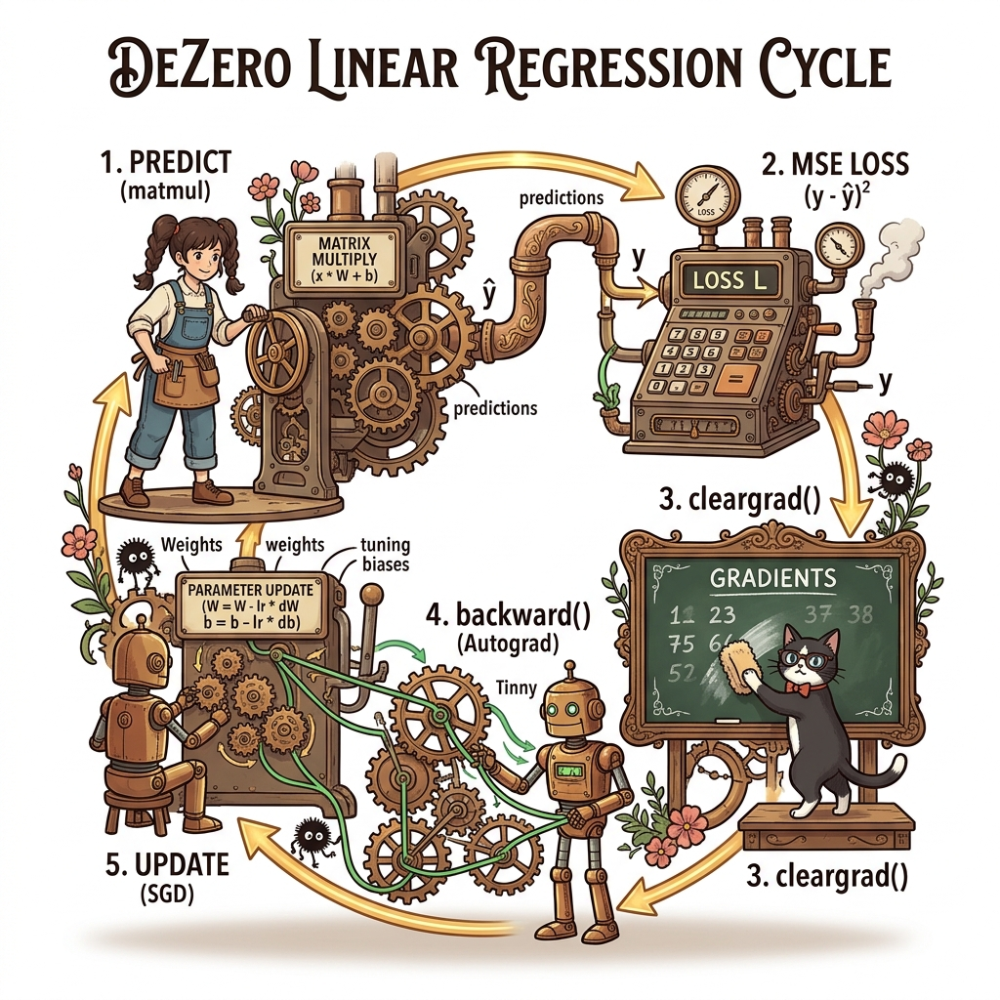

> **[강의 스크립트]**
> 십일점이점사 절에서는 디제로를 이용해 선형 회귀 전체 파이프라인을 파이썬 코드로 완성해 봅니다.

---

<div align="right"><b>ch07/dezero3.py</b></div>

```python
import numpy as np
from dezero import Variable
import dezero.functions as F

# 1. 토이 데이터셋 생성
np.random.seed(0)
x = np.random.rand(100, 1)
y = 5 + 2 * x + np.random.rand(100, 1)

# 2. 학습할 매개변수 W와 b를 Variable로 선언 (초깃값 0.0)
W = Variable(np.zeros((1, 1)))
b = Variable(np.zeros(1))

# 3. 선형 모델 예측 함수 정의
def predict(x):
    return F.matmul(x, W) + b

# 4. 평균 제곱 오차(MSE) 손실 함수 정의
def mean_squared_error(y_true, y_pred):
    diff = y_true - y_pred
    return F.sum(diff ** 2) / len(diff)

# 5. 경사 하강법 학습 루프
lr = 0.1          # 학습률
iters = 100       # 에포크 횟수

for i in range(iters):
    # 순전파: 예측값 및 손실 계산
    y_pred = predict(x)
    loss = mean_squared_error(y, y_pred)

    # 역전파 전 기울기 초기화
    W.cleargrad()
    b.cleargrad()

    # 역전파: dLoss/dW와 dLoss/db 자동 계산
    loss.backward()

    # 파라미터 경사 하강 갱신
    W.data -= lr * W.grad.data
    b.data -= lr * b.grad.data

    if i % 10 == 0:
        print(f"에포크 {i:02d} | 손실(MSE): {loss.data:.4f}")

print("=" * 30)
print("최종 학습된 W:", W.data)
print("최종 학습된 b:", b.data)
```

> **[강의 스크립트]**
> 구현 코드를 살펴보겠습니다. 더블유와 비를 베리어블로 선언하고 예측 함수와 평균 제곱 오차 손실 함수를 정의합니다. 그리고 백 회의 에포크 루프 안에서 순전파로 손실을 구하고, 클리어그레드 후 로스 점 백워드로 기울기를 계산하여 경사 하강법으로 파라미터를 갱신합니다.

---

**학습 진행 로그**:

```text
에포크 00 | 손실(MSE): 42.2963
에포크 10 | 손실(MSE): 0.2492
에포크 20 | 손실(MSE): 0.1008
에포크 30 | 손실(MSE): 0.0946
에포크 40 | 손실(MSE): 0.0903
에포크 50 | 손실(MSE): 0.0869
에포크 60 | 손실(MSE): 0.0844
에포크 70 | 손실(MSE): 0.0825
에포크 80 | 손실(MSE): 0.0810
에포크 90 | 손실(MSE): 0.0799
==============================
최종 학습된 W: [[2.11807369]]
최종 학습된 b: [5.46608905]
```

> **[강의 스크립트]**
> 출력 로그를 확인해 보십시오. 초기 손실 사십이점삼에서 단 십 에포크 만에 영점이사로 급격히 떨어지며, 최종적으로 영점영칠구구까지 매끄럽게 수렴합니다.

---

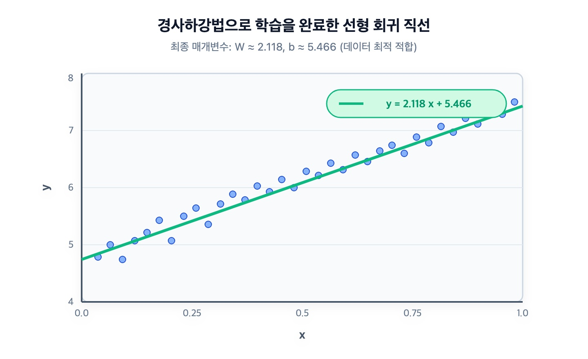
**그림 11-2-6** 100회 경사 하강 갱신 후 도출된 최종 예측 직선 *y* = 2.118*x* + 5.466. 노이즈 낀 데이터 점들의 중심을 자로 잰 듯 완벽하게 관통합니다.

> **[강의 스크립트]**
> 그림 십일점이점육은 백 회 학습 후 찾아낸 예측 직선입니다. 흩어져 있는 데이터 점들의 한가운데를 자로 잰 듯 정확히 관통하고 있습니다.

---

초기 손실 42.29에서 단 10회 만에 0.24로 급락하며 최종적으로 **0.0799**까지 수렴했습니다. 
도출된 가중치 **$W = 2.118$** 과 편향 **$b = 5.466$** 은 우리가 처음에 노이즈를 섞어 만든 참 모델(기울기 2.0, 절편 5.5)과 거의 완벽하게 일치합니다!

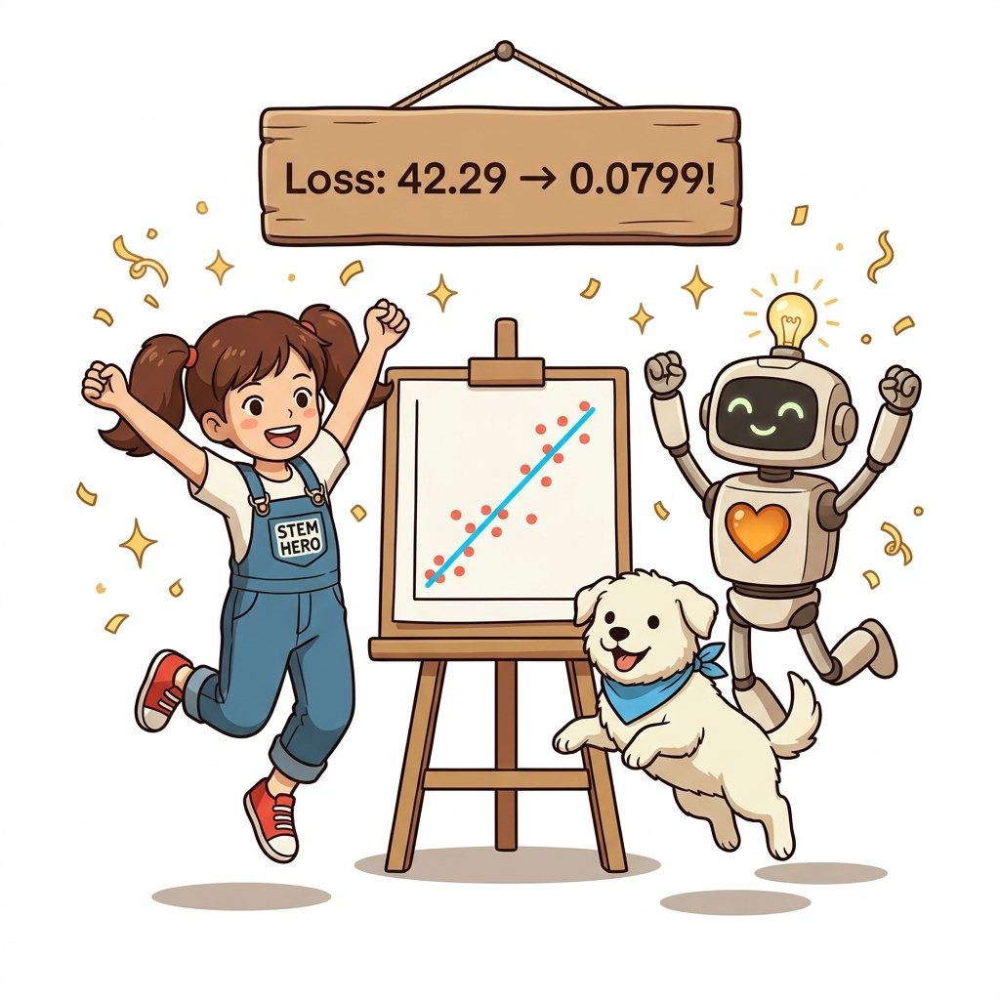

> **[강의 스크립트]**
> 학습 결과 도출된 가중치 이점일일팔과 편향 오점사육육은, 우리가 처음에 노이즈를 섞어 생성했던 참값인 기울기 이점영과 절편 오점오에 놀라울 정도로 완벽하게 근접했습니다. 컴퓨터가 스스로 규칙을 찾아낸 것입니다.

---

## 11.2.5 선형 회귀에서 강화학습으로 이어지는 실마리

선형 회귀에서 배운 이 단순한 루프는 **딥 강화학습(DQN)**의 학습 메커니즘과 본질적으로 같습니다:


> **[강의 스크립트]**
> 십일점이점오 절에서는 선형 회귀에서 배운 이 루프가 딥 강화학습으로 어떻게 직결되는지 그 사상적 연결고리를 조명합니다.

---

1. **상태 입력**: 환경의 상태 *S*가 입력 *x*로 주어집니다.


> **[강의 스크립트]**
> 일단계로 환경의 상태 에스가 회귀 문제의 입력 엑스 역할을 합니다.

---

2. **Q 예측**: 신경망 모델이 각 행동의 Q값을 예측합니다 (`Q_pred = predict(state)`).


> **[강의 스크립트]**
> 이단계로 신경망 모델이 현재 상태에 대한 행동 가치 큐를 예측값으로 출력합니다.

---

3. **TD 타깃 정답**: 환경에서 받은 즉각 보상과 다음 상태 최댓값으로 정답 레이블을 만듭니다 (`target = R + γ max Q(S', a')`).

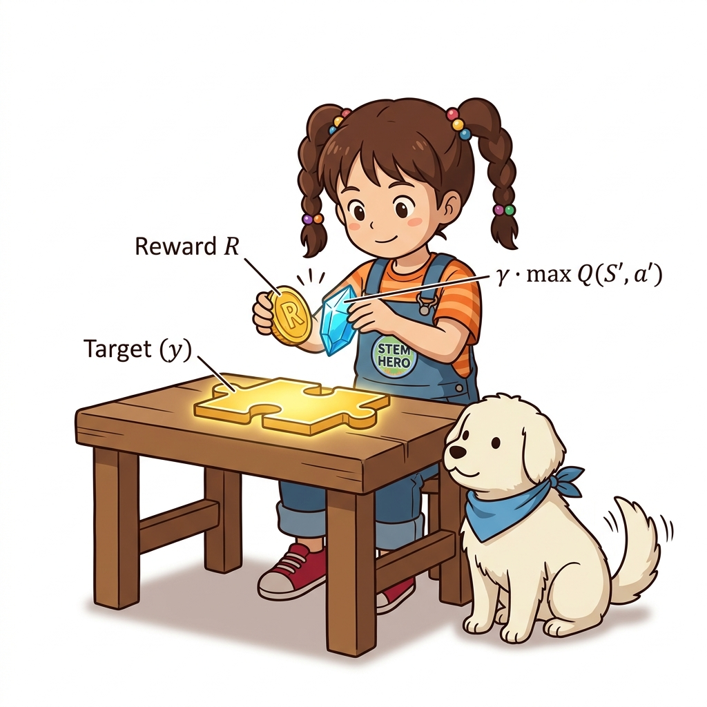

> **[강의 스크립트]**
> 삼단계로 벨만 방정식을 통해 즉각 보상과 미래 가치를 더해 정답 역할을 하는 티디 타깃을 구성합니다.

---

4. **MSE 손실 역전파**: 예측 Q값과 타깃 사이의 MSE 손실을 구하고 `loss.backward()`로 신경망 가중치를 업데이트합니다!

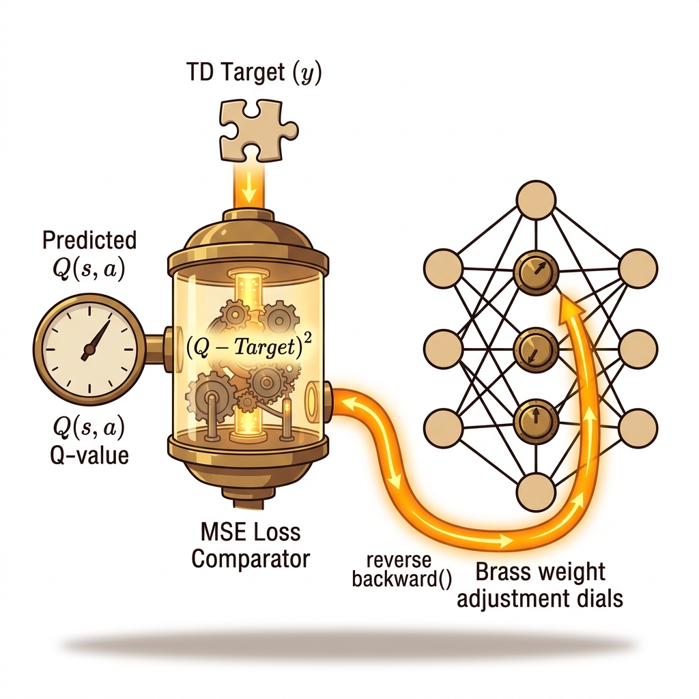

> **[강의 스크립트]**
> 사단계로 예측 큐값과 티디 타깃 사이의 평균 제곱 오차를 구하고 로스 점 백워드로 신경망 가중치를 갱신합니다. 강화학습이 곧 회귀 문제로 치환되는 순간입니다.

---

하지만 현실 세계의 복잡한 물리 법칙과 게임 전략은 직선 하나만으로는 결코 표현할 수 없습니다. 


> **[강의 스크립트]**
> 하지만 현실의 복잡한 물리 법칙이나 고난도 의사결정은 하나의 직선 모델만으로는 표현할 수 없는 비선형성을 지니고 있습니다.

---

곡선과 꺾은선, 복잡한 비선형 관계를 자유자재로 그려내기 위해, 다음 절에서는 **활성화 함수(Activation Function)**를 탑재한 진짜 **인공신경망(Neural Network)**으로 진화해 봅시다!


> **[강의 스크립트]**
> 따라서 우리는 굴곡진 곡선과 복잡한 패턴을 유연하게 표현할 수 있는 비선형 활성화 함수를 도입해야 합니다. 다음 절에서는 다층 인공신경망 아키텍처로 도약해 보겠습니다.
